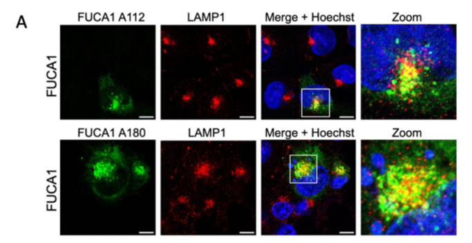

## Question

# Gene Research for Functional Annotation

## ⚠️ CRITICAL: Gene/Protein Identification Context

**BEFORE YOU BEGIN RESEARCH:** You MUST verify you are researching the CORRECT gene/protein. Gene symbols can be ambiguous, especially for less well-characterized genes from non-model organisms.

### Target Gene/Protein Identity (from UniProt):
- **UniProt Accession:** P04066
- **Protein Description:** RecName: Full=Tissue alpha-L-fucosidase {ECO:0000305}; EC=3.2.1.51 {ECO:0000305|PubMed:9741689}; AltName: Full=Alpha-L-fucosidase I; AltName: Full=Alpha-L-fucoside fucohydrolase 1; Short=Alpha-L-fucosidase 1; Flags: Precursor;
- **Gene Information:** Name=FUCA1 {ECO:0000312|HGNC:HGNC:4006}; ORFNames=Nbla10230;
- **Organism (full):** Homo sapiens (Human).
- **Protein Family:** Belongs to the glycosyl hydrolase 29 family. .
- **Key Domains:** FUC_metazoa-typ. (IPR016286); Fucosidase_C. (IPR031919); GH_hydrolase_sf. (IPR017853); Glyco_hydro_29. (IPR000933); Glyco_hydro_29_CS. (IPR018526)

### MANDATORY VERIFICATION STEPS:

1. **Check if the gene symbol "FUCA1" matches the protein description above**
2. **Verify the organism is correct:** Homo sapiens (Human).
3. **Check if protein family/domains align with what you find in literature**
4. **If you find literature for a DIFFERENT gene with the same or similar symbol, STOP**

### If Gene Symbol is Ambiguous or You Cannot Find Relevant Literature:

**DO NOT PROCEED WITH RESEARCH ON A DIFFERENT GENE.** Instead:
- State clearly: "The gene symbol 'FUCA1' is ambiguous or literature is limited for this specific protein"
- Explain what you found (e.g., "Found extensive literature on a different gene with the same symbol in a different organism")
- Describe the protein based ONLY on the UniProt information provided above
- Suggest that the protein function can be inferred from domain/family information

### Research Target:

Please provide a comprehensive research report on the gene **FUCA1** (gene ID: FUCA1, UniProt: P04066) in human.

The research report should be a detailed narrative explaining the function, biological processes, and localization of the gene product. Citations should be given for all claims.

You should prioritize authoritative reviews and primary scientific literature when conducting research. You can supplement
this with annotations you find in gene/protein databases, but these can be outdated or inaccurate.

We are specifically interested in the primary function of the gene - for enzymes, what reaction is catalyzed, and what is the substrate specificity? For transporters, what is the substrate? For structural proteins or adapters, what is the broader structural role? For signaling molecules, what is the role in the pathway.

We are interested in where in or outside the cell the gene product carries out its function.

We are also interested in the signaling or biochemical pathways in which the gene functions. We are less interested in broad pleiotropic effects, except where these elucidate the precise role.

Include evidence where possible. We are interested in both experimental evidence as well as inference from structure, evolution, or bioinformatic analysis. Precise studies should be prioritized over high-throughput, where available.

## Output

Question: You are an expert researcher providing comprehensive, well-cited information.

Provide detailed information focusing on:
1. Key concepts and definitions with current understanding
2. Recent developments and latest research (prioritize 2023-2024 sources)
3. Current applications and real-world implementations
4. Expert opinions and analysis from authoritative sources
5. Relevant statistics and data from recent studies

Format as a comprehensive research report with proper citations. Include URLs and publication dates where available.
Always prioritize recent, authoritative sources and provide specific citations for all major claims.

# Gene Research for Functional Annotation

## ⚠️ CRITICAL: Gene/Protein Identification Context

**BEFORE YOU BEGIN RESEARCH:** You MUST verify you are researching the CORRECT gene/protein. Gene symbols can be ambiguous, especially for less well-characterized genes from non-model organisms.

### Target Gene/Protein Identity (from UniProt):
- **UniProt Accession:** P04066
- **Protein Description:** RecName: Full=Tissue alpha-L-fucosidase {ECO:0000305}; EC=3.2.1.51 {ECO:0000305|PubMed:9741689}; AltName: Full=Alpha-L-fucosidase I; AltName: Full=Alpha-L-fucoside fucohydrolase 1; Short=Alpha-L-fucosidase 1; Flags: Precursor;
- **Gene Information:** Name=FUCA1 {ECO:0000312|HGNC:HGNC:4006}; ORFNames=Nbla10230;
- **Organism (full):** Homo sapiens (Human).
- **Protein Family:** Belongs to the glycosyl hydrolase 29 family. .
- **Key Domains:** FUC_metazoa-typ. (IPR016286); Fucosidase_C. (IPR031919); GH_hydrolase_sf. (IPR017853); Glyco_hydro_29. (IPR000933); Glyco_hydro_29_CS. (IPR018526)

### MANDATORY VERIFICATION STEPS:

1. **Check if the gene symbol "FUCA1" matches the protein description above**
2. **Verify the organism is correct:** Homo sapiens (Human).
3. **Check if protein family/domains align with what you find in literature**
4. **If you find literature for a DIFFERENT gene with the same or similar symbol, STOP**

### If Gene Symbol is Ambiguous or You Cannot Find Relevant Literature:

**DO NOT PROCEED WITH RESEARCH ON A DIFFERENT GENE.** Instead:
- State clearly: "The gene symbol 'FUCA1' is ambiguous or literature is limited for this specific protein"
- Explain what you found (e.g., "Found extensive literature on a different gene with the same symbol in a different organism")
- Describe the protein based ONLY on the UniProt information provided above
- Suggest that the protein function can be inferred from domain/family information

### Research Target:

Please provide a comprehensive research report on the gene **FUCA1** (gene ID: FUCA1, UniProt: P04066) in human.

The research report should be a detailed narrative explaining the function, biological processes, and localization of the gene product. Citations should be given for all claims.

You should prioritize authoritative reviews and primary scientific literature when conducting research. You can supplement
this with annotations you find in gene/protein databases, but these can be outdated or inaccurate.

We are specifically interested in the primary function of the gene - for enzymes, what reaction is catalyzed, and what is the substrate specificity? For transporters, what is the substrate? For structural proteins or adapters, what is the broader structural role? For signaling molecules, what is the role in the pathway.

We are interested in where in or outside the cell the gene product carries out its function.

We are also interested in the signaling or biochemical pathways in which the gene functions. We are less interested in broad pleiotropic effects, except where these elucidate the precise role.

Include evidence where possible. We are interested in both experimental evidence as well as inference from structure, evolution, or bioinformatic analysis. Precise studies should be prioritized over high-throughput, where available.

# Human FUCA1 (UniProt P04066): functional annotation research report

## Identity and principal function

**Identity verified.** Human **FUCA1** encodes *tissue α-L-fucosidase* (EC 3.2.1.51), a glycoside hydrolase family 29 (GH29) enzyme. The human sequence identified as FUCA1 in a comparative primary study is NP_000138, and the study associates its structural sequence with accession **P04066**. Its GH29 assignment agrees with the glycosyl-hydrolase and fucosidase domains specified in the question. FUCA1 must not be confused with the related human **FUCA2** (NP_114409; Q9BTY2): the proteins share approximately **55% sequence identity**, but FUCA1 is the experimentally established enzyme responsible for bulk lysosomal α-L-fucosidase activity. (baumges2025decipheringαlfucosidaseactivity pages 2-4, baumges2025decipheringαlfucosidaseactivity pages 1-2)

**Primary reaction:** FUCA1 hydrolyzes an α-L-fucosidic bond at the nonreducing end of a fucosylated glycoconjugate, releasing free L-fucose and the defucosylated remainder. Relevant substrates arise during degradation of fucosylated **N- and O-glycans, glycoproteins, and glycolipids**. Its reported linkage scope includes **α1,2, α1,3, α1,4, and α1,6** fucose. This is evidence of broad cleavage capacity, **not** a demonstrated quantitative ranking of its rates on every intact human glycoconjugate. Recombinant human FUCA1 hydrolyzes the diagnostic artificial substrates 4-methylumbelliferyl-α-L-fucopyranoside (*4-MUF*) and p-nitrophenyl-α-L-fucopyranoside (*pNPF*); these assays establish activity but cannot, by themselves, identify the preferred physiological substrate. Bäumges *et al.*, published **30 August 2025**, https://doi.org/10.3390/cells14171355. (baumges2025decipheringαlfucosidaseactivity pages 1-2, baumges2025decipheringαlfucosidaseactivity pages 13-15)

The most persuasive evidence for its **physiological substrate class** is the consequence of human FUCA1 deficiency: fucosidosis causes storage of fucosylated glycans and glycolipids, prominently the core-fucosylated glycoasparagine **Fuc(α1,6)GlcNAcβ1-Asn**. That metabolite supports a role in completing lysosomal degradation of core-fucosylated N-glycans; storage in patients should not be mistaken for a measured kinetic preference of purified FUCA1. (baumges2025decipheringαlfucosidaseactivity pages 1-2, chkioua2021fucosidosisintunisian pages 1-2)

## Where the reaction occurs and how FUCA1 arrives there

The **lysosomal lumen is the established principal site of action**. FUCA1 is synthesized as a signal-peptide-containing precursor, enters the secretory pathway, and acquires N-linked glycans bearing **mannose 6-phosphate (M6P)**, a lysosomal-targeting signal. The 2025 human-cell study detected FUCA1 in LAMP1-positive vesicles and in endogenous lysosome-enriched fractions. Deleting **GNPTAB**, which is needed to generate M6P targeting signals, reduced FUCA1 in lysosome-enriched fractions and increased its missorting into culture medium. Its microscopy and biochemical panels provide complementary evidence for localization and targeting, respectively. (baumges2025decipheringαlfucosidaseactivity pages 1-2, baumges2025decipheringαlfucosidaseactivity pages 10-13, baumges2025decipheringαlfucosidaseactivity media f3bacd7b, baumges2025decipheringαlfucosidaseactivity media 138e5d61)

An **extra-lysosomal pool remains plausible but less well defined**. In a 2016 study, overexpressed FUCA1 occupied perinuclear structures that did not substantially overlap with LysoTracker, and immunopurified enzyme retained activity near neutral pH, with a reported optimum near **pH 6.7** under that study’s assay conditions. The 2025 study subsequently detected recombinant FUCA1 activity at **pH 5.5, 6.5, and 7.5** with artificial substrates. Thus, pH activity does not overturn direct evidence for lysosomal targeting, and overexpression microscopy does not establish the precise identity or physiological importance of another compartment. Ezawa *et al.*, **2016**, https://doi.org/10.1111/cas.12933; Bäumges *et al.*, **2025**, https://doi.org/10.3390/cells14171355. (baumges2025decipheringαlfucosidaseactivity pages 13-15, baumges2025decipheringαlfucosidaseactivity pages 10-13, ezawa2016novelp53target pages 5-7)

## Biochemical pathway, structure, and paralog distinction

FUCA1 acts in **lysosomal glycoconjugate catabolism**, removing fucose so that glycan-derived material can be further cleared. Released fucose may subsequently supply the **GDP-fucose salvage pathway**, but FUCA1 neither synthesizes GDP-fucose nor adds fucose to glycans. Free fucose is processed downstream by fucokinase **FCSK** and GDP-fucose pyrophosphorylase **FPGT**; a **2024** HEK293T study of salvage/de novo pathway interplay manipulated these synthesis enzymes, **not FUCA1**, so its quantitative GDP-fucose results should not be attributed to a FUCA1 experiment. Skurska and Olczak, **October 2024**, https://doi.org/10.1371/journal.pone.0309450. (skurska2024interplaybetweende pages 1-2, skurska2024interplaybetweende pages 2-4, skurska2024interplaybetweende pages 4-5)

Structural work supports a catalytic, rather than scaffolding, role. A human FUCA1 cryo-EM study reported a **homotetramer** and implicated catalytic aspartates; a subsequent human-enzyme analysis discusses **D230** as the proposed nucleophile and **D281** as the proposed acid/base residue. The original structural report is Armstrong *et al.*, **2022**, “Cryo-EM structures of human fucosidase FucA1 reveal insight into substrate recognition and catalysis,” https://doi.org/10.1016/j.str.2022.07.001. The residue assignments here are reported through the accessible 2025 analysis rather than independently reanalyzed cryo-EM data; historical catalytic assignments used other numbering and should not be interchanged without sequence alignment. Bäumges *et al.*, **2025**, https://doi.org/10.3390/cells14171355. (baumges2025decipheringαlfucosidaseactivity pages 15-17, baumges2025decipheringαlfucosidaseactivity pages 1-2, baumges2025decipheringαlfucosidaseactivity pages 18-20, wang2026casereporta pages 7-7)

The paralog comparison materially changes an older simplification: **FUCA2 is not exclusively a secreted plasma protein**. The 2025 study found that FUCA2 also reaches lysosomes through M6P-dependent sorting. Nevertheless, across expressed, differently tagged, and purified preparations, **FUCA1—but not FUCA2—produced detectable hydrolysis of the standard 4-MUF and pNPF substrates**. This supports FUCA1 as the established bulk lysosomal enzyme; it does **not** prove that FUCA2 lacks activity toward every possible natural substrate. Bäumges *et al.*, **2025**, https://doi.org/10.3390/cells14171355. (baumges2025decipheringαlfucosidaseactivity pages 2-4, baumges2025decipheringαlfucosidaseactivity pages 13-15, baumges2025decipheringαlfucosidaseactivity pages 10-13)

The following evidence summary separates direct observations from pathway inference and proposed signaling functions.

| Annotation | Direct human evidence | Important qualification and source publication year + DOI URL |
|---|---|---|
| **Catalytic hydrolysis** | Human FUCA1 is an EC 3.2.1.51 GH29 α-L-fucosidase that releases terminal α-L-fucose from glycoconjugates. Literature supports cleavage of α1,2-, α1,3-, α1,4-, and α1,6-linked substrates; recombinant human FUCA1 hydrolyzed 4-MUF and pNPF in mammalian-cell assays. (baumges2025decipheringαlfucosidaseactivity pages 1-2, baumges2025decipheringαlfucosidaseactivity pages 13-15) | These data establish broad linkage capability, **not a quantitative kinetic ranking** among natural linkages. FUCA2 is a separate, lysosome-targeted homolog but lacked detectable activity toward these standard pseudo-substrates. Bäumges et al., 2025: [10.3390/cells14171355](https://doi.org/10.3390/cells14171355). (baumges2025decipheringαlfucosidaseactivity pages 2-4, baumges2025decipheringαlfucosidaseactivity pages 13-15) |
| **Lysosomal localization and M6P targeting** | FUCA1 partially colocalized with LAMP1; endogenous FUCA1 was detected in lysosome-enriched human-cell fractions. GNPTAB knockout reduced lysosomal FUCA1 and increased missorting/secretion, directly supporting mannose-6-phosphate-dependent targeting. (baumges2025decipheringαlfucosidaseactivity pages 10-13, baumges2025decipheringαlfucosidaseactivity media f3bacd7b) | FUCA1 is synthesized through the secretory pathway as an N-glycosylated precursor, so ER, Golgi, endosomal, extracellular, or other pools can occur. FUCA2 is also M6P-dependent and lysosomal—not exclusively secreted. Bäumges et al., 2025: [10.3390/cells14171355](https://doi.org/10.3390/cells14171355). (baumges2025decipheringαlfucosidaseactivity pages 2-4, baumges2025decipheringαlfucosidaseactivity pages 10-13) |
| **Storage product and human genetics** | FUCA1 deficiency causes fucosidosis, with accumulation of fucosylated glycoconjugates—particularly **Fuc(α1,6)GlcNAcβ1-Asn**. Sequencing of three Tunisian patients identified four novel variants: p.K57Sfs*75, p.F77Sfs*55, p.G332E, and c.662+5G>C; p.G332E was modeled near the catalytic region. (baumges2025decipheringαlfucosidaseactivity pages 1-2, chkioua2021fucosidosisintunisian pages 1-2) | Accumulation in genetically deficient humans is strong evidence for the physiological lysosomal substrate class, while the modeled effect of p.G332E is inferential rather than a purified-mutant kinetic result. Chkioua et al., 2021: [10.1186/s12920-021-01061-3](https://doi.org/10.1186/s12920-021-01061-3); Bäumges et al., 2025: [10.3390/cells14171355](https://doi.org/10.3390/cells14171355). |
| **p53–FUCA1–EGFR signaling** | A p53-responsive element in FUCA1 intron 1 drove p53-dependent reporter activation. Ectopic FUCA1 reduced α1,6-fucosylation of immunoprecipitated EGFR and attenuated EGF-induced Akt phosphorylation; inactive fucosidosis variants did not reproduce wild-type enzyme activity. (ezawa2016novelp53target pages 5-7, ezawa2016novelp53target pages 7-9) | This is a proposed context-dependent, partly extra-lysosomal signaling function based mainly on cultured-cell overexpression and lectin assays; it does not supersede the established lysosomal catabolic role, and the precise EGFR glycosite was not identified. Ezawa et al., 2016: [10.1111/cas.12933](https://doi.org/10.1111/cas.12933). |
| **Fucose salvage—indirect contribution** | FUCA1 can supply free fucose by lysosomal glycoconjugate degradation; downstream FCSK and FPGT—not FUCA1—convert free fucose through the salvage route toward GDP-fucose. (skurska2024interplaybetweende pages 1-2, becker2003fucosebiosynthesisand pages 7-8) | Skurska and Olczak manipulated GMDS, TSTA3, and FCSK in HEK293T cells but did **not** directly manipulate or assay FUCA1. Their study supplies pathway context rather than direct FUCA1 evidence. Skurska & Olczak, 2024: [10.1371/journal.pone.0309450](https://doi.org/10.1371/journal.pone.0309450). (skurska2024interplaybetweende pages 8-10, skurska2024interplaybetweende pages 2-4, skurska2024interplaybetweende pages 4-5) |

*Table: Evidence-ranked functional annotations for human FUCA1/P04066, separating direct biochemical, localization, genetic, and signaling findings from pathway inference and experimental limitations.*

## Disease evidence, emerging signaling role, and applications

**Human loss-of-function evidence.** Biallelic FUCA1 defects cause **fucosidosis**, an autosomal-recessive lysosomal storage disorder characterized by markedly impaired α-L-fucosidase activity and progressive neurological and systemic disease. In a **2021** primary study of **three affected individuals from three Tunisian families**, severe disease accompanied two homozygous early frameshifts, whereas a milder case carried **p.G332E** and a splice-region variant; the proposed structural effect of p.G332E was modeled, not established by a purified-mutant kinetic experiment. Chkioua *et al.*, https://doi.org/10.1186/s12920-021-01061-3. A **2025** report of **three patients from two families** added a homozygous **p.Trp79*** variant and a **64.5-kb deletion** encompassing FUCA1 and neighboring genes, illustrating why genomic context matters when interpreting phenotype. Kılıç *et al.*, https://doi.org/10.24953/turkjpediatr.2025.6009. (chkioua2021fucosidosisintunisian pages 1-2, kılıc2025novel&lt;i&gt;fuca1&lt;i&gt;variants pages 1-3)

A **2024 Cuban case series** used leukocyte α-L-fucosidase testing to study **19 diagnosed patients**: **84.2%** had angiokeratomas, **52.7%** had infant-onset psychomotor delay with rapid neurological deterioration, and **42.1%** died between ages 10 and 20. These are **case-series proportions, not population prevalence estimates**. They illustrate the clinical consequences of deficient degradation rather than an additional catalytic function. Tamayo-Chang and Pérez-Benítez, **July 2024**, https://revfinlay.sld.cu/index.php/finlay/article/view/1385. (chang2024fenotipoclínicode pages 1-2)

**Proposed signaling function.** Cultured-cell experiments identify FUCA1 as a **p53-induced gene**: p53 activated a reporter bearing a FUCA1 intron-1 response element, but not one bearing a disrupted element. FUCA1 expression reduced lectin-detected **α1,6-fucosylation of immunoprecipitated EGFR** and attenuated EGF-induced Akt signaling; enzymatically defective FUCA1 variants did not reproduce wild-type enzyme activity. This is a credible *context-dependent hypothesis* that defucosylation can modify receptor signaling, but the precise EGFR glycosite, the compartment in which EGFR is modified, and the generality of the mechanism in patients are unresolved. Ezawa *et al.*, **2016**, https://doi.org/10.1111/cas.12933. A **2024 expert review** notes inconsistent effects of FUCA1 manipulation on cancer-cell viability across models; cancer associations should therefore **not** displace its well-established lysosomal catabolic annotation. Hu *et al.*, **August 2024**, https://doi.org/10.3390/cancers16152753. (ezawa2016novelp53target pages 5-7, ezawa2016novelp53target pages 7-9, hu2024fuca1anunderexplored pages 15-17)

**Real-world use and treatment status.** FUCA1 function is applied clinically through **α-L-fucosidase activity assays** in patient material, often alongside urinary glycan/glycopeptide assessment and confirmatory **FUCA1 sequencing**. There is **no established curative therapy** for fucosidosis. Supportive care is the principal routine approach; hematopoietic-cell transplantation has limited human case-level experience, whereas enzyme replacement and gene-therapy strategies remain developmental, with central-nervous-system delivery a major concern. Experimental fluorogenic substrates also enable cellular FUCA1 activity measurements and inhibitor screening, but these are research tools rather than treatments. Pekdemir *et al.*, **January 2025**, https://doi.org/10.3390/ijms26010353; Miura *et al.*, **2019**, https://doi.org/10.1021/acsmedchemlett.9b00259. (pekdemir2025fucosidosisareview pages 9-10, pekdemir2025fucosidosisareview pages 15-16, chang2024fenotipoclínicode pages 1-2)

**Functional annotation conclusion:** annotate human **FUCA1/P04066 primarily as an M6P-targeted, lysosomal GH29 α-L-fucosidase that hydrolyzes terminal α-linked L-fucose during glycoconjugate degradation**. Fucosidosis genetics and substrate storage establish the physiological importance of this reaction. Treat fucose salvage as a downstream consequence and p53–EGFR regulation as an interesting, less settled extension—not as FUCA1’s primary biochemical function. (baumges2025decipheringαlfucosidaseactivity pages 1-2, baumges2025decipheringαlfucosidaseactivity pages 10-13, skurska2024interplaybetweende pages 1-2, hu2024fuca1anunderexplored pages 15-17)

References

1. (baumges2025decipheringαlfucosidaseactivity pages 2-4): Hannah Bäumges, Svenja Jelinek, Heike Lange, Sandra Markmann, Emanuela Capriotti, Jan Anwar Häusser, Mai-Britt Ilse, Thomas Braulke, and Torben Lübke. Deciphering α-l-fucosidase activity contribution in human and mouse: tissue α-l-fucosidase fuca1 meets plasma α-l-fucosidase fuca2. Cells, 14:1355, Aug 2025. URL: https://doi.org/10.3390/cells14171355, doi:10.3390/cells14171355. This article has 6 citations.

2. (baumges2025decipheringαlfucosidaseactivity pages 1-2): Hannah Bäumges, Svenja Jelinek, Heike Lange, Sandra Markmann, Emanuela Capriotti, Jan Anwar Häusser, Mai-Britt Ilse, Thomas Braulke, and Torben Lübke. Deciphering α-l-fucosidase activity contribution in human and mouse: tissue α-l-fucosidase fuca1 meets plasma α-l-fucosidase fuca2. Cells, 14:1355, Aug 2025. URL: https://doi.org/10.3390/cells14171355, doi:10.3390/cells14171355. This article has 6 citations.

3. (baumges2025decipheringαlfucosidaseactivity pages 13-15): Hannah Bäumges, Svenja Jelinek, Heike Lange, Sandra Markmann, Emanuela Capriotti, Jan Anwar Häusser, Mai-Britt Ilse, Thomas Braulke, and Torben Lübke. Deciphering α-l-fucosidase activity contribution in human and mouse: tissue α-l-fucosidase fuca1 meets plasma α-l-fucosidase fuca2. Cells, 14:1355, Aug 2025. URL: https://doi.org/10.3390/cells14171355, doi:10.3390/cells14171355. This article has 6 citations.

4. (chkioua2021fucosidosisintunisian pages 1-2): Latifa Chkioua, Yessine Amri, Sahli Chaima, Ferdawes Fenni, Hela Boudabous, Hadhami Ben Turkia, Taieb Messaoud, Neji Tebib, and Sandrine Laradi. Fucosidosis in tunisian patients: mutational analysis and homology-based modeling of fuca1 enzyme. BMC Medical Genomics, Aug 2021. URL: https://doi.org/10.1186/s12920-021-01061-3, doi:10.1186/s12920-021-01061-3. This article has 17 citations and is from a peer-reviewed journal.

5. (baumges2025decipheringαlfucosidaseactivity pages 10-13): Hannah Bäumges, Svenja Jelinek, Heike Lange, Sandra Markmann, Emanuela Capriotti, Jan Anwar Häusser, Mai-Britt Ilse, Thomas Braulke, and Torben Lübke. Deciphering α-l-fucosidase activity contribution in human and mouse: tissue α-l-fucosidase fuca1 meets plasma α-l-fucosidase fuca2. Cells, 14:1355, Aug 2025. URL: https://doi.org/10.3390/cells14171355, doi:10.3390/cells14171355. This article has 6 citations.

6. (baumges2025decipheringαlfucosidaseactivity media f3bacd7b): Hannah Bäumges, Svenja Jelinek, Heike Lange, Sandra Markmann, Emanuela Capriotti, Jan Anwar Häusser, Mai-Britt Ilse, Thomas Braulke, and Torben Lübke. Deciphering α-l-fucosidase activity contribution in human and mouse: tissue α-l-fucosidase fuca1 meets plasma α-l-fucosidase fuca2. Cells, 14:1355, Aug 2025. URL: https://doi.org/10.3390/cells14171355, doi:10.3390/cells14171355. This article has 6 citations.

7. (baumges2025decipheringαlfucosidaseactivity media 138e5d61): Hannah Bäumges, Svenja Jelinek, Heike Lange, Sandra Markmann, Emanuela Capriotti, Jan Anwar Häusser, Mai-Britt Ilse, Thomas Braulke, and Torben Lübke. Deciphering α-l-fucosidase activity contribution in human and mouse: tissue α-l-fucosidase fuca1 meets plasma α-l-fucosidase fuca2. Cells, 14:1355, Aug 2025. URL: https://doi.org/10.3390/cells14171355, doi:10.3390/cells14171355. This article has 6 citations.

8. (ezawa2016novelp53target pages 5-7): Issei Ezawa, Yuichiro Sawai, Tatsuya Kawase, Atsushi Okabe, Shuichi Tsutsumi, Hitoshi Ichikawa, Yuka Kobayashi, Fumio Tashiro, Hideo Namiki, Tadashi Kondo, Kentaro Semba, Hiroyuki Aburatani, Yoichi Taya, Hitoshi Nakagama, and Rieko Ohki. Novel p53 target gene fuca1 encodes a fucosidase and regulates growth and survival of cancer cells. Cancer Science, 107:734-745, May 2016. URL: https://doi.org/10.1111/cas.12933, doi:10.1111/cas.12933. This article has 80 citations and is from a peer-reviewed journal.

9. (skurska2024interplaybetweende pages 1-2): Edyta Skurska and Mariusz Olczak. Interplay between de novo and salvage pathways of gdp-fucose synthesis. PLOS ONE, 19:e0309450, Oct 2024. URL: https://doi.org/10.1371/journal.pone.0309450, doi:10.1371/journal.pone.0309450. This article has 12 citations and is from a peer-reviewed journal.

10. (skurska2024interplaybetweende pages 2-4): Edyta Skurska and Mariusz Olczak. Interplay between de novo and salvage pathways of gdp-fucose synthesis. PLOS ONE, 19:e0309450, Oct 2024. URL: https://doi.org/10.1371/journal.pone.0309450, doi:10.1371/journal.pone.0309450. This article has 12 citations and is from a peer-reviewed journal.

11. (skurska2024interplaybetweende pages 4-5): Edyta Skurska and Mariusz Olczak. Interplay between de novo and salvage pathways of gdp-fucose synthesis. PLOS ONE, 19:e0309450, Oct 2024. URL: https://doi.org/10.1371/journal.pone.0309450, doi:10.1371/journal.pone.0309450. This article has 12 citations and is from a peer-reviewed journal.

12. (baumges2025decipheringαlfucosidaseactivity pages 15-17): Hannah Bäumges, Svenja Jelinek, Heike Lange, Sandra Markmann, Emanuela Capriotti, Jan Anwar Häusser, Mai-Britt Ilse, Thomas Braulke, and Torben Lübke. Deciphering α-l-fucosidase activity contribution in human and mouse: tissue α-l-fucosidase fuca1 meets plasma α-l-fucosidase fuca2. Cells, 14:1355, Aug 2025. URL: https://doi.org/10.3390/cells14171355, doi:10.3390/cells14171355. This article has 6 citations.

13. (baumges2025decipheringαlfucosidaseactivity pages 18-20): Hannah Bäumges, Svenja Jelinek, Heike Lange, Sandra Markmann, Emanuela Capriotti, Jan Anwar Häusser, Mai-Britt Ilse, Thomas Braulke, and Torben Lübke. Deciphering α-l-fucosidase activity contribution in human and mouse: tissue α-l-fucosidase fuca1 meets plasma α-l-fucosidase fuca2. Cells, 14:1355, Aug 2025. URL: https://doi.org/10.3390/cells14171355, doi:10.3390/cells14171355. This article has 6 citations.

14. (wang2026casereporta pages 7-7): Hua Wang and Weirong Xing. Case report: a rare case of fucosidosis caused by a novel homozygous pathogenic variant in the fuca1 gene within a 17.2 mb region of homozygosity. Frontiers in Medicine, Jun 2026. URL: https://doi.org/10.3389/fmed.2026.1573922, doi:10.3389/fmed.2026.1573922. This article has 0 citations.

15. (ezawa2016novelp53target pages 7-9): Issei Ezawa, Yuichiro Sawai, Tatsuya Kawase, Atsushi Okabe, Shuichi Tsutsumi, Hitoshi Ichikawa, Yuka Kobayashi, Fumio Tashiro, Hideo Namiki, Tadashi Kondo, Kentaro Semba, Hiroyuki Aburatani, Yoichi Taya, Hitoshi Nakagama, and Rieko Ohki. Novel p53 target gene fuca1 encodes a fucosidase and regulates growth and survival of cancer cells. Cancer Science, 107:734-745, May 2016. URL: https://doi.org/10.1111/cas.12933, doi:10.1111/cas.12933. This article has 80 citations and is from a peer-reviewed journal.

16. (becker2003fucosebiosynthesisand pages 7-8): D. J. Becker and J. B. Lowe. Fucose: biosynthesis and biological function in mammals. Glycobiology, 13 7:41R-53R, Jul 2003. URL: https://doi.org/10.1093/glycob/cwg054, doi:10.1093/glycob/cwg054. This article has 722 citations and is from a peer-reviewed journal.

17. (skurska2024interplaybetweende pages 8-10): Edyta Skurska and Mariusz Olczak. Interplay between de novo and salvage pathways of gdp-fucose synthesis. PLOS ONE, 19:e0309450, Oct 2024. URL: https://doi.org/10.1371/journal.pone.0309450, doi:10.1371/journal.pone.0309450. This article has 12 citations and is from a peer-reviewed journal.

18. (kılıc2025novel&lt;i&gt;fuca1&lt;i&gt;variants pages 1-3): Mustafa Kılıç, Harun Yıldız, and Firdevs Dinçsoy Bir. Novel &lt;i&gt;fuca1&lt;/i&gt; variants in two families, including the first report of a contiguous gene deletion syndrome involving &lt;i&gt;fuca1&lt;/i&gt; and &lt;i&gt;hmgcl&lt;/i&gt;. The Turkish Journal of Pediatrics, 67:896-903, Oct 2025. URL: https://doi.org/10.24953/turkjpediatr.2025.6009, doi:10.24953/turkjpediatr.2025.6009. This article has 0 citations.

19. (chang2024fenotipoclínicode pages 1-2): VJT Chang and GAP Benítez. Fenotipo clínico de la fucosidosis en cuba. Unknown journal, 2024.

20. (hu2024fuca1anunderexplored pages 15-17): Die Hu, Naoya Kobayashi, and Rieko Ohki. Fuca1: an underexplored p53 target gene linking glycosylation and cancer progression. Cancers, 16:2753, Aug 2024. URL: https://doi.org/10.3390/cancers16152753, doi:10.3390/cancers16152753. This article has 11 citations.

21. (pekdemir2025fucosidosisareview pages 9-10): Burcu Pekdemir, Mikhael Bechelany, and Sercan Karav. Fucosidosis: a review of a rare disease. International Journal of Molecular Sciences, 26:353, Jan 2025. URL: https://doi.org/10.3390/ijms26010353, doi:10.3390/ijms26010353. This article has 17 citations.

22. (pekdemir2025fucosidosisareview pages 15-16): Burcu Pekdemir, Mikhael Bechelany, and Sercan Karav. Fucosidosis: a review of a rare disease. International Journal of Molecular Sciences, 26:353, Jan 2025. URL: https://doi.org/10.3390/ijms26010353, doi:10.3390/ijms26010353. This article has 17 citations.

## Artifacts

- [Edison artifact artifact-00](FUCA1-deep-research-falcon_artifacts/artifact-00.md)

## Citations

1. chkioua2021fucosidosisintunisian pages 1-2
2. skurska2024interplaybetweende pages 1-2
3. skurska2024interplaybetweende pages 2-4
4. skurska2024interplaybetweende pages 4-5
5. wang2026casereporta pages 7-7
6. becker2003fucosebiosynthesisand pages 7-8
7. skurska2024interplaybetweende pages 8-10
8. pekdemir2025fucosidosisareview pages 9-10
9. pekdemir2025fucosidosisareview pages 15-16
10. 10.3390/cells14171355
11. 10.1186/s12920-021-01061-3
12. 10.1111/cas.12933
13. 10.1371/journal.pone.0309450
14. https://doi.org/10.3390/cells14171355.
15. https://doi.org/10.1111/cas.12933;
16. https://doi.org/10.1371/journal.pone.0309450.
17. https://doi.org/10.1016/j.str.2022.07.001.
18. https://doi.org/10.3390/cells14171355
19. https://doi.org/10.1186/s12920-021-01061-3
20. https://doi.org/10.1111/cas.12933
21. https://doi.org/10.1371/journal.pone.0309450
22. https://doi.org/10.1186/s12920-021-01061-3.
23. https://doi.org/10.24953/turkjpediatr.2025.6009.
24. https://revfinlay.sld.cu/index.php/finlay/article/view/1385.
25. https://doi.org/10.1111/cas.12933.
26. https://doi.org/10.3390/cancers16152753.
27. https://doi.org/10.3390/ijms26010353;
28. https://doi.org/10.1021/acsmedchemlett.9b00259.
29. https://doi.org/10.3390/cells14171355,
30. https://doi.org/10.1186/s12920-021-01061-3,
31. https://doi.org/10.1111/cas.12933,
32. https://doi.org/10.1371/journal.pone.0309450,
33. https://doi.org/10.3389/fmed.2026.1573922,
34. https://doi.org/10.1093/glycob/cwg054,
35. https://doi.org/10.24953/turkjpediatr.2025.6009,
36. https://doi.org/10.3390/cancers16152753,
37. https://doi.org/10.3390/ijms26010353,