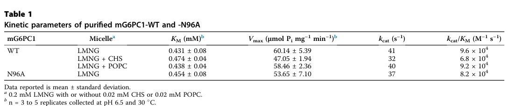

## Question

# Gene Research for Functional Annotation

## ⚠️ CRITICAL: Gene/Protein Identification Context

**BEFORE YOU BEGIN RESEARCH:** You MUST verify you are researching the CORRECT gene/protein. Gene symbols can be ambiguous, especially for less well-characterized genes from non-model organisms.

### Target Gene/Protein Identity (from UniProt):
- **UniProt Accession:** P35575
- **Protein Description:** RecName: Full=Glucose-6-phosphatase catalytic subunit 1 {ECO:0000312|HGNC:HGNC:4056}; EC=3.1.3.9 {ECO:0000269|PubMed:10960498, ECO:0000269|PubMed:12093795, ECO:0000269|PubMed:15542400, ECO:0000269|PubMed:9332655}; AltName: Full=Glucose-6-phosphatase; Short=G-6-Pase; Short=G6Pase; AltName: Full=Glucose-6-phosphatase alpha; Short=G6Pase-alpha;
- **Gene Information:** Name=G6PC1 {ECO:0000312|HGNC:HGNC:4056}; Synonyms=G6PC, G6PT;
- **Organism (full):** Homo sapiens (Human).
- **Protein Family:** Belongs to the glucose-6-phosphatase family. .
- **Key Domains:** Glucose-6-phosphatase. (IPR016275); PAP2/HPO. (IPR000326); PAP2/HPO_sf. (IPR036938); PAP2 (PF01569)

### MANDATORY VERIFICATION STEPS:

1. **Check if the gene symbol "G6PC1" matches the protein description above**
2. **Verify the organism is correct:** Homo sapiens (Human).
3. **Check if protein family/domains align with what you find in literature**
4. **If you find literature for a DIFFERENT gene with the same or similar symbol, STOP**

### If Gene Symbol is Ambiguous or You Cannot Find Relevant Literature:

**DO NOT PROCEED WITH RESEARCH ON A DIFFERENT GENE.** Instead:
- State clearly: "The gene symbol 'G6PC1' is ambiguous or literature is limited for this specific protein"
- Explain what you found (e.g., "Found extensive literature on a different gene with the same symbol in a different organism")
- Describe the protein based ONLY on the UniProt information provided above
- Suggest that the protein function can be inferred from domain/family information

### Research Target:

Please provide a comprehensive research report on the gene **G6PC1** (gene ID: G6PC1, UniProt: P35575) in human.

The research report should be a detailed narrative explaining the function, biological processes, and localization of the gene product. Citations should be given for all claims.

You should prioritize authoritative reviews and primary scientific literature when conducting research. You can supplement
this with annotations you find in gene/protein databases, but these can be outdated or inaccurate.

We are specifically interested in the primary function of the gene - for enzymes, what reaction is catalyzed, and what is the substrate specificity? For transporters, what is the substrate? For structural proteins or adapters, what is the broader structural role? For signaling molecules, what is the role in the pathway.

We are interested in where in or outside the cell the gene product carries out its function.

We are also interested in the signaling or biochemical pathways in which the gene functions. We are less interested in broad pleiotropic effects, except where these elucidate the precise role.

Include evidence where possible. We are interested in both experimental evidence as well as inference from structure, evolution, or bioinformatic analysis. Precise studies should be prioritized over high-throughput, where available.

## Output

Question: You are an expert researcher providing comprehensive, well-cited information.

Provide detailed information focusing on:
1. Key concepts and definitions with current understanding
2. Recent developments and latest research (prioritize 2023-2024 sources)
3. Current applications and real-world implementations
4. Expert opinions and analysis from authoritative sources
5. Relevant statistics and data from recent studies

Format as a comprehensive research report with proper citations. Include URLs and publication dates where available.
Always prioritize recent, authoritative sources and provide specific citations for all major claims.

# Gene Research for Functional Annotation

## ⚠️ CRITICAL: Gene/Protein Identification Context

**BEFORE YOU BEGIN RESEARCH:** You MUST verify you are researching the CORRECT gene/protein. Gene symbols can be ambiguous, especially for less well-characterized genes from non-model organisms.

### Target Gene/Protein Identity (from UniProt):
- **UniProt Accession:** P35575
- **Protein Description:** RecName: Full=Glucose-6-phosphatase catalytic subunit 1 {ECO:0000312|HGNC:HGNC:4056}; EC=3.1.3.9 {ECO:0000269|PubMed:10960498, ECO:0000269|PubMed:12093795, ECO:0000269|PubMed:15542400, ECO:0000269|PubMed:9332655}; AltName: Full=Glucose-6-phosphatase; Short=G-6-Pase; Short=G6Pase; AltName: Full=Glucose-6-phosphatase alpha; Short=G6Pase-alpha;
- **Gene Information:** Name=G6PC1 {ECO:0000312|HGNC:HGNC:4056}; Synonyms=G6PC, G6PT;
- **Organism (full):** Homo sapiens (Human).
- **Protein Family:** Belongs to the glucose-6-phosphatase family. .
- **Key Domains:** Glucose-6-phosphatase. (IPR016275); PAP2/HPO. (IPR000326); PAP2/HPO_sf. (IPR036938); PAP2 (PF01569)

### MANDATORY VERIFICATION STEPS:

1. **Check if the gene symbol "G6PC1" matches the protein description above**
2. **Verify the organism is correct:** Homo sapiens (Human).
3. **Check if protein family/domains align with what you find in literature**
4. **If you find literature for a DIFFERENT gene with the same or similar symbol, STOP**

### If Gene Symbol is Ambiguous or You Cannot Find Relevant Literature:

**DO NOT PROCEED WITH RESEARCH ON A DIFFERENT GENE.** Instead:
- State clearly: "The gene symbol 'G6PC1' is ambiguous or literature is limited for this specific protein"
- Explain what you found (e.g., "Found extensive literature on a different gene with the same symbol in a different organism")
- Describe the protein based ONLY on the UniProt information provided above
- Suggest that the protein function can be inferred from domain/family information

### Research Target:

Please provide a comprehensive research report on the gene **G6PC1** (gene ID: G6PC1, UniProt: P35575) in human.

The research report should be a detailed narrative explaining the function, biological processes, and localization of the gene product. Citations should be given for all claims.

You should prioritize authoritative reviews and primary scientific literature when conducting research. You can supplement
this with annotations you find in gene/protein databases, but these can be outdated or inaccurate.

We are specifically interested in the primary function of the gene - for enzymes, what reaction is catalyzed, and what is the substrate specificity? For transporters, what is the substrate? For structural proteins or adapters, what is the broader structural role? For signaling molecules, what is the role in the pathway.

We are interested in where in or outside the cell the gene product carries out its function.

We are also interested in the signaling or biochemical pathways in which the gene functions. We are less interested in broad pleiotropic effects, except where these elucidate the precise role.

Include evidence where possible. We are interested in both experimental evidence as well as inference from structure, evolution, or bioinformatic analysis. Precise studies should be prioritized over high-throughput, where available.

# Functional annotation report: human G6PC1 (UniProt P35575)

## Identity and scope

**G6PC1 is the correct human protein for UniProt P35575:** glucose-6-phosphatase catalytic subunit 1, historically called **G6PC** or glucose-6-phosphatase-α. The reviewed protein is an endoplasmic-reticulum (ER) membrane enzyme of the PAP2-related phosphatase family, consistent with the supplied domain annotations. It is not the pancreatic paralog G6PC2 or the more widely expressed G6PC3. Importantly, **G6PT is also the established name of a different protein, the G6P transporter SLC37A4**; despite its appearance among the supplied synonyms, G6PC1 should not be assigned a transport function. A 2025 human structural study explicitly identifies its G6PC1 construct as UniProt **P35575**. (lizak2019glucosetransportand pages 3-5, hawes2024identificationofstructural pages 1-2, chen2025theinducedfitand pages 1-2)

The table summarizes the functional assignment and the distinction between experiments on the human enzyme and its mouse ortholog.

| Aspect | Human G6PC1/P35575 findings | Evidence and interpretation |
|---|---|---|
| Identity and nomenclature | **G6PC1**, formerly **G6PC**, encodes glucose-6-phosphatase catalytic subunit 1, also called G6Pase-α. It is distinct from **G6PC2**, **G6PC3**, and the separate transporter **G6PT/SLC37A4**. | G6PC1 is the membrane-embedded catalytic enzyme, whereas SLC37A4 transports G6P. Accordingly, G6PC1 itself should not be annotated as G6PT. (lizak2019glucosetransportand pages 3-5, hawes2024identificationofstructural pages 1-2) |
| Primary reaction | **D-glucose 6-phosphate + H₂O → D-glucose + inorganic phosphate**; EC 3.1.3.9. | Human structural evidence places G6P in the active-site cavity and identifies His176 as the catalytic nucleophile, with His119 assisting phosphoester cleavage. (chen2025theinducedfitand pages 2-3, chen2025theinducedfitand pages 8-9) |
| Phosphosugar specificity | G6P is the physiological substrate. Purified **mouse** G6PC1, an 89%-identical ortholog rather than human P35575, hydrolyzed G6P and M6P at similar rates. F6P activity was approximately **26–30%** of G6P activity at 1.5 mM, and catalytic efficiency for G6P was **more than tenfold** higher than for F6P. | These results demonstrate intrinsic phosphosugar promiscuity but do not establish M6P or F6P as major human physiological substrates. Mouse WT G6PC1 in LMNG had a G6P Kₘ of **0.431 ± 0.08 mM**, kcat of **41 s⁻¹**, and kcat/Kₘ of **9.6 × 10⁴ M⁻¹ s⁻¹**; purified human G6PC1 had an apparent G6P Kₘ of approximately **2 mM**. (chen2025theinducedfitand pages 2-3, claxton2022biophysicalandfunctional pages 1-2, claxton2022biophysicalandfunctional pages 4-5, claxton2022biophysicalandfunctional pages 5-6) |
| Family and localization | G6PC1 is a PAP2-family, multispanning integral membrane glycoprotein of the **endoplasmic-reticulum membrane**. It has **nine transmembrane helices**, an N-luminal and C-cytosolic orientation, and a positively charged catalytic pocket opening toward the ER lumen. | Cryo-EM and purified-protein evidence support a luminal active site rather than a cytosolic catalytic site. (chen2025theinducedfitand pages 2-3, chen2025theinducedfitand pages 1-2, claxton2022biophysicalandfunctional pages 1-2) |
| Coupled ER system | **SLC37A4/G6PT** imports cytosolic G6P into the ER. G6PC1 hydrolyzes it within the lumen, after which glucose and phosphate leave the ER. | Transport and catalysis are performed by different proteins. Transport-dependent substrate access means that intrinsic enzyme activity alone does not determine physiological substrate use. (lizak2019glucosetransportand pages 3-5, hutton2009glucose6phosphatasecatalyticsubunit pages 1-1) |
| Physiological pathway | G6PC1 performs the terminal common step of **gluconeogenesis and glycogenolysis**, enabling fasting glucose output principally from liver and kidney, with expression also reported in intestine. | Its position at the shared endpoint of these pathways makes G6PC1 a gatekeeper of interprandial blood-glucose homeostasis. (hawes2024identificationofstructural pages 1-2, claxton2022biophysicalandfunctional pages 1-2) |
| Loss of function | Biallelic pathogenic G6PC1 variants cause **glycogen storage disease type Ia**. Failed G6P hydrolysis produces fasting hypoglycemia, glycogen and lipid accumulation, hepatomegaly, nephromegaly, hyperlipidemia, hyperuricemia, and lactic acidemia. | In a 2024 humanized G6PC1-p.R83C mouse model, hepatic activity was **2.2 ± 0.3 units**, compared with **330.4 ± 36.3 units** in wild-type animals, and only **39%** of untreated animals survived to three weeks. (arnaoutova2024baseeditingcorrectsmetabolic pages 1-2) |

*Table: Compact annotation of human G6PC1/P35575 covering identity, catalytic function, specificity, ER topology, pathway role, and loss-of-function disease. It distinguishes the catalytic enzyme from SLC37A4/G6PT and explicitly labels mouse-derived kinetic evidence.*

## Reaction, substrate specificity, and molecular mechanism

G6PC1 catalyzes the hydrolytic reaction **D-glucose 6-phosphate + H₂O → D-glucose + inorganic phosphate** (EC 3.1.3.9). This is the final common biochemical step that allows glucose derived from either glycogenolysis or gluconeogenesis to be released for maintenance of blood glucose during fasting. The enzyme removes phosphate; it does **not** transport G6P across the ER membrane. (hutton2009glucose6phosphatasecatalyticsubunit pages 1-1, claxton2022biophysicalandfunctional pages 1-2)

**G6P is the established physiological substrate, but intrinsic phosphatase activity is not absolutely restricted to it.** In a direct study of purified *mouse* G6PC1, G6P and mannose 6-phosphate (M6P) were hydrolyzed at similar rates, whereas fructose 6-phosphate (F6P) produced approximately **26–30%** of the G6P-associated phosphate-release rate under the comparison conditions; catalytic efficiency for G6P was **more than tenfold** that for F6P. For purified mouse enzyme in LMNG detergent, measured G6P Kₘ was **0.431 ± 0.08 mM** and turnover number **41 s⁻¹**. These are **mouse-ortholog, detergent-solubilized measurements**, not kinetic constants established for human tissues. A subsequent human purified-protein study reported an approximately **2 mM** G6P Kₘ and directly visualized bound G6P and F6P. Moreover, M6P is not efficiently delivered by the relevant ER G6P transporter; activity on an accessible substrate *in vitro* does not make it an important substrate of the intact physiological system. (chen2025theinducedfitand pages 2-3, claxton2022biophysicalandfunctional pages 4-5, claxton2022biophysicalandfunctional pages 5-6, claxton2022biophysicalandfunctional media 439614ff)

Structural work published in **July 2025** provides unusually direct mechanistic evidence for this human protein. Cryo-electron microscopy captured apo, substrate-bound, and phosphate-bound conformations of G6PC1. Its conserved PAP2-like catalytic motifs line a positively charged substrate cavity: **Arg83 and Arg170** interact with the substrate phosphate, **His176** is proposed to attack phosphorus as the catalytic nucleophile, and **His119** assists cleavage of the glucose–phosphate bond. Substrate binding reorganizes the cavity in an induced-fit mechanism. These atomic assignments refine, rather than replace, the older physiological evidence for G6P hydrolysis. (chen2025theinducedfitand pages 2-3, chen2025theinducedfitand pages 1-2, chen2025theinducedfitand pages 8-9)

## Site of action and pathway integration

G6PC1 is a **multispanning integral ER-membrane protein**, not a secreted enzyme or plasma-membrane glucose exporter. The human structure supports **nine membrane-spanning helices** and a catalytic cavity accessible on the **ER-luminal side**; its N terminus is luminal and C terminus cytosolic. The ER system works in sequence: **SLC37A4/G6PT moves cytosolic G6P into the lumen; G6PC1 hydrolyzes it there; glucose and phosphate subsequently leave the ER.** Thus both catalytic competence and substrate access determine net glucose production. The precise assignment of every product-export pathway is less secure than the experimentally established distinction between G6PC1 catalysis and SLC37A4-mediated G6P entry. (lizak2019glucosetransportand pages 3-5, chen2025theinducedfitand pages 2-3, hutton2009glucose6phosphatasecatalyticsubunit pages 1-1, claxton2022biophysicalandfunctional pages 1-2)

G6PC1 expression is particularly important in **liver and kidney**, with expression also reported in **intestine**. Its immediate pathway role is terminal glucose release from G6P, not glycogen cleavage or the upstream synthesis of G6P. The enzyme therefore couples the two upstream sources of G6P—glycogen breakdown and gluconeogenic carbon—to systemic fasting glucose supply. Insulin represses, whereas glucagon promotes, hepatic G6PC1 expression; those regulatory effects alter the capacity for this specific terminal reaction and should not be confused with G6PC1 acting as a hormone receptor or signaling protein. (hawes2024identificationofstructural pages 1-2, claxton2022biophysicalandfunctional pages 1-2, arnaoutova2024baseeditingcorrectsmetabolic pages 1-2)

## Human disease as a functional experiment

Biallelic loss-of-function **G6PC1** variants cause **glycogen storage disease type Ia (GSD-Ia)**, distinct from GSD-Ib due to deficiency of the transporter **SLC37A4**. The failure to convert luminal G6P into glucose explains fasting hypoglycemia and, through accumulation and diversion of G6P, the characteristic hepatic and renal glycogen accumulation and metabolic abnormalities, including hyperlipidemia, hyperuricemia, and lactic acidemia. In a **2024** humanized mouse carrying pathogenic **G6PC1 p.R83C**, hepatic G6Pase activity measured **2.2 ± 0.3** versus **330.4 ± 36.3** activity units in wild-type mice; **39%** of untreated mutants survived to three weeks. These model results provide a strong loss-of-function test but are not estimates of human survival or human enzyme activity. (lizak2019glucosetransportand pages 3-5, arnaoutova2024baseeditingcorrectsmetabolic pages 1-2)

## Recent developments and clinical applications

A **November 2024** primary study tested **BEAM-301**, an intravenously delivered lipid-nanoparticle adenine base editor designed to correct the G6PC1 **c.247C>T/p.R83C** allele. In humanized mice, correction reached approximately **60%** of liver alleles in some animals; the authors reported therapeutic improvement at approximately **10%** correction, restored fasting tolerance, and survival through **53 weeks**. Liver rescue **did not correct the renal enzyme deficiency**, and potentially deleterious bystander editing was examined. All efficacy percentages and survival observations here are **preclinical**, not patient outcomes. The variant-specificity of this editing strategy also limits direct generalization to other G6PC1 genotypes. (arnaoutova2024baseeditingcorrectsmetabolic pages 1-2, arnaoutova2024baseeditingcorrectsmetabolic pages 2-3, arnaoutova2024baseeditingcorrectsmetabolic pages 6-9)

As a real-world translational application, **NCT06735755** evaluates BEAM-301 in adults carrying p.R83C. The registry listed this phase **1/2** study as **recruiting**, with **36 estimated participants**; its posted outcomes concern safety, fasting-challenge tolerance, starch supplementation, and metabolic markers, **not demonstrated clinical efficacy**. Separately, **NCT05139316**, the phase **3** study of AAV8-mediated G6PC replacement **DTX401/pariglasgene brecaparvovec**, was listed as **completed** with **49 actual participants** in a registry update posted **25 March 2026**. Its prespecified primary endpoint is change in daily cornstarch consumption at week 48; the retrieved registry material did **not** establish a numerical efficacy result. In its **2024** assessment, Koeberl and colleagues regarded GSD-Ia gene therapy as promising while emphasizing vector immunity, toxicity, and durability as unresolved implementation issues. (NCT06735755 chunk 1, NCT05139316 chunk 1, koeberl2024genetherapyfor pages 13-14)

### Selected sources and dates

- Hawes *et al.*, **January 2024**, *Bioscience Reports*, comparative PAP2-motif and substrate-cavity analysis; its quantitative M6P-over-G6P observation concerns **G6PC2, not G6PC1**: https://doi.org/10.1042/BSR20231851. (hawes2024identificationofstructural pages 4-6)
- Arnaoutova *et al.*, **November 2024**, *Nature Communications*, humanized G6PC1-R83C mouse base-editing experiments: https://doi.org/10.1038/s41467-024-54108-1. (arnaoutova2024baseeditingcorrectsmetabolic pages 1-2)
- Koeberl *et al.*, **2024**, *Journal of Inherited Metabolic Disease*, expert review of GSD gene therapy: https://doi.org/10.1002/jimd.12654. (koeberl2024genetherapyfor pages 13-14)
- Claxton *et al.*, **January 2022**, *Journal of Biological Chemistry*, purified **mouse** G6PC1 enzymology: https://doi.org/10.1016/j.jbc.2021.101520. (claxton2022biophysicalandfunctional pages 4-5, claxton2022biophysicalandfunctional pages 5-6)
- Chen *et al.*, **July 2025**, *Cell Discovery*, human G6PC1 cryo-EM and catalytic mechanism: https://doi.org/10.1038/s41421-025-00814-z. (chen2025theinducedfitand pages 2-3, chen2025theinducedfitand pages 1-2)
- ClinicalTrials.gov, BEAM-301, **NCT06735755**, first posted **16 December 2024**: https://clinicaltrials.gov/study/NCT06735755; DTX401, **NCT05139316**, registry updated **25 March 2026**: https://clinicaltrials.gov/study/NCT05139316. (NCT06735755 chunk 1, NCT05139316 chunk 1)

References

1. (lizak2019glucosetransportand pages 3-5): Beáta Lizák, András Szarka, Yejin Kim, Kyu-sung Choi, Csilla E. Németh, Paola Marcolongo, Angelo Benedetti, Gábor Bánhegyi, and Éva Margittai. Glucose transport and transporters in the endomembranes. International Journal of Molecular Sciences, 20:5898, Nov 2019. URL: https://doi.org/10.3390/ijms20235898, doi:10.3390/ijms20235898. This article has 108 citations.

2. (hawes2024identificationofstructural pages 1-2): Emily M. Hawes, Derek P. Claxton, James K. Oeser, and Richard M. O’Brien. Identification of structural motifs critical for human g6pc2 function informed by sequence analysis and an alphafold2-predicted model. Bioscience Reports, Jan 2024. URL: https://doi.org/10.1042/bsr20231851, doi:10.1042/bsr20231851. This article has 7 citations and is from a peer-reviewed journal.

3. (chen2025theinducedfitand pages 1-2): Qihao Chen, Yuhang Wang, Renjie Li, Qinru Bai, and Yan Zhao. The induced-fit and catalytic mechanisms of human g6pc1. Cell Discovery, Jul 2025. URL: https://doi.org/10.1038/s41421-025-00814-z, doi:10.1038/s41421-025-00814-z. This article has 12 citations and is from a peer-reviewed journal.

4. (chen2025theinducedfitand pages 2-3): Qihao Chen, Yuhang Wang, Renjie Li, Qinru Bai, and Yan Zhao. The induced-fit and catalytic mechanisms of human g6pc1. Cell Discovery, Jul 2025. URL: https://doi.org/10.1038/s41421-025-00814-z, doi:10.1038/s41421-025-00814-z. This article has 12 citations and is from a peer-reviewed journal.

5. (chen2025theinducedfitand pages 8-9): Qihao Chen, Yuhang Wang, Renjie Li, Qinru Bai, and Yan Zhao. The induced-fit and catalytic mechanisms of human g6pc1. Cell Discovery, Jul 2025. URL: https://doi.org/10.1038/s41421-025-00814-z, doi:10.1038/s41421-025-00814-z. This article has 12 citations and is from a peer-reviewed journal.

6. (claxton2022biophysicalandfunctional pages 1-2): Derek P. Claxton, Emily M. Overway, James K. Oeser, Richard M. O'Brien, and Hassane S. Mchaourab. Biophysical and functional properties of purified glucose-6-phosphatase catalytic subunit 1. Journal of Biological Chemistry, 298:101520, Jan 2022. URL: https://doi.org/10.1016/j.jbc.2021.101520, doi:10.1016/j.jbc.2021.101520. This article has 25 citations and is from a domain leading peer-reviewed journal.

7. (claxton2022biophysicalandfunctional pages 4-5): Derek P. Claxton, Emily M. Overway, James K. Oeser, Richard M. O'Brien, and Hassane S. Mchaourab. Biophysical and functional properties of purified glucose-6-phosphatase catalytic subunit 1. Journal of Biological Chemistry, 298:101520, Jan 2022. URL: https://doi.org/10.1016/j.jbc.2021.101520, doi:10.1016/j.jbc.2021.101520. This article has 25 citations and is from a domain leading peer-reviewed journal.

8. (claxton2022biophysicalandfunctional pages 5-6): Derek P. Claxton, Emily M. Overway, James K. Oeser, Richard M. O'Brien, and Hassane S. Mchaourab. Biophysical and functional properties of purified glucose-6-phosphatase catalytic subunit 1. Journal of Biological Chemistry, 298:101520, Jan 2022. URL: https://doi.org/10.1016/j.jbc.2021.101520, doi:10.1016/j.jbc.2021.101520. This article has 25 citations and is from a domain leading peer-reviewed journal.

9. (hutton2009glucose6phosphatasecatalyticsubunit pages 1-1): John C. Hutton and Richard M. O'Brien. Glucose-6-phosphatase catalytic subunit gene family. Journal of Biological Chemistry, 284:29241-29245, Oct 2009. URL: https://doi.org/10.1074/jbc.r109.025544, doi:10.1074/jbc.r109.025544. This article has 268 citations and is from a domain leading peer-reviewed journal.

10. (arnaoutova2024baseeditingcorrectsmetabolic pages 1-2): Irina Arnaoutova, Yvonne Aratyn-Schaus, Lisa Zhang, Michael S. Packer, Hung-Dar Chen, Cheol Lee, Sudeep Gautam, Francine M. Gregoire, Dominique Leboeuf, Steven Boule, Thomas P. Fernandez, Victoria Huang, Lo-I Cheng, Genesis Lung, Brianna Bannister, Jeremy Decker, Thomas Leete, Lan S. Shuang, Caroline Bock, Prachi Kothiyal, Phil Grayson, Ka W. Mok, Jeffrey J. Quinn, Lauren Young, Luis Barrera, Giuseppe Ciaramella, Brian C. Mansfield, and Janice Y. Chou. Base-editing corrects metabolic abnormalities in a humanized mouse model for glycogen storage disease type-ia. Nature Communications, Nov 2024. URL: https://doi.org/10.1038/s41467-024-54108-1, doi:10.1038/s41467-024-54108-1. This article has 20 citations and is from a highest quality peer-reviewed journal.

11. (claxton2022biophysicalandfunctional media 439614ff): Derek P. Claxton, Emily M. Overway, James K. Oeser, Richard M. O'Brien, and Hassane S. Mchaourab. Biophysical and functional properties of purified glucose-6-phosphatase catalytic subunit 1. Journal of Biological Chemistry, 298:101520, Jan 2022. URL: https://doi.org/10.1016/j.jbc.2021.101520, doi:10.1016/j.jbc.2021.101520. This article has 25 citations and is from a domain leading peer-reviewed journal.

12. (arnaoutova2024baseeditingcorrectsmetabolic pages 2-3): Irina Arnaoutova, Yvonne Aratyn-Schaus, Lisa Zhang, Michael S. Packer, Hung-Dar Chen, Cheol Lee, Sudeep Gautam, Francine M. Gregoire, Dominique Leboeuf, Steven Boule, Thomas P. Fernandez, Victoria Huang, Lo-I Cheng, Genesis Lung, Brianna Bannister, Jeremy Decker, Thomas Leete, Lan S. Shuang, Caroline Bock, Prachi Kothiyal, Phil Grayson, Ka W. Mok, Jeffrey J. Quinn, Lauren Young, Luis Barrera, Giuseppe Ciaramella, Brian C. Mansfield, and Janice Y. Chou. Base-editing corrects metabolic abnormalities in a humanized mouse model for glycogen storage disease type-ia. Nature Communications, Nov 2024. URL: https://doi.org/10.1038/s41467-024-54108-1, doi:10.1038/s41467-024-54108-1. This article has 20 citations and is from a highest quality peer-reviewed journal.

13. (arnaoutova2024baseeditingcorrectsmetabolic pages 6-9): Irina Arnaoutova, Yvonne Aratyn-Schaus, Lisa Zhang, Michael S. Packer, Hung-Dar Chen, Cheol Lee, Sudeep Gautam, Francine M. Gregoire, Dominique Leboeuf, Steven Boule, Thomas P. Fernandez, Victoria Huang, Lo-I Cheng, Genesis Lung, Brianna Bannister, Jeremy Decker, Thomas Leete, Lan S. Shuang, Caroline Bock, Prachi Kothiyal, Phil Grayson, Ka W. Mok, Jeffrey J. Quinn, Lauren Young, Luis Barrera, Giuseppe Ciaramella, Brian C. Mansfield, and Janice Y. Chou. Base-editing corrects metabolic abnormalities in a humanized mouse model for glycogen storage disease type-ia. Nature Communications, Nov 2024. URL: https://doi.org/10.1038/s41467-024-54108-1, doi:10.1038/s41467-024-54108-1. This article has 20 citations and is from a highest quality peer-reviewed journal.

14. (NCT06735755 chunk 1):  A Phase 1/2, Dose-Exploration Study to Evaluate the Safety and Efficacy of BEAM-301 in Patients With Glycogen Storage Disease Type Ia (GSDIa). Beam Therapeutics Inc.. 2024. ClinicalTrials.gov Identifier: NCT06735755

15. (NCT05139316 chunk 1):  A Study of Adeno-Associated Virus Serotype 8-Mediated Gene Transfer of Glucose-6-Phosphatase in Patients With Glycogen Storage Disease Type Ia (GSDIa). Ultragenyx Pharmaceutical Inc. 2021. ClinicalTrials.gov Identifier: NCT05139316

16. (koeberl2024genetherapyfor pages 13-14): Dwight D. Koeberl, Rebecca L. Koch, Jeong‐A. Lim, Elizabeth D. Brooks, Benjamin D. Arnson, Baodong Sun, and Priya S. Kishnani. Gene therapy for glycogen storage diseases. Journal of Inherited Metabolic Disease, 47:93-118, Jul 2024. URL: https://doi.org/10.1002/jimd.12654, doi:10.1002/jimd.12654. This article has 44 citations and is from a peer-reviewed journal.

17. (hawes2024identificationofstructural pages 4-6): Emily M. Hawes, Derek P. Claxton, James K. Oeser, and Richard M. O’Brien. Identification of structural motifs critical for human g6pc2 function informed by sequence analysis and an alphafold2-predicted model. Bioscience Reports, Jan 2024. URL: https://doi.org/10.1042/bsr20231851, doi:10.1042/bsr20231851. This article has 7 citations and is from a peer-reviewed journal.

## Artifacts

- [Edison artifact artifact-00](G6PC1-deep-research-falcon_artifacts/artifact-00.md)

## Citations

1. arnaoutova2024baseeditingcorrectsmetabolic pages 1-2
2. hawes2024identificationofstructural pages 4-6
3. koeberl2024genetherapyfor pages 13-14
4. lizak2019glucosetransportand pages 3-5
5. hawes2024identificationofstructural pages 1-2
6. chen2025theinducedfitand pages 1-2
7. chen2025theinducedfitand pages 2-3
8. chen2025theinducedfitand pages 8-9
9. claxton2022biophysicalandfunctional pages 1-2
10. claxton2022biophysicalandfunctional pages 4-5
11. claxton2022biophysicalandfunctional pages 5-6
12. arnaoutova2024baseeditingcorrectsmetabolic pages 2-3
13. arnaoutova2024baseeditingcorrectsmetabolic pages 6-9
14. https://doi.org/10.1042/BSR20231851.
15. https://doi.org/10.1038/s41467-024-54108-1.
16. https://doi.org/10.1002/jimd.12654.
17. https://doi.org/10.1016/j.jbc.2021.101520.
18. https://doi.org/10.1038/s41421-025-00814-z.
19. https://clinicaltrials.gov/study/NCT06735755;
20. https://clinicaltrials.gov/study/NCT05139316.
21. https://doi.org/10.3390/ijms20235898,
22. https://doi.org/10.1042/bsr20231851,
23. https://doi.org/10.1038/s41421-025-00814-z,
24. https://doi.org/10.1016/j.jbc.2021.101520,
25. https://doi.org/10.1074/jbc.r109.025544,
26. https://doi.org/10.1038/s41467-024-54108-1,
27. https://doi.org/10.1002/jimd.12654,