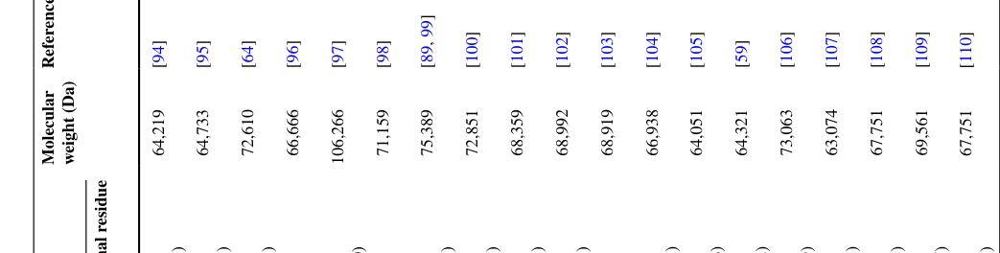

## Question

# Gene Research for Functional Annotation

## ⚠️ CRITICAL: Gene/Protein Identification Context

**BEFORE YOU BEGIN RESEARCH:** You MUST verify you are researching the CORRECT gene/protein. Gene symbols can be ambiguous, especially for less well-characterized genes from non-model organisms.

### Target Gene/Protein Identity (from UniProt):
- **UniProt Accession:** Q14435
- **Protein Description:** RecName: Full=Polypeptide N-acetylgalactosaminyltransferase 3; EC=2.4.1.41 {ECO:0000269|PubMed:16638743, ECO:0000269|PubMed:31932717, ECO:0000269|PubMed:8663203, ECO:0000269|PubMed:9295285}; AltName: Full=Polypeptide GalNAc transferase 3; Short=GalNAc-T3; Short=pp-GaNTase 3; AltName: Full=Protein-UDP acetylgalactosaminyltransferase 3; AltName: Full=UDP-GalNAc:polypeptide N-acetylgalactosaminyltransferase 3;
- **Gene Information:** Name=GALNT3;
- **Organism (full):** Homo sapiens (Human).
- **Protein Family:** Belongs to the glycosyltransferase 2 family. GalNAc-T
- **Key Domains:** GalNAc-T. (IPR045885); Glyco_trans_2-like. (IPR001173); Nucleotide-diphossugar_trans. (IPR029044); Ricin_B-like_lectins. (IPR035992); Ricin_B_lectin. (IPR000772)

### MANDATORY VERIFICATION STEPS:

1. **Check if the gene symbol "GALNT3" matches the protein description above**
2. **Verify the organism is correct:** Homo sapiens (Human).
3. **Check if protein family/domains align with what you find in literature**
4. **If you find literature for a DIFFERENT gene with the same or similar symbol, STOP**

### If Gene Symbol is Ambiguous or You Cannot Find Relevant Literature:

**DO NOT PROCEED WITH RESEARCH ON A DIFFERENT GENE.** Instead:
- State clearly: "The gene symbol 'GALNT3' is ambiguous or literature is limited for this specific protein"
- Explain what you found (e.g., "Found extensive literature on a different gene with the same symbol in a different organism")
- Describe the protein based ONLY on the UniProt information provided above
- Suggest that the protein function can be inferred from domain/family information

### Research Target:

Please provide a comprehensive research report on the gene **GALNT3** (gene ID: GALNT3, UniProt: Q14435) in human.

The research report should be a detailed narrative explaining the function, biological processes, and localization of the gene product. Citations should be given for all claims.

You should prioritize authoritative reviews and primary scientific literature when conducting research. You can supplement
this with annotations you find in gene/protein databases, but these can be outdated or inaccurate.

We are specifically interested in the primary function of the gene - for enzymes, what reaction is catalyzed, and what is the substrate specificity? For transporters, what is the substrate? For structural proteins or adapters, what is the broader structural role? For signaling molecules, what is the role in the pathway.

We are interested in where in or outside the cell the gene product carries out its function.

We are also interested in the signaling or biochemical pathways in which the gene functions. We are less interested in broad pleiotropic effects, except where these elucidate the precise role.

Include evidence where possible. We are interested in both experimental evidence as well as inference from structure, evolution, or bioinformatic analysis. Precise studies should be prioritized over high-throughput, where available.

## Output

Question: You are an expert researcher providing comprehensive, well-cited information.

Provide detailed information focusing on:
1. Key concepts and definitions with current understanding
2. Recent developments and latest research (prioritize 2023-2024 sources)
3. Current applications and real-world implementations
4. Expert opinions and analysis from authoritative sources
5. Relevant statistics and data from recent studies

Format as a comprehensive research report with proper citations. Include URLs and publication dates where available.
Always prioritize recent, authoritative sources and provide specific citations for all major claims.

# Gene Research for Functional Annotation

## ⚠️ CRITICAL: Gene/Protein Identification Context

**BEFORE YOU BEGIN RESEARCH:** You MUST verify you are researching the CORRECT gene/protein. Gene symbols can be ambiguous, especially for less well-characterized genes from non-model organisms.

### Target Gene/Protein Identity (from UniProt):
- **UniProt Accession:** Q14435
- **Protein Description:** RecName: Full=Polypeptide N-acetylgalactosaminyltransferase 3; EC=2.4.1.41 {ECO:0000269|PubMed:16638743, ECO:0000269|PubMed:31932717, ECO:0000269|PubMed:8663203, ECO:0000269|PubMed:9295285}; AltName: Full=Polypeptide GalNAc transferase 3; Short=GalNAc-T3; Short=pp-GaNTase 3; AltName: Full=Protein-UDP acetylgalactosaminyltransferase 3; AltName: Full=UDP-GalNAc:polypeptide N-acetylgalactosaminyltransferase 3;
- **Gene Information:** Name=GALNT3;
- **Organism (full):** Homo sapiens (Human).
- **Protein Family:** Belongs to the glycosyltransferase 2 family. GalNAc-T
- **Key Domains:** GalNAc-T. (IPR045885); Glyco_trans_2-like. (IPR001173); Nucleotide-diphossugar_trans. (IPR029044); Ricin_B-like_lectins. (IPR035992); Ricin_B_lectin. (IPR000772)

### MANDATORY VERIFICATION STEPS:

1. **Check if the gene symbol "GALNT3" matches the protein description above**
2. **Verify the organism is correct:** Homo sapiens (Human).
3. **Check if protein family/domains align with what you find in literature**
4. **If you find literature for a DIFFERENT gene with the same or similar symbol, STOP**

### If Gene Symbol is Ambiguous or You Cannot Find Relevant Literature:

**DO NOT PROCEED WITH RESEARCH ON A DIFFERENT GENE.** Instead:
- State clearly: "The gene symbol 'GALNT3' is ambiguous or literature is limited for this specific protein"
- Explain what you found (e.g., "Found extensive literature on a different gene with the same symbol in a different organism")
- Describe the protein based ONLY on the UniProt information provided above
- Suggest that the protein function can be inferred from domain/family information

### Research Target:

Please provide a comprehensive research report on the gene **GALNT3** (gene ID: GALNT3, UniProt: Q14435) in human.

The research report should be a detailed narrative explaining the function, biological processes, and localization of the gene product. Citations should be given for all claims.

You should prioritize authoritative reviews and primary scientific literature when conducting research. You can supplement
this with annotations you find in gene/protein databases, but these can be outdated or inaccurate.

We are specifically interested in the primary function of the gene - for enzymes, what reaction is catalyzed, and what is the substrate specificity? For transporters, what is the substrate? For structural proteins or adapters, what is the broader structural role? For signaling molecules, what is the role in the pathway.

We are interested in where in or outside the cell the gene product carries out its function.

We are also interested in the signaling or biochemical pathways in which the gene functions. We are less interested in broad pleiotropic effects, except where these elucidate the precise role.

Include evidence where possible. We are interested in both experimental evidence as well as inference from structure, evolution, or bioinformatic analysis. Precise studies should be prioritized over high-throughput, where available.

# Human GALNT3 (UniProt Q14435): functional annotation and research report

**Identity verified.** Human **GALNT3** encodes polypeptide *N*-acetylgalactosaminyltransferase 3 (**GalNAc-T3**, EC 2.4.1.41). A human transferase comparison assigns **Q14435** specifically to T3, not the paralog GalNAc-T2 (**Q10471**); biochemical studies explicitly examine human GalNAc-T3. Its catalytic glycosyltransferase region and C-terminal ricin-B-like lectin region match the supplied protein-domain description. The apparently different labels “glycosyltransferase-2-like” and CAZy **GT27** describe structural similarity and catalytic-family classification, respectively, rather than different protein identities. (garay2022polypeptidenacetylgalactosaminetransferase pages 2-4, garay2022polypeptidenacetylgalactosaminetransferase pages 4-6, garay2022polypeptidenacetylgalactosaminetransferase media 02ec4b8f, rivas2020molecularbasisfor pages 5-7)

## Primary molecular function and location

GALNT3 initiates **mucin-type protein O-glycosylation**. Its principal reaction is **UDP-GalNAc + protein-Ser/Thr–OH → GalNAc-α-O-Ser/Thr–protein + UDP**: the enzyme transfers *N*-acetylgalactosamine (GalNAc) to a serine or threonine hydroxyl on a peptide or glycoprotein. The product, often called the **Tn antigen** before further sugar additions, can be extended by other glycosylation enzymes; GALNT3 is the initiating transferase, not the enzyme that necessarily completes an O-glycan. Its catalytic region binds the nucleotide-sugar donor and uses Mn²⁺ in structural and enzymatic studies. Ser and Thr are the relevant established acceptors for its FGF23 function, although occasional Tyr O-GalNAc modification has been discussed at the transferase-family level. (jiang2024runx2regulatesgalnt3 pages 1-2, garay2022polypeptidenacetylgalactosaminetransferase pages 1-2, su2026researchprogressin pages 1-2, rivas2020molecularbasisfor pages 21-24)

The **canonical working location is the Golgi secretory pathway**, where GALNT3 modifies proteins before their secretion or arrival at the cell surface. It is a type-II membrane protein: a short N-terminal tail faces the cytosol, its transmembrane segment anchors it, and its catalytic and lectin regions project into the secretory-pathway lumen. One published human-domain map places the tail at residues 1–19, membrane anchor at 20–37, stem at 38–183, catalytic region at 184–418, linker at 419–503, and lectin domain at 504–630; boundaries depend on the domain-definition method. Some studies reviewed in 2022 report GALNT3 in the nucleus or other non-Golgi compartments, but those observations do not displace **Golgi-luminal glycosylation** as the best-established site of its physiological FGF23 reaction. (garay2022polypeptidenacetylgalactosaminetransferase media 02ec4b8f, garay2022polypeptidenacetylgalactosaminetransferase pages 2-4, garay2022polypeptidenacetylgalactosaminetransferase pages 1-2, garay2022polypeptidenacetylgalactosaminetransferase pages 6-7)

**Substrate specificity is contextual, not a single obligatory sequence motif.** GALNT3 recognizes peptide sequence and pre-existing O-GalNAc modifications. In a 2020 structure–function study, four particularly active test peptides contained Tyr three residues before the acceptor site; the C-terminal β-trefoil lectin domain bound an existing GalNAc and helped position glycopeptides for additional modification. Consequently, a Ser/Thr-containing protein is not automatically a GALNT3 substrate: local sequence, prior glycosylation, access to the Golgi lumen, tissue expression and other GALNT paralogs matter. (rivas2020molecularbasisfor pages 5-7, rivas2020molecularbasisfor pages 11-16, garay2022polypeptidenacetylgalactosaminetransferase pages 4-6)

## Established pathway: protection of FGF23 and phosphate homeostasis

**FGF23 is GALNT3’s clearest physiologically consequential substrate.** Purified GalNAc-T3 transfers GalNAc from UDP-GalNAc specifically to **FGF23 Thr178**, adjacent to its **R176XXR179/S180** proprotein-convertase site. Glycosylation protects intact FGF23 from cleavage by **furin**. Conversely, the secretory-pathway kinase **FAM20C** phosphorylates neighboring **Ser180**, inhibiting Thr178 glycosylation and favoring furin-dependent processing into less-active fragments. These are distinct enzymes acting on the same hormone; GALNT3 is a glycosyltransferase, **not** itself a phosphate transporter, hormone receptor or kinase. Evidence includes peptide mass spectrometry, FGF23-site mutants and furin-knockout cells. (tagliabracci2014dynamicregulationof pages 3-4, tagliabracci2014dynamicregulationof pages 4-5, tagliabracci2014dynamicregulationof pages 1-2)

Pre-existing glycosylation can markedly influence recognition of this cleavage-site region. In the 2020 peptide assays, an FGF23 peptide already GalNAc-modified at **Thr171** had reported catalytic efficiency **21.3**, versus **0.29** for its unmodified counterpart—approximately **73-fold greater under those assay conditions**. This demonstrates strong glycopeptide-context dependence, **not** a universal 73-fold difference in human osteocytes. Structural experiments used a related nonhuman GalNAc-T3 enzyme for some crystals, while separate comparisons showed similar binding or kinetics with the human enzyme. (rivas2020molecularbasisfor pages 21-24, rivas2020molecularbasisfor pages 5-7, rivas2020molecularbasisfor pages 11-16)

Osteocyte-derived **intact FGF23** subsequently signals through FGFR/α-Klotho in the kidney, reducing renal phosphate reabsorption and 1,25-dihydroxyvitamin-D production. GALNT3 therefore regulates endocrine phosphate balance **upstream, by determining how much intact FGF23 survives secretory processing**. In a 2019 mouse and osteoblastic-cell study, higher phosphate activated an FGFR1c–ERK-linked response, induced skeletal *Galnt3*, and raised the ratio of intact to cleaved FGF23; the dietary comparison used **0.6% versus 1.2% phosphate for two weeks**, with **19 mice per group** for reported serum and expression measurements. The interpretation of FGFR1 as a phosphate sensor is supported in this experimental setting but need not be the sole phosphate-sensing mechanism in humans. (tagliabracci2014dynamicregulationof pages 1-2, takashi2019activationofunliganded pages 1-2)

### Recent mechanistic findings, 2023–2024

* **Bone regulation (14 February 2024).** Mouse osteoblast-lineage experiments found that the transcription factor **Runx2** binds and activates *Galnt3* regulatory sequences; Runx2 perturbation changed *Galnt3* expression. In *Galnt3*-null mice, **intact circulating Fgf23 was about 40% of wild type**, despite approximately **threefold greater femoral *Fgf23* mRNA** and **16-fold greater circulating total FGF23 and fragments**. The divergence between total and intact hormone provides particularly strong in-vivo evidence that GALNT3 controls **processing**, not simply FGF23 transcription. These are mouse measurements, not measurements of human Q14435 knockout. [Jiang *et al.*, *International Journal of Molecular Sciences*, 2024](https://doi.org/10.3390/ijms25042275). (jiang2024runx2regulatesgalnt3 pages 1-2, jiang2024runx2regulatesgalnt3 pages 8-11, jiang2024runx2regulatesgalnt3 pages 2-4)
* **Additional possible bone substrates (2023).** Two independent high-bone-mass kindreds carried different rare heterozygous GALNT3 variants, **p.Arg553Trp** and **p.Asp277Glu**. Structural modeling predicted impaired stability or Mn²⁺-associated catalytic function; common variation at the GALNT3 locus was associated with bone mineral density at several skeletal sites. The investigators proposed a possible **FGF23-independent** contribution because measured phosphate and FGF23 were normal in a small number of carriers. However, neither an additional causal glycoprotein substrate nor a clinical osteoporosis treatment has been established. [Hassan *et al.*, *Journal of Bone and Mineral Research*, 2023](https://doi.org/10.1002/jbmr.4795). (hassan2023rareandcommon pages 15-16, hassan2023rareandcommon pages 17-17, hassan2023rareandcommon pages 17-18)
* **A context-specific viral substrate (May 2024).** Purified-enzyme experiments identified GalNAc-T3 modification of SARS-CoV-2 spike **Thr678**, followed by **GalNAc-T7** modification predominantly at **Ser686**, near its furin-cleavage site. Clustered glycosylation reduced spike processing and incorporation into experimental particles; expression of T3/T7 in human Calu-3 lung cells was associated with a **76% reduction in Omicron BA.1 viral titer** under the reported conditions. Alpha/Delta-associated substitutions reduced susceptibility to this glycosylation, whereas Omicron-associated sequence changes restored it. This is a demonstrated **experimental host–virus interaction**, not proof that GALNT3 is a generally effective antiviral target or that the same magnitude occurs in patients. [Wang *et al.*, *Nature Communications*, May 2024](https://doi.org/10.1038/s41467-024-48503-x). (wang2024sequentialglycosylationsat pages 2-3, wang2024sequentialglycosylationsat pages 9-10)

## Human disease and present-day applications

**Biallelic deleterious GALNT3 variants cause hyperphosphatemic familial tumoral calcinosis**, sometimes presenting in the related hyperostosis–hyperphosphatemia spectrum. The original linkage-and-sequencing study identified deleterious variants in affected families. Mechanistically, inadequate FGF23 Thr178 glycosylation increases hormone cleavage, leaving too little active FGF23 to promote appropriate phosphate excretion; excess phosphate contributes to periarticular or other ectopic calcium-phosphate deposits. Measuring **intact versus C-terminal/total FGF23** is therefore mechanistically informative: abundant fragments need not imply abundant active hormone. [Topaz *et al.*, *Nature Genetics*, May 2004](https://doi.org/10.1038/ng1358); [Tagliabracci *et al.*, *PNAS*, 2014](https://doi.org/10.1073/pnas.1402218111). (tagliabracci2014dynamicregulationof pages 1-2, jiang2024runx2regulatesgalnt3 pages 8-11, tagliabracci2014dynamicregulationof pages 3-4)

**The current practical implementation is genetic and biochemical diagnosis followed by management of hyperphosphatemia, rather than direct correction of GALNT3 enzymatic activity.** A 2023 genome-sequenced case linked a GALNT3 lectin-domain frameshift with low FGF23 and calcinosis. Dietary phosphate restriction plus phosphate-lowering agents, including sevelamer and acetazolamide, reduced serum phosphate from **6.5 to 5.5 mg/dL after 10 months**; calcinosis nevertheless did **not** improve after more than one year. This single-patient observation illustrates both clinical use of the molecular diagnosis and the limits of existing symptomatic treatment; it is not a controlled estimate of efficacy. [Iwasaki, *Endocrinology, Diabetes & Metabolism Case Reports*, October 2023](https://doi.org/10.1530/edm-23-0071). (iwasaki2023elderlyonsetcalcinosisof pages 1-2)

**Assessment.** The strongest functional annotation for **human GALNT3/Q14435** is a **Golgi-luminal, Mn²⁺-associated UDP-GalNAc:polypeptide transferase** that initiates O-GalNAc glycosylation and, most decisively, **protects FGF23 from furin cleavage through site-specific Thr178 modification**. Human Mendelian genetics, purified-enzyme experiments, structural studies and mouse physiology converge on this mechanism. Other reported substrates and putative FGF23-independent effects expand its possible repertoire but have more context-dependent or less complete physiological validation. (garay2022polypeptidenacetylgalactosaminetransferase pages 4-6, garay2022polypeptidenacetylgalactosaminetransferase media 02ec4b8f, tagliabracci2014dynamicregulationof pages 3-4, rivas2020molecularbasisfor pages 21-24, jiang2024runx2regulatesgalnt3 pages 8-11, hassan2023rareandcommon pages 15-16)

The following evidence map summarizes individual findings and their limitations. (garay2022polypeptidenacetylgalactosaminetransferase media 02ec4b8f, tagliabracci2014dynamicregulationof pages 3-4, jiang2024runx2regulatesgalnt3 pages 8-11)

| Key concept / feature / claim | Primary evidence | Major finding | Notes / research caveats |
|---|---|---|---|
| **Identity and paralog discrimination** | Garay et al., *Journal of Molecular Medicine* (2022), [doi:10.1007/s00109-022-02249-5](https://doi.org/10.1007/s00109-022-02249-5) | The human ppGalNAc-transferase table assigns **UniProt Q14435 to GalNAc-T3/GALNT3**, distinct from GalNAc-T2 (Q10471) and other paralogs. (garay2022polypeptidenacetylgalactosaminetransferase pages 4-6, garay2022polypeptidenacetylgalactosaminetransferase media 02ec4b8f) | Confirms that the target is human GALNT3, not a similarly named family member; the source is a review compiling database and structural annotations. |
| **Protein architecture and family** | Garay et al., *Journal of Molecular Medicine* (2022), [doi:10.1007/s00109-022-02249-5](https://doi.org/10.1007/s00109-022-02249-5) | Q14435 is a 633-aa type-II membrane enzyme with cytoplasmic tail (1–19), transmembrane segment (20–37), stem (38–183), catalytic domain (184–418), linker (419–503), and C-terminal β-trefoil/ricin-type lectin domain (504–630). (garay2022polypeptidenacetylgalactosaminetransferase pages 2-4, garay2022polypeptidenacetylgalactosaminetransferase media 02ec4b8f) | Domain boundaries vary somewhat by annotation method; CAZy GT27 and broader glycosyltransferase-2-like structural classifications are compatible. |
| **Catalytic reaction** | Jiang et al., *International Journal of Molecular Sciences* (14 February 2024), [doi:10.3390/ijms25042275](https://doi.org/10.3390/ijms25042275); Garay et al. (2022), [doi:10.1007/s00109-022-02249-5](https://doi.org/10.1007/s00109-022-02249-5) | GalNAc-T3 transfers α-GalNAc from UDP-GalNAc to a protein Ser/Thr hydroxyl, forming **GalNAc-α-O-Ser/Thr and UDP**; the catalytic region recognizes UDP-GalNAc and Mn²⁺. (su2026researchprogressin pages 1-2, jiang2024runx2regulatesgalnt3 pages 1-2, garay2022polypeptidenacetylgalactosaminetransferase pages 1-2) | Ser and Thr are the principal physiological acceptors; occasional Tyr modification is a family-level observation and is not the established basis of GALNT3’s FGF23 function. |
| **Cellular localization** | Garay et al., *Journal of Molecular Medicine* (2022), [doi:10.1007/s00109-022-02249-5](https://doi.org/10.1007/s00109-022-02249-5) | GalNAc-T3 is principally a **Golgi-resident type-II transmembrane enzyme**. Its short N terminus is cytosolic, while the catalytic and lectin regions face the secretory-pathway lumen; nuclear localization has also been reported in some contexts. (garay2022polypeptidenacetylgalactosaminetransferase pages 4-6, garay2022polypeptidenacetylgalactosaminetransferase pages 1-2) | Golgi-luminal O-glycosylation is the canonical functional annotation. Non-Golgi observations are context-dependent and do not establish an equally general catalytic role. |
| **General substrate recognition** | de las Rivas et al., *Nature Chemical Biology* (2020), [doi:10.1038/s41589-019-0444-x](https://doi.org/10.1038/s41589-019-0444-x) | GalNAc-T3 has peptide- and glycopeptide-context preferences rather than one strict consensus: highly active test peptides frequently contained Tyr at −3, while the lectin domain recognizes pre-existing GalNAc and promotes modification of neighboring sites. (garay2022polypeptidenacetylgalactosaminetransferase pages 4-6, rivas2020molecularbasisfor pages 5-7) | In-vitro peptide preferences do not define the complete cellular substrate repertoire; expression, Golgi access, prior glycosylation, and competing GALNT isoforms also matter. |
| **FGF23 site specificity and priming** | de las Rivas et al., *Nature Chemical Biology* (2020), [doi:10.1038/s41589-019-0444-x](https://doi.org/10.1038/s41589-019-0444-x) | Structural, NMR, and kinetic experiments show recognition of the FGF23 cleavage-site region. A Thr171-glycosylated peptide was modified near Thr178 with catalytic efficiency about 21.3 versus 0.29 for the corresponding unmodified peptide, an approximately 73-fold difference under the assay conditions. (rivas2020molecularbasisfor pages 21-24, rivas2020molecularbasisfor pages 1-5, rivas2020molecularbasisfor pages 11-16) | Some crystallographic work used a highly similar nonhuman GalNAc-T3 ortholog, but comparative binding and kinetics showed closely matching behavior for human GalNAc-T3. |
| **FGF23 stabilization and protease protection** | Tagliabracci et al., *PNAS* (March 2014), [doi:10.1073/pnas.1402218111](https://doi.org/10.1073/pnas.1402218111) | Purified GalNAc-T3 transferred GalNAc specifically to FGF23 Thr178. This modification protects the adjacent R176XXR179–S180 convertase site, favoring intact, biologically active FGF23 rather than inactive fragments. (tagliabracci2014dynamicregulationof pages 3-4, tagliabracci2014dynamicregulationof pages 3-3) | FGF23 is the best-established physiologically decisive substrate, but it is not GALNT3’s only substrate. |
| **Competition with FAM20C phosphorylation** | Tagliabracci et al., *PNAS* (2014), [doi:10.1073/pnas.1402218111](https://doi.org/10.1073/pnas.1402218111) | FAM20C phosphorylates adjacent FGF23 Ser180; phosphorylated FGF23(172–190) showed no detectable GalNAc-T3 glycosylation by MALDI-TOF. Loss of Thr178 glycosylation permits furin cleavage, whereas furin-knockout cells produced only intact FGF23. (tagliabracci2014dynamicregulationof pages 1-2, tagliabracci2014dynamicregulationof pages 3-4, tagliabracci2014dynamicregulationof pages 4-5) | This is reciprocal post-translational control in the secretory pathway, not evidence that GALNT3 directly signals through FAM20C or furin. |
| **Phosphate-sensing pathway** | Takashi et al., *PNAS* (16 May 2019), [doi:10.1073/pnas.1815166116](https://doi.org/10.1073/pnas.1815166116) | High extracellular phosphate activated unliganded FGFR1c–ERK signaling and induced skeletal Galnt3, increasing the intact-to-cleaved FGF23 ratio. Mice received 1.2% versus 0.6% phosphate diets for two weeks with **n=19 per group**. (takashi2019activationofunliganded pages 1-2) | Evidence combines mouse and osteoblastic-cell experiments. Whether FGFR1 is the sole or universal mammalian phosphate sensor remains unresolved. |
| **Physiological phosphate homeostasis** | Jiang et al., *International Journal of Molecular Sciences* (14 February 2024), [doi:10.3390/ijms25042275](https://doi.org/10.3390/ijms25042275) | By stabilizing osteocyte-derived FGF23, Galnt3 supports renal phosphate excretion and suppression of 1,25-dihydroxyvitamin-D production. Galnt3-null mice had intact FGF23 at about **40% of wild type**, despite approximately threefold higher bone Fgf23 mRNA and approximately 16-fold higher total circulating FGF23 and fragments. (jiang2024runx2regulatesgalnt3 pages 1-2, jiang2024runx2regulatesgalnt3 pages 8-11) | Quantitative results are from mice, not human Q14435-null subjects, but support the conserved mechanism established by human genetics and biochemistry. |
| **Transcriptional control in bone** | Jiang et al., *International Journal of Molecular Sciences* (2024), [doi:10.3390/ijms25042275](https://doi.org/10.3390/ijms25042275) | Runx2 overexpression and knockdown respectively increased and decreased Galnt3; promoter-reporter and ChIP experiments supported direct regulation. Osteoblast-lineage Runx2 knockout reduced Galnt3 and Fgf23 expression to approximately half of control. (jiang2024runx2regulatesgalnt3 pages 1-2, jiang2024runx2regulatesgalnt3 pages 2-4) | Evidence is predominantly from mice and primary osteoblasts; direct quantitative confirmation in human osteocytes remains limited. |
| **Recent bone-mass genetics** | Hassan et al., *Journal of Bone and Mineral Research* (February 2023), [doi:10.1002/jbmr.4795](https://doi.org/10.1002/jbmr.4795) | Rare heterozygous p.Arg553Trp and p.Asp277Glu variants occurred in two independent high-bone-mass kindreds; modelling predicted protein destabilization and impaired Mn²⁺-dependent catalysis. Common GALNT3 variants were significantly associated with lumbar-spine, femoral-neck, and total-body BMD. (hassan2023rareandcommon pages 17-17, hassan2023rareandcommon pages 17-18, hassan2023rareandcommon pages 15-16) | The proposed FGF23-independent bone-mass role is not mechanistically resolved; rare-variant evidence rests on very few kindreds and structural predictions. |
| **Emerging antiviral substrate** | Wang et al., *Nature Communications* (May 2024), [doi:10.1038/s41467-024-48503-x](https://doi.org/10.1038/s41467-024-48503-x) | GalNAc-T3 first modified SARS-CoV-2 spike T678, enabling GalNAc-T7 modification at S686 near the S1/S2 furin site. Clustered glycosylation reduced cleavage and particle incorporation; T3/T7 expression reduced Omicron BA.1 titer by **76%** in Calu-3 cells. (wang2024sequentialglycosylationsat pages 9-10, wang2024sequentialglycosylationsat pages 2-3) | This is an experimental host–virus mechanism, not an approved therapy. Evidence includes purified peptides, engineered expression, virus-like particles, and cultured lung cells; variant susceptibility differs. |
| **Clinical implementation and management** | Iwasaki, *Endocrinology, Diabetes & Metabolism Case Reports* (October 2023), [doi:10.1530/edm-23-0071](https://doi.org/10.1530/edm-23-0071) | Genome sequencing identified a novel GALNT3 lectin-domain frameshift in a 73-year-old with hyperphosphatemia, low FGF23, and calcinosis. Diet and phosphate-lowering drugs reduced serum phosphate from **6.5 to 5.5 mg/dL after 10 months**, but calcinosis did not improve after more than one year. (iwasaki2023elderlyonsetcalcinosisof pages 1-2) | Current implementation is molecular diagnosis and phosphate-lowering management; no approved therapy directly restores or selectively modulates GALNT3. Treatment evidence is largely observational. |
| **Overall evidence-based interpretation** | Garay et al. (2022), [doi:10.1007/s00109-022-02249-5](https://doi.org/10.1007/s00109-022-02249-5); de las Rivas et al. (2020), [doi:10.1038/s41589-019-0444-x](https://doi.org/10.1038/s41589-019-0444-x) | The strongest convergent annotation is that Q14435 is a Golgi O-GalNAc writer whose clearest systemic role is site-selective protection of FGF23 from proteolysis, thereby controlling endocrine phosphate balance. (rivas2020molecularbasisfor pages 21-24, garay2022polypeptidenacetylgalactosaminetransferase pages 1-2) | Proposed roles in FGF23-independent bone biology, nuclear function, infection, cancer, and other substrates remain secondary or more context-dependent than the validated FGF23 pathway. |

*Table: Concise evidence map for human GALNT3/UniProt Q14435, covering identity, enzymology, localization, substrate specificity, phosphate physiology, disease genetics, and recent applications. Caveats distinguish established human function from animal, cellular, computational, and emerging findings.*

References

1. (garay2022polypeptidenacetylgalactosaminetransferase pages 2-4): Yohana Camila Garay, Romina Beatriz Cejas, Virginia Lorenz, Natacha Zlocowski, Pedro Parodi, Franco Alejandro Ferrero, Genaro Angeloni, Valentina Alfonso García, Victor German Sendra, Ricardo Dante Lardone, and Fernando José Irazoqui. Polypeptide n-acetylgalactosamine transferase 3: a post-translational writer on human health. Journal of Molecular Medicine, 100:1387-1403, Sep 2022. URL: https://doi.org/10.1007/s00109-022-02249-5, doi:10.1007/s00109-022-02249-5. This article has 5 citations.

2. (garay2022polypeptidenacetylgalactosaminetransferase pages 4-6): Yohana Camila Garay, Romina Beatriz Cejas, Virginia Lorenz, Natacha Zlocowski, Pedro Parodi, Franco Alejandro Ferrero, Genaro Angeloni, Valentina Alfonso García, Victor German Sendra, Ricardo Dante Lardone, and Fernando José Irazoqui. Polypeptide n-acetylgalactosamine transferase 3: a post-translational writer on human health. Journal of Molecular Medicine, 100:1387-1403, Sep 2022. URL: https://doi.org/10.1007/s00109-022-02249-5, doi:10.1007/s00109-022-02249-5. This article has 5 citations.

3. (garay2022polypeptidenacetylgalactosaminetransferase media 02ec4b8f): Yohana Camila Garay, Romina Beatriz Cejas, Virginia Lorenz, Natacha Zlocowski, Pedro Parodi, Franco Alejandro Ferrero, Genaro Angeloni, Valentina Alfonso García, Victor German Sendra, Ricardo Dante Lardone, and Fernando José Irazoqui. Polypeptide n-acetylgalactosamine transferase 3: a post-translational writer on human health. Journal of Molecular Medicine, 100:1387-1403, Sep 2022. URL: https://doi.org/10.1007/s00109-022-02249-5, doi:10.1007/s00109-022-02249-5. This article has 5 citations.

4. (rivas2020molecularbasisfor pages 5-7): Matilde de las Rivas, Earnest James Paul Daniel, Yoshiki Narimatsu, Ismael Compañón, Kentaro Kato, Pablo Hermosilla, Aurélien Thureau, Laura Ceballos-Laita, Helena Coelho, Pau Bernadó, Filipa Marcelo, Lars Hansen, Ryota Maeda, Anabel Lostao, Francisco Corzana, Henrik Clausen, Thomas A. Gerken, and Ramon Hurtado-Guerrero. Molecular basis for fibroblast growth factor 23 o-glycosylation by galnac-t3. Nature Chemical Biology, pages 1-10, Jan 2020. URL: https://doi.org/10.1038/s41589-019-0444-x, doi:10.1038/s41589-019-0444-x. This article has 92 citations and is from a highest quality peer-reviewed journal.

5. (jiang2024runx2regulatesgalnt3 pages 1-2): Qing Jiang, Xin Qin, Takeshi Moriishi, Ryo Fukuyama, Shinichi Katsumata, Hiroshi Matsuzaki, Hisato Komori, Yuki Matsuo, Chiharu Sakane, Kosei Ito, Hironori Hojo, Shinsuke Ohba, and Toshihisa Komori. Runx2 regulates galnt3 and fgf23 expressions and galnt3 decelerates osteoid mineralization by stabilizing fgf23. International Journal of Molecular Sciences, 25:2275, Feb 2024. URL: https://doi.org/10.3390/ijms25042275, doi:10.3390/ijms25042275. This article has 11 citations.

6. (garay2022polypeptidenacetylgalactosaminetransferase pages 1-2): Yohana Camila Garay, Romina Beatriz Cejas, Virginia Lorenz, Natacha Zlocowski, Pedro Parodi, Franco Alejandro Ferrero, Genaro Angeloni, Valentina Alfonso García, Victor German Sendra, Ricardo Dante Lardone, and Fernando José Irazoqui. Polypeptide n-acetylgalactosamine transferase 3: a post-translational writer on human health. Journal of Molecular Medicine, 100:1387-1403, Sep 2022. URL: https://doi.org/10.1007/s00109-022-02249-5, doi:10.1007/s00109-022-02249-5. This article has 5 citations.

7. (su2026researchprogressin pages 1-2): Linhong Su, Yongxiu Lin, Xiaoxia Hu, and Zhen Liu. Research progress in the role and mechanism of galnt3 in human diseases (review). Biomedical Reports, 24:1-16, Mar 2026. URL: https://doi.org/10.3892/br.2026.2137, doi:10.3892/br.2026.2137. This article has 0 citations and is from a peer-reviewed journal.

8. (rivas2020molecularbasisfor pages 21-24): Matilde de las Rivas, Earnest James Paul Daniel, Yoshiki Narimatsu, Ismael Compañón, Kentaro Kato, Pablo Hermosilla, Aurélien Thureau, Laura Ceballos-Laita, Helena Coelho, Pau Bernadó, Filipa Marcelo, Lars Hansen, Ryota Maeda, Anabel Lostao, Francisco Corzana, Henrik Clausen, Thomas A. Gerken, and Ramon Hurtado-Guerrero. Molecular basis for fibroblast growth factor 23 o-glycosylation by galnac-t3. Nature Chemical Biology, pages 1-10, Jan 2020. URL: https://doi.org/10.1038/s41589-019-0444-x, doi:10.1038/s41589-019-0444-x. This article has 92 citations and is from a highest quality peer-reviewed journal.

9. (garay2022polypeptidenacetylgalactosaminetransferase pages 6-7): Yohana Camila Garay, Romina Beatriz Cejas, Virginia Lorenz, Natacha Zlocowski, Pedro Parodi, Franco Alejandro Ferrero, Genaro Angeloni, Valentina Alfonso García, Victor German Sendra, Ricardo Dante Lardone, and Fernando José Irazoqui. Polypeptide n-acetylgalactosamine transferase 3: a post-translational writer on human health. Journal of Molecular Medicine, 100:1387-1403, Sep 2022. URL: https://doi.org/10.1007/s00109-022-02249-5, doi:10.1007/s00109-022-02249-5. This article has 5 citations.

10. (rivas2020molecularbasisfor pages 11-16): Matilde de las Rivas, Earnest James Paul Daniel, Yoshiki Narimatsu, Ismael Compañón, Kentaro Kato, Pablo Hermosilla, Aurélien Thureau, Laura Ceballos-Laita, Helena Coelho, Pau Bernadó, Filipa Marcelo, Lars Hansen, Ryota Maeda, Anabel Lostao, Francisco Corzana, Henrik Clausen, Thomas A. Gerken, and Ramon Hurtado-Guerrero. Molecular basis for fibroblast growth factor 23 o-glycosylation by galnac-t3. Nature Chemical Biology, pages 1-10, Jan 2020. URL: https://doi.org/10.1038/s41589-019-0444-x, doi:10.1038/s41589-019-0444-x. This article has 92 citations and is from a highest quality peer-reviewed journal.

11. (tagliabracci2014dynamicregulationof pages 3-4): Vincent S. Tagliabracci, James L. Engel, Sandra E. Wiley, Junyu Xiao, David J. Gonzalez, Hitesh Nidumanda Appaiah, Antonius Koller, Victor Nizet, Kenneth E. White, and Jack E. Dixon. Dynamic regulation of fgf23 by fam20c phosphorylation, galnac-t3 glycosylation, and furin proteolysis. Proceedings of the National Academy of Sciences, 111:5520-5525, Mar 2014. URL: https://doi.org/10.1073/pnas.1402218111, doi:10.1073/pnas.1402218111. This article has 374 citations and is from a highest quality peer-reviewed journal.

12. (tagliabracci2014dynamicregulationof pages 4-5): Vincent S. Tagliabracci, James L. Engel, Sandra E. Wiley, Junyu Xiao, David J. Gonzalez, Hitesh Nidumanda Appaiah, Antonius Koller, Victor Nizet, Kenneth E. White, and Jack E. Dixon. Dynamic regulation of fgf23 by fam20c phosphorylation, galnac-t3 glycosylation, and furin proteolysis. Proceedings of the National Academy of Sciences, 111:5520-5525, Mar 2014. URL: https://doi.org/10.1073/pnas.1402218111, doi:10.1073/pnas.1402218111. This article has 374 citations and is from a highest quality peer-reviewed journal.

13. (tagliabracci2014dynamicregulationof pages 1-2): Vincent S. Tagliabracci, James L. Engel, Sandra E. Wiley, Junyu Xiao, David J. Gonzalez, Hitesh Nidumanda Appaiah, Antonius Koller, Victor Nizet, Kenneth E. White, and Jack E. Dixon. Dynamic regulation of fgf23 by fam20c phosphorylation, galnac-t3 glycosylation, and furin proteolysis. Proceedings of the National Academy of Sciences, 111:5520-5525, Mar 2014. URL: https://doi.org/10.1073/pnas.1402218111, doi:10.1073/pnas.1402218111. This article has 374 citations and is from a highest quality peer-reviewed journal.

14. (takashi2019activationofunliganded pages 1-2): Yuichi Takashi, Hidetaka Kosako, Shun Sawatsubashi, Yuka Kinoshita, Nobuaki Ito, Maria K. Tsoumpra, Masaomi Nangaku, Masahiro Abe, Munehide Matsuhisa, Shigeaki Kato, Toshio Matsumoto, and Seiji Fukumoto. Activation of unliganded fgf receptor by extracellular phosphate potentiates proteolytic protection of fgf23 by its o-glycosylation. Proceedings of the National Academy of Sciences of the United States of America, 116:11418-11427, May 2019. URL: https://doi.org/10.1073/pnas.1815166116, doi:10.1073/pnas.1815166116. This article has 176 citations and is from a highest quality peer-reviewed journal.

15. (jiang2024runx2regulatesgalnt3 pages 8-11): Qing Jiang, Xin Qin, Takeshi Moriishi, Ryo Fukuyama, Shinichi Katsumata, Hiroshi Matsuzaki, Hisato Komori, Yuki Matsuo, Chiharu Sakane, Kosei Ito, Hironori Hojo, Shinsuke Ohba, and Toshihisa Komori. Runx2 regulates galnt3 and fgf23 expressions and galnt3 decelerates osteoid mineralization by stabilizing fgf23. International Journal of Molecular Sciences, 25:2275, Feb 2024. URL: https://doi.org/10.3390/ijms25042275, doi:10.3390/ijms25042275. This article has 11 citations.

16. (jiang2024runx2regulatesgalnt3 pages 2-4): Qing Jiang, Xin Qin, Takeshi Moriishi, Ryo Fukuyama, Shinichi Katsumata, Hiroshi Matsuzaki, Hisato Komori, Yuki Matsuo, Chiharu Sakane, Kosei Ito, Hironori Hojo, Shinsuke Ohba, and Toshihisa Komori. Runx2 regulates galnt3 and fgf23 expressions and galnt3 decelerates osteoid mineralization by stabilizing fgf23. International Journal of Molecular Sciences, 25:2275, Feb 2024. URL: https://doi.org/10.3390/ijms25042275, doi:10.3390/ijms25042275. This article has 11 citations.

17. (hassan2023rareandcommon pages 15-16): Neelam Hassan, Celia L. Gregson, Haotian Tang, Marc van der Kamp, Paul Leo, Aideen M. McInerney-Leo, Jie Zheng, Maria Luisa Brandi, Jonathan C. Y. Tang, William Fraser, Michael D. Stone, Elin Grundberg, Matthew A. Brown, Emma L. Duncan, and Jonathan H. Tobias. Rare and common variants in galnt3 may affect bone mass independently of phosphate metabolism. Journal of Bone and Mineral Research, 38:678-691, Feb 2023. URL: https://doi.org/10.1002/jbmr.4795, doi:10.1002/jbmr.4795. This article has 6 citations and is from a highest quality peer-reviewed journal.

18. (hassan2023rareandcommon pages 17-17): Neelam Hassan, Celia L. Gregson, Haotian Tang, Marc van der Kamp, Paul Leo, Aideen M. McInerney-Leo, Jie Zheng, Maria Luisa Brandi, Jonathan C. Y. Tang, William Fraser, Michael D. Stone, Elin Grundberg, Matthew A. Brown, Emma L. Duncan, and Jonathan H. Tobias. Rare and common variants in galnt3 may affect bone mass independently of phosphate metabolism. Journal of Bone and Mineral Research, 38:678-691, Feb 2023. URL: https://doi.org/10.1002/jbmr.4795, doi:10.1002/jbmr.4795. This article has 6 citations and is from a highest quality peer-reviewed journal.

19. (hassan2023rareandcommon pages 17-18): Neelam Hassan, Celia L. Gregson, Haotian Tang, Marc van der Kamp, Paul Leo, Aideen M. McInerney-Leo, Jie Zheng, Maria Luisa Brandi, Jonathan C. Y. Tang, William Fraser, Michael D. Stone, Elin Grundberg, Matthew A. Brown, Emma L. Duncan, and Jonathan H. Tobias. Rare and common variants in galnt3 may affect bone mass independently of phosphate metabolism. Journal of Bone and Mineral Research, 38:678-691, Feb 2023. URL: https://doi.org/10.1002/jbmr.4795, doi:10.1002/jbmr.4795. This article has 6 citations and is from a highest quality peer-reviewed journal.

20. (wang2024sequentialglycosylationsat pages 2-3): Shengjun Wang, Wei Ran, Lingyu Sun, Qingchi Fan, Yuanqi Zhao, Bowen Wang, Jinghong Yang, Yuqi He, Ying Wu, Yuanyuan Wang, Luoyi Chen, Arpaporn Chuchuay, Yuyu You, Xinhai Zhu, Xiaojuan Wang, Ye Chen, Yanqun Wang, Yao-Qing Chen, Yanqiu Yuan, Jincun Zhao, and Yang Mao. Sequential glycosylations at the multibasic cleavage site of sars-cov-2 spike protein regulate viral activity. Nature Communications, May 2024. URL: https://doi.org/10.1038/s41467-024-48503-x, doi:10.1038/s41467-024-48503-x. This article has 22 citations and is from a highest quality peer-reviewed journal.

21. (wang2024sequentialglycosylationsat pages 9-10): Shengjun Wang, Wei Ran, Lingyu Sun, Qingchi Fan, Yuanqi Zhao, Bowen Wang, Jinghong Yang, Yuqi He, Ying Wu, Yuanyuan Wang, Luoyi Chen, Arpaporn Chuchuay, Yuyu You, Xinhai Zhu, Xiaojuan Wang, Ye Chen, Yanqun Wang, Yao-Qing Chen, Yanqiu Yuan, Jincun Zhao, and Yang Mao. Sequential glycosylations at the multibasic cleavage site of sars-cov-2 spike protein regulate viral activity. Nature Communications, May 2024. URL: https://doi.org/10.1038/s41467-024-48503-x, doi:10.1038/s41467-024-48503-x. This article has 22 citations and is from a highest quality peer-reviewed journal.

22. (iwasaki2023elderlyonsetcalcinosisof pages 1-2): Hiroaki Iwasaki. Elderly-onset calcinosis of hyperphosphataemic familial tumoural calcinosis/hyperostosis-hyperphosphataemia syndrome: the role of comorbid scleroderma. Endocrinology, Diabetes & Metabolism Case Reports, Oct 2023. URL: https://doi.org/10.1530/edm-23-0071, doi:10.1530/edm-23-0071. This article has 1 citations and is from a peer-reviewed journal.

23. (rivas2020molecularbasisfor pages 1-5): Matilde de las Rivas, Earnest James Paul Daniel, Yoshiki Narimatsu, Ismael Compañón, Kentaro Kato, Pablo Hermosilla, Aurélien Thureau, Laura Ceballos-Laita, Helena Coelho, Pau Bernadó, Filipa Marcelo, Lars Hansen, Ryota Maeda, Anabel Lostao, Francisco Corzana, Henrik Clausen, Thomas A. Gerken, and Ramon Hurtado-Guerrero. Molecular basis for fibroblast growth factor 23 o-glycosylation by galnac-t3. Nature Chemical Biology, pages 1-10, Jan 2020. URL: https://doi.org/10.1038/s41589-019-0444-x, doi:10.1038/s41589-019-0444-x. This article has 92 citations and is from a highest quality peer-reviewed journal.

24. (tagliabracci2014dynamicregulationof pages 3-3): Vincent S. Tagliabracci, James L. Engel, Sandra E. Wiley, Junyu Xiao, David J. Gonzalez, Hitesh Nidumanda Appaiah, Antonius Koller, Victor Nizet, Kenneth E. White, and Jack E. Dixon. Dynamic regulation of fgf23 by fam20c phosphorylation, galnac-t3 glycosylation, and furin proteolysis. Proceedings of the National Academy of Sciences, 111:5520-5525, Mar 2014. URL: https://doi.org/10.1073/pnas.1402218111, doi:10.1073/pnas.1402218111. This article has 374 citations and is from a highest quality peer-reviewed journal.

## Artifacts

- [Edison artifact artifact-00](GALNT3-deep-research-falcon_artifacts/artifact-00.md)

## Citations

1. iwasaki2023elderlyonsetcalcinosisof pages 1-2
2. takashi2019activationofunliganded pages 1-2
3. garay2022polypeptidenacetylgalactosaminetransferase pages 2-4
4. garay2022polypeptidenacetylgalactosaminetransferase pages 4-6
5. rivas2020molecularbasisfor pages 5-7
6. garay2022polypeptidenacetylgalactosaminetransferase pages 1-2
7. su2026researchprogressin pages 1-2
8. rivas2020molecularbasisfor pages 21-24
9. garay2022polypeptidenacetylgalactosaminetransferase pages 6-7
10. rivas2020molecularbasisfor pages 11-16
11. tagliabracci2014dynamicregulationof pages 3-4
12. tagliabracci2014dynamicregulationof pages 4-5
13. tagliabracci2014dynamicregulationof pages 1-2
14. hassan2023rareandcommon pages 15-16
15. hassan2023rareandcommon pages 17-17
16. hassan2023rareandcommon pages 17-18
17. wang2024sequentialglycosylationsat pages 2-3
18. wang2024sequentialglycosylationsat pages 9-10
19. rivas2020molecularbasisfor pages 1-5
20. tagliabracci2014dynamicregulationof pages 3-3
21. Jiang *et al.*, *International Journal of Molecular Sciences*, 2024
22. Hassan *et al.*, *Journal of Bone and Mineral Research*, 2023
23. Wang *et al.*, *Nature Communications*, May 2024
24. Topaz *et al.*, *Nature Genetics*, May 2004
25. Tagliabracci *et al.*, *PNAS*, 2014
26. Iwasaki, *Endocrinology, Diabetes & Metabolism Case Reports*, October 2023
27. doi:10.1007/s00109-022-02249-5
28. doi:10.3390/ijms25042275
29. doi:10.1038/s41589-019-0444-x
30. doi:10.1073/pnas.1402218111
31. doi:10.1073/pnas.1815166116
32. doi:10.1002/jbmr.4795
33. doi:10.1038/s41467-024-48503-x
34. doi:10.1530/edm-23-0071
35. https://doi.org/10.3390/ijms25042275
36. https://doi.org/10.1002/jbmr.4795
37. https://doi.org/10.1038/s41467-024-48503-x
38. https://doi.org/10.1038/ng1358
39. https://doi.org/10.1073/pnas.1402218111
40. https://doi.org/10.1530/edm-23-0071
41. https://doi.org/10.1007/s00109-022-02249-5
42. https://doi.org/10.1038/s41589-019-0444-x
43. https://doi.org/10.1073/pnas.1815166116
44. https://doi.org/10.1007/s00109-022-02249-5,
45. https://doi.org/10.1038/s41589-019-0444-x,
46. https://doi.org/10.3390/ijms25042275,
47. https://doi.org/10.3892/br.2026.2137,
48. https://doi.org/10.1073/pnas.1402218111,
49. https://doi.org/10.1073/pnas.1815166116,
50. https://doi.org/10.1002/jbmr.4795,
51. https://doi.org/10.1038/s41467-024-48503-x,
52. https://doi.org/10.1530/edm-23-0071,