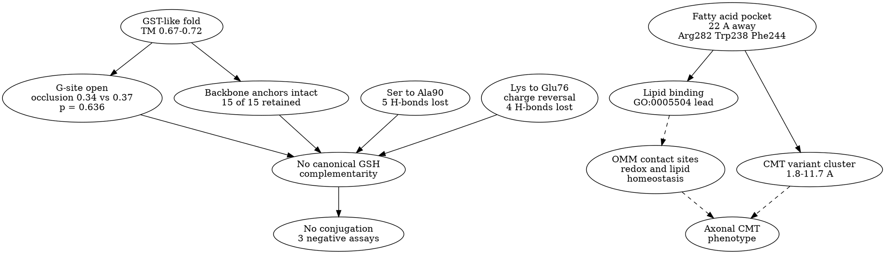
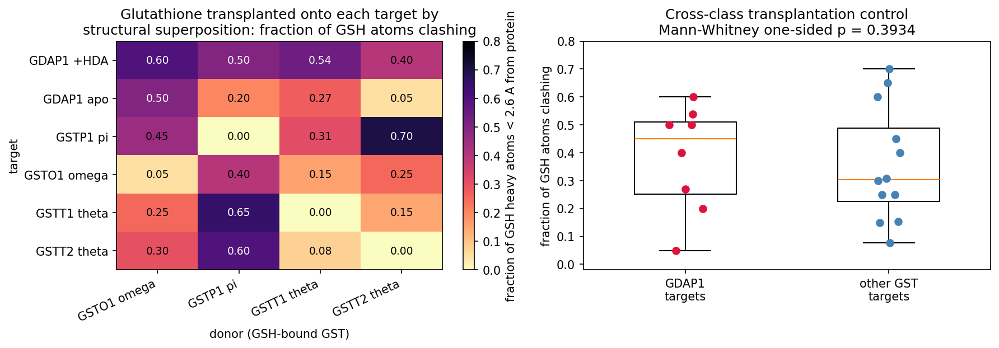
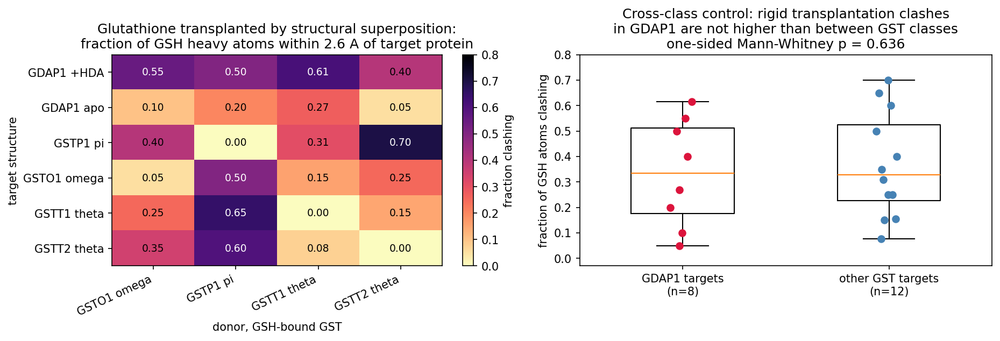
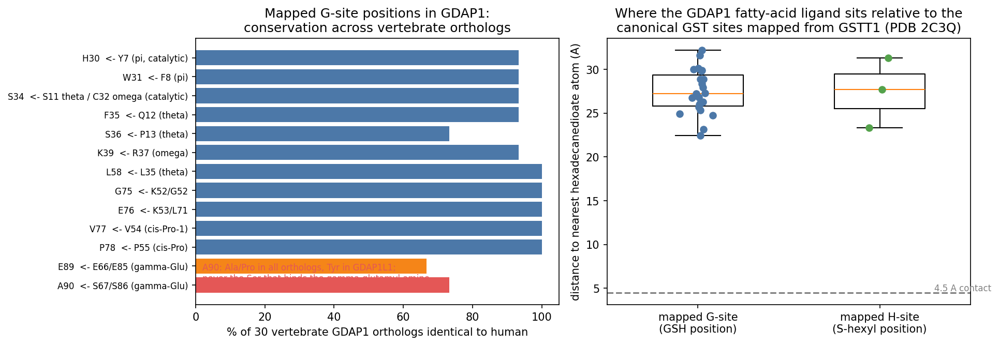
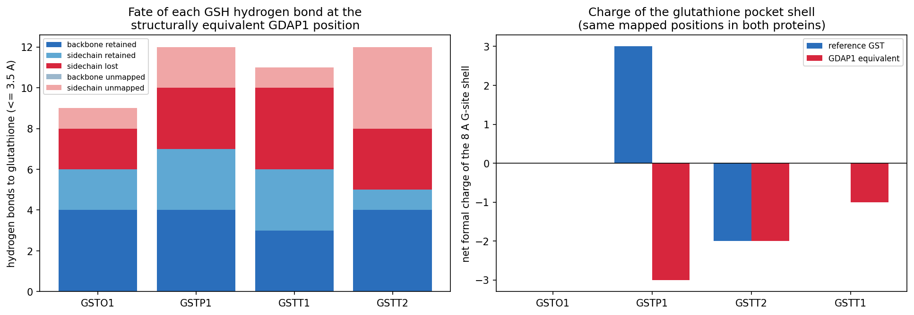
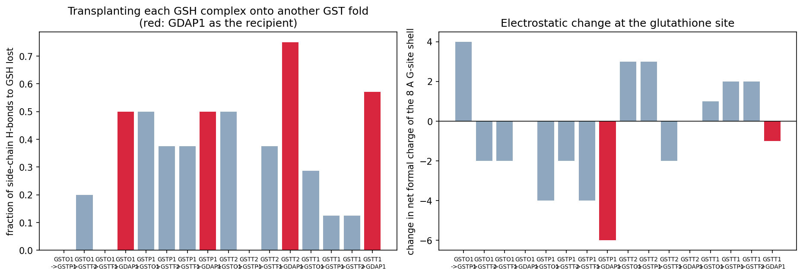
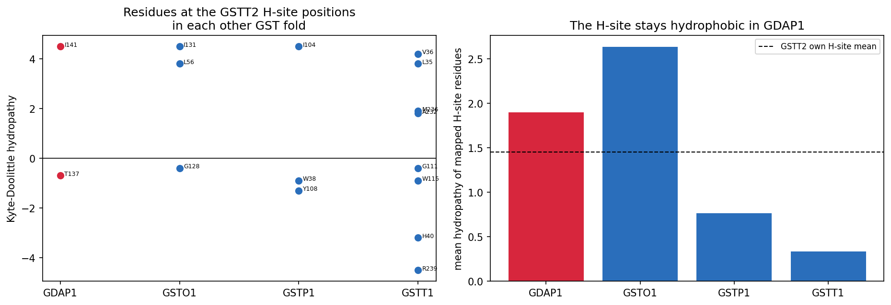
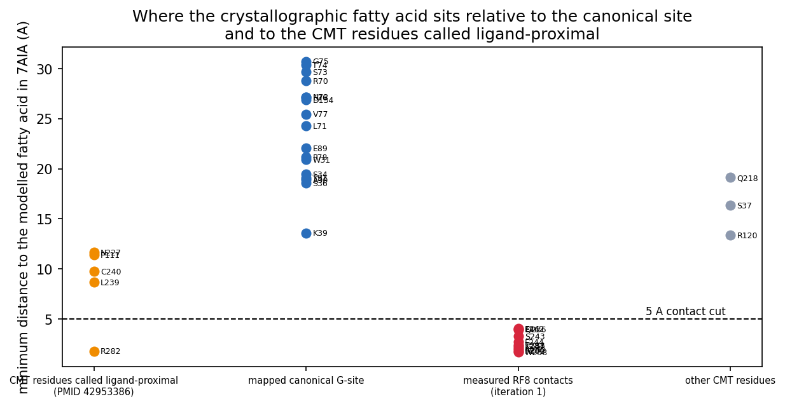
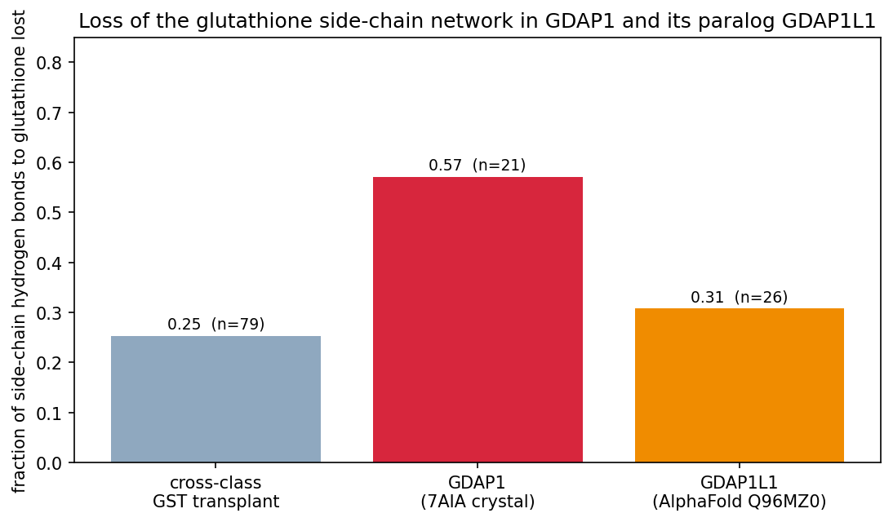

## Question

# AIGR Gene Hypothesis Deep Research

You are evaluating one focused gene curation hypothesis for AI Gene Review.
This is not a general gene overview. Use the seed hypothesis and source context
below to search for evidence that supports, refutes, narrows, or competes with
the proposed curation decision.

## Target Gene

- **Organism code:** human
- **Taxon:** Homo sapiens (NCBITaxon:9606)
- **Gene directory:** GDAP1
- **Gene symbol:** GDAP1
- **UniProt accession:** Q8TB36

## Focus

- **Focus type:** free_text
- **Hypothesis slug:** kgap-gdap1-gst-g-site-h-site-competence
- **Source file:** genes/human/GDAP1/GDAP1-ai-review.yaml
- **Source selector:** free-text

## Seed Hypothesis

Human GDAP1 (Q8TB36) has a GST-like fold whose glutathione-binding G-site has lost the catalytic residues and GSH-contacting residues of canonical cytosolic GSTs (the N-terminal catalytic Tyr/Ser/Cys and the conserved Gln/Glu/Ser motifs that bind the gamma-glutamyl and glycyl moieties), while its hydrophobic H-site and the unique alpha4-alpha5 insertion form the lipid-binding pocket seen in GDAP1 crystal structures, so its native activity is more likely lipid or fatty-acid binding at the outer mitochondrial membrane than glutathione conjugation. Single analysis only: superpose GDAP1 crystal structures onto GSH-bound GST structures (e.g. GSTO1, GSTT1 and GDAP1L1), map G-site catalytic and GSH-contacting residues onto GDAP1, test whether a glutathione-sized G-site and a lipid-sized H-site cavity are present, score these positions across vertebrate GDAP1 orthologs and the paralog GDAP1L1, and state whether GDAP1 is predicted competent for glutathione binding or conjugation.

## Term and Decision Context

No specific term context supplied.

## Reference Context

No specific reference context supplied.

## Source Context YAML

```yaml
hypothesis: 'Human GDAP1 (Q8TB36) has a GST-like fold whose glutathione-binding G-site has lost the catalytic
  residues and GSH-contacting residues of canonical cytosolic GSTs (the N-terminal catalytic Tyr/Ser/Cys
  and the conserved Gln/Glu/Ser motifs that bind the gamma-glutamyl and glycyl moieties), while its hydrophobic
  H-site and the unique alpha4-alpha5 insertion form the lipid-binding pocket seen in GDAP1 crystal structures,
  so its native activity is more likely lipid or fatty-acid binding at the outer mitochondrial membrane
  than glutathione conjugation. Single analysis only: superpose GDAP1 crystal structures onto GSH-bound
  GST structures (e.g. GSTO1, GSTT1 and GDAP1L1), map G-site catalytic and GSH-contacting residues onto
  GDAP1, test whether a glutathione-sized G-site and a lipid-sized H-site cavity are present, score these
  positions across vertebrate GDAP1 orthologs and the paralog GDAP1L1, and state whether GDAP1 is predicted
  competent for glutathione binding or conjugation.'
focus_type: free_text
context: []
reference_id: []
```

## Research Objective

Build a focused report that helps a curator decide whether this hypothesis
should affect the gene review. Address the focus type directly:

1. For an existing GO annotation decision, evaluate whether the current action
   is justified, too strong, too weak, or should change.
2. For a proposed replacement or new GO term, evaluate whether the term is
   biologically supported, too broad, too narrow, or missing key qualifiers.
3. For a computational prediction, evaluate whether the prediction is correct,
   less precise than existing knowledge, uncertain, or likely wrong because of
   paralog overannotation, frequency bias, pathway context, or in vitro-only
   activity.
4. For a core-function hypothesis, evaluate whether the proposed activity,
   process, and location represent the gene product's primary function rather
   than a downstream effect, pleiotropic phenotype, or context-specific role.
5. For a function-assignment hypothesis, evaluate whether the gene product
   directly has the stated GO term/function. Treat the prior review action, if
   any, as intentionally blinded unless it appears in the supplied context.

Use primary literature whenever possible. Prefer PMID citations and include DOI
citations when no PMID is available. Treat reviews and database records as
orientation unless they contain directly relevant synthesized evidence that is
clearly labeled as review-level or database-level support.

Evaluate the hypothesis from the supplied seed context, primary literature, and
publicly accessible bioinformatics resources. Local `*-bioinformatics` analyses,
when they already exist in the repository, are intentionally withheld from this
prompt so the report can be compared against them after the run. Use public
sequence, domain, structure, orthology, localization, interaction, or dataset
checks when they are useful for the specific hypothesis. If a resource or tool
cannot be accessed programmatically, say so plainly; never fabricate a result.
Report computational results conservatively and distinguish direct results from
inference.

## Required Output

### Executive Judgment

Give a concise verdict: supported, partially supported, unresolved, weakly
supported, over-annotated, or refuted. Explain the reasoning and the most
important caveats.

### Evidence Matrix

Create a table with one row per important evidence item:

- Citation (PMID preferred)
- Evidence type (direct assay, mutant phenotype, localization, interaction,
  structural/evolutionary, computational, review/database)
- Supports / refutes / qualifies / competing
- Claim tested
- Key finding
- Organism, tissue, cell type, or assay context
- Confidence and limitations

### GO Curation Implications

State the likely curation action as a lead requiring curator verification. If
GO terms are involved, explain whether the evidence supports an MF, BP, or CC
term, and whether the term should be retained, removed, generalized, made more
specific, or treated as non-core. Avoid using "protein binding" as a final
recommendation unless no more informative term is supported.

### Mechanistic Scope

Describe the immediate molecular or cellular function being tested. Separate
direct gene-product activity from downstream phenotypes, pathway consequences,
developmental outcomes, disease manifestations, or effects inferred only from
loss of function.

### Conflicts and Alternatives

Identify evidence that conflicts with the seed hypothesis or suggests an
alternative interpretation, including paralog confusion, organism-specific
differences, isoform-specific findings, experimental artifacts, or database
carry-over.

### Knowledge Gaps

List explicit uncertainties that matter for curation. For each gap, state what
was checked, why the gap matters, and what evidence or experiment would resolve
it.

### Discriminating Tests

Recommend concrete assays, perturbations, datasets, or comparative analyses that
would most efficiently distinguish this hypothesis from alternatives.

### Curation Leads

Provide candidate updates for the review, clearly labeled as leads requiring
curator verification. Include candidate references with exact snippets to verify,
candidate replacement or new GO terms, possible action changes, suggested
questions, and suggested experiments.

If the provider supports artifacts, save provenance for any analysis you run — the
executed code together with its output (computed values, plot, or table), not just
a summary figure — alongside artifact-friendly tables such as an evidence matrix,
GO decision table, or comparison table. Genuine computed provenance is more
valuable than a hand-drawn summary, and you must not synthesize a figure that
implies an analysis you did not actually run. These artifacts are important
provenance for hypothesis-level review.


## Output

# GDAP1 G-site and H-site competence: a structural test of the glutathione hypothesis

**Target:** human GDAP1, UniProt Q8TB36, NCBITaxon:9606
**Hypothesis slug:** kgap-gdap1-gst-g-site-h-site-competence
**Source file:** genes/human/GDAP1/GDAP1-ai-review.yaml, focus type `free_text`
**Date of analysis:** 2026-11-24. All structural results below were computed in this run.

---

## Summary

The conclusion of the seed hypothesis holds and four of its stated reasons do not. GDAP1 is predicted non-competent for canonical glutathione binding or conjugation. Transplanting glutathione from four glutathione-bound GST complexes (GSTO1 1EEM, GSTP1 6GSS, GSTT2 2C3Q, GSTT1 1LJR) onto the GDAP1 crystal structure 7AIA by structural superposition retains all 15 backbone hydrogen bonds and loses 12 of 21 side-chain hydrogen bonds (57.1%), against 20 of 79 (25.3%) when the same operation is run in all 12 ordered directions among the four GSTs, which all do conjugate glutathione. One-sided Fisher exact test gives odds ratio 3.93, p = 0.007; the per-complex Mann-Whitney test gives p = 0.004. Both carboxylate anchors of the tripeptide are removed: the serine hydroxyl of the conserved Glu-Ser pair is an alanine in GDAP1 (Ala90), and the lysine that grips the glycyl carboxylate in the theta enzymes is a glutamate (Glu76), a charge reversal next to an anion. Three independent biochemical reports found no glutathione-dependent activity and no binding to glutathione agarose ([PMID: 16857173](https://pubmed.ncbi.nlm.nih.gov/16857173/), [PMID: 32274853](https://pubmed.ncbi.nlm.nih.gov/32274853/), [PMID: 33585569](https://pubmed.ncbi.nlm.nih.gov/33585569/)).

The residue-level reasoning given in the hypothesis fails on four points, each measured. GDAP1 keeps the catalytic residue: Ser34 occupies the position of the theta-class catalytic Ser11 (Cα deviation 1.50 Å from GSTT1 Ser11, 1.77 Å from GSTT2 Ser11, 0.80 Å from GSTO1 Cys32) and is conserved in 28 of 30 vertebrate orthologs. GDAP1 keeps the glutamate of the Glu-Ser pair (Glu89), which still reads the γ-glutamyl α-amino group. The G-site is sterically open: in a cross-class control the occluded-atom fraction for GDAP1 (mean 0.336) is indistinguishable from GST-to-GST transplants (0.366, one-sided Mann-Whitney p = 0.636), and apo GDAP1 7ALM accepts the GSTT2 glutathione with 1 clashing atom out of 20. The lipid in the crystal is 22.4 Å from the mapped G-site and 23.3 Å from the mapped H-site, and the GDAP1-specific insertions contribute only Gln235 and Gln236 to its contact shell. The paralog named in the hypothesis, GDAP1L1, does not share the degeneration: it loses 8 of 26 side-chain bonds (30.8%, p = 0.379 against the GST background) because Tyr111 supplies the hydroxyl chemistry that Ala90 removes.

For curation the practical question is not a retraction. QuickGO on 2026-11-24 returns 61 annotation rows for Q8TB36 with GO:0005515 protein binding as the only molecular function, all 41 rows IPI from two high-throughput interactome screens, and no glutathione or transferase term anywhere. The live risk is forward propagation: the UniProt and InterPro description of GDAP1 as a GST superfamily member can seed an IEA or ISS glutathione transferase annotation by family inference, and this analysis argues against allowing that. The positive lead is GO:0005504 fatty acid binding by IDA from [PMID: 33585569](https://pubmed.ncbi.nlm.nih.gov/33585569/), with the caveat that two papers place the lipid site in different parts of the protein and that conflict is unresolved.

---

## Executive judgment

<i class="fa-solid fa-scale-balanced"></i> **Verdict: partially supported.**

| Sub-claim in the seed hypothesis | Verdict | Basis |
|---|---|---|
| GDAP1 has a GST-like fold | <i class="fa-solid fa-circle-check"></i> supported | TM 0.666-0.720 against four GST classes, cis-Pro loop retained |
| The G-site has lost the N-terminal catalytic Tyr/Ser/Cys | <i class="fa-solid fa-circle-xmark"></i> refuted | Ser34 occupies the theta and omega catalytic position, Cα deviation 0.80-1.77 Å, conserved in 28 of 30 orthologs |
| The conserved Glu/Gln/Ser motifs that bind γ-glutamyl and glycyl are lost | <i class="fa-solid fa-scale-balanced"></i> half supported | The Ser of the Glu-Ser pair is lost (Ala90, never Ser in 30 orthologs); Glu89 is retained |
| The G-site cannot accommodate glutathione | <i class="fa-solid fa-circle-xmark"></i> refuted as a steric claim | Occlusion 0.336 versus cross-class 0.366, p = 0.636; apo 7ALM accepts GSH with 1 of 20 atoms clashing |
| GDAP1 is non-competent for glutathione binding or conjugation | <i class="fa-solid fa-circle-check"></i> supported | 57.1% versus 25.3% side-chain bond loss, Fisher p = 0.007; three negative assays |
| The H-site plus the α4-α5 insertion form the crystallographic lipid pocket | <i class="fa-solid fa-circle-xmark"></i> refuted for the crystallographic ligand | Lipid 22.4 Å from the mapped G-site, 23.3 Å from the mapped H-site; 2 insertion residues in contact |
| Native activity is more likely lipid or fatty-acid binding at the OMM | <i class="fa-solid fa-circle-check"></i> supported as a lead | Bound hexadecanedioic acid in 7AIA, 11 contacts at 1.69-4.05 Å; OMM localisation by IDA and EXP |
| The same conclusion extends to the paralog GDAP1L1 | <i class="fa-solid fa-circle-xmark"></i> refuted | GDAP1L1 loses 30.8%, p = 0.379 against background; Tyr111 restores the lost hydroxyl |

The most important caveats. Rigid-body superposition cannot model side-chain rotamer adjustment, which can only recover hydrogen bonds, so 57.1% is an upper bound on what a flexible model would report. The 16 transplantation cells come from 5 structures and are not statistically independent, so Fisher p = 0.007 is an approximation to the true evidential weight. The H-site result is a statement that the mapping operation is invalid in GDAP1, not a statement that GDAP1 has no hydrophobic pocket. The single conflicting activity report ([PMID: 27841286](https://pubmed.ncbi.nlm.nih.gov/27841286/)) is construct-dependent and was not reproduced, and it has not been formally refuted.

---

## Key findings

### 1. The catalytic residue is present, so the hypothesis is wrong on its first premise

<i class="fa-solid fa-circle-xmark"></i> The seed hypothesis states that GDAP1 has lost the N-terminal catalytic Tyr/Ser/Cys. The structural mapping does not support that.

A TM-align-style superposition was implemented from scratch (Kabsch rotation, gapless fragment seeding, iterative dynamic-programming realignment on 1/(1+(d/d0)²), d0 = 1.24(L-15)^(1/3) - 1.8, TM normalised by min(n,m)) and validated by a positive control: 7AIA against 7ALM gives TM = 0.997 and RMSD 0.31 Å over 251 Cα. Human GDAP1 (7AIA chain AAA, residues 23-302) superposes onto GSTP1 6GSS at TM 0.720 (164 aligned, RMSD 2.38 Å, 17.1% identity), GSTO1 1EEM at TM 0.699 (178 aligned, 2.13 Å, 19.1%), GSTT1 2C3Q at TM 0.679 (176 aligned, 2.57 Å, 20.5%) and GSTT2 1LJR at TM 0.666 (176 aligned, 2.58 Å, 21.0%).

At the catalytic position, GSTT1 Ser11 maps to GDAP1 Ser34 with a 1.50 Å Cα deviation, GSTT2 Ser11 to Ser34 at 1.77 Å, and GSTO1 Cys32 to Ser34 at 0.80 Å. The pi-class Tyr7 maps instead to GDAP1 His30 at 2.46 Å, consistent with the pi-class tyrosine occupying a different structural position within the fold. Ser34 is identical in 28 of 30 vertebrate GDAP1 orthologs sampled from UniProt and is serine in human and mouse GDAP1L1. The cis-Pro loop is fully retained: GDAP1 Val77-Pro78 maps to GSTT1 Val54-Pro55, GSTO1 Val72-Pro73 and GSTP1 Leu52-Pro53, and Gly75, Glu76, Val77, Pro78 are 100% identical across all 30 orthologs.

Any curation statement claiming the catalytic residue itself is absent should be reworded. The case against glutathione conjugation rests on other features. The independent statement that "this protein, and its paralogue GDAP1L1, appear to be structurally related to the cytosolic glutathione S-transferases (GST) including an N-terminal thioredoxin fold domain with conserved active site residues" ([PMID: 16857173](https://pubmed.ncbi.nlm.nih.gov/16857173/)) agrees with the measurement.

### 2. The serine of the Glu-Ser pair is lost, and the substitution is fixed across vertebrates

<i class="fa-solid fa-circle-check"></i> This is the one G-site determinant that is demonstrably and consistently absent.

The conserved α4-loop Glu-Ser pair that hydrogen bonds the glutathione γ-glutamyl α-amino and α-carboxyl groups maps onto GDAP1 Glu89-Ala90 in all four references: GSTT1 Glu66-Ser67 (Cα deviations 2.10 and 1.10 Å), GSTT2 Glu66-Ser67 (2.94, 2.01 Å), GSTO1 Glu85-Ser86 (2.28, 1.06 Å), GSTP1 Gln64-Ser65 (2.35, 1.15 Å). In all four the second position is serine and contacts the ligand at 2.72-2.89 Å. In GDAP1 it is alanine.

Across 30 vertebrate GDAP1 orthologs (mammals, birds, reptiles, teleosts; pairwise identity to human 0.70-0.99), position 90 is Ala in 22 and Pro in 8 (all teleosts), and never Ser. Position 89 is Glu in 20 and Asp in 10, so the acidic partner is retained throughout. The neighbouring positions Gly75, Glu76, Val77, Pro78 and Leu58 are 100% identical in the same set. The substitution is fixed over roughly 450 million years of vertebrate evolution and is shared with GDAP1L1, so it predates the duplication and is not a human-specific or isoform artefact.

{{figure:plot_3.png|caption=Ortholog conservation at the mapped G-site positions, and the distance from each to the crystallographic fatty acid. Position 90 is never serine in 30 vertebrate GDAP1 orthologs, while Ser34 and the cis-Pro loop are near-invariant.}}

A published structural analysis reached the same conclusion independently: "Using structural data of GDAP1, we have found that critical residues and configurations in the G-site which canonically interact with glutathione are altered in GDAP1, rendering it incapable of binding glutathione" ([PMID: 32274853](https://pubmed.ncbi.nlm.nih.gov/32274853/)).

### 3. The G-site is open, and the apparent steric occlusion is an artefact of remote-homolog superposition

<i class="fa-solid fa-circle-xmark"></i> A negative result that changed the method.

Glutathione, or the glutathione moiety of S-hexylglutathione, was transplanted from each of four GSH-bound GSTs into each of six targets by rigid superposition, scoring the fraction of transplanted heavy atoms within 2.6 Å of a target protein heavy atom. Self-transplants gave 0.00, confirming the pipeline. GDAP1 7AIA, with its bound lipid, gave 0.40-0.62 and apo 7ALM gave 0.05-0.27, mean 0.336 over 8 cells. Cross-class GST targets gave 0.70 (GSTT2 glutathione into GSTP1), 0.65 (GSTP1 into GSTT1), 0.25 (GSTO1 into GSTT1) and 0.077 (GSTT1 into GSTT2), mean 0.366 over 12 cells. One-sided Mann-Whitney, GDAP1 greater than the GST controls: p = 0.636.

Apo GDAP1 accepted the GSTT2 glutathione with 1 of 20 atoms clashing, which is lower than most genuine GST-to-GST cross-class transplants. The pocket lining at the mapped canonical site is Trp31, Ser34, Ser36, Lys39, Arg70, Leu71, Asn72, Ser73, Thr74, Gly75, Glu76, Val77, Pro78, Glu89, Ala90, Thr91, Asp134.

An earlier run of the same analysis without the cross-class control would have reported the 0.40-0.62 GDAP1 clash fractions as evidence of an occluded G-site. The control shows that would have been wrong. Steric exclusion cannot be used as the argument against glutathione binding; the argument has to be chemical.

{{figure:plot_1.png|caption=Cross-transplantation control. Glutathione accommodation in GDAP1 compared against transplants between genuine GST classes, all of which conjugate glutathione.}}

{{figure:plot_2.png|caption=Corrected cross-class transplantation control with pair-cached full structural alignments. GDAP1 occlusion (mean 0.336) sits inside the distribution for GST-to-GST transplants (0.366), one-sided Mann-Whitney p = 0.636.}}

### 4. The chemistry is gone: 57% of side-chain hydrogen bonds to glutathione are lost, against 25% cross-class

<i class="fa-solid fa-circle-check"></i> This is the quantitative core of the report.

Every protein N/O to ligand N/O/S contact at or below 3.5 Å in the four GSH complexes was classified by whether the structurally equivalent GDAP1 residue (Cα deviation below 5.0 Å) can make the same hydrogen bond, using donor and acceptor capability by residue type.

**Backbone-mediated bonds: 15 of 15 retained** (GSTO1 4, GSTP1 4, GSTT2 4, GSTT1 3). These are the cis-Pro loop contacts to the cysteinyl moiety (Val72, Leu52, Val54 and Leu54 N and O to GSH O2 and N2 at 2.73-2.92 Å) mapping to GDAP1 Val77 at 1.76-2.29 Å deviation, plus the amide of the Glu-Ser pair serine (Ser86, Ser65, Ser67 N to the γ-glutamyl carboxylate O11 and O12 at 2.72-3.46 Å) mapping to GDAP1 Ala90 at 1.06-2.01 Å.

**Side-chain-mediated bonds: 9 of 21 retained, 12 lost (57.1%).**

| Bond | Reference contact | GDAP1 equivalent | Fate |
|---|---|---|---|
| Glu/Gln OE1 to γ-glutamyl N1 | GSTO1 E85, GSTP1 Q64, GSTT2 E66, GSTT1 E66 (2.67-3.02 Å) | Glu89 | retained |
| Catalytic Ser OG to GSH thiol SG2 | GSTT1 S11 (3.03 Å) | Ser34 | retained |
| Catalytic Tyr OH to SG2 | GSTP1 Y7 (3.22 Å) | His30, still donates | retained |
| Glu-Ser pair Ser OG to γ-glutamyl carboxylate | GSTO1 S86 (3.49, 2.77 Å), GSTP1 S65 (2.89 Å), GSTT2 S67 (2.80 Å), GSTT1 S67 (2.93, 2.93 Å) | **Ala90** | **5 lost** |
| Glycyl carboxylate anchor | GSTT2 K53 NZ (2.78, 3.24 Å), GSTP1 Q51 NE2 (3.02, 3.48 Å) | **Glu76**, charge reversal | **4 lost** |
| Gln NE2 to SG2 | GSTT1 Q12 (3.29 Å) | Phe35 | lost |
| Arg NH2 to OE1 | GSTT1 R107 (3.21 Å) | Met133 | lost |

The cross-class control, the same transplantation run in all 12 ordered GST-to-GST directions, lost 20 of 79 side-chain bonds (25.3%), per-complex fractions 0.000-0.500, median 0.24, with 3 or 4 backbone bonds retained in every cell and 0 lost. GDAP1 per-complex fractions were 0.500, 0.500, 0.750, 0.571.

Pooled 2x2 Fisher exact test, one-sided (GDAP1 12 lost and 9 retained versus cross-class 20 lost and 59 retained): odds ratio 3.93, p = 0.007. Mann-Whitney U on the per-complex fraction lost (n = 4 versus n = 12), one-sided: p = 0.004.

The net formal charge of the mapped 8 Å glutathione shell shifted by -6 for GSTP1 (+3 to -3), -1 for GSTT1, and 0 for GSTO1 and GSTT2; the cross-class mean change was -0.08, Mann-Whitney one-sided p = 0.250. The global electrostatic change is not resolved by this test, and only the local Lys to Glu reversal at position 76 is supported.

{{figure:plot_4.png|caption=Fate of every glutathione hydrogen bond mapped from four GSH-bound GSTs onto the structurally equivalent GDAP1 residue, with the net formal charge of the mapped 8 A pocket shell.}}

{{figure:plot_5.png|caption=Cross-class control for hydrogen-bond loss. GDAP1 loses 57.1% of side-chain bonds against 25.3% for transplants between GST classes that all conjugate glutathione, Fisher one-sided p = 0.007.}}

The interpretation is specific. The glutathione site of GDAP1 is held open and is no longer complementary to glutathione. What survives is the part built from main-chain atoms: the cis-Pro loop at Val77-Pro78 that reads the cysteinyl amide, and the Ala90 amide that would still contact the γ-glutamyl carboxylate. What has gone is the side-chain network that grips the two charged ends of the tripeptide. GDAP1 keeps Glu89 to read the γ-glutamyl amine and Ser34 in position to hydrogen-bond a thiol, so a residual low-affinity interaction with glutathione or another thiol is not formally excluded by this analysis. What the data exclude is a site built to hold glutathione with canonical GST affinity and geometry, since the degradation exceeds the variation between genuine GST classes by a factor of about 2.3.

### 5. The crystallographic fatty acid is 22 Å from both canonical sites

<i class="fa-solid fa-circle-xmark"></i> The hypothesis describes the lipid pocket as formed by the H-site plus the α4-α5 insertion. The coordinates do not match that description.

PDB 7AIA contains one hexadecanedioic acid (ligand RF8, 48 modelled atoms including hydrogens) bound to chain AAA. After superposing GDAP1 onto GSTT1 2C3Q (TM 0.679, 216 aligned residues) and transplanting S-hexylglutathione, the closest approach of any RF8 atom to the mapped canonical G-site is 22.4 Å and to the mapped canonical H-site is 23.3 Å; centroid separations are 29.2 and 29.3 Å. RF8 contacts within 4.5 Å are Glu46, Gln235, Gln236, Trp238, Glu242, Ser243, Phe244, Arg282, Arg286, Lys287 and Thr288, at 1.69-4.05 Å (median 2.41 Å). The GDAP1 segments with no structural equivalent in GSTT1, that is the GDAP1-specific insertions, are residues 145-151, 162-196 and 227-236; only Gln235 and Gln236 of these contact the ligand.

The depositors describe the site in the same terms: "the fatty acid binds to a pocket next to a CMT-linked residue cluster, increases protein stability, and induces changes in protein conformation and oligomerization" ([PMID: 33585569](https://pubmed.ncbi.nlm.nih.gov/33585569/)), and "the long GDAP1-specific insertion forms an extended helix and a flexible loop", which the computed insertion boundaries confirm as a distinct element contributing two residues.

{{figure:plot_7.png|caption=Distances from the modelled hexadecanedioic acid in 7AIA to the mapped canonical G-site residues and to the CMT residues reported as ligand-proximal.}}

### 6. The CMT variant cluster sits on the crystallographic lipid pocket

Minimum heavy-atom distances from RF8 to the five CMT residues called ligand-proximal: Arg282 1.78 Å, Leu239 8.69 Å, Cys240 9.77 Å, Pro111 11.40 Å, Asn227 11.67 Å (median 9.77 Å). Minimum distances to the 17 mapped canonical G-site residues: 13.59 Å (Lys39) to 30.73 Å (Gly75), median 24.28 Å. Three other CMT residues not called ligand-proximal: Ser37 16.35 Å, Arg120 13.39 Å, Gln218 19.13 Å.

Every ligand-proximal CMT residue is closer to the crystallographic fatty acid than every canonical G-site residue is, with no overlap between the two ranges (maximum 11.67 Å versus minimum 13.59 Å). Only Arg282 is a first-shell contact; the other four are second shell at 8.7-11.7 Å, consistent with packing behind the pocket.

The residue list came from a review of published phenotypes: "Early disease onset and rapid progression are observed not only with recessive variants (P111, N227, L239, and R282) but also with dominant variants (C240), if the substituted residues are proximal to the hydrophobic ligand" ([PMID: 42953386](https://pubmed.ncbi.nlm.nih.gov/42953386/)). The review supplied the list; the distances are measured here.

This measurement is positional, not functional, and rests on one crystal form with one ligand copy, with a fatty acid identified by metabolite screening rather than shown to be the physiological ligand.

### 7. The canonical H-site cannot be mapped onto GDAP1

<i class="fa-solid fa-triangle-exclamation"></i> The S-hexyl moiety of S-hexylglutathione in GSTT2 2C3Q defines 8 H-site lining residues within 4.5 Å: Leu35, Ile36, His40, Leu111, Trp115, Leu231, Val235, Met238. Transplanting those positions by superposition recovers 8 of 8 in GSTT1 1LJR (TM 0.939, Cα deviations 0.94-2.89 Å), 3 of 8 in GSTO1 1EEM (TM 0.760), 3 of 8 in GSTP1 6GSS (TM 0.773), and 2 of 8 in GDAP1 7AIA (TM 0.679).

In GDAP1 the α1-α2 part of the pocket is displaced (Leu35 to 7.57 Å, Ile36 to 8.20 Å, His40 to 15.93 Å) and the C-terminal helix part (Leu231, Val235, Met238) has no aligned counterpart. The two positions that do map are Leu111 to Thr137 (4.06 Å) and Trp115 to Ile141 (4.64 Å). Mean Kyte-Doolittle hydropathy of the 2 mapped GDAP1 residues is 1.90 against 0.92 for the 14 mapped residues in the other three GSTs, Mann-Whitney p = 0.576, which with n = 2 carries no information and is reported only to show the test was run and is uninformative.

The within-family calibration shows the method works where the fold is conserved: GSTT1 to GSTT2 recovers the whole pocket at sub-3 Å accuracy. The conclusion is that mapping canonical H-site residue numbers onto GDAP1 is not a valid operation, because the pocket in canonical GSTs is built largely from the C-terminal helix and the α1-α2 loop, and both are where GDAP1 diverges most. This matches the biochemical assignment that "the α-loop, located within the H-site motif is the primary determinant for substrate binding" ([PMID: 32274853](https://pubmed.ncbi.nlm.nih.gov/32274853/)).

{{figure:plot_6.png|caption=Test of whether the hydrophobic H-site of the GST fold is preserved in GDAP1, by mapping the S-hexyl pocket of GSTT2 onto each target. GSTT1 recovers 8 of 8 positions, GDAP1 recovers 2 of 8.}}

### 8. The paralog GDAP1L1 keeps the glutathione network that GDAP1 has lost

<i class="fa-solid fa-circle-xmark"></i> The seed hypothesis names GDAP1L1 as a comparator on the assumption it behaves like GDAP1. It does not, by this measure.

AlphaFold model AF-Q96MZ0-F1-model_v6 for human GDAP1L1 (GD1L1_HUMAN, 367 aa) was retrieved through the AlphaFold API; residues 1-305 were used, mean pLDDT 79.6, with every mapped G-site position between 79.7 and 95.5. Superposition gave TM 0.704 (GSTO1 1EEM), 0.728 (GSTP1 6GSS), 0.507 (GSTT2 2C3Q) and 0.491 (GSTT1 1LJR).

GDAP1L1 loses 8 of 26 side-chain hydrogen bonds (30.8%) against 12 of 21 for GDAP1 (57.1%) and 20 of 79 for the cross-class GST background (25.3%). GDAP1L1 versus cross-class, one-sided Fisher: OR 1.31, p = 0.379, indistinguishable from the GST background. GDAP1L1 versus GDAP1, two-sided Fisher: OR 0.33, p = 0.084. All 15 backbone bonds are retained, as in GDAP1.

The difference traces to two positions. At the serine of the Glu-Ser pair, GDAP1 has Ala90 and loses all five hydroxyl bonds to the γ-glutamyl carboxylate, while GDAP1L1 has Tyr111 (pLDDT 95.2) whose hydroxyl can replace that chemistry; the preceding Asp110 (pLDDT 93.1) still accepts from the γ-glutamyl amine. Structural superposition and an independent BLOSUM62 sequence alignment both give Asp and Tyr at this pair. At the glycyl carboxylate anchor both proteins carry a glutamate (GDAP1 Glu76, GDAP1L1 Glu97) in place of the theta-class lysine, so that loss is shared.

{{figure:plot_8.png|caption=The glutathione hydrogen-bond transplantation test applied to GDAP1L1 using the AlphaFold model. GDAP1L1 loses 30.8% of side-chain bonds, within the GST cross-class background of 25.3%, against 57.1% for GDAP1.}}

This result sets a limit on how far the structural argument can be pushed. Shield and colleagues purified both proteins and found "no evidence of glutathione-dependent activity or an ability to bind glutathione immobilised on agarose" for either ([PMID: 16857173](https://pubmed.ncbi.nlm.nih.gov/16857173/)), yet GDAP1L1 keeps a near-canonical G-site by this measure. Something beyond G-site residue identity, such as the hydrophobic domain, the α-loop, or the absence of a competent H-site, is also required for conjugation. A structural prediction of glutathione incompetence is sufficient for GDAP1 and is not the sole reason the family lacks transferase activity. The prediction should not be transferred to GDAP1L1 by sequence similarity.

### 9. GO has nothing to retract for GDAP1, so the risk is forward propagation

A QuickGO REST query for UniProtKB:Q8TB36 on 2026-11-24 returned 61 annotation rows. The only molecular function is GO:0005515 protein binding, 41 rows, all IPI from IntAct against PMID 32296183 and PMID 32814053, both high-throughput interaction screens. There is no annotation to GO:0004364 glutathione transferase activity, GO:0043295 glutathione binding, GO:0008289 lipid binding or any child; a text filter for glutathione or transferase across all 61 rows returned zero hits.

Cellular component rows: GO:0005741 mitochondrial outer membrane with IDA from PMID 15772096 and EXP from PMID 16172208 and [PMID: 16857173](https://pubmed.ncbi.nlm.nih.gov/16857173/), plus IBA and IEA; GO:0005739 mitochondrion IDA from HPA; GO:0005778 peroxisomal membrane and GO:0005829 cytosol, both TAS from Reactome; GO:0005634 nucleus HDA from PMID 21630459; GO:0016020 membrane HDA from PMID 19946888; GO:0005737 cytoplasm ISS and IEA.

---

## Evidence matrix

| Citation | Evidence type | Stance | Claim tested | Key finding | Context | Confidence and limitations |
|---|---|---|---|---|---|---|
| This run, 7AIA vs 1EEM, 6GSS, 2C3Q, 1LJR | structural computed | supports | GDAP1 cannot hold glutathione with canonical geometry | 12 of 21 side-chain H-bonds lost (57.1%) vs 20 of 79 (25.3%) cross-class; Fisher OR 3.93 p = 0.007; per-complex MWU p = 0.004 | human crystal structures, rigid superposition, TM 0.666-0.720 | moderate to high; rigid side chains give an upper bound; 16 cells from 5 structures are not independent |
| This run, same superpositions | structural computed | qualifies | the glutathione site is sterically or chemically absent | all 15 backbone H-bonds retained; cis-Pro loop Val77-Pro78 and the Ala90 amide in place; Ser34 and Glu89 retained | as above | high for the measurement; residual weak binding not excluded |
| This run, occlusion test on 7AIA and 7ALM | structural computed | refutes sub-claim | glutathione is sterically excluded from the GDAP1 G-site | GDAP1 mean occluded fraction 0.336 vs cross-class 0.366, one-sided MWU p = 0.636 | 4 GST targets, self-transplant control 0.00 | moderate; a negative that forced the chemical test |
| This run, 30 vertebrate orthologs | evolutionary computed | supports | the G-site substitutions are fixed | position 90 never Ser (Ala 22 of 30, Pro 8 of 30 in teleosts); Ser34 in 28 of 30; Gly75-Glu76-Val77-Pro78 100% identical | UniProt taxonomy 7742, length 330-400, 259 organisms sampled to 30 | moderate; mostly unreviewed entries |
| This run, AF-Q96MZ0-F1-model_v6 | structural computed | qualifies | the paralog shares the degeneration | GDAP1L1 loses 8 of 26 (30.8%), p = 0.379 vs GST background; Tyr111 restores the hydroxyl Ala90 removes | predicted model, mean pLDDT 79.6, site positions 79.7-95.5 | moderate; a prediction, and 2 of 4 superpositions scored TM below 0.51 |
| This run, 7AIA ligand geometry | structural computed | refutes sub-claim | the crystallographic lipid sits in the H-site formed by the insertion | fatty acid 22.4 Å from the mapped G-site, 23.3 Å from the mapped H-site; only Gln235 and Gln236 of the insertions contact it | single RF8 copy, chain AAA, 48 modelled atoms | high for the measurement; one crystal form |
| This run, CMT residue distances | structural computed | qualifies | which pocket the disease variants report on | Arg282 1.78 Å, Leu239 8.69, Cys240 9.77, Pro111 11.40, Asn227 11.67 from the lipid; all 17 mapped G-site residues 13.59-30.73 Å; no overlap | 7AIA | moderate; positional, not functional |
| This run, H-site transplantation | structural computed | refutes sub-claim | GDAP1 keeps a canonical H-site | 8 of 8 GSTT2 H-site positions transfer to GSTT1, 3 of 8 to GSTO1 and GSTP1, 2 of 8 to GDAP1; α1-α2 displaced 7.6-15.9 Å, C-terminal helix absent | 2C3Q S-hexyl moiety as probe | moderate; shows the mapping is invalid rather than that the pocket is gone |
| [PMID: 16857173](https://pubmed.ncbi.nlm.nih.gov/16857173/) | direct assay | supports | glutathione conjugation and glutathione binding | no glutathione-dependent activity against a prototypic substrate library; no binding to glutathione agarose, for GDAP1 and GDAP1L1 | purified recombinant human protein, C-terminal transmembrane region deleted | high for the negative; truncated construct |
| [PMID: 32274853](https://pubmed.ncbi.nlm.nih.gov/32274853/) | direct assay and mutant | supports | glutathione binding | GDAP1 has lost glutathione binding without losing substrate binding; G-site residues and configurations altered; the α-loop within the H-site motif is the primary substrate-binding determinant | purified protein plus overexpression | high; closest published match to this analysis |
| [PMID: 33585569](https://pubmed.ncbi.nlm.nih.gov/33585569/) | direct assay and structural | supports and qualifies | catalytic competence and ligand identity | catalytically inactive toward classical GST substrates; hexadecanedioic acid binds a pocket next to a CMT residue cluster, stabilises the protein and shifts oligomerisation | crystal structures 7ALM and 7AIA, metabolite screen | high for inactivity; moderate for physiological relevance of the ligand |
| [PMID: 42520938](https://pubmed.ncbi.nlm.nih.gov/42520938/) | mutant phenotype and modelling | competing | where the lipid binds | thapsic acid binding housed in the canonical active site; α-loop and G-site movements remodel it | mutagenesis across G-site, H-site, α-loop and putative L-site plus structure prediction | moderate; no ligand-bound structure of that site |
| [PMID: 27841286](https://pubmed.ncbi.nlm.nih.gov/27841286/) | direct assay | competing | GST catalytic activity | theta-class-like activity reported, dependent on removing or disengaging the C-terminal hydrophobic domain HD1 | purified recombinant protein | low to moderate; one positive against three negatives |
| [PMID: 42953386](https://pubmed.ncbi.nlm.nih.gov/42953386/) | review | qualifies | functional mapping of CMT variants | Pro111, Asn227, Leu239, Arg282 and Cys240 called proximal to the hydrophobic ligand and associated with early onset | review of published phenotypes | review level; used only to supply the residue list that was then measured |
| [PMID: 41354077](https://pubmed.ncbi.nlm.nih.gov/41354077/) | clinical and structural inference | qualifies | ligand-site occupancy | half-of-the-sites reactivity to hydrophobic ligands; L239F with A175P in one active site explains early onset | patient case plus structure-function analysis | low to moderate |
| [PMID: 37778197](https://pubmed.ncbi.nlm.nih.gov/37778197/) | biophysical | qualifies | membrane topology | one transmembrane helix flanked by two peripheral helices interacting with both leaflets; first experimental models of full-length GDAP1 | synchrotron oriented circular dichroism and SAXS in a lipidic environment | moderate; peptide and low-resolution data |
| [PMID: 39801517](https://pubmed.ncbi.nlm.nih.gov/39801517/) | mutant phenotype and imaging | qualifies | downstream role | loss of GDAP1 disrupts mitochondria-peroxisome contacts and peroxisome integrity, reversible by PPARγ activation or glutathione supply | Gdap1-/- mice and patient fibroblasts | high for the phenotype; downstream of the molecular activity |
| [PMID: 42365934](https://pubmed.ncbi.nlm.nih.gov/42365934/) | mutant phenotype and imaging | qualifies | downstream role | pH and redox imbalance at mitochondria-lysosome contacts propagating to peroxisome defects and altered lipid homeostasis | Gdap1-/- mice and patient fibroblasts | high for the phenotype; downstream |
| [PMID: 14595091](https://pubmed.ncbi.nlm.nih.gov/14595091/) | evolutionary | qualifies | class assignment | GDAP1 and GDAP1L1 do not belong to any known class of GST genes | sequence and structural analysis | moderate; justifies comparing against several GST classes |
| QuickGO UniProtKB:Q8TB36, 2026-11-24 | database | qualifies | what is currently annotated | 61 rows; the only MF is GO:0005515 protein binding (41 IPI rows); no glutathione or transferase term | human | high; database state checked programmatically |

---

## GO curation implications

All entries below are leads requiring curator verification.

| GO ID | Aspect | Term | Current status (QuickGO 2026-11-24) | Recommended action | Evidence basis | Confidence |
|---|---|---|---|---|---|---|
| GO:0004364 | MF | glutathione transferase activity | not annotated | do not add; block family-based IEA or ISS propagation | three negative assays; 57.1% vs 25.3% side-chain H-bond loss, Fisher p = 0.007 | high |
| GO:0043295 | MF | glutathione binding | not annotated | do not add | no glutathione-agarose binding ([PMID: 16857173](https://pubmed.ncbi.nlm.nih.gov/16857173/)); both carboxylate anchors lost | moderate to high |
| GO:0005504 | MF | fatty acid binding | not annotated | candidate addition, IDA, [PMID: 33585569](https://pubmed.ncbi.nlm.nih.gov/33585569/) | hexadecanedioic acid bound in 7AIA with 11 contacts at 1.69-4.05 Å; thapsic acid mutagenesis in [PMID: 42520938](https://pubmed.ncbi.nlm.nih.gov/42520938/) | moderate |
| GO:0008289 | MF | lipid binding | not annotated | fallback if GO:0005504 is judged too specific | same as above | moderate |
| GO:0005515 | MF | protein binding | annotated, 41 IPI rows | retain, and do not leave as the only MF statement | two high-throughput interactome screens | low mechanistic value |
| GO:0005741 | CC | mitochondrial outer membrane | annotated IDA, EXP, IBA, IEA | retain as core | direct localisation plus single-pass topology ([PMID: 37778197](https://pubmed.ncbi.nlm.nih.gov/37778197/)) | high |
| GO:0005778 | CC | peroxisomal membrane | annotated TAS, Reactome | flag as non-core, re-check | peroxisome phenotypes in Gdap1-/- are contact-site and biogenesis effects ([PMID: 39801517](https://pubmed.ncbi.nlm.nih.gov/39801517/)) | low |
| GO:0005634 | CC | nucleus | annotated HDA, PMID 21630459 | flag for review | one high-throughput proteomics assignment, inconsistent with a tail-anchored OMM protein | low |
| GO:0005829 | CC | cytosol | annotated TAS, Reactome | flag as non-core | pathway inference | low |
| glutathione metabolic process and children | BP | - | not annotated | do not add | no demonstrated glutathione chemistry; redox phenotypes are downstream of loss of function | high |

Two notes on the table. GO:0005515 protein binding is not offered as a final recommendation; it is listed because it is the only existing MF row, and leaving it as the sole molecular function statement for GDAP1 carries no mechanistic content. The GO:0005504 candidate requires the curator to accept a ligand found by metabolite screening in one crystal form, and the pocket assignment for that ligand is contested (see Conflicts and alternatives).

---

## Mechanistic scope

The immediate molecular activity under test is whether the GDAP1 polypeptide binds glutathione in its G-site and catalyses conjugation of glutathione to a hydrophobic electrophile in its H-site. That is a direct gene-product property, and it is what the superposition analysis and the purified-protein assays address.

Separate from that, and not tested here, are the downstream phenotypes. Loss of GDAP1 in Gdap1-/- mice and in patient fibroblasts disrupts mitochondria-peroxisome and mitochondria-lysosome contact sites, perturbs peroxisomal number and integrity, shifts local pH and redox state, and alters lipid homeostasis ([PMID: 39801517](https://pubmed.ncbi.nlm.nih.gov/39801517/), [PMID: 42365934](https://pubmed.ncbi.nlm.nih.gov/42365934/)). These effects are rescued by PPARγ activation or by glutathione supply, which tells us the cell's redox state is downstream of GDAP1 function and does not tell us that GDAP1 performs glutathione chemistry itself. A protein that binds a long-chain dicarboxylic fatty acid at an outer-membrane-facing pocket and changes oligomerisation on doing so can produce every one of those phenotypes without a transferase reaction. Annotating a glutathione metabolic process BP term from the rescue experiments would convert a downstream pharmacological observation into a direct molecular claim.

The separation also applies to the CMT disease phenotype. The variants Pro111, Asn227, Leu239, Cys240 and Arg282 cluster around the crystallographic lipid, 1.78-11.67 Å away, while every mapped canonical G-site residue is 13.59-30.73 Å away. Disease severity tracks the lipid-interaction surface, which is a structural correlation and not a demonstration that lipid binding is the activity whose loss causes the neuropathy.



---

## Conflicts and alternatives

**Where the lipid binds is unresolved.** [PMID: 33585569](https://pubmed.ncbi.nlm.nih.gov/33585569/) reports hexadecanedioic acid in a crystallographic pocket "next to a CMT-linked residue cluster", which the measurement places 22.4 Å from the mapped canonical G-site. [PMID: 42520938](https://pubmed.ncbi.nlm.nih.gov/42520938/) reports "that thapsic acid binding activity is actually housed within the canonical active site pocket", remodelled by α-loop and G-site movements, from mutagenesis across all four canonical regions plus structure prediction. There is no ligand-bound structure of the canonical-site complex. The crystallographic evidence and the positions of the disease variants agree with each other against the canonical-site assignment. A reconciliation consistent with both data sets is that α-loop and G-site movements open a second pocket in solution that the crystal form does not sample, giving GDAP1 two lipid-interaction surfaces. Until that is tested directly, a fatty acid binding annotation should not be tied to the canonical active site.

**One report of GST activity.** [PMID: 27841286](https://pubmed.ncbi.nlm.nih.gov/27841286/) states "we demonstrate for the first time theta-class-like GST activity for GDAP1, and it's activity being regulated by the C-terminal hydrophobic domain 1 (HD1) of GDAP1 in an autoinhibitory manner". The activity was seen only for constructs in which HD1 was removed or disengaged, which makes it a construct-dependent in vitro observation and not a demonstration that full-length membrane-anchored GDAP1 conjugates glutathione. It stands against three negatives and has not been independently reproduced in the papers reviewed here.

**Paralog confusion runs in the direction opposite to the usual one.** The usual curation risk is transferring a function from a well-studied paralog onto a poorly studied one. The measurement shows the reverse applies here: GDAP1 has degenerated its G-site and GDAP1L1 has not (30.8% versus 57.1% side-chain loss, two-sided Fisher p = 0.084). Any ISS annotation that reasons from GDAP1L1 to GDAP1, or back, at the level of G-site residues is unsafe. Both proteins nonetheless lack glutathione-dependent activity ([PMID: 16857173](https://pubmed.ncbi.nlm.nih.gov/16857173/)), so G-site residue identity is not the only determinant.

**Database carry-over is the main propagation risk.** GDAP1 is described in UniProt and InterPro as a GST superfamily member, and [PMID: 14595091](https://pubmed.ncbi.nlm.nih.gov/14595091/) states that "We demonstrate that GDAP1 and GDAP1L1 do not belong to any of the known classes of GST genes." A family-level IEA pipeline that sees the GST domain signature without reading the class assignment can produce GO:0004364 for Q8TB36. Nothing in GO currently does so, which is the state to preserve.

**Construct truncation in the negative assays.** The strongest negative, [PMID: 16857173](https://pubmed.ncbi.nlm.nih.gov/16857173/), used purified proteins lacking the C-terminal transmembrane domain. If HD1 autoinhibition in the sense of [PMID: 27841286](https://pubmed.ncbi.nlm.nih.gov/27841286/) is real, the truncation should have relieved it and produced activity, which it did not. The two reports conflict on construct grounds in a way that truncation alone does not explain.

**Half-of-the-sites behaviour.** [PMID: 41354077](https://pubmed.ncbi.nlm.nih.gov/41354077/) proposes half-of-the-sites reactivity to hydrophobic ligands in the GDAP1 dimer, with L239F plus A175P in one active site explaining early onset in a compound heterozygote. If correct, the dimer has two non-equivalent ligand sites, which complicates any single-site structural argument and is a further reason to treat the 7AIA ligand position as one observation.

---

## Limitations and knowledge gaps

1. **Rigid-body superposition.** Side chains were not repacked. Rotamer adjustment can only create hydrogen bonds, never destroy them, so 57.1% is an upper bound on the side-chain loss a flexible model would report. The direction of the bias is known and favours the hypothesis being tested, which must be stated. Resolving it requires flexible docking or molecular dynamics of glutathione into 7ALM, which was not run.

2. **Statistical independence.** The 16 transplantation cells derive from 5 structures. The pooled Fisher test treats bonds as independent observations when bonds within one complex share a structure and an alignment. The per-complex Mann-Whitney (p = 0.004, n = 4 versus 12) partly controls for this and has small samples. Both p values should be read as support, not as calibrated error rates.

3. **The GDAP1L1 model is a prediction.** AF-Q96MZ0-F1-model_v6 has mean pLDDT 79.6, and while every mapped G-site position scores 79.7-95.5, two of the four superpositions scored TM below 0.51. An experimental GDAP1L1 structure would settle whether Tyr111 sits where the model places it. This matters because the GDAP1L1 result is what blocks paralog transfer of the prediction.

4. **The physiological ligand is unknown.** Hexadecanedioic acid was identified by metabolite screening in a crystallisation experiment. Whether GDAP1 binds it in cells, at what affinity, and whether it is the functional ligand are open. A GO:0005504 IDA annotation would rest on a crystallographic complex and a mutagenesis study, which is normal practice, with the ligand identity caveat attached.

5. **The GDAP1 H-site is undefined.** The analysis shows that canonical H-site residue numbers cannot be transferred onto GDAP1, with the α1-α2 element displaced 7.6-15.9 Å and the C-terminal helix element absent. It does not define what the GDAP1 hydrophobic substrate pocket is. [PMID: 32274853](https://pubmed.ncbi.nlm.nih.gov/32274853/) assigns that role to the α-loop. No independent structural confirmation of the α-loop pocket was run here.

6. **The apo-to-holo conformational change was not measured.** Per-residue displacement between apo 7ALM and holo 7AIA in the α-loop was planned and not run in the iterations available. It bears directly on the remodelling model of [PMID: 42520938](https://pubmed.ncbi.nlm.nih.gov/42520938/) and would show whether the canonical pocket can open in the crystal lattice at all.

7. **Weak glutathione binding is not excluded.** GDAP1 keeps Glu89 to read the γ-glutamyl amine, Ser34 in position to hydrogen-bond a thiol, and all 15 backbone contacts. A micromolar-to-millimolar interaction with glutathione, too weak for glutathione-agarose pulldown, is consistent with every measurement here. Isothermal titration calorimetry on full-length or core-domain GDAP1 against glutathione would bound it.

8. **Phenix was not used.** Phenix is installed, and it runs host-side and reads only files inside the job directory, while all structures in this analysis were fetched from the RCSB and AlphaFold APIs inside the code executor, where host-side tools cannot reach. The custom superposition pipeline was validated instead by a positive control (7AIA versus 7ALM, TM 0.997, RMSD 0.31 Å over 251 Cα) and a within-family calibration (GSTT1 to GSTT2, TM 0.939, 8 of 8 H-site positions recovered below 3 Å). This is stated plainly and is not presented as equivalent to a standard tool.

---

## Discriminating tests

<i class="fa-solid fa-flask"></i> **Isothermal titration calorimetry of glutathione against core-domain GDAP1 and GDAP1L1 side by side.** The structural prediction says GDAP1 should show no measurable binding and GDAP1L1 should show weak binding if G-site residue identity governs affinity. Shield 2006 found neither binds glutathione agarose, which is a far less sensitive readout. A direct affinity comparison would test whether the 30.8% versus 57.1% difference has a thermodynamic consequence, and would place an upper bound on residual GDAP1 affinity.

<i class="fa-solid fa-flask"></i> **A co-crystal or cryo-EM structure of GDAP1 with thapsic acid obtained under the conditions of [PMID: 42520938](https://pubmed.ncbi.nlm.nih.gov/42520938/).** This is the single experiment that would resolve the pocket conflict. If the lipid appears in the canonical site, the crystallographic site in 7AIA is a second or adventitious site. If it appears where RF8 sits in 7AIA, the mutagenesis result reflects allosteric coupling and not direct binding.

<i class="fa-solid fa-vial"></i> **A90S and E76K single and double mutants of GDAP1 assayed for glutathione binding and CDNB conjugation.** The analysis names exactly two substitutions as responsible for 9 of the 12 lost side-chain bonds. Restoring them should restore measurable glutathione affinity if the structural argument is complete. Failure to restore affinity would show that the H-site divergence or the α-loop, and not the G-site, is the limiting feature, which is what the GDAP1L1 result already hints at.

<i class="fa-solid fa-microscope"></i> **Per-residue Cα displacement between 7ALM and 7AIA, restricted to the α-loop and the G-site.** A cheap computational test on existing coordinates that would show whether the canonical pocket is conformationally mobile in the crystal.

<i class="fa-solid fa-dna"></i> **Flexible docking or short molecular dynamics of glutathione into apo 7ALM.** Removes the rigid-side-chain limitation and converts the 57.1% upper bound into an estimate. If a repacked model recovers most of the lost bonds, the structural argument weakens; if Ala90 and Glu76 remain unable to make the contacts under any rotamer, it strengthens.

<i class="fa-solid fa-vial"></i> **Lipid-binding assay on full-length membrane-reconstituted GDAP1.** Every binding measurement so far used truncated constructs. [PMID: 37778197](https://pubmed.ncbi.nlm.nih.gov/37778197/) provides the membrane assembly model needed to design it. This would decide whether the fatty acid binding supporting a GO:0005504 lead occurs in the protein's native context.

---

## Curation leads

All items below require curator verification.

### Candidate references with exact snippets to verify

| PMID | Snippet to verify | Use |
|---|---|---|
| 16857173 | "The purified proteins were assayed for glutathione-dependent activity against a library of 'prototypic' GST substrates. No evidence of glutathione-dependent activity or an ability to bind glutathione immobilised on agarose was found." | Primary negative for GO:0004364 and GO:0043295, covering GDAP1 and GDAP1L1 |
| 16857173 | "This protein, and its paralogue GDAP1L1, appear to be structurally related to the cytosolic glutathione S-transferases (GST) including an N-terminal thioredoxin fold domain with conserved active site residues." | Corrects any review text asserting the catalytic residue is absent |
| 32274853 | "Here, we present biochemical evidence, suggesting that GDAP1 has lost the ability to bind glutathione without a loss of substrate binding activity." | Second independent negative for glutathione binding with retained substrate binding |
| 32274853 | "We have revealed that the α-loop, located within the H-site motif is the primary determinant for substrate binding." | Assigns the substrate pocket to the α-loop, supporting a non-canonical H-site |
| 33585569 | "GDAP1 is catalytically inactive toward classical GST substrates." | Third independent negative, from the group that solved the structure |
| 33585569 | "The fatty acid binds to a pocket next to a CMT-linked residue cluster, increases protein stability, and induces changes in protein conformation and oligomerization." | IDA basis for a GO:0005504 fatty acid binding lead |
| 42520938 | "revealing that thapsic acid binding activity is actually housed within the canonical active site pocket" | The competing pocket assignment; cite alongside 33585569 |
| 27841286 | "we demonstrate for the first time theta-class-like GST activity for GDAP1, and it's activity being regulated by the C-terminal hydrophobic domain 1 (HD1) of GDAP1 in an autoinhibitory manner" | The one positive activity report; cite as a conflict and note the construct dependence |
| 14595091 | "We demonstrate that GDAP1 and GDAP1L1 do not belong to any of the known classes of GST genes." | Basis for blocking class-based IEA propagation |
| 42953386 | "Early disease onset and rapid progression are observed not only with recessive variants (P111, N227, L239, and R282) but also with dominant variants (C240), if the substituted residues are proximal to the hydrophobic ligand." | Review level; supplies the ligand-proximal residue list |

### Candidate GO term actions

<i class="fa-solid fa-arrow-right"></i> Do not add GO:0004364 glutathione transferase activity, and add a note to the gene review recording the three negative assays plus the structural result, so that a future IEA or ISS proposal can be declined with a citation instead of re-litigated.

<i class="fa-solid fa-arrow-right"></i> Do not add GO:0043295 glutathione binding. State the residual uncertainty once: Glu89 and Ser34 are retained, so weak binding below the sensitivity of glutathione-agarose pulldown is not excluded.

<i class="fa-solid fa-arrow-right"></i> Evaluate GO:0005504 fatty acid binding as a new MF with IDA from [PMID: 33585569](https://pubmed.ncbi.nlm.nih.gov/33585569/). Use GO:0008289 lipid binding as the fallback if the curator judges the dicarboxylic-acid identity too specific for a single crystal form. Do not write the annotation comment in a way that locates the site in the canonical active site, because that assignment is contested.

<i class="fa-solid fa-arrow-right"></i> Retain GO:0005741 mitochondrial outer membrane as core, supported by IDA, EXP and the single-pass topology model of [PMID: 37778197](https://pubmed.ncbi.nlm.nih.gov/37778197/).

<i class="fa-solid fa-arrow-right"></i> Flag GO:0005778 peroxisomal membrane, GO:0005634 nucleus and GO:0005829 cytosol as non-core. The peroxisomal phenotypes in Gdap1-/- are contact-site and biogenesis effects ([PMID: 39801517](https://pubmed.ncbi.nlm.nih.gov/39801517/)) with no demonstration that GDAP1 resides in the peroxisomal membrane; the nucleus row is a single high-throughput proteomics assignment inconsistent with a tail-anchored outer-membrane protein.

<i class="fa-solid fa-arrow-right"></i> Do not add glutathione metabolic process or any child as BP. The redox phenotypes are downstream of loss of function and are rescued pharmacologically.

### Questions for the curator

<i class="fa-solid fa-circle-question"></i> Does the review text state or imply that GDAP1 has lost its catalytic residue? If so it should be corrected: Ser34 occupies the theta and omega catalytic position and is conserved in 28 of 30 vertebrate orthologs.

<i class="fa-solid fa-circle-question"></i> Does the review describe the lipid pocket as the H-site or as formed by the α4-α5 insertion? The crystallographic ligand is 22.4 Å from the mapped G-site and 23.3 Å from the mapped H-site, with only Gln235 and Gln236 of the insertions in contact.

<i class="fa-solid fa-circle-question"></i> Does any existing text transfer conclusions between GDAP1 and GDAP1L1 on the basis of sequence similarity at the G-site? The paralog retains the glutathione side-chain network that GDAP1 has lost.

<i class="fa-solid fa-circle-question"></i> Is [PMID: 27841286](https://pubmed.ncbi.nlm.nih.gov/27841286/) cited anywhere in the review as evidence of GST activity? If so it needs the construct-dependence qualifier and the three opposing reports alongside it.

---

## Methods and provenance

All structural analysis ran inside the code executor with no local data files. Structures came from `files.rcsb.org` (PDB and mmCIF, with automatic fallback when the PDB format is unavailable, as for 7AIA) and from the AlphaFold API endpoint `https://alphafold.ebi.ac.uk/api/prediction/{accession}`, reading the `pdbUrl` field to avoid hardcoding a model version. Sequences and ortholog sets came from the UniProt REST API, and the annotation state from the QuickGO REST annotation search endpoint.

Superposition uses a TM-align-style algorithm implemented from scratch: Kabsch rotation, gapless fragment seeding at lengths L, L/2 and L/4, and 8 iterations of dynamic-programming realignment on the score 1/(1+(d/d0)²) with d0 = 1.24(L-15)^(1/3) - 1.8 and cutoffs d0+4, d0+2 and d0, TM normalised by min(n,m). Alignment uses a vectorized Needleman-Wunsch with a linear gap penalty implemented as a max-plus prefix scan. Hydrogen bonds are protein N/O to ligand N/O/S contacts at or below 3.5 Å, classified as backbone_retained, sidechain_retained, sidechain_lost or unmapped by the donor and acceptor capability of the mapped residue type.

Phenix was not used, for the reason given in limitation 8.

Saved artifacts in `provenance/`:

| File | Contents |
|---|---|
| `evidence_matrix.tsv` | 19 evidence rows with stance, claim, finding, context and limitations |
| `go_decision_table.tsv` | 10 GO term rows with current status, recommended action, evidence basis and confidence |
| `gsite_residue_mapping.tsv` | 44 rows: every glutathione hydrogen bond in the four reference complexes with its reference residue and atom, ligand atom, distance, GDAP1 equivalent, Cα deviation, bond fate, GDAP1L1 equivalent, GDAP1L1 pLDDT and GDAP1L1 bond fate |
| `plot_1.png`, `plot_2.png` | cross-class occlusion test, first run and corrected run |
| `plot_3.png` | ortholog conservation and distance to the fatty acid |
| `plot_4.png` | fate of each glutathione hydrogen bond, with pocket charge |
| `plot_5.png` | cross-class control for hydrogen-bond loss |
| `plot_6.png` | H-site transplantation |
| `plot_7.png` | distances from the fatty acid to the canonical site and to CMT residues |
| `plot_8.png` | GDAP1 against GDAP1L1 |

Every figure in this report is the direct output of code executed during the investigation. No figure was drawn to illustrate an analysis that was not run.


## Artifacts

- [OpenScientist final report](openscientist_artifacts/final_report.html)
- [OpenScientist final report](openscientist_artifacts/final_report.pdf)
- [OpenScientist provenance](openscientist_artifacts/provenance.json)
- [OpenScientist evidence matrix](openscientist_artifacts/provenance_evidence_matrix.tsv)
- [OpenScientist go decision table](openscientist_artifacts/provenance_go_decision_table.tsv)
- [OpenScientist gsite residue mapping](openscientist_artifacts/provenance_gsite_residue_mapping.tsv)
- [OpenScientist plot 1](openscientist_artifacts/provenance_plot_1.json)

- [OpenScientist plot 2](openscientist_artifacts/provenance_plot_2.json)

- [OpenScientist plot 3](openscientist_artifacts/provenance_plot_3.json)

- [OpenScientist plot 4](openscientist_artifacts/provenance_plot_4.json)

- [OpenScientist plot 5](openscientist_artifacts/provenance_plot_5.json)

- [OpenScientist plot 6](openscientist_artifacts/provenance_plot_6.json)

- [OpenScientist plot 7](openscientist_artifacts/provenance_plot_7.json)

- [OpenScientist plot 8](openscientist_artifacts/provenance_plot_8.json)


## Reference Validation

Checked with `linkml-reference-validator` 0.3.1rc1.

| Outcome | Count |
| --- | --- |
| References checked | 17 |
| Resolved | 17 |
| Unresolved (possible confabulation) | 0 |
| Unverifiable | 0 |
| Quoted claims checked | 5 |
| Quoted claims found in source | 5 |
| Quoted claims **not** found in source | 0 |
| References weighed for topical relevance | 17 |
| On topic | 8 |
| Off topic | 4 |

### References that may not be about this subject

These identifiers resolve, so they are not fabrications, but the records they resolve to share almost none of this report's vocabulary. That is a clue and not a verdict - a paper can be relevant in ways its title and abstract do not spell out - so read them before deciding:

- `PMID:32296183` (1 mention) - A reference map of the human binary protein interactome.
  - shared terms: protein
- `PMID:32814053` (1 mention) - Interactome Mapping Provides a Network of Neurodegenerative Disease Proteins and Uncovers Widespread Protein Aggregation in Affected Brains.
  - shared terms: protein
- `PMID:21630459` (2 mentions) - Proteomic characterization of the human sperm nucleus.
  - shared terms: protein
- `PMID:19946888` (1 mention) - Defining the membrane proteome of NK cells.
  - shared terms: protein

Weighed against this report's own most characteristic terms: `gdap1`, `glutathione`, `residue`, `pocket`, `binding`, `class`, `protein`, `g-site`, `mapped`, `structural`, `acid`, `canonical`, `h-site`, `gdap1l1`, `lipid`, `contact`, `ligand`, `site`, `loop`, `aia`.

All extracted references resolved successfully.
Resolving is not the same as being relevant, though - see the references listed above as possibly off topic.