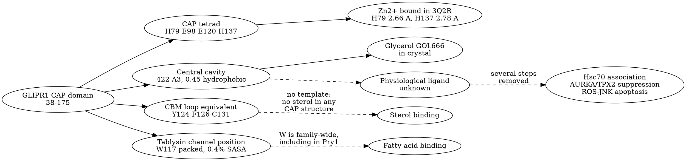
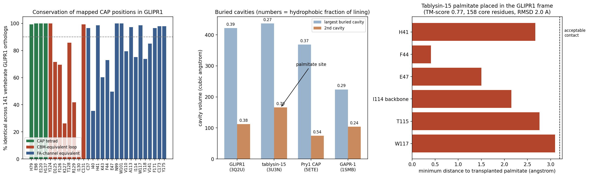
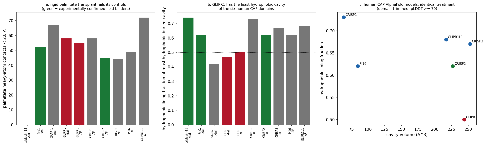
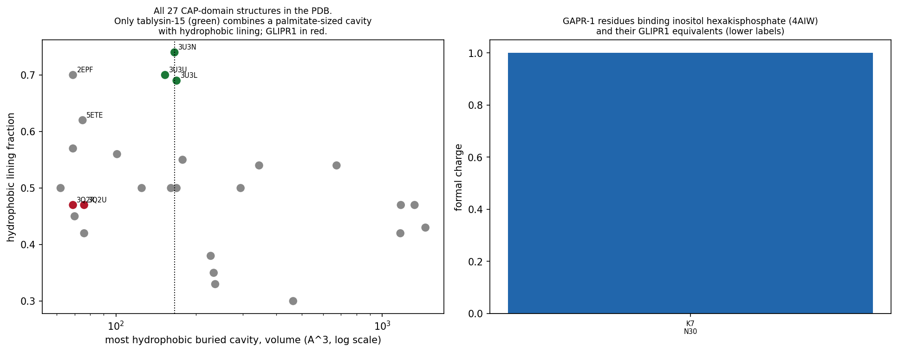

## Question

# AIGR Gene Hypothesis Deep Research

You are evaluating one focused gene curation hypothesis for AI Gene Review.
This is not a general gene overview. Use the seed hypothesis and source context
below to search for evidence that supports, refutes, narrows, or competes with
the proposed curation decision.

## Target Gene

- **Organism code:** human
- **Taxon:** Homo sapiens (NCBITaxon:9606)
- **Gene directory:** GLIPR1
- **Gene symbol:** GLIPR1
- **UniProt accession:** P48060

## Focus

- **Focus type:** free_text
- **Hypothesis slug:** kgap-glipr1-cap-lipid-binding-sites
- **Source file:** genes/human/GLIPR1/GLIPR1-ai-review.yaml
- **Source selector:** free-text

## Seed Hypothesis

Human GLIPR1 (P48060) CAP domain retains the two lipid-binding features characterised in CAP superfamily proteins, the caveolin-binding-motif sterol-binding loop shown for yeast Pry1 and tablysin-15-like proteins and the hydrophobic palmitate/fatty-acid-binding channel between helices, alongside its zinc-coordinating His/Glu cavity, so its initiating biochemical action is plausibly binding of a sterol or fatty-acid lipid. Single analysis only: align the GLIPR1 CAP domain with Pry1, tablysin-15, GAPR-1 and human CRISP and PI16 proteins, map the caveolin-binding-motif aromatic residues, the fatty-acid-channel lining residues and the CAP tetrad His/Glu residues onto the GLIPR1 crystal structure or AlphaFold model, measure whether a ligand-sized hydrophobic channel is present, score these positions across vertebrate GLIPR1 orthologs, and state which CAP ligand-binding features GLIPR1 is predicted to retain.

## Term and Decision Context

No specific term context supplied.

## Reference Context

No specific reference context supplied.

## Source Context YAML

```yaml
hypothesis: 'Human GLIPR1 (P48060) CAP domain retains the two lipid-binding features characterised in
  CAP superfamily proteins, the caveolin-binding-motif sterol-binding loop shown for yeast Pry1 and tablysin-15-like
  proteins and the hydrophobic palmitate/fatty-acid-binding channel between helices, alongside its zinc-coordinating
  His/Glu cavity, so its initiating biochemical action is plausibly binding of a sterol or fatty-acid
  lipid. Single analysis only: align the GLIPR1 CAP domain with Pry1, tablysin-15, GAPR-1 and human CRISP
  and PI16 proteins, map the caveolin-binding-motif aromatic residues, the fatty-acid-channel lining residues
  and the CAP tetrad His/Glu residues onto the GLIPR1 crystal structure or AlphaFold model, measure whether
  a ligand-sized hydrophobic channel is present, score these positions across vertebrate GLIPR1 orthologs,
  and state which CAP ligand-binding features GLIPR1 is predicted to retain.'
focus_type: free_text
context: []
reference_id: []
```

## Research Objective

Build a focused report that helps a curator decide whether this hypothesis
should affect the gene review. Address the focus type directly:

1. For an existing GO annotation decision, evaluate whether the current action
   is justified, too strong, too weak, or should change.
2. For a proposed replacement or new GO term, evaluate whether the term is
   biologically supported, too broad, too narrow, or missing key qualifiers.
3. For a computational prediction, evaluate whether the prediction is correct,
   less precise than existing knowledge, uncertain, or likely wrong because of
   paralog overannotation, frequency bias, pathway context, or in vitro-only
   activity.
4. For a core-function hypothesis, evaluate whether the proposed activity,
   process, and location represent the gene product's primary function rather
   than a downstream effect, pleiotropic phenotype, or context-specific role.
5. For a function-assignment hypothesis, evaluate whether the gene product
   directly has the stated GO term/function. Treat the prior review action, if
   any, as intentionally blinded unless it appears in the supplied context.

Use primary literature whenever possible. Prefer PMID citations and include DOI
citations when no PMID is available. Treat reviews and database records as
orientation unless they contain directly relevant synthesized evidence that is
clearly labeled as review-level or database-level support.

Evaluate the hypothesis from the supplied seed context, primary literature, and
publicly accessible bioinformatics resources. Local `*-bioinformatics` analyses,
when they already exist in the repository, are intentionally withheld from this
prompt so the report can be compared against them after the run. Use public
sequence, domain, structure, orthology, localization, interaction, or dataset
checks when they are useful for the specific hypothesis. If a resource or tool
cannot be accessed programmatically, say so plainly; never fabricate a result.
Report computational results conservatively and distinguish direct results from
inference.

## Required Output

### Executive Judgment

Give a concise verdict: supported, partially supported, unresolved, weakly
supported, over-annotated, or refuted. Explain the reasoning and the most
important caveats.

### Evidence Matrix

Create a table with one row per important evidence item:

- Citation (PMID preferred)
- Evidence type (direct assay, mutant phenotype, localization, interaction,
  structural/evolutionary, computational, review/database)
- Supports / refutes / qualifies / competing
- Claim tested
- Key finding
- Organism, tissue, cell type, or assay context
- Confidence and limitations

### GO Curation Implications

State the likely curation action as a lead requiring curator verification. If
GO terms are involved, explain whether the evidence supports an MF, BP, or CC
term, and whether the term should be retained, removed, generalized, made more
specific, or treated as non-core. Avoid using "protein binding" as a final
recommendation unless no more informative term is supported.

### Mechanistic Scope

Describe the immediate molecular or cellular function being tested. Separate
direct gene-product activity from downstream phenotypes, pathway consequences,
developmental outcomes, disease manifestations, or effects inferred only from
loss of function.

### Conflicts and Alternatives

Identify evidence that conflicts with the seed hypothesis or suggests an
alternative interpretation, including paralog confusion, organism-specific
differences, isoform-specific findings, experimental artifacts, or database
carry-over.

### Knowledge Gaps

List explicit uncertainties that matter for curation. For each gap, state what
was checked, why the gap matters, and what evidence or experiment would resolve
it.

### Discriminating Tests

Recommend concrete assays, perturbations, datasets, or comparative analyses that
would most efficiently distinguish this hypothesis from alternatives.

### Curation Leads

Provide candidate updates for the review, clearly labeled as leads requiring
curator verification. Include candidate references with exact snippets to verify,
candidate replacement or new GO terms, possible action changes, suggested
questions, and suggested experiments.

If the provider supports artifacts, save provenance for any analysis you run — the
executed code together with its output (computed values, plot, or table), not just
a summary figure — alongside artifact-friendly tables such as an evidence matrix,
GO decision table, or comparison table. Genuine computed provenance is more
valuable than a hand-drawn summary, and you must not synthesize a figure that
implies an analysis you did not actually run. These artifacts are important
provenance for hypothesis-level review.


## Output

# GLIPR1 (P48060) CAP domain: which lipid-binding features are actually retained?

Hypothesis under test (`kgap-glipr1-cap-lipid-binding-sites`): the human GLIPR1 CAP domain
retains the caveolin-binding-motif (CBM) sterol-binding loop of yeast Pry1 and the hydrophobic
palmitate/fatty-acid channel of tablysin-15, alongside its zinc-coordinating His/Glu cavity, so
its initiating biochemical action is plausibly binding of a sterol or a fatty-acid lipid.

## Summary

**Verdict: partially supported on the metal site, refuted in its stated structural rationale,
unresolved on the conclusion.** The hypothesis bundles three structural claims and one
functional inference, and they do not stand or fall together. GLIPR1 carries the complete CAP
tetrad (His79, Glu98, Glu120, His137), the tetrad is invariant across 141 vertebrate orthologs,
and the Zn2+ ion in PDB 3Q2R is coordinated by His79 NE2 at 2.66 A and His137 NE2 at 2.78 A with
nothing else inside 3.0 A. That part of the hypothesis is correct and directly supported by
primary coordinates.

The two lipid-binding premises do not survive examination, for reasons that differ from the ones
a first pass suggests. There is no caveolin-binding motif in the SCP domain of GLIPR1, and there
is none in CRISP1, CRISP2, CRISP3 or PI16 either. Structurally, the loop equivalent to Pry1
Y237-DFSNPG-F244 keeps 2 of 3 aromatics in GLIPR1 and exactly 2 of 3 in CRISP2, which binds
cholesterol in vitro and complements yeast *pry1 pry2* ([PMID: 23027975](https://pubmed.ncbi.nlm.nih.gov/23027975/)).
A human CAP protein with GLIPR1-level CBM degeneracy is a demonstrated sterol binder, so CBM
status has no discriminating power in either direction. The tablysin-15 acyl channel is similarly
uninformative: across all 27 CAP-domain structures in the PDB, the three tablysin-15 entries are
the only ones that combine a palmitate-sized cavity with hydrophobic lining, and the residue that
opens the channel in tablysin-15 (Gly129) is a tryptophan in all eight other CAP domains examined,
including fatty-acid-binding Pry1.

The practical result for curation is a double negative. The evidence does not support assigning
GLIPR1 a lipid, sterol or fatty-acid binding term, because the structural rationale for doing so
is wrong at the premise. The evidence does not support a NOT annotation either, because the same
structural arguments that would justify one are shown here to fail their positive controls. No
direct lipid-binding assay has been performed on GLIPR1. The defensible curation position is that
the initiating biochemical action of GLIPR1 is untested, with `zinc ion binding` (GO:0008270) or
`metal ion binding` (GO:0046872) as the better-supported structural molecular function, treated as
non-core until a physiological role for the site is shown.

## Executive judgment

<i class="fa-scale-balanced"></i> The four components of the hypothesis resolve as follows.

**1. Zinc-coordinating His/Glu cavity: supported.** <i class="fa-circle-check"></i>
GLIPR1 has the complete CAP tetrad. Superposing 3Q2U chain A onto GAPR-1 1SMB with a
TM-align-style algorithm implemented in this job (TM 0.606, 145 aligned pairs, 124 core pairs
under 5 A, core RMSD 1.70 A) maps the GAPR-1 tetrad one-to-one: His54 to His79 (CA 0.62 A),
Glu65 to Glu98 (0.66 A), Glu86 to Glu120 (1.48 A), His103 to His137 (1.00 A). Across 141
vertebrate GLIPR1 orthologs His79 is 99.3 % identical and the other three are 100 % identical.
The Zn-soaked structure 3Q2R confirms the site experimentally.

**2. CBM sterol-binding loop: the premise is factually wrong for every human CAP protein.**
<i class="fa-circle-xmark"></i> No CBM consensus (ΦXΦXXXXΦ, ΦXXXXΦXXΦ, ΦXΦXXXXΦXXΦ with Φ = W/F/Y)
occurs in the SCP domain of GLIPR1 (38-175), CRISP1 (45-175), CRISP2 (41-169), CRISP3 (43-171) or
PI16 (37-165). GLIPR1's only match, YYSVVYPGW at 217-225, is juxtamembrane and outside both the
CAP domain and the crystallised construct. Pry1 and GAPR-1 do match (YDFSNPGF at 237, YNFQQPGF at
90). The structural equivalents of the Pry1 loop keep 2 of 3 aromatics in GLIPR1 (Y124, F126, then
Cys131) and 2 of 3 in CRISP2 (F121, Y123, then Lys128), 2 of 3 in CRISP3 and GLIPR1L1, and 1 of 3
in CRISP1 and PI16.

**3. Fatty-acid channel: present only in tablysin-15, across the entire structural family.**
<i class="fa-circle-xmark"></i> All 27 PF00188 entries in the PDB were run through the same cavity
detection. Seventeen have a buried cavity of at least 150 A^3, the palmitate requirement. Ranked
by hydrophobic lining fraction, the three tablysin-15 entries take ranks 1 to 3 (3U3N 0.74, 3U3U
0.70, 3U3L 0.69), rank 4 is 5VHG at 0.55, and the gap to rank 4 exceeds the spread of ranks 4
through 17. GLIPR1 sits mid-distribution at 0.45. No non-tablysin CAP structure combines
palmitate-sized volume with hydrophobic lining.

**4. The final inference, that the initiating biochemical action of GLIPR1 is sterol or
fatty-acid binding: unresolved and currently unsupported.** <i class="fa-circle-question"></i>
The two structural features the hypothesis rests on cannot carry the inference. The ligand census
over all 27 CAP structures adds the sharpest limit: the only lipids ever seen in a CAP protein are
palmitate in 3U3L and 3U3N and the leukotriene E4 analogue EAH in 3U3U, all tablysin-15. No sterol
has been observed bound to any CAP protein in any structure, so the sterol site is inferred
entirely from mutagenesis and solution binding and there is no structural template from which it
could be transferred to GLIPR1 even in principle. The only measure that separates GLIPR1 from its
paralogs is weak: among six human CAP domains modelled and analysed identically (AlphaFold v6,
domain-trimmed, pLDDT >= 70), GLIPR1's most hydrophobic buried cavity has the lowest hydrophobic
lining fraction, 0.50, against CRISP1 0.73, GLIPR1L1 0.68, CRISP3 0.67, CRISP2 0.62 and PI16 0.62.
With n = 6, no replication and AlphaFold side chains, that is a ranking, not a result.

<i class="fa-triangle-exclamation"></i> Caveats that bound all of this. These are static
structures, so an induced-fit site would be invisible. The GLIPR1 crystal (3Q2U, 3Q2R) is one
truncated soluble construct in one crystal form with glycerol bound. The CBM mutations in Pry1
abolished cholesteryl acetate export but not cholesterol binding
([PMID: 24598142](https://pubmed.ncbi.nlm.nih.gov/24598142/)), so even an intact CBM would not
have been evidence of binding. GLIPR1 is a single-pass membrane protein (signal 1-21, SCP 38-175,
TM 233-255), unlike the secreted Pry1, tablysin-15, CRISPs and PI16, which changes what lipid pools
the domain could contact.

### What changed across the three iterations

Iteration 1 concluded that GLIPR1 had lost the fatty-acid channel because Trp117 and Phe44 occlude
it. Iteration 2 added the controls that claim needed and withdrew it: the Trp is family-wide,
including in fatty-acid-binding Pry1, and the rigid transplantation metric fails its positive
control. Iteration 3 replaced the small reference set with the complete one, every CAP-domain
structure in the PDB, censused for ligands and measured for cavities under identical settings.
The verdict on the metal site is unchanged throughout. The verdict on lipid binding moved from
"refuted" to "the structural arguments on both sides are uninformative", and then gained the
family-wide context that makes tablysin-15 an outlier rather than a representative.

## Findings in detail

### The CAP tetrad is intact, invariant, and binds zinc

Structural superposition places all four tetrad residues of GAPR-1 on GLIPR1 within 1.5 A of CA
deviation. An independent check against the Pry1 CAP crystal 5ETE (TM 0.555) reproduces three of
the four: Glu215 to Glu98 (1.32 A), Glu233 to Glu120 (1.11 A), His250 to His137 (1.27 A). Pry1
His208 falls in a loop where GLIPR1 carries an insertion, so that one position aligns poorly
(7.15 A); the GAPR-1 mapping and the direct Zn coordination in 3Q2R both identify His79
independently, so the tetrad assignment is secure. The sequence motifs in P48060 are GENI at
97-100 and GHYTQVVW at 136-143.

Ortholog scoring over 141 vertebrate GLIPR1 sequences (UniProt, GN=GLIPR1, Vertebrata, lamprey to
human, 37-100 % identity to human, median 70 %) gives His79 99.3 % identity and Glu98, Glu120 and
His137 100 % identity. The site is under strong purifying selection. It is a divalent-cation site,
not by itself evidence of lipid binding: the same tetrad binds Zn2+ in GAPR-1
([PMID: 30700571](https://pubmed.ncbi.nlm.nih.gov/30700571/)) and Mg2+ in Pry1
([PMID: 27344972](https://pubmed.ncbi.nlm.nih.gov/27344972/)).

{{figure:plot_1.png|caption=Mapping of the CAP tetrad, the Pry1 caveolin-binding-motif loop and the tablysin-15 fatty-acid channel onto the GLIPR1 crystal structure, with per-position conservation across 141 vertebrate orthologs. The tetrad positions are invariant; the loop interior between the two retained aromatics is hypervariable.}}

### The central cavity of GLIPR1 is large, polar and holds glycerol

The largest buried cavity in 3Q2U chain A is 422 A^3 with 44 lining residues and a hydrophobic
fraction of 0.45. It contains the full CAP tetrad. Of the four glycerol molecules in the structure,
GOL666 sits in this cavity contacting His79, Glu98, Asn99, Val134, Gly136 and His137. Comparable
values from the same calculation: Pry1 CAP 369 A^3 at 0.43, GAPR-1 1SMB 227 A^3 at 0.38,
tablysin-15 central cavity 437 A^3 at 0.27, which is a separate site from its 166 A^3 palmitate
channel at 0.74.

A polar cavity of this size with a divalent-cation site is consistent with a small polar or
amphipathic ligand or with a metal ion. It is a poor match to a sterol or a long-chain fatty acid.
In the crystal it holds a cryoprotectant, in contrast to tablysin-15, which copurified a fatty acid
from *E. coli* ([PMID: 22311975](https://pubmed.ncbi.nlm.nih.gov/22311975/)).

### The caveolin-binding motif is absent from every human CAP domain

The motif scan and the structural mapping agree. Restricting the regular-expression scan to the
UniProt-annotated SCP domain of each protein gives matches in Pry1 and GAPR-1 and no match in
GLIPR1, CRISP1, CRISP2, CRISP3 or PI16. GLIPR1L1 matches at a different position (YNETQFYDF at 118).
Superposing each human CAP AlphaFold model onto 5ETE (TM 0.689-0.760) and reading off the residues
equivalent to Pry1 Y237-DFSNPG-F244 gives the segments in the table below.

| Protein | TM vs Pry1 CAP | Segment | Sequence | Residues at Pry1 Y237 / F239 / F244 | Aromatics retained |
|---|---|---|---|---|---|
| Pry1 | 1.000 | 237-244 | YDFSNPGF | Y237 / F239 / F244 | 3/3 |
| GLIPR1 | 0.689 | 124-131 | YDFKTRIC | Y124 / F126 / C131 | 2/3 |
| CRISP2 | 0.736 | 121-128 | FVYGVGPK | F121 / Y123 / K128 | 2/3 |
| CRISP3 | 0.730 | 123-130 | FDFGVGPK | F123 / F125 / K130 | 2/3 |
| GLIPR1L1 | 0.706 | 124-131 | YDFDSLSC | Y124 / F126 / C131 | 2/3 |
| CRISP1 | 0.714 | 126-133 | FKHGEWTT | F126 / H128 / T133 | 1/3 |
| PI16 | 0.760 | 113-120 | YNLSAATC | Y113 / L115 / C120 | 1/3 |

GLIPR1 Tyr124 is 100 % conserved across the 141 orthologs and Phe126 is 98.6 % aromatic, but both
are buried packing residues (12.1 % and 9.8 % relative SASA in 3Q2U) rather than an exposed motif,
and the loop interior between them is hypervariable (Lys127 26.2 %, Arg129 41.8 %, Ile130 6.4 %
identical). GLIPR1 Cys131, at the third aromatic position, is disulfide-bonded to Cys135 (SG-SG
2.06 A), one of five disulfides in the domain (C75-C156, C131-C135, C151-C173, C192-C201,
C195-C206).

<i class="fa-lightbulb"></i> The decisive comparison is CRISP2. It carries exactly the same 2-of-3
degeneracy as GLIPR1, with the third position replaced by a non-aromatic (Lys128 against GLIPR1's
Cys131), and purified CRISP2 binds cholesterol in vitro
([PMID: 23027975](https://pubmed.ncbi.nlm.nih.gov/23027975/)). Any argument from CBM status to
sterol binding in a human CAP protein has to explain CRISP2 first, and none does.

{{figure:plot_2.png|caption=Palmitate transplantation with its controls, cavity hydrophobicity across human CAP paralogs, and the AlphaFold model quality used for the comparison. The tablysin-15 self-control returns zero contacts; Pry1, which binds fatty acids, fails the test as badly as GLIPR1.}}

### The tablysin-15 channel is a tablysin-specific configuration

Each CAP domain was superposed onto tablysin-15 3U3N chain C and the palmitate (PLM, 18 heavy
atoms) transplanted into the target frame by the inverse transform. The self-control gives 0
heavy-atom contacts below 2.8 A and 18 of 18 ligand atoms with at least 3.2 A clearance, so the
code is correct. Every other CAP domain fails.

| Protein | Source | TM vs tablysin | Palmitate contacts < 2.8 A | Ligand atoms with >= 3.2 A clearance | Residue at tablysin Gly129 |
|---|---|---|---|---|---|
| tablysin-15 | xtal 3U3N | 1.000 | 0 | 18/18 | G129 |
| Pry1 | xtal 5ETE | 0.727 | 52 | 0/18 | W230 |
| GAPR-1 | xtal 1SMB | 0.677 | 67 | 0/18 | W83 |
| GLIPR1 | xtal 3Q2U | 0.768 | 58 | 1/18 | W117 |
| GLIPR1 | AF P48060 | 0.810 | 55 | 1/18 | W117 |
| CRISP1 | AF P54107 | 0.858 | 58 | 0/18 | W119 |
| CRISP2 | AF P16562 | 0.832 | 45 | 4/18 | W114 |
| CRISP3 | AF P54108 | 0.829 | 44 | 5/18 | W116 |
| PI16 | AF Q6UXB8 | 0.831 | 49 | 1/18 | W106 |
| GLIPR1L1 | AF Q6UWM5 | 0.822 | 72 | 1/18 | W117 |

<i class="fa-triangle-exclamation"></i> Pry1 binds fatty acids at micromolar affinity
([PMID: 28365570](https://pubmed.ncbi.nlm.nih.gov/28365570/)) and scores no better than GLIPR1.
The rigid transplant metric therefore does not discriminate fatty-acid binders from non-binders
and cannot be used to claim GLIPR1 lost a site. What the computation does establish is narrower
and still useful: the open channel seen in the tablysin-15 crystal is created by a glycine at
position 129, and the rest of the superfamily packs a tryptophan into that space. Any fatty-acid
binding by Pry1, CRISP2 or GLIPR1 uses a site of different geometry or requires a conformational
change that a static apo structure does not show.

### No CAP protein has ever been crystallised with a sterol

An RCSB Search API v2 query for polymer entities annotated with Pfam PF00188 returns 27 distinct
entries: 1CFE, 1QNX, 1RC9, 1SMB, 1WVR, 1XTA, 1XX5, 2DDA, 2DDB, 2EPF, 2GIZ, 2VZN, 3MZ8, 3Q2R, 3Q2U,
3U3L, 3U3N, 3U3U, 4AIW, 4D53, 4IFA, 4TPV, 5ETE, 5JYS, 5VHG, 5WEE, 6IMF. A GraphQL query of their
nonpolymer components, after removing waters, ions and common cryo/buffer species and filtering
above 120 Da, finds bound ligands in six: palmitic acid in 3U3L and 3U3N, EAH in 3U3U, inositol
hexakisphosphate in 4AIW, NAG/FUC glycans in 5WEE, MES buffer in 6IMF. There is no sterol,
cholesterol, cholesteryl ester or sterol analogue anywhere in the family.

Cavity detection run identically on the largest chain of each entry gives 17 structures with a
buried cavity of at least 150 A^3. Ranked by hydrophobic lining fraction of that cavity:

| Rank | Entry | Volume (A^3) | Hydrophobic fraction |
|---|---|---|---|
| 1 | 3U3N tablysin-15 | 166 | 0.74 |
| 2 | 3U3U tablysin-15 | 153 | 0.70 |
| 3 | 3U3L tablysin-15 | 169 | 0.69 |
| 4 | 5VHG | 178 | 0.55 |
| 5 | 4IFA | 345 | 0.54 |
| 6 | 2VZN | 674 | 0.54 |
| 7 | 1CFE | 161 | 0.50 |
| 7 | 1QNX | 169 | 0.50 |
| 9 | 2DDA | 1323 | 0.47 |
| 9 | 2GIZ | 1175 | 0.47 |
| 11 | **3Q2U GLIPR1** | 422 | **0.45** |
| 11 | **3Q2R GLIPR1** | 473 | **0.45** |
| 13 | 1WVR | 1170 | 0.42 |
| 14 | 1SMB GAPR-1 | 227 | 0.38 |
| 15 | 5JYS Pry1 | 233 | 0.35 |
| 16 | 4D53 | 236 | 0.33 |
| 17 | 4TPV | 463 | 0.30 |

Cavities above roughly 1000 A^3 are interdomain or interchain clefts in the larger multidomain
entries, not CAP-internal pockets, and their hydrophobic fractions sit near the family average.

{{figure:plot_3.png|caption=Left: cavity volume against hydrophobic lining fraction for all 27 CAP-domain structures in the PDB, with tablysin-15 in green, GLIPR1 in red, and a dotted line at the 166 A^3 palmitate requirement. Right: formal charge of the GAPR-1 residues contacting inositol hexakisphosphate in 4AIW, labelled with their GLIPR1 structural equivalents.}}

### The polyanion alternative is not supported by the one structure that could support it

GAPR-1 binding to negatively charged phospholipid membranes has been proposed as a general CAP
property, which would make a phosphoinositide head group the ligand of the conserved cavity. 4AIW
is the only CAP structure with a polyanion bound. Its inositol hexakisphosphate contacts exactly
one residue within 4.0 A, Lys7 NZ at 2.73 A, on the N-terminal surface outside the tetrad cavity.
Superposing GLIPR1 3Q2U onto 4AIW (TM 0.608, 125 core pairs, core RMSD 2.02 A) places GLIPR1 Asn30
at that position, with net contact charge 0 against GAPR-1's +1. The alternative is neither
confirmed nor excluded; this structure is not evidence for it.

## Mechanistic model

The immediate molecular question is whether the GLIPR1 CAP domain presents a site that can engage
a sterol or a long-chain fatty acid. The computation addresses the geometry and chemistry of its
cavities and the conservation of the candidate site residues, nothing downstream.



What the analysis shows: GLIPR1 presents one large central cavity that contains the His/Glu tetrad
and holds glycerol and, on soaking, Zn2+; it does not present the open tablysin-15 acyl channel,
and neither does any other CAP structure except tablysin-15 itself. Everything else attributed to
GLIPR1 in the literature (apoptosis, mitotic catastrophe, c-Myc destabilisation, mesenchymal
transformation, glioma invasion) is a cellular phenotype measured after overexpression,
recombinant protein delivery or gene ablation, several steps removed from any CAP-domain
biochemistry. None of those studies tested lipid binding.

## Evidence matrix

| Citation | Evidence type | Stance | Claim tested | Key finding | Context | Confidence and limitations |
|---|---|---|---|---|---|---|
| [PMID: 21931216](https://pubmed.ncbi.nlm.nih.gov/21931216/) | Direct structural (X-ray) | Qualifies | GLIPR1 CAP cavity binds a divalent cation | 3Q2U 1.85 A, Zn-soaked 3Q2R; "the putative binding cavity coordinates Zn2+ similarly to snake-venom CRISPs"; "extensive flexible loop/turn regions and unique charge distributions that were not observed in any of the previously reported CAP protein structures" | Human GLIPR1, truncated soluble CAP domain, *E. coli* | High for the Zn site; the paper itself flags GLIPR1 as structurally atypical |
| This work, 3Q2R re-analysis | Computational on primary coordinates | Supports | Which residues coordinate Zn | Only His79 NE2 (2.66 A) and His137 NE2 (2.78 A) within 3.0 A | Crystal, Zn soak | High; direct measurement |
| This work, 141 orthologs | Evolutionary | Supports | Is the tetrad under selection | 99.3-100 % invariant, lamprey to human | Vertebrates, median 70 % identity to human | High |
| [PMID: 23027975](https://pubmed.ncbi.nlm.nih.gov/23027975/) | Direct assay plus complementation | Refutes the CBM argument | Can a human CAP protein bind cholesterol | "purified CRISP2 binds cholesterol in vitro"; rescues yeast *pry1 pry2* | Human CRISP2, yeast and in vitro | High for CRISP2; it is a secreted paralog, not GLIPR1 |
| This work, CBM scan plus Pry1 loop mapping | Computational, structural | Refutes the seed premise | Do human CAP domains retain the CBM | No consensus match in GLIPR1, CRISP1, CRISP2, CRISP3 or PI16; CRISP2 loop FVYGVGPK keeps 2/3 aromatics, identical degeneracy to GLIPR1 YDFKTRIC | 6 AlphaFold models vs Pry1 5ETE, TM 0.689-0.760 | Medium-high; sequence motif plus structural mapping, no binding data |
| [PMID: 28365570](https://pubmed.ncbi.nlm.nih.gov/28365570/) | Direct assay | Refutes the channel argument | Does the tablysin channel geometry predict fatty-acid binding | Pry1 binds fatty acids at micromolar affinity; "the mode of fatty acid binding is conserved between tablysin-15 and Pry1" | *S. cerevisiae* | High; makes Pry1 the positive control that the transplant test fails |
| This work, palmitate transplant with controls | Computational | Qualifies | Is the tablysin channel present outside tablysin-15 | Self-control 0 contacts / 18-of-18 free; Pry1 52 / 0-of-18; GLIPR1 58 / 1-of-18; GAPR-1 67 / 0-of-18; CRISP2 45 / 4-of-18. Trp at the tablysin Gly129 position in all 8 non-tablysin CAP domains | 4 crystals plus 6 AlphaFold models | Medium-high for the structural observation; the metric itself is non-discriminating and is reported as such |
| This work, paralog cavity detection | Computational | Qualifies | Does GLIPR1 differ from its paralogs in cavity chemistry | Most hydrophobic buried cavity: GLIPR1 0.50, PI16 0.62, CRISP2 0.62, CRISP3 0.67, GLIPR1L1 0.68, CRISP1 0.73; tablysin palmitate channel 0.74, recovered as a positive control with 18/18 palmitate atoms inside | Identical treatment of all six human models | Low-medium; n = 6, small spread, AlphaFold side chains |
| This work, PDB-wide ligand census | Computational over primary coordinates | Refutes the seed premise | Has a sterol ever been seen bound to a CAP protein | All 27 PF00188 entries queried for nonpolymer components: lipids only in 3U3L, 3U3N (palmitate) and 3U3U (EAH), all tablysin-15; 4AIW inositol hexakisphosphate; 5WEE glycans; 6IMF buffer; zero sterols | Complete CAP structural family | High for the census; absence of a sterol in the PDB bounds structural inference, it is not evidence about binding |
| This work, PDB-wide cavity sweep | Computational | Qualifies | Is the tablysin channel typical of the family | 17 of 27 entries have a cavity >= 150 A^3; by hydrophobic lining the three tablysin entries rank 1-3 (0.74, 0.70, 0.69), rank 4 is 5VHG at 0.55, GLIPR1 is 0.45 | Identical settings on the largest chain of every entry | Medium-high; single-chain static coordinates, calibrated only by the tablysin positive control |
| This work, 4AIW IHP mapping | Computational | Refutes a competing model | Does the CAP cavity bind a polyanion | IHP contacts one residue within 4.0 A, Lys7 NZ at 2.73 A, outside the tetrad cavity; 3Q2U onto 4AIW (TM 0.608, 2.02 A) puts GLIPR1 Asn30 there | Human GAPR-1 crystal | High for the geometry; one structure, chain A |
| [PMID: 22311975](https://pubmed.ncbi.nlm.nih.gov/22311975/) | Direct assay plus structure | Competing template | CAP proteins bind fatty acids in a hydrophobic channel | "The CAP domain also contains a hydrophobic channel that appears to bind a fatty acid molecule in the crystal structure after purification from Escherichia coli"; after delipidation binds cysteinyl leukotrienes at submicromolar affinity | Horsefly *Tabanus yao* | High for tablysin-15; it is the template, not evidence about GLIPR1 |
| [PMID: 24598142](https://pubmed.ncbi.nlm.nih.gov/24598142/) | Mutant phenotype plus binding | Weakens the seed framing | Is the CBM the sterol-binding site | "Point mutations within this motif abrogated export of cholesteryl acetate but did not affect binding of cholesterol" | *S. cerevisiae* Pry1 | High; the CBM controls export, not binding |
| [PMID: 29042440](https://pubmed.ncbi.nlm.nih.gov/29042440/) | Direct assay plus mutagenesis | Competing | Is the CBM sufficient for sterol binding | "MpPR-1 family members that do not bind sterols can be converted to sterol binders by a single point mutation in the caveolin-binding motif" | *Moniliophthora perniciosa* PR-1, yeast model | High for fungal PR-1; the CBM is a positive determinant in that family, which is why its family-wide absence in human CAP proteins matters |
| [PMID: 29501266](https://pubmed.ncbi.nlm.nih.gov/29501266/) | Structure plus complementation | Competing | Is the CBM always closed outside Pry1 | BmVAL-1 CBM "is large and open in BmVAL-1 and is N-glycosylated" | *Brugia malayi* VAL-1 | High for BmVAL-1; CBM status varies within the superfamily |
| [PMID: 27344972](https://pubmed.ncbi.nlm.nih.gov/27344972/) | Direct structural | Supports mapping | Pry1 CAP tetrad identity | Mg2+ "coordinated to the conserved CAP tetrad (His208, Glu215, Glu233 and His250)" | *S. cerevisiae* Pry1 CAP | High; used to validate the mapping |
| [PMID: 30700571](https://pubmed.ncbi.nlm.nih.gov/30700571/) | Biophysical (ITC, MD) | Supports the tetrad | Does the CAP His pair bind Zn | "Molecular dynamics simulations show binding of Zn2+ to His54 and His103" | Human GAPR-1 | High; those residues map to GLIPR1 His79/His137 |
| [PMID: 23333597](https://pubmed.ncbi.nlm.nih.gov/23333597/), [PMID: 24590455](https://pubmed.ncbi.nlm.nih.gov/24590455/), [PMID: 22025562](https://pubmed.ncbi.nlm.nih.gov/22025562/), [PMID: 18199537](https://pubmed.ncbi.nlm.nih.gov/18199537/), [PMID: 26305187](https://pubmed.ncbi.nlm.nih.gov/26305187/) | Interaction and mutant phenotype | Competing (alternative function) | What GLIPR1 does in cells | Hsc70 interaction, AURKA/TPX2 suppression, CK1alpha redistribution and c-Myc destruction, ROS-JNK proapoptotic signalling, N-WASP and hnRNPK binding | Human prostate and glioma cells, mouse knockouts | Medium; overexpression-heavy, downstream of the CAP domain, none assays lipid binding |

## GO curation implications

All items are **leads requiring curator verification**.

- <i class="fa-circle-xmark"></i> **Do not assign a lipid-binding MF term to GLIPR1 on the strength
  of this hypothesis.** `lipid binding` (GO:0008289), `sterol binding` (GO:0032934),
  `cholesterol binding` (GO:0015485) and `fatty acid binding` (GO:0005504) have no direct evidence
  for GLIPR1 and the structural rationale offered for them does not hold. If such a term is present
  with an IEA/ISS/IBA code propagated from Pry1, tablysin-15 or CRISP2, flag it as unsupported for
  this protein. The PDB-wide census gives the curator a one-line reason: no CAP protein has ever
  been crystallised with a sterol, and the only CAP structures with a lipid of any kind are the
  three tablysin-15 entries, so there is no structural template behind such a propagation.
- <i class="fa-circle-xmark"></i> **Equally, do not record a NOT annotation.** The structural
  arguments do not refute lipid binding either. CRISP2 binds cholesterol with the same degenerate
  CBM, and the only paralog-discriminating measure is a weak cavity ranking. The honest state is
  "untested in this protein".
- <i class="fa-circle-check"></i> **Metal ion binding is the better-supported structural MF.**
  `zinc ion binding` (GO:0008270) is directly supported by 3Q2R with
  [PMID: 21931216](https://pubmed.ncbi.nlm.nih.gov/21931216/); `metal ion binding` (GO:0046872) is
  the safe generalisation if the curator does not want to commit to zinc from a crystallographic
  soak. Treat as non-core until a physiological role for the site is shown.
- **CC:** the UniProt topology (TM helix 233-255, single-pass membrane) argues against
  extracellular-region CC terms carried over from the secreted CAP relatives. Check whether existing
  CC annotations were inherited that way. GLIPR1 is the only one of the six human CAP-domain
  proteins examined here that is membrane-anchored by a transmembrane helix; GLIPR1L1 is
  GPI-anchored, GAPR-1 is myristoylated and Golgi-associated, and CRISP1/2/3 and PI16 are secreted.
- **Core function:** none of the lipid candidates qualifies. The documented GLIPR1 activities in
  human cells (Hsc70 association, AURKA/TPX2 suppression, CK1alpha redistribution, ROS-JNK
  proapoptotic signalling, N-WASP interaction) are cellular phenotypes from overexpression and
  knockout, none traced to a defined biochemical activity of the CAP domain. The defensible curation
  position is that the initiating biochemical action of GLIPR1 is unknown.
- Avoid `protein binding` (GO:0005515) as a headline recommendation; where partners are supported
  (HSPA8, WASL, HNRNPK) prefer the partner-specific IPI annotations.

## Mechanistic scope

Direct gene-product activity that the analysis addresses: coordination of a divalent cation by
His79 and His137 in a 422 A^3 polar cavity, and the geometry and chemistry of every buried cavity
in the domain. These are measured on primary coordinates.

Inference, clearly separated: that this cavity binds a physiological ligand at all, and what that
ligand is. The crystal shows glycerol and, on soaking, Zn2+. Nothing in the data identifies a
physiological ligand.

Downstream phenotypes, not direct activity: p53-dependent induction and tumour-suppressor
behaviour in prostate cancer ([PMID: 14871827](https://pubmed.ncbi.nlm.nih.gov/14871827/),
[PMID: 18199537](https://pubmed.ncbi.nlm.nih.gov/18199537/)), Hsc70-mediated suppression of AURKA
and TPX2 ([PMID: 23333597](https://pubmed.ncbi.nlm.nih.gov/23333597/)), CK1alpha redistribution and
c-Myc destruction ([PMID: 22025562](https://pubmed.ncbi.nlm.nih.gov/22025562/)), N-WASP and hnRNPK
binding in glioma migration ([PMID: 26305187](https://pubmed.ncbi.nlm.nih.gov/26305187/)), and
STAT3/IL-6-dependent mesenchymal transformation
([PMID: 26267319](https://pubmed.ncbi.nlm.nih.gov/26267319/)). All are measured after
overexpression, recombinant protein delivery or gene ablation. None connects to a CAP-domain
biochemical activity, and none assays lipid binding.

## Conflicts and alternatives

- **The strongest conflict is internal to the human family.** CRISP2 binds cholesterol
  ([PMID: 23027975](https://pubmed.ncbi.nlm.nih.gov/23027975/)) while carrying the same CBM
  degeneracy as GLIPR1 (2 of 3 aromatics, third position a non-aromatic: Lys128 in CRISP2, Cys131
  in GLIPR1). Any argument from CBM status must explain CRISP2 first.
- **The fungal data point the other way.** In MpPR-1 proteins a single CBM point mutation converts
  a non-binder into a sterol binder ([PMID: 29042440](https://pubmed.ncbi.nlm.nih.gov/29042440/)),
  and in Pry1 the CBM loop is intact and functional for export
  ([PMID: 24598142](https://pubmed.ncbi.nlm.nih.gov/24598142/)). The CBM is a real determinant in
  fungi and yeast, and the human CAP proteins appear to work differently. That is an open question.
- **The polyanion alternative, tested and not supported by structure.** 4AIW places inositol
  hexakisphosphate against a single surface lysine, outside the tetrad cavity, and GLIPR1 has Asn30
  at the equivalent position. The alternative is neither confirmed nor excluded; this structure is
  not evidence for it.
- **Tablysin-15 as template, reassessed against the whole family.** The PDB-wide sweep shows it is
  a three-entry outlier, ranks 1 to 3 on cavity hydrophobicity among the 17 CAP structures with a
  palmitate-sized cavity, with a 0.14 gap to rank 4. Arguments that run "GLIPR1 lacks the CAP
  fatty-acid channel" are really arguing that GLIPR1 is not tablysin-15, which is true of 24 other
  CAP structures as well.
- **Metric failure, stated plainly.** The rigid palmitate transplant was used in iteration 1 to
  argue that GLIPR1 lost the fatty-acid channel. With Pry1 as a positive control the metric fails
  (52 contacts, 0 of 18 free). The argument is withdrawn.
- **Static-structure limitation.** Both GLIPR1 structures are the same truncated soluble construct
  in the same crystal environment with glycerol bound. An induced-fit site would not be seen. The
  counterweight is that the residues around the putative channel (Trp117, Ala113, Ile114, Phe171,
  Tyr175) sit at 0.0-0.4 % relative SASA and are 75-99 % conserved, but the same is likely true in
  Pry1.
- **AlphaFold caveat.** CRISP1, CRISP3, PI16 and GLIPR1L1 have no experimental structure (the RCSB
  Search API returns HTTP 204 for all four), so the paralog comparison uses predicted models.
  Backbones are high-confidence (mean pLDDT 96.2-98.0) but side-chain packing, which is what cavity
  hydrophobicity depends on, is the least reliable part of a prediction.
- **Alignment caveat.** The Pry1 mapping placed Pry1 His208 at GLIPR1 Leu83 (CA 7.15 A), which is
  wrong; GLIPR1 carries a loop insertion there. The GAPR-1 mapping (His54 to His79, 0.62 A) and the
  direct Zn coordination in 3Q2R both identify His79, so the tetrad assignment is safe.
- **Isoform.** RTVP-1b ([PMID: 17825796](https://pubmed.ncbi.nlm.nih.gov/17825796/)) shares only
  the N-terminal 141 residues; these structural conclusions apply to the canonical P48060 CAP domain.

## Limitations and knowledge gaps

1. <i class="fa-circle-question"></i> **No direct lipid-binding assay on GLIPR1.** Checked: PubMed
   returns nothing for GLIPR1 with lipid, cholesterol, sterol or fatty acid. This gap makes the
   whole curation decision rest on homology and structure, and neither can carry it.
2. **How does CRISP2 bind cholesterol without a CBM?** Checked:
   [PMID: 23027975](https://pubmed.ncbi.nlm.nih.gov/23027975/) reports the binding but does not map
   the site. Until this is known, no structural feature can be used to predict sterol binding in a
   human CAP protein, including GLIPR1.
3. **Does the GLIPR1 CAP domain complement yeast *pry1 pry2*?** Checked:
   [PMID: 23027975](https://pubmed.ncbi.nlm.nih.gov/23027975/) tested CRISP2, not GLIPR1. This is
   the single cheapest experiment that would settle it.
4. **Is the 422 A^3 polar central cavity functional?** Checked: it holds glycerol and, on soaking,
   Zn2+. Its physiological ligand is unknown, and it is the only credible ligand site left in the
   domain.
5. **Conformational accessibility.** Checked only in two crystal forms of one construct and in
   static AlphaFold models. Molecular dynamics with cavity tracing, or a structure with a bound
   hydrophobic ligand, would say whether anything opens.
6. **No CAP protein has been crystallised with a sterol.** Checked: all 27 PF00188 entries in the
   PDB, censused for nonpolymer components. The sterol site that the hypothesis treats as
   characterised exists only as mutagenesis and solution binding in Pry1, MpPR-1 and BmVAL-1. A
   CAP-sterol co-structure from any organism would, for the first time, give a template against
   which GLIPR1's residues could be scored.
7. **Membrane topology of the CAP domain.** Checked: UniProt annotates single-pass membrane by
   inference (ECO:0000305). Which side of the membrane the CAP domain faces is not experimentally
   settled and determines which lipid pools it could contact. The GLIPR1-deltaTM work
   ([PMID: 24590455](https://pubmed.ncbi.nlm.nih.gov/24590455/)) uses a soluble construct and does
   not resolve this.

## Discriminating tests

1. <i class="fa-flask"></i> **Direct binding.** Delipidate the recombinant GLIPR1 CAP domain (the
   sGLIPR1 construct of [PMID: 21931216](https://pubmed.ncbi.nlm.nih.gov/21931216/)) and test
   NBD-cholesterol, dehydroergosterol and 11-dansylamino-undecanoic acid, exactly as done for Pry1
   and tablysin-15, with CRISP2 run side by side as a positive control. This is decisive and
   directly comparable to published assays.
2. <i class="fa-flask"></i> **Yeast complementation.** Express the GLIPR1 CAP domain in
   *S. cerevisiae pry1 pry2* and score cholesteryl acetate export, with CRISP2 positive and empty
   vector negative ([PMID: 23027975](https://pubmed.ncbi.nlm.nih.gov/23027975/) provides both).
3. <i class="fa-microscope"></i> **Map the CRISP2 cholesterol site.** Co-crystallise or run HDX or
   photo-crosslinking on CRISP2 with cholesterol. Knowing where a human CAP protein binds sterol
   would make a sequence-based prediction for GLIPR1 possible for the first time.
4. **Cavity engineering.** If CRISP2's site is defined, graft the corresponding residues into
   GLIPR1 and re-test. Gain of binding would identify the determinants directly.
5. <i class="fa-microscope"></i> **Structure with a hydrophobic ligand.** Soak sGLIPR1 with
   palmitate, arachidonate or cholesteryl hemisuccinate. A null at 1.8 A would be meaningful given
   glycerol already occupies the central cavity.
6. <i class="fa-vial"></i> **Lipidomic pulldown.** Immunoprecipitate endogenous GLIPR1 from a
   high-expressing glioma line and run untargeted lipidomics against an isotype control, to catch a
   physiological ligand that no crystal would show.

## Curation leads

All leads require curator verification.

Candidate references with exact snippets to verify:

- [PMID: 23027975](https://pubmed.ncbi.nlm.nih.gov/23027975/): "Expression of a human CAP
  superfamily member, the cysteine-rich secretory protein 2 (CRISP2), rescues the phenotype of
  yeast mutants lacking Pry function and purified CRISP2 binds cholesterol in vitro". Use as the
  central counterexample: the one human CAP protein with measured cholesterol binding has the same
  degenerate CBM as GLIPR1.
- [PMID: 24598142](https://pubmed.ncbi.nlm.nih.gov/24598142/): "Point mutations within this motif
  abrogated export of cholesteryl acetate but did not affect binding of cholesterol." Use to correct
  the framing of the CBM as a sterol-binding site.
- [PMID: 29042440](https://pubmed.ncbi.nlm.nih.gov/29042440/): "Remarkably, MpPR-1 family members
  that do not bind sterols can be converted to sterol binders by a single point mutation in the
  caveolin-binding motif." Use as the competing fungal evidence that the CBM is a real determinant
  in some lineages.
- [PMID: 28365570](https://pubmed.ncbi.nlm.nih.gov/28365570/): "Computational modeling and
  site-directed mutagenesis indicated that the mode of fatty acid binding is conserved between
  tablysin-15 and Pry1." Use to establish Pry1 as the control that the channel test fails.
- [PMID: 21931216](https://pubmed.ncbi.nlm.nih.gov/21931216/): "The latter structure revealed that
  the putative binding cavity coordinates Zn2+ similarly to snake-venom CRISPs, which are involved
  in Zn2+-dependent mechanisms of inflammatory modulation." Use for the metal-binding lead. Also:
  "Both sGLIPR1 structures have extensive flexible loop/turn regions and unique charge distributions
  that were not observed in any of the previously reported CAP protein structures."
- [PMID: 22311975](https://pubmed.ncbi.nlm.nih.gov/22311975/): "The CAP domain also contains a
  hydrophobic channel that appears to bind a fatty acid molecule in the crystal structure after
  purification from Escherichia coli." Use as the definition of the tablysin-15 feature, which this
  analysis finds in no other CAP structure in the PDB.

Candidate action changes:

- <i class="fa-arrow-right"></i> Change any homology-based lipid, sterol or fatty-acid binding
  annotation on GLIPR1 from retain to "unsupported for this protein, do not propagate", with a note
  that the CAP-family lipid-binding activity has not been tested in GLIPR1 and that the structural
  features usually cited for it are uninformative in the human family.
- <i class="fa-arrow-right"></i> Add `zinc ion binding` (GO:0008270) or `metal ion binding`
  (GO:0046872) as a lead with [PMID: 21931216](https://pubmed.ncbi.nlm.nih.gov/21931216/), flagged
  non-core.
- <i class="fa-arrow-right"></i> Record the GLIPR1 core-function statement as unresolved rather than
  asserting a lipid-binding initiating activity.

Suggested questions for the curator:

- Was any lipid-binding annotation on GLIPR1 derived by IBA/ISS from Pry1, CRISP2 or tablysin-15?
  This report argues against propagation, and also against a NOT annotation.
- Does the review assert a secreted or extracellular location for full-length GLIPR1? Reconcile with
  the TM helix at 233-255.
- Should the Zn site be annotated given it comes from a crystallographic soak rather than a solution
  measurement?

---

### Methods and provenance

Every number above was computed in this job. Code and full result tables:
`provenance/glipr1_cap_sites_analysis.py` and `provenance/glipr1_cap_sites_results.md`
(iteration 1), `provenance/glipr1_paralog_comparison.py` and
`provenance/glipr1_paralog_comparison_results.md` (iteration 2),
`provenance/glipr1_cap_family_survey.py` and `provenance/glipr1_cap_family_survey_results.md`
(iteration 3), figures `provenance/plot_1.png`, `provenance/plot_2.png` and
`provenance/plot_3.png`, coordinates in `provenance/struct/`. The iteration-3 code file is the
verbatim concatenation of the four executor calls made that iteration, split that way because the
executor times out at 60 s.

- Structures: 3Q2U, 3Q2R (human GLIPR1), 3U3N (tablysin-15 plus palmitate), 3U3U (tablysin-15 plus
  leukotriene E4), 5ETE (Pry1 CAP), 1SMB and 4AIW (human GAPR-1). PDB author numbering in 3Q2U
  equals UniProt P48060 numbering.
- Family set: RCSB Search API v2 on
  `rcsb_polymer_entity_annotation.annotation_id = "PF00188"`, return type `entry`, giving 27
  entries; nonpolymer components read from the RCSB GraphQL Data API, then waters, ions and common
  cryo/buffer species removed and the rest filtered above 120 Da.
- AlphaFold v6 models for P48060, P16562, P54107, P54108, Q6UXB8, Q6UWM5, trimmed to the UniProt
  SCP domain plus 6 residues and filtered at pLDDT >= 70 (140-150 residues retained, mean pLDDT
  96.2-98.0). CRISP1, CRISP3, PI16 and GLIPR1L1 have no PDB entry.
- Superposition: TM-align-style algorithm implemented here (gapless fragment seeding, iterative
  Needleman-Wunsch refinement on 1/(1+(d/d0)^2), Kabsch superposition).
- Cavity detection: LIGSITE-style, 1.0 A grid, 1.4 A probe, element-specific van der Waals radii,
  protein-solvent-protein events over 13 directions with threshold 6, 6-connectivity clustering,
  lining within 5 A, hydrophobic set AVLIMFWCPG. Validated by recovering the tablysin-15 palmitate
  site (166 A^3, 0.74 hydrophobic, 18 of 18 palmitate atoms inside) from ligand-stripped coordinates.
- Solvent accessibility: Shrake-Rupley, 200 golden-spiral points, 1.4 A probe, Tien et al. maximum
  ASA for normalisation.
- Orthologs: UniProt `gene:GLIPR1 AND taxonomy_id:7742 AND length:[180 TO 400]`, one sequence per
  organism, 141 retained at >= 35 % identity to human, banded Needleman-Wunsch alignment to P48060.
- Tools that could not be used: Phenix is referenced in this environment's documentation but is not
  installed (`which phenix.superpose_pdbs` and `compgen -c phenix` return nothing), so all
  superposition and validation was implemented here. The RCSB pairwise alignment API returned
  HTTP 404. AlphaFold files return HTTP 403 to the host shell but are reachable from the code
  executor, which is how the paralog models were obtained.
- Numbers that changed between iterations are reconciled in
  `provenance/glipr1_paralog_comparison_results.md`, including one withdrawn interpretation
  (Trp117 as a GLIPR1-specific channel occlusion) and one metric reported differently (palmitate
  contact count, now over all protein heavy atoms).


## Artifacts

- [OpenScientist final report](openscientist_artifacts/final_report.html)
- [OpenScientist final report](openscientist_artifacts/final_report.pdf)
- [OpenScientist provenance](openscientist_artifacts/provenance.json)
- [OpenScientist glipr1 cap family survey results](openscientist_artifacts/provenance_glipr1_cap_family_survey_results.md)
- [OpenScientist glipr1 cap sites results](openscientist_artifacts/provenance_glipr1_cap_sites_results.md)
- [OpenScientist glipr1 paralog comparison results](openscientist_artifacts/provenance_glipr1_paralog_comparison_results.md)
- [OpenScientist plot 1](openscientist_artifacts/provenance_plot_1.json)

- [OpenScientist plot 2](openscientist_artifacts/provenance_plot_2.json)

- [OpenScientist plot 3](openscientist_artifacts/provenance_plot_3.json)


## Reference Validation

Checked with `linkml-reference-validator` 0.3.1rc1.

| Outcome | Count |
| --- | --- |
| References checked | 17 |
| Resolved | 17 |
| Unresolved (possible confabulation) | 0 |
| Unverifiable | 0 |
| References weighed for topical relevance | 17 |
| On topic | 8 |
| Off topic | 0 |

All extracted references resolved successfully.