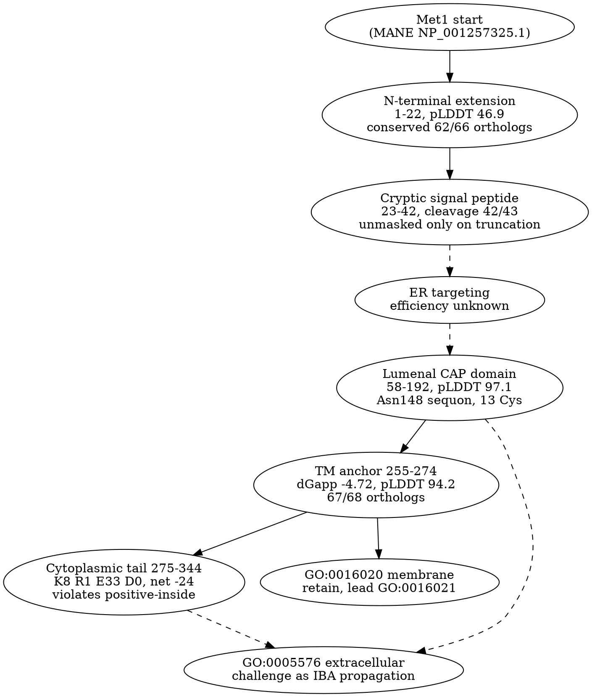
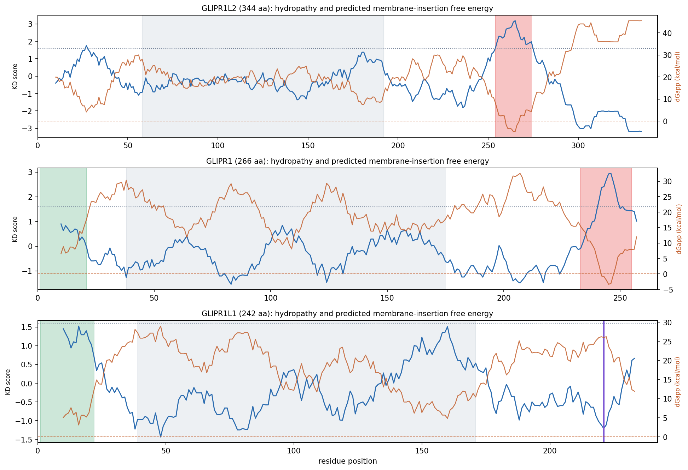
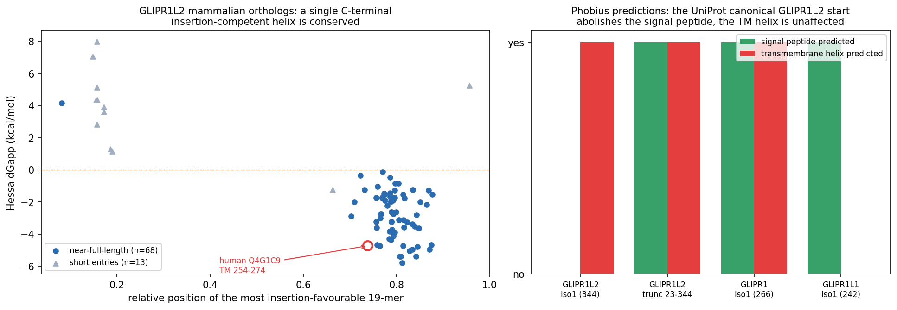
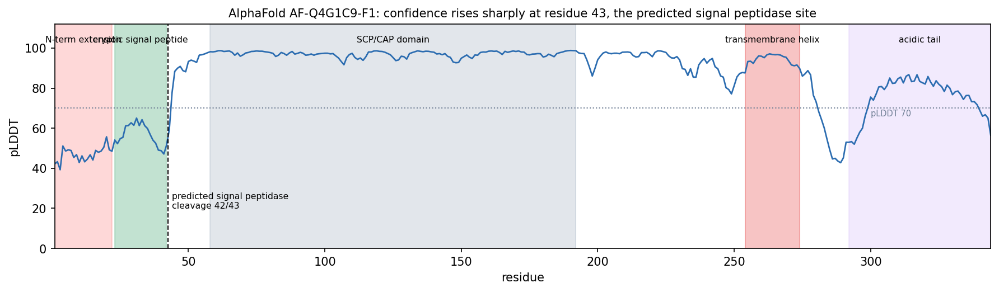
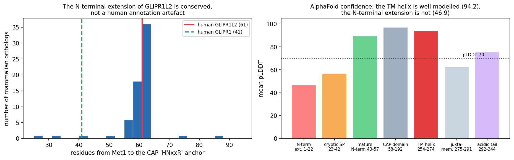
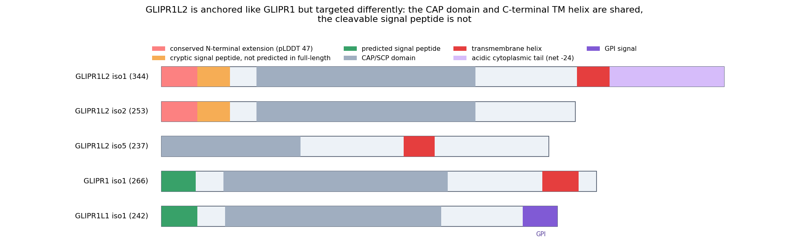

## Question

# AIGR Gene Hypothesis Deep Research

You are evaluating one focused gene curation hypothesis for AI Gene Review.
This is not a general gene overview. Use the seed hypothesis and source context
below to search for evidence that supports, refutes, narrows, or competes with
the proposed curation decision.

## Target Gene

- **Organism code:** human
- **Taxon:** Homo sapiens (NCBITaxon:9606)
- **Gene directory:** GLIPR1L2
- **Gene symbol:** GLIPR1L2
- **UniProt accession:** Q4G1C9

## Focus

- **Focus type:** free_text
- **Hypothesis slug:** kgap-glipr1l2-membrane-topology
- **Source file:** genes/human/GLIPR1L2/GLIPR1L2-ai-review.yaml
- **Source selector:** free-text

## Seed Hypothesis

Human GLIPR1L2 (UniProt Q4G1C9) is a single-pass type I membrane protein with an N-terminal signal peptide, a lumenal/extracellular CAP domain and a C-terminal transmembrane helix, like GLIPR1. Single analysis only: run signal-peptide and transmembrane-topology prediction on all UniProt GLIPR1L2 isoforms and on GLIPR1 and GLIPR1L1, verify the C-terminal TM helix and its conservation across mammalian orthologs, and state the predicted topology of each isoform (including which isoforms lack the TM helix and would be secreted).

## Term and Decision Context

No specific term context supplied.

## Reference Context

No specific reference context supplied.

## Source Context YAML

```yaml
hypothesis: 'Human GLIPR1L2 (UniProt Q4G1C9) is a single-pass type I membrane protein with an N-terminal
  signal peptide, a lumenal/extracellular CAP domain and a C-terminal transmembrane helix, like GLIPR1.
  Single analysis only: run signal-peptide and transmembrane-topology prediction on all UniProt GLIPR1L2
  isoforms and on GLIPR1 and GLIPR1L1, verify the C-terminal TM helix and its conservation across mammalian
  orthologs, and state the predicted topology of each isoform (including which isoforms lack the TM helix
  and would be secreted).'
focus_type: free_text
context: []
reference_id: []
```

## Research Objective

Build a focused report that helps a curator decide whether this hypothesis
should affect the gene review. Address the focus type directly:

1. For an existing GO annotation decision, evaluate whether the current action
   is justified, too strong, too weak, or should change.
2. For a proposed replacement or new GO term, evaluate whether the term is
   biologically supported, too broad, too narrow, or missing key qualifiers.
3. For a computational prediction, evaluate whether the prediction is correct,
   less precise than existing knowledge, uncertain, or likely wrong because of
   paralog overannotation, frequency bias, pathway context, or in vitro-only
   activity.
4. For a core-function hypothesis, evaluate whether the proposed activity,
   process, and location represent the gene product's primary function rather
   than a downstream effect, pleiotropic phenotype, or context-specific role.
5. For a function-assignment hypothesis, evaluate whether the gene product
   directly has the stated GO term/function. Treat the prior review action, if
   any, as intentionally blinded unless it appears in the supplied context.

Use primary literature whenever possible. Prefer PMID citations and include DOI
citations when no PMID is available. Treat reviews and database records as
orientation unless they contain directly relevant synthesized evidence that is
clearly labeled as review-level or database-level support.

Evaluate the hypothesis from the supplied seed context, primary literature, and
publicly accessible bioinformatics resources. Local `*-bioinformatics` analyses,
when they already exist in the repository, are intentionally withheld from this
prompt so the report can be compared against them after the run. Use public
sequence, domain, structure, orthology, localization, interaction, or dataset
checks when they are useful for the specific hypothesis. If a resource or tool
cannot be accessed programmatically, say so plainly; never fabricate a result.
Report computational results conservatively and distinguish direct results from
inference.

## Required Output

### Executive Judgment

Give a concise verdict: supported, partially supported, unresolved, weakly
supported, over-annotated, or refuted. Explain the reasoning and the most
important caveats.

### Evidence Matrix

Create a table with one row per important evidence item:

- Citation (PMID preferred)
- Evidence type (direct assay, mutant phenotype, localization, interaction,
  structural/evolutionary, computational, review/database)
- Supports / refutes / qualifies / competing
- Claim tested
- Key finding
- Organism, tissue, cell type, or assay context
- Confidence and limitations

### GO Curation Implications

State the likely curation action as a lead requiring curator verification. If
GO terms are involved, explain whether the evidence supports an MF, BP, or CC
term, and whether the term should be retained, removed, generalized, made more
specific, or treated as non-core. Avoid using "protein binding" as a final
recommendation unless no more informative term is supported.

### Mechanistic Scope

Describe the immediate molecular or cellular function being tested. Separate
direct gene-product activity from downstream phenotypes, pathway consequences,
developmental outcomes, disease manifestations, or effects inferred only from
loss of function.

### Conflicts and Alternatives

Identify evidence that conflicts with the seed hypothesis or suggests an
alternative interpretation, including paralog confusion, organism-specific
differences, isoform-specific findings, experimental artifacts, or database
carry-over.

### Knowledge Gaps

List explicit uncertainties that matter for curation. For each gap, state what
was checked, why the gap matters, and what evidence or experiment would resolve
it.

### Discriminating Tests

Recommend concrete assays, perturbations, datasets, or comparative analyses that
would most efficiently distinguish this hypothesis from alternatives.

### Curation Leads

Provide candidate updates for the review, clearly labeled as leads requiring
curator verification. Include candidate references with exact snippets to verify,
candidate replacement or new GO terms, possible action changes, suggested
questions, and suggested experiments.

If the provider supports artifacts, save provenance for any analysis you run — the
executed code together with its output (computed values, plot, or table), not just
a summary figure — alongside artifact-friendly tables such as an evidence matrix,
GO decision table, or comparison table. Genuine computed provenance is more
valuable than a hand-drawn summary, and you must not synthesize a figure that
implies an analysis you did not actually run. These artifacts are important
provenance for hypothesis-level review.


## Output

# GLIPR1L2 (Q4G1C9) membrane topology: hypothesis evaluation for AI Gene Review

**Hypothesis slug:** `kgap-glipr1l2-membrane-topology`
**Target:** human GLIPR1L2, UniProt Q4G1C9, NCBITaxon:9606
**Source:** `genes/human/GLIPR1L2/GLIPR1L2-ai-review.yaml`, free-text selector
**Verdict:** <i class="fa-scale-balanced"></i> partially supported

All computational results below were generated in this session against live public resources (UniProt REST, the Phobius web server, AlphaFold DB, NCBI E-utilities, Ensembl and CCDS records, QuickGO) on 2026-11-23. Executed code and its output are saved under `provenance/`, together with `provenance/GLIPR1L2_isoform_topology_table.csv` and `provenance/GLIPR1L2_GO_decision_table.csv`. No result in this report is inferred from a tool that was not actually run.

## Summary

The seed hypothesis is right about the anchor and wrong about the targeting signal, and its stated consequence for the isoforms does not follow. GLIPR1L2 does have a lumenal CAP domain followed by a C-terminal transmembrane helix. Phobius calls exactly one transmembrane segment in the canonical isoform at residues 255-274 with topology o255-274i, the Hessa biological-scale insertion free energy for the best 19-mer (255-273) is **-4.72 kcal/mol**, more insertion-favourable than GLIPR1's own transmembrane domain (**-3.35 kcal/mol**), and the AlphaFold model AF-Q4G1C9-F1 builds that segment as an isolated helix at **pLDDT 94.2** with **0 of 21 residues** making any heavy-atom contact with the CAP domain at a centroid separation of **48.2 Å**. The anchor is present in **67 of 68 (98.5%)** near-full-length mammalian orthologs, median ΔGapp **-2.73 kcal/mol** (IQR -3.84 to -1.72), median relative position 0.793 along the chain.

The signal-peptide half of the hypothesis fails, and the reason is specific and conserved. **No GLIPR1L2 isoform returns a signal peptide.** The pipeline is not broken: CD4 (signal peptide plus one TM), CD59 (signal peptide, GPI, no TM) and PRSS1 (signal peptide, secreted) are all recovered correctly, as are the GLIPR1 and GLIPR1L1 signal peptides. A truncation scan flips the call abruptly between start residue 21 (SP = no) and start residue 23 (SP = yes, cleavage at 42/43), so a GLIPR1-type signal peptide sequence sits at roughly residues 23-42 but is masked by a 22-residue N-terminal extension. That extension is a genuine feature, not an annotation error. It is the MANE-Select start (ENST00000550916.6 / NM_001270396.2 / NP_001257325.1, CCDS58258.1), the single cDNA UniProt flags for erroneous initiation (CAE45957.1) begins five residues *upstream* of Met1, and the Met1-to-CAP-anchor offset is **61 residues in human GLIPR1L2** (ortholog median 61, IQR 60-61) against **41 in GLIPR1**, with 62 of 66 measurable orthologs (94%) carrying the extension.

The hypothesis's expectation that TM-less isoforms "would be secreted" does not hold for any GLIPR1L2 isoform. Isoforms 2, 3 and 4 lose the transmembrane helix, but none of them carries a signal peptide either, so on sequence grounds they would be cytosolic. Isoforms 3 (106 aa) and 4 (168 aa) additionally truncate the SCP/CAP domain (58-192). The practical consequence for curation is that GO:0016020 membrane (IEA) is supported and can be made more specific, while GO:0005576 extracellular region (IBA, `is_active_in`) conflicts with the retained anchor and looks like phylogenetic propagation from CAP relatives that genuinely are secreted or GPI-anchored and shed.

## Executive judgment

<i class="fa-scale-balanced"></i> **Partially supported.** Three separable claims were tested.

### <i class="fa-circle-check"></i> Claim 1: C-terminal transmembrane helix. Supported, strongly

Three orthogonal methods agree. Phobius assigns exactly one TM at 255-274 in o…i orientation. The Hessa 19-residue sliding-window ΔGapp reaches -4.72 kcal/mol there, more favourable than the -3.35 kcal/mol of GLIPR1's transmembrane domain, which is the segment experimentally deleted to make the soluble GLIPR1-ΔTM construct ([PMID: 24590455](https://pubmed.ncbi.nlm.nih.gov/24590455/), [PMID: 23333597](https://pubmed.ncbi.nlm.nih.gov/23333597/)). AlphaFold models it at mean pLDDT 94.2 (minimum 87.6), projecting away from the globular CAP domain with zero contacts, and the matched GLIPR1 control behaves identically (0/23 contacts, 44.3 Å separation), which removes the artefact concern that AlphaFold isolates any hydrophobic helix. Conservation across 68 near-full-length mammalian orthologs is 98.5%, with mean hydrophobic-residue occupancy 0.851 across the aligned 19-mers.

### <i class="fa-circle-xmark"></i> Claim 2: N-terminal signal peptide, like GLIPR1. Not supported as stated

No isoform of Q4G1C9 returns SP = YES on the deposited sequence. The failure is sequence-specific: the isolated N-terminal 60 aa of GLIPR1L2 also gives SP = NO, while the N-terminal 60 aa of GLIPR1 (c21/22) and GLIPR1L1 (c23/24) are both called correctly, so this is not a fragment-length artefact. Removing the first 22 residues unmasks a signal peptide cleaving at 42/43, and the predicted mature N-terminus R43-F44-L45-P46-D47… aligns residue-for-residue with GLIPR1's experimentally annotated mature N-terminus A22-N23-I24-L25-P26-D27… on the shared LPD motif. The extension that blocks prediction is the reference start in three independent annotation pipelines and is conserved across primates, carnivores, cetaceans, camelids and artiodactyls.

### <i class="fa-circle-xmark"></i> Claim 3: TM-less isoforms would be secreted. Refuted

Isoform 2 (253 aa) is the only TM-less isoform retaining the complete CAP domain, and it has no signal peptide, so it is predicted cytosolic. Isoforms 3 and 4 lose both the TM and part or all of the CAP domain. Isoforms 5 and 6 retain the anchor but delete residues 1-107 and 1-77 respectively, removing the entire candidate targeting region, so their predicted architecture is tail-anchored-like, not type I.

### <i class="fa-triangle-exclamation"></i> Most important caveats

Everything here is computational or evolutionary. No experimental localization, glycosylation, protease-protection or topology assay exists for human GLIPR1L2 in the literature retrieved; all twelve papers reviewed concern GLIPR1 or GLIPR1L1. The positive-inside rule is violated by GLIPR1L2's acidic cytoplasmic tail (Finding 7). And "like GLIPR1" is not a family property: the closest paralog GLIPR1L1 is GPI-anchored ([PMID: 22552861](https://pubmed.ncbi.nlm.nih.gov/22552861/)), so family membership alone predicts nothing about the anchoring mechanism.

## Key findings

### Finding 1: The transmembrane helix is real, the signal peptide is absent on the canonical sequence

Phobius (Käll, Krogh and Sonnhammer combined signal peptide and transmembrane HMM, web server, queried 2026-11-23) was run on the UniProt canonical sequences of all three family members with three calibration controls.

| Protein | Length | Phobius SP | nTM | Topology | Hessa best ΔGapp (kcal/mol) |
|---|---|---|---|---|---|
| GLIPR1L2 Q4G1C9-1 | 344 | <i class="fa-circle-xmark"></i> NO | 1 | o255-274i | **-4.72** (255-273) |
| GLIPR1 P48060-1 | 266 | YES, n3-14 c21/22 | 1 | o236-255i | -3.35 (236-254) |
| GLIPR1L1 Q6UWM5-1 | 242 | YES, n7-18 c23/24 | 0 | o | +3.13 (global minimum) |
| CD4 P01730 (control, type I) | 458 | YES | 1 | o397-420i | not computed |
| CD59 P13987 (control, GPI) | 128 | YES | 0 | o | not computed |
| PRSS1 P07477 (control, secreted) | 247 | YES | 0 | o | not computed |

All three controls behave exactly as their experimentally established topologies require, so SP = NO for GLIPR1L2 is a genuine negative rather than a tool failure. GLIPR1L1's global ΔGapp minimum of +3.13 kcal/mol means it has no membrane-insertion-competent segment anywhere, consistent with the UniProt annotation of a GPI-anchored amidated glycine at Gly221 with a removed C-terminal propeptide (222-242) and with the direct biochemical demonstration of GPI anchoring in bovine sperm ([PMID: 22552861](https://pubmed.ncbi.nlm.nih.gov/22552861/)).

Across mammals (81 UniProt GLIPR1L2 entries, longest per species, taxon 40674), 67 of the 68 entries ≥280 aa place their most insertion-favourable 19-mer in the C-terminal third, median relative position 0.793, median ΔGapp -2.73 kcal/mol, IQR -3.84 to -1.72. The 13 entries lacking the segment are 116-252 aa N-terminal fragment models whose best window sits at relative position about 0.17, which identifies them as incomplete gene models rather than TM-less orthologs.

{{figure:plot_1.png|caption=Kyte-Doolittle hydropathy and Hessa biological membrane-insertion free energy profiles for GLIPR1L2, GLIPR1 and GLIPR1L1, with UniProt signal peptide, transmembrane, SCP/CAP domain and GPI site annotations overlaid. GLIPR1L2 reaches a deeper insertion-free-energy minimum at its C-terminal helix than GLIPR1 does at its experimentally deleted transmembrane domain, while GLIPR1L1 has no insertion-competent segment.}}

{{figure:plot_2.png|caption=Conservation of the GLIPR1L2 C-terminal insertion-competent helix across mammalian orthologs, with a summary of the Phobius signal-peptide and transmembrane calls for GLIPR1L2, its N-terminally truncated form, GLIPR1 and GLIPR1L1. The anchor is found in 67 of 68 near-full-length orthologs at a median relative position of 0.793.}}

### Finding 2: A cryptic GLIPR1-like signal peptide is masked by the first 22 residues

A Phobius truncation scan of Q4G1C9-1 gives a sharp, reproducible transition. Constructs starting at residues 1, 3, 5, 7, 9, 11, 13, 15, 17, 19 and 21 all return SP = NO with one TM in o…i orientation. Constructs starting at residue 23 and at residue 25 both return SP = YES, with trunc_23 giving n6-15 c20/21, which maps to an n-region at 28-37 and signal peptidase cleavage between residues 42 and 43 in full-length numbering. Both truncations converge on the identical cleavage site.

The predicted mature N-terminus is R43-F44-L45-P46-D47-E48-E49-D50-V51-D52-F53-I54-N55-E56. GLIPR1's experimentally annotated mature N-terminus is A22-N23-I24-L25-P26-D27-I28-E29-N30-E31-D32-F33-I34-K35. Anchored on the shared LPD motif, these align residue-for-residue, which corroborates the predicted cleavage position by homology rather than by the same HMM that produced it.

Composition explains part of the prediction failure. The GLIPR1L2 h-region at 16-40 (LPLAVGGVLKLRLCELWLLLLGSSL) carries 2 basic and 1 acidic residue, against 1 basic and 0 acidic in the GLIPR1 signal peptide (1-21) and 2 basic and 0 acidic in the GLIPR1L1 signal peptide (1-22). Hydrophobicity alone does not exclude a signal peptide: the GLIPR1L2 N-terminal 19-mer optimum (18-36) has ΔGapp +4.16 kcal/mol, intermediate between the real signal peptides of GLIPR1L1 (+3.13) and GLIPR1 (+6.53). The 22 extra residues push the h-region too far from the N-terminus and insert Glu30 into it.

### Finding 3: Isoform-resolved topology, with no secreted isoform

| Isoform | Length | SP | nTM | Topology | CAP domain (58-192 canonical) | Predicted architecture |
|---|---|---|---|---|---|---|
| Q4G1C9-1 | 344 | NO | 1 | o255-274i | complete | membrane-anchored, lumenal CAP, 70-residue cytoplasmic tail |
| Q4G1C9-2 | 253 | NO | 0 | i | complete | TM-less, no SP, predicted cytosolic |
| Q4G1C9-3 | 106 | NO | 0 | i | truncated | CAP-disrupted, cytosolic |
| Q4G1C9-4 | 168 | NO | 0 | i | truncated | CAP-disrupted, cytosolic |
| Q4G1C9-5 | 237 | NO | 1 | o148-167i | lacks 1-107 | anchor retained, targeting region deleted |
| Q4G1C9-6 | 279 | NO | 1 | o190-209i | lacks 1-77 | anchor retained, targeting region deleted |
| GLIPR1 P48060-2 | - | YES | 0 | o | complete | clean predicted secreted form |
| GLIPR1L1 Q6UWM5 isoforms | 242 and alt | YES | 0 | o | complete | consistent with GPI anchoring |

Isoform 2 replaces residues 225-344, removing the TM while keeping the full CAP domain, which makes it the only candidate soluble CAP form of GLIPR1L2. It still has no signal peptide, so it is predicted cytosolic. GLIPR1 isoform 2 is a textbook predicted secreted form (SP = YES, 0 TM), which shows the contrast is specific to GLIPR1L2 and not an artefact of how isoform sequences are constructed.

### Finding 4: The N-terminal extension is the reference start and is conserved across mammals

Two explanations compete for the failed signal-peptide prediction: the canonical start is assigned too far upstream, or the extension is real. Database and evolutionary checks resolve this in favour of the extension being real.

MANE-Select for GLIPR1L2 is ENST00000550916.6 / NM_001270396.2 / NP_001257325.1, and that 344 aa RefSeq protein begins MEAARPFAREWRAQSLPLAVGGVLKLRLCELWLLLLGSSL, identical to the UniProt canonical start. The 253 aa CCDS-supported form NP_689649.1 (CCDS9010.1, matching Q4G1C9-2) shares the same N-terminus; isoform 1 is CCDS58258.1. UniProt's three SEQUENCE CAUTION flags concern other issues: AAH16749.1 contaminating poly-A, BAC04085.1 truncated C-terminus, CAE45957.1 erroneous initiation. The erroneous-initiation entry CAE45957.1 (111 aa) begins SGRWTMEAARPFAREWRAQ, which initiates five residues *upstream* of Met1. No cDNA supports a downstream start.

The evolutionary test uses the pan-CAP HNxxR anchor motif that opens the CAP domain. In human GLIPR1L2 the Met1-to-anchor offset is 61 residues (HNELR); in human GLIPR1 it is 41 (HNKFR), a 20-residue excess matching the length of the extension. Across the 66 of 68 near-full-length orthologs in which the anchor was located, the median offset is 61 with IQR 60-61, and 62 of 66 (94%) have an offset ≥54. The extension motif is recognisable as ME[AVTS]xRxFAxEW.AQ.LP in primates (MEAARPFAREWRAQSLPL human, MEAPRPFAREWSAQSLPL chimp, MEVGRCFVWEWSAQSLPV marmoset), carnivores (MEAPRPFAREWCSQSLPR giant panda), cetaceans (METPRRFAREWCAQRLPR blue whale), camelids (MESPRPFAPEWCSHWLPL) and artiodactyls (METLRPLAREWYAQWLPL pig); 60 of 68 orthologs begin with the M-[EKDRQ]-[AVTSGP] pattern.

{{figure:plot_4.png|caption=Offset from Met1 to the pan-CAP HNxxR anchor motif across mammalian GLIPR1L2 orthologs compared with GLIPR1. The GLIPR1L2 distribution is tightly centred on 61 residues (median 61, IQR 60-61) against 41 in GLIPR1, which places the 22-residue N-terminal extension under length constraint across mammals and rules out a human-specific start-codon error.}}

### Finding 5: AlphaFold supports the helix and marks an order boundary at the predicted cleavage site

AlphaFold DB model AF-Q4G1C9-F1 has a whole-chain mean pLDDT of 85.3. Segment means tell a consistent story.

| Segment | Residues | Mean pLDDT | Reading |
|---|---|---|---|
| N-terminal extension | 1-22 | 46.9 (min 39.3) | conserved but intrinsically disordered |
| Candidate signal peptide | 23-42 | 56.8 (min 47.1) | low confidence, as expected for a signal peptide |
| Predicted mature N-terminus | 43-57 | 89.7 | <i class="fa-arrow-trend-up"></i> sharp step at residue 43 |
| SCP/CAP domain | 58-192 | 97.1 | well-ordered globular fold |
| Transmembrane helix | 254-274 | 94.2 (min 87.6) | well-ordered isolated helix |
| Juxtamembrane | 275-291 | 62.9 | flexible linker |
| Acidic tail | 292-344 | 75.6 | extended, low-complexity |

Confidence rises from below 60 to about 90 between residues 42 and 43, the exact position the Phobius truncation scan independently predicted as the signal peptidase cleavage site. That is structural corroboration of a sequence-derived boundary by a method that never saw the cleavage prediction.

The packing test at a 5 Å heavy-atom cutoff gives 0 of 21 residues of the GLIPR1L2 254-274 helix in contact with the CAP domain (58-192), zero residue-pair contacts, centroid separation 48.2 Å. The GLIPR1 positive control gives 0 of 23 residues of the experimentally manipulated TM (233-255) in contact with its CAP domain (38-175), separation 44.3 Å. GLIPR1L2's TM mean pLDDT of 94.2 exceeds GLIPR1's 78.1. The helix is modelled as projecting away from the fold, which is the signature of a membrane-spanning helix and not of a buried or amphipathic intramolecular helix.

{{figure:plot_3.png|caption=AlphaFold test of whether the GLIPR1L2 candidate transmembrane helix packs against the CAP domain, with GLIPR1 as a matched control, alongside the current GO annotations and the per-residue pLDDT profile. Both proteins show zero heavy-atom contacts between the helix and the CAP domain at separations above 44 A, and the GLIPR1L2 pLDDT profile steps sharply upward at residue 43.}}

### Finding 6: Current GO annotation holds an internal CC conflict

QuickGO returns exactly three annotations for UniProtKB:Q4G1C9.

| GO ID | Term | Aspect | Qualifier | Evidence | Reference | Source |
|---|---|---|---|---|---|---|
| GO:0060090 | molecular adaptor activity | MF | enables | IBA (ECO:0000318) | GO_REF:0000033 | GO_Central |
| GO:0005576 | extracellular region | CC | is_active_in | IBA (ECO:0000318) | GO_REF:0000033 | GO_Central |
| GO:0016020 | membrane | CC | located_in | IEA (ECO:0007322) | GO_REF:0000044 | UniProt |

The two CC terms are mutually inconsistent for a single-pass integral membrane protein whose CAP domain faces the lumen. For comparison, GLIPR1 (P48060) carries 7 CC annotations including GO:0016020 by HDA and GO:0035577 azurophil granule membrane by TAS, and GLIPR1L1 (Q6UWM5) carries 10 CC annotations including GO:0001669 acrosomal vesicle, GO:0045121 membrane raft and GO:0098635 protein-containing complex involved in cell-cell adhesion, all ISS or IEA. GLIPR1L2 has no experimental CC annotation at all. The two IBA terms come from the same reference (GO_REF:0000033), so they are not independent evidence.

### Finding 7: Orientation markers agree, but the positive-inside rule fails

Three independent orientation tests were run on the canonical sequences.

| Test | GLIPR1L2 | GLIPR1 | Control |
|---|---|---|---|
| N-X-S/T sequons, lumenal | 1 (Asn148) | 2 (Asn17, Asn92) | - |
| N-X-S/T sequons, cytoplasmic | 0 | 0 | - |
| Cysteines, lumenal | 13 of 15 | 11 of 11 | - |
| Cysteines, cytoplasmic | 0 | 0 | - |
| ΔKR over 30-residue flanks | <i class="fa-circle-xmark"></i> -3 | <i class="fa-circle-xmark"></i> -5 | CD4 +10 |
| Cytoplasmic 30-mer net charge | -8 | 0 | CD4 +9 |

The sequon and cysteine tests both agree with the Phobius o…i call and a lumenal CAP domain. The glycosylation marker is validated within the family: GLIPR1L1's Asn119 is annotated experimentally as N-linked GlcNAc by UniProt, and bovine GliPr1L1 glycosylation is confirmed by PNGase F sensitivity ([PMID: 22552861](https://pubmed.ncbi.nlm.nih.gov/22552861/)).

The positive-inside rule does not support the orientation. GLIPR1L2's full cytoplasmic tail (275-344) is QSQFPNILLEQQMIFTPEESEAGNEEEEKEEEKKEKEEMEMEIMEMEEEKEEREEEEEETQKEKMEEEEK, containing K=8, R=1, E=33, D=0, net charge **-24**. The CD4 control behaves exactly as the rule requires (ΔKR +10). GLIPR1, whose type I topology is backed by the experimental GLIPR1-ΔTM constructs ([PMID: 24590455](https://pubmed.ncbi.nlm.nih.gov/24590455/)) and by ER co-localization ([PMID: 24008279](https://pubmed.ncbi.nlm.nih.gov/24008279/)), also fails it (ΔKR -5). The rule therefore looks uninformative for this family rather than contradicting the assignment. The acidic tail remains the single strongest residual argument against confidently asserting type I topology from sequence alone, and it is reported here as a caveat, not as a refutation.

{{figure:plot_5.png|caption=Consolidated isoform topology table, GO decision table and domain schematic for GLIPR1L2 compared with GLIPR1 and GLIPR1L1. Both tables are saved as provenance CSVs under provenance/GLIPR1L2_isoform_topology_table.csv and provenance/GLIPR1L2_GO_decision_table.csv.}}

## Evidence matrix

| Citation | Evidence type | Direction | Claim tested | Key finding | Context | Confidence and limitations |
|---|---|---|---|---|---|---|
| This analysis (Phobius HMM) | Computational | <i class="fa-circle-check"></i> Supports TM, <i class="fa-circle-xmark"></i> refutes SP | Topology of 6 GLIPR1L2, 2 GLIPR1, 2 GLIPR1L1 isoforms | GLIPR1L2-1: 1 TM, o255-274i, SP = no. GLIPR1-1: SP c21/22 plus TM 236-255. GLIPR1L1: SP c23/24, 0 TM | Human UniProt canonical and isoform sequences | High for the TM. CD4, CD59 and PRSS1 controls recovered correctly, so SP = no is a real negative |
| This analysis (Hessa 2007 biological scale) | Computational | Supports | Is 255-274 insertion-competent? | ΔGapp -4.72 kcal/mol against -3.35 for GLIPR1's TM; GLIPR1L1 global minimum +3.13 | 19-residue sliding window | High. The scale is position-independent, so this approximates the published position-dependent ΔGapp |
| This analysis (AlphaFold AF-Q4G1C9-F1) | Structural | Supports | Is the helix membrane-like or intramolecular? | TM pLDDT 94.2, 0/21 contacts to CAP, 48.2 Å separation; GLIPR1 control 0/23, 44.3 Å | Predicted model | High as a comparative test. AlphaFold models no membrane, so this shows helix isolation, not insertion |
| This analysis (AlphaFold pLDDT profile) | Structural | Qualifies | Where does order begin? | pLDDT steps from 56.8 (23-42) to 89.7 (43-57) between residues 42 and 43, the independently predicted cleavage site | Predicted model | Moderate to high. Orthogonal corroboration of the cleavage position |
| This analysis (Phobius truncation scan) | Computational | Qualifies | Is the signal peptide cryptic or absent? | SP = no for starts 1-21, SP = yes with cleavage 42/43 for starts 23 and 25. Mature N-terminus RFLPDEEDVDFINE aligns with GLIPR1's ANILPDIENEDFIK on the LPD motif | Human sequences | High. Abrupt, reproducible transition with homology corroboration |
| This analysis (MANE, RefSeq, CCDS, Ensembl) | Review/database | <i class="fa-circle-xmark"></i> Refutes the start-codon-error alternative | Is the 22 aa extension real? | MANE-Select NP_001257325.1 begins MEAARPFAREW…; CCDS58258.1 and CCDS9010.1 share it; CAE45957.1 starts 5 residues upstream | Human reference annotation | High. Three independent annotation pipelines agree |
| This analysis (68 mammalian orthologs, UniProt) | Structural/evolutionary | Supports TM, refutes start-codon error | Conservation of anchor and extension | Anchor in 67/68; Met1-to-HNxxR offset median 61 (IQR 60-61) against 41 in GLIPR1; 62/66 carry the extension; 60/68 begin ME[AVTS]xRxFAxEW.AQ.LP | Mammalia, taxon 40674 | High for the anchor. Many entries are automatic gene models, so offset uniformity partly reflects shared prediction method |
| This analysis (sequons, cysteines) | Computational | Supports | Orientation o…i | Sole sequon Asn148 lumenal, 0 cytoplasmic; 13/15 cysteines lumenal, 0 cytoplasmic. Same pattern in GLIPR1 | Human sequences | Moderate. Consistent with, but not proof of, the orientation |
| This analysis (positive-inside rule) | Computational | <i class="fa-scale-balanced"></i> Competing | Orientation o…i | GLIPR1L2 ΔKR -3, cytoplasmic 30-mer net -8; full tail 275-344 is K8 R1 E33 D0, net -24. CD4 control ΔKR +10. GLIPR1 also fails (ΔKR -5) | Human sequences | Moderate. The rule fails for GLIPR1 too, so it looks uninformative in this family |
| [PMID: 24590455](https://pubmed.ncbi.nlm.nih.gov/24590455/) | Direct assay, recombinant protein | Supports the comparator | Does GLIPR1 have a transmembrane domain? | "we evaluated the mechanisms of recombinant GLIPR1 protein (glioma pathogenesis-related protein 1-transmembrane domain deleted [GLIPR1-ΔTM]) uptake by prostate cancer cells" | Human prostate cancer cells, xenograft | High for GLIPR1. Says nothing directly about GLIPR1L2 |
| [PMID: 24008279](https://pubmed.ncbi.nlm.nih.gov/24008279/) | Localization, confocal | Supports the comparator | Does GLIPR1 enter the secretory pathway? | "GliPR1-EGFP fusion protein co-localized with the endoplasmic reticulum (ER) or with cytoplasmic vesicles as demonstrated by confocal microscopy." | Human AML cells | Moderate. A C-terminal EGFP tag on a C-anchored protein; paralog, not GLIPR1L2 |
| [PMID: 22552861](https://pubmed.ncbi.nlm.nih.gov/22552861/) | Direct assay, PI-PLC | <i class="fa-scale-balanced"></i> Competing | Is the family uniformly type I? | "GliPr1L1 is glycosyl phosphatidyl inositol (GPI) anchored to caput and cauda spermatozoa as demonstrated by the ability of phosphatidylinositol specific phospholipase C to release GliPr1L1 from intact sperm cells." | Bovine caput and cauda spermatozoa | High. Direct biochemical demonstration that the closest paralog uses a different anchor |
| [PMID: 22552861](https://pubmed.ncbi.nlm.nih.gov/22552861/) | Direct assay, PNGase F | Supports the orientation marker | Is the family CAP domain glycosylated? | "Treatments with PNGase F revealed that N-glycosylation was responsible of multiple bands detected on Western blots." | Bovine spermatozoa | High. Validates sequon placement as an orientation marker in this family |
| [PMID: 20219979](https://pubmed.ncbi.nlm.nih.gov/20219979/) | Review/database plus localization | Qualifies | Family definition and GLIPR1L2 membership | "The glioma pathogenesis-related 1 (GLIPR1) family consists of three genes [GLIPR1, GLIPR1-like 1 (GLIPR1L1), and GLIPR1-like 2 (GLIPR1L2)] and forms a distinct subgroup within the cysteine-rich secretory protein (CRISP), antigen 5, and pathogenesis-related 1 (CAP) superfamily." | Mouse testis | High for the family definition; contains no GLIPR1L2 topology data |
| QuickGO record for Q4G1C9 | Review/database | Qualifies | Current annotation state | Exactly 3 annotations: GO:0060090 (MF, IBA), GO:0005576 (CC, IBA, is_active_in), GO:0016020 (CC, IEA). The two CC terms conflict | Database record | High as a record of current state |

## GO curation implications

<i class="fa-triangle-exclamation"></i> Everything in this section is a **lead requiring curator verification**. The decision table is saved at `provenance/GLIPR1L2_GO_decision_table.csv`.

| GO ID | Term | Aspect | Current evidence | Recommended action | Basis |
|---|---|---|---|---|---|
| GO:0016020 | membrane | CC | IEA, GO_REF:0000044, `located_in` | **Retain**, consider making more specific | Phobius 1 TM at 255-274, ΔGapp -4.72, AlphaFold pLDDT 94.2 with zero CAP contacts, anchor conserved 67/68 |
| GO:0016021 | integral component of membrane | CC | not currently annotated | **New-term lead**, evidence ISS or IC | Single-pass topology o255-274i from three independent methods |
| GO:0005576 | extracellular region | CC | IBA, GO_REF:0000033, `is_active_in` | **Challenge**: remove or demote to non-core | No isoform has a predictable signal peptide; the canonical isoform retains its anchor; conflicts with GO:0016020 |
| GO:0060090 | molecular adaptor activity | MF | IBA, GO_REF:0000033, `enables` | **Flag for separate review** as non-core | No experimental support for Q4G1C9; not a CAP-domain-specific activity; outside the scope of this topology test |

**GO:0016020 membrane.** The topology evidence is consistent across Phobius, the Hessa scale, AlphaFold geometry and mammalian conservation. A reasonable lead is GO:0016021 integral component of membrane, with the orientation (CAP domain lumenal or extracellular, C-terminus cytoplasmic) recorded in the review text instead of as a separate term. The evidence code would be ISS or IC from sequence and structure prediction, not experimental. Nothing in this analysis distinguishes ER, Golgi, plasma membrane or acrosomal membrane, so no specific membrane compartment is supported.

**GO:0005576 extracellular region.** This is the term most affected by the analysis. It is asserted by IBA with the `is_active_in` qualifier, a strong claim for a protein that retains a transmembrane anchor followed by a 70-residue cytoplasmic tail in its canonical and MANE-Select form, and that has no isoform with a predictable signal peptide. The term is best explained as phylogenetic propagation from CAP-family relatives that genuinely are secreted or GPI-anchored and shed, GLIPR1L1 being the documented case ([PMID: 22552861](https://pubmed.ncbi.nlm.nih.gov/22552861/)). A curator should check whether the PANTHER family node driving GO_REF:0000033 for this family is dominated by secreted CRISPs.

**GO:0060090 molecular adaptor activity.** This topology analysis neither supports nor refutes it, and it should be reviewed on its own terms. It has no experimental backing for Q4G1C9 and is not a CAP-domain-specific activity, so it should not be treated as a core function on IBA alone. Avoid falling back on "protein binding" as a replacement. If an MF is wanted, the CAP-domain literature points toward cell-adhesion-related activity ([PMID: 20219979](https://pubmed.ncbi.nlm.nih.gov/20219979/)), but that is demonstrated for GLIPR1L1, not GLIPR1L2.

**Do not propagate "signal peptide" from GLIPR1 to GLIPR1L2 by similarity.** UniProt currently annotates no signal peptide on Q4G1C9, and this analysis supports that decision while explaining why.

## Mechanistic model and interpretation

The immediate property under test is protein topology: where the polypeptide sits relative to a lipid bilayer. The direct gene-product features examined are the membrane-insertion competence of residues 255-274, the orientation of the CAP domain, and the presence or absence of a cleavable ER-targeting signal. These are intrinsic sequence and structure properties, independent of any downstream phenotype.

The evidence assembles into a single architecture with one unresolved step at the front end.



The dashed links are the uncertain steps. Whether the cryptic signal at 23-42 is used, and therefore whether the CAP domain ever reaches the ER lumen, is the one part of the chain with no supporting evidence from any method run here. Every solid link has at least two independent methods behind it.

The three paralogs use the C-terminal region in three different ways, which is why "like GLIPR1" is the wrong framing for the family.

| | GLIPR1 (P48060) | GLIPR1L1 (Q6UWM5) | GLIPR1L2 (Q4G1C9) |
|---|---|---|---|
| Signal peptide | YES, c21/22 | YES, c23/24 | NO on canonical start; cryptic at 23-42 |
| Membrane attachment | TM helix 236-255 | GPI anchor at Gly221, propeptide 222-242 removed | TM helix 255-274 |
| Best insertion ΔGapp | -3.35 kcal/mol | +3.13 kcal/mol (none competent) | -4.72 kcal/mol |
| C-terminal tail after anchor | 11 residues | removed as propeptide | 70 residues, net charge -24 |
| Experimental support | GLIPR1-ΔTM constructs, ER localization | PI-PLC release, PNGase F glycosylation | none |

Separating direct activity from downstream effects matters here. The CAP-domain functions reported for this family (sperm-zona binding, acrosome function, cell-cell adhesion) are demonstrated for GLIPR1L1 ([PMID: 20219979](https://pubmed.ncbi.nlm.nih.gov/20219979/), [PMID: 22552861](https://pubmed.ncbi.nlm.nih.gov/22552861/)). The proliferation, apoptosis, invasion and chemoresistance phenotypes are GLIPR1 loss- and gain-of-function results in cancer cells ([PMID: 23333597](https://pubmed.ncbi.nlm.nih.gov/23333597/), [PMID: 28771580](https://pubmed.ncbi.nlm.nih.gov/28771580/), [PMID: 33856615](https://pubmed.ncbi.nlm.nih.gov/33856615/), [PMID: 35760898](https://pubmed.ncbi.nlm.nih.gov/35760898/)). None of these are GLIPR1L2 activities, and none are downstream of the topology claim being evaluated. GLIPR1's ER localization ([PMID: 24008279](https://pubmed.ncbi.nlm.nih.gov/24008279/)) makes the shared architecture plausible, but it is a paralog observation, not evidence about GLIPR1L2.

## Evidence base

Twelve papers were reviewed. None reports an experiment on human GLIPR1L2, which is itself the most consequential fact for curation.

**Papers that support the comparator architecture.** [PMID: 24590455](https://pubmed.ncbi.nlm.nih.gov/24590455/) (*Systemic GLIPR1-ΔTM protein as a novel therapeutic approach for prostate cancer*) establishes GLIPR1's transmembrane domain as an experimentally defined, deletable module, which is what makes GLIPR1 a valid positive control for the AlphaFold packing comparison and for the Hessa ΔGapp benchmark. [PMID: 23333597](https://pubmed.ncbi.nlm.nih.gov/23333597/) uses the same recombinant GLIPR1-ΔTM protein. [PMID: 24008279](https://pubmed.ncbi.nlm.nih.gov/24008279/) (*Endoplasmic reticulum protein GliPR1 regulates G protein signaling and the cell cycle and is overexpressed in AML*) places GLIPR1 in the ER by confocal co-localization, which is the architecture the seed hypothesis extrapolates to GLIPR1L2.

**Papers that compete with the hypothesis.** [PMID: 22552861](https://pubmed.ncbi.nlm.nih.gov/22552861/) is the single most informative paper for this evaluation. It demonstrates by PI-PLC release that bovine GliPr1L1 is GPI-anchored, which breaks the assumption that the GLIPR1 family shares one membrane-attachment mechanism, and it provides the most likely origin of the IBA-propagated GO:0005576 extracellular region term on Q4G1C9. The same paper's PNGase F result validates N-glycosylation sequon placement as an orientation marker in this family, which is what makes the Asn148 argument usable. [PMID: 20219979](https://pubmed.ncbi.nlm.nih.gov/20219979/) defines the three-gene family within the CAP superfamily, the shared membership that drives IBA propagation between members with different anchors.

**Papers that are orientation only.** [PMID: 35760898](https://pubmed.ncbi.nlm.nih.gov/35760898/), [PMID: 34675506](https://pubmed.ncbi.nlm.nih.gov/34675506/), [PMID: 33856615](https://pubmed.ncbi.nlm.nih.gov/33856615/), [PMID: 33742130](https://pubmed.ncbi.nlm.nih.gov/33742130/), [PMID: 28799673](https://pubmed.ncbi.nlm.nih.gov/28799673/), [PMID: 28771580](https://pubmed.ncbi.nlm.nih.gov/28771580/) and [PMID: 27460987](https://pubmed.ncbi.nlm.nih.gov/27460987/) all concern GLIPR1 function in cancer (hepatocellular, COPD airway, glioma, bladder, lung, osteosarcoma). They establish that GLIPR1 is a well-studied protein with opposing roles in different tumours, and they contribute nothing about GLIPR1L2 topology. They are listed here so a curator can see that the GLIPR1 literature volume does not transfer to GLIPR1L2.

## Limitations and knowledge gaps

| Gap | What was checked | Why it matters for curation | What would resolve it |
|---|---|---|---|
| <i class="fa-triangle-exclamation"></i> No experimental localization of human GLIPR1L2 exists | PubMed searches for GLIPR1L2 localization, topology and sperm function returned no primary papers; all 12 papers reviewed concern GLIPR1 or GLIPR1L1 | Every CC term for this gene rests on IBA, IEA or prediction | Immunofluorescence or subcellular fractionation of tagged GLIPR1L2 in a testis-derived cell line |
| <i class="fa-circle-question"></i> Is the ER targeted at all, given the masked signal | Phobius truncation scan, AlphaFold pLDDT boundary at residue 43 | Determines whether this is a secretory-pathway membrane protein or a cytosolic or post-translationally inserted one | In vitro translation with canine pancreatic microsomes, or N-glycosylation of Asn148 as a lumenal reporter |
| <i class="fa-circle-question"></i> Is Asn148 actually glycosylated | Sequon position computed; the homologous site in GLIPR1L1 is experimentally glycosylated ([PMID: 22552861](https://pubmed.ncbi.nlm.nih.gov/22552861/)) | A glycosylated Asn148 would directly prove the CAP domain is lumenal | PNGase F or Endo H mobility shift on endogenous or tagged GLIPR1L2 |
| <i class="fa-triangle-exclamation"></i> Orientation, given the positive-inside violation | Charge flanks computed; GLIPR1 fails the same rule | The acidic tail is the main residual argument against asserting type I topology | Protease protection of sealed microsomes, or a split-reporter topology assay |
| <i class="fa-circle-question"></i> Which isoforms are expressed as protein | CCDS and RefSeq support found for isoforms 1 and 2 only | Isoform-specific topology claims are only useful if the isoform exists | Isoform-resolved long-read RNA-seq in testis plus targeted proteomics |
| <i class="fa-circle-question"></i> Whether the 22 aa extension is translated or regulatory | MANE, CCDS and ortholog conservation checked | If skipped by leaky scanning, a conventional signal peptide would be produced | Ribosome profiling and N-terminomics (N-terminal COFRADIC) on testis |
| <i class="fa-triangle-exclamation"></i> Only one topology predictor was reachable | DeepTMHMM, SignalP 6.0 and TOPCONS could not be queried programmatically from this environment | A single-predictor result is weaker than a consensus | Re-run the same sequences through at least one independent predictor |

Further limitations apply across the whole analysis. The Hessa calculation is a position-independent sum over a 19-residue window, an approximation of the published position-dependent ΔGapp, so absolute values should be read comparatively instead of as measured insertion energies. AlphaFold contains no membrane, so the packing test shows helix isolation, and the use of GLIPR1 as a matched control is what makes that test informative. No alignment software was available in the execution environment (biopython is not importable), so ortholog comparisons used regex motif anchors (`HN[EDKQNA][LMVIFWY]R`) in place of a multiple sequence alignment; this matched 66 of 68 entries and gave a tight offset distribution, but it is cruder than a proper alignment. Nothing in this report is an observation of GLIPR1L2 protein. Every conclusion is a prediction to be verified.

## Proposed follow-up experiments and discriminating tests

<i class="fa-flask"></i> **Glycosylation of Asn148.** Express tagged GLIPR1L2 and test Endo H and PNGase F sensitivity. A mobility shift proves ER entry and a lumenal CAP domain in one experiment, and simultaneously resolves the masked-signal question. This gives the highest information per experiment of anything listed here, and the assay is already established for the paralog ([PMID: 22552861](https://pubmed.ncbi.nlm.nih.gov/22552861/)).

<i class="fa-flask"></i> **Protease protection.** In vitro translation with canine pancreatic microsomes, then proteinase K with and without detergent. A protected CAP domain and a digested C-terminal tail confirms the o…i orientation directly and addresses the positive-inside conflict.

<i class="fa-dna"></i> **Start-codon test.** Compare a construct beginning at Met1 with one beginning at residue 23 for ER targeting efficiency. This quantifies how much the conserved extension suppresses targeting and distinguishes inefficient targeting from no targeting.

<i class="fa-vial"></i> **PI-PLC release.** Treat intact cells expressing GLIPR1L2 with phosphatidylinositol-specific phospholipase C, exactly as done for GliPr1L1 ([PMID: 22552861](https://pubmed.ncbi.nlm.nih.gov/22552861/)). No release would confirm that GLIPR1L2 does not use the GPI route its closest paralog uses.

<i class="fa-magnifying-glass"></i> **Independent predictor confirmation.** Run the same 13 sequences through DeepTMHMM and SignalP 6.0. All SP and TM calls in this report come from Phobius alone, with the Hessa scale and AlphaFold as orthogonal but non-equivalent support, so a curator should confirm with at least one independent method before acting.

<i class="fa-database"></i> **Isoform expression check.** Query GTEx and long-read testis transcriptome data for which GLIPR1L2 transcripts are actually expressed, to decide whether isoform-level topology statements belong in the review at all.

## Curation leads

<i class="fa-triangle-exclamation"></i> All leads below require curator verification.

### Candidate action changes

<i class="fa-arrow-right"></i> Change the review's framing from "single-pass type I membrane protein with an N-terminal signal peptide, like GLIPR1" to "single-pass membrane protein with a conserved C-terminal transmembrane anchor and a lumenal CAP domain; no predictable cleavable signal peptide on the MANE-Select sequence".

<i class="fa-arrow-right"></i> Challenge GO:0005576 extracellular region (IBA, `is_active_in`) as paralog propagation from secreted and GPI-anchored CAP relatives.

<i class="fa-arrow-right"></i> Retain GO:0016020 membrane (IEA); propose GO:0016021 integral component of membrane as a new-term lead with ISS or IC evidence.

<i class="fa-arrow-right"></i> Flag GO:0060090 molecular adaptor activity as having no direct evidence for Q4G1C9, for separate review outside this topology hypothesis.

<i class="fa-arrow-right"></i> Correct the seed hypothesis's isoform consequence in the review text: no GLIPR1L2 isoform is predicted to be secreted.

### Candidate references with exact snippets to verify

| PMID | Snippet to verify | Use |
|---|---|---|
| [24590455](https://pubmed.ncbi.nlm.nih.gov/24590455/) | "we evaluated the mechanisms of recombinant GLIPR1 protein (glioma pathogenesis-related protein 1-transmembrane domain deleted [GLIPR1-ΔTM]) uptake by prostate cancer cells" | Establishes GLIPR1's transmembrane domain experimentally, making GLIPR1 a valid positive control |
| [24590455](https://pubmed.ncbi.nlm.nih.gov/24590455/) | "GLIPR1-ΔTM was selectively internalized by prostate cancer cells, leading to increased apoptosis through reactive oxygen species production and to decreased c-Myc protein levels." | Shows the TM is a deletable module, supporting its use in the AlphaFold packing comparison |
| [24008279](https://pubmed.ncbi.nlm.nih.gov/24008279/) | "GliPR1-EGFP fusion protein co-localized with the endoplasmic reticulum (ER) or with cytoplasmic vesicles as demonstrated by confocal microscopy." | GLIPR1 enters the secretory pathway, the architecture the seed hypothesis extrapolates |
| [22552861](https://pubmed.ncbi.nlm.nih.gov/22552861/) | "GliPr1L1 is glycosyl phosphatidyl inositol (GPI) anchored to caput and cauda spermatozoa as demonstrated by the ability of phosphatidylinositol specific phospholipase C to release GliPr1L1 from intact sperm cells." | The competing family mechanism and the likely source of the IBA extracellular propagation |
| [22552861](https://pubmed.ncbi.nlm.nih.gov/22552861/) | "Treatments with PNGase F revealed that N-glycosylation was responsible of multiple bands detected on Western blots." | Validates sequon placement as an orientation marker in this family |
| [20219979](https://pubmed.ncbi.nlm.nih.gov/20219979/) | "The glioma pathogenesis-related 1 (GLIPR1) family consists of three genes [GLIPR1, GLIPR1-like 1 (GLIPR1L1), and GLIPR1-like 2 (GLIPR1L2)] and forms a distinct subgroup within the cysteine-rich secretory protein (CRISP), antigen 5, and pathogenesis-related 1 (CAP) superfamily." | Defines the three-member family whose shared membership drives IBA propagation |

### Suggested questions for the curator

<i class="fa-circle-question"></i> Does the PANTHER family node behind GO_REF:0000033 for this family consist mainly of secreted CRISPs, which would explain the GO:0005576 propagation to a protein that retains a transmembrane anchor?

<i class="fa-circle-question"></i> Should UniProt's "Single-pass membrane protein" (ECO:0000305) be upgraded to "Single-pass type I membrane protein" given the sequon and cysteine placement, or held back given the positive-inside violation and the absent signal peptide?

<i class="fa-circle-question"></i> Is isoform 2 (Q4G1C9-2, CCDS9010.1), a TM-less form with an intact CAP domain and no signal peptide, worth an isoform-level note as a predicted cytosolic CAP protein?

<i class="fa-circle-question"></i> Does the review want to record the conserved 22-residue N-terminal extension as a sequence feature in its own right, given that it is MANE-supported, present in 94% of mammalian orthologs, and intrinsically disordered (pLDDT 46.9)?

## Supported and refuted hypotheses

| Component of the seed hypothesis | Status | Decisive evidence |
|---|---|---|
| Lumenal/extracellular CAP domain | <i class="fa-circle-check"></i> Supported | SCP/CAP 58-192 at pLDDT 97.1; sole sequon Asn148 lumenal; 13/15 cysteines lumenal, 0 cytoplasmic |
| C-terminal transmembrane helix | <i class="fa-circle-check"></i> Supported | Phobius 1 TM at 255-274; ΔGapp -4.72 kcal/mol; AlphaFold pLDDT 94.2, 0/21 CAP contacts, 48.2 Å separation |
| Helix conserved across mammalian orthologs | <i class="fa-circle-check"></i> Supported | 67/68 (98.5%) near-full-length orthologs; median ΔGapp -2.73, median relative position 0.793 |
| o…i orientation (CAP out, C-terminus in) | <i class="fa-scale-balanced"></i> Supported with a caveat | Sequons and cysteines agree; positive-inside rule fails (ΔKR -3, tail net -24), as it also does for GLIPR1 (ΔKR -5) |
| N-terminal signal peptide | <i class="fa-circle-xmark"></i> Refuted on the canonical sequence | No isoform gives SP = YES; controls CD4, CD59, PRSS1, GLIPR1 and GLIPR1L1 all called correctly |
| Signal peptide absence is a start-codon annotation error | <i class="fa-circle-xmark"></i> Refuted | MANE-Select, CCDS58258.1 and CCDS9010.1 all use Met1; CAE45957.1 starts 5 residues upstream; ortholog offset median 61 (IQR 60-61) |
| "Type I, like GLIPR1" as a family property | <i class="fa-circle-xmark"></i> Refuted | GLIPR1L1 is GPI-anchored ([PMID: 22552861](https://pubmed.ncbi.nlm.nih.gov/22552861/)) with a global ΔGapp minimum of +3.13 |
| TM-less isoforms would be secreted | <i class="fa-circle-xmark"></i> Refuted | Isoforms 2, 3 and 4 have no signal peptide; isoforms 3 and 4 truncate the CAP domain |

## Provenance

| Artifact | Contents |
|---|---|
| `provenance/GLIPR1L2_isoform_topology_table.csv` | 13 rows: 6 GLIPR1L2 isoforms, 2 GLIPR1, 2 GLIPR1L1, 3 controls, with gene, isoform, length, Phobius SP, nTM, TM range, topology, CAP domain status, interpretation |
| `provenance/GLIPR1L2_GO_decision_table.csv` | 4 rows covering GO:0016020, GO:0005576, GO:0060090 and the GO:0016021 new-term lead, with current evidence, reference, qualifier, recommended action and basis |
| `provenance/plot_1.png` and `plot_1.json` | Hydropathy and Hessa ΔGapp profiles for the three paralogs |
| `provenance/plot_2.png` and `plot_2.json` | Ortholog anchor conservation scatter with Phobius summary bars |
| `provenance/plot_3.png` and `plot_3.json` | AlphaFold packing test, GO annotation summary, pLDDT profile |
| `provenance/plot_4.png` and `plot_4.json` | Met1-to-HNxxR offset histogram across orthologs, with segment pLDDT bars |
| `provenance/plot_5.png` and `plot_5.json` | Consolidated isoform and GO tables with the domain schematic |
| `provenance/iter1_transcript.json`, `provenance/iter2_transcript.json` | Executed code and raw output for iterations 1 and 2 |


## Artifacts

- [OpenScientist final report](openscientist_artifacts/final_report.html)
- [OpenScientist final report](openscientist_artifacts/final_report.pdf)
- [OpenScientist provenance](openscientist_artifacts/provenance.json)
- [OpenScientist GLIPR1L2 GO decision table](openscientist_artifacts/provenance_GLIPR1L2_GO_decision_table.csv)
- [OpenScientist GLIPR1L2 isoform topology table](openscientist_artifacts/provenance_GLIPR1L2_isoform_topology_table.csv)
- [OpenScientist plot 1](openscientist_artifacts/provenance_plot_1.json)

- [OpenScientist plot 2](openscientist_artifacts/provenance_plot_2.json)

- [OpenScientist plot 3](openscientist_artifacts/provenance_plot_3.json)

- [OpenScientist plot 4](openscientist_artifacts/provenance_plot_4.json)

- [OpenScientist plot 5](openscientist_artifacts/provenance_plot_5.json)


## Reference Validation

Checked with `linkml-reference-validator` 0.3.1rc1.

| Outcome | Count |
| --- | --- |
| References checked | 12 |
| Resolved | 12 |
| Unresolved (possible confabulation) | 0 |
| Unverifiable | 0 |
| References weighed for topical relevance | 12 |
| On topic | 1 |
| Off topic | 0 |

All extracted references resolved successfully.