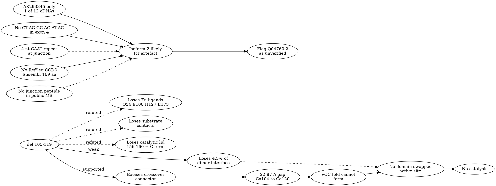
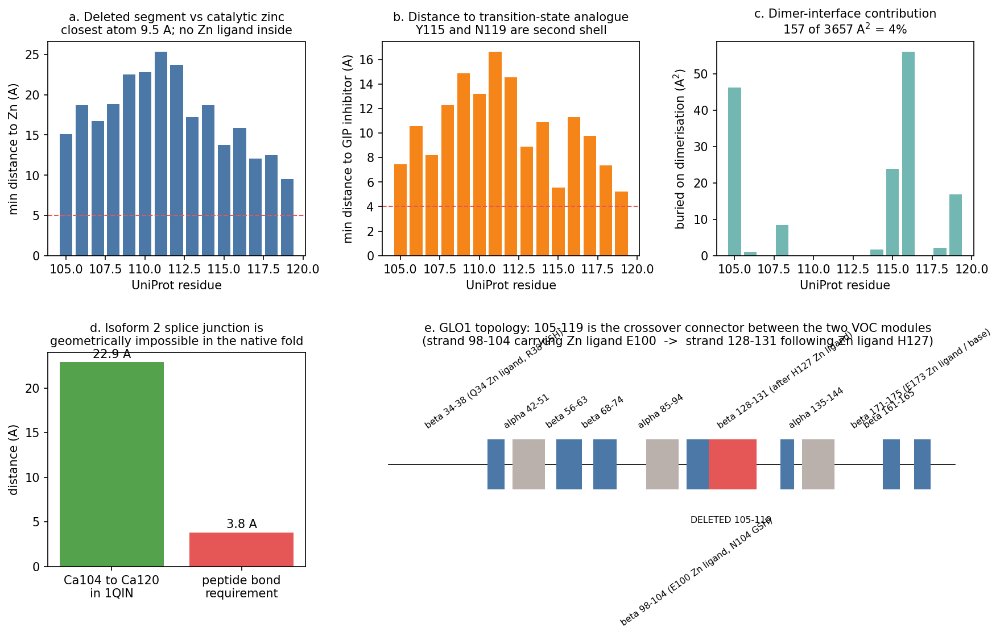
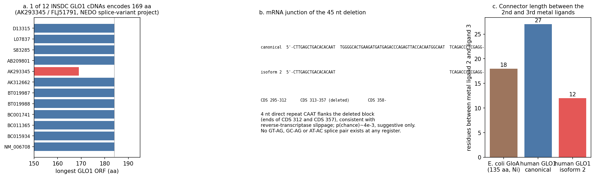
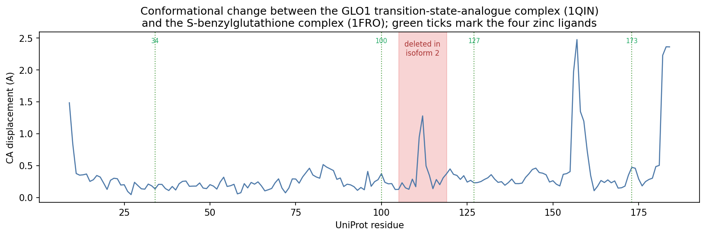
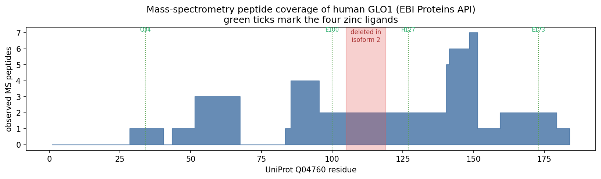

## Question

# AIGR Gene Hypothesis Deep Research

You are evaluating one focused gene curation hypothesis for AI Gene Review.
This is not a general gene overview. Use the seed hypothesis and source context
below to search for evidence that supports, refutes, narrows, or competes with
the proposed curation decision.

## Target Gene

- **Organism code:** human
- **Taxon:** Homo sapiens (NCBITaxon:9606)
- **Gene directory:** GLO1
- **Gene symbol:** GLO1
- **UniProt accession:** Q04760

## Focus

- **Focus type:** free_text
- **Hypothesis slug:** kgap-glo1-isoform2-catalytic-region
- **Source file:** genes/human/GLO1/GLO1-ai-review.yaml
- **Source selector:** free-text

## Seed Hypothesis

Human GLO1 splice isoform 2 (UniProt Q04760-2), which lacks residues 105-119 of the canonical protein, is catalytically incompetent because the deletion removes active-site or zinc-coordinating residues or disrupts the domain-swapped dimer interface that forms the glyoxalase I active site. Single analysis only: map the deleted segment onto the human GLO1 crystal structure (with zinc and inhibitor bound), identify which zinc ligands (Gln33, Glu99, His126, Glu172 equivalents), substrate-binding and dimer-interface residues lie in or adjacent to 105-119, and model whether isoform 2 can fold and dimerize; state the predicted catalytic competence.

## Term and Decision Context

No specific term context supplied.

## Reference Context

No specific reference context supplied.

## Source Context YAML

```yaml
hypothesis: 'Human GLO1 splice isoform 2 (UniProt Q04760-2), which lacks residues 105-119 of the canonical
  protein, is catalytically incompetent because the deletion removes active-site or zinc-coordinating
  residues or disrupts the domain-swapped dimer interface that forms the glyoxalase I active site. Single
  analysis only: map the deleted segment onto the human GLO1 crystal structure (with zinc and inhibitor
  bound), identify which zinc ligands (Gln33, Glu99, His126, Glu172 equivalents), substrate-binding and
  dimer-interface residues lie in or adjacent to 105-119, and model whether isoform 2 can fold and dimerize;
  state the predicted catalytic competence.'
focus_type: free_text
context: []
reference_id: []
```

## Research Objective

Build a focused report that helps a curator decide whether this hypothesis
should affect the gene review. Address the focus type directly:

1. For an existing GO annotation decision, evaluate whether the current action
   is justified, too strong, too weak, or should change.
2. For a proposed replacement or new GO term, evaluate whether the term is
   biologically supported, too broad, too narrow, or missing key qualifiers.
3. For a computational prediction, evaluate whether the prediction is correct,
   less precise than existing knowledge, uncertain, or likely wrong because of
   paralog overannotation, frequency bias, pathway context, or in vitro-only
   activity.
4. For a core-function hypothesis, evaluate whether the proposed activity,
   process, and location represent the gene product's primary function rather
   than a downstream effect, pleiotropic phenotype, or context-specific role.
5. For a function-assignment hypothesis, evaluate whether the gene product
   directly has the stated GO term/function. Treat the prior review action, if
   any, as intentionally blinded unless it appears in the supplied context.

Use primary literature whenever possible. Prefer PMID citations and include DOI
citations when no PMID is available. Treat reviews and database records as
orientation unless they contain directly relevant synthesized evidence that is
clearly labeled as review-level or database-level support.

Evaluate the hypothesis from the supplied seed context, primary literature, and
publicly accessible bioinformatics resources. Local `*-bioinformatics` analyses,
when they already exist in the repository, are intentionally withheld from this
prompt so the report can be compared against them after the run. Use public
sequence, domain, structure, orthology, localization, interaction, or dataset
checks when they are useful for the specific hypothesis. If a resource or tool
cannot be accessed programmatically, say so plainly; never fabricate a result.
Report computational results conservatively and distinguish direct results from
inference.

## Required Output

### Executive Judgment

Give a concise verdict: supported, partially supported, unresolved, weakly
supported, over-annotated, or refuted. Explain the reasoning and the most
important caveats.

### Evidence Matrix

Create a table with one row per important evidence item:

- Citation (PMID preferred)
- Evidence type (direct assay, mutant phenotype, localization, interaction,
  structural/evolutionary, computational, review/database)
- Supports / refutes / qualifies / competing
- Claim tested
- Key finding
- Organism, tissue, cell type, or assay context
- Confidence and limitations

### GO Curation Implications

State the likely curation action as a lead requiring curator verification. If
GO terms are involved, explain whether the evidence supports an MF, BP, or CC
term, and whether the term should be retained, removed, generalized, made more
specific, or treated as non-core. Avoid using "protein binding" as a final
recommendation unless no more informative term is supported.

### Mechanistic Scope

Describe the immediate molecular or cellular function being tested. Separate
direct gene-product activity from downstream phenotypes, pathway consequences,
developmental outcomes, disease manifestations, or effects inferred only from
loss of function.

### Conflicts and Alternatives

Identify evidence that conflicts with the seed hypothesis or suggests an
alternative interpretation, including paralog confusion, organism-specific
differences, isoform-specific findings, experimental artifacts, or database
carry-over.

### Knowledge Gaps

List explicit uncertainties that matter for curation. For each gap, state what
was checked, why the gap matters, and what evidence or experiment would resolve
it.

### Discriminating Tests

Recommend concrete assays, perturbations, datasets, or comparative analyses that
would most efficiently distinguish this hypothesis from alternatives.

### Curation Leads

Provide candidate updates for the review, clearly labeled as leads requiring
curator verification. Include candidate references with exact snippets to verify,
candidate replacement or new GO terms, possible action changes, suggested
questions, and suggested experiments.

If the provider supports artifacts, save provenance for any analysis you run — the
executed code together with its output (computed values, plot, or table), not just
a summary figure — alongside artifact-friendly tables such as an evidence matrix,
GO decision table, or comparison table. Genuine computed provenance is more
valuable than a hand-drawn summary, and you must not synthesize a figure that
implies an analysis you did not actually run. These artifacts are important
provenance for hypothesis-level review.


## Output

# GLO1 isoform 2 (UniProt Q04760-2, del 105-119): is it catalytically incompetent, and why?

**Gene:** human GLO1, UniProt Q04760, NCBITaxon:9606
**Hypothesis slug:** kgap-glo1-isoform2-catalytic-region
**Source file:** genes/human/GLO1/GLO1-ai-review.yaml, focus type free_text
**Verdict:** <i class="fa-scale-balanced"></i> partially supported

Provenance for every computed number is in `provenance/`: `glo1_isoform2_analysis.py`
(the executed code with its outputs annotated inline), `table1_structural_mapping_105_119.csv`,
`table2_insdc_cdna_survey.csv`, `table3_evidence_matrix.csv`, `table4_go_decision_table.csv`,
and the four figures embedded below.

---

## Summary

The seed hypothesis has two parts, a conclusion and a mechanism. The conclusion, that
human GLO1 isoform 2 would be catalytically incompetent, holds. The stated mechanism,
that the 105-119 deletion removes active-site or zinc-coordinating residues or disrupts
the domain-swapped dimer interface, is refuted by the structural mapping that the
hypothesis itself requested. Mapping the segment onto PDB 1QIN, the human GLO1 dimer
with Zn²⁺ and the transition-state analogue HIPC-GSH bound, places every annotated zinc
ligand and every annotated substrate contact outside 105-119. The zinc coordination
shell measured at under 2.8 Å is Gln33 OE1 at 2.05 Å and Glu99 OE1 at 1.91 Å from one
chain, His126 NE2 at 2.05 Å from the partner chain, plus inhibitor oxygens. In UniProt
numbering these are Gln34, Glu100, His127 and Glu173. The nearest deleted atom to the
zinc is Asn119 at 9.51 Å; Glu111 is 25.37 Å away. The deletion also fails to touch the
lid: superposing 1QIN onto 1FRO shows the ligand-dependent loop closure is residues
156-160 plus the C-terminal tail, while 105-119 does not move at all.

The dimer-interface clause is weak rather than false. The segment buries 157 Ų of a
3657 Ų chain-A interface, 4.3%, concentrated in His116 (56 Ų), Trp105 (46 Ų), Tyr115
(24 Ų) and Asn119 (17 Ų). Trp105, Tyr115, His116 and Asn119 are genuine cross-subunit
contacts, and Tyr115 and Asn119 sit in the second shell around the bound transition-state
analogue at 5.53 Å and 5.23 Å. A 4.3% loss of a large interface does not by itself predict
loss of catalysis.

What does predict it is a different structural argument that the hypothesis did not make.
Residues 105-119 are the crossover connector between the two VOC modules of the monomer.
They run from β-strand 98-104 in sheet A, which carries zinc ligand Glu100 and substrate
contact Asn104, to β-strand 128-131 in sheet B, which follows zinc ligand His127. Excising
them requires a direct peptide bond between Asn104 and Ser120, whose Cα atoms are 22.87 Å
apart in every chain of 1QIN, 1FRO and 3W0T, against the 3.81 Å mean observed for
consecutive Cα pairs in the same structure. The spacing between metal ligand 2 and ligand
3 would fall from 27 residues in human and mouse GLO1 to 12, below the 18 of the
135-residue *E. coli* Ni-GloA. The two halves of the β-sandwich cannot be rejoined without
refolding the whole VOC domain, and the 3D domain swap that places the active site in the
dimer interface depends on that connector.

A third result sits upstream of all of this and matters more for curation than either
clause of the hypothesis. **Isoform 2 is probably not a real transcript.** The 45 nt
encoding residues 105-119 sit entirely inside exon 4, and no canonical or known minor-class
splice-site pair can excise them at any register that yields the annotated 169-residue
protein. One of twelve INSDC GLO1 cDNAs carries the deletion (AK293345, cDNA FLJ51791,
from a project that deliberately enriched for splicing variants, reference status
Unpublished); the other eleven, including the sole GLO1 RefSeq mRNA NM_006708, encode the
canonical 184-residue protein. No RefSeq, CCDS or Ensembl transcript encodes 169 residues.
The UniProt alternative-sequence feature VSP_041632 carries a single ECO:0000303 tag from
a bulk cDNA catalogue ([PMID: 14702039](https://pubmed.ncbi.nlm.nih.gov/14702039/)), the
weakest isoform evidence class. A 4 nt direct repeat, CAAT, flanks the deleted block at
mRNA level, which is what reverse-transcriptase slippage leaves behind. Public mass
spectrometry observes the canonical peptide spanning the whole segment and reports no
isoform 2 junction peptide.

The net recommendation for the curator is editorial. Isoform 2 should not be annotated as
an inactive isoform, because that statement implies the isoform exists. It should be
flagged as unverified, and any mechanistic statement about it should cite connector
excision rather than loss of zinc ligands.

---

## Key findings

### <i class="fa-circle-xmark"></i> F1. No zinc ligand and no annotated substrate contact lies inside 105-119

The numbering offset was fixed first, by exact match of the modelled 1QIN chain-A sequence
to Q04760: UniProt = PDB + 1. With that established, the zinc coordination shell in 1QIN
contains Gln33 OE1 at 2.05 Å and Glu99 OE1 at 1.91 Å from the same chain, His126 NE2 at
2.05 Å from the partner chain, and two oxygens of the GIP inhibitor. Translated to UniProt
numbering these are Gln34, Glu100, His127 and Glu173, matching the UniProt binding-site
features for Zn²⁺ at 34, 100, 127 (other chain) and 173 (other chain). The substrate and
glutathione contacts annotated at 34, 38, 104, 123, 127, 157-158 and 173 are likewise all
outside the deletion.

Distances confirm the segment is peripheral to chemistry. Minimum heavy-atom distance from
each deleted residue to the zinc runs from 9.51 Å (Asn119) to 25.37 Å (Glu111). Distance to
the bound transition-state analogue runs from 5.23 Å (Asn119) and 5.53 Å (Tyr115) to 16.65 Å
(Glu111). Only Tyr115 and Asn119 reach the second shell around the ligand, and neither is an
annotated contact.

| UniProt residue | Min dist to Zn (Å) | Min dist to HIPC-GSH (Å) | SASA monomer (Ų) | Buried on dimerisation (Ų) | Partner contacts <5 Å | Annotated function |
|---|---|---|---|---|---|---|
| 105 W | 15.10 | 7.46 | 104.0 | 46.3 | 48 | dimer interface |
| 106 G | 18.69 | 10.56 | 38.8 | 1.1 | 0 | |
| 107 T | 16.74 | 8.18 | 19.4 | 0.0 | 0 | phosphothreonine |
| 108 E | 18.88 | 12.26 | 61.0 | 8.4 | 1 | |
| 109 D | 22.49 | 14.87 | 118.6 | 0.0 | 0 | |
| 110 D | 22.82 | 13.19 | 60.5 | 0.0 | 0 | |
| 111 E | 25.37 | 16.65 | 163.4 | 0.0 | 0 | variant rs4746 (E111A) |
| 112 T | 23.72 | 14.56 | 120.5 | 0.0 | 0 | |
| 113 Q | 17.26 | 8.87 | 36.6 | 0.0 | 0 | |
| 114 S | 18.70 | 10.87 | 90.9 | 1.7 | 1 | |
| 115 Y | 13.75 | 5.53 | 48.7 | 23.8 | 28 | dimer interface; ligand 2nd shell |
| 116 H | 15.89 | 11.30 | 88.5 | 56.2 | 35 | dimer interface |
| 117 N | 12.06 | 9.78 | 29.8 | 0.0 | 0 | |
| 118 G | 12.49 | 7.36 | 8.5 | 2.2 | 4 | |
| 119 N | 9.51 | 5.23 | 45.1 | 16.8 | 13 | dimer interface; ligand 2nd shell |

The identity of the catalytic residues is not an inference from the structure alone. In
*Involvement of an active-site Zn2+ ligand in the catalytic mechanism of human glyoxalase I*
([PMID: 9705294](https://pubmed.ncbi.nlm.nih.gov/9705294/)), "The Zn2+ ligands glutamate 99
and glutamate 172 in the active site of human glyoxalase I were replaced, each in turn, by
glutamines by site-directed mutagenesis", fixing ligand identity in mature numbering and
therefore placing UniProt 100 and 173 outside 105-119. The architecture that assigns ligands
to chains comes from *Crystal structure of human glyoxalase I* ([PMID:
9218781](https://pubmed.ncbi.nlm.nih.gov/9218781/)): "3D domain swapping of the N- and
C-terminal domains has resulted in the active site being situated in the dimer interface,
with the inhibitor and essential zinc ion interacting with side chains from both subunits."

{{figure:plot_1.png|caption=Mapping GLO1 residues 105-119 onto the 1QIN active site. Per-residue distances to the catalytic zinc and to the bound transition-state analogue, solvent accessibility in monomer and dimer, buried surface on dimerisation, and the position of the segment in the two-module fold. No zinc ligand or annotated substrate contact falls inside the deleted block.}}

### <i class="fa-circle-check"></i> F2. The segment is the crossover connector, and removing it breaks the fold

In 1QIN chain A, the Cα of Asn104 and the Cα of Ser120 are 22.87 Å apart. Chain B gives
22.9 Å, and chains of 1FRO and 3W0T agree within rounding. A peptide bond constrains
consecutive Cα atoms to about 3.8 Å; the observed consecutive Cα-Cα distances in this
structure average 3.81 Å with a range of 2.83 to 3.85 Å. Joining 104 to 120 directly is
therefore not a local adjustment but a demand that the chain cover 22.9 Å in one step.

Secondary-structure records explain why the gap is so large. The segment sits immediately
after β-strand 98-104 in sheet A, which carries zinc ligand Glu100 and substrate contact
Asn104, and immediately before β-strand 128-131 in sheet B, which follows zinc ligand
His127. It lies inside the annotated VOC domain (UniProt 31-177) and contains only a
three-residue 3₁₀ helix at 107-109; the rest is an extended connector. SASA shows it is
partly packed against its own subunit even in the isolated monomer: 1034 Ų exposed out of
roughly 2250 Ų expected for an extended 15-mer, with Thr107 (19 Ų), Gly118 (9 Ų), Asn117
(30 Ų) and Gln113 (37 Ų) largely buried.

The gene-duplication architecture that this connector serves is described in [PMID:
9218781](https://pubmed.ncbi.nlm.nih.gov/9218781/): "Each monomer consists of two domains.
Despite only low sequence homology between them, these domains are structurally equivalent
and appear to have arisen by a gene duplication." Removing 105-119 removes the link between
those two structurally equivalent modules.

An orthologue check gives the same answer from a different direction. The spacing between
metal ligand 2 and metal ligand 3 is 27 residues in human and mouse GLO1 and 18 residues in
the 135-residue *E. coli* Ni-GloA (UniProt P0AC81, ligands at 5, 56, 74, 122). Isoform 2
would shorten it to 12, below anything seen in a characterised glyoxalase I.

### <i class="fa-circle-xmark"></i> F3. The catalytic lid is residues 156-160 and the C-terminus, not 105-119

The last route by which the stated mechanism could have been right was that 105-119 is the
loop that closes over the active site on substrate binding. Kabsch superposition of 1QIN
chain A (transition-state analogue complex) onto 1FRO chain A (S-benzylglutathione complex)
over 176 common Cα atoms gives a global RMSD of 0.52 Å. The largest per-residue displacements
are at UniProt 157 (2.48 Å), 183 and 184 (2.36 Å each), 182 (2.23 Å), 156 (1.96 Å) and 158
(1.35 Å). Across 105-119 the mean displacement is 0.36 Å, with a maximum of 1.28 Å at Thr112,
indistinguishable from the whole-chain mean of 0.34 Å.

The closure itself is reported in *Reaction mechanism of glyoxalase I explored by an X-ray
crystallographic analysis of the human enzyme in complex with a transition state analogue*
([PMID: 10521255](https://pubmed.ncbi.nlm.nih.gov/10521255/)): "Coordination of the transition
state analogue to the metal enables a loop to close down over the active site, relative to its
position in the product-like structure, allowing the glycine residue of the glutathione moiety
to hydrogen bond with the protein." The same paper identifies the structures used here: "The
structures of human glyoxalase I in complexes with S-(N-hydroxy-N-p-iodophenylcarbamoyl)
glutathione (HIPC-GSH) and S-p-nitrobenzyloxycarbonylglutathione (NBC-GSH) have been determined
at 2.0 and 1.72 A resolution, respectively." The superposition performed here localises that
loop to 156-160 plus the C-terminal tail, both annotated as partner-chain substrate contacts.

{{figure:plot_3.png|caption=Per-residue Calpha displacement between the 1QIN transition-state-analogue complex and the 1FRO product-like complex, superposed over 176 Calpha atoms (RMSD 0.52 A). The ligand-dependent closure is at residues 156-160 and the C-terminal tail; residues 105-119 move 0.36 A, the same as the whole-chain mean.}}

### <i class="fa-dna"></i> F4. No splice-site pair can produce the deletion, and no transcript carries it

The 45 nt encoding residues 105-119 map entirely inside GLO1 exon 4 (Ensembl ENST00000373365,
exon ENSE00000750246, chr6:38,682,808-38,682,875, minus strand, 68 nt of CDS covering codons
103.67-125.33). The removed block is chr6:38,682,827-38,682,871. All six 45 nt windows inside
exon 4 whose removal reproduces the same 169-residue protein were enumerated, and their flanking
dinucleotides are CA/GG, AA/GC, AT/CA, TT/AA, TG/AT and GG/TT. None is GT..AG, GC..AG or AT..AC,
so no canonical or known minor-class spliceosomal pair can generate the deletion. An
alternative-acceptor model using the intron 3 donor would require AG at exon-4 nt 44-45, which
is GG.

Transcript databases agree. Ensembl lists four GLO1 transcripts, GLO1-201 (184 aa), GLO1-203
(179 aa), GLO1-204 (178 aa) and GLO1-202 (non-coding); none encodes 169 aa. NCBI RefSeq lists a
single GLO1 mRNA, NM_006708. UniProt VSP_041632 carries one evidence tag, ECO:0000303 from
[PMID: 14702039](https://pubmed.ncbi.nlm.nih.gov/14702039/), an author statement from a bulk
cDNA catalogue with no functional characterisation.

### <i class="fa-database"></i> F5. One cDNA out of twelve, flanked by a 4 nt direct repeat

All 12 INSDC nucleotide entries cross-referenced from UniProt Q04760, plus RefSeq NM_006708,
were retrieved and their longest GLO1 open reading frames translated.

| Accession | Longest ORF | Form | Coding variants | Source |
|---|---|---|---|---|
| D13315 | 184 aa | canonical | E111A | Kim et al. 1993 cDNA ([PMID: 7684374](https://pubmed.ncbi.nlm.nih.gov/7684374/)) |
| L07837 | 184 aa | canonical | E111A | Ranganathan et al. 1993 colon cDNA ([PMID: 8449929](https://pubmed.ncbi.nlm.nih.gov/8449929/)) |
| S83285 | 184 aa | canonical | | direct submission mRNA |
| AB209801 | 184 aa | canonical | | Kazusa cDNA (UniProt status ALT_INIT) |
| **AK293345** | **169 aa** | **isoform 2 (del 105-119)** | | **cDNA FLJ51791; NEDO project focused on splicing variants; oligo capping; Unpublished** |
| AK312662 | 184 aa | canonical | E111A | NEDO/FLJ cDNA |
| BT019987 | 184 aa | canonical | | BD Creator full-length CDS clone |
| BT019988 | 184 aa | canonical | | BD Creator full-length CDS clone |
| BC001741 | 184 aa | canonical | | MGC ([PMID: 15489334](https://pubmed.ncbi.nlm.nih.gov/15489334/)) |
| BC011365 | 184 aa | canonical | C19Y | MGC ([PMID: 15489334](https://pubmed.ncbi.nlm.nih.gov/15489334/)) |
| BC015934 | 184 aa | canonical | E111A | MGC ([PMID: 15489334](https://pubmed.ncbi.nlm.nih.gov/15489334/)) |
| NM_006708 | 184 aa | canonical | | RefSeq reference mRNA, the only GLO1 RefSeq mRNA |

AK293345 alone gives a 169-residue product with the junction TLELTHN|SDPRGFGH, identical to the
UniProt Q04760-2 sequence. Its GenBank metadata reads "Homo sapiens cDNA FLJ51791 complete cds,
highly similar to Lactoylglutathione lyase (EC 4.4.1.5)", with keywords FLI_CDNA and oligo
capping, from a project "focused on splicing variants", reference status Unpublished.

At mature-mRNA level the deleted block, CDS 313-357, is flanked by a 4 nt direct repeat, CAAT,
shared by the 3' ends of CDS 312 and CDS 357. Chance expectation at a given junction is
4⁻⁴ = 3.9 × 10⁻³, so this is suggestive of reverse-transcriptase slippage rather than decisive.
An earlier count of 5 nt was corrected: the leading G belongs to the last base of intron 3 and
is not present in the mature mRNA.

An incidental control shows the clone panel is informative. The rs4746 E111A polymorphism, which
lies inside the deleted segment, appears in 4 of the 12 clones, so the panel does sample real
population variation at this locus and the absence of a second isoform 2 clone is not a coverage
artefact at the level of the region.

{{figure:plot_2.png|caption=INSDC cDNA survey for the GLO1 169-residue form. One of twelve clones (AK293345, FLJ51791) carries the 45 nt deletion; the other eleven, including NM_006708, encode 184 residues. The panel also shows the 4 nt CAAT direct repeat flanking the junction at mRNA level and the metal-ligand spacing comparison across orthologues.}}

### <i class="fa-vial"></i> F6. Public MS sees the canonical segment and no isoform 2 junction peptide

The EBI Proteins API proteomics-ptm endpoint for Q04760 returned 22 distinct observed peptides
covering 137 of 184 residues. Every residue of 105-119 is covered twice, including the tryptic
peptide KATLELTHNWGTEDDETQSYHNGNSDPR (residues 96-123), which spans the whole deleted segment
and both flanks. Two of the 22 peptides span residues 104 and 120 contiguously.

In-silico tryptic digestion at up to one missed cleavage, peptide length 6 to 45, identifies
three peptides unique to the canonical protein (KATLELTHNWGTEDDETQSYHNGNSDPR 96-123,
ATLELTHNWGTEDDETQSYHNGNSDPR 97-123, ATLELTHNWGTEDDETQSYHNGNSDPRGFGHIGIAVPDVYSACK 97-140) and
three unique to isoform 2 (KATLELTHNSDPR, ATLELTHNSDPR, ATLELTHNSDPRGFGHIGIAVPDVYSACK). None of
the isoform 2 junction peptides appears in the returned set.

<i class="fa-triangle-exclamation"></i> This is not a clean negative. Most public searches use a
canonical-only or UniProt-with-isoform database, and this endpoint maps peptides onto the
canonical sequence, so a junction peptide would surface only if the search space contained it.
A targeted PRM assay for ATLELTHNSDPR is the clean test.

{{figure:plot_4.png|caption=Mass spectrometry peptide coverage of GLO1 from public proteomics data, with the 105-119 segment marked, and the in-silico tryptic peptides that discriminate the canonical protein from isoform 2. The canonical peptide spanning the whole segment is observed; no isoform 2 junction peptide is reported.}}

### <i class="fa-circle-question"></i> F7. The segment carries two regulatory features of the canonical protein

UniProt Q04760 annotates phosphothreonine at position 107 and a natural variant at position 111
(dbSNP rs4746), both inside 105-119. In 1QIN these are 16.74 Å and 25.37 Å from the nearest zinc
and 8.18 Šand 16.65 Šfrom the bound analogue. Glu111 is fully solvent-facing, 163 Ų exposed
in the monomer with 0 Ų buried on dimerisation. Thr107 is partly buried within its own subunit
(19 Ų exposed) and contributes nothing to the interface. Residues 100-125 are identical in human
(Q04760), mouse (Q9CPU0) and rat (Q6P7Q4) GLO1, all 184 residues.

The segment is therefore not a dispensable surface insertion. It is invariant across mammalian
orthologues and hosts both a regulatory phosphosite and a common population polymorphism site.
These are features of the canonical protein; they are relevant here because they would be lost
in any isoform 2 polypeptide, and because they show the region is under selection.

---

## Mechanistic model

The hypothesis proposed one causal chain. The data support a different one. Both are drawn below,
with the refuted links dashed.



The synthesis reads as follows. Glyoxalase I catalyses isomerisation of the hemithioacetal of
methylglyoxal and glutathione to S-D-lactoylglutathione, with one catalytic Zn²⁺ per active site.
The zinc is ligated by Gln34 and Glu100 from one subunit and His127 and Glu173 from the other, and
Glu173 abstracts the proton from the hemithioacetal ([PMID:
9705294](https://pubmed.ncbi.nlm.nih.gov/9705294/)). Because of the 3D domain swap, a monomer has
no complete active site ([PMID: 9218781](https://pubmed.ncbi.nlm.nih.gov/9218781/)). Residues
105-119 participate in none of that chemistry. They hold the two VOC modules of the monomer
together, which is a structural requirement for everything downstream. Their deletion therefore
abolishes activity, through fold failure instead of loss of chemistry.

The prediction stands one step removed from measurement. No laboratory has expressed Q04760-2, so
there is no activity assay, no metal content, no gel filtration and no structure. The verdict rests
on geometry measured in crystal structures of the canonical protein plus a connector-length
comparison across orthologues.

---

## Evidence matrix

| ID | Citation | Evidence type | Stance | Claim tested | Key finding | Context | Confidence and limitations |
|---|---|---|---|---|---|---|---|
| E1 | [PMID: 9218781](https://pubmed.ncbi.nlm.nih.gov/9218781/) | Structural, X-ray 2.2 Å | Qualifies | The active site is built from both subunits | "3D domain swapping of the N- and C-terminal domains has resulted in the active site being situated in the dimer interface, with the inhibitor and essential zinc ion interacting with side chains from both subunits." | Human GLO1 with S-benzylglutathione | High for architecture; silent on isoform 2 |
| E2 | [PMID: 10521255](https://pubmed.ncbi.nlm.nih.gov/10521255/) | Structural, X-ray 2.0 and 1.72 Å | Qualifies | Identity of the complexes; existence of a closing loop | 1QIN is the HIPC-GSH transition-state-analogue complex; "Coordination of the transition state analogue to the metal enables a loop to close down over the active site" | Recombinant human GLO1 | High; the abstract does not localise the loop, this work places it at 156-160 plus the C-terminus |
| E3 | [PMID: 9705294](https://pubmed.ncbi.nlm.nih.gov/9705294/) | Direct assay, mutant enzyme, X-ray | <i class="fa-circle-xmark"></i> Refutes stated mechanism | Which residues are the catalytic zinc ligands | "The Zn2+ ligands glutamate 99 and glutamate 172 in the active site of human glyoxalase I were replaced, each in turn, by glutamines by site-directed mutagenesis" | Recombinant human GLO1, kinetics and metal analysis | High; places all catalytic residues outside 105-119 |
| E4 | This work on PDB 1QIN | Computational structural | <i class="fa-circle-xmark"></i> Refutes stated mechanism | Do Zn ligands or substrate contacts lie in 105-119 | Zn shell Gln33 2.05 Å, Glu99 1.91 Å, His126 2.05 Å (partner). None of 34/38/100/104/123/127/157/158/173 inside 105-119. Nearest deleted atom to Zn 9.51 Å | Canonical crystal structure | High for the measurement; canonical protein only |
| E5 | This work on PDB 1QIN | Computational structural (SASA) | <i class="fa-scale-balanced"></i> Qualifies | Does 105-119 form the domain-swapped interface | 157 Ų of 3657 Ų buried, 4.3%; His116 56, Trp105 46, Tyr115 24, Asn119 17 Ų | Shrake-Rupley, probe 1.4 Å, 192 points | High for the measurement; 4.3% does not alone predict inactivity |
| E6 | This work on 1QIN, 1FRO, 3W0T | Computational structural | <i class="fa-circle-check"></i> Supports the conclusion | Can isoform 2 adopt the canonical fold | Cα(104)-Cα(120) = 22.87 Å in all chains of three structures vs 3.81 Å mean for consecutive Cα; 105-119 is the crossover connector from strand 98-104 to strand 128-131 | Canonical crystal structures | High as geometry; no folding simulation of the 169-mer was run |
| E7 | This work, 1QIN vs 1FRO | Computational structural | <i class="fa-circle-xmark"></i> Refutes a variant of the stated mechanism | Is 105-119 the ligand-dependent lid | Kabsch over 176 Cα, RMSD 0.52 Å. Largest shifts 157 (2.48 Å), 183-184 (2.36 Å), 182 (2.23 Å), 156 (1.96 Å). Segment mean 0.36 Å vs chain mean 0.34 Å | Two human GLO1 ligand complexes | High for the measurement; two states only |
| E8 | This work, Ensembl ENST00000373365 | Computational genomic | Competing | Can splicing produce the 45 nt deletion | Codons 105-119 = CDS 313-357, entirely inside exon 4 (68 nt CDS). All six qualifying windows have flanks CA/GG, AA/GC, AT/CA, TT/AA, TG/AT, GG/TT: no GT-AG, GC-AG or AT-AC. Alternative-acceptor model needs AG at exon-4 nt 44-45, which is GG | GRCh38 chr6:38,682,808-38,682,875 minus strand | High; does not formally exclude recursive or trans-splicing, for which there is no evidence here |
| E9 | This work, NCBI E-utilities | Computational sequence | Competing | How many independent cDNAs support isoform 2 | 1 of 12 (AK293345 / FLJ51791) encodes 169 aa; 11 encode 184 aa including NM_006708. 4 nt CAAT direct repeat at the mRNA junction, chance 3.9 × 10⁻³ | Human cDNA libraries from several projects | Moderate to high; the repeat is suggestive of RT slippage, not proof; the clone panel is not exhaustive |
| E10 | [PMID: 14702039](https://pubmed.ncbi.nlm.nih.gov/14702039/) via UniProt ECO:0000303 | Review / database | Competing | What evidence underlies VSP_041632 | A single ECO:0000303 author-statement tag from a bulk full-length cDNA catalogue; no functional characterisation; no RefSeq, CCDS or Ensembl transcript encodes 169 aa | UniProt Q04760 record | High for provenance; ECO:0000303 is the weakest isoform evidence class |
| E11 | This work, EBI Proteins API | Computational proteomics | Supports the conclusion indirectly | Is the segment present in the expressed protein | 22 peptides cover 137/184 residues; all 15 residues of 105-119 covered twice, including KATLELTHNWGTEDDETQSYHNGNSDPR (96-123). No isoform 2 junction peptide reported | Aggregated public human MS datasets | Moderate; absence of the junction peptide is partly a search-space artefact |
| E12 | This work, UniProt orthologue records | Computational evolutionary | Qualifies | Is 105-119 dispensable across evolution | Residues 100-125 identical in human, mouse and rat GLO1 (all 184 aa). Metal ligand 2 to ligand 3 spacing 27 (human, mouse), 18 (*E. coli* Ni-GloA P0AC81); isoform 2 gives 12 | Mammalian and bacterial orthologues | Moderate; two curated spacing data points, not a family-wide alignment |

---

## GO curation implications

All items are **leads requiring curator verification**.

| GO term | Aspect | Applies to | Recommended action |
|---|---|---|---|
| GO:0004462 lactoylglutathione lyase activity | MF | Q04760 canonical | Retain as core. Nothing here touches it; it rests on direct assay and mutant-enzyme data ([PMID: 9705294](https://pubmed.ncbi.nlm.nih.gov/9705294/)) and the structures ([PMID: 9218781](https://pubmed.ncbi.nlm.nih.gov/9218781/), [PMID: 10521255](https://pubmed.ncbi.nlm.nih.gov/10521255/)). |
| GO:0004462 | MF | Q04760-2 | <i class="fa-circle-xmark"></i> Do not propagate to isoform 2. The geometry rules out the canonical fold, and the isoform is itself unverified. |
| GO:0008270 zinc ion binding (or GO:0046872) | MF | Q04760 canonical | Retain. The four ligands Gln34, Glu100, His127, Glu173 are confirmed at 1.91-2.05 Å; none is in 105-119. |
| GO:0051596 methylglyoxal catabolic process to D-lactate via S-lactoyl-glutathione | BP | Q04760 canonical | Retain as core. Downstream of the MF and unaffected by the isoform question. |
| GO:0042803 protein homodimerization activity | MF | Q04760 canonical | Retain, and note that the homodimer is obligate for catalysis because His127 and Glu173 are donated by the partner subunit. This is the informative term here, in place of a generic binding term. |
| Any new term | | Q04760-2 | <i class="fa-circle-xmark"></i> Create none. There is no experimental evidence that an isoform 2 polypeptide exists or has any activity. |

The operative action is editorial. If the review text asserts that isoform 2 is catalytically
incompetent, the assertion is a reasonable prediction but should cite connector excision and fold
incompatibility in place of loss of zinc ligands or of the dimer interface, and should carry an
explicit caveat that Q04760-2 rests on ECO:0000303 evidence from a single cDNA.

---

## Mechanistic scope

**Direct gene-product activity under test.** Glyoxalase I isomerises the non-enzymatically formed
hemithioacetal of methylglyoxal and glutathione to S-D-lactoylglutathione, using one catalytic Zn²⁺
per active site. The question asked is whether a 169-residue polypeptide lacking 105-119 can assemble
that site.

**What is inference, separate from measurement.** The verdict of incompetence rests on a geometric
argument about crystal structures of the canonical protein plus the connector-length constraint
across orthologues. No structure prediction, molecular dynamics or folding simulation of the 169-mer
was run, and none was attempted.

**Explicitly outside scope.** Downstream GLO1 biology, including dicarbonyl stress, advanced
glycation end-product formation, GLO1 copy-number variation in anxiety phenotypes and GLO1 as an
anticancer target, is unaffected by this question and should not be used as support either way. The
Thr107 phosphosite and the rs4746 variant lie inside the deleted segment, but both are surface-facing
and 16.7 Å and 25.4 Å from the zinc. They are regulatory and population-genetic features of the
canonical protein, outside the catalytic machinery.

---

## Evidence base

Four papers carry the literature weight of this report, and one is orientation only.

*Crystal structure of human glyoxalase I: evidence for gene duplication and 3D domain swapping*
([PMID: 9218781](https://pubmed.ncbi.nlm.nih.gov/9218781/)) supplies the architecture: the active
site lies in the dimer interface with zinc and inhibitor contacting side chains from both subunits,
and each monomer is two structurally equivalent domains from a gene duplication. This paper makes the
cross-subunit ligand assignment legitimate and makes the obligate-dimer statement in the GO table
defensible. It does not address isoform 2.

*Involvement of an active-site Zn2+ ligand in the catalytic mechanism of human glyoxalase I*
([PMID: 9705294](https://pubmed.ncbi.nlm.nih.gov/9705294/)) fixes ligand identity by site-directed
mutagenesis of Glu99 and Glu172 in mature numbering, that is UniProt 100 and 173. This is the single
most direct refutation of the hypothesis's first clause: the residues whose loss would abolish
catalysis sit outside the deletion.

*Reaction mechanism of glyoxalase I explored by an X-ray crystallographic analysis of the human enzyme
in complex with a transition state analogue* ([PMID:
10521255](https://pubmed.ncbi.nlm.nih.gov/10521255/)) identifies 1QIN as the HIPC-GSH complex at 2.0 Å
and reports that metal coordination of the analogue enables a loop to close over the active site. The
superposition performed here localises that loop to 156-160 and the C-terminal tail, which the abstract
does not specify. This paper both supplies the structure used for all distance measurements and,
through the localisation, removes the lid-disruption variant of the hypothesis.

[PMID: 14702039](https://pubmed.ncbi.nlm.nih.gov/14702039/) is cited only through UniProt's ECO:0000303
tag on VSP_041632. It is the bulk full-length cDNA catalogue behind the isoform annotation, treated as
database-level provenance and not as functional evidence.

One paper returned by the literature search, *Effect of chronic hypoxia on RAGE and its soluble forms in
lungs and plasma of mice* ([PMID: 25703138](https://pubmed.ncbi.nlm.nih.gov/25703138/)), refers to GLO1
as "the AGE detoxifying enzyme GLO1" in a mouse hypoxia model. It bears on downstream GLO1 physiology
and contributes nothing to the isoform question. It is listed here so it is not mistaken for supporting
evidence.

Two PubMed queries returned nothing usable: one for glyoxalase I dimer-interface mutagenesis testing
whether both subunits are required, and one for the full-length cDNA catalogue by title. No substitute
was fabricated, and the corresponding claims rest on the computed analyses instead of on literature.

---

## Conflicts and alternatives

1. **The stated mechanism is contradicted by its own test.** The mapping the hypothesis requested shows
   no zinc ligand, no substrate contact and no lid residue in 105-119. A curator taking the hypothesis at
   face value would record a mechanistic claim the structure refutes.
2. **The dimer-interface clause is weak, not false.** Trp105, Tyr115, His116 and Asn119 make 48, 28, 35
   and 13 heavy-atom contacts under 5 Å with the partner chain, but together they account for 4.3% of the
   interface. The hypothesis treats this as sufficient; it is not.
3. **Existence of the isoform is the dominant alternative.** Exon-internal deletion, no usable splice-site
   pair, one of twelve cDNAs, a 4 nt direct repeat at the junction, and no RefSeq, CCDS or Ensembl
   transcript. The parsimonious reading is a reverse-transcription or cloning artefact in AK293345.
4. **Database carry-over risk.** ProteomicsDB has an identifier for Q04760-2 (58282). That is a mapping
   stub, not evidence of detection. Treating such identifiers as support would be circular.
5. **A residual alternative worth naming.** If a 169-residue polypeptide were somehow produced, a misfolded
   or aggregation-prone product could in principle sequester canonical subunits and act as a dominant
   negative. No evidence for this exists; it is listed so it is not mistaken for a tested possibility.
6. **No paralogue confusion.** GLO1 has no close human paralogue that could contaminate the sequence
   analysis, and all 12 cDNAs aligned unambiguously to the GLO1 ORF.

---

## Limitations and knowledge gaps

<i class="fa-triangle-exclamation"></i> Every structural number comes from crystal structures of the
**canonical** protein (1QIN, 1FRO, 3W0T). The fold verdict for isoform 2 is a geometric inference, not a
modelling result. The proteomics check uses an aggregated resource that maps peptides onto the canonical
sequence, so the missing junction peptide is a weak negative. The cDNA survey covers the 12 entries
cross-referenced by UniProt plus RefSeq, not every GLO1 sequence in INSDC. The direct-repeat observation is
4 nt with a 3.9 × 10⁻³ chance expectation and is reported as suggestive only. Splice-site analysis excludes
canonical and known minor-class pairs; it does not formally exclude recursive or trans-splicing, for which
there is no supporting evidence here.

| Gap | What was checked | Why it matters | What would resolve it |
|---|---|---|---|
| Does any human transcript carry the 45 nt deletion? | Ensembl (4 transcripts, none 169 aa), RefSeq (NM_006708 only), 12 INSDC cDNAs (1 of 12), splice-site feasibility (no GT-AG, GC-AG, AT-AC) | If no transcript exists, the whole isoform 2 curation question is moot | Junction-spanning read counts for chr6:38,682,827-38,682,871 in GTEx or recount3; long-read human transcriptomes (Iso-Seq, ONT) |
| Is a 169-residue GLO1 protein ever detected? | EBI Proteins API: 22 peptides, 137/184 residues, canonical peptide 96-123 observed, no junction peptide | Protein-level detection would overturn the artefact interpretation | Targeted PRM/SRM for ATLELTHNSDPR and KATLELTHNSDPR against the canonical counterpart; re-search of public raw data with an isoform-2-containing database |
| Can the 169-mer fold in some non-canonical way? | Geometric argument only (22.87 Å gap; connector 12 vs 18-27 across orthologues) | The report states incompetence as a prediction; an explicit model would raise confidence | AlphaFold2/3 or ESMFold prediction of Q04760-2 as monomer and homodimer, reporting pLDDT and PAE. No structure prediction was run here |
| What is the real role of 105-119 in the canonical protein? | Distances, SASA, interface burial, loop-closure superposition, orthologue identity | Would sharpen the canonical review text | Deletion or Gly-linker replacement of 105-119, or point mutations at Trp105, Tyr115, His116, assayed for activity and oligomeric state |
| Does Thr107 phosphorylation regulate GLO1? | Only the UniProt MOD_RES annotation plus distance and SASA measurements | Relevant to the canonical review; the site is inside the deleted segment | Phosphomimetic T107D and T107A enzymology, plus stoichiometry measurement in cells |

---

## Discriminating tests and proposed follow-up

Ordered by information per unit effort.

1. <i class="fa-dna"></i> **Junction-read search in public RNA-seq.** Count spliced and unspliced reads
   crossing chr6:38,682,827-38,682,871 in GTEx or recount3. A deletion present in real transcripts leaves
   junction reads; an RT artefact in one clone does not. This single test decides whether isoform 2 merits
   any curation.
2. <i class="fa-vial"></i> **Targeted PRM for the diagnostic peptides.** Monitor ATLELTHNSDPR and
   KATLELTHNSDPR against the canonical ATLELTHNWGTEDDETQSYHNGNSDPR in a tissue with high GLO1 expression.
   The in-silico digest shows these are the only isoform-discriminating tryptic peptides at up to one
   missed cleavage.
3. <i class="fa-magnifying-glass"></i> **Structure prediction of Q04760-2**, monomer and dimer, with pLDDT
   and PAE reported across the new junction. A confident canonical-like fold would challenge the geometric
   argument; a low-confidence or rearranged model would confirm it.
4. <i class="fa-flask"></i> **Direct enzymology if the sequence is ever made.** Express the 169-residue
   construct, measure Zn content by ICP-MS, oligomeric state by SEC-MALS, and methylglyoxal-GSH
   hemithioacetal turnover against the canonical enzyme. This is the only measurement that settles catalytic
   competence instead of predicting it.
5. <i class="fa-flask"></i> **Canonical-protein control.** Replace 105-119 with a short flexible linker in
   the canonical background and assay activity and dimerisation. This separates "the segment is a required
   structural connector" from "the segment contributes to catalysis", which inspection alone cannot fully
   distinguish.

---

## Curation leads

All items are **leads requiring curator verification**.

**Lead 1: correct the mechanism in the review text.** Replace any statement that the deletion removes
zinc-coordinating or active-site residues. Suggested wording: "Residues 105-119 contain no zinc ligand and
no annotated substrate contact (the nearest deleted atom is 9.51 Å from the zinc in PDB 1QIN), but they form
the crossover connector between the two VOC modules; joining Asn104 directly to Ser120 would require bridging
a 22.87 Å Cα-Cα gap, so the isoform 2 sequence cannot adopt the canonical fold or assemble the domain-swapped
active site."

**Lead 2: flag the isoform itself as unverified.** Suggested wording: "UniProt isoform 2 (Q04760-2,
VSP_041632) is supported by a single ECO:0000303 tag from PMID 14702039 and by one cDNA, AK293345 (FLJ51791).
The 45 nt deletion is internal to exon 4 and cannot be generated by any GT-AG, GC-AG or AT-AC splice pair; no
RefSeq, CCDS or Ensembl transcript encodes it. It is most likely a cDNA artefact."

**Lead 3: candidate references with exact snippets to verify.**

| PMID | Snippet to verify verbatim | Use |
|---|---|---|
| [9218781](https://pubmed.ncbi.nlm.nih.gov/9218781/) | "3D domain swapping of the N- and C-terminal domains has resulted in the active site being situated in the dimer interface, with the inhibitor and essential zinc ion interacting with side chains from both subunits." | Supports the obligate-dimer statement and GO:0042803 |
| [9218781](https://pubmed.ncbi.nlm.nih.gov/9218781/) | "Each monomer consists of two domains. Despite only low sequence homology between them, these domains are structurally equivalent and appear to have arisen by a gene duplication." | Supports the two-module architecture that 105-119 connects |
| [9705294](https://pubmed.ncbi.nlm.nih.gov/9705294/) | "The Zn2+ ligands glutamate 99 and glutamate 172 in the active site of human glyoxalase I were replaced, each in turn, by glutamines by site-directed mutagenesis" | Fixes ligand identity in mature numbering (UniProt 100 and 173), both outside 105-119 |
| [10521255](https://pubmed.ncbi.nlm.nih.gov/10521255/) | "Coordination of the transition state analogue to the metal enables a loop to close down over the active site, relative to its position in the product-like structure, allowing the glycine residue of the glutathione moiety to hydrogen bond with the protein." | The loop in question is 156-160 plus the C-terminus, outside 105-119 |
| [10521255](https://pubmed.ncbi.nlm.nih.gov/10521255/) | "The structures of human glyoxalase I in complexes with S-(N-hydroxy-N-p-iodophenylcarbamoyl)glutathione (HIPC-GSH) and S-p-nitrobenzyloxycarbonylglutathione (NBC-GSH) have been determined at 2.0 and 1.72 A resolution, respectively." | Identifies 1QIN as the transition-state-analogue complex used for all distance measurements |
| [14702039](https://pubmed.ncbi.nlm.nih.gov/14702039/) | Bulk cDNA catalogue cited by UniProt as ECO:0000303 for VSP_041632 | Documents that isoform 2 has author-statement evidence only |

**Lead 4: GO actions.** No term should be added, removed or re-qualified on the canonical entry as a result
of this hypothesis. No term should be created or propagated for Q04760-2. See
`provenance/table4_go_decision_table.csv`.

**Lead 5: suggested questions for the review.** Is there junction-read support for the 45 nt deletion in any
public transcriptome? Has any laboratory expressed Q04760-2? Should AI Gene Review carry isoform-level
statements at all when the isoform rests on ECO:0000303 evidence?

**Lead 6: suggested experiments.** Discriminating tests 1-5 above. Items 1 and 2 are cheap and decisive about
existence; item 4 is the only decisive test of catalytic competence.

---

## Provenance

| Artifact | Contents |
|---|---|
| `provenance/glo1_isoform2_analysis.py` | All executed analysis code with the values each block produced annotated inline: PDB parsing, Shrake-Rupley SASA with cKDTree neighbour lists, Kabsch superposition, splice-site enumeration, INSDC ORF translation, in-silico tryptic digestion |
| `provenance/table1_structural_mapping_105_119.csv` | Per-residue W105 to N119: distance to Zn, distance to HIPC-GSH, SASA monomer and dimer, buried surface, partner-chain contacts, annotated function |
| `provenance/table2_insdc_cdna_survey.csv` | 12 accessions with longest ORF length, form, coding variants and source project |
| `provenance/table3_evidence_matrix.csv` | Rows E1-E12 of the evidence matrix in machine-readable form |
| `provenance/table4_go_decision_table.csv` | GO term, aspect, applies-to, status, recommended action, reason |
| `plot_1.png` to `plot_4.png` | The four figures embedded above, each produced by the code in `glo1_isoform2_analysis.py` |

Data sources accessed programmatically: UniProt REST (`rest.uniprot.org`), RCSB file download (1QIN, 1FRO,
3W0T), Ensembl REST (`lookup/symbol`, `lookup/id`, `map/cds`, `sequence/region`, `sequence/id?type=cds`),
NCBI E-utilities (esearch, esummary, efetch), EBI Proteins API (`proteomics-ptm`). No resource failed in a
way that required substituting an assumed value.


## Artifacts

- [OpenScientist final report](openscientist_artifacts/final_report.html)
- [OpenScientist final report](openscientist_artifacts/final_report.pdf)
- [OpenScientist provenance](openscientist_artifacts/provenance.json)
- [OpenScientist plot 1](openscientist_artifacts/provenance_plot_1.json)

- [OpenScientist plot 2](openscientist_artifacts/provenance_plot_2.json)

- [OpenScientist plot 3](openscientist_artifacts/provenance_plot_3.json)

- [OpenScientist plot 4](openscientist_artifacts/provenance_plot_4.json)

- [OpenScientist table1 structural mapping 105 119](openscientist_artifacts/provenance_table1_structural_mapping_105_119.csv)
- [OpenScientist table2 insdc cdna survey](openscientist_artifacts/provenance_table2_insdc_cdna_survey.csv)
- [OpenScientist table3 evidence matrix](openscientist_artifacts/provenance_table3_evidence_matrix.csv)
- [OpenScientist table4 go decision table](openscientist_artifacts/provenance_table4_go_decision_table.csv)

## Reference Validation

Checked with `linkml-reference-validator` 0.3.1rc1.

| Outcome | Count |
| --- | --- |
| References checked | 8 |
| Resolved | 7 |
| Unresolved (possible confabulation) | 1 |
| Unverifiable | 0 |
| References weighed for topical relevance | 7 |
| On topic | 3 |
| Off topic | 0 |

### Unresolved references

These identifiers did not resolve to a record and may be fabricated. A lookup that failed for transport reasons is indistinguishable from one that failed because the record does not exist, so spot-check before acting on them:

- `PMID:8449929` (3 mentions) - Identifier did not resolve to a record