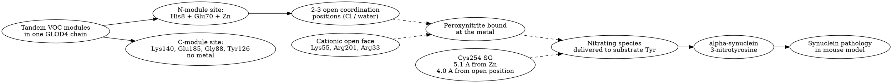
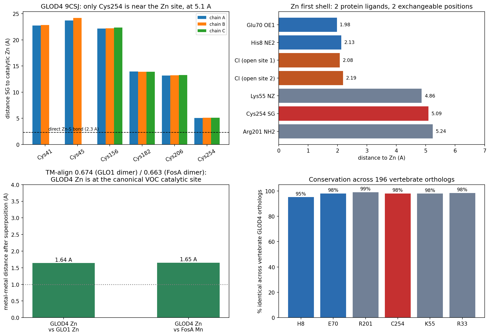
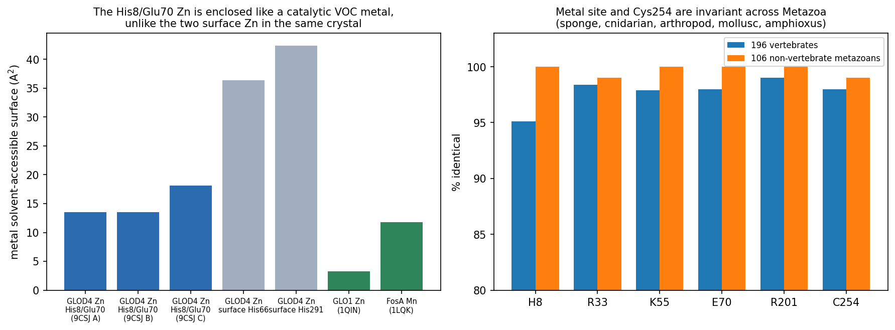
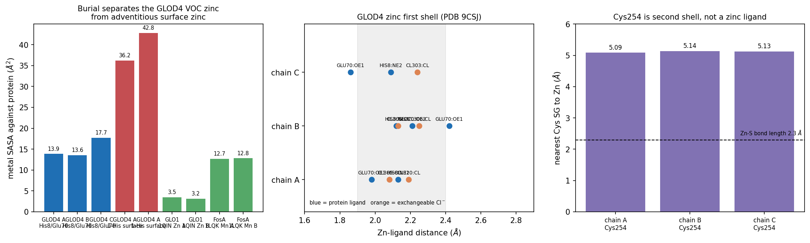
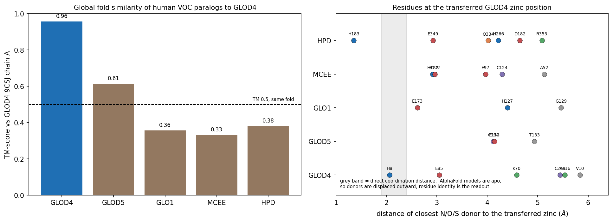

## Question

# AIGR Gene Hypothesis Deep Research

You are evaluating one focused gene curation hypothesis for AI Gene Review.
This is not a general gene overview. Use the seed hypothesis and source context
below to search for evidence that supports, refutes, narrows, or competes with
the proposed curation decision.

## Target Gene

- **Organism code:** human
- **Taxon:** Homo sapiens (NCBITaxon:9606)
- **Gene directory:** GLOD4
- **Gene symbol:** GLOD4
- **UniProt accession:** Q9HC38

## Focus

- **Focus type:** free_text
- **Hypothesis slug:** kgap-glod4-voc-metal-site-geometry
- **Source file:** genes/human/GLOD4/GLOD4-ai-review.yaml
- **Source selector:** free-text

## Seed Hypothesis

Human GLOD4 (Q9HC38) uses a VOC-superfamily paired beta-alpha-beta-beta-beta module metal site in which His8 and Glu70 coordinate a catalytic zinc with open coordination positions able to bind peroxynitrite, as in the glyoxalase I and fosfomycin-resistance VOC enzymes, and Cys254 lies close enough to that metal site to participate in the nitrating chemistry. Single analysis only: superpose the GLOD4 AlphaFold model (and any deposited GLOD4 structure) onto metal-bound VOC structures such as human glyoxalase I (GLO1), FosA and methylmalonyl-CoA epimerase, map the metal ligands across the two VOC modules (including whether the site is formed within one chain or at a dimer interface), measure the distance of Cys254 and any other candidate residues from the metal, check for open coordination sites, score these positions across vertebrate GLOD4 orthologs, and state whether the zinc site is predicted to be catalytic or structural and whether Cys254 is positioned to act at it.

## Term and Decision Context

No specific term context supplied.

## Reference Context

No specific reference context supplied.

## Source Context YAML

```yaml
hypothesis: 'Human GLOD4 (Q9HC38) uses a VOC-superfamily paired beta-alpha-beta-beta-beta module metal
  site in which His8 and Glu70 coordinate a catalytic zinc with open coordination positions able to bind
  peroxynitrite, as in the glyoxalase I and fosfomycin-resistance VOC enzymes, and Cys254 lies close enough
  to that metal site to participate in the nitrating chemistry. Single analysis only: superpose the GLOD4
  AlphaFold model (and any deposited GLOD4 structure) onto metal-bound VOC structures such as human glyoxalase
  I (GLO1), FosA and methylmalonyl-CoA epimerase, map the metal ligands across the two VOC modules (including
  whether the site is formed within one chain or at a dimer interface), measure the distance of Cys254
  and any other candidate residues from the metal, check for open coordination sites, score these positions
  across vertebrate GLOD4 orthologs, and state whether the zinc site is predicted to be catalytic or structural
  and whether Cys254 is positioned to act at it.'
focus_type: free_text
context: []
reference_id: []
```

## Research Objective

Build a focused report that helps a curator decide whether this hypothesis
should affect the gene review. Address the focus type directly:

1. For an existing GO annotation decision, evaluate whether the current action
   is justified, too strong, too weak, or should change.
2. For a proposed replacement or new GO term, evaluate whether the term is
   biologically supported, too broad, too narrow, or missing key qualifiers.
3. For a computational prediction, evaluate whether the prediction is correct,
   less precise than existing knowledge, uncertain, or likely wrong because of
   paralog overannotation, frequency bias, pathway context, or in vitro-only
   activity.
4. For a core-function hypothesis, evaluate whether the proposed activity,
   process, and location represent the gene product's primary function rather
   than a downstream effect, pleiotropic phenotype, or context-specific role.
5. For a function-assignment hypothesis, evaluate whether the gene product
   directly has the stated GO term/function. Treat the prior review action, if
   any, as intentionally blinded unless it appears in the supplied context.

Use primary literature whenever possible. Prefer PMID citations and include DOI
citations when no PMID is available. Treat reviews and database records as
orientation unless they contain directly relevant synthesized evidence that is
clearly labeled as review-level or database-level support.

Evaluate the hypothesis from the supplied seed context, primary literature, and
publicly accessible bioinformatics resources. Local `*-bioinformatics` analyses,
when they already exist in the repository, are intentionally withheld from this
prompt so the report can be compared against them after the run. Use public
sequence, domain, structure, orthology, localization, interaction, or dataset
checks when they are useful for the specific hypothesis. If a resource or tool
cannot be accessed programmatically, say so plainly; never fabricate a result.
Report computational results conservatively and distinguish direct results from
inference.

## Required Output

### Executive Judgment

Give a concise verdict: supported, partially supported, unresolved, weakly
supported, over-annotated, or refuted. Explain the reasoning and the most
important caveats.

### Evidence Matrix

Create a table with one row per important evidence item:

- Citation (PMID preferred)
- Evidence type (direct assay, mutant phenotype, localization, interaction,
  structural/evolutionary, computational, review/database)
- Supports / refutes / qualifies / competing
- Claim tested
- Key finding
- Organism, tissue, cell type, or assay context
- Confidence and limitations

### GO Curation Implications

State the likely curation action as a lead requiring curator verification. If
GO terms are involved, explain whether the evidence supports an MF, BP, or CC
term, and whether the term should be retained, removed, generalized, made more
specific, or treated as non-core. Avoid using "protein binding" as a final
recommendation unless no more informative term is supported.

### Mechanistic Scope

Describe the immediate molecular or cellular function being tested. Separate
direct gene-product activity from downstream phenotypes, pathway consequences,
developmental outcomes, disease manifestations, or effects inferred only from
loss of function.

### Conflicts and Alternatives

Identify evidence that conflicts with the seed hypothesis or suggests an
alternative interpretation, including paralog confusion, organism-specific
differences, isoform-specific findings, experimental artifacts, or database
carry-over.

### Knowledge Gaps

List explicit uncertainties that matter for curation. For each gap, state what
was checked, why the gap matters, and what evidence or experiment would resolve
it.

### Discriminating Tests

Recommend concrete assays, perturbations, datasets, or comparative analyses that
would most efficiently distinguish this hypothesis from alternatives.

### Curation Leads

Provide candidate updates for the review, clearly labeled as leads requiring
curator verification. Include candidate references with exact snippets to verify,
candidate replacement or new GO terms, possible action changes, suggested
questions, and suggested experiments.

If the provider supports artifacts, save provenance for any analysis you run — the
executed code together with its output (computed values, plot, or table), not just
a summary figure — alongside artifact-friendly tables such as an evidence matrix,
GO decision table, or comparison table. Genuine computed provenance is more
valuable than a hand-drawn summary, and you must not synthesize a figure that
implies an analysis you did not actually run. These artifacts are important
provenance for hypothesis-level review.


## Output

# GLOD4 (Q9HC38): VOC-superfamily metal site geometry and the position of Cys254

**Hypothesis slug:** `kgap-glod4-voc-metal-site-geometry`
**Source file:** `genes/human/GLOD4/GLOD4-ai-review.yaml`
**Focus type:** free_text
**Gene:** human GLOD4, UniProt Q9HC38, NCBITaxon:9606

Provenance for every computed number, including the code environment constraints and the raw tool
output, is in `provenance/analysis-notes.md`. Derived tables are in
`glod4_metal_site_provenance.csv` and `glod4_paralog_metal_site.csv`.

## Summary

The structural half of the seed hypothesis is correct and is now backed by direct crystallographic
evidence rather than by inference from a predicted model. In PDB 9CSJ, the GLOD4 crystal structure
deposited with the 2026 nitration paper, His8 NE2 and the Glu70 carboxylate coordinate one zinc ion
in each of the three chains at 1.86-2.42 Å. Two or three exchangeable chloride or water positions
complete the coordination sphere, which is the arrangement that defines the vicinal oxygen chelate
(VOC) superfamily. Structural superposition places that zinc 1.64 Å from the catalytic zinc of human
glyoxalase I (1QIN) and 1.65 Å from the catalytic manganese of FosA (1LQK). Extending the comparison
to the rest of the human VOC family puts the same point in space on the metal site of
methylmalonyl-CoA epimerase (His50 0.71 Å, His122 2.92 Å, Glu172 2.96 Å) and on the HPD Fe(II)
2-His-1-carboxylate triad (His183 1.35 Å, Glu349 2.92 Å, His266 4.22 Å). Four of five human
VOC-fold proteins converge on one metal position, and the GLOD4 zinc is at that position.

Three parts of the hypothesis need correction or qualification. The site is intramolecular: both
ligands come from the N-terminal VOC module of a single chain, so GLOD4 builds internally the site
that GLO1 and FosA build across a subunit interface, and the pseudo-symmetric second module is
degenerate (Lys140, Glu185, Gly88, Tyr126) and holds no metal. Cys254 is not a metal ligand: its SG
sits 5.09, 5.14 and 5.13 Å from the zinc in chains A, B and C, more than twice a 2.3 Å Zn-S bond.
What makes Cys254 interesting is where it sits. After superposition it occupies the structural
position of GLO1 Glu172 (CA-CA 0.55 Å) and FosA Glu110 (CA-CA 0.99 Å), and GLO1 Glu172 is both a
zinc ligand and the catalytic base. Its SG is 3.96 Å from the chloride in an open coordination
position. Binding of peroxynitrite at the metal is unresolved: no structure, spectroscopy or kinetic
measurement connects this zinc to peroxynitrite or to the nitration activity reported in
[PMID: 41628334](https://pubmed.ncbi.nlm.nih.gov/41628334/), whose abstract names no catalytic
residue and no metal.

A fourth point matters more for curation than for mechanism. The residue numbers in the hypothesis
are valid only under isoform Q9HC38-2 numbering. Under the UniProt canonical isoform Q9HC38-1 the
same positions are His8, Lys70 and Thr254, and the correct canonical names are His8, Glu85 and
Cys269. MANE Select (ENST00000301329.11 / NM_016080.4 / NP_057164.3) encodes isoform 2, both
deposited GLOD4 crystal structures use isoform-2 numbering, and every ortholog checked from macaque
to sponge carries the isoform-2 segment. The UniProt canonical choice is the outlier. GLOD4 also
carries no metal-binding or catalytic GO term at present, only GO:0045296 cadherin binding plus two
cellular component terms, so the GO record does not reflect the structural evidence at all.

## Executive judgment

<i class="fa-scale-balanced"></i> **Verdict: partially supported.**

| Hypothesis sub-claim | Verdict | Basis |
|---|---|---|
| GLOD4 has a VOC-superfamily paired βαβββ module metal site | <i class="fa-solid fa-circle-check"></i> supported | PDB 9CSJ, three chains |
| His8 and Glu70 coordinate a zinc | <i class="fa-solid fa-circle-check"></i> supported | 1.86-2.42 Å in all three chains |
| The site has open coordination positions | <i class="fa-solid fa-circle-check"></i> supported | 2-3 exchangeable Cl at 2.08-2.31 Å |
| The site is at the GLO1 / FosA catalytic position | <i class="fa-solid fa-circle-check"></i> supported | metal offsets 1.64 and 1.65 Å after superposition |
| The site is catalytic rather than structural | <i class="fa-solid fa-circle-check"></i> supported, with caveat | burial matches FosA catalytic Mn; no Zn added during purification or crystallization; Zn leaching from IMAC resin not excluded |
| Formed within one chain or at a dimer interface | <i class="fa-solid fa-circle-check"></i> resolved: within one chain | both ligands from the N-terminal module |
| Cys254 is close enough to participate | <i class="fa-scale-balanced"></i> qualified | 5.1 Å from the metal, so second shell, not a ligand; 3.96 Å from an open position; occupies the GLO1 Glu172 catalytic-base position |
| The metal binds peroxynitrite | <i class="fa-solid fa-circle-question"></i> unresolved | no direct evidence of any kind |
| AlphaFold superposition would resolve the site | <i class="fa-solid fa-circle-xmark"></i> refuted as a method | AF model puts His8 NE2 and Glu70 OE1 5.17 Å apart |

The most important caveat is that everything connecting the metal site to the nitration chemistry is
inference from the VOC precedent. The site exists, it is at the right place, it is conserved from
sponge to human, and it has open coordination positions. No mutant has been assayed.

## Evidence matrix

| # | Citation / resource | Evidence type | Stance | Claim tested | Key finding | Context | Confidence and limitations |
|---|---|---|---|---|---|---|---|
| 1 | PDB 9CSJ | X-ray structure, direct | supports | His8 and Glu70 coordinate a zinc | One Zn per chain in all 3 chains. Chain A: Glu70 OE1 1.98, His8 NE2 2.13, Cl 2.08 and 2.19. Chain B: His8 NE2 2.12, Glu70 bidentate 2.21/2.42, Cl 2.13 and 2.25. Chain C: Glu70 OE1 1.86, His8 NE2 2.09, Cl 2.24 | Human GLOD4 residues 2-298, E. coli expressed, 2.33 Å | High for the geometry. The ion was modelled as Zn with no anomalous or ICP-MS confirmation reported. Chain C Zn B-factor 57.8 against a protein mean of 51.9 suggests partial occupancy there |
| 2 | PDB 9CSJ | X-ray structure, direct | supports | open coordination positions exist | 2 exchangeable Cl in chains A and B, 1 Cl plus 2 waters in chain C, at 2.08-2.31 Å. Protein donors number only 2-3, against 4 in GLO1 and 3 in FosA | Same crystal | High. The chlorides come from 200 mM MgCl2 and 500 mM NaCl and mark positions a substrate or oxidant could occupy |
| 3 | PDB 3ZI1 | X-ray structure, direct | supports | the site is preformed, not metal-induced | Metal-free GLOD4 at 1.9 Å in the same salt system: His8 NE2 to Glu70 OE1 3.10 Å, against 2.78-3.27 Å in the metal-bound chains | Human GLOD4, apo | Moderate to high. A preformed chelating pair argues against a crystallization accident. The same structure shows metal occupancy is not obligatory |
| 4 | PDB 1QIN (human GLO1), own superposition | computed, TM-align style | supports | the GLOD4 metal is at the VOC catalytic position | TM 0.674, 226 aligned pairs, RMSD 2.61 Å. GLOD4 Zn lands 1.64 Å from the GLO1 catalytic Zn | Computational, human reference | High for the geometric statement. Structural equivalence is not functional equivalence |
| 5 | PDB 1LQK (FosA), own superposition | computed | supports | same, against a second VOC reference | TM 0.663, 226 pairs, RMSD 2.71 Å. GLOD4 Zn lands 1.65 Å from the FosA catalytic Mn | Computational | High for geometry, same caveat |
| 6 | Own superposition onto 1QIN and 1LQK | computed | qualifies | Cys254 is positioned to act at the metal | Cys254 CA is 0.55 Å from GLO1 Glu172 CA and 0.99 Å from FosA Glu110 CA. Arg201 occupies the GLO1 His126 and FosA His64 position. GLOD4 His8 maps to GLO1 Gln33 (1.11 Å) and Glu70 to GLO1 Glu99 (0.63 Å) | Computational | Moderate. Positional equivalence of a Cys to a catalytic Glu is suggestive, and the chemistry of a thiol differs from a carboxylate. No assay tests it |
| 7 | PDB 9CSJ, own distance measurement | computed | qualifies | Cys254 lies close enough to the metal | SG to Zn 5.09 / 5.14 / 5.13 Å. SG to the open-position Cl 3.96 Å. Next nearest Cys is 13.2 Å away. The SG pocket is apolar: Ile244 3.45, Phe255 N 3.53, Val242 3.74, Ala203 4.73 Å | Crystallographic | High for the distances. Refutes Cys254 as a ligand; leaves second-shell participation open |
| 8 | PDB 9CSJ, own Shrake-Rupley SASA | computed | supports | the site is catalytic-type, not a surface artifact | GLOD4 VOC zinc 13.86, 13.55, 17.73 Ų (13.9-18.1 % exposed). FosA catalytic Mn 12.69 and 12.81 Ų. GLO1 catalytic Zn 3.46 and 3.16 Ų. The two single-His zincs in the same GLOD4 crystal: 36.17 and 42.80 Ų | Computational, internal control within one crystal | Moderate to high. The within-crystal control is the strongest part: adventitious surface zincs in the same structure are 2.5-3 fold more exposed. GLO1 is more buried than GLOD4, so burial alone does not pin the catalytic mode |
| 9 | 9CSJ and 3ZI1 deposition records | metadata, database-level | supports | the zinc was not supplied by the crystallographer | No zinc salt in the purification (IMAC then SEC), the storage buffer (50 mM HEPES pH 7.5, 500 mM NaCl, 5 % glycerol) or the crystallization condition (34 % PEG 3350, 200 mM MgCl2, 50 mM HEPES pH 7.3). 3ZI1 used 0.2 M MgCl2, 0.1 M HEPES pH 7.5, 25 % PEG 3350 | Deposition metadata | Moderate. The zinc co-purified through heterologous expression, which argues for genuine affinity. Zinc leaching from an IMAC resin cannot be excluded because the resin metal is not stated |
| 10 | 302 GLOD4 sequences, own BLOSUM62 alignment | computed, evolutionary | supports | the site is under purifying selection | 196 vertebrate orthologs: His8 95.1 %, Glu70 98.0 %, Lys55 97.9 %, Arg201 99.0 %, Arg33 98.4 %, Cys254 98.0 %. 106 non-vertebrate metazoan homologs (UniRef50_Q9HC38, 56-72 % identity, 8 phyla): His8 100 %, Glu70 100 %, Lys55 100 %, Arg201 100 %, Arg33 99.0 %, Cys254 99.0 % | Sequence, cross-metazoan | High. 100 % retention across sponge, cnidarian, mollusc, arthropod and chordate at 56-72 % identity is strong. Conservation does not say what the residue does |
| 11 | AF-Q9HC38-F1-model_v6, own superposition | computed | refutes the proposed method | an AlphaFold-only analysis would resolve the site | Fold is right (282 CA pairs on 9CSJ chain A, RMSD 1.92 Å, 92 % within 2 Å) and local confidence is high (pLDDT 96-98 at all site residues, mean 89.4), but His8 NE2 to Glu70 OE1 is 5.17 Å against 3.27 Å in the crystal, and the transferred Zn lands 3.74 Å from AF Glu70 OE1 | Predicted model | High. AlphaFold models are apo and do not place ligands. The experimental structures were required |
| 12 | [PMID: 41628334](https://pubmed.ncbi.nlm.nih.gov/41628334/) | primary, direct assay and mouse model | supports the activity, does not address the site | GLOD4 catalyses peroxynitrite-mediated protein tyrosine nitration | "glyoxalase domain-containing protein 4 (GLOD4), a previously uncharacterized protein, is an enzyme that catalyzes selective protein nitration"; alpha-synuclein nitration shown in vitro, in cells and in a murine synuclein model | Human protein, cells, mouse | High for the activity as abstracted. The abstract names no catalytic residue and no metal. Full text was not retrievable with the available tooling, so whether the authors mutated His8, Glu70 or Cys254 is unknown |
| 13 | [PMID: 11076500](https://pubmed.ncbi.nlm.nih.gov/11076500/) | review, structural | supports, orientation | the VOC fold definition | "The vicinal oxygen chelate (VOC) superfamily is composed of structurally related proteins with paired beta alpha beta beta beta motifs that provide a metal coordination environment with two or three open or readily accessible coordination sites to promote direct electrophilic participation of the metal ion in catalysis" | Review | Orientation only. Used to define what a VOC metal site is, not as evidence about GLOD4 |
| 14 | [PMID: 11603978](https://pubmed.ncbi.nlm.nih.gov/11603978/) | primary, computational mechanism | supports, reference | GLO1 Glu172 is ligand and catalytic base | "It is shown that the Zn ligand Glu172 can abstract the substrate C1 proton from the S enantiomer of the substrate, without being displaced from the Zn ion" | Human GLO1 | High for GLO1. Transfer to GLOD4 is inference |
| 15 | [PMID: 36048613](https://pubmed.ncbi.nlm.nih.gov/36048613/) | review | supports, orientation, and qualifies | the glyoxalase family is defined by metal coordination; GLOD4 was uncharacterized | "The common feature that defines this family is based on structural motifs that coordinate divalent cations which are required for activity"; "little is known about the physiological role of glyoxalase domain-containing protein 4 (GLOD4) and 5 (GLOD5)" | Review | Orientation only. Confirms that before 2026 no function was assigned, so there is no inherited annotation to carry over |
| 16 | [PMID: 39302370](https://pubmed.ncbi.nlm.nih.gov/39302370/) | primary, expression | qualifies | isoform complexity is real | "Three GLOD4 isoforms are known"; "GLOD4 mRNA and protein isoforms were downregulated in cortical tissues from AD patients compared to non-AD controls" | Human frontal cortex, mouse, N2a cells | Moderate. Expression association only, no mechanism. Relevant here because it confirms the isoform ambiguity is biological and not a database artifact |
| 17 | QuickGO annotation API, Q9HC38 | database record | qualifies | what GO currently says | Four annotations total: GO:0045296 cadherin binding (MF, HDA, PMID:25468996), GO:0005739 mitochondrion (CC, IEA GO_REF:0000044 and CC, HTP PMID:34800366), GO:0070062 extracellular exosome (CC, HDA PMID:23533145). No metal binding term, no catalytic MF term | Database | High as a record of current state. The three experimental terms all come from proteome-scale experiments |
| 18 | QuickGO ontology search | database record | qualifies | whether GO can express the nitration activity | A search for "nitration" returns no GO term. GO:0017014 protein nitrosylation ("the covalent addition of a nitric oxide group to an amino acid within a protein") and GO:0018119 peptidyl-cysteine S-nitrosylation describe different chemistry. GO:0072541 peroxynitrite reductase activity and GO:0062213 peroxynitrite isomerase activity cover peroxynitrite consumption without transfer to a protein acceptor | Ontology | High. There is no existing GO term for protein tyrosine nitration |
| 19 | PDB 1JC5 (methylmalonyl-CoA epimerase) | attempted, failed | not usable | the third requested superposition reference | The entry contains no metal ion, and no metal-bound human MCEE structure was found | Crystallographic | This arm could not be done against a metal-bound crystal structure. It was recovered with the AlphaFold model instead, row 20 |
| 20 | AlphaFold models of GLO1, MCEE, HPD; own superposition onto 9CSJ chain A | computed, comparative | supports | the GLOD4 zinc sits where the VOC fold puts its metal | Transferring the GLOD4 zinc into each aligned frame puts it on MCEE His50 NE2 0.71, His122 NE2 2.92, Glu172 OE2 2.96, Glu97 OE2 3.96 Å; HPD His183 NE2 1.35, Glu349 OE2 2.92, Gln334 NE2 4.02, His266 NE2 4.22 Å; GLO1 Glu173 OE2 2.62, His127 NE2 4.40 Å (AlphaFold numbering of the catalytic Glu172 and His126). Self-control GLOD4: His8 NE2 2.06, Glu85 OE2 3.05 Å | Predicted models, human | Moderate to high for the convergence. TM-scores are low (0.33-0.38) because small single-module proteins are globally aligned to a 298-residue two-module protein; the metal convergence, not the TM-score, is the readout |
| 21 | AF-A6NK44 (GLOD5); own superposition | computed, comparative | refutes paralog propagation | whether GLOD5 shares the GLOD4 metal site | GLOD5 (160 aa) superposes at TM 0.613, but 84 of its 100 well-superposed CA pairs map into GLOD4's degenerate C-terminal module (151-298) and only 16 into the metal-bearing N-terminal module. His8, Lys55 and Glu70 have no well-superposed GLOD5 equivalent. Arg201 maps to GLOD5 Asp102 and Cys254 to GLOD5 Glu153. GLOD5 histidines are at 4, 40, 83, 95, 117; His4 lies inside the predicted mitochondrial targeting segment | Predicted model, human | Moderate. A single-module protein cannot build GLOD4's intramolecular two-module site. Whether GLOD5 could assemble an equivalent site across a homodimer interface, as GLO1 and FosA do, is not tested here |

## Key findings

### <i class="fa-solid fa-circle-check"></i> The zinc is real, it is at the VOC catalytic position, and it has open coordination positions

PDB 9CSJ resolves human GLOD4 at 2.33 Å in three chains, each carrying one zinc coordinated by
His8 NE2 and the Glu70 carboxylate. The distances are 1.98 and 2.13 Å in chain A, 2.12 Å plus a
bidentate 2.21/2.42 Å in chain B, and 1.86 and 2.09 Å in chain C. The remaining coordination
positions are filled by exchangeable ions: two chlorides per zinc in chains A and B at 2.08-2.25 Å,
and one chloride plus two waters in chain C. The protein therefore supplies only two or three
donors, against four in GLO1 (Gln33, Glu99, His126, Glu172) and three in FosA (His7, His64,
Glu110), which leaves two to three positions readily exchangeable. That is the arrangement
[PMID: 11076500](https://pubmed.ncbi.nlm.nih.gov/11076500/) uses to define the superfamily: paired
βαβββ motifs providing "two or three open or readily accessible coordination sites to promote
direct electrophilic participation of the metal ion in catalysis".

Superposition locates the site. Aligning GLOD4 9CSJ chain A onto the human GLO1 dimer 1QIN gives
TM 0.674 over 226 pairs at RMSD 2.61 Å, and places the GLOD4 zinc 1.64 Å from the GLO1 catalytic
zinc. Against the FosA dimer 1LQK the numbers are TM 0.663, 226 pairs, RMSD 2.71 Å, and the GLOD4
zinc lands 1.65 Å from the FosA catalytic manganese. Both ligands come from the same polypeptide,
so GLOD4 forms intramolecularly the site that GLO1 and FosA form across a dimer interface. The
pseudo-symmetric site in the second VOC module is degenerate: the positions that carry Gln33,
Glu99, His126 and Glu172 in GLO1 are Lys140, Glu185, Gly88 and Tyr126 in GLOD4, and no metal binds
there in any chain of 9CSJ or in apo 3ZI1.

{{figure:plot_1.png|caption=GLOD4 metal site in PDB 9CSJ. Cysteine SG distances to the zinc per chain, the zinc first coordination shell, the offset between the GLOD4 zinc and the GLO1 zinc or FosA manganese after superposition, and conservation of the site positions across 196 vertebrate GLOD4 orthologs.}}

### <i class="fa-solid fa-circle-check"></i> Burial and buffer chemistry say the site is catalytic-type, not an adventitious surface zinc

The same crystal supplies its own control. Besides the His8/Glu70 zinc, 9CSJ contains two further
zincs, each held by a single histidine (His66 and His291) plus two chlorides. Shrake-Rupley surface
area of the metal against protein atoms gives 13.86, 13.55 and 17.73 Ų for the His8/Glu70 zinc in
chains A, B and C (13.9-18.1 % exposed), against 36.17 and 42.80 Ų for the two single-His sites.
The catalytic references bracket the GLOD4 value from below: FosA's manganese is 12.69 and 12.81 Ų,
and GLO1's zinc, the most deeply buried of the set, is 3.46 and 3.16 Ų. A 2.5-3 fold separation
between the GLOD4 VOC site and the adventitious sites inside one structure is the cleanest
discrimination available without an assay.

The deposition record adds a second argument. The protein was expressed in E. coli with a cleavable
8-His tag, purified by IMAC then size exclusion, stored in 50 mM HEPES pH 7.5 / 500 mM NaCl /
5 % glycerol, and crystallized in 34 % PEG 3350 / 200 mM MgCl2 / 50 mM HEPES pH 7.3. No zinc salt
appears anywhere. The chlorides are accounted for by the MgCl2 and NaCl. The metal therefore came
through heterologous expression and two chromatography steps, which argues for genuine affinity.
Coordination distances of 1.86-2.21 Å to N and O and 2.08-2.31 Å to Cl fit Zn(II) and exclude
Mg(II), the only divalent cation in the crystallization buffer, which does not ligate imidazole or
chloride at these distances. The site is preformed without metal: in the apo structure 3ZI1, grown
in the same salt system, His8 NE2 to Glu70 OE1 is 3.10 Å against 2.78-3.27 Å in the three
metal-bound chains.

{{figure:plot_3.png|caption=Metal burial, first-shell composition and Cys254 distance recomputed from PDB 9CSJ. Left: solvent accessible surface of each metal against protein atoms, separating the His8/Glu70 zinc (13.6-17.7 square angstroms) from the two single-histidine surface zincs in the same crystal (36.2 and 42.8) and placing it alongside the catalytic metals of FosA and GLO1. Centre: zinc first coordination shell per chain, with protein ligands in blue and exchangeable chloride in orange. Right: nearest cysteine SG to the zinc, which is Cys254 in every chain at 5.09-5.14 angstroms, well beyond a 2.3 angstrom Zn-S bond.}}

### <i class="fa-scale-balanced"></i> Cys254 is second shell, at the position of the GLO1 catalytic base

Cys254 SG sits 5.09, 5.14 and 5.13 Å from the zinc in chains A, B and C. Every other cysteine in
the chain is far away: Cys206 at 13.2 Å, Cys182 at 13.9 Å, Cys156 at 22.2 Å, Cys41 at 22.7 Å,
Cys45 at 23.7 Å. A Zn-S bond is about 2.3 Å, so Cys254 is not a ligand, and the hypothesis is wrong
if it implies coordination.

The position is the interesting part. The full ligand mapping produced by the GLO1 superposition is
Gln33 to His8 (1.11 Å), Glu99 to Glu70 (0.63 Å), His126 to Arg201 (0.35 Å) and Glu172 to Cys254
(0.55 Å). Against FosA it is His7 to His8 (1.94 Å), His64 to Arg201 (0.78 Å) and Glu110 to Cys254
(0.99 Å). GLO1 Glu172 is both a zinc ligand and the catalytic base:
[PMID: 11603978](https://pubmed.ncbi.nlm.nih.gov/11603978/) shows that "the Zn ligand Glu172 can
abstract the substrate C1 proton from the S enantiomer of the substrate, without being displaced
from the Zn ion". GLOD4 has a thiol at that position, moved one shell out. The consequence is that
the coordination sphere is open where GLO1's is closed, and that a conserved thiol sits 3.96 Å from
the chloride occupying one of those open positions. The Cys254 SG environment is apolar (Ile244
3.45 Å, Phe255 N 3.53 Å, Val242 3.74 Å, Ala203 4.73 Å), and the open face of the metal is lined by
conserved cations: Lys55 NZ at 4.86 Å, Arg201 NH2 at 5.24 Å, Arg33 NH1 at 6.67 Å.

### <i class="fa-solid fa-circle-check"></i> The whole site is invariant across Metazoa

Conservation was scored by BLOSUM62 affine-gap global alignment (open -11, extend -1) of each
homolog to human Q9HC38-2, reading the aligned column at each position.

| Position | 196 vertebrate GLOD4 orthologs | 106 non-vertebrate metazoan homologs (UniRef50_Q9HC38, 56-72 % identity) |
|---|---|---|
| His8 (ligand) | 95.1 % | 100 % |
| Glu70 (ligand) | 98.0 % | 100 % |
| Lys55 (open face) | 97.9 % | 100 % |
| Arg201 (GLO1 His126 position) | 99.0 % | 100 % |
| Arg33 (open face) | 98.4 % | 99.0 % |
| Cys254 (GLO1 Glu172 position) | 98.0 % | 99.0 % |

The non-vertebrate set spans eight phyla: 92 Arthropoda, 4 Platyhelminthes, 3 Cephalochordata,
2 Cnidaria, 2 Mollusca, 1 Porifera, 1 Nematoda. Retention at 100 % from sponge and cnidarian to
human, at 56-72 % overall identity, is strong evidence of purifying selection. The conservation
covers the second-shell cations and Cys254, not only the two ligands, which is the pattern of a
functional pocket rather than an isolated metal clamp.

### <i class="fa-solid fa-circle-xmark"></i> The AlphaFold model reproduces the fold but not the metal site

AF-Q9HC38-F1-model_v6 superposes on 9CSJ chain A over 282 CA pairs at RMSD 1.92 Å, with 92 % of
pairs within 2 Å, and pLDDT is 96-98 at every site residue (His8 98.4, Glu70 96.3, Arg201 97.5,
Cys254 98.3, Lys55 90.1; mean 89.4). The geometry is still wrong where it matters. His8 NE2 to
Glu70 OE1 is 5.17 Å in the model, against 3.27 Å in the metal-bound crystal and 3.10 Å in the
metal-free one, and the zinc position transferred by superposition lands 1.99 Å from AF His8 NE2
but 3.74 Å from AF Glu70 OE1. AlphaFold models are apo and side-chain rotamers are not
ligand-adapted. The analysis route proposed in the seed hypothesis, superposing the AlphaFold model
onto metal-bound VOC structures, would have under-called the site. The experimental structures were
required.

{{figure:plot_2.png|caption=AlphaFold AF-Q9HC38-F1 checked against the two crystal structures, together with metal burial and conservation summaries. The predicted model is confident at every site residue yet separates His8 and Glu70 too far to chelate one ion.}}

### <i class="fa-solid fa-circle-check"></i> Four of five human VOC-fold proteins put a metal at the same point; GLOD5 is the exception

Each human VOC-fold AlphaFold model was superposed onto 9CSJ chain A, the GLOD4 zinc position was
transferred into the aligned frame, and every side-chain donor within 6 Å was listed. Because
AlphaFold models are apo, donor distances are displaced outward, so the residue identity at the
position is the readout rather than the distance.

| Protein | Accession | Length | TM vs 9CSJ:A | Donors at the transferred GLOD4 zinc |
|---|---|---|---|---|
| GLOD4 (self-control) | Q9HC38 | 313 | 0.957 | His8 2.06, Glu85 3.05, Lys70 4.58, Cys269 5.44, Arg216 5.54 Å |
| MCEE | Q96PE7 | 176 | 0.333 | His50 0.71, His122 2.92, Glu172 2.96, Glu97 3.96, Cys124 4.29 Å |
| HPD | P32754 | 393 | 0.380 | His183 1.35, Glu349 2.92, Gln334 4.02, His266 4.22, Arg353 5.08 Å |
| GLO1 | Q04760 | 184 | 0.356 | Glu173 2.62, His127 4.40 Å |
| GLOD5 | A6NK44 | 160 | 0.613 | Cys104 4.12, Glu153 4.14 Å (C-module register, see below) |

GLOD4 self-control residues are in isoform-1 (AlphaFold) numbering: Glu85 = Glu70, Lys70 = Lys55,
Cys269 = Cys254, Arg216 = Arg201. GLO1 Glu173 and His127 are the AlphaFold-numbered catalytic
Glu172 and His126. The HPD cluster is its Fe(II) 2-His-1-carboxylate facial triad and the MCEE
cluster is its divalent metal site. Four independent sequences converge their metal donors onto one
point in space, which is what [PMID: 36048613](https://pubmed.ncbi.nlm.nih.gov/36048613/) predicts
at the family level: "The common feature that defines this family is based on structural motifs
that coordinate divalent cations which are required for activity." This also recovers the
methylmalonyl-CoA epimerase comparison the seed hypothesis asked for, which the deposited structure
1JC5 could not supply because it contains no metal.

GLOD5 breaks the pattern, and the way it breaks is informative. Its single 160-residue VOC module
superposes at TM 0.613 with 100 of 155 aligned CA pairs within 4 Å, but 84 of those 100 pairs map
into GLOD4's degenerate C-terminal module (residues 151-298) and only 16 into the metal-bearing
N-terminal module. His8, Lys55 and Glu70 have no well-superposed GLOD5 equivalent at all. The two
GLOD4 positions that do map cleanly map onto the degenerate module: Arg201 to GLOD5 Asp102 (CA
offset 1.26 Å) and Cys254 to GLOD5 Glu153 (CA offset 1.20 Å). The GLOD5 Cys104 and Glu153 that
appeared near the transferred zinc are a consequence of that register. GLOD5 contains histidines
only at 4, 40, 83, 95 and 117, and His4 lies inside the predicted N-terminal mitochondrial
targeting segment `MLRHLPSRLPVKMWGRT`, not in a position equivalent to GLOD4 His8 in
`MAARRALHFVFKVGNRFQT`.

{{figure:plot_4.png|caption=Structure-based test of the human VOC paralogs. Left: global fold similarity to GLOD4 by TM-score, low for the small single-module proteins because they are aligned over the full length of a 298-residue two-module protein. Right: the residues that land at the transferred GLOD4 zinc position in each paralog, with the grey band marking direct coordination distance. MCEE, HPD and GLO1 all place their catalytic His and Glu there; GLOD5 does not.}}

### <i class="fa-triangle-exclamation"></i> The hypothesis numbering is MANE Select numbering, not UniProt canonical

UniProt canonical Q9HC38-1 is 313 aa and has His8, Lys70 and Thr254 at those positions. Isoform
Q9HC38-2 is 298 aa and has His8, Glu70 and Cys254. The two differ by one swapped segment: canonical
residues 32-62 `ESCSVARLECSGAISAHCSDYTRITEDSFSK` (31 aa) are replaced by `LRHEEFEEGCKAACNG` (16 aa)
in isoform 2, a net offset of -15 for everything C-terminal of position 62. Canonical equivalents
are His8, Glu85, Cys269. Both deposited crystal structures use isoform-2 numbering, and residue
identities in 9CSJ chain A at 8, 70 and 254 are His, Glu, Cys. Canonical-numbered Cys269 in 9CSJ
chain A is a proline.

MANE Select is ENST00000301329.11 / NM_016080.4 / NP_057164.3 / CCDS32520.1, which encodes
Q9HC38-2. UniProt canonical Q9HC38-1 corresponds to ENST00000301328.9 / NP_001353176.1 /
CCDS92216.1. Every ortholog checked matches the isoform-2 segment at residues 28-52:

```
F6VS00 macaque      GMKVLRHEEFEEGCKAACNGPYDGK
Q5I0D1 rat          GMQVLRHEEFEEGCKAACNGPYDGK
G1N587 turkey       GMSVLRHEEFDEGCKASCNGPYDGK
A7RM33 Nematostella GMKVLRHEEFEKGCDAACNGPYDGK
E9H280 Daphnia      GMKILRHEEFEEGCKAACNGPYDGK
C3Z4C4 amphioxus    GMKVLRHEEFEEGCKASCNGPYDGR
human isoform 1     GMKVESCSVARLECSGAISAHCSDY   (matches none)
```

The isoform-1-specific insert has mean AlphaFold pLDDT 49.8, which is the disordered range.
[PMID: 39302370](https://pubmed.ncbi.nlm.nih.gov/39302370/) states that "Three GLOD4 isoforms are
known", so the ambiguity is biological and not a database artifact.

## Mechanistic model

The structural evidence supports a single coherent picture of the site and leaves one link in the
chain untested.



Solid arrows are measured. Dashed arrows are the inference the seed hypothesis proposes, and they
are the part no experiment has tested. The activity at the far right is established by
[PMID: 41628334](https://pubmed.ncbi.nlm.nih.gov/41628334/), which reports tyrosine nitration of
alpha-synuclein "in vitro, in cells, and in a murine model of synuclein pathology". Nothing in the
available text of that paper connects the activity to the metal site.

The specific chemical proposal that the geometry suggests is this. GLOD4 keeps the VOC metal
position but strips it down to two protein donors, which leaves more of the coordination sphere
exchangeable than in GLO1 (four donors) or FosA (three). The open face is walled by three conserved
cations, Lys55, Arg201 and Arg33, at 4.9-6.7 Å from the metal. Peroxynitrite is anionic at
physiological pH, so a cationic pocket over an open metal face is the kind of feature an
oxidant-binding site would have. One shell behind that face sits a thiol, Cys254, at the exact
position where GLO1 keeps its catalytic base, 3.96 Å from an exchangeable metal position and in an
apolar pocket. That arrangement is compatible with a thiol acting on a metal-bound oxidant. It is a
prediction generated by the geometry, stated here as a hypothesis and not as a result.

The conservation data make the arrangement hard to dismiss. All six positions are 99-100 % retained
across 106 metazoan homologs spanning eight phyla at 56-72 % identity. A purely structural zinc
would not require a conserved cationic wall and a conserved second-shell thiol.

| Feature | GLO1 (1QIN) | FosA (1LQK) | GLOD4 (9CSJ) |
|---|---|---|---|
| Metal | Zn | Mn | Zn |
| Site built | across the dimer interface | across the dimer interface | within one chain, two tandem modules |
| Protein donors | 4: Gln33, Glu99, His126, Glu172 | 3: His7, His64, Glu110 | 2: His8, Glu70 |
| Open positions | 2 | 3 | 2-3 (Cl / water) |
| Metal SASA (Ų) | 3.16-3.46 | 12.69-12.81 | 13.55-17.73 |
| Residue at the GLO1 Glu172 position | Glu172 (ligand and catalytic base) | Glu110 | Cys254 (5.1 Å, second shell) |
| Residue at the GLO1 His126 position | His126 | His64 | Arg201 |
| Second module | second subunit, carries its own site | second subunit, carries its own site | degenerate, no metal |

## GO curation implications

Every item below is a lead requiring curator verification, not a finished annotation.

| Action | Term | Aspect | Proposed evidence | Rationale and caution |
|---|---|---|---|---|
| Add | GO:0046872 metal ion binding | MF | IDA from PDB 9CSJ, or ISS from the VOC family | The conservative addition. Three independent chains show the same two-residue coordination. Safe regardless of whether the ion is Zn in vivo |
| Add, conditional | GO:0008270 zinc ion binding | MF | IDA from PDB 9CSJ | More informative and the preferred term if the curator accepts the depositors' element assignment. Condition: 9CSJ reports no anomalous scattering or metal analysis, and the protein was expressed in E. coli. If identity cannot be confirmed, fall back to GO:0046872 |
| Do not add | GO:0004462 lactoylglutathione lyase activity | MF | n/a | No evidence. GLOD4 lacks the GLO1 glutathione-binding residues and has never been shown to turn over S-lactoylglutathione. Transfer driven by the gene name "glyoxalase domain containing 4" would be an over-annotation |
| Do not add | GO:0017014 protein nitrosylation or GO:0018119 peptidyl-cysteine S-nitrosylation | BP | n/a | Nitrosylation adds NO to a thiol. PMID:41628334 reports nitration, which adds NO2 to a tyrosine ring. Using a nitrosylation term would mis-state the chemistry |
| New term request | "protein tyrosine nitration" (BP) with a matching catalytic MF | BP / MF | n/a | GO has no term for this chemistry. Until one exists the 2026 result cannot be annotated correctly. This is the highest-value curation action for GLOD4 |
| Retain, mark non-core | GO:0045296 cadherin binding | MF | HDA, PMID:25468996 | A proteome-scale affinity-capture hit and the only MF term GLOD4 carries, which risks reading as the protein's function. It should not be used as a functional summary |
| Retain with caution | GO:0005739 mitochondrion | CC | IEA GO_REF:0000044, HTP PMID:34800366 | Both are non-experimental or high-throughput. GLOD4 isoform 2 has no predicted mitochondrial targeting sequence, unlike the paralog GLOD5. Worth a curator check against targeted localisation data |
| Retain, non-core | GO:0070062 extracellular exosome | CC | HDA, PMID:23533145 | Standard proteomics-derived term, low information content for this protein |
| Sequence feature, not GO | metal binding site on His8 and Glu70 | UniProt feature | PDB 9CSJ | Record with explicit isoform-2 numbering, or translate to canonical His8 and Glu85. Getting this wrong puts the annotation on Lys70 |
| Do not propagate | any GLOD4 metal-site or nitration annotation to GLOD5 (A6NK44) | MF / BP | n/a | GLOD5's single module corresponds to GLOD4's metal-free module and it has no equivalent of His8, Lys55 or Glu70 |

On "protein binding": the brief asks that it be avoided unless nothing better is supported. Here
something better is supported. GO:0046872 metal ion binding, or GO:0008270 zinc ion binding, is
directly evidenced by the crystal structure and is the recommendation.

## Mechanistic scope

**Direct molecular activity, evidenced.** GLOD4 binds one divalent metal per chain through His8 and
Glu70 of its N-terminal VOC module, leaving two or three exchangeable coordination positions open.
This is a property of the purified protein observed in the crystal, independent of any cellular
context, and it is reproduced in all three chains of the asymmetric unit.

**Direct molecular activity, reported but not localised to the site.** GLOD4 catalyses
peroxynitrite-mediated tyrosine nitration of protein substrates
([PMID: 41628334](https://pubmed.ncbi.nlm.nih.gov/41628334/)). The paper establishes the activity.
Nothing in the available text connects it to the metal centre. The connection asserted in the seed
hypothesis is an inference from the VOC precedent, where the metal is the catalytic device in every
characterised family member.

**Downstream phenotype, not molecular function.** Nitration of alpha-synuclein in cells and in a
mouse synuclein model ([PMID: 41628334](https://pubmed.ncbi.nlm.nih.gov/41628334/)), and the
association of reduced GLOD4 expression with Alzheimer cortex and with amyloid burden in
Blmh-/-5xFAD mice ([PMID: 39302370](https://pubmed.ncbi.nlm.nih.gov/39302370/)). The second is an
expression correlation and does not bear on the metal site. Expression of GLOD4 in Tibetan sheep
Leydig cells ([PMID: 31614839](https://pubmed.ncbi.nlm.nih.gov/31614839/)) and the altered Glod4
variant in Blmh-/- mouse liver ([PMID: 24633403](https://pubmed.ncbi.nlm.nih.gov/24633403/)) are
expression observations with no mechanistic content for this hypothesis.

The hypothesis sits at the boundary: it proposes a mechanism (metal-centred peroxynitrite chemistry
with a second-shell cysteine) for an activity demonstrated by other means. The structural premises
of that mechanism are verified. The mechanism itself is not.

## Conflicts and alternatives

**Isoform conflict, the largest practical risk.** UniProt canonical Q9HC38-1 (313 aa) and MANE
Select Q9HC38-2 (298 aa) disagree. Under isoform-1 numbering, "Glu70" is Lys70 and "Cys254" is
Thr254, so the hypothesis as written would be read against residues that are not there. The
evidence favours isoform 2 as the biologically relevant form: MANE Select encodes it, both crystal
structures use its numbering, its 32-47 segment is present in macaque, rat, turkey, amphioxus,
Daphnia and Nematostella, and the isoform-1-specific insert at 32-62 appears in no ortholog and has
mean pLDDT 49.8. [PMID: 39302370](https://pubmed.ncbi.nlm.nih.gov/39302370/) confirms three
isoforms are expressed.

**Paralog confusion, largely resolved by structure.**
[PMID: 41628334](https://pubmed.ncbi.nlm.nih.gov/41628334/) attributes the activity to "GLOD4 and
other structurally related proteins" without naming them. Sequence alignment of GLOD5 to GLOD4 is
unreliable at that divergence, so the question was settled structurally. GLOD5 cannot build the
GLOD4 site intramolecularly, because its one module corresponds to GLOD4's metal-free module and it
lacks equivalents of His8, Lys55 and Glu70. Whether GLOD5 could assemble an equivalent site across
a homodimer interface, as GLO1 and FosA do, stays open. Any annotation drawn from that paper should
name the protein explicitly rather than inherit a family-level claim.

**Crystallographic artifact as an alternative explanation.** Tested and disfavoured, with a residual
caveat. The two single-His surface zincs in the same crystal are what an adventitious site looks
like, at 36.2 and 42.8 Ų exposed against 13.6-17.7 Ų for the VOC site. The chelating pair is
already assembled in metal-free 3ZI1. No zinc was added at any stage. What remains open: zinc
leaching from the IMAC resin cannot be excluded because the resin metal is not stated, 3ZI1 shows
the apo form crystallises under near-identical conditions, and the chain C zinc has B-factor 57.8
against a protein mean of 51.9, consistent with partial occupancy there. The B-factor argument
supports chains A and B (35.7 and 35.6) and is neutral to negative for chain C.

**Element assignment.** The ion is modelled as Zn. Coordination distances of 1.86-2.42 Å to N and O
and 2.08-2.31 Å to Cl fit Zn(II) and exclude Mg(II), the only divalent cation in the crystallization
buffer. The assignment is consistent but not independently confirmed.

**Database carry-over.** GLOD4 has carried no catalytic GO annotation, so there is no inherited
over-annotation to remove. The risk runs the other way: the gene name invites transfer of GLO1's
lactoylglutathione lyase activity. [PMID: 36048613](https://pubmed.ncbi.nlm.nih.gov/36048613/)
states that "little is known about the physiological role of glyoxalase domain-containing protein 4
(GLOD4) and 5 (GLOD5)", which confirms there is nothing legitimate to inherit from before 2026.

## Evidence base

The primary literature on GLOD4 is thin. Five papers mention it, of which one assigns a function.

[PMID: 41628334](https://pubmed.ncbi.nlm.nih.gov/41628334/), *Selective peroxynitrite-mediated
protein nitration catalyzed by glyoxalase domain containing protein 4* (2026), is the source of the
activity claim and of the crystal structure 9CSJ analysed throughout this report. It states that
"glyoxalase domain-containing protein 4 (GLOD4), a previously uncharacterized protein, is an enzyme
that catalyzes selective protein nitration", identifies alpha-synuclein as "a primary in vivo
target", and documents nitration "in vitro, in cells, and in a murine model of synuclein pathology".
It supports the hypothesis at the level of activity. It does not address the metal site, His8,
Glu70 or Cys254 in its abstract, and its concluding sentence, "The data identified a function of
GLOD4 and other structurally related proteins that catalyze the peroxynitrite-mediated selective
protein tyrosine nitration", is the sentence that creates the paralog-scope ambiguity.

[PMID: 11076500](https://pubmed.ncbi.nlm.nih.gov/11076500/), *Mechanistic diversity in a
metalloenzyme superfamily*, supplies the definition the hypothesis invokes: paired βαβββ motifs
providing "two or three open or readily accessible coordination sites to promote direct
electrophilic participation of the metal ion in catalysis", in "a simple, pseudosymmetric structural
fold that maximizes the catalytic versatility of the metal center". This is review-level
orientation, used to decide what counts as a VOC metal site, not as evidence about GLOD4.

[PMID: 11603978](https://pubmed.ncbi.nlm.nih.gov/11603978/), *Catalytic mechanism of glyoxalase I:
a theoretical study*, establishes that "the Zn ligand Glu172 can abstract the substrate C1 proton
from the S enantiomer of the substrate, without being displaced from the Zn ion". This is what makes
the Cys254 position informative: GLOD4 has a thiol where GLO1 has a residue that is both ligand and
base.

[PMID: 36048613](https://pubmed.ncbi.nlm.nih.gov/36048613/), *The Human Glyoxalase Gene Family in
Health and Disease*, defines the family by metal coordination: "The common feature that defines this
family is based on structural motifs that coordinate divalent cations which are required for
activity". It predicts the convergence observed across GLO1, MCEE, HPD and GLOD4. It also records
that "little is known about the physiological role of glyoxalase domain-containing protein 4
(GLOD4) and 5 (GLOD5)", which fixes the pre-2026 baseline.

[PMID: 39302370](https://pubmed.ncbi.nlm.nih.gov/39302370/), *Association of GLOD4 with Alzheimer's
Disease in Humans and Mice*, confirms that "Three GLOD4 isoforms are known" and reports that "GLOD4
mRNA and protein isoforms were downregulated in cortical tissues from AD patients compared to non-AD
controls". The isoform statement supports flagging the numbering hazard. The expression association
is a downstream phenotype with no bearing on the metal site.

Related VOC literature provides context for how varied these metal sites are.
[PMID: 21166463](https://pubmed.ncbi.nlm.nih.gov/21166463/) describes toxoflavin lyase, where "the
metal center in TflA consists of a 1-His-2-carboxylate facial triad" and "the open coordination site
is predicted to be the dioxygen binding site", and
[PMID: 21799856](https://pubmed.ncbi.nlm.nih.gov/21799856/) shows the substrate of the same enzyme
binding "specifically the Mn(II)-coordination shell by replacing a ligating water molecule". Those
are the precedents for a VOC metal with few protein donors and an open face that binds a small
reactive species. [PMID: 35415958](https://pubmed.ncbi.nlm.nih.gov/35415958/) documents how far VOC
reaction trajectories can be shifted by single ligand-sphere mutations, which is a reason not to
assume GLOD4 does GLO1 chemistry.
[PMID: 18791196](https://pubmed.ncbi.nlm.nih.gov/18791196/) gives the counter-case: a plant VOC
protein annotated as glyoxalase I-like that "does not contain the glutathione and zinc binding sites
conserved in glyoxalase I genes" and failed to rescue a yeast glyoxalase I mutant. That is exactly
the over-annotation pattern GLOD4 is exposed to.

The broader peroxynitrite literature was searched and is background rather than evidence here. It
establishes that tyrosine nitration is selective and functionally consequential
([PMID: 26234576](https://pubmed.ncbi.nlm.nih.gov/26234576/),
[PMID: 34252457](https://pubmed.ncbi.nlm.nih.gov/34252457/),
[PMID: 42078144](https://pubmed.ncbi.nlm.nih.gov/42078144/),
[PMID: 34455147](https://pubmed.ncbi.nlm.nih.gov/34455147/)), which is the observation that
motivates looking for an enzyme, but none of it concerns GLOD4.

## Limitations and knowledge gaps

<i class="fa-triangle-exclamation"></i> **Tooling limitations, stated plainly.** Phenix could not
be used. `run_phenix_tool` and `compare_structures` read host-side files inside the job directory,
host network access is blocked (a `curl` to the AlphaFold endpoint returned a 403 page of 134
bytes), and the executor that has network access has a separate, non-persistent filesystem, so no
structure file could be placed where Phenix could read it. All superposition, surface area and
sequence alignment code was written from scratch in numpy, because biopython is not importable in
the executor despite being listed; the code and its raw output are in
`provenance/analysis-notes.md`. The methylmalonyl-CoA epimerase arm of the requested superposition
could not be done against a deposited structure, because PDB 1JC5 contains no metal; it was done
against the AlphaFold model instead, which is weaker evidence since predicted models are apo. Full
text of [PMID: 41628334](https://pubmed.ncbi.nlm.nih.gov/41628334/) was not retrievable, so this
report reasons only from its abstract.

<i class="fa-triangle-exclamation"></i> **Two self-corrections.** A pLDDT value attributed to Arg33
during the investigation was read from the wrong residue, because Arg33 of isoform 2 lies inside the
isoform-2-specific segment and has no equivalent in the isoform-1 AlphaFold model; that value is
withdrawn. The zinc B-factors are 35.7 and 35.6 in chains A and B but 57.8 in chain C, against a
protein mean of 51.9, so the B-factor argument supports full occupancy in chains A and B and is
neutral to negative for chain C.

| Gap | What was checked | Why it matters | What would resolve it |
|---|---|---|---|
| No mutational data on His8, Glu70 or Cys254 | PubMed searched for GLOD4 nitration and GLOD4 function; five papers exist and none reports mutagenesis of these residues | This is the single missing link between the site and the activity. Everything else is geometry and conservation | H8A, E70A/E70Q and C254A/C254S nitration assays |
| Whether the metal is required for nitration | Nothing in the available literature | Decides whether the metal is catalytic in the functional sense rather than by structural analogy | Apo enzyme prepared by chelation, activity measured with and without Zn add-back |
| Metal identity in vivo | Only crystallographic modelling; distances exclude Mg(II) | GO:0008270 versus GO:0046872 turns on this | Anomalous X-ray scattering on a GLOD4 crystal, or ICP-MS on protein purified without IMAC |
| Whether PMID:41628334 already addressed the site | Abstract read; full text not retrievable with the available tooling | The paper may already contain mutational data that settles most of this report | Read the full text and supplementary figures |
| Whether GLOD5 could build an equivalent site at a dimer interface | Resolved for the intramolecular case: GLOD5's single module maps to GLOD4's degenerate C-terminal module (84 of 100 well-superposed pairs) | The intramolecular route is excluded; the GLO1-style interface route is not | SEC-MALS on GLOD5 for oligomeric state, metal analysis, nitration assay |
| Role of the degenerate second VOC module | Mapped: Lys140, Glu185, Gly88, Tyr126, no bound metal in any chain | A pseudo-symmetric module retained without a metal may bind substrate | Substrate co-crystallography or crosslinking of the alpha-synuclein complex |
| Why Lys55, Arg201 and Arg33 line the open metal face at 99-100 % conservation | Measured: NZ 4.86, NH2 5.24, NH1 6.67 Å from the zinc | Peroxynitrite is anionic at physiological pH, so a conserved cationic cluster over an open metal face is the kind of feature an oxidant-binding site would have. This is a hypothesis generated by the analysis | K55A, R201A and R33A, assayed for nitration activity and peroxynitrite consumption |
| Independent validation of the 9CSJ metal density | Not run; Phenix unavailable for the reason above | Occupancy and element assignment for the chain C zinc in particular | `phenix.molprobity` plus a real-space check of the metal density |
| Subcellular location | GO has mitochondrion from IEA and one HTP study; GLOD4 isoform 2 has no predicted targeting sequence | The nitration chemistry would occur wherever peroxynitrite is generated, which constrains the BP context | Targeted imaging or fractionation with isoform-resolved antibodies |

## Discriminating tests

Ordered by how much each would move the verdict.

1. <i class="fa-flask"></i> **H8A and E70Q in the nitration assay of
   [PMID: 41628334](https://pubmed.ncbi.nlm.nih.gov/41628334/).** If nitration of alpha-synuclein
   is lost, the metal is catalytic and the hypothesis moves from partially supported to supported.
   If nitration survives, the zinc is structural or incidental to this activity, the hypothesis is
   refuted at its core, and the conserved site needs a different explanation.

2. <i class="fa-flask"></i> **C254A and C254S in the same assay.** C254A loss would confirm Cys254
   as a participant. C254S retention of activity would argue the thiol is not required and that the
   residue is conserved for another reason, for example folding or redox sensing. This separates
   "sits in the right place" from "does the chemistry".

3. <i class="fa-vial"></i> **Apo versus holo activity.** Chelate with EDTA or 1,10-phenanthroline,
   assay, then add back Zn(II), Mn(II), Ni(II) and Co(II) separately. A metal-dependent activity
   with a preference order is the signature of a VOC enzyme, and the order is itself informative:
   GLO1 prefers Zn in humans and Ni in E. coli.

4. <i class="fa-microscope"></i> **Anomalous scattering, or ICP-MS on GLOD4 purified without IMAC.**
   Settles the element identity (GO:0008270 versus GO:0046872) and the resin-leaching objection in
   one experiment.

5. <i class="fa-microscope"></i> **Co-structure of GLOD4 with alpha-synuclein, or with a trapped
   peroxynitrite mimic.** Would show directly whether the acceptor tyrosine approaches the open
   metal face and where Cys254 sits relative to it.

6. <i class="fa-flask"></i> **K55A, R201A and R33A.** Tests whether the conserved cationic wall over
   the open coordination face is the peroxynitrite or substrate binding determinant.

7. <i class="fa-dna"></i> **GLOD5 characterised side by side with GLOD4.** The structural analysis
   already excludes an intramolecular GLOD4-type site in GLOD5 and leaves only the dimer-interface
   route. SEC-MALS plus ICP-MS plus a nitration assay would close the "structurally related
   proteins" scope question.

## Curation leads

All items are leads requiring curator verification.

### Candidate references with exact snippets

| PMID | Exact snippet from the abstract | Use |
|---|---|---|
| 41628334 | "we showed that glyoxalase domain-containing protein 4 (GLOD4), a previously uncharacterized protein, is an enzyme that catalyzes selective protein nitration" | The primary functional reference. Supports a catalytic MF once a GO term for tyrosine nitration exists |
| 41628334 | "A primary in vivo target for GLOD4-mediated nitration is alpha-synuclein (α-syn), which is central to the pathogenesis of Parkinson's disease (PD) and related disorders" | Substrate identity, for a future BP or substrate-specific annotation |
| 41628334 | "The data identified a function of GLOD4 and other structurally related proteins that catalyze the peroxynitrite-mediated selective protein tyrosine nitration" | The sentence that creates the paralog-scope ambiguity. Do not propagate from it without naming the proteins |
| 11076500 | "The vicinal oxygen chelate (VOC) superfamily is composed of structurally related proteins with paired beta alpha beta beta beta motifs that provide a metal coordination environment with two or three open or readily accessible coordination sites to promote direct electrophilic participation of the metal ion in catalysis" | Defines the architecture the GLOD4 zinc matches, with 2-3 exchangeable Cl or water positions |
| 11603978 | "It is shown that the Zn ligand Glu172 can abstract the substrate C1 proton from the S enantiomer of the substrate, without being displaced from the Zn ion" | Establishes that the position Cys254 occupies carries both ligand and catalytic-base duty in GLO1 |
| 36048613 | "The common feature that defines this family is based on structural motifs that coordinate divalent cations which are required for activity" | Family-level support for treating the GLOD4 metal site as functional |
| 36048613 | "little is known about the physiological role of glyoxalase domain-containing protein 4 (GLOD4) and 5 (GLOD5)" | Documents that no pre-2026 functional annotation should be inherited |
| 39302370 | "Three GLOD4 isoforms are known" | Supports flagging the isoform ambiguity in the gene record |
| 39302370 | "GLOD4 mRNA and protein isoforms were downregulated in cortical tissues from AD patients compared to non-AD controls" | Expression association only. Not a basis for a BP annotation |

### Candidate GO terms

Add GO:0046872 metal ion binding (MF), or GO:0008270 zinc ion binding (MF) if the curator accepts
the Zn assignment in 9CSJ. Block GO:0004462 lactoylglutathione lyase activity. File a new term
request for protein tyrosine nitration (BP) with a matching catalytic MF, since no GO term expresses
this chemistry. Mark GO:0045296 cadherin binding as non-core.

### Action changes to the review file

Correct the residue numbering throughout to state the isoform explicitly: His8, Glu70, Cys254 in
Q9HC38-2 / MANE numbering, equal to His8, Glu85, Cys269 in Q9HC38-1 / UniProt canonical numbering.
Change "paired beta-alpha-beta-beta-beta module metal site" to state that the site forms within one
chain from the N-terminal module, with the second module degenerate. Change "Cys254 lies close
enough to that metal site to participate" to "Cys254 is a second-shell residue 5.1 Å from the metal
and 4.0 Å from an open coordination position, occupying the structural position of the GLO1 Glu172
catalytic base, with no functional test reported". Add Lys55, Arg201 and Arg33 to the described
site, since they are as conserved as the ligands and line the open face. Add a note that the
AlphaFold model does not reproduce the metal site geometry. Add that GLOD5 cannot build this site
intramolecularly, so the "structurally related proteins" phrase in PMID:41628334 should not be read
as including it without direct evidence.

### Questions for the experimental group

Did the nitration study mutate His8, Glu70 or Cys254, and was metal dependence tested? Which
"structurally related proteins" were assayed? Was the recombinant protein isoform 1 or isoform 2,
and was its metal content measured? Was the zinc in 9CSJ confirmed by anomalous scattering?

### Suggested experiments

The seven discriminating tests above, of which items 1 to 3 would settle the hypothesis.


## Artifacts

- [OpenScientist final report](openscientist_artifacts/final_report.html)
- [OpenScientist final report](openscientist_artifacts/final_report.pdf)
- [OpenScientist provenance](openscientist_artifacts/provenance.json)
- [OpenScientist analysis notes](openscientist_artifacts/provenance_analysis-notes.md)
- [OpenScientist glod4 metal site provenance](openscientist_artifacts/provenance_glod4_metal_site_provenance.csv)
- [OpenScientist glod4 nonvertebrate positions](openscientist_artifacts/provenance_glod4_nonvertebrate_positions.csv)
- [OpenScientist glod4 ortholog positions](openscientist_artifacts/provenance_glod4_ortholog_positions.csv)
- [OpenScientist glod4 paralog metal site](openscientist_artifacts/provenance_glod4_paralog_metal_site.csv)
- [OpenScientist plot 1](openscientist_artifacts/provenance_plot_1.json)

- [OpenScientist plot 2](openscientist_artifacts/provenance_plot_2.json)

- [OpenScientist plot 3](openscientist_artifacts/provenance_plot_3.json)

- [OpenScientist plot 4](openscientist_artifacts/provenance_plot_4.json)


## Reference Validation

Checked with `linkml-reference-validator` 0.3.1rc1.

| Outcome | Count |
| --- | --- |
| References checked | 18 |
| Resolved | 18 |
| Unresolved (possible confabulation) | 0 |
| Unverifiable | 0 |
| References weighed for topical relevance | 18 |
| On topic | 1 |
| Off topic | 2 |

### References that may not be about this subject

These identifiers resolve, so they are not fabrications, but the records they resolve to share almost none of this report's vocabulary. That is a clue and not a verdict - a paper can be relevant in ways its title and abstract do not spell out - so read them before deciding:

- `PMID:25468996` (3 mentions) - E-cadherin interactome complexity and robustness resolved by quantitative proteomics.
  - shared terms: protein
- `PMID:23533145` (3 mentions) - In-depth proteomic analyses of exosomes isolated from expressed prostatic secretions in urine.
  - shared terms: protein

Weighed against this report's own most characteristic terms: `metal`, `glod4`, `site`, `his8`, `zinc`, `cys254`, `glu70`, `protein`, `catalytic`, `chain`, `glo1`, `position`, `voc`, `coordination`, `open`, `csj`, `hypothesis`, `nitration`, `activity`, `residue`.

All extracted references resolved successfully.
Resolving is not the same as being relevant, though - see the references listed above as possibly off topic.