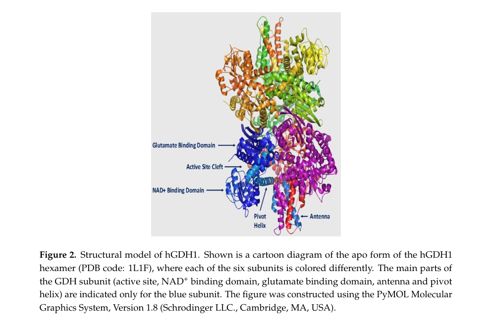

## Question

# Gene Research for Functional Annotation

## ⚠️ CRITICAL: Gene/Protein Identification Context

**BEFORE YOU BEGIN RESEARCH:** You MUST verify you are researching the CORRECT gene/protein. Gene symbols can be ambiguous, especially for less well-characterized genes from non-model organisms.

### Target Gene/Protein Identity (from UniProt):
- **UniProt Accession:** P00367
- **Protein Description:** RecName: Full=Glutamate dehydrogenase 1, mitochondrial; Short=GDH 1; EC=1.4.1.3 {ECO:0000269|PubMed:11032875, ECO:0000269|PubMed:11254391, ECO:0000269|PubMed:11903050, ECO:0000269|PubMed:16023112, ECO:0000269|PubMed:16959573}; Flags: Precursor;
- **Gene Information:** Name=GLUD1; Synonyms=GLUD;
- **Organism (full):** Homo sapiens (Human).
- **Protein Family:** Belongs to the Glu/Leu/Phe/Val dehydrogenases family.
- **Key Domains:** Aminoacid_DH-like_N_sf. (IPR046346); Glu/Leu/Phe/Val/Trp_DH. (IPR006095); Glu/Leu/Phe/Val/Trp_DH_C. (IPR006096); Glu/Leu/Phe/Val/Trp_DH_dimer. (IPR006097); Glu/Leu/Phe/Val_DH_AS. (IPR033524)

### MANDATORY VERIFICATION STEPS:

1. **Check if the gene symbol "GLUD1" matches the protein description above**
2. **Verify the organism is correct:** Homo sapiens (Human).
3. **Check if protein family/domains align with what you find in literature**
4. **If you find literature for a DIFFERENT gene with the same or similar symbol, STOP**

### If Gene Symbol is Ambiguous or You Cannot Find Relevant Literature:

**DO NOT PROCEED WITH RESEARCH ON A DIFFERENT GENE.** Instead:
- State clearly: "The gene symbol 'GLUD1' is ambiguous or literature is limited for this specific protein"
- Explain what you found (e.g., "Found extensive literature on a different gene with the same symbol in a different organism")
- Describe the protein based ONLY on the UniProt information provided above
- Suggest that the protein function can be inferred from domain/family information

### Research Target:

Please provide a comprehensive research report on the gene **GLUD1** (gene ID: GLUD1, UniProt: P00367) in human.

The research report should be a detailed narrative explaining the function, biological processes, and localization of the gene product. Citations should be given for all claims.

You should prioritize authoritative reviews and primary scientific literature when conducting research. You can supplement
this with annotations you find in gene/protein databases, but these can be outdated or inaccurate.

We are specifically interested in the primary function of the gene - for enzymes, what reaction is catalyzed, and what is the substrate specificity? For transporters, what is the substrate? For structural proteins or adapters, what is the broader structural role? For signaling molecules, what is the role in the pathway.

We are interested in where in or outside the cell the gene product carries out its function.

We are also interested in the signaling or biochemical pathways in which the gene functions. We are less interested in broad pleiotropic effects, except where these elucidate the precise role.

Include evidence where possible. We are interested in both experimental evidence as well as inference from structure, evolution, or bioinformatic analysis. Precise studies should be prioritized over high-throughput, where available.

## Output

Question: You are an expert researcher providing comprehensive, well-cited information.

Provide detailed information focusing on:
1. Key concepts and definitions with current understanding
2. Recent developments and latest research (prioritize 2023-2024 sources)
3. Current applications and real-world implementations
4. Expert opinions and analysis from authoritative sources
5. Relevant statistics and data from recent studies

Format as a comprehensive research report with proper citations. Include URLs and publication dates where available.
Always prioritize recent, authoritative sources and provide specific citations for all major claims.

# Gene Research for Functional Annotation

## ⚠️ CRITICAL: Gene/Protein Identification Context

**BEFORE YOU BEGIN RESEARCH:** You MUST verify you are researching the CORRECT gene/protein. Gene symbols can be ambiguous, especially for less well-characterized genes from non-model organisms.

### Target Gene/Protein Identity (from UniProt):
- **UniProt Accession:** P00367
- **Protein Description:** RecName: Full=Glutamate dehydrogenase 1, mitochondrial; Short=GDH 1; EC=1.4.1.3 {ECO:0000269|PubMed:11032875, ECO:0000269|PubMed:11254391, ECO:0000269|PubMed:11903050, ECO:0000269|PubMed:16023112, ECO:0000269|PubMed:16959573}; Flags: Precursor;
- **Gene Information:** Name=GLUD1; Synonyms=GLUD;
- **Organism (full):** Homo sapiens (Human).
- **Protein Family:** Belongs to the Glu/Leu/Phe/Val dehydrogenases family.
- **Key Domains:** Aminoacid_DH-like_N_sf. (IPR046346); Glu/Leu/Phe/Val/Trp_DH. (IPR006095); Glu/Leu/Phe/Val/Trp_DH_C. (IPR006096); Glu/Leu/Phe/Val/Trp_DH_dimer. (IPR006097); Glu/Leu/Phe/Val_DH_AS. (IPR033524)

### MANDATORY VERIFICATION STEPS:

1. **Check if the gene symbol "GLUD1" matches the protein description above**
2. **Verify the organism is correct:** Homo sapiens (Human).
3. **Check if protein family/domains align with what you find in literature**
4. **If you find literature for a DIFFERENT gene with the same or similar symbol, STOP**

### If Gene Symbol is Ambiguous or You Cannot Find Relevant Literature:

**DO NOT PROCEED WITH RESEARCH ON A DIFFERENT GENE.** Instead:
- State clearly: "The gene symbol 'GLUD1' is ambiguous or literature is limited for this specific protein"
- Explain what you found (e.g., "Found extensive literature on a different gene with the same symbol in a different organism")
- Describe the protein based ONLY on the UniProt information provided above
- Suggest that the protein function can be inferred from domain/family information

### Research Target:

Please provide a comprehensive research report on the gene **GLUD1** (gene ID: GLUD1, UniProt: P00367) in human.

The research report should be a detailed narrative explaining the function, biological processes, and localization of the gene product. Citations should be given for all claims.

You should prioritize authoritative reviews and primary scientific literature when conducting research. You can supplement
this with annotations you find in gene/protein databases, but these can be outdated or inaccurate.

We are specifically interested in the primary function of the gene - for enzymes, what reaction is catalyzed, and what is the substrate specificity? For transporters, what is the substrate? For structural proteins or adapters, what is the broader structural role? For signaling molecules, what is the role in the pathway.

We are interested in where in or outside the cell the gene product carries out its function.

We are also interested in the signaling or biochemical pathways in which the gene functions. We are less interested in broad pleiotropic effects, except where these elucidate the precise role.

Include evidence where possible. We are interested in both experimental evidence as well as inference from structure, evolution, or bioinformatic analysis. Precise studies should be prioritized over high-throughput, where available.

# Functional research report: human GLUD1 (glutamate dehydrogenase 1)

## Identity and evidence scope

**GLUD1 encodes human glutamate dehydrogenase 1 (hGDH1), the mitochondrial enzyme identified as UniProt P00367 in the supplied target record.** Independent structural and biochemical literature confirms the human GLUD1–hGDH1 gene–protein pairing. It distinguishes GLUD1, a broadly expressed chromosome-10 gene, from **GLUD2**, the X-linked paralog encoding hGDH2; results concerning GDH2 alone are not assigned to GLUD1 below. The cited papers do not independently print accession P00367, so that accession identification rests on the supplied UniProt record. (aleshina2024evolutionarychangesin pages 1-2, litso2023structuralevolutionof pages 1-2, fang2002expressionpurificationand pages 1-2)

**Functional annotation in one sentence:** GLUD1 is a predominantly mitochondrial-matrix, NAD(P)-dependent *L-glutamate dehydrogenase* that connects glutamate nitrogen metabolism to 2-oxoglutarate supply for the tricarboxylic-acid (TCA) cycle; its activity is controlled strongly by cellular-energy-related nucleotides. It is **not** a glutamine-cleaving enzyme, a leucine dehydrogenase, or a glutamate transporter. (aleshina2024evolutionarychangesin pages 1-2, plaitakis2017theglutamatedehydrogenase pages 5-7, fang2002expressionpurificationand pages 1-2, jin2015glutamatedehydrogenase1 pages 1-3)

## Catalytic function and substrate specificity

The established reaction, EC **1.4.1.3**, is reversible oxidative deamination:

**L-glutamate + NAD(P)⁺ + H₂O ⇌ 2-oxoglutarate (α-ketoglutarate) + NH₄⁺ + NAD(P)H + H⁺.**

Thus, **L-glutamate is the directly identified amino-acid substrate** in the physiological annotation; 2-oxoglutarate and ammonia are substrates in the reverse, reductive-amination direction. Human GDH can use either NAD⁺ or NADP⁺ as oxidizing cofactor. **L-leucine stimulates the enzyme but should not be confused with the L-glutamate converted in this reaction.** Glutamine supplies glutamate only after an upstream *glutaminase* reaction. (aleshina2024evolutionarychangesin pages 1-2, fang2002expressionpurificationand pages 1-2, jin2015glutamatedehydrogenase1 pages 1-3)

Reversibility **does not establish a single reaction direction in every tissue**. Although thermodynamic equilibrium can favor glutamate synthesis, the comparatively high ammonia concentration required for reductive amination makes oxidative deamination especially plausible where free ammonia is low; local substrate concentrations, redox state and pH remain important. In recombinant hGDH1 assays, the apparent ammonia *K*m increased from **12.8 mM at pH 8.0** to **35.0 mM at pH 7.5** and **57.5 mM at pH 7.0**, consistent with reduced capacity for the reverse reaction during acidification. These are **assay measurements, not tissue ammonia measurements**. (plaitakis2017theglutamatedehydrogenase pages 3-5)

## Cellular location, structure and regulation

GLUD1 produces a **558-residue precursor** bearing an approximately **53-residue N-terminal mitochondrial-targeting peptide**. Import and cleavage generate an approximately **505-residue mature enzyme**; its principal catalytic location is the **mitochondrial matrix**, where both glutamate metabolism and TCA-cycle substrates are available. Human hGDH1 also has reported nonmitochondrial immunolocalization, including glial nuclear-membrane association and full-length cytosolic/endoplasmic-reticulum forms. These observations do **not** establish that such pools carry most physiological glutamate-dehydrogenase flux: matrix localization remains the strongest-supported primary assignment. (litso2023structuralevolutionof pages 1-2, aleshina2024evolutionarychangesin pages 12-14, bunik2016multipleformsof pages 3-4)

Mature GDH1 is a **homohexamer of two trimers**. Its subunits contain glutamate-binding and NAD(P)-binding regions separated by a mobile catalytic cleft, plus an **antenna** and **pivot helix** implicated in communication between subunits. This architecture accords with the supplied amino-acid-dehydrogenase, C-terminal, dimerization and active-site InterPro annotations. A cropped rendering of the **human hGDH1 hexamer, PDB 1L1F**, identifies these structural features. (plaitakis2017theglutamatedehydrogenase pages 3-5, litso2023structuralevolutionof pages 1-2, plaitakis2017theglutamatedehydrogenase media 0d78389a)

**GTP is a major inhibitor; ADP is a major activator.** Structural and mutational analyses support a mechanism in which GTP favors the closed catalytic state and slows product release, whereas ADP facilitates cleft opening and turnover. Leucine also promotes activity and can act together with ADP; its precise binding mechanism has been discussed as possibly involving the active-site region rather than a conventional distant allosteric site. One comparative recombinant study reported **235% activation of hGDH1 at 1 mM ADP**, an ADP activation SC₅₀ of **25 μM**, and a leucine activation SC₅₀ of **1.0 mM**. These context-dependent assay values should not be treated as fixed intracellular thresholds. (plaitakis2017theglutamatedehydrogenase pages 5-7)

A direct **human-protein mutagenesis experiment** provides particularly strong validation of the regulatory assignments: the concentration giving half-maximal GTP inhibition was **42 nM for wild-type GDH**, compared with **210 μM for the disease-associated H454Y variant** and **3.1 μM for S448P**, under that study’s assay conditions. Those variants retained ADP and leucine responses, whereas engineered **R463A abolished ADP activation** with comparatively little effect on GTP or leucine responses. This selectively separates inhibitory and activating regulatory mechanisms; comparisons with other reported GTP IC₅₀ values require attention to assay conditions. (fang2002expressionpurificationand pages 1-2)

The following table consolidates reaction, structural, quantitative and clinical evidence; publication dates and URLs are included with its source entries. (aleshina2024evolutionarychangesin pages 1-2, litso2023structuralevolutionof pages 1-2, aftab2023spectrumofneurodevelopmental pages 1-2, fang2002expressionpurificationand pages 1-2)

| Feature | Human GLUD1-supported conclusion | Evidence type | Citation and URL |
|---|---|---|---|
| Target identity | **GLUD1** encodes human mitochondrial glutamate dehydrogenase 1 (**hGDH1**; target accession **P00367** as specified). It is the broadly expressed chromosome-10 housekeeping paralog, not the X-linked hominoid-specific **GLUD2/hGDH2**. | 2023–2024 structural and evolutionary literature | Litso et al., published 23 Dec 2023, [DOI](https://doi.org/10.3390/biom14010022) (litso2023structuralevolutionof pages 1-2); Aleshina and Aleshin, 14 Apr 2024, [DOI](https://doi.org/10.3390/ijms25084341) (aleshina2024evolutionarychangesin pages 1-2) |
| Primary reaction and specificity | EC 1.4.1.3 catalyzes **L-glutamate + NAD(P)+ + H2O ⇌ 2-oxoglutarate + NH4+ + NAD(P)H + H+**. Both NAD+ and NADP+ can serve as cofactors. **L-leucine is principally an activator, not the amino-acid substrate deaminated in this reaction.** | Direct human-enzyme biochemical description and 2024 review | Fang et al., 1 Apr 2002, [DOI](https://doi.org/10.1042/0264-6021:3630081) (fang2002expressionpurificationand pages 1-2); Aleshina and Aleshin, 14 Apr 2024, [DOI](https://doi.org/10.3390/ijms25084341) (aleshina2024evolutionarychangesin pages 1-2) |
| Localization and maturation | GLUD1 is synthesized as a **558-residue precursor** with a **53-residue N-terminal mitochondrial targeting peptide**; cleavage after import yields a **505-residue mature mitochondrial-matrix enzyme**. Mitochondria are the principal location, although full-length extramitochondrial forms have been reported. | Structural and targeting evidence | Litso et al., published 23 Dec 2023, [DOI](https://doi.org/10.3390/biom14010022) (litso2023structuralevolutionof pages 1-2); Aleshina and Aleshin, 14 Apr 2024, [DOI](https://doi.org/10.3390/ijms25084341) (aleshina2024evolutionarychangesin pages 12-14) |
| Oligomer and domains | Mature hGDH1 forms a symmetric **homohexamer composed of two trimers**. Each subunit contains glutamate- and NAD(P)-binding regions, the regulatory antenna and a pivot helix, consistent with the supplied InterPro amino-acid-dehydrogenase, catalytic, dimerization and active-site assignments. | Human X-ray structure and structural review | Plaitakis et al., Feb 2017, [DOI](https://doi.org/10.3390/biology6010011) (plaitakis2017theglutamatedehydrogenase pages 3-5, plaitakis2017theglutamatedehydrogenase media 0d78389a); Litso et al., published 23 Dec 2023, [DOI](https://doi.org/10.3390/biom14010022) (litso2023structuralevolutionof pages 1-2) |
| Energy-state regulation | **GTP inhibits** hGDH1 by stabilizing a closed or product-bound state; **ADP activates** by facilitating catalytic-cleft opening and product release. At 1 mM, ADP increased hGDH1 activity by **235%**; the reported ADP SC50 was **25 micromolar**. | Recombinant kinetics, crystallography and mutagenesis | Plaitakis et al., Feb 2017, [DOI](https://doi.org/10.3390/biology6010011) (plaitakis2017theglutamatedehydrogenase pages 5-7) |
| Leucine regulation | L-leucine activates hGDH1 over approximately **0.5–5 mM**, with a reported SC50 of **1.0 mM**, and can counter GTP inhibition together with ADP. Evidence favors facilitation of product release, possibly through active-site occupancy rather than a conventional remote allosteric site. | Recombinant kinetics and structure–function analysis | Plaitakis et al., Feb 2017, [DOI](https://doi.org/10.3390/biology6010011) (plaitakis2017theglutamatedehydrogenase pages 5-7) |
| Regulatory-site validation | GTP half-inhibition shifted from **42 nM for wild-type human GDH** to **210 micromolar for H454Y** and **3.1 micromolar for S448P**. These disease variants selectively impaired GTP inhibition while retaining ADP and leucine responsiveness. Engineered **R463A abolished ADP activation** with little effect on GTP inhibition or leucine activation. | Primary human recombinant-protein mutagenesis | Fang et al., 1 Apr 2002, [DOI](https://doi.org/10.1042/0264-6021:3630081) (fang2002expressionpurificationand pages 1-2, fang2002expressionpurificationand pages 4-5) |
| Physiological direction and pH | Although equilibrium can favor glutamate synthesis, low tissue ammonia and GLUD1's high ammonia requirement generally favor **oxidative deamination** in relevant settings. Recombinant hGDH1 ammonia Km increased from **12.8 mM at pH 8.0** to **35.0 mM at pH 7.5** and **57.5 mM at pH 7.0**, making reductive amination progressively less favorable during acidification. | Recombinant human-enzyme kinetics and physiological interpretation | Plaitakis et al., Feb 2017, [DOI](https://doi.org/10.3390/biology6010011) (plaitakis2017theglutamatedehydrogenase pages 3-5) |
| Disease mechanism | Dominant activating GLUD1 variants causing hyperinsulinism–hyperammonemia (**HI/HA**) affect the GTP-contact, antenna or pivot-helix network. Reduced nucleotide inhibition permits excessive glutamate oxidation and TCA-cycle ATP production in beta cells, driving inappropriate insulin release, especially after leucine or protein exposure. | Human genetics, recombinant mutagenesis and 2024 structural analysis | Fang et al., 1 Apr 2002, [DOI](https://doi.org/10.1042/0264-6021:3630081) (fang2002expressionpurificationand pages 1-2); Aleshina and Aleshin, 14 Apr 2024, [DOI](https://doi.org/10.3390/ijms25084341) (aleshina2024evolutionarychangesin pages 14-15) |
| Recent clinical statistics | A 2023 two-center cohort included **25** children with activating GLUD1 variants: **24/25 (96%)** presented with hypoglycemic seizures, **24/25 responded to diazoxide plus protein restriction**, and **13/25 (52%)** developed neurodevelopmental manifestations. Epilepsy occurred in **9/25 (36%)**, learning difficulties in **8/25 (32%)**, and speech delay in **8/25 (32%)**. | Retrospective human genotype–phenotype cohort | Aftab et al., Apr 2023, [DOI](https://doi.org/10.1530/ec-22-0008) (aftab2023spectrumofneurodevelopmental pages 1-2) |
| Current clinical implementation | International guidance recommends **diazoxide as first-line therapy for established hyperinsulinism**, generally **5–15 mg/kg/day in children**, with safety monitoring. Diazoxide suppresses insulin secretion through beta-cell KATP channels; it is not a selective GLUD1 inhibitor. The guideline was **published online in July 2023** and appears in **volume 97 (2024)**. | International consensus guideline | De Leon et al., online 6 Jul 2023, [DOI](https://doi.org/10.1159/000531766) (leon2024internationalguidelinesfor pages 5-6, leon2024internationalguidelinesfor pages 8-10) |
| 2024 targeting-sequence development | A 2024 evolutionary analysis proposes that ape-GLUD1 **A23S** slightly reduced mitochondrial-import efficiency and may create a phosphorylation-sensitive site near Ser21. This is a **sequence- and structure-based inference**, not direct proof that A23S alters endogenous human P00367 import. | Evolutionary inference with explicit caveat | Aleshina and Aleshin, 14 Apr 2024, [DOI](https://doi.org/10.3390/ijms25084341) (aleshina2024evolutionarychangesin pages 14-15) |

*Table: Mechanistic and clinical evidence supporting functional annotation of human GLUD1/P00367, with GLUD2 findings excluded or explicitly distinguished. Exact biochemical and cohort measurements are paired with primary or recent authoritative sources.*

## Pathways and tissue-specific biological processes

**Glutaminolysis and energy metabolism.** In cells using glutamine-derived carbon, glutaminase first produces glutamate; GLUD1 can then produce **2-oxoglutarate for the TCA cycle** along with reduced cofactor and ammonium. This is a biochemical connection between amino-acid catabolism and oxidative energy production, **not** a claim that GLUD1 supplies all cellular 2-oxoglutarate: mitochondrial aminotransferases offer alternative routes. ADP/GTP control makes GDH1 activity responsive to the energetic context in which that carbon is used. (plaitakis2017theglutamatedehydrogenase pages 5-7, jin2015glutamatedehydrogenase1 pages 1-3)

**Pancreatic β cells.** Leucine-activated GLUD1 promotes oxidation of glutamate to 2-oxoglutarate, increasing TCA-cycle-supported ATP production and thereby favoring insulin secretion. Normal GTP inhibition limits this response. The causal importance of that restraint is demonstrated by *gain-of-function* human GLUD1 variants that weaken GTP inhibition and cause protein- or leucine-sensitive hyperinsulinemic hypoglycemia. GLUD2’s naturally different GTP response must not be mistaken for the β-cell GLUD1 disease mechanism. (aftab2023spectrumofneurodevelopmental pages 1-2, fang2002expressionpurificationand pages 1-2, aleshina2024evolutionarychangesin pages 14-15)

**Liver and nitrogen handling.** Human liver expresses abundant hGDH1 and essentially little hGDH2. Glutamate deamination supplies ammonium relevant to hepatic nitrogen disposal while changing the glutamate and 2-oxoglutarate pools; the net hepatic direction depends on metabolic conditions. Hyperammonemia accompanying activating GLUD1 variants is strong human evidence that GDH1 regulation matters for systemic nitrogen homeostasis. **GLUD1 is not itself a urea-cycle enzyme:** a separate 2023 *Nature Metabolism* study identified SIRT4-dependent regulation of **ornithine transcarbamylase** and urea-cycle activity. That OTC result should not be presented as direct experimental proof that SIRT4 regulates human GLUD1 through the same modification. (hu2023aminoacidsdownregulate pages 1-6, fang2002expressionpurificationand pages 1-2, plaitakis2017theglutamatedehydrogenase pages 13-14, plaitakis2017theglutamatedehydrogenase pages 8-10)

**Kidney and acid–base physiology.** Both hGDH1 and hGDH2 are detected in human proximal-tubule epithelium. Glutamate oxidative deamination can contribute to renal ammonia production during acidosis; one review attributes **at least 25% of renal ammonia** to the GDH pathway. This pathway-level estimate cannot be allocated wholly to human GLUD1 because **both paralogs** occur in that tissue. Lower pH also increases recombinant hGDH1’s ammonia *K*m, reinforcing the interpretation that acidosis favors deamination over ammonia assimilation under the tested conditions. (plaitakis2017theglutamatedehydrogenase pages 3-5, plaitakis2017theglutamatedehydrogenase pages 13-14, plaitakis2024evolutionofglutamate pages 7-9, plaitakis2017theglutamatedehydrogenase pages 8-10)

**Brain glutamate metabolism.** Evidence places human hGDH1 predominantly in glial populations, particularly astrocytes; hGDH2 additionally has substantial neuronal expression. Glial mitochondrial GDH provides a route from taken-up glutamate into TCA metabolism, alongside—not in place of—astrocytic conversion of glutamate to glutamine for neurotransmitter recycling. A **mouse** nervous-system *Glud1* deletion reduced glutamate-fueled mitochondrial respiration and impaired neuronal use of glutamine-derived carbon under glucose limitation or elevated demand. This supports an energy-metabolic role for GDH1 but is not, by itself, proof that a particular neurological phenotype in humans is directly caused by neuronal GLUD1 activity. (hohnholt2018glutamatedehydrogenaseis pages 1-2, plaitakis2017theglutamatedehydrogenase pages 13-14, plaitakis2024evolutionofglutamate pages 9-10)

## Human disease, implementation and 2023–2024 developments

The most firmly established human gene–disease relationship is **dominant, activating GLUD1 variants causing hyperinsulinism–hyperammonemia syndrome**. A 2024 structure-informed analysis groups disease-associated changes around direct GTP contacts, the antenna and associated intersubunit/conformational machinery. Impaired inhibitory control permits inappropriate GDH1 activity, β-cell insulin release and elevated ammonia; this explains why gene identity and *gain* rather than loss of enzyme regulation matter clinically. These structural groupings synthesize existing genetic and biochemical evidence, rather than constituting a new clinical intervention. (aleshina2024evolutionarychangesin pages 14-15, fang2002expressionpurificationand pages 1-2)

A **2023 retrospective study of 25 genetically confirmed children** reported hypoglycemic seizures at presentation in **24/25 (96%)**, neurodevelopmental manifestations in **13/25 (52%)**, epilepsy in **9/25 (36%)**, and learning difficulties and speech delay in **8/25 (32%) each**. **Twenty-four of 25** responded to diazoxide and protein restriction; one underwent partial pancreatectomy. Exon 11/12 variants were associated with neurological manifestations in this cohort (**P = 0.01**), but its retrospective size limits generalization of mutation-position prognoses. The authors also found no association of ammonia concentration with neurological manifestations (**P = 0.62**); elevated ammonia should therefore not be assumed to explain every neurological outcome. (aftab2023spectrumofneurodevelopmental pages 1-2, aftab2023spectrumofneurodevelopmental pages 4-5)

**Real-world implementation is genetic diagnosis and management of hyperinsulinism, not routine direct pharmacological inhibition of GLUD1.** International consensus guidance recommends diazoxide as first-line therapy for established hyperinsulinism; it opens pancreatic β-cell KATP channels rather than inhibiting GDH1 directly. Its stated pediatric therapeutic range is **5–15 mg/kg/day**, with monitoring for adverse effects. The guideline was **published online in July 2023** and appears in a **2024 journal volume**. The GLUD1 cohort documents use of protein restriction alongside diazoxide; nutritional management must remain compatible with adequate childhood nutrition. (aftab2023spectrumofneurodevelopmental pages 1-2, leon2024internationalguidelinesfor pages 5-6, leon2024internationalguidelinesfor pages 8-10)

Recent mechanistic work is best separated by evidentiary level. A **2024 GLUD1/GLUD2 evolutionary analysis** proposed that a conserved ape-GLUD1 targeting-sequence substitution, **A23S**, may modestly reduce mitochondrial-import efficiency; this remains **an evolutionary inference**, not a measurement of endogenous human GDH1 import. In cancer research, GLUD1 knockdown and the experimental inhibitor **R162** reduced growth in selected human cancer-cell and mouse-xenograft models, with a proposed 2-oxoglutarate→fumarate→glutathione-peroxidase-1 redox mechanism. These are **preclinical, context-dependent findings**, not evidence of an approved GLUD1 inhibitor or demonstrated patient benefit. (aleshina2024evolutionarychangesin pages 14-15, aleshina2024evolutionarychangesin pages 12-14, jin2015glutamatedehydrogenase1 pages 1-3)

**Assessment.** The highest-confidence annotation for **human GLUD1/P00367** is reversible, regulated **L-glutamate dehydrogenase activity in the mitochondrial matrix**, supplying 2-oxoglutarate and linking carbon, nitrogen and cellular-energy metabolism. Human variant biochemistry and hyperinsulinism–hyperammonemia establish the functional importance of **GTP-mediated inhibition** particularly clearly. Proposed import differences, nonmitochondrial activities and cancer-targeting applications should be retained as qualified findings rather than substituted for that primary enzymatic role. (litso2023structuralevolutionof pages 1-2, fang2002expressionpurificationand pages 1-2, aftab2023spectrumofneurodevelopmental pages 1-2, aleshina2024evolutionarychangesin pages 12-14, jin2015glutamatedehydrogenase1 pages 1-3)

References

1. (aleshina2024evolutionarychangesin pages 1-2): Yulia A. Aleshina and Vasily A. Aleshin. Evolutionary changes in primate glutamate dehydrogenases 1 and 2 influence the protein regulation by ligands, targeting and posttranslational modifications. International Journal of Molecular Sciences, 25:4341, Apr 2024. URL: https://doi.org/10.3390/ijms25084341, doi:10.3390/ijms25084341. This article has 10 citations.

2. (litso2023structuralevolutionof pages 1-2): Ionela Litso, Andreas Plaitakis, Vasiliki E. Fadouloglou, Mary Providaki, Michael Kokkinidis, and Ioannis Zaganas. Structural evolution of primate glutamate dehydrogenase 2 as revealed by in silico predictions and experimentally determined structures. Biomolecules, Dec 2023. URL: https://doi.org/10.3390/biom14010022, doi:10.3390/biom14010022. This article has 7 citations.

3. (fang2002expressionpurificationand pages 1-2): Jie FANG, Betty Y. L. HSU, Courtney M. MacMULLEN, Mortimer PONCZ, Thomas J. SMITH, and Charles A. STANLEY. Expression, purification and characterization of human glutamate dehydrogenase (gdh) allosteric regulatory mutations. The Biochemical journal, 363 Pt 1:81-7, Apr 2002. URL: https://doi.org/10.1042/0264-6021:3630081, doi:10.1042/0264-6021:3630081. This article has 115 citations.

4. (plaitakis2017theglutamatedehydrogenase pages 5-7): Andreas Plaitakis, Ester Kalef-Ezra, Dimitra Kotzamani, Ioannis Zaganas, and Cleanthe Spanaki. The glutamate dehydrogenase pathway and its roles in cell and tissue biology in health and disease. Biology, 6:11, Feb 2017. URL: https://doi.org/10.3390/biology6010011, doi:10.3390/biology6010011. This article has 311 citations.

5. (jin2015glutamatedehydrogenase1 pages 1-3): Lingtao Jin, Dan Li, Gina N. Alesi, Jun Fan, Hee-Bum Kang, Zhou Lu, Titus J. Boggon, Peng Jin, Hong Yi, Elizabeth R. Wright, Duc Duong, Nicholas T. Seyfried, Robert Egnatchik, Ralph J. DeBerardinis, Kelly R. Magliocca, Chuan He, Martha L. Arellano, Hanna J. Khoury, Dong M. Shin, Fadlo R. Khuri, and Sumin Kang. Glutamate dehydrogenase 1 signals through antioxidant glutathione peroxidase 1 to regulate redox homeostasis and tumor growth. Cancer cell, 27 2:257-70, Feb 2015. URL: https://doi.org/10.1016/j.ccell.2014.12.006, doi:10.1016/j.ccell.2014.12.006. This article has 447 citations and is from a highest quality peer-reviewed journal.

6. (plaitakis2017theglutamatedehydrogenase pages 3-5): Andreas Plaitakis, Ester Kalef-Ezra, Dimitra Kotzamani, Ioannis Zaganas, and Cleanthe Spanaki. The glutamate dehydrogenase pathway and its roles in cell and tissue biology in health and disease. Biology, 6:11, Feb 2017. URL: https://doi.org/10.3390/biology6010011, doi:10.3390/biology6010011. This article has 311 citations.

7. (aleshina2024evolutionarychangesin pages 12-14): Yulia A. Aleshina and Vasily A. Aleshin. Evolutionary changes in primate glutamate dehydrogenases 1 and 2 influence the protein regulation by ligands, targeting and posttranslational modifications. International Journal of Molecular Sciences, 25:4341, Apr 2024. URL: https://doi.org/10.3390/ijms25084341, doi:10.3390/ijms25084341. This article has 10 citations.

8. (bunik2016multipleformsof pages 3-4): Victoria Bunik, Artem Artiukhov, Vasily Aleshin, and Garik Mkrtchyan. Multiple forms of glutamate dehydrogenase in animals: structural determinants and physiological implications. Biology, 5:53, Dec 2016. URL: https://doi.org/10.3390/biology5040053, doi:10.3390/biology5040053. This article has 60 citations.

9. (plaitakis2017theglutamatedehydrogenase media 0d78389a): Andreas Plaitakis, Ester Kalef-Ezra, Dimitra Kotzamani, Ioannis Zaganas, and Cleanthe Spanaki. The glutamate dehydrogenase pathway and its roles in cell and tissue biology in health and disease. Biology, 6:11, Feb 2017. URL: https://doi.org/10.3390/biology6010011, doi:10.3390/biology6010011. This article has 311 citations.

10. (aftab2023spectrumofneurodevelopmental pages 1-2): Sommayya Aftab, Diliara Gubaeva, Jayne A L Houghton, Antonia Dastamani, Ellada Sotiridou, Clare Gilbert, Sarah E Flanagan, Anatoly Tiulpakov, Maria Melikyan, and Pratik Shah. Spectrum of neuro-developmental disorders in children with congenital hyperinsulinism due to activating mutations in glud1. Endocrine Connections, Apr 2023. URL: https://doi.org/10.1530/ec-22-0008, doi:10.1530/ec-22-0008. This article has 8 citations and is from a peer-reviewed journal.

11. (fang2002expressionpurificationand pages 4-5): Jie FANG, Betty Y. L. HSU, Courtney M. MacMULLEN, Mortimer PONCZ, Thomas J. SMITH, and Charles A. STANLEY. Expression, purification and characterization of human glutamate dehydrogenase (gdh) allosteric regulatory mutations. The Biochemical journal, 363 Pt 1:81-7, Apr 2002. URL: https://doi.org/10.1042/0264-6021:3630081, doi:10.1042/0264-6021:3630081. This article has 115 citations.

12. (aleshina2024evolutionarychangesin pages 14-15): Yulia A. Aleshina and Vasily A. Aleshin. Evolutionary changes in primate glutamate dehydrogenases 1 and 2 influence the protein regulation by ligands, targeting and posttranslational modifications. International Journal of Molecular Sciences, 25:4341, Apr 2024. URL: https://doi.org/10.3390/ijms25084341, doi:10.3390/ijms25084341. This article has 10 citations.

13. (leon2024internationalguidelinesfor pages 5-6): Diva D. De Leon, Jean Baptiste Arnoux, Indraneel Banerjee, Ignacio Bergada, Tricia Bhatti, Louise S. Conwell, Junfen Fu, Sarah E. Flanagan, David Gillis, Thomas Meissner, Klaus Mohnike, Tai L.S. Pasquini, Pratik Shah, Charles A. Stanley, Adrian Vella, Tohru Yorifuji, and Paul S. Thornton. International guidelines for the diagnosis and management of hyperinsulinism. Hormone Research in Paediatrics, 97:279-298, Jul 2023. URL: https://doi.org/10.1159/000531766, doi:10.1159/000531766. This article has 115 citations and is from a peer-reviewed journal.

14. (leon2024internationalguidelinesfor pages 8-10): Diva D. De Leon, Jean Baptiste Arnoux, Indraneel Banerjee, Ignacio Bergada, Tricia Bhatti, Louise S. Conwell, Junfen Fu, Sarah E. Flanagan, David Gillis, Thomas Meissner, Klaus Mohnike, Tai L.S. Pasquini, Pratik Shah, Charles A. Stanley, Adrian Vella, Tohru Yorifuji, and Paul S. Thornton. International guidelines for the diagnosis and management of hyperinsulinism. Hormone Research in Paediatrics, 97:279-298, Jul 2023. URL: https://doi.org/10.1159/000531766, doi:10.1159/000531766. This article has 115 citations and is from a peer-reviewed journal.

15. (hu2023aminoacidsdownregulate pages 1-6): Song-Hua Hu, Yu-Yang Feng, Yuan-Xin Yang, Hui-Da Ma, Shu-Xian Zhou, Ya-Nan Qiao, Kai-Hui Zhang, Lei Zhang, Lin Huang, Yi-Yuan Yuan, Yan Lin, Xin-Yan Zhang, Yao Li, Hai-Tao Li, Jian-Yuan Zhao, Wei Xu, and Shi-Min Zhao. Amino acids downregulate sirt4 to detoxify ammonia through the urea cycle. Nature Metabolism, 5:626-641, Apr 2023. URL: https://doi.org/10.1038/s42255-023-00784-0, doi:10.1038/s42255-023-00784-0. This article has 38 citations and is from a domain leading peer-reviewed journal.

16. (plaitakis2017theglutamatedehydrogenase pages 13-14): Andreas Plaitakis, Ester Kalef-Ezra, Dimitra Kotzamani, Ioannis Zaganas, and Cleanthe Spanaki. The glutamate dehydrogenase pathway and its roles in cell and tissue biology in health and disease. Biology, 6:11, Feb 2017. URL: https://doi.org/10.3390/biology6010011, doi:10.3390/biology6010011. This article has 311 citations.

17. (plaitakis2017theglutamatedehydrogenase pages 8-10): Andreas Plaitakis, Ester Kalef-Ezra, Dimitra Kotzamani, Ioannis Zaganas, and Cleanthe Spanaki. The glutamate dehydrogenase pathway and its roles in cell and tissue biology in health and disease. Biology, 6:11, Feb 2017. URL: https://doi.org/10.3390/biology6010011, doi:10.3390/biology6010011. This article has 311 citations.

18. (plaitakis2024evolutionofglutamate pages 7-9): Andreas Plaitakis, Kyriaki Sidiropoulou, Dimitra Kotzamani, Ionela Litso, Ioannis Zaganas, and Cleanthe Spanaki. Evolution of glutamate metabolism via glud2 enhances lactate-dependent synaptic plasticity and complex cognition. International Journal of Molecular Sciences, 25:5297, May 2024. URL: https://doi.org/10.3390/ijms25105297, doi:10.3390/ijms25105297. This article has 9 citations.

19. (hohnholt2018glutamatedehydrogenaseis pages 1-2): Michaela C Hohnholt, Vibe H Andersen, Jens V Andersen, Sofie K Christensen, Melis Karaca, Pierre Maechler, and Helle S Waagepetersen. Glutamate dehydrogenase is essential to sustain neuronal oxidative energy metabolism during stimulation. Journal of Cerebral Blood Flow & Metabolism, 38:1754-1768, Jun 2018. URL: https://doi.org/10.1177/0271678x17714680, doi:10.1177/0271678x17714680. This article has 66 citations and is from a highest quality peer-reviewed journal.

20. (plaitakis2024evolutionofglutamate pages 9-10): Andreas Plaitakis, Kyriaki Sidiropoulou, Dimitra Kotzamani, Ionela Litso, Ioannis Zaganas, and Cleanthe Spanaki. Evolution of glutamate metabolism via glud2 enhances lactate-dependent synaptic plasticity and complex cognition. International Journal of Molecular Sciences, 25:5297, May 2024. URL: https://doi.org/10.3390/ijms25105297, doi:10.3390/ijms25105297. This article has 9 citations.

21. (aftab2023spectrumofneurodevelopmental pages 4-5): Sommayya Aftab, Diliara Gubaeva, Jayne A L Houghton, Antonia Dastamani, Ellada Sotiridou, Clare Gilbert, Sarah E Flanagan, Anatoly Tiulpakov, Maria Melikyan, and Pratik Shah. Spectrum of neuro-developmental disorders in children with congenital hyperinsulinism due to activating mutations in glud1. Endocrine Connections, Apr 2023. URL: https://doi.org/10.1530/ec-22-0008, doi:10.1530/ec-22-0008. This article has 8 citations and is from a peer-reviewed journal.

## Artifacts

- [Edison artifact artifact-00](GLUD1-deep-research-falcon_artifacts/artifact-00.md)

## Citations

1. plaitakis2017theglutamatedehydrogenase pages 3-5
2. plaitakis2017theglutamatedehydrogenase pages 5-7
3. fang2002expressionpurificationand pages 1-2
4. litso2023structuralevolutionof pages 1-2
5. aleshina2024evolutionarychangesin pages 1-2
6. aleshina2024evolutionarychangesin pages 12-14
7. aleshina2024evolutionarychangesin pages 14-15
8. aftab2023spectrumofneurodevelopmental pages 1-2
9. bunik2016multipleformsof pages 3-4
10. fang2002expressionpurificationand pages 4-5
11. leon2024internationalguidelinesfor pages 5-6
12. leon2024internationalguidelinesfor pages 8-10
13. hu2023aminoacidsdownregulate pages 1-6
14. plaitakis2017theglutamatedehydrogenase pages 13-14
15. plaitakis2017theglutamatedehydrogenase pages 8-10
16. plaitakis2024evolutionofglutamate pages 7-9
17. hohnholt2018glutamatedehydrogenaseis pages 1-2
18. plaitakis2024evolutionofglutamate pages 9-10
19. aftab2023spectrumofneurodevelopmental pages 4-5
20. DOI
21. https://doi.org/10.3390/biom14010022
22. https://doi.org/10.3390/ijms25084341
23. https://doi.org/10.1042/0264-6021:3630081
24. https://doi.org/10.3390/biology6010011
25. https://doi.org/10.1530/ec-22-0008
26. https://doi.org/10.1159/000531766
27. https://doi.org/10.3390/ijms25084341,
28. https://doi.org/10.3390/biom14010022,
29. https://doi.org/10.1042/0264-6021:3630081,
30. https://doi.org/10.3390/biology6010011,
31. https://doi.org/10.1016/j.ccell.2014.12.006,
32. https://doi.org/10.3390/biology5040053,
33. https://doi.org/10.1530/ec-22-0008,
34. https://doi.org/10.1159/000531766,
35. https://doi.org/10.1038/s42255-023-00784-0,
36. https://doi.org/10.3390/ijms25105297,
37. https://doi.org/10.1177/0271678x17714680,