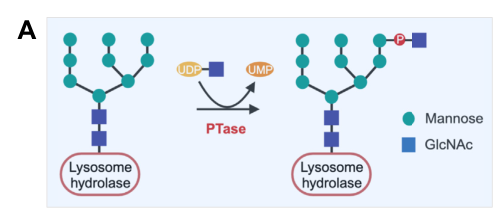

## Question

# Gene Research for Functional Annotation

## ⚠️ CRITICAL: Gene/Protein Identification Context

**BEFORE YOU BEGIN RESEARCH:** You MUST verify you are researching the CORRECT gene/protein. Gene symbols can be ambiguous, especially for less well-characterized genes from non-model organisms.

### Target Gene/Protein Identity (from UniProt):
- **UniProt Accession:** Q3T906
- **Protein Description:** RecName: Full=N-acetylglucosamine-1-phosphotransferase subunits alpha/beta; EC=2.7.8.17 {ECO:0000269|PubMed:19955174}; AltName: Full=GlcNAc-1-phosphotransferase subunits alpha/beta; AltName: Full=Stealth protein GNPTAB; AltName: Full=UDP-N-acetylglucosamine-1-phosphotransferase subunits alpha/beta; Contains: RecName: Full=N-acetylglucosamine-1-phosphotransferase subunit alpha; Contains: RecName: Full=N-acetylglucosamine-1-phosphotransferase subunit beta; Flags: Precursor;
- **Gene Information:** Name=GNPTAB; Synonyms=GNPTA, KIAA1208;
- **Organism (full):** Homo sapiens (Human).
- **Protein Family:** Belongs to the stealth family. .
- **Key Domains:** DMAP1-bd. (IPR010506); EF_Hand_1_Ca_BS. (IPR018247); EF_hand_dom. (IPR002048); GNPTAB_reg. (IPR041536); Ig_GNPTAB. (IPR060126)

### MANDATORY VERIFICATION STEPS:

1. **Check if the gene symbol "GNPTAB" matches the protein description above**
2. **Verify the organism is correct:** Homo sapiens (Human).
3. **Check if protein family/domains align with what you find in literature**
4. **If you find literature for a DIFFERENT gene with the same or similar symbol, STOP**

### If Gene Symbol is Ambiguous or You Cannot Find Relevant Literature:

**DO NOT PROCEED WITH RESEARCH ON A DIFFERENT GENE.** Instead:
- State clearly: "The gene symbol 'GNPTAB' is ambiguous or literature is limited for this specific protein"
- Explain what you found (e.g., "Found extensive literature on a different gene with the same symbol in a different organism")
- Describe the protein based ONLY on the UniProt information provided above
- Suggest that the protein function can be inferred from domain/family information

### Research Target:

Please provide a comprehensive research report on the gene **GNPTAB** (gene ID: GNPTAB, UniProt: Q3T906) in human.

The research report should be a detailed narrative explaining the function, biological processes, and localization of the gene product. Citations should be given for all claims.

You should prioritize authoritative reviews and primary scientific literature when conducting research. You can supplement
this with annotations you find in gene/protein databases, but these can be outdated or inaccurate.

We are specifically interested in the primary function of the gene - for enzymes, what reaction is catalyzed, and what is the substrate specificity? For transporters, what is the substrate? For structural proteins or adapters, what is the broader structural role? For signaling molecules, what is the role in the pathway.

We are interested in where in or outside the cell the gene product carries out its function.

We are also interested in the signaling or biochemical pathways in which the gene functions. We are less interested in broad pleiotropic effects, except where these elucidate the precise role.

Include evidence where possible. We are interested in both experimental evidence as well as inference from structure, evolution, or bioinformatic analysis. Precise studies should be prioritized over high-throughput, where available.

## Output

Question: You are an expert researcher providing comprehensive, well-cited information.

Provide detailed information focusing on:
1. Key concepts and definitions with current understanding
2. Recent developments and latest research (prioritize 2023-2024 sources)
3. Current applications and real-world implementations
4. Expert opinions and analysis from authoritative sources
5. Relevant statistics and data from recent studies

Format as a comprehensive research report with proper citations. Include URLs and publication dates where available.
Always prioritize recent, authoritative sources and provide specific citations for all major claims.

# Gene Research for Functional Annotation

## ⚠️ CRITICAL: Gene/Protein Identification Context

**BEFORE YOU BEGIN RESEARCH:** You MUST verify you are researching the CORRECT gene/protein. Gene symbols can be ambiguous, especially for less well-characterized genes from non-model organisms.

### Target Gene/Protein Identity (from UniProt):
- **UniProt Accession:** Q3T906
- **Protein Description:** RecName: Full=N-acetylglucosamine-1-phosphotransferase subunits alpha/beta; EC=2.7.8.17 {ECO:0000269|PubMed:19955174}; AltName: Full=GlcNAc-1-phosphotransferase subunits alpha/beta; AltName: Full=Stealth protein GNPTAB; AltName: Full=UDP-N-acetylglucosamine-1-phosphotransferase subunits alpha/beta; Contains: RecName: Full=N-acetylglucosamine-1-phosphotransferase subunit alpha; Contains: RecName: Full=N-acetylglucosamine-1-phosphotransferase subunit beta; Flags: Precursor;
- **Gene Information:** Name=GNPTAB; Synonyms=GNPTA, KIAA1208;
- **Organism (full):** Homo sapiens (Human).
- **Protein Family:** Belongs to the stealth family. .
- **Key Domains:** DMAP1-bd. (IPR010506); EF_Hand_1_Ca_BS. (IPR018247); EF_hand_dom. (IPR002048); GNPTAB_reg. (IPR041536); Ig_GNPTAB. (IPR060126)

### MANDATORY VERIFICATION STEPS:

1. **Check if the gene symbol "GNPTAB" matches the protein description above**
2. **Verify the organism is correct:** Homo sapiens (Human).
3. **Check if protein family/domains align with what you find in literature**
4. **If you find literature for a DIFFERENT gene with the same or similar symbol, STOP**

### If Gene Symbol is Ambiguous or You Cannot Find Relevant Literature:

**DO NOT PROCEED WITH RESEARCH ON A DIFFERENT GENE.** Instead:
- State clearly: "The gene symbol 'GNPTAB' is ambiguous or literature is limited for this specific protein"
- Explain what you found (e.g., "Found extensive literature on a different gene with the same symbol in a different organism")
- Describe the protein based ONLY on the UniProt information provided above
- Suggest that the protein function can be inferred from domain/family information

### Research Target:

Please provide a comprehensive research report on the gene **GNPTAB** (gene ID: GNPTAB, UniProt: Q3T906) in human.

The research report should be a detailed narrative explaining the function, biological processes, and localization of the gene product. Citations should be given for all claims.

You should prioritize authoritative reviews and primary scientific literature when conducting research. You can supplement
this with annotations you find in gene/protein databases, but these can be outdated or inaccurate.

We are specifically interested in the primary function of the gene - for enzymes, what reaction is catalyzed, and what is the substrate specificity? For transporters, what is the substrate? For structural proteins or adapters, what is the broader structural role? For signaling molecules, what is the role in the pathway.

We are interested in where in or outside the cell the gene product carries out its function.

We are also interested in the signaling or biochemical pathways in which the gene functions. We are less interested in broad pleiotropic effects, except where these elucidate the precise role.

Include evidence where possible. We are interested in both experimental evidence as well as inference from structure, evolution, or bioinformatic analysis. Precise studies should be prioritized over high-throughput, where available.

# Human GNPTAB: functional annotation and research report

**Identity verified.** The supplied UniProt accession **Q3T906** identifies human (*Homo sapiens*) **GNPTAB**, also called GNPTA or KIAA1208. Independent human-protein studies confirm that **GNPTAB encodes one precursor that yields the α and β subunits of N-acetylglucosamine-1-phosphotransferase** (GlcNAc-1-phosphotransferase; EC 2.7.8.17). It must not be confused with **GNPTG**, a different gene encoding the enzyme’s γ subunit. The reported Stealth catalytic regions, EF-hand, DMAP1-binding-like region and immunoglobulin-like/Notch-related modules agree with the supplied protein-family and domain annotations. The papers establish the human gene–protein identity and architecture; the accession-to-gene mapping itself is supplied by the specified UniProt record, [Q3T906](https://www.uniprot.org/uniprotkb/Q3T906/entry). (li2024structureofa pages 1-2, gorelik2022structuresofthe pages 2-3)

## Primary molecular function and substrate specificity

GNPTAB supplies the **catalytic α/β component** of an approximately 400-kDa **α₂β₂γ₂ phosphotransferase complex**. Its physiological reaction is transfer of **N-acetylglucosamine-1-phosphate (GlcNAc-1-P)** from UDP-GlcNAc onto the **6-hydroxyl of a mannose residue in a protein’s high-mannose N-linked glycan**, yielding a GlcNAc-P-mannose phosphodiester and **UMP**. Thus, the product of GNPTAB’s reaction is *not yet* the exposed mannose-6-phosphate (M6P) monoester, and the enzyme does not simply transfer GlcNAc as a conventional glycosyltransferase would. The subsequent uncovering enzyme, **NAGPA**, removes the terminal GlcNAc to expose M6P. This reaction and the human α/β domain organization are depicted in the cropped panels of **Figure 1** of Li and colleagues’ 2024 study. (li2024structureofa pages 1-2, gorelik2022structuresofthe pages 1-2, gorelik2022structuresofthe pages 2-3, li2024structureofa media a7fb61f4, li2024structureofa media ebbeac72)

Its principal *protein* substrates are newly synthesized **soluble lysosomal hydrolases**, rather than all proteins bearing mannose-rich glycans: approximately **70 lysosomal enzymes** must be selected from a much larger population of secretory glycoproteins. The catalytic pocket accepts simple mannose-containing molecules *in vitro*, including α-methyl-mannoside, mannobiose and Man₉GlcNAc₂; those activities alone do not establish selective recognition of intact hydrolases. Accessory regions of GNPTAB—including Notch-like, immunoglobulin-like and DMAP1-binding-like modules—contribute protein recognition, while the **GNPTG γ subunit** binds mannose-containing glycans and affects tagging of particular hydrolases. γ is **accessory, not the principal catalytic subunit**. A stripped-down catalytic construct remains active yet loses discrimination between lysosomal and nonlysosomal glycoproteins, demonstrating why glycan recognition and hydrolase recognition must be distinguished. Glycan placement and lysine-containing surface features contribute to hydrolase recognition, but a universal molecular rule for selecting every substrate remains unresolved. (gorelik2022structuresofthe pages 1-2, gorelik2022structuresofthe pages 2-3, gorelik2022structuresofthe pages 5-7)

## Localization, activation and pathway

**The principal site of GNPTAB function is the lumen-facing surface of the cis-Golgi membrane, not the lysosomal lumen.** The α/β precursor has membrane-spanning segments near both ends and short cytoplasmic regions. After biosynthesis, **site-1 protease cleaves the precursor at the Lys928/Asp929 junction** in the Golgi, generating α and β subunits and activating efficient phosphotransfer. The four dispersed conserved Stealth regions of the resulting α/β proteins assemble into a single catalytic core; an EF-hand contributes to the α/β dimer interface. Domain names such as *DMAP1-binding-like* describe structural features and should not, without separate evidence, be taken to mean that nuclear DMAP1 is the physiological substrate or that GNPTAB acts in the nucleus. (li2024structureofa pages 1-2, li2024structureofa pages 2-4, gorelik2022structuresofthe pages 1-2, gorelik2022structuresofthe pages 2-3)

GNPTAB therefore acts **upstream of lysosomal delivery** in the M6P biosynthesis and sorting pathway: cis-Golgi phosphorylation by GNPT, GlcNAc removal by NAGPA, binding of exposed M6P by M6P receptors later in the Golgi, and receptor-mediated transport toward endosomes and lysosomes. The hydrolases—not GNPTAB’s normal catalytic activity—are delivered to lysosomes. GNPTAB is consequently best annotated as a **Golgi enzyme for lysosomal-enzyme targeting**, rather than as a lysosomal degradative enzyme or a primary signaling receptor. (li2024structureofa pages 1-2, gorelik2022structuresofthe pages 1-2)

## Mechanistic and recent research

Structural experiments substantiate the reaction at residue-level resolution. A **2022 PNAS** crystal-structure study used a minimal zebrafish GNPTAB construct, **87% identical to human**, together with enzyme assays. It identified the donor-binding pocket, the four-segment Stealth fold, metal-dependent catalysis and the importance of noncatalytic modules for protein-substrate selection. Mutating several donor-pocket residues reduced measured activity by approximately **50- to 1,000-fold** in the tested constructs. Because that structure used an engineered nonhuman protein, direct human structural evidence is especially valuable. [Gorelik et al., published 8 August 2022, *PNAS*, DOI:10.1073/pnas.2203518119](https://doi.org/10.1073/pnas.2203518119). (gorelik2022structuresofthe pages 1-2, gorelik2022structuresofthe pages 2-3)

That evidence was extended by a **2024 human cryo-EM and biochemical study**: a soluble engineered GNPTAB α/β truncation called **S1S3** was resolved at **3.4 Å**, and a soluble human enzyme bound to UDP-GlcNAc at **2.9 Å**. Donor binding orders part of the active site; structural and mutational results implicate **Arg322, the Asn406–Asp407–Asp408 motif, His956, Arg986 and Asn1151** in donor coordination or catalysis. The proposed chemistry involves His956 assisting activation of the acceptor mannose 6-hydroxyl for direct attack on the donor phosphate; the detailed transition state is an interpretation of structural, docking and biochemical evidence, **not a directly imaged reaction intermediate**. Removal of inhibitory regions makes S1S3 more catalytically accessible. With saturating UDP-GlcNAc, its *k*cat relative to the soluble parent was **3.39 versus 0.153 s⁻¹** on α-methyl-mannoside (~22-fold), **1.54 versus 0.119 s⁻¹** on mannobiose (~13-fold), and **0.11 versus 0.012 s⁻¹** on Man₉GlcNAc₂ (~9-fold); these kinetic values came from **two independent assays** and should not be generalized to all intact cellular substrates. [Li et al., published online 22 August 2024, *Journal of Biological Chemistry*, DOI:10.1016/j.jbc.2024.107706](https://doi.org/10.1016/j.jbc.2024.107706). (li2024structureofa pages 2-4, li2024structureofa pages 4-5, li2024structureofa media a7fb61f4, li2024structureofa pages 1-2)

**Golgi retention is itself functionally important.** A peer-reviewed **2024 EMBO Journal** study found that **LYSET/TMEM251** supports GNPT retention in the cis-Golgi and that the trafficking adaptors **GOLPH3/GOLPH3L** help maintain LYSET–GNPT complexes. Perturbation impaired M6P tagging and lysosomal-hydrolase maturation in human-cell models. The researchers also detected M6P tagging of **B4GALT5**, a Golgi membrane protein, indicating that GNPT-dependent labeling is **not absolutely exclusive to soluble lysosomal hydrolases**; a proposed degradative route for B4GALT5 still requires contextual interpretation. [Brauer et al., published online 25 November 2024, *EMBO Journal*, DOI:10.1038/s44318-024-00305-z](https://doi.org/10.1038/s44318-024-00305-z). Additional detailed TMEM251 cleavage/retromer experiments appeared as a **December 2024 preprint**, so those particular claims should be accorded the appropriate preprint evidentiary status rather than conflated with the peer-reviewed EMBO results. (brauer2024golph3andgolph3l pages 1-2, brauer2024golph3andgolph3l pages 3-5, brauer2024golph3andgolph3l pages 13-14, yang2024molecularinsightsinto pages 5-8, yang2024molecularinsightsinto pages 8-11)

The following evidence map separates direct structural, cellular and clinical observations from their limitations.

| Mechanistic question | Principal observation and exact quantitative result | Evidence level / limitation | Source, date, and DOI URL |
|---|---|---|---|
| What does the human GNPTAB catalytic architecture reveal? | Cryo-EM resolved the soluble human S1S3 GNPTAB truncation at **3.4 Å** and UDP-GlcNAc-bound soluble human phosphotransferase at **2.9 Å**. S1S3 preserves the four-region Stealth catalytic core and NDD motif but lacks major regulatory and recognition regions, favoring a constitutively open state. (li2024structureofa pages 1-2, li2024structureofa pages 10-12) | Peer-reviewed human structural study. The soluble engineered proteins lack transmembrane regions; S1S3 is not equivalent to native full-length α₂β₂γ₂ GNPT and has reduced protein-substrate selectivity. | Li et al., 2024; published online **22 Aug 2024**. [https://doi.org/10.1016/j.jbc.2024.107706](https://doi.org/10.1016/j.jbc.2024.107706) |
| How much does S1S3 increase catalytic turnover? | At saturating UDP-GlcNAc, S1S3 versus soluble parent hPTase had *k*cat values of **3.39 vs 0.153 s⁻¹** for α-methyl-mannoside (~22-fold), **1.54 vs 0.119 s⁻¹** for mannobiose (~13-fold), and **0.11 vs 0.012 s⁻¹** for Man₉GlcNAc₂ (~9-fold). Reported values were based on **two independent assays**. (li2024structureofa pages 2-4, li2024structureofa media a7fb61f4, li2024structureofa pages 1-2) | Peer-reviewed purified-enzyme biochemistry. Artificial or isolated glycan acceptors do not reproduce recognition of intact lysosomal hydrolases; increased turnover may accompany off-target phosphorylation of nonlysosomal glycoproteins. | Li et al., 2024. [https://doi.org/10.1016/j.jbc.2024.107706](https://doi.org/10.1016/j.jbc.2024.107706) |
| How is GNPT retained in the Golgi, and can it modify cargo beyond soluble hydrolases? | In human-cell knockouts, loss of **GOLPH3/GOLPH3L** destabilized LYSET–GNPT complexes, impaired M6P tagging, and disrupted lysosomal-enzyme maturation and trafficking. Anti-M6P enrichment detected tagged proteins in wild-type but not LYSET-, GNPTAB-, or GOLPH3/GOLPH3L-deficient cells; M6P immunoprecipitation supported direct tagging of the **B4GALT5 ectodomain**, suggesting a degradative lysosomal route for this Golgi protein. (brauer2024golph3andgolph3l pages 1-2, brauer2024golph3andgolph3l pages 3-5, brauer2024golph3andgolph3l pages 13-14) | Peer-reviewed human-cell genetic, biochemical, and trafficking evidence. B4GALT5 expands the candidate substrate space, but the physiological prevalence and tissue relevance of this route remain unresolved. | Brauer et al., 2024; online **25 Nov 2024**. [https://doi.org/10.1038/s44318-024-00305-z](https://doi.org/10.1038/s44318-024-00305-z) |
| What recent human evidence connects GNPTAB deficiency to ML II/III diagnosis? | Among **20 Chinese probands**, **6** had ML II and **14** had ML III α/β. Variants were found in **35/40 alleles (87.5%)**, including **five novel variants**. Plasma arylsulfatase A was **13–63×** the reference value and HexA approximately **3–4×** higher; urinary glycosaminoglycans were generally normal. (feng2024clinicalandmolecular pages 4-6, feng2024clinicalandmolecular pages 1-2) | Peer-reviewed clinical cohort, but small and ancestry-specific. Five alleles remained unresolved; Sanger sequencing may miss copy-number or deep-intronic variants, and most new variants lacked direct cellular functional validation. | Feng et al., 2024; published **Dec 2024**. [https://doi.org/10.1186/s12887-024-05223-x](https://doi.org/10.1186/s12887-024-05223-x) |
| What did the foundational minimal-domain structure establish about catalysis and specificity? | A minimal zebrafish GNPTAB construct—**87% identical** to human—showed that four dispersed Stealth-family regions assemble the catalytic domain and that both α and β products are required. Removing accessory regions retained catalytic activity but abolished discrimination between lysosomal hydrolases and nonlysosomal glycoproteins; mutations of key donor-pocket residues reduced activity by roughly **50–1,000-fold**. (gorelik2022structuresofthe pages 2-3) | Peer-reviewed crystallographic and biochemical evidence. The structure is zebrafish-derived and engineered; conclusions about human substrate selection require corroboration from intact human complexes. | Gorelik et al., 2022; published **8 Aug 2022**. [https://doi.org/10.1073/pnas.2203518119](https://doi.org/10.1073/pnas.2203518119) |
| Are GNPTAB-directed treatments clinically established? | Engineered S1S3 can increase M6P installation and is less than half the size of full-length hPTase, making it attractive for AAV-oriented M6P engineering; however, genomes above roughly **5 kb** show reduced vector expression, and S1S3 may phosphorylate nonlysosomal proteins. Available structural literature describes gene therapy, antisense approaches, and pharmacological chaperones as investigational, and no relevant disease-targeted interventional GNPTAB trial was identified in the registry search. (li2024structureofa pages 9-10, gorelik2022structuresofthe pages 1-2) | **Preclinical, not approved therapy.** Increased M6P tagging or cellular rescue does not establish safety, durable in-vivo correction, skeletal/CNS delivery, or clinical efficacy. | Li et al., 2024, [https://doi.org/10.1016/j.jbc.2024.107706](https://doi.org/10.1016/j.jbc.2024.107706); Gorelik et al., 2022, [https://doi.org/10.1073/pnas.2203518119](https://doi.org/10.1073/pnas.2203518119) |

*Table: Compact evidence map linking GNPTAB structure and catalysis to Golgi retention, human disease, diagnosis, and translational status. Quantitative claims are paired with their evidence level and principal limitations.*

## Human disease, applications and interpretation

**Biallelic pathogenic GNPTAB variants** cause mucolipidosis **II (ML II; I-cell disease)** and **III α/β (ML III α/β)**. Strong loss of phosphotransferase function prevents normal M6P tagging, causing multiple hydrolases to be missorted and released rather than efficiently delivered to lysosomes; undegraded material consequently accumulates. ML II is generally the more severe presentation, whereas residual function often accompanies the attenuated ML III α/β phenotype. This is not a rigid variant-class rule: functional testing found that some missense changes severely impair activity, so a *missense* designation alone does not predict mild disease. GNPTG variants, by contrast, cause **ML III γ** and should not be attributed to GNPTAB. [Danyukova et al., published 2020, *Human Mutation*, DOI:10.1002/humu.23928](https://doi.org/10.1002/humu.23928); [Velho et al., published July 2019, *Human Mutation*, DOI:10.1002/humu.23748](https://doi.org/10.1002/humu.23748). (velho2019thelysosomalstorage pages 1-3, danyukova2020combinedinvitro pages 1-3)

A direct **2024 diagnostic application** was a study of **20 Chinese probands**: **6** had ML II and **14** ML III α/β. Plasma arylsulfatase A and hexosaminidase A activities were elevated, consistent with hydrolase missorting; reported arylsulfatase A values were **13–63 times** the reference value and hexosaminidase A approximately **3–4 times** higher, while urinary glycosaminoglycans were generally normal. Sequencing identified variants in **35 of 40 expected GNPTAB alleles (87.5%)**, including **five novel variants**. This supports a practical combination of clinical assessment, *multiple* circulating-enzyme measurements and GNPTAB molecular testing—not reliance on a single abnormal enzyme result. Five alleles remained unresolved, and the newly identified variants did not all receive direct cellular functional validation; these are limitations for variant-specific interpretation. [Feng et al., published December 2024, *BMC Pediatrics*, DOI:10.1186/s12887-024-05223-x](https://doi.org/10.1186/s12887-024-05223-x). (feng2024clinicalandmolecular pages 4-6, feng2024clinicalandmolecular pages 1-2)

**Translational status.** GNPTAB is relevant to diagnosing ML II/III α/β and to engineering M6P labeling of replacement lysosomal enzymes. The smaller, more active S1S3 construct is a **preclinical** candidate for increasing M6P tagging and potentially facilitating gene-delivery design; its ability to modify some *nonlysosomal* proteins is a specificity concern, not evidence of clinical benefit. A 2025 peer-reviewed ML II study stated that no specific treatment currently existed for ML II/III α/β, and the registry search conducted for this report did not establish an eligible, disease-targeted GNPTAB interventional trial. Neither engineered phosphotransferase activity nor M6P-tagged-enzyme uptake should therefore be described as an approved GNPTAB therapy. [Li et al., 2024](https://doi.org/10.1016/j.jbc.2024.107706); [Monteagudo-Vilavedra et al., published March 2025, *International Journal of Molecular Sciences*, DOI:10.3390/ijms26062408](https://doi.org/10.3390/ijms26062408). (li2024structureofa pages 10-12, li2024structureofa pages 9-10, monteagudovilavedra2025novelphenotypicaland pages 2-4)

**Functional annotation in one sentence:** Human GNPTAB is the membrane-associated, Golgi-luminal **catalytic α/β precursor of GlcNAc-1-phosphotransferase**; after proteolytic activation, it initiates selective M6P labeling of lysosomal-enzyme N-glycans by transferring GlcNAc-1-phosphate from UDP-GlcNAc to mannose, thereby enabling receptor-mediated lysosomal sorting. (li2024structureofa pages 1-2, gorelik2022structuresofthe pages 1-2, gorelik2022structuresofthe pages 2-3)

References

1. (li2024structureofa pages 1-2): Hua Li, Balraj Doray, Benjamin C. Jennings, Wang-Sik Lee, Lin Liu, Stuart Kornfeld, and Huilin Li. Structure of a truncated human glcnac-1-phosphotransferase variant reveals the basis for its hyperactivity. Journal of Biological Chemistry, 300:107706, Sep 2024. URL: https://doi.org/10.1016/j.jbc.2024.107706, doi:10.1016/j.jbc.2024.107706. This article has 5 citations and is from a domain leading peer-reviewed journal.

2. (gorelik2022structuresofthe pages 2-3): Alexei Gorelik, Katalin Illes, Khanh Huy Bui, and Bhushan Nagar. Structures of the mannose-6-phosphate pathway enzyme, glcnac-1-phosphotransferase. Proceedings of the National Academy of Sciences of the United States of America, Aug 2022. URL: https://doi.org/10.1073/pnas.2203518119, doi:10.1073/pnas.2203518119. This article has 25 citations and is from a highest quality peer-reviewed journal.

3. (gorelik2022structuresofthe pages 1-2): Alexei Gorelik, Katalin Illes, Khanh Huy Bui, and Bhushan Nagar. Structures of the mannose-6-phosphate pathway enzyme, glcnac-1-phosphotransferase. Proceedings of the National Academy of Sciences of the United States of America, Aug 2022. URL: https://doi.org/10.1073/pnas.2203518119, doi:10.1073/pnas.2203518119. This article has 25 citations and is from a highest quality peer-reviewed journal.

4. (li2024structureofa media a7fb61f4): Hua Li, Balraj Doray, Benjamin C. Jennings, Wang-Sik Lee, Lin Liu, Stuart Kornfeld, and Huilin Li. Structure of a truncated human glcnac-1-phosphotransferase variant reveals the basis for its hyperactivity. Journal of Biological Chemistry, 300:107706, Sep 2024. URL: https://doi.org/10.1016/j.jbc.2024.107706, doi:10.1016/j.jbc.2024.107706. This article has 5 citations and is from a domain leading peer-reviewed journal.

5. (li2024structureofa media ebbeac72): Hua Li, Balraj Doray, Benjamin C. Jennings, Wang-Sik Lee, Lin Liu, Stuart Kornfeld, and Huilin Li. Structure of a truncated human glcnac-1-phosphotransferase variant reveals the basis for its hyperactivity. Journal of Biological Chemistry, 300:107706, Sep 2024. URL: https://doi.org/10.1016/j.jbc.2024.107706, doi:10.1016/j.jbc.2024.107706. This article has 5 citations and is from a domain leading peer-reviewed journal.

6. (gorelik2022structuresofthe pages 5-7): Alexei Gorelik, Katalin Illes, Khanh Huy Bui, and Bhushan Nagar. Structures of the mannose-6-phosphate pathway enzyme, glcnac-1-phosphotransferase. Proceedings of the National Academy of Sciences of the United States of America, Aug 2022. URL: https://doi.org/10.1073/pnas.2203518119, doi:10.1073/pnas.2203518119. This article has 25 citations and is from a highest quality peer-reviewed journal.

7. (li2024structureofa pages 2-4): Hua Li, Balraj Doray, Benjamin C. Jennings, Wang-Sik Lee, Lin Liu, Stuart Kornfeld, and Huilin Li. Structure of a truncated human glcnac-1-phosphotransferase variant reveals the basis for its hyperactivity. Journal of Biological Chemistry, 300:107706, Sep 2024. URL: https://doi.org/10.1016/j.jbc.2024.107706, doi:10.1016/j.jbc.2024.107706. This article has 5 citations and is from a domain leading peer-reviewed journal.

8. (li2024structureofa pages 4-5): Hua Li, Balraj Doray, Benjamin C. Jennings, Wang-Sik Lee, Lin Liu, Stuart Kornfeld, and Huilin Li. Structure of a truncated human glcnac-1-phosphotransferase variant reveals the basis for its hyperactivity. Journal of Biological Chemistry, 300:107706, Sep 2024. URL: https://doi.org/10.1016/j.jbc.2024.107706, doi:10.1016/j.jbc.2024.107706. This article has 5 citations and is from a domain leading peer-reviewed journal.

9. (brauer2024golph3andgolph3l pages 1-2): Berit K Brauer, Zilei Chen, Felix Beirow, Jiaran Li, Daniel Meisinger, Emanuela Capriotti, Michaela Schweizer, Lea Wagner, Jascha Wienberg, Laura Hobohm, Lukas Blume, Wenjie Qiao, Yoshiki Narimatsu, Jan E Carette, Henrik Clausen, Dominic Winter, Thomas Braulke, Sabrina Jabs, and Matthias Voss. Golph3 and golph3l maintain golgi localization of lyset and a functional mannose 6-phosphate transport pathway. The EMBO Journal, 43:6264-6290, Nov 2024. URL: https://doi.org/10.1038/s44318-024-00305-z, doi:10.1038/s44318-024-00305-z. This article has 23 citations.

10. (brauer2024golph3andgolph3l pages 3-5): Berit K Brauer, Zilei Chen, Felix Beirow, Jiaran Li, Daniel Meisinger, Emanuela Capriotti, Michaela Schweizer, Lea Wagner, Jascha Wienberg, Laura Hobohm, Lukas Blume, Wenjie Qiao, Yoshiki Narimatsu, Jan E Carette, Henrik Clausen, Dominic Winter, Thomas Braulke, Sabrina Jabs, and Matthias Voss. Golph3 and golph3l maintain golgi localization of lyset and a functional mannose 6-phosphate transport pathway. The EMBO Journal, 43:6264-6290, Nov 2024. URL: https://doi.org/10.1038/s44318-024-00305-z, doi:10.1038/s44318-024-00305-z. This article has 23 citations.

11. (brauer2024golph3andgolph3l pages 13-14): Berit K Brauer, Zilei Chen, Felix Beirow, Jiaran Li, Daniel Meisinger, Emanuela Capriotti, Michaela Schweizer, Lea Wagner, Jascha Wienberg, Laura Hobohm, Lukas Blume, Wenjie Qiao, Yoshiki Narimatsu, Jan E Carette, Henrik Clausen, Dominic Winter, Thomas Braulke, Sabrina Jabs, and Matthias Voss. Golph3 and golph3l maintain golgi localization of lyset and a functional mannose 6-phosphate transport pathway. The EMBO Journal, 43:6264-6290, Nov 2024. URL: https://doi.org/10.1038/s44318-024-00305-z, doi:10.1038/s44318-024-00305-z. This article has 23 citations.

12. (yang2024molecularinsightsinto pages 5-8): Xi Yang, Balraj Doray, Varsha Venkatarangan, Benjamin C. Jennings, Danielle Henn, Jiaxuan Liang, Haikun Zhao, Weichao Zhang, Bokai Zhang, Linchen Yu, Liang Chen, Stuart Kornfeld, and Ming Li. Molecular insights into the regulation of gnptab by tmem251. bioRxiv, Dec 2024. URL: https://doi.org/10.1101/2024.12.05.627003, doi:10.1101/2024.12.05.627003. This article has 4 citations.

13. (yang2024molecularinsightsinto pages 8-11): Xi Yang, Balraj Doray, Varsha Venkatarangan, Benjamin C. Jennings, Danielle Henn, Jiaxuan Liang, Haikun Zhao, Weichao Zhang, Bokai Zhang, Linchen Yu, Liang Chen, Stuart Kornfeld, and Ming Li. Molecular insights into the regulation of gnptab by tmem251. bioRxiv, Dec 2024. URL: https://doi.org/10.1101/2024.12.05.627003, doi:10.1101/2024.12.05.627003. This article has 4 citations.

14. (li2024structureofa pages 10-12): Hua Li, Balraj Doray, Benjamin C. Jennings, Wang-Sik Lee, Lin Liu, Stuart Kornfeld, and Huilin Li. Structure of a truncated human glcnac-1-phosphotransferase variant reveals the basis for its hyperactivity. Journal of Biological Chemistry, 300:107706, Sep 2024. URL: https://doi.org/10.1016/j.jbc.2024.107706, doi:10.1016/j.jbc.2024.107706. This article has 5 citations and is from a domain leading peer-reviewed journal.

15. (feng2024clinicalandmolecular pages 4-6): Yuyu Feng, Yonglan Huang, Xiaoyuan Zhao, Huiying Sheng, Xueying Su, Xi Yin, Liu Li, and Wen Zhang. Clinical and molecular characteristics of 20 chinese probands with mucolipidosis type ii and iii alpha/beta. BMC Pediatrics, Dec 2024. URL: https://doi.org/10.1186/s12887-024-05223-x, doi:10.1186/s12887-024-05223-x. This article has 4 citations and is from a peer-reviewed journal.

16. (feng2024clinicalandmolecular pages 1-2): Yuyu Feng, Yonglan Huang, Xiaoyuan Zhao, Huiying Sheng, Xueying Su, Xi Yin, Liu Li, and Wen Zhang. Clinical and molecular characteristics of 20 chinese probands with mucolipidosis type ii and iii alpha/beta. BMC Pediatrics, Dec 2024. URL: https://doi.org/10.1186/s12887-024-05223-x, doi:10.1186/s12887-024-05223-x. This article has 4 citations and is from a peer-reviewed journal.

17. (li2024structureofa pages 9-10): Hua Li, Balraj Doray, Benjamin C. Jennings, Wang-Sik Lee, Lin Liu, Stuart Kornfeld, and Huilin Li. Structure of a truncated human glcnac-1-phosphotransferase variant reveals the basis for its hyperactivity. Journal of Biological Chemistry, 300:107706, Sep 2024. URL: https://doi.org/10.1016/j.jbc.2024.107706, doi:10.1016/j.jbc.2024.107706. This article has 5 citations and is from a domain leading peer-reviewed journal.

18. (velho2019thelysosomalstorage pages 1-3): Renata Voltolini Velho, Frederike L. Harms, Tatyana Danyukova, Nataniel F. Ludwig, Michael J. Friez, Sara S. Cathey, Mirella Filocamo, Barbara Tappino, Nilay Güneş, Beyhan Tüysüz, Karen L. Tylee, Kathryn L. Brammeier, Lesley Heptinstall, Esmee Oussoren, Ans T. Ploeg, Christine Petersen, Sandra Alves, Gloria Durán Saavedra, Ida V. Schwartz, Nicole Muschol, Kerstin Kutsche, and Sandra Pohl. The lysosomal storage disorders mucolipidosis type ii, type iii alpha/beta, and type iii gamma: update on gnptab and gnptg mutations. Human Mutation, 40:842-864, Jul 2019. URL: https://doi.org/10.1002/humu.23748, doi:10.1002/humu.23748. This article has 89 citations and is from a domain leading peer-reviewed journal.

19. (danyukova2020combinedinvitro pages 1-3): Tatyana Danyukova, Nataniel F. Ludwig, Renata V. Velho, Frederike L. Harms, Nilay Güneş, Henning Tidow, Ida V. Schwartz, Beyhan Tüysüz, and Sandra Pohl. Combined in vitro and in silico analyses of missense mutations in <i>gnptab</i> provide new insights into the molecular bases of mucolipidosis ii and iii alpha/beta. Human Mutation, 41:133-139, Oct 2020. URL: https://doi.org/10.1002/humu.23928, doi:10.1002/humu.23928. This article has 8 citations and is from a domain leading peer-reviewed journal.

20. (monteagudovilavedra2025novelphenotypicaland pages 2-4): Eines Monteagudo-Vilavedra, Daniel Rodrigues, Giorgia Vella, Susana B. Bravo, Carmen Pena, Laura Lopez-Valverde, Cristobal Colon, Paula Sanchez-Pintos, Francisco J. Otero Espinar, Maria L. Couce, and J. Victor Alvarez. Novel phenotypical and biochemical findings in mucolipidosis type ii. International Journal of Molecular Sciences, 26:2408, Mar 2025. URL: https://doi.org/10.3390/ijms26062408, doi:10.3390/ijms26062408. This article has 5 citations.

## Artifacts

- [Edison artifact artifact-00](GNPTAB-deep-research-falcon_artifacts/artifact-00.md)

## Citations

1. gorelik2022structuresofthe pages 2-3
2. li2024structureofa pages 1-2
3. gorelik2022structuresofthe pages 1-2
4. gorelik2022structuresofthe pages 5-7
5. li2024structureofa pages 2-4
6. li2024structureofa pages 4-5
7. yang2024molecularinsightsinto pages 5-8
8. yang2024molecularinsightsinto pages 8-11
9. li2024structureofa pages 10-12
10. feng2024clinicalandmolecular pages 4-6
11. feng2024clinicalandmolecular pages 1-2
12. li2024structureofa pages 9-10
13. velho2019thelysosomalstorage pages 1-3
14. danyukova2020combinedinvitro pages 1-3
15. monteagudovilavedra2025novelphenotypicaland pages 2-4
16. Q3T906
17. Gorelik et al., published 8 August 2022, *PNAS*, DOI:10.1073/pnas.2203518119
18. Li et al., published online 22 August 2024, *Journal of Biological Chemistry*, DOI:10.1016/j.jbc.2024.107706
19. Brauer et al., published online 25 November 2024, *EMBO Journal*, DOI:10.1038/s44318-024-00305-z
20. https://doi.org/10.1016/j.jbc.2024.107706
21. https://doi.org/10.1038/s44318-024-00305-z
22. https://doi.org/10.1186/s12887-024-05223-x
23. https://doi.org/10.1073/pnas.2203518119
24. Danyukova et al., published 2020, *Human Mutation*, DOI:10.1002/humu.23928
25. Velho et al., published July 2019, *Human Mutation*, DOI:10.1002/humu.23748
26. Feng et al., published December 2024, *BMC Pediatrics*, DOI:10.1186/s12887-024-05223-x
27. Li et al., 2024
28. Monteagudo-Vilavedra et al., published March 2025, *International Journal of Molecular Sciences*, DOI:10.3390/ijms26062408
29. https://www.uniprot.org/uniprotkb/Q3T906/entry
30. https://doi.org/10.1016/j.jbc.2024.107706](https://doi.org/10.1016/j.jbc.2024.107706
31. https://doi.org/10.1038/s44318-024-00305-z](https://doi.org/10.1038/s44318-024-00305-z
32. https://doi.org/10.1186/s12887-024-05223-x](https://doi.org/10.1186/s12887-024-05223-x
33. https://doi.org/10.1073/pnas.2203518119](https://doi.org/10.1073/pnas.2203518119
34. https://doi.org/10.1002/humu.23928
35. https://doi.org/10.1002/humu.23748
36. https://doi.org/10.3390/ijms26062408
37. https://doi.org/10.1016/j.jbc.2024.107706,
38. https://doi.org/10.1073/pnas.2203518119,
39. https://doi.org/10.1038/s44318-024-00305-z,
40. https://doi.org/10.1101/2024.12.05.627003,
41. https://doi.org/10.1186/s12887-024-05223-x,
42. https://doi.org/10.1002/humu.23748,
43. https://doi.org/10.1002/humu.23928,
44. https://doi.org/10.3390/ijms26062408,