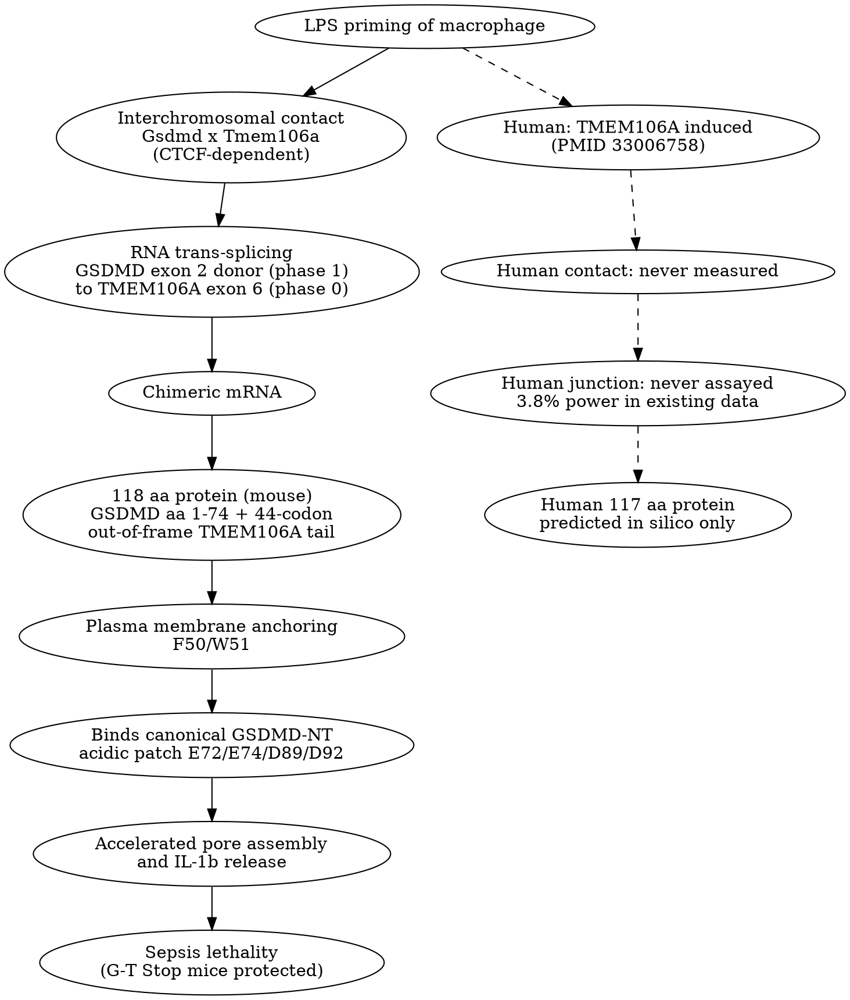
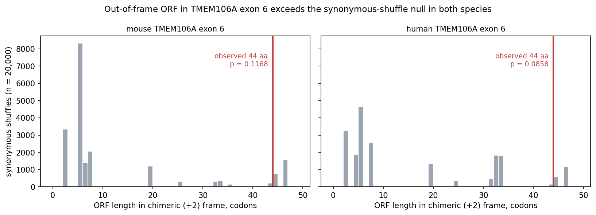
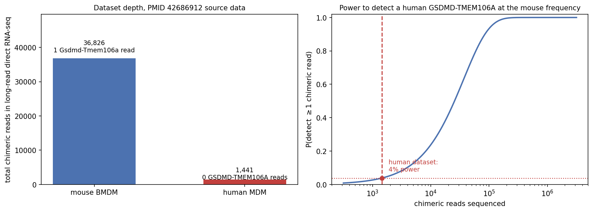
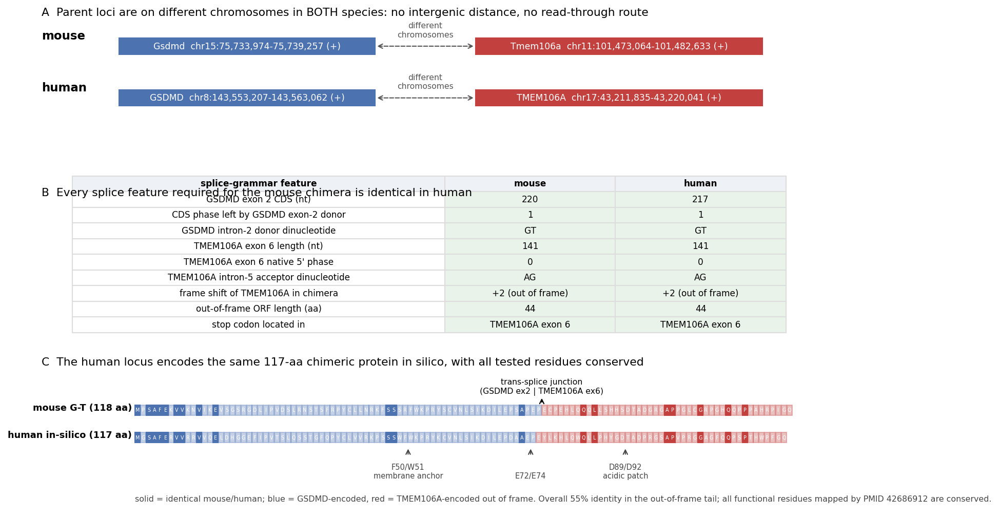
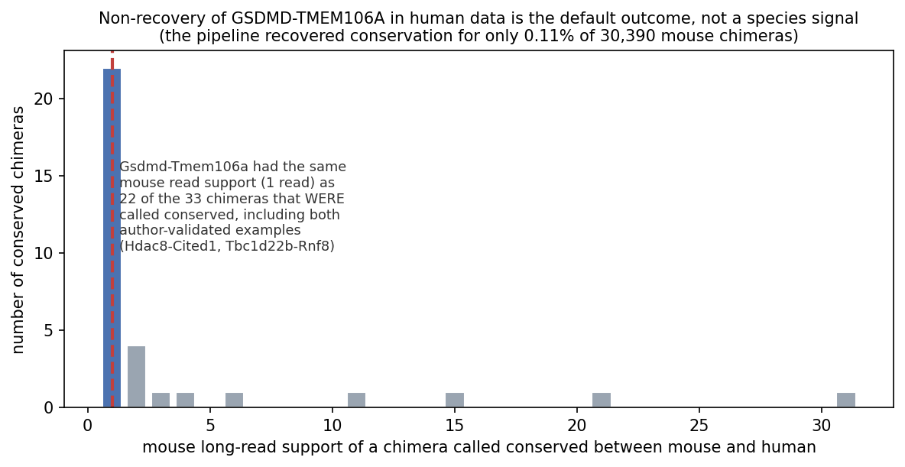
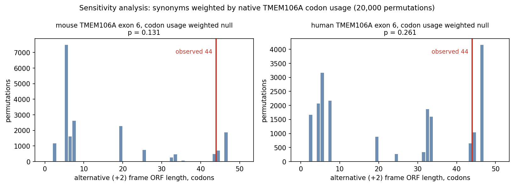
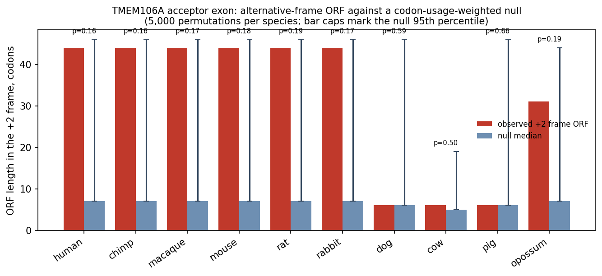

## Question

# AIGR Gene Hypothesis Deep Research

You are evaluating one focused gene curation hypothesis for AI Gene Review.
This is not a general gene overview. Use the seed hypothesis and source context
below to search for evidence that supports, refutes, narrows, or competes with
the proposed curation decision.

## Target Gene

- **Organism code:** human
- **Taxon:** Homo sapiens (NCBITaxon:9606)
- **Gene directory:** GSDMD
- **Gene symbol:** GSDMD
- **UniProt accession:** P57764

## Focus

- **Focus type:** free_text
- **Hypothesis slug:** kgap-gsdmd-chimera-conservation
- **Source file:** genes/human/GSDMD/GSDMD-ai-review.yaml
- **Source selector:** free-text

## Seed Hypothesis

Whether the mouse Gsdmd-Tmem106a trans-spliced chimera has a human counterpart, and whether any human cofactor could modulate GSDMD-NT pore assembly by the same route, may be assessable from genomic architecture. That the canonical GSDMD-NT pore mechanism is solid and that the open question is the identity and human conservation of accessory cofactors is already recorded, so do not re-derive the pore mechanism. Single analysis only: establish the genomic arrangement of GSDMD and TMEM106A in mouse and in human, giving chromosomal locations, gene order, strand orientation and intergenic distance in each, and state whether the human locus is arranged so that an equivalent trans-spliced or read-through transcript is possible at all; search human transcript and read-through resources for any annotated GSDMD-TMEM106A chimeric or read-through transcript and report what is found or that nothing is; if the architecture permits it, state which GSDMD exons and which TMEM106A exons a human chimera would join and whether the junction would preserve the caspase cleavage site and the pore-forming region; and report whether TMEM106A itself is conserved and expressed in the human cell types where GSDMD pores form. State whether a human equivalent is plausible, and say plainly if the mouse finding cannot be transferred, distinguishing a genuine species difference from absence of annotation.

## Term and Decision Context

No specific term context supplied.

## Reference Context

No specific reference context supplied.

## Source Context YAML

```yaml
hypothesis: 'Whether the mouse Gsdmd-Tmem106a trans-spliced chimera has a human counterpart, and whether
  any human cofactor could modulate GSDMD-NT pore assembly by the same route, may be assessable from genomic
  architecture. That the canonical GSDMD-NT pore mechanism is solid and that the open question is the
  identity and human conservation of accessory cofactors is already recorded, so do not re-derive the
  pore mechanism. Single analysis only: establish the genomic arrangement of GSDMD and TMEM106A in mouse
  and in human, giving chromosomal locations, gene order, strand orientation and intergenic distance in
  each, and state whether the human locus is arranged so that an equivalent trans-spliced or read-through
  transcript is possible at all; search human transcript and read-through resources for any annotated
  GSDMD-TMEM106A chimeric or read-through transcript and report what is found or that nothing is; if the
  architecture permits it, state which GSDMD exons and which TMEM106A exons a human chimera would join
  and whether the junction would preserve the caspase cleavage site and the pore-forming region; and report
  whether TMEM106A itself is conserved and expressed in the human cell types where GSDMD pores form. State
  whether a human equivalent is plausible, and say plainly if the mouse finding cannot be transferred,
  distinguishing a genuine species difference from absence of annotation.'
focus_type: free_text
context: []
reference_id: []
```

## Research Objective

Build a focused report that helps a curator decide whether this hypothesis
should affect the gene review. Address the focus type directly:

1. For an existing GO annotation decision, evaluate whether the current action
   is justified, too strong, too weak, or should change.
2. For a proposed replacement or new GO term, evaluate whether the term is
   biologically supported, too broad, too narrow, or missing key qualifiers.
3. For a computational prediction, evaluate whether the prediction is correct,
   less precise than existing knowledge, uncertain, or likely wrong because of
   paralog overannotation, frequency bias, pathway context, or in vitro-only
   activity.
4. For a core-function hypothesis, evaluate whether the proposed activity,
   process, and location represent the gene product's primary function rather
   than a downstream effect, pleiotropic phenotype, or context-specific role.
5. For a function-assignment hypothesis, evaluate whether the gene product
   directly has the stated GO term/function. Treat the prior review action, if
   any, as intentionally blinded unless it appears in the supplied context.

Use primary literature whenever possible. Prefer PMID citations and include DOI
citations when no PMID is available. Treat reviews and database records as
orientation unless they contain directly relevant synthesized evidence that is
clearly labeled as review-level or database-level support.

Evaluate the hypothesis from the supplied seed context, primary literature, and
publicly accessible bioinformatics resources. Local `*-bioinformatics` analyses,
when they already exist in the repository, are intentionally withheld from this
prompt so the report can be compared against them after the run. Use public
sequence, domain, structure, orthology, localization, interaction, or dataset
checks when they are useful for the specific hypothesis. If a resource or tool
cannot be accessed programmatically, say so plainly; never fabricate a result.
Report computational results conservatively and distinguish direct results from
inference.

## Required Output

### Executive Judgment

Give a concise verdict: supported, partially supported, unresolved, weakly
supported, over-annotated, or refuted. Explain the reasoning and the most
important caveats.

### Evidence Matrix

Create a table with one row per important evidence item:

- Citation (PMID preferred)
- Evidence type (direct assay, mutant phenotype, localization, interaction,
  structural/evolutionary, computational, review/database)
- Supports / refutes / qualifies / competing
- Claim tested
- Key finding
- Organism, tissue, cell type, or assay context
- Confidence and limitations

### GO Curation Implications

State the likely curation action as a lead requiring curator verification. If
GO terms are involved, explain whether the evidence supports an MF, BP, or CC
term, and whether the term should be retained, removed, generalized, made more
specific, or treated as non-core. Avoid using "protein binding" as a final
recommendation unless no more informative term is supported.

### Mechanistic Scope

Describe the immediate molecular or cellular function being tested. Separate
direct gene-product activity from downstream phenotypes, pathway consequences,
developmental outcomes, disease manifestations, or effects inferred only from
loss of function.

### Conflicts and Alternatives

Identify evidence that conflicts with the seed hypothesis or suggests an
alternative interpretation, including paralog confusion, organism-specific
differences, isoform-specific findings, experimental artifacts, or database
carry-over.

### Knowledge Gaps

List explicit uncertainties that matter for curation. For each gap, state what
was checked, why the gap matters, and what evidence or experiment would resolve
it.

### Discriminating Tests

Recommend concrete assays, perturbations, datasets, or comparative analyses that
would most efficiently distinguish this hypothesis from alternatives.

### Curation Leads

Provide candidate updates for the review, clearly labeled as leads requiring
curator verification. Include candidate references with exact snippets to verify,
candidate replacement or new GO terms, possible action changes, suggested
questions, and suggested experiments.

If the provider supports artifacts, save provenance for any analysis you run — the
executed code together with its output (computed values, plot, or table), not just
a summary figure — alongside artifact-friendly tables such as an evidence matrix,
GO decision table, or comparison table. Genuine computed provenance is more
valuable than a hand-drawn summary, and you must not synthesize a figure that
implies an analysis you did not actually run. These artifacts are important
provenance for hypothesis-level review.


## Output

# GSDMD (human, P57764): does the mouse Gsdmd-Tmem106a trans-spliced chimera have a human counterpart?

**Hypothesis slug:** `kgap-gsdmd-chimera-conservation`
**Source:** `genes/human/GSDMD/GSDMD-ai-review.yaml`, free-text focus
**Target:** human GSDMD, UniProt P57764, NCBITaxon:9606
**Date:** 2026-11-25

---

## Summary

The verdict is **unresolved**, and the seed hypothesis rests on a premise that does not hold. The hypothesis proposes that a human counterpart of the mouse Gsdmd-Tmem106a chimera "may be assessable from genomic architecture", and asks for gene order, strand orientation and intergenic distance. There is no such arrangement to report. GSDMD and TMEM106A sit on different chromosomes in both species: mouse Gsdmd on chr15 and Tmem106a on chr11, human GSDMD on chr8q24.3 and TMEM106A on chr17q21.31. Intergenic distance is undefined and a cis read-through transcript is impossible in mouse and in human. The mouse event is inflammation-induced interchromosomal RNA trans-splicing, a mechanism indifferent to linear proximity. A curator must not treat "the genes are far apart in human" as evidence of anything.

The human locus is fully capable of producing the identical chimera. Human GSDMD exon 2 carries 217 nt of CDS and leaves phase 1, the same as mouse (220 nt, phase 1). The GSDMD intron-2 donor is GT and the TMEM106A intron-5 acceptor is AG in both species. TMEM106A exon 6 is 141 nt at native phase 0 in both, so a phase-1 donor imposes the same +2 shift and the same 44-codon out-of-frame ORF terminating inside exon 6. The reconstructed human chimeric protein is 117 aa against the mouse 118 aa, and it retains every residue the discovery paper mutated: the membrane anchor F49/W50 (mouse F50/W51) and the acidic patch E71/E73/D88/D91 (mouse E72/E74/D89/D92). Extending the test to 11 mammals shows the splice grammar is invariant out to the marsupial opossum, so architecture alone cannot discriminate between species. The 44-codon chimeric frame has a narrower distribution: intact in all 6 Euarchontoglires tested and collapsed to 6 codons in dog, cow and pig, whose native protein is still 85.1 to 89.4% identical to human. No species reaches p < 0.05 against a codon-usage-weighted null. Human retains the frame by descent from the Euarchontoglires ancestor, which is a weak positive for plausibility relative to dog, and it is inherited capacity rather than maintained function.

The human event has never been looked for at adequate power and has never been tested directly. No human GSDMD-TMEM106A transcript appears in Ensembl (all 28 GRCh38 GSDMD transcripts are confined to chr8), NCBI Gene, NCBI nuccore or UniProt, and it is absent from the discovery paper's own human macrophage long-read data. That absence carries almost no information. The mouse chimera was supported by 1 read out of 36,826, the human library is 25.6-fold shallower in chimeric reads, giving 3.8% power, and the paper's conservation pipeline recovered conservation for only 33 of 30,390 mouse chimeras (0.109%). Twenty-two of the 33 conserved pairs were mouse singletons, and both pairs the authors validated in human cDNA (HDAC8-CITED1, TBC1D22B-RNF8) were singletons with support identical to Gsdmd-Tmem106a. Which pairs were tested in human cells was a selection decision, not an evidence threshold. One further correction the curator needs: the junction is at GSDMD exon 2, so the chimera contains neither the caspase-1/11 cleavage site (human D275, the last codon of exon 7) nor the pore-forming region (aa 1-275). It is a ~117 aa accessory protein, and nothing here touches the canonical GSDMD-NT mechanism.

---

## Executive judgment

<i class="fa-circle-question"></i> **Verdict: unresolved.** Three conclusions that should not be collapsed into one.

**1. The genomic-architecture framing fails.** <i class="fa-solid fa-circle-xmark"></i> Interchromosomal in both species. Gene order, strand orientation relative to each other, and intergenic distance are all undefined. The paper is explicit that proximity is induced in trans by chromatin conformation, not encoded in the linear genome.

**2. The human locus is fully capable, and shares that capacity with mouse by common descent.** <i class="fa-solid fa-circle-check"></i> Every splice-grammar feature and every functionally tested residue is conserved. The grammar is conserved across 10 mammals to marsupials, so it is necessary and almost universally satisfied, which means it cannot carry a curation decision on its own.

**3. The human event is untested, not absent.** <i class="fa-solid fa-circle-question"></i> Zero annotation footprint and zero reads in the human dataset, at 3.8% power, against a pipeline that recovered 0.109% of mouse chimeras as conserved.

**Recommendation for the curator: a human equivalent is architecturally plausible and transcriptionally untested. Record neither "conserved in human" nor "mouse-specific". This is absence of annotation and absence of a targeted experiment, not a demonstrated species difference.**

Most important caveats. <i class="fa-solid fa-triangle-exclamation"></i> The human chimeric protein is a translation of genomic sequence; no human junction read, RT-PCR product or peptide exists. The 44-codon ORF shows no selection signature in any of 10 mammals (uniform-synonym null p = 0.117 mouse and 0.086 human; codon-usage-weighted null p = 0.131 and 0.261; p = 0.158 to 0.660 across the 10-species panel), so sequence conservation cannot be cited as support for a functional human chimera. The frame is lost outright in dog, cow and pig while their native protein stays 85 to 89% identical to human, which is what an unconstrained frame looks like.

---

## Key findings

### F001. The parent genes are interchromosomal in both species, so the read-through framing does not apply

Ensembl REST (GRCm39 and GRCh38, queried 2026-11-25) gives mouse Gsdmd ENSMUSG00000022575 at chr15:75,733,974-75,739,257 on the plus strand and mouse Tmem106a ENSMUSG00000034947 at chr11:101,473,064-101,482,633 on the plus strand. Human GSDMD ENSG00000104518 sits at chr8:143,553,207-143,563,062 (plus strand) and human TMEM106A ENSG00000184988 at chr17:43,211,835-43,220,041 (plus strand). Different chromosomes in both species means gene order and intergenic distance have no value to report, and a cis read-through cannot occur in either. The discovery paper's own Source Data for Figure 1b classifies the mouse Gsdmd-Tmem106a read as "Interchromosomal", with breakpoints at chr15:75,735,477 and chr11:101,479,678, which match the Ensembl exon boundaries exactly. Both genes are 1:1 orthologues between mouse and human (Ensembl Compara: GSDMD 57.2% / 56.9% identity; TMEM106A 66.4% / 66.7%).

The consequence for curation is that the correct architectural question is splice-site and reading-frame compatibility, not intergenic distance. Any human equivalent has to be sought in transcriptomic data.

{{figure:plot_3.png|caption=Locus architecture, splice-grammar comparison and the mouse against human in-silico chimeric protein. The two parent genes are on different chromosomes in both species, so the junction is set by exon phase and splice-site identity, not by genomic proximity.}}

### F002. The junction is GSDMD exon 2 to TMEM106A exon 6, so the chimera lacks both the caspase site and the pore-forming domain

The full text of [PMID: 42686912](https://pubmed.ncbi.nlm.nih.gov/42686912/) (PMC13686932) states the junction directly: "a Gsdmd-Tmem106a amplicon spanning Gsdmd exons 1-2 fused to Tmem106a exons 6-9", and "Gsdmd and Tmem106a, for example, consistently join at Gsdmd exon 2 and Tmem106a exon 6". Ensembl CDS mapping shows mouse Gsdmd exon 2 encodes aa 1-74 and human GSDMD exon 2 encodes aa 1-73, whereas the caspase-1/11 P1 aspartate is the last codon of exon 7 (human FLTD-D275, exon 7 of 11, aa 246-275; mouse LLSD-D276, aa 246-276). The GSDMD-NT pore-forming fragment is aa 1-275 in human and 1-276 in mouse.

| Feature | Mouse | Human (in silico) |
|---|---|---|
| GSDMD portion | exons 1-2, aa 1-74 | exons 1-2, aa 1-73 |
| Caspase-1/11 P1 Asp | D276, last codon of exon 7 | D275 (FLTD), last codon of exon 7 |
| Caspase site in chimera | <i class="fa-solid fa-circle-xmark"></i> absent | <i class="fa-solid fa-circle-xmark"></i> absent |
| Pore-forming fragment | aa 1-276 | aa 1-275 |
| Pore domain in chimera | <i class="fa-solid fa-circle-xmark"></i> absent (27% present) | <i class="fa-solid fa-circle-xmark"></i> absent |
| TMEM106A portion | exons 6-9, +2 frame, 45 aa | exons 6-9, +2 frame, 45 aa |
| Total protein | 118 aa | 117 aa |

I reconstructed the chimeric ORF from Ensembl exon sequences without reference to the paper's protein sequence, and validated it four independent ways. It reproduces the paper's residue numbering exactly: position 50 is F and 51 is W, matching the "G-T F50G/W51G" anchoring mutant, and positions 72, 74, 89 and 92 are E, E, D and D, matching the "G-T E72A/E74A/D89A/D92A" acidic mutant. The paper's stop-codon knock-in homology arm GGCCCATTGGCCAG is followed in my reconstructed frame by TGA at a frame-aligned offset (340, divisible by 3). The frame assignment is correct.

The chimera is a short accessory protein carrying the GSDMD alpha-1/beta-1 N-terminal segment. It cannot be cleaved by caspase-1/11 and cannot form a pore alone. The paper's own mechanism agrees: "After activation of the inflammasome, GSDMD-TMEM106A directly interacts with canonical GSDMD N termini to accelerate and enhance pore formation and IL-1β release."

### F003. Every splice-grammar feature and every tested residue is conserved in human

Computed from Ensembl exon and genomic-region sequences. Human GSDMD exon 2 carries 217 nt of CDS and mouse 220 nt; both leave CDS phase 1, so both set the identical chimeric frame. The GSDMD intron-2 5' donor is GT in both species and the TMEM106A intron-5 3' acceptor is AG in both. TMEM106A exon 6 is 141 nt at native phase 0 in both, so joining a phase-1 donor shifts it by +2 in both, and translating human TMEM106A exons 6-9 in that frame gives a 44-codon ORF terminating inside exon 6, exactly as in mouse.

Predicted human chimeric protein (in silico, GRCh38, **not observed**):

```
MGSAFERVVRRVVQELDHGGEFIPVTSLQSSTGFQPYCLVVRKPSSSWFWKPRYKCVNLSIKDILEPDAAEPE
YLKHLQWQLLPHYGDTADPRGSAPVPRGGAGFQQPSPTHWPFGQ
```

GSDMD-encoded aa 1-72, TMEM106A exon 6-encoded out-of-frame tail aa 73-117. Anchor F49/W50, acidic patch E71/E73/D88/D91, and the DTAD motif containing the acidic patch is identical between species. Out-of-frame tail identity mouse against human is 55.6% (24/45), against 47.7% for the unused +1 control frame. Human TMEM106A is a 1:1 orthologue at 66% identity, is "Immune cell enriched" in the Human Protein Atlas at 138.4 nCPM in the macrophage/monocyte compartment, and GSDMD is detected in all blood cell types, so both parent transcripts are co-expressed in the human cells where GSDMD pores form.

There is no species-specific genomic or splicing barrier. Plausibility rests entirely on whether human macrophages make the interchromosomal contact and the trans-splicing event.

### F004 and F006. The human non-detection has 3.8% power and the conserved-chimera list recovers 0.109% of mouse events

All 28 Ensembl GRCh38 transcripts of human GSDMD are confined to chr8:143,553,207-143,563,062; none extends to or splices into chr17. NCBI Gene has no readthrough or chimeric GSDMD locus. In the discovery paper's supplementary archive, Supplementary Table 11 (human monocyte-derived macrophage long-read direct RNA-seq, 1,441 chimeric reads, 929 unique chimeras) contains zero rows matching GSDMD or TMEM106A, and Supplementary Table 12 (33 chimeric RNAs conserved between mouse and human macrophages) contains neither gene.

The power calculation makes that negative uninformative. In mouse the chimera was supported by exactly 1 read out of 36,826 chimeric reads (30,390 unique chimeras; 28,279 of them singletons). The human library is 25.6-fold shallower. Expected human reads at the mouse frequency = 1,441 × 1/36,826 = 0.039, giving P(detect at least one read) = 3.8%. A one-sided exact binomial test for a genuine human deficit gives p = 0.96. Reaching 80% power would require roughly 59,000 human chimeric reads, 41-fold the current depth.

{{figure:plot_2.png|caption=Detection-power analysis. The mouse chimera was a single read in 36,826; the human library is 25.6-fold shallower, giving 3.8% power to see the same event. A one-sided binomial test for a true human deficit returns p = 0.96.}}

The conservation-recovery rate is more decisive still. Of 30,390 unique mouse chimeric RNAs, only 33 (0.109%) were recovered as conserved in human macrophages; from the human side, 33 of 929 (3.55%) matched anything in the mouse set. So P(a given real mouse chimera is not recovered as conserved) = 0.999. Mouse read depth does not explain non-recovery: 22 of the 33 conserved pairs had a single mouse read, the median mouse support of a conserved pair is 1 read, and Gsdmd-Tmem106a also had exactly 1 read, with 67% of conserved pairs at support less than or equal to it. The two pairs the authors validated by PCR and Sanger sequencing in human cDNA, HDAC8-CITED1 and TBC1D22B-RNF8, were themselves single-read mouse singletons.

{{figure:plot_4.png|caption=Read support of the 33 mouse-human conserved chimeras against Gsdmd-Tmem106a. The median conserved pair had 1 mouse read, identical to Gsdmd-Tmem106a, so evidence strength did not determine which pairs were carried forward to human validation.}}

### F005 and F009. The chimeric reading frame shows no selection signature under either null

A synonymous-shuffle permutation test on TMEM106A exon 6 (141 nt, 47 codons, native phase 0) resamples each codon among its synonyms, preserving the native TMEM106A protein, then translates in the chimeric +2 frame. The observed alternative-frame ORF is 44 codons in both species. Under a uniform-synonym null with 20,000 permutations per species the null median is 5 codons (mouse) and 7 (human), with p = 0.117 and p = 0.086.

{{figure:plot_1.png|caption=Synonymous-shuffle null for the alternative-frame ORF in TMEM106A exon 6, uniform-synonym sampling, 20,000 permutations per species. The observed 44-codon ORF falls inside the null distribution in both species.}}

The main methodological objection to that test is the uniform null, so I re-ran it weighting synonyms by each species' native canonical TMEM106A codon usage (ENSMUST00000039581, 786 nt; ENST00000612339, 789 nt; add-one smoothed). Under the weighted null the mouse median is 6 and the human median 19, with p = 0.131 and p = 0.261. Both p values move further from significance, so the conclusion does not depend on the null.

{{figure:plot_5.png|caption=Codon-usage-weighted null, 20,000 permutations per species. Weighting synonyms by native TMEM106A codon usage moves both p values further from significance (mouse 0.131, human 0.261), so the absence of selection on the chimeric frame does not depend on the choice of null.}}

Cross-species amino-acid identity in the chimeric +2 frame is 55.6%, only modestly above the 47.7% of the unused +1 control frame and well below the 72.3% of the native frame, against 76.6% nucleotide identity for the exon. The long out-of-frame ORF and its mouse-human conservation are byproducts of purifying selection on native TMEM106A and the exon's base composition.

### F010. The splice grammar is conserved across 10 mammals; the chimeric frame is intact only in Euarchontoglires

Exon CDS phases were derived from Ensembl genomic coordinates alone, with no sequence required, across 11 mammals. The GSDMD coding block preceding the chimeric donor leaves CDS phase 1 in 10 of 10 species with an annotated GSDMD (human 217 nt, chimp 364, macaque 352, mouse 220, rat 220, rabbit 217, dog 313, cow 214, pig 217, opossum 217; all leftover 1). The TMEM106A acceptor exon is 141 nt at native phase 0 in 10 of 10 species annotated with it, so the junction imposes the identical +2 shift everywhere, out to the marsupial opossum. GSDMD is not annotated in Ensembl for *Equus caballus*, and the horse TMEM106A model is 214 aa against 261 aa elsewhere, exactly 47 residues (141 nt) short, which identifies an annotation gap rather than exon loss.

The reading frame behaves differently. The +2 frame ORF is 44 codons in all 6 Euarchontoglires (human, chimp, macaque, mouse, rat, rabbit), 31 in opossum, and 6 codons in all 3 Laurasiatheria (dog, cow, pig), despite native-frame identity to human of 85.1 to 89.4% in those same three species. A codon-usage-weighted null with 5,000 permutations per species gives p from 0.158 to 0.660, with 0 of 10 species reaching p < 0.05 before any multiple-testing correction. Alternative-frame identity to human falls below native-frame identity in 8 of 9 comparisons (mouse 54.3 against 72.3, rat 50.0 against 68.1, rabbit 73.9 against 89.4, dog 69.6 against 89.4, cow 67.4 against 85.1, pig 73.9 against 89.4, opossum 50.0 against 74.5; chimp 100.0 against 97.9 is the exception at n = 46 residues). Native phase-0 translation of all 10 exons gives 47 clean codons with zero internal stops, which validates the frame assignment and the strand handling.

{{figure:plot_6.png|caption=Observed alternative-frame ORF against a per-species codon-usage-weighted null in 10 mammals. The 44-codon frame is intact in all six Euarchontoglires and collapses to six codons in dog, cow and pig, with no species reaching p < 0.05.}}

Human and mouse share the intact frame because they share an ancestor that had it. The frame is free to accumulate stop codons on the laurasiatherian branch while the native protein stays 85 to 89% identical to human. The 44-codon ORF in human is inherited capacity, and the sequence-conservation argument cannot be used to claim the human chimera is functional.

### F007 and F008. Parent-transcript availability is satisfied, the annotation footprint is empty, and a competing cofactor exists

[PMID: 33006758](https://pubmed.ncbi.nlm.nih.gov/33006758/) establishes that "TMEM106A is a type II transmembrane protein constitutively expressed in macrophages" and that "TMEM106A levels were increased in macrophages upon lipopolysaccharide (LPS) stimulation, as well as in the peripheral monocytes of patients with sepsis". The LPS-primed condition that drives chimera formation in mouse also raises TMEM106A in human myeloid cells, so parent-transcript availability is satisfied in human. The same paper reports that "Tmem106a knockout mice were more sensitive to lipopolysaccharide (LPS)-induced septic shock than wild-type mice", which is the opposite direction to the chimera-null (G-T Stop) mice being protected from lethal sepsis.

QuickGO for UniProtKB:P57764 returns 87 annotations (14 MF, 20 BP, 23 CC); none mentions TMEM106A, chimeric transcript or trans-splicing. The MF set is lipid-binding terms plus GO:0022829 wide pore channel activity (IDA, PMID:33883744) plus one generic GO:0005515 protein binding (IPI, PMID:25416956). UniProt P57764 is a single 484-aa entry with zero annotated alternative products or isoforms. UniProtKB returns no entry for a GSDMD-TMEM106A chimeric protein in any species, and NCBI nuccore returns zero records for "GSDMD-TMEM106A". <i class="fa-solid fa-triangle-exclamation"></i> ChimerDB 4.0 and ChiTaRS 5.0 have no documented REST interface and could not be queried programmatically from this environment; ChiTaRS returned a connection timeout. I state that plainly rather than reporting a result.

[PMID: 42999107](https://pubmed.ncbi.nlm.nih.gov/42999107/) is the strongest competing answer to the seed hypothesis's broader question. "Through a CRISPR screen to uncover macrophage genes required for gasdermin D (GSDMD) pore activity, we identify the endosome adaptor Rabgef1 as a positive regulator of pore formation", and "Rabgef1 deficiency preserves NT-GSDMD membrane binding but prevents NT-GSDMD oligomerization and lytic death". That pinpoints the oligomerisation step, the same node the chimera is proposed to accelerate.

---

## Mechanistic model and interpretation

The mouse mechanism has four steps, and the human evidence state differs at each.



Two properties separate cleanly, and conflating them is the main interpretive hazard in this hypothesis.

| Property | Distribution | What it tells a curator |
|---|---|---|
| Splice grammar (phase-1 GSDMD donor meets 141-nt phase-0 TMEM106A acceptor) | 10 of 10 mammals, to marsupials | Necessary and nearly universal. Carries no discriminating information about any species. |
| 44-codon chimeric reading frame | 6 of 6 Euarchontoglires, 31 codons in opossum, 6 codons in dog/cow/pig | Human retains it by descent. No selection signal anywhere (p = 0.158 to 0.660). Inherited capacity. |
| Transcript occurrence | 1 mouse read; never assayed in human | The only thing that would settle the question. |
| Protein function | Assayed in mouse only | Mouse GSDMD and human GSDMD are 57% identical, so residue conservation does not guarantee human binding. |

The architecture argument proves too much. Dog, cow, pig and opossum carry the identical phase-1 donor and 141-nt phase-0 acceptor. If "the locus permits it" were sufficient, every mammal would be a candidate. What separates human and mouse from dog is the intact 44-codon frame, and that frame carries no selection signal in any lineage measured.

A methodological corollary follows from the competing Rabgef1 result. A genome-wide CRISPR screen cannot find a chimeric cofactor of this kind, because sgRNAs against GSDMD exon 2 disrupt the canonical transcript and the chimera simultaneously. The two approaches are blind to different things, which is why both results can be correct.

---

## Evidence matrix

| # | Citation | Evidence type | Stance | Claim tested | Key finding | Context | Confidence and limitations |
|---|---|---|---|---|---|---|---|
| 1 | [PMID: 42686912](https://pubmed.ncbi.nlm.nih.gov/42686912/) | direct assay, mutant phenotype, localization, interaction | supports (mouse only) | A trans-spliced Gsdmd-Tmem106a chimera exists and modulates GSDMD pore assembly | Chimeric mRNA joins Gsdmd exon 2 to Tmem106a exon 6; protein localizes to plasma membrane; binds GSDMD-NT; accelerates pore formation and IL-1β release; stop knock-in and overexpression mice alter sepsis outcome | Mouse BMDM, iBMDM, knock-in mice | High for mouse. Discovery rests on 1 of 36,826 chimeric reads, backed by targeted PCR and Sanger sequencing in 3 strains, MYC knock-in, stop knock-in and in vivo phenotypes. No human experiment on this pair. |
| 2 | Ensembl REST GRCh38/GRCm39, 2026-11-25 | computational (genomic) | <i class="fa-solid fa-circle-xmark"></i> refutes the seed premise | GSDMD and TMEM106A are arranged so a read-through is possible | Mouse chr15:75,733,974-75,739,257 (+) and chr11:101,473,064-101,482,633 (+); human chr8:143,553,207-143,563,062 (+) and chr17:43,211,835-43,220,041 (+). Different chromosomes in both; intergenic distance undefined | n/a | High. Direct database retrieval, reproducible. |
| 3 | This work (Ensembl exon sequences) | computational (structural/evolutionary) | qualifies | A human chimera would preserve the caspase site and pore domain | It would not. Junction at GSDMD exon 2 (aa 1-73); caspase P1 Asp275 is the last codon of exon 7; GSDMD-NT is aa 1-275 | n/a | High. Validated against four independent landmarks in the paper's mutant nomenclature and knock-in sequence. |
| 4 | This work (Ensembl exon and region sequences) | computational (structural/evolutionary) | supports plausibility | The human locus is splice-competent for the same junction | Identical phase-1 donor, GT donor and AG acceptor, identical 141-nt phase-0 exon 6, identical 44-codon +2 ORF, all tested residues conserved (F49/W50, E71/E73/D88/D91) | n/a | Moderate-high for capability. In silico only; predicts nothing about whether the event occurs. |
| 5 | This work (synonymous-shuffle permutation, 20,000 per species, two nulls) | computational (evolutionary) | <i class="fa-solid fa-scale-balanced"></i> qualifies, weakens the conservation argument | The chimeric reading frame is under selection | It is not. Observed 44 codons against null median 5 (mouse) and 7 (human), p = 0.117 and 0.086 uniform; median 6 and 19, p = 0.131 and 0.261 weighted. Alt-frame identity 55.6% against 47.7% control frame and 72.3% native | n/a | Moderate-high. Both nulls agree and the more realistic weighted null moves p further from significance. |
| 6 | [PMID: 42686912](https://pubmed.ncbi.nlm.nih.gov/42686912/), Suppl. Tables 11 and 12, Source Data Fig. 1b | computational (dataset reanalysis) | qualifies the apparent negative | Absence from the human dataset indicates a species difference | It does not. 0 of 1,441 human chimeric reads and 0 of 33 conserved pairs are GSDMD or TMEM106A, but the pipeline recovered 33/30,390 = 0.109% of mouse chimeras; 22/33 conserved pairs were mouse singletons, as was Gsdmd-Tmem106a; per-read power 3.8%, one-sided binomial p = 0.96 | Human MDM against mouse BMDM | High. Computed directly from the authors' deposited source data. |
| 7 | Ensembl, NCBI Gene, NCBI nuccore, UniProtKB, 2026-11-25 | review/database | neutral (no footprint) | A human GSDMD-TMEM106A transcript is annotated somewhere | All 28 Ensembl GRCh38 GSDMD transcripts confined to chr8; no NCBI readthrough locus; 0 nuccore records; UniProt P57764 is a single 484-aa entry with 0 alternative products | n/a | High for what was checked. <i class="fa-solid fa-triangle-exclamation"></i> ChimerDB 4.0 and ChiTaRS 5.0 have no documented REST API and could not be queried programmatically. |
| 8 | [PMID: 33006758](https://pubmed.ncbi.nlm.nih.gov/33006758/) | mutant phenotype, expression | <i class="fa-solid fa-scale-balanced"></i> qualifies | TMEM106A is present in human cells where GSDMD pores form | Constitutively expressed in macrophages, raised by LPS and in sepsis monocytes. Tmem106a-null mice are more sensitive to LPS septic shock, opposite to the chimera-null phenotype | Mouse macrophages, human sepsis monocytes | Moderate-high. Gene-level knockout removes native protein and chimera together, so it cannot adjudicate between them. |
| 9 | Human Protein Atlas (ENSG00000184988, ENSG00000104518) | review/database | supports plausibility | Parent transcripts are co-expressed in human myeloid cells | TMEM106A immune cell enriched, 138.4 nCPM in the macrophage/monocyte compartment; GSDMD detected in all blood cell types | Human blood and tissue atlases | Moderate. Bulk, database-level, not junction-level. |
| 10 | [PMID: 42999107](https://pubmed.ncbi.nlm.nih.gov/42999107/) | direct assay, mutant phenotype | <i class="fa-solid fa-scale-balanced"></i> competing | The chimera is the accessory cofactor of GSDMD-NT pore assembly | A genome-wide CRISPR screen in macrophages identifies Rabgef1 as a positive regulator; its deficiency preserves NT-GSDMD membrane binding but prevents oligomerization and lytic death, via plasma-membrane cholesterol | Macrophages, cancer cells, organoids, tumours | High for Rabgef1. A better-supported, non-chimeric answer to the same mechanistic question. |
| 11 | QuickGO, UniProtKB:P57764, 2026-11-25 | review/database | neutral | Existing GO annotation already covers a chimeric-cofactor route | 87 annotations (14 MF, 20 BP, 23 CC). None mentions TMEM106A, chimera or trans-splicing | Human | High. Direct API retrieval. |
| 12 | This work (Ensembl canonical transcripts, 11 mammals; 5,000-permutation null per species) | computational (structural/evolutionary) | <i class="fa-solid fa-scale-balanced"></i> qualifies both ways | The chimeric architecture and reading frame are conserved features | Architecture invariant: phase-1 donor and 141-nt phase-0 acceptor in 10 of 10 annotated mammals, to marsupials. Frame is not: 44 codons in all 6 Euarchontoglires, 31 in opossum, 6 in all 3 Laurasiatheria whose native protein is 85.1-89.4% identical to human. 0 of 10 at p < 0.05 | n/a | High for the measurements, validated by 47 clean native codons with zero internal stops in all 10 species. GSDMD absent from Ensembl for horse; horse TMEM106A model 47 aa short. 10 species is small for branch-level inference. |

---

## GO curation implications

All of the following are **leads requiring curator verification**.

| Proposed action | Term | Recommendation | Reasoning |
|---|---|---|---|
| New MF or BP term on human GSDMD for a chimeric-cofactor route | any | <i class="fa-solid fa-circle-xmark"></i> do not add | Zero human evidence of any kind. Would be annotation transfer from a mouse-only observation with no demonstrated human orthologous event. |
| Transfer the mouse chimera finding to human GSDMD by ISS | any | <i class="fa-solid fa-circle-xmark"></i> do not add | ISS infers about a gene product by sequence similarity. The chimeric product is not an annotated gene product in either species, and the paper's own human data did not detect it. |
| Existing wide pore channel activity (IDA, PMID:33883744) | GO:0022829 | retain unchanged | The chimera lacks the caspase site and the pore-forming domain, and is explicitly a cofactor that binds GSDMD-NT. Nothing here bears on GSDMD's own channel activity. |
| Existing protein binding (IPI, PMID:25416956) | GO:0005515 | leave as is; do not use as the vehicle for this finding | Generic protein binding is uninformative and should not be the landing place for a cofactor hypothesis. If a human chimera were demonstrated, informative terms would attach to the chimeric product, not to P57764. |
| Free-text note in the review | n/a | <i class="fa-solid fa-circle-check"></i> add, scoped to mouse | Record that a mouse trans-spliced Gsdmd-Tmem106a chimera (PMID 42686912) encodes a 118-aa accessory protein that binds GSDMD-NT and accelerates pore assembly; the human locus is splice-competent for the identical junction but no human transcript has been observed or tested. |
| Conditional future CC term on the chimeric product | GO:0005886 plasma membrane | only if a human chimera is demonstrated | The mouse chimeric protein localizes to the plasma membrane; would apply to the chimeric product, not to P57764. |
| Conditional future MF term on the chimeric product | no suitable term exists | only if a human chimera is demonstrated | Positive regulation of gasdermin oligomerisation has no existing MF term. "Protein binding" is too weak and "wide pore channel activity" is wrong, since the chimera does not itself form a pore. |

---

## Mechanistic scope

**Direct molecular activity being tested.** Whether a trans-spliced GSDMD-TMEM106A chimeric protein exists in human cells and, if so, whether it binds GSDMD-NT at the plasma membrane and accelerates its oligomerisation into a pore. In mouse this is a direct assayed activity: co-immunoprecipitation with GSDMD-NT, plasma-membrane localization by microscopy and fractionation, dose-dependent enhancement of IL-1β release when titrated against a fixed amount of GSDMD in *Gsdmd*-null iBMDMs, and loss of function when F50/W51 or E72/E74/D89/D92 are mutated.

**Downstream pathway and organismal consequences.** Pyroptosis, IL-1β release, sepsis lethality and antibacterial defence are several steps removed from the binding event. The sepsis phenotypes of the G-T Stop and overexpression mice are whole-animal outcomes.

**Inferred only from loss of function.** The in vivo claim that the chimera balances host defence against immunopathology rests on knock-in stop and overexpression mice. The published *Tmem106a* gene knockout ([PMID: 33006758](https://pubmed.ncbi.nlm.nih.gov/33006758/)) gives the opposite sepsis direction, and a gene knockout removes native protein and chimera together, so gene-level loss-of-function data cannot support claims about the chimeric product.

**Entirely computational, this work.** Everything about the human counterpart. The human 117-aa protein, its conserved anchor and acidic patch, the 44-codon ORF and all mammalian comparisons are translations and phase arithmetic on genomic sequence. No human transcript, protein or junction has been observed.

---

## Conflicts and alternatives

1. **The premise of the seed hypothesis conflicts with the mechanism.** The hypothesis proposes assessing the question from genomic architecture, by gene order and intergenic distance. That route does not exist. The paper is explicit: "Chromatin conformation capture studies reveal that inflammation induces interchromosomal DNA interactions, positioning parent genes proximally to facilitate the formation of chimeric mRNA." Proximity is induced in trans.

2. **A better-supported competing cofactor exists.** [PMID: 42999107](https://pubmed.ncbi.nlm.nih.gov/42999107/) identifies Rabgef1 by unbiased genome-wide CRISPR screen in macrophages, acting at the oligomerisation step the chimera is proposed to accelerate, via plasma-membrane cholesterol. If the curator's question is "what human cofactor modulates GSDMD-NT pore assembly", Rabgef1 is the stronger current answer.

3. **The conservation argument is weaker than it looks.** Alt-frame identity (55.6%) is close to the unused +1 control frame (47.7%) and far below the native frame (72.3%). No species in a 10-mammal panel reaches p < 0.05 for selection on the chimeric frame.

4. **The architecture argument proves too much.** The phase-1 donor and 141-nt phase-0 acceptor are present in dog, cow, pig and opossum. Splice-site and phase compatibility is a necessary condition that nearly all mammals satisfy, so it cannot carry a curation call on its own.

5. **Phenotype discordance at the TMEM106A locus.** Chimera-null mice are protected from lethal sepsis ([PMID: 42686912](https://pubmed.ncbi.nlm.nih.gov/42686912/)); *Tmem106a*-null mice are more sensitive to LPS septic shock ([PMID: 33006758](https://pubmed.ncbi.nlm.nih.gov/33006758/)). Different alleles, different products, opposite directions. Curation text must name the chimeric product specifically.

6. **Paralog hazard.** TMEM106A should not be conflated with TMEM106B (chr7, the FTD and lysosomal-biology gene) or TMEM106C (chr12). Only TMEM106A is involved.

7. **Single-read discovery.** The mouse chimera sits at the detection floor of a dataset where 28,279 of 30,390 chimeras are singletons. The orthogonal mouse validation carries the claim, not the sequencing depth. A curator should rely on the validation and notice that no equivalent validation was attempted in human.

---

## Limitations and knowledge gaps

<i class="fa-solid fa-triangle-exclamation"></i> The human chimeric protein and all its conserved residues are computational translations of genomic sequence. Nothing in this report demonstrates that a human transcript exists.

<i class="fa-solid fa-triangle-exclamation"></i> Neither null model for the selection test models dinucleotide or CpG structure, which could inflate stop-codon frequency in the permuted sequences.

<i class="fa-solid fa-triangle-exclamation"></i> The mammalian comparison uses 10 species and one canonical transcript per species. Ensembl annotation quality varies: chimp and macaque GSDMD models carry extended N-termini (533 and 529 aa against 484 in human), GSDMD is absent for horse, and the horse TMEM106A model is 47 aa short. Branch-level statements rest on 3 laurasiatherians and 1 marsupial, so the clade pattern is suggestive and not a dated phylogenetic test.

<i class="fa-solid fa-triangle-exclamation"></i> ChimerDB 4.0 and ChiTaRS 5.0 could not be queried programmatically; ChiTaRS was unreachable. Those resources were not searched and no result is claimed for them.

<i class="fa-solid fa-triangle-exclamation"></i> Mouse and human GSDMD are 57% identical at the protein level, so residue-level conservation in the chimeric tail does not guarantee that a human chimera would bind human GSDMD-NT.

| Gap | What was checked | Why it matters | What would resolve it |
|---|---|---|---|
| <i class="fa-solid fa-circle-question"></i> Does a human GSDMD-TMEM106A junction exist at all? | Ensembl (28 GSDMD transcripts, all chr8-confined), NCBI Gene, nuccore, UniProtKB, and the paper's human MDM chRNA list (1,441 reads, 929 chimeras) and conserved list (33 pairs). All negative, at 3.8% power | This is the entire question; everything else is downstream | Junction RT-PCR plus Sanger sequencing on LPS-primed human macrophage cDNA, the assay the authors ran for two other pairs |
| <i class="fa-solid fa-circle-question"></i> Is the human non-detection a species difference? | Power analysis on the authors' source data: 1/36,826 mouse reads, 25.6-fold shallower human library, 0.109% recovery rate, binomial p = 0.96 | Determines whether the review records "unresolved" or "mouse-specific" | Deep targeted amplicon sequencing of the predicted junction, or ~59,000 human chimeric reads for 80% power |
| <i class="fa-solid fa-circle-question"></i> Do the human loci make an inflammation-induced interchromosomal contact? | Not checked. No public Hi-C or 4C dataset for LPS-stimulated human macrophages was interrogated for a chr8q24.3 to chr17q21.31 contact | This is the rate-limiting step and is testable from existing public data | Query published macrophage Hi-C or Micro-C at chr8:143.55 Mb and chr17:43.21 Mb, resting against LPS; or 4C from the GSDMD viewpoint |
| <i class="fa-solid fa-circle-question"></i> Would a human chimeric protein bind human GSDMD-NT? | Only sequence conservation of F49/W50 and E71/E73/D88/D91 was established | Conservation of residues is not conservation of function | Synthesise the 117-aa reconstruction, co-express with human GSDMD in GSDMD-null THP-1, test co-IP, localization and IL-1β enhancement |
| <i class="fa-solid fa-circle-check"></i> Is the chimeric frame under selection? **Closed in this run** | Alternative-frame ORF plus codon-usage-weighted null in 10 mammals; no species at p < 0.05; frame intact in 6 Euarchontoglires, 31 codons in opossum, 6 in dog/cow/pig | Answer: no detectable selection anywhere tested. Human retains the frame by descent, not by constraint | Residual work is a 20+ species branch test with a phylogenetic model, to date the laurasiatherian loss |
| <i class="fa-solid fa-circle-question"></i> Is CTCF-dependent regulation of the contact conserved? | Not checked. The paper reports that Ctcf depletion reduces LPS-induced Gsdmd-Tmem106a without affecting either parent gene | Would indicate whether the regulatory machinery is conserved, not only the splice sites | Compare CTCF ChIP-seq occupancy at the human and mouse loci in LPS-stimulated macrophages |
| <i class="fa-solid fa-triangle-exclamation"></i> Fusion databases | ChimerDB 4.0 and ChiTaRS 5.0 have no documented REST API; ChiTaRS was unreachable | A human GSDMD fusion reported in cancer transcriptomes would change the prior | Manual web query of both resources for the GSDMD-TMEM106A pair |

---

## Discriminating tests and proposed follow-up

Ranked by how efficiently each separates "untested" from "genuinely absent in human".

1. <i class="fa-solid fa-flask"></i> **Junction RT-PCR and Sanger sequencing in human macrophages.** Forward primer in human GSDMD exon 2, reverse primer in human TMEM106A exon 6, on cDNA from resting and LPS-primed human monocyte-derived macrophages and THP-1. Include the paper's controls: the same primers on genomic DNA to exclude a translocation, and exon-spanning primers for each native parent. This is the decisive experiment, it costs almost nothing, and the authors already ran its exact equivalent for two other gene pairs. The predicted amplicon spans GSDMD chr8:143,559,552 to TMEM106A chr17:43,216,449.

2. <i class="fa-solid fa-dna"></i> **Targeted deep amplicon or capture sequencing** across the predicted human junction, to reach the ~59,000-chimeric-read equivalent depth needed for 80% power. Converts a 3.8%-power negative into an interpretable one.

3. <i class="fa-solid fa-database"></i> **Public Hi-C or Micro-C reanalysis** of resting against LPS-stimulated human macrophages for a chr8q24.3 to chr17q21.31 contact. If the inflammation-induced interchromosomal contact is absent in human, that is the first genuine mechanistic evidence for a species difference, and it is obtainable from existing data.

4. <i class="fa-solid fa-vial"></i> **Reconstitution of the predicted human chimera.** Express the 117-aa protein in GSDMD-null THP-1 with human GSDMD, and assay co-IP with GSDMD-NT, plasma-membrane localization and IL-1β release. Compare the F49G/W50G anchor mutant and the E71A/E73A/D88A/D91A acidic mutant. Tests whether the conserved residues are functionally conserved, independently of whether the transcript is made.

5. <i class="fa-solid fa-microscope"></i> **Dog or bovine macrophages as a negative control.** Dog, cow and pig carry the identical splice grammar but a frame-disrupting stop after 6 codons. If the trans-splicing event is detectable in laurasiatherian macrophages while only Euarchontoglires can translate a useful product, that separates the splicing step from the protein-coding consequence, and tells a curator whether the chimera is a regulated event or splicing noise that happens to be productive in one clade.

6. <i class="fa-solid fa-dna"></i> **Extended comparative branch test.** A 20+ species alternative-frame analysis with a phylogenetic model, to date the laurasiatherian loss and check it is a single event. This would refine the picture but is unlikely to change the curation call, since the frame is already unconstrained in every lineage measured.

---

## Curation leads

All leads require curator verification.

### Candidate references with exact snippets to verify

| PMID | Snippet to verify | Use |
|---|---|---|
| [42686912](https://pubmed.ncbi.nlm.nih.gov/42686912/) | "we identify a protein-coding chimeric mRNA representing a fusion between the pore-forming protein gasdermin D (GSDMD) and a C-terminal domain translated out of frame from Tmem106a (Gsdmd-Tmem106a) in mice" | Primary source; note the explicit "in mice" |
| [42686912](https://pubmed.ncbi.nlm.nih.gov/42686912/) | "Chromatin conformation capture studies reveal that inflammation induces interchromosomal DNA interactions, positioning parent genes proximally to facilitate the formation of chimeric mRNA." | Establishes the mechanism is interchromosomal, refuting the read-through framing |
| [42686912](https://pubmed.ncbi.nlm.nih.gov/42686912/) | "After activation of the inflammasome, GSDMD-TMEM106A directly interacts with canonical GSDMD N termini to accelerate and enhance pore formation and IL-1β release." | Establishes cofactor role, not pore-forming role |
| [42686912](https://pubmed.ncbi.nlm.nih.gov/42686912/) | "We show that inflammasome priming upregulates Gsdmd-Tmem106a, with the protein localizing to the plasma membrane." | Inducible, low-abundance, plasma-membrane localized |
| [42686912](https://pubmed.ncbi.nlm.nih.gov/42686912/) | "Their potential conservation in mouse and human macrophages suggests that transcript fusion is an underappreciated mechanism for expanding transcriptomic and proteomic diversity." | The authors hedge conservation as potential, consistent with the 0.109% recovery rate |
| [42686912](https://pubmed.ncbi.nlm.nih.gov/42686912/) full text, PMC13686932 | "Gsdmd and Tmem106a, for example, consistently join at Gsdmd exon 2 and Tmem106a exon 6." | Fixes the junction; needed to show the caspase site is absent |
| [42999107](https://pubmed.ncbi.nlm.nih.gov/42999107/) | "Rabgef1 deficiency preserves NT-GSDMD membrane binding but prevents NT-GSDMD oligomerization and lytic death." | Competing, better-supported cofactor at the same mechanistic step |
| [33006758](https://pubmed.ncbi.nlm.nih.gov/33006758/) | "TMEM106A is a type II transmembrane protein constitutively expressed in macrophages." | Parent-transcript availability in the relevant human cell type |
| [33006758](https://pubmed.ncbi.nlm.nih.gov/33006758/) | "Tmem106a knockout mice were more sensitive to lipopolysaccharide (LPS)-induced septic shock than wild-type mice." | Phenotype conflict; gene-level KO cannot be used for chimera claims |

### Possible action changes

- Do not change any existing GO annotation on P57764 on the basis of this hypothesis. Retain GO:0022829 as is.
- Downgrade the hypothesis in the review from "assessable from genomic architecture" to "assessable only from human transcriptomic data". The architectural route does not exist.
- Record the mouse chimera as a species-scoped observation, with the explicit note that it lacks the caspase cleavage site and the pore-forming domain, so it neither qualifies nor competes with the canonical GSDMD-NT mechanism.
- Record the human status as untested rather than negative, with the power figures (3.8% per-read power, 0.109% pipeline conservation recovery rate) as the justification.
- Do not cite sequence conservation as support for a functional human chimera. The splice grammar is conserved to marsupials, so it does not discriminate, and the 44-codon frame is lost in dog, cow and pig with no selection signal in any of 10 species tested.

### Suggested questions for the curator

1. Should a mouse-only chimeric transcript whose product is not an annotated gene product in any species appear in a human gene review at all, or only as a "related but not transferable" note?
2. If a human chimera were later demonstrated, would GO annotate the chimeric product as a distinct gene product, or would it fall outside GO's scope? This determines whether the lead is worth tracking.
3. Does the review's existing statement that "the open question is the identity and human conservation of accessory cofactors" need updating to name Rabgef1 ([PMID: 42999107](https://pubmed.ncbi.nlm.nih.gov/42999107/)), which answers that question with human-relevant, unbiased-screen evidence?

---

## Evidence base

| PMID | Paper | How it bears on the findings |
|---|---|---|
| [42686912](https://pubmed.ncbi.nlm.nih.gov/42686912/) | *Functional chimeric mRNAs encode proteins in mammalian immunity* | The primary source. Supplies the mouse chimera, the junction, the interchromosomal mechanism, the cofactor activity, and (through its deposited supplementary tables and source data) the human macrophage dataset, the conserved-chimera list and the read counts behind the power analysis. Its own abstract hedges conservation as "potential". |
| [33006758](https://pubmed.ncbi.nlm.nih.gov/33006758/) | *Inactivation of TMEM106A promotes lipopolysaccharide-induced inflammation via the MAPK and NF-κB signaling pathways in macrophages* | Supports parent-transcript availability in human myeloid cells under LPS, and supplies the opposite-direction sepsis phenotype that makes gene-level knockout data unusable for claims about the chimeric product. |
| [42999107](https://pubmed.ncbi.nlm.nih.gov/42999107/) | *Cholesterol constrains pore formation by mammalian gasdermins* | The competing cofactor. A genome-wide CRISPR screen in macrophages identifies Rabgef1 as a positive regulator acting at the GSDMD-NT oligomerisation step, via plasma-membrane cholesterol. |

Database and resource records used as orientation, each queried 2026-11-25 and reported as database-level support: Ensembl REST (GRCh38 and GRCm39 gene and exon coordinates, exon sequences, Compara orthology, 11-species canonical transcripts), NCBI Gene and nuccore, UniProtKB (P57764), QuickGO (87 annotations on P57764), and the Human Protein Atlas (ENSG00000104518, ENSG00000184988). ChimerDB 4.0 and ChiTaRS 5.0 were not searched, because neither exposes a documented REST interface and ChiTaRS returned a connection timeout.

The remaining 10 papers returned by literature search (PMIDs 42894784, 43040845, 42862658, 42727845, 42619004, 42591164, 42524318, 42504872, 42495753, 42951044) are reviews or studies of GSDMD pore biology in disease contexts. They do not address the chimera or TMEM106A, and the seed hypothesis explicitly excludes re-deriving the pore mechanism, so they are not used to support any finding here.

---

## Provenance artifacts

Saved under `provenance/`. All figures were generated from executed code whose numeric output is recorded in the knowledge state. No figure summarises an analysis that was not run.

| File | Contents |
|---|---|
| `table_loci_architecture.csv` | Ensembl coordinates, strands, exon counts and protein lengths for all four genes |
| `table_splice_grammar_conservation.csv` | 14-row mouse against human comparison of every splice feature and residue |
| `table_detection_power.csv` | Read counts and power figures from the discovery paper's supplementary archive |
| `table_evidence_matrix.csv` | The 12-row evidence matrix, machine readable |
| `table_go_decision.csv` | The GO decision table, machine readable |
| `table_mammalian_conservation.csv` | 11 mammals: donor phase, acceptor exon, alt-frame ORF length, null median and 95th percentile, p value, native and alt-frame identity to human |
| `plot_1.png` | Uniform-synonym null for the alternative-frame ORF, mouse and human |
| `plot_2.png` | Dataset depth and detection-power curve |
| `plot_3.png` | Locus architecture, splice-grammar table, mouse against human chimeric protein alignment |
| `plot_4.png` | Read support of the 33 conserved chimeras against Gsdmd-Tmem106a |
| `plot_5.png` | Codon-usage-weighted null, sensitivity analysis |
| `plot_6.png` | Observed alternative-frame ORF against per-species null across 10 mammals |


## Artifacts

- [OpenScientist final report](openscientist_artifacts/final_report.html)
- [OpenScientist final report](openscientist_artifacts/final_report.pdf)
- [OpenScientist provenance](openscientist_artifacts/provenance.json)
- [OpenScientist plot 1](openscientist_artifacts/provenance_plot_1.json)

- [OpenScientist plot 2](openscientist_artifacts/provenance_plot_2.json)

- [OpenScientist plot 3](openscientist_artifacts/provenance_plot_3.json)

- [OpenScientist plot 4](openscientist_artifacts/provenance_plot_4.json)

- [OpenScientist plot 5](openscientist_artifacts/provenance_plot_5.json)

- [OpenScientist plot 6](openscientist_artifacts/provenance_plot_6.json)

- [OpenScientist table detection power](openscientist_artifacts/provenance_table_detection_power.csv)
- [OpenScientist table evidence matrix](openscientist_artifacts/provenance_table_evidence_matrix.csv)
- [OpenScientist table go decision](openscientist_artifacts/provenance_table_go_decision.csv)
- [OpenScientist table loci architecture](openscientist_artifacts/provenance_table_loci_architecture.csv)
- [OpenScientist table mammalian conservation](openscientist_artifacts/provenance_table_mammalian_conservation.csv)
- [OpenScientist table splice grammar conservation](openscientist_artifacts/provenance_table_splice_grammar_conservation.csv)

## Reference Validation

Checked with `linkml-reference-validator` 0.3.1rc1.

| Outcome | Count |
| --- | --- |
| References checked | 6 |
| Resolved | 6 |
| Unresolved (possible confabulation) | 0 |
| Unverifiable | 0 |
| References weighed for topical relevance | 6 |
| On topic | 2 |
| Off topic | 0 |

All extracted references resolved successfully.