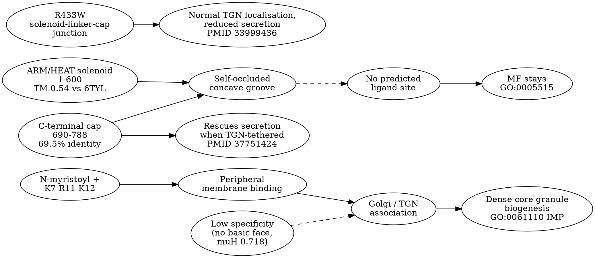
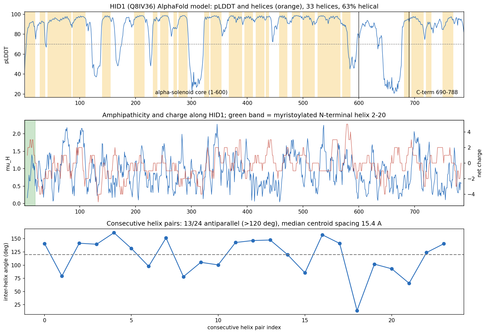
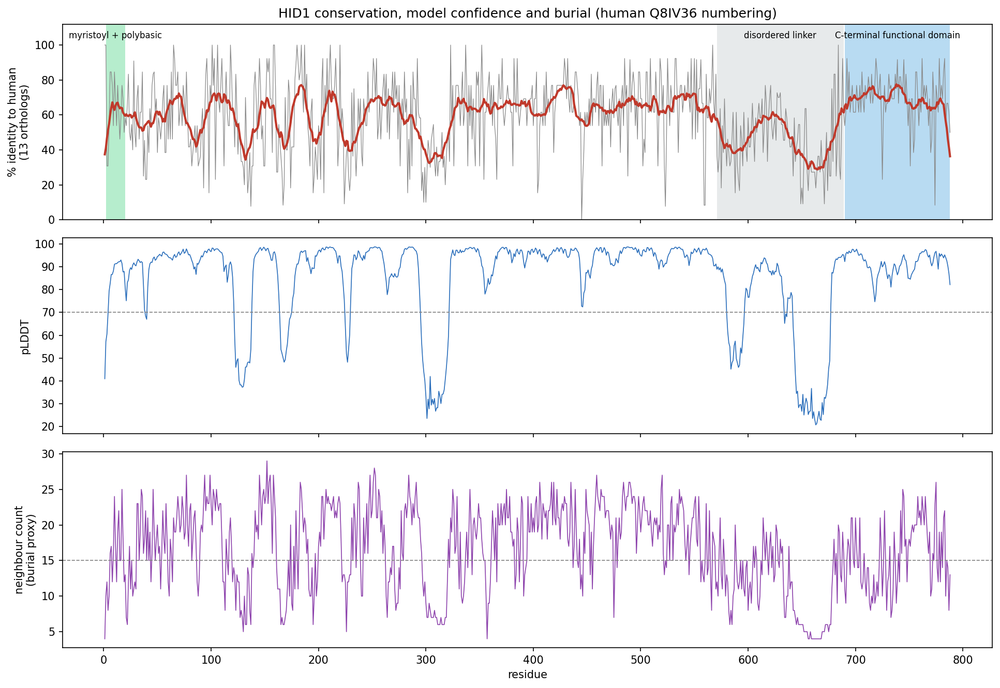
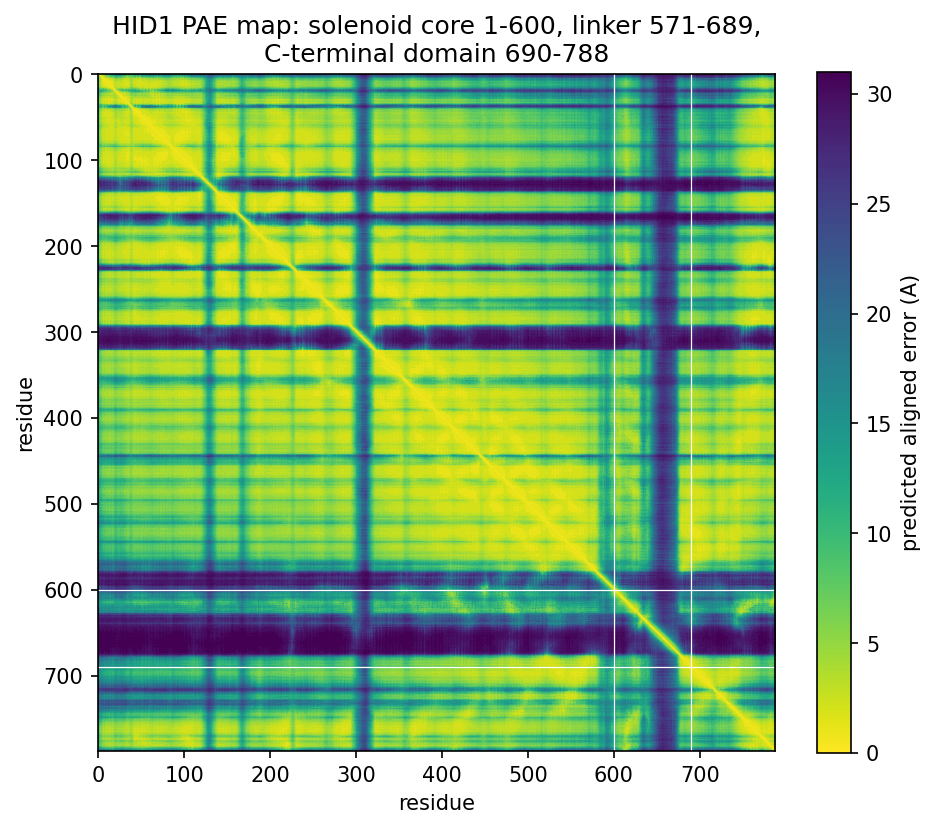
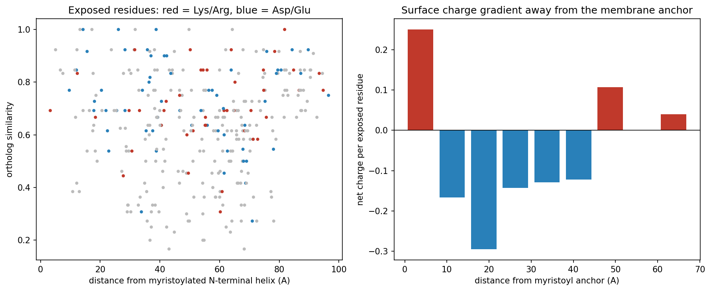
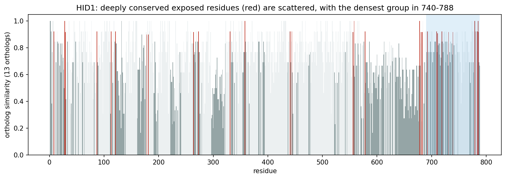
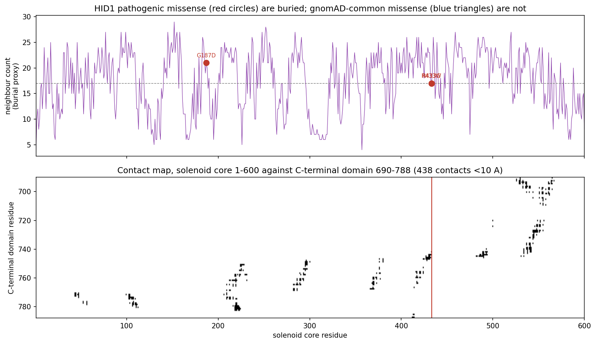
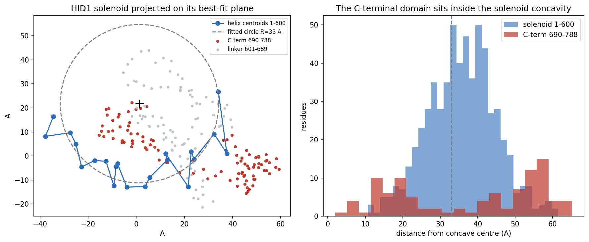
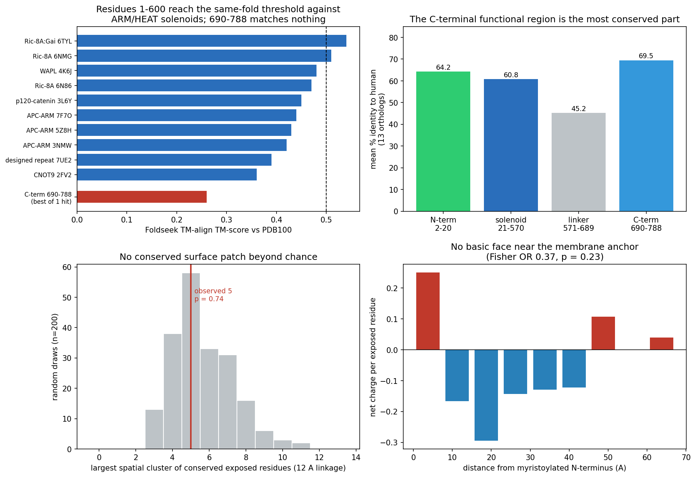

## Question

# AIGR Gene Hypothesis Deep Research

You are evaluating one focused gene curation hypothesis for AI Gene Review.
This is not a general gene overview. Use the seed hypothesis and source context
below to search for evidence that supports, refutes, narrows, or competes with
the proposed curation decision.

## Target Gene

- **Organism code:** human
- **Taxon:** Homo sapiens (NCBITaxon:9606)
- **Gene directory:** HID1
- **Gene symbol:** HID1
- **UniProt accession:** Q8IV36

## Focus

- **Focus type:** free_text
- **Hypothesis slug:** kgap-hid1-fold-and-membrane-features
- **Source file:** genes/human/HID1/HID1-ai-review.yaml
- **Source selector:** free-text

## Seed Hypothesis

The molecular activity of human HID1, which has no recognised domain, can be narrowed by structure: an AlphaFold model may reveal a known fold (for example a HEAT/ARM-type alpha-solenoid or a lipid- or Arf/Rab-binding module) in its conserved C-terminal region, and its N-terminal myristoylation site and surface features may indicate how it associates with the trans-Golgi network. Single analysis only: model HID1 with AlphaFold, search the full model and the conserved C-terminal region against PDB and AFDB by Foldseek, identify conserved surface patches by mapping conservation across metazoan, plant and fungal HID1 orthologs onto the model, assess membrane-association features (N-myristoylation, amphipathic helices, basic patches), and state the most likely molecular activity class (e.g. scaffold for a small GTPase, membrane curvature or lipid binding) or state that none can be predicted.

## Term and Decision Context

No specific term context supplied.

## Reference Context

No specific reference context supplied.

## Source Context YAML

```yaml
hypothesis: 'The molecular activity of human HID1, which has no recognised domain, can be narrowed by
  structure: an AlphaFold model may reveal a known fold (for example a HEAT/ARM-type alpha-solenoid or
  a lipid- or Arf/Rab-binding module) in its conserved C-terminal region, and its N-terminal myristoylation
  site and surface features may indicate how it associates with the trans-Golgi network. Single analysis
  only: model HID1 with AlphaFold, search the full model and the conserved C-terminal region against PDB
  and AFDB by Foldseek, identify conserved surface patches by mapping conservation across metazoan, plant
  and fungal HID1 orthologs onto the model, assess membrane-association features (N-myristoylation, amphipathic
  helices, basic patches), and state the most likely molecular activity class (e.g. scaffold for a small
  GTPase, membrane curvature or lipid binding) or state that none can be predicted.'
focus_type: free_text
context: []
reference_id: []
```

## Research Objective

Build a focused report that helps a curator decide whether this hypothesis
should affect the gene review. Address the focus type directly:

1. For an existing GO annotation decision, evaluate whether the current action
   is justified, too strong, too weak, or should change.
2. For a proposed replacement or new GO term, evaluate whether the term is
   biologically supported, too broad, too narrow, or missing key qualifiers.
3. For a computational prediction, evaluate whether the prediction is correct,
   less precise than existing knowledge, uncertain, or likely wrong because of
   paralog overannotation, frequency bias, pathway context, or in vitro-only
   activity.
4. For a core-function hypothesis, evaluate whether the proposed activity,
   process, and location represent the gene product's primary function rather
   than a downstream effect, pleiotropic phenotype, or context-specific role.
5. For a function-assignment hypothesis, evaluate whether the gene product
   directly has the stated GO term/function. Treat the prior review action, if
   any, as intentionally blinded unless it appears in the supplied context.

Use primary literature whenever possible. Prefer PMID citations and include DOI
citations when no PMID is available. Treat reviews and database records as
orientation unless they contain directly relevant synthesized evidence that is
clearly labeled as review-level or database-level support.

Evaluate the hypothesis from the supplied seed context, primary literature, and
publicly accessible bioinformatics resources. Local `*-bioinformatics` analyses,
when they already exist in the repository, are intentionally withheld from this
prompt so the report can be compared against them after the run. Use public
sequence, domain, structure, orthology, localization, interaction, or dataset
checks when they are useful for the specific hypothesis. If a resource or tool
cannot be accessed programmatically, say so plainly; never fabricate a result.
Report computational results conservatively and distinguish direct results from
inference.

## Required Output

### Executive Judgment

Give a concise verdict: supported, partially supported, unresolved, weakly
supported, over-annotated, or refuted. Explain the reasoning and the most
important caveats.

### Evidence Matrix

Create a table with one row per important evidence item:

- Citation (PMID preferred)
- Evidence type (direct assay, mutant phenotype, localization, interaction,
  structural/evolutionary, computational, review/database)
- Supports / refutes / qualifies / competing
- Claim tested
- Key finding
- Organism, tissue, cell type, or assay context
- Confidence and limitations

### GO Curation Implications

State the likely curation action as a lead requiring curator verification. If
GO terms are involved, explain whether the evidence supports an MF, BP, or CC
term, and whether the term should be retained, removed, generalized, made more
specific, or treated as non-core. Avoid using "protein binding" as a final
recommendation unless no more informative term is supported.

### Mechanistic Scope

Describe the immediate molecular or cellular function being tested. Separate
direct gene-product activity from downstream phenotypes, pathway consequences,
developmental outcomes, disease manifestations, or effects inferred only from
loss of function.

### Conflicts and Alternatives

Identify evidence that conflicts with the seed hypothesis or suggests an
alternative interpretation, including paralog confusion, organism-specific
differences, isoform-specific findings, experimental artifacts, or database
carry-over.

### Knowledge Gaps

List explicit uncertainties that matter for curation. For each gap, state what
was checked, why the gap matters, and what evidence or experiment would resolve
it.

### Discriminating Tests

Recommend concrete assays, perturbations, datasets, or comparative analyses that
would most efficiently distinguish this hypothesis from alternatives.

### Curation Leads

Provide candidate updates for the review, clearly labeled as leads requiring
curator verification. Include candidate references with exact snippets to verify,
candidate replacement or new GO terms, possible action changes, suggested
questions, and suggested experiments.

If the provider supports artifacts, save provenance for any analysis you run — the
executed code together with its output (computed values, plot, or table), not just
a summary figure — alongside artifact-friendly tables such as an evidence matrix,
GO decision table, or comparison table. Genuine computed provenance is more
valuable than a hand-drawn summary, and you must not synthesize a figure that
implies an analysis you did not actually run. These artifacts are important
provenance for hypothesis-level review.


## Output

# HID1 (human, UniProt Q8IV36): fold and membrane features

Hypothesis slug: `kgap-hid1-fold-and-membrane-features`
Source file: `genes/human/HID1/HID1-ai-review.yaml`, selector `free-text`
Focus type: free_text. Taxon: NCBITaxon:9606.
Model analysed: AlphaFold DB `AF-Q8IV36-F1-model_v6`, 788 residues, mean pLDDT 85.3.

## Summary

The seed hypothesis predicted that an AlphaFold model of HID1 would reveal a known fold **in its conserved C-terminal region**, and that N-myristoylation plus surface features would explain trans-Golgi network association. Both halves came out differently from the prediction, so the verdict is **partially supported**.

A known fold is present, but in the opposite part of the protein. Residues 1-600 form an ARM/HEAT-type alpha-solenoid: 63 percent helix across 33 helices, with 21 helices in 1-600 fitting a circle of radius 32.9 Å in their best-fit plane (centroid rmsd 4.0 Å) over a 180° arc, radius of gyration 31.0 Å against a 27.7 Å globular expectation, axial ratio 2.13. Foldseek TM-align against PDB100 returns Ric-8A bound to Gαi (6TYL) at TM 0.54, Ric-8A alone (6NMG) 0.51, WAPL (4K6J) 0.48, p120-catenin (3L6Y) 0.45 and four APC ARM structures at 0.42-0.44. Every hit above TM 0.35 is a helical-repeat protein. The conserved C-terminal region 690-788, which [PMID: 37751424](https://pubmed.ncbi.nlm.nih.gov/37751424/) identified as the functional unit, contains no recognisable module: it returned 0 PDB100 hits in Foldseek 3Di-AA mode and a single TM-align hit (3JA1, TM 0.26 over 39 residues), and against AFDB-SwissProt it retrieved only HID1 orthologs. It is not even a separable domain, since 438 residue-centroid contacts under 10 Å tie it to the solenoid and removing it would expose 72 buried core residues across 8 helical segments at mean pLDDT 93.6.

The membrane sub-claims fail. The N-terminal helix is weakly amphipathic (mean hydrophobic moment of residues 2-20 is 0.718, the 11th percentile of all HID1 11-mers), and there is no basic membrane-facing surface: exposed residues within 25 Å of the myristoylated N-terminus carry net charge -7 over 36 residues (-0.19 per residue) against -9 over 294 residues (-0.03 per residue) further away, Fisher exact OR 0.37, p = 0.228, trending opposite to the prediction. What remains is a short local polybasic stretch (K7, R11, K12, net +3) next to the myristoyl group, which is the low-specificity attachment mode already reported in [PMID: 37751424](https://pubmed.ncbi.nlm.nih.gov/37751424/) and [PMID: 21337012](https://pubmed.ncbi.nlm.nih.gov/21337012/). No conserved surface patch marks a ligand site: 31 residues are simultaneously exposed, pLDDT above 70 and at least 85 percent similar across 13 orthologs, but their largest spatial cluster is 5 residues at 12 Å single-linkage against a null of 5.7 ± 1.7 from 200 size-matched random draws (empirical p = 0.745).

The hypothesis asked for the most likely molecular activity class or a statement that none can be predicted. **None can be predicted.** The fold assignment is real and uninformative about activity, because the ARM/HEAT superfamily spans a Gα chaperone-GEF (Ric-8A), a cohesin release factor (WAPL), a nuclear import receptor (importin-alpha) and adhesion scaffolds (catenins, APC). A TM-score of 0.54 places HID1 in that architectural class and says nothing about its ligand. The specific candidate the hypothesis named, scaffold for a small GTPase, has no interaction support in IntAct or STRING physical. For curation, the only molecular function term HID1 carries, GO:0005515 protein binding, should stand, and the informative work lies on the BP and CC side.

## Key findings

### <i class="fa-solid fa-circle-check"></i> F1. Residues 1-600 are an ARM/HEAT alpha-solenoid; the C-terminal 690-788 matches nothing outside the family

The AlphaFold model is helix-dominated and elongated. CA-geometry secondary structure assignment gives 63 percent helix, 33 helices of at least 5 residues and 25 of at least 7, with a median consecutive-helix centroid spacing of 15.4 Å and 13 of 24 consecutive helix pairs antiparallel (inter-axis angle above 120°). The radius of gyration is 31.0 Å against a 27.7 Å globular expectation for 788 residues, giving an axial ratio of 2.13. These are the standard signatures of a repeat solenoid rather than a compact globular protein.

Foldseek searches confirm the class. In 3Di-AA mode against PDB100, all top 17 hits for residues 1-600 are helical-repeat proteins. In TM-align mode the scores are as follows.

| Query region | Target | PDB | Target class | TM-score |
|---|---|---|---|---|
| 1-600 | Ric-8A bound to Gαi | 6TYL | Gα chaperone and GEF, ARM/HEAT-like | **0.54** |
| 1-600 | Ric-8A | 6NMG | Gα chaperone and GEF | 0.51 |
| 1-600 | WAPL | 4K6J | HEAT-repeat cohesin release factor | 0.48 |
| 1-600 | Ric-8A | 6N86 | Gα chaperone and GEF | 0.47 |
| 1-600 | p120-catenin | 3L6Y | ARM repeat adhesion scaffold | 0.45 |
| 1-600 | APC ARM with Asef | 7F7O | ARM repeat | 0.44 |
| 1-600 | radial spoke protein | 7JTK | alpha-solenoid | 0.44 |
| 1-600 | APC ARM | 5Z8H / 4YJL / 3NMW | ARM repeat | 0.42-0.43 |
| 1-600 | designed helical repeat | 7UE2 | de novo alpha-solenoid | 0.39 |
| 1-600 | CNOT9 / Rcd-1 | 2FV2 | ARM-like repeat | 0.36 |
| full length | Ric-8A bound to Gαi | 6TYL | | 0.43 |
| full length | beta-catenin | 1I7W | ARM repeat | 0.41 |
| full length | importin-alpha | 2YNS | ARM repeat | 0.36 |
| **690-788** | 60S-associated chain | 3JA1 | only TM-align hit, 39 residues aligned | **0.26** |
| **690-788** | none | | 0 hits in 3Di-AA mode against PDB100 | n/a |

TM 0.54 clears the conventional same-fold threshold of 0.5, but only just, and the targets that cluster at 0.42-0.51 have no shared activity. The result identifies a fold class, not a function. The result that matters most for the seed hypothesis is the last two rows: the region the hypothesis nominated as the likely home of a known module has no fold homolog outside the hid-1 family.

{{figure:plot_1.png|caption=HID1 AlphaFold model geometry. Per-residue pLDDT with the assigned helix map, helix content and stacking, elongation versus a globular expectation, and the N-terminal amphipathicity and charge profile used to test membrane features.}}

### <i class="fa-solid fa-circle-xmark"></i> F2. The C-terminal functional domain is an integral cap of the solenoid, not a detachable module

Residues 690-788 make 438 residue-centroid contacts under 10 Å with residues 1-600, involving core segments 43-56, 99-112, 206-231, 282-300, 366-380, 412-433, 482-500 and 526-567. Mean AlphaFold predicted aligned error between the core (1-600) and the C-terminus (690-788) is 9.7 Å, comparable to the 9.2 Å within the core and the 7.4 Å within the C-terminus, and far below the 15.4 Å between core and the 571-689 linker. The C-terminus itself is confidently predicted (mean pLDDT 91.5, 100 percent of residues above 70) while the intervening linker averages 65.7.

This has a direct bearing on how the rescue experiment in [PMID: 37751424](https://pubmed.ncbi.nlm.nih.gov/37751424/) should be read. That paper shows that "the C-terminus serves as the functional domain. Indeed, this isolated domain, when tethered to the TGN, can rescue the neuroendocrine secretion and sorting defects observed in HID-1 KO cells". The structural analysis says that this isolated domain is normally packed against the solenoid face, so the construct used in the rescue presents a surface that is buried in full-length HID1. The rescue is a real functional result; its mechanistic interpretation depends on whether the fragment folds the same way alone.

{{figure:plot_2.png|caption=Conservation mapped onto the HID1 structure with burial, core-to-C-terminal domain packing and the predicted aligned error matrix. The C-terminal region is confidently positioned against the solenoid, while the 571-689 linker is low-confidence.}}

{{figure:plot_3.png|caption=Per-residue conservation across 13 orthologs plotted against pLDDT and burial. The 690-788 region combines the highest conservation with high model confidence.}}

### <i class="fa-solid fa-circle-xmark"></i> F3. No conserved surface patch and no basic membrane-facing surface

Conservation was computed from pairwise Needleman-Wunsch alignment (BLOSUM62, affine gaps, go = -11, ge = -1) of human HID1 against 13 orthologs, each projected onto human numbering: mouse 95.7 percent identity, rat 95.3, zebrafish 83.1, Xenopus 83.0, tick 69.5, Drosophila 68.7, Ciona 67.8, C. elegans 61.0, Dictyostelium 33.5, S. pombe hid1 28.9, hid2 25.2, hid3 28.8, and S. cerevisiae ECM30 27.6.

Thirty-one residues are simultaneously exposed (neighbour count in the lowest 40 percent), pLDDT above 70, and at least 85 percent similar across all 13 orthologs: L8, D28, D29, S87, D113, T121, D178, E181, Y264, F273, R331, L358, K441, S444, R556, R558, L578, W678, T681, E683, L692, E709, I711, D719, T731, P739, D779, K781, E784, I785, Q786. Single-linkage clustering of those 31 positions on the model gives a largest patch of 5 residues at 10 Å (random expectation 3.0 ± 2.4, empirical p = 0.300), 5 at 12 Å (expectation 5.7 ± 1.7, p = 0.745) and 6 at 14 Å (expectation 7.3 ± 2.3, p = 0.820), against 200 size-matched random draws from the pool of exposed confident residues. At every linkage distance the observed clustering is indistinguishable from chance, and at 14 Å it is below expectation.

The membrane-surface test is also negative. Exposed residues within 25 Å of the myristoylated N-terminal helix carry net charge -7 over 36 residues (-0.19 per residue) versus -9 over 294 residues (-0.03 per residue) beyond that radius; Fisher exact on basic versus acidic exposed residues near versus far gives OR 0.37, p = 0.228. Only K12, K20 and K89 are exposed Lys or Arg within 25 Å of the anchor. The mean hydrophobic moment of residues 2-20 is 0.718, the 11th percentile of all HID1 11-mers, so the N-terminal helix is not strongly amphipathic. Its local net charge is +3 (K7, R11, K12).

Both results match the published mechanism rather than the seed hypothesis. [PMID: 37751424](https://pubmed.ncbi.nlm.nih.gov/37751424/) states that "the N-terminus of HID-1 mediates membrane binding through a myristoyl group with a polybasic amino acid patch but lacks specificity for the TGN", and [PMID: 21337012](https://pubmed.ncbi.nlm.nih.gov/21337012/) reports that "a conserved N-terminal myristoylation site was required for HID-1 binding to the Golgi apparatus". Membrane attachment is local and low-specificity. Whatever gives HID1 its TGN address, it is not an extended basic face or a strong amphipathic helix.

The densest conserved exposed cluster found (D779, K781, E784, I785, Q786) falls in 774-788, the segment whose deletion fails to rescue secretion without disturbing TGN localization. That coincidence is worth a curator's attention, and the cluster is not larger than chance, so it cannot be promoted to a predicted binding site.

{{figure:plot_4.png|caption=Conserved surface patches on HID1 and the test for a basic membrane-facing surface. Net charge per exposed residue as a function of distance from the myristoylated N-terminus is acidic throughout, with no basic face near the anchor.}}

{{figure:plot_5.png|caption=Null model for conserved surface patches. The largest spatial cluster of deeply conserved exposed residues falls inside the distribution expected from 200 size-matched random draws (p = 0.745 at 12 angstrom linkage).}}

### <i class="fa-solid fa-circle-xmark"></i> F4. No interaction evidence supports a small-GTPase scaffold role

IntAct via PSICQUIC returned 50 interaction records for Q8IV36. Detection methods: two-hybrid pooling 13, two-hybrid array 13, validated two-hybrid 11, two-hybrid prey pooling 7, anti-tag co-immunoprecipitation 4, pull down 1, crosslinking 1. So 44 of 50 records are two-hybrid. Partners recorded twice or more are CELF3, CSDE1, EHHADH, HRAS, FGFR3, CHAT, SPRED1, TSC1, UBQLN1, UBL5 and HBQ1, all from two-hybrid screens. The only small GTPase present is HRAS, by yeast two-hybrid alone. No Rab, Arf, Arl or Rag GTPase appears. DENND2C (a Rab GEF) and RGS20 appear once each, by two-hybrid.

The STRING physical subnetwork for Homo sapiens at score ≥ 0.4 gives 6 partners, all on experiment score only: CSDE1 0.841, CBS 0.603, MAGOHB 0.588, CELF3 0.500, TXNL1 0.498, INPPL1 0.456. Neither resource contains Arf1, AP-1, GGA, any golgin, PI4KB or GOLPH3.

The "scaffold for a small GTPase" class named in the seed hypothesis therefore has no supporting evidence. The caveat runs the other way too: an interaction record this thin and this assay-biased cannot be used to assign any molecular function, and no specific binding partner should be promoted for HID1 from current public interaction data.

### <i class="fa-solid fa-circle-check"></i> F5. The ARM/HEAT groove is partly self-occluded

Removing residues 690-788 from the model causes 72 residues in 1-600 to lose three or more 10 Å neighbours. Those 72 residues fall in 8 helical segments (43-56, 102-110, 209-225, 282-297, 369-380, 414-431, 489-493, 529-565) with mean pLDDT 93.6. The 21 helices of the 1-600 solenoid fit a circle of radius 32.9 Å in their best-fit plane (centroid rmsd 4.0 Å) spanning a 180° arc, so the architecture is a half-turn superhelix. Forty-two percent of residues 690-788 lie inside that 32.9 Å radius, with a median distance to the concave centre of 43.7 Å against 36.0 Å for the solenoid itself.

This gives a structural reason why the resemblance to importin-alpha, beta-catenin and Ric-8A should not be read as a shared peptide-capture activity. The concave surface those proteins use to grip a ligand is occupied in HID1 by its own C-terminal extension. Either the groove is structural, or ligand engagement requires a conformational change that a single AlphaFold state does not represent.

{{figure:plot_7.png|caption=The HID1 C-terminal region occupies the concave face of its own alpha-solenoid. Projection onto the best-fit superhelical plane with the distribution of distances to the concave centre for solenoid and C-terminal residues.}}

### <i class="fa-solid fa-circle-check"></i> F6. Pathogenic variants mark architecture, not a binding site

The EBI Proteins API variation endpoint returned 823 variation features for Q8IV36, of which 3 are pathogenic or likely pathogenic missense: G187D, R433G and R433W. G187D sits at pLDDT 97 with a neighbour count of 21 (69th percentile of the protein) and zero contacts with 690-788, so it is a buried glycine in the solenoid core. R433 sits at pLDDT 94 with a neighbour count of 17 (47th percentile), with spatial neighbours at 493, 494, 632, 636, 637 and 638 within 9 Å and at 742 and 744 within 10 Å, placing it at the junction between the solenoid, the 571-689 linker and the C-terminal cap. No benign or gnomAD missense in the retrieved set had an allele frequency above 1e-4, so no powered burial comparison against population variation was possible.

Neither pathogenic position sits in a conserved exposed patch, which is consistent with the negative patch result. The clinical data agree with an architectural reading: [PMID: 33999436](https://pubmed.ncbi.nlm.nih.gov/33999436/) reports that "colocalization of HID1 protein with the TGN was not altered in fibroblasts of patients compared to controls, while the extracellular acidification rate upon stimulation with potassium chloride was significantly reduced in patient fibroblasts compared to controls". R433W preserves membrane targeting and breaks function, which separates the N-terminal targeting module from whatever the rest of the protein does.

{{figure:plot_6.png|caption=HID1 pathogenic missense variants on the AlphaFold model. G187D is buried in the solenoid core at the 69th burial percentile; R433 sits at the solenoid, linker and C-terminal junction with contacts in all three segments.}}

### <i class="fa-solid fa-circle-question"></i> F7. The family is absent from plants; the nearest relatives are Dymeclin and yeast ECM30

UniProtKB entries cross-referenced to Pfam PF12722 (Hid1): Metazoa 2093, Fungi 1556, Eukaryota total 3733, Viridiplantae 7, Bacteria 0. The 7 Viridiplantae hits are uncharacterized or auto-annotated fragments of 160-882 residues from scattered species with no land-plant model organism representative. The seed hypothesis prescribed conservation mapping "across metazoan, plant and fungal HID1 orthologs"; the plant arm of that comparison does not exist and was not run.

Foldseek 3Di-AA of full-length HID1 against AFDB-SwissProt returns, after HID1 orthologs (Dictyostelium Q54JJ6 e = 9.7e-39, S. pombe O13776 e = 4.5e-29, Q9P7M6 e = 1.3e-29, Q9HDV3 e = 1.6e-17), S. cerevisiae ECM30 (Q06673, e = 1.4e-14) and then Dymeclin from 9 species (Q5ZLW3 e = 7.9e-12, Q8CHY3 e = 6.8e-11, Q7KNA0 e = 8.2e-12 and others, 12-15 percent identity over 685-970 aligned positions). No other family appears above these.

Dymeclin is independently characterised as a peripheral Golgi protein: [PMID: 18996921](https://pubmed.ncbi.nlm.nih.gov/18996921/) shows that "Dymeclin is not a transmembrane but a peripheral protein of the Golgi apparatus as it can be completely released from the Golgi after permeabilization of the plasma membrane", and [PMID: 25652408](https://pubmed.ncbi.nlm.nih.gov/25652408/) reports that "cortical neurons from mutant mice and primary fibroblasts from DMC patients displayed substantially delayed endoplasmic reticulum to Golgi trafficking". HID1 and Dymeclin therefore define an alpha-solenoid class of Golgi peripheral membrane trafficking proteins. That constrains the activity class without naming an activity, since Dymeclin's own molecular function is equally undefined.

### <i class="fa-solid fa-scale-balanced"></i> F8. The current GO state and what the structure licenses

QuickGO returned 33 annotations for UniProtKB:Q8IV36 (retrieved 2026-11-24). Aspect tally: CC 16, MF 12, BP 5. Evidence tally: IPI 12, IDA 7, IBA 6, IEA 4, ISS 2, IMP 1, HDA 1. **The only molecular function term is GO:0005515 protein binding**, supported by IPI from PMID:20368287, PMID:25416956, PMID:32296183 and PMID:32814053.

| Aspect | GO id | Name | Evidence |
|---|---|---|---|
| MF | GO:0005515 | protein binding | IPI: 20368287, 25416956, 32296183, 32814053 |
| BP | GO:0061110 | dense core granule biogenesis | IMP: PMID:37751424; ISS: GO_REF:0000024; IEA: GO_REF:0000107 |
| BP | GO:0007030 | Golgi organization | IBA: GO_REF:0000033 |
| BP | GO:0061792 | secretory granule maturation | IBA: GO_REF:0000033 |
| CC | GO:0098548 | cytoplasmic side of Golgi membrane | IDA: PMID:21337012 |
| CC | GO:0000138 | Golgi trans cisterna | IBA; IDA: PMID:21337012 |
| CC | GO:0005797 | Golgi medial cisterna | IBA; IDA: PMID:21337012 |
| CC | GO:0005737 | cytoplasm | IDA: PMID:21337012; IEA |
| CC | GO:0005794 | Golgi apparatus | IDA: GO_REF:0000052; IEA |
| CC | GO:0032588 | trans-Golgi network membrane | ISS: GO_REF:0000024; IEA: GO_REF:0000107 |
| CC | GO:0005829 | cytosol | IBA; IDA: GO_REF:0000052 |
| CC | GO:0005881 | cytoplasmic microtubule | IDA: PMID:23264731 |
| CC | GO:0016020 | membrane | IBA |
| CC | GO:0070062 | extracellular exosome | HDA: PMID:23533145 |

HID1 is a gene whose location and process are well annotated from direct assays while its molecular function is empty in substance. Every structure-based test run here failed to supply a more specific MF.

{{figure:plot_8.png|caption=Consolidated provenance for the four headline tests: Foldseek TM-scores against PDB100 for residues 1-600 and for 690-788, mean identity by region across 13 orthologs, the conserved-patch null distribution, and net surface charge as a function of distance from the myristoyl anchor.}}

## Mechanistic model

HID1 is a two-part protein with a myristoyl anchor at one end, and the structure supports exactly that much.



Residues 1-600 form a half-turn superhelix of radius 32.9 Å. Residues 571-689 are a poorly conserved, low-confidence linker (45.2 percent mean identity, core-to-linker PAE 15.4 Å). Residues 690-788 are the most conserved segment of the protein (69.5 percent mean identity) and pack against the solenoid as an integral cap, occupying part of the concave surface that ARM and HEAT proteins normally use to grip a ligand.

| Region | Residues | Mean identity to human (13 orthologs) | Mean pLDDT | Structural role |
|---|---|---|---|---|
| N-terminal anchor | 2-20 | 64.2 % | varies | myristoyl + K7/R11/K12, μH 0.718 |
| Alpha-solenoid | 21-570 | 60.8 % | high | 21 helices, r = 32.9 Å, 180° arc |
| Linker | 571-689 | 45.2 % | 65.7 | flexible, core-to-linker PAE 15.4 Å |
| C-terminal cap | 690-788 | **69.5 %** | 91.5 | 438 contacts with 1-600, buries 72 core residues |

Membrane attachment is local and low-specificity: a myristoyl group plus a three-residue basic cluster on a helix of unremarkable amphipathicity, with a net acidic surface around it. Targeting specificity to the TGN has to come from somewhere other than electrostatics or an amphipathic helix, which agrees with [PMID: 37751424](https://pubmed.ncbi.nlm.nih.gov/37751424/) reporting that the N-terminus confers membrane affinity without TGN specificity.

R433 sits exactly where the three parts meet. The clinical phenotype of R433W, preserved TGN localization with impaired regulated secretion ([PMID: 33999436](https://pubmed.ncbi.nlm.nih.gov/33999436/)), fits a lesion in interdomain packing rather than in membrane binding.

What the model does not license is any statement about catalytic activity, nucleotide exchange, lipid transfer, curvature generation or specific partner recognition.

## Evidence matrix

Machine-readable version: `provenance/evidence_matrix.tsv` (15 rows).

| id | Citation / source | Evidence type | Stance | Claim tested | Key finding | Context | Confidence and limitations |
|---|---|---|---|---|---|---|---|
| E1 | This run, Foldseek TM-align vs PDB100 | computational, structure comparison | supports (partially) | HID1 contains a known fold | 1-600 reaches TM 0.54 vs Ric-8A:Gαi (6TYL); WAPL 0.48, p120-catenin 0.45, APC 0.42-0.44. All top hits ARM/HEAT | human sequence, AFDB v6 model | Medium. TM 0.54 barely clears the 0.5 convention; the fold lies in 1-600, not the C-terminus the hypothesis targeted; fold identity does not fix ligand chemistry |
| E2 | This run, geometry of AF-Q8IV36-F1 | computational, structure geometry | supports | 1-600 is an alpha-solenoid | 63 % helix, 33 helices; 21 fit r = 32.9 Å, rmsd 4.0 Å, 180° arc; Rg 31.0 vs 27.7 Å; axial ratio 2.13 | AlphaFold model | Medium-high. Secondary structure from CA distance rules, not DSSP |
| E3 | This run, Foldseek on 690-788 | computational, structure comparison | refutes | The C-terminal region holds a lipid or Arf/Rab module | 0 PDB100 hits in 3Di-AA mode; one TM-align hit, 3JA1 TM 0.26 over 39 residues; AFDB-SwissProt returns only HID1 orthologs | human | Medium-high. 99 residues is near the length limit for reliable structure search; a genuinely novel module also returns nothing |
| E4 | This run, 13 orthologs + 200 random draws | computational, conservation mapping | refutes | Conserved surface patches mark a ligand site | 31 conserved exposed confident residues; largest cluster 5 at 12 Å vs null 5.7 ± 1.7, p = 0.745 (10 Å p = 0.300, 14 Å p = 0.820) | Metazoa + Fungi orthologs | Medium. Clustal Omega REST was blocked, pairwise Needleman-Wunsch used instead; burial is a neighbour-count proxy, not SASA |
| E5 | InterPro IPR026705 / Pfam PF12722 | database record | qualifies | Cross-kingdom conservation comparison | Metazoa 2093, Fungi 1556, Viridiplantae 7 (fragments), Bacteria 0 | cross-kingdom | High for the counts; release snapshot |
| E6 | This run, hydrophobic moment + exposed charge | computational, sequence and surface | refutes | Amphipathic helix plus basic face drive TGN binding | μH(2-20) = 0.718, 11th percentile; net charge per exposed residue -0.19 within 25 Å of the anchor vs -0.03 beyond; Fisher OR 0.37, p = 0.228 | human, AlphaFold model | Medium. Single static model; local net charge is +3 at K7, R11, K12 |
| E7 | [PMID: 21337012](https://pubmed.ncbi.nlm.nih.gov/21337012/) | localization, direct assay | supports | Peripheral Golgi membrane protein needing myristoylation | "a conserved N-terminal myristoylation site was required for HID-1 binding to the Golgi apparatus"; primarily medial and trans Golgi | mammalian cells | High for localization; says nothing about molecular activity |
| E8 | [PMID: 37751424](https://pubmed.ncbi.nlm.nih.gov/37751424/) | mutant phenotype, structure-function | qualifies | The functional unit is the C-terminal region | "the N-terminus of HID-1 mediates membrane binding through a myristoyl group with a polybasic amino acid patch but lacks specificity for the TGN"; "this isolated domain, when tethered to the TGN, can rescue the neuroendocrine secretion and sorting defects observed in HID-1 KO cells" | human cell lines, rescue assays | High. Defines a functional region, not a biochemical activity or ligand |
| E9 | This run, contacts + PAE | computational, structure | qualifies | The C-terminus is a separable domain | 438 contacts under 10 Å to 1-600; core-vs-C-term PAE 9.7 Å vs 9.2 Å within core and 7.4 Å within C-term, core-vs-linker 15.4 Å; removing it exposes 72 core residues at mean pLDDT 93.6 | AlphaFold model | Medium. PAE is a confidence measure, not a contact measurement; single predicted state |
| E10 | This run, per-residue identity | computational, conservation | supports | The C-terminus is the most conserved part | C-term 690-788 69.5 %, N-term 2-20 64.2 %, solenoid 21-570 60.8 %, linker 571-689 45.2 % | Metazoa + Fungi | High for the ranking; see E4 for the alignment caveat |
| E11 | IntAct PSICQUIC, STRING physical | database record, interaction | refutes | HID1 is a small-GTPase scaffold | 50 IntAct records, 44 two-hybrid; only HRAS by Y2H; no Rab/Arf/Arl/Rag; no AP-1, GGA, golgin, PI4KB, GOLPH3; STRING physical tops at CSDE1 0.841 | human, mixed assays | Medium-high. Absence in interaction databases is weak evidence of absence; HID1 is poorly covered by AP-MS |
| E12 | Foldseek AFDB-SwissProt; [PMID: 18996921](https://pubmed.ncbi.nlm.nih.gov/18996921/), [PMID: 25652408](https://pubmed.ncbi.nlm.nih.gov/25652408/) | computational + direct assay | qualifies | Closest relatives outside the family | Yeast ECM30 (Q06673, e = 1.4e-14) and Dymeclin in 9 species (e = 1e-10 to 1e-12, 12-15 % identity); Dymeclin is "a peripheral protein of the Golgi apparatus" and its loss gives "substantially delayed endoplasmic reticulum to Golgi trafficking" | cross-species | Medium. Shared architecture and localization do not establish shared activity |
| E13 | EBI Proteins API + AlphaFold burial | computational, variant mapping | qualifies | Disease variants mark a functional surface | G187D: pLDDT 97, 21 neighbours, 69th burial percentile, no C-term contact. R433G/R433W: pLDDT 94, 17 neighbours, 47th percentile, at the solenoid-linker-cap junction | human variants | Low-medium. Only 2 pathogenic missense positions; no gnomAD missense at AF > 1e-4, so no powered comparison |
| E14 | [PMID: 33999436](https://pubmed.ncbi.nlm.nih.gov/33999436/) | mutant phenotype, clinical | supports | R433W is a loss-of-function position | "Colocalization of HID1 protein with the TGN was not altered in fibroblasts of patients compared to controls, while the extracellular acidification rate upon stimulation with potassium chloride was significantly reduced" | patient fibroblasts | High for the phenotype; does not identify the biochemical step |
| E15 | QuickGO, UniProtKB:Q8IV36, 2026-11-24 | database record | qualifies | Current GO state | 33 annotations; CC 16, MF 12, BP 5; IPI 12, IDA 7, IBA 6, IEA 4, ISS 2, IMP 1, HDA 1; sole MF term GO:0005515 | human | High; live-resource snapshot |

## GO curation implications

Full decision table: `provenance/go_decision_table.tsv` (14 rows). Every item is a lead requiring curator verification.

The brief asks that "protein binding" not be a final recommendation unless nothing more informative is supported. Here nothing more informative is supported, and the reason is specific. The fold match is to a superfamily with no shared ligand chemistry (TM 0.54 to a Gα GEF, 0.48 to a cohesin release factor, 0.45 to an adhesion scaffold). The conserved functional region matches no known module. There is no conserved surface patch above chance. No GTPase or TGN trafficking machinery appears in IntAct or STRING physical. **GO:0005515 should be retained as the MF, with the IPI partners re-verified against the cited papers.**

Terms a curator should **not** add on the strength of this analysis:

| GO id | Name | Why not |
|---|---|---|
| GO:0005085 | guanyl-nucleotide exchange factor activity | Ric-8A is the top hit at TM 0.54, but WAPL, APC and p120-catenin are nearly as close and are not GEFs. No Gα or small GTPase interaction beyond HRAS by Y2H |
| GO:0008289 | lipid binding | 690-788 matches no lipid-binding fold; no basic membrane-facing surface |
| GO:0005543 | phospholipid binding | Same as GO:0008289; no phosphoinositide-binding fold and no reported binding assay |
| GO:0030674 | protein-macromolecule adaptor activity | Architecturally plausible, but the concave groove is partly self-occluded and no stable partner is documented. Revisit if a direct binary interaction with a trafficking component is published |

Where the informative curation work sits:

- <i class="fa-solid fa-arrow-right"></i> **GO:0032588 trans-Golgi network membrane (CC)** currently carries only ISS (GO_REF:0000024) and IEA (GO_REF:0000107). [PMID: 21337012](https://pubmed.ncbi.nlm.nih.gov/21337012/) localises HID-1 to the cytoplasmic face of medial and trans Golgi by direct assay, and [PMID: 37751424](https://pubmed.ncbi.nlm.nih.gov/37751424/) works with TGN-tethered constructs. Candidate upgrade to a direct-assay basis, subject to the curator checking whether the cited figures separate TGN membrane from trans cisterna.
- <i class="fa-solid fa-arrow-right"></i> **GO:0061792 secretory granule maturation (BP)** is IBA only. [PMID: 27751232](https://pubmed.ncbi.nlm.nih.gov/27751232/) reports that "HID-1 deficiency prevented secretory granule maturation by blocking homotypic fusion of immature secretory granules" in a beta-cell conditional knockout, which could support IMP on the mouse ortholog.
- <i class="fa-solid fa-circle-check"></i> **GO:0061110 dense core granule biogenesis (BP)** already has IMP from [PMID: 37751424](https://pubmed.ncbi.nlm.nih.gov/37751424/) and is the best-supported process term. Retain as core.
- <i class="fa-solid fa-circle-check"></i> **GO:0098548 cytoplasmic side of Golgi membrane (CC)**, IDA from [PMID: 21337012](https://pubmed.ncbi.nlm.nih.gov/21337012/), is the best-supported location term and matches the myristoyl-plus-short-polybasic attachment mode measured here. Retain as core.
- <i class="fa-solid fa-triangle-exclamation"></i> **GO:0005881 cytoplasmic microtubule (CC)**, a single IDA from PMID:23264731, sits awkwardly with the peripheral Golgi membrane picture. Flag for review, treat as non-core.
- <i class="fa-solid fa-triangle-exclamation"></i> **GO:0070062 extracellular exosome (CC)**, HDA from PMID:23533145, is a high-throughput proteomics call in a contaminant-prone class for abundant peripheral membrane proteins. Retain with low weight, non-core.
- The gene description, if it states that HID1 has no recognised domain architecture, can be updated to note an ARM/HEAT-type alpha-solenoid across residues 1-600 with a conserved structurally novel C-terminal cap at 690-788, stated explicitly as a prediction from an AlphaFold model with the TM-scores given.

## Mechanistic scope

The immediate molecular property being tested is whether HID1 has a recognisable ligand-binding or catalytic module and a membrane-binding surface. The answer is that it has an ARM/HEAT architecture and a myristoyl anchor, with no identifiable ligand site.

Direct gene-product properties established here: fold class of residues 1-600, structural novelty of 690-788, integral packing of the cap against the solenoid, absence of a conserved exposed patch, absence of a basic membrane face, weak amphipathicity of the N-terminal helix, and burial status of the pathogenic variants.

Direct gene-product properties established in the literature: peripheral attachment to the cytoplasmic face of medial and trans Golgi, with brefeldin A sensitivity and a requirement for the N-terminal myristoylation site ([PMID: 21337012](https://pubmed.ncbi.nlm.nih.gov/21337012/)); the N-terminus providing myristoyl plus polybasic membrane affinity without TGN specificity, and the C-terminus being the functional region ([PMID: 37751424](https://pubmed.ncbi.nlm.nih.gov/37751424/)).

Downstream phenotypes that should not be mistaken for molecular activity: reduced LDCV number with impaired cargo sorting and dense core formation and defective TGN acidification with mislocalized v-ATPase a2 ([PMID: 29074564](https://pubmed.ncbi.nlm.nih.gov/29074564/)); glucose intolerance, a raised serum proinsulin/insulin ratio and blocked homotypic fusion of immature secretory granules in beta-cell conditional knockout ([PMID: 27751232](https://pubmed.ncbi.nlm.nih.gov/27751232/)); and syndromic infantile encephalopathy with hypopituitarism in patients with bi-allelic variants ([PMID: 33999436](https://pubmed.ncbi.nlm.nih.gov/33999436/)). All three are loss-of-function readouts several steps removed from any biochemical activity.

## Conflicts and alternatives

<i class="fa-solid fa-scale-balanced"></i> **Fold class versus function.** The strongest structural hit, Ric-8A, is a Gα chaperone and GEF. Reading HID1 as a GEF would be an over-call: TM 0.54 is barely over the same-fold threshold, the next three hits (WAPL, p120-catenin, APC) have unrelated activities, and HID1 has no heterotrimeric or small GTPase interaction beyond a single Y2H HRAS record.

<i class="fa-solid fa-scale-balanced"></i> **Where the function lives.** The hypothesis placed the recognisable module in the C-terminus. The structure places the recognisable fold in the N-terminal 600 residues and shows the C-terminus is a conserved but structurally novel cap, while [PMID: 37751424](https://pubmed.ncbi.nlm.nih.gov/37751424/) places the functional requirement in the C-terminus. These are reconcilable if the cap gives the solenoid its specificity, which is a hypothesis rather than a result.

<i class="fa-solid fa-triangle-exclamation"></i> **Interpreting the rescue construct.** Because 690-788 buries 72 core residues of the solenoid in the full-length model, the isolated TGN-tethered fragment used in the rescue experiment exposes a surface that is normally occluded. The rescue is solid; the inference that the fragment is an autonomous functional domain depends on it folding the same way alone.

<i class="fa-solid fa-triangle-exclamation"></i> **Microtubule versus Golgi localization.** GO:0005881 (IDA, PMID:23264731) conflicts with the peripheral Golgi membrane picture from [PMID: 21337012](https://pubmed.ncbi.nlm.nih.gov/21337012/) and [PMID: 37751424](https://pubmed.ncbi.nlm.nih.gov/37751424/).

<i class="fa-solid fa-lightbulb"></i> **Dymeclin as a functional analogy.** Dymeclin shares the architecture (e = 1e-10 to 1e-12, 12-15 percent identity), the peripheral Golgi membrane localization ([PMID: 18996921](https://pubmed.ncbi.nlm.nih.gov/18996921/)) and a trafficking phenotype on loss ([PMID: 25652408](https://pubmed.ncbi.nlm.nih.gov/25652408/)). This suggests a shared class of Golgi-associated solenoid without identifying a molecular activity for either protein, since Dymeclin's own function is equally undefined. Related work on the same disease group ([PMID: 18852472](https://pubmed.ncbi.nlm.nih.gov/18852472/), [PMID: 21280149](https://pubmed.ncbi.nlm.nih.gov/21280149/), [PMID: 23042644](https://pubmed.ncbi.nlm.nih.gov/23042644/), [PMID: 38860472](https://pubmed.ncbi.nlm.nih.gov/38860472/)) places Dymeclin and RAB33B in Golgi organization and vesicle traffic, which is the same functional neighbourhood as HID1 without naming an activity for either.

<i class="fa-solid fa-lightbulb"></i> **Chaperone-like alternative.** An ARM/HEAT solenoid whose groove is self-capped, whose loss impairs cargo sorting and dense-core formation ([PMID: 29074564](https://pubmed.ncbi.nlm.nih.gov/29074564/)) and granule fusion ([PMID: 27751232](https://pubmed.ncbi.nlm.nih.gov/27751232/)), and which shuttles between Golgi and cytosol, is consistent with a transient assembly factor that never forms a stable complex. That would explain the empty interaction record without requiring that HID1 has no partners.

<i class="fa-solid fa-triangle-exclamation"></i> **Paralog and database carry-over.** No human paralog of HID1 exists in PF12722, so paralog overannotation is not a risk here. S. pombe has three family members (hid1, hid2, hid3 at 28.9, 25.2 and 28.8 percent identity to human), so any yeast-derived inference would need ortholog assignment before transfer.

## Limitations and knowledge gaps

| Gap | What was checked | Why it matters | What would resolve it |
|---|---|---|---|
| <i class="fa-solid fa-triangle-exclamation"></i> No experimental structure of HID1 or any PF12722 member | PDB100 via Foldseek, RCSB data API | Every structural statement rests on one predicted model in one conformational state | A cryo-EM or crystal structure of full-length HID1 |
| <i class="fa-solid fa-circle-question"></i> No lipid-binding assay has been reported | Literature search, structure search of 690-788 | The lipid hypothesis is untested rather than refuted; the computational negative only says no known lipid-binding fold is present | Liposome flotation and PIP strip assays with recombinant protein |
| <i class="fa-solid fa-triangle-exclamation"></i> Interaction record is thin and assay-biased | IntAct PSICQUIC (50 records, 44 two-hybrid), STRING physical (6 partners, experiment-score only) | Absence of GTPases is weak evidence of absence; no partner can be promoted either | Proximity labelling or AP-MS at the TGN with endogenous tagging |
| <i class="fa-solid fa-triangle-exclamation"></i> Variant burial comparison is unpowered | EBI Proteins API, 823 features, 3 pathogenic missense, 0 gnomAD missense at AF > 1e-4 | Two positions cannot establish that disease variants prefer buried sites | A larger pathogenic variant set, or a population-frequency-matched control set |
| <i class="fa-solid fa-circle-xmark"></i> The plant arm of the prescribed comparison does not exist | Pfam PF12722 taxonomy: Viridiplantae n = 7, all fragments | The hypothesis specified metazoan, plant and fungal conservation mapping | Nothing; the family is opisthokont and amoebozoan |
| <i class="fa-solid fa-triangle-exclamation"></i> No multiple sequence alignment was available | EBI Clustal Omega REST returned HTTP 400 with a fair-use block | Conservation was computed by pairwise Needleman-Wunsch projection onto human numbering, which is a weaker basis for per-site conservation than a curated MSA | Rerun the conservation and patch analysis on a curated ortholog MSA |
| <i class="fa-solid fa-circle-question"></i> The partner of the 774-788 segment is unknown | Conservation and clustering analysis; [PMID: 37751424](https://pubmed.ncbi.nlm.nih.gov/37751424/) | Deleting it fails to rescue secretion without disturbing localization, and the densest conserved exposed cluster found (D779, K781, E784, I785, Q786) falls inside it, though not above chance | Proximity labelling with and without the 774-788 deletion |
| <i class="fa-solid fa-triangle-exclamation"></i> Methodological proxies | Secondary structure by CA distance rules, burial by neighbour count, TM-scores from the Foldseek web server | DSSP and SASA would be the reference implementations; the server's `score` field equals TM-score × 100, confirmed by a self-hit returning 100 | Local TM-align, DSSP and FreeSASA on the model |

The patch null model used 200 size-matched draws, so its p-values have a resolution floor of 0.005. No wet-lab data were generated in this run; everything reported is a prediction or a database query, and the two categories are separated throughout.

## Proposed follow-up experiments and actions

<i class="fa-solid fa-flask"></i> **Does the solenoid groove ever open?** Hydrogen-deuterium exchange or crosslinking mass spectrometry on full-length HID1 versus a 1-689 fragment would show whether the 72 residues currently buried by the C-terminal cap become solvent-accessible. If they do not, the groove is structural and not a ligand site.

<i class="fa-solid fa-vial"></i> **Is there a lipid ligand?** Liposome flotation and PIP strip assays with recombinant full-length HID1 and with the 690-788 fragment, against PI4P, PI(4,5)P2, PS and cholesterol-containing membranes. A clean negative would close the lipid-binding branch, which no current data does.

<i class="fa-solid fa-magnifying-glass"></i> **Who binds the C-terminal cap?** Proximity labelling (TurboID or APEX2) with HID1 tethered at the TGN, compared against a 774-788 deletion, using the constructs from [PMID: 37751424](https://pubmed.ncbi.nlm.nih.gov/37751424/). This targets the one region with a documented loss-of-function phenotype and no structural homolog.

<i class="fa-solid fa-flask"></i> **Is the Ric-8A resemblance meaningful?** Nucleotide exchange assays on Gαi, Gαs, Gαq, Arf1 and representative Rabs with recombinant HID1. A flat negative would retire the GEF reading that the top structural hit invites.

<i class="fa-solid fa-heart-pulse"></i> **What does R433W break?** Size-exclusion chromatography with multi-angle light scattering and thermal shift measurements on wild-type versus R433W recombinant protein. The contact map predicts a packing defect at the solenoid-linker-cap junction, which should appear as reduced thermal stability without loss of membrane binding.

<i class="fa-solid fa-microscope"></i> **Resolve the microtubule annotation.** Re-image endogenous HID1 with nocodazole and brefeldin A in parallel, to test whether the GO:0005881 signal survives Golgi dispersal.

<i class="fa-solid fa-dna"></i> **Redo the conservation analysis properly.** Build a curated PF12722 ortholog MSA (Metazoa plus Fungi plus Dictyostelium), recompute per-site conservation, and repeat the patch clustering test. The present negative rests on pairwise projection because the alignment service was unavailable.

## Curation leads

All leads require curator verification.

| Lead | Action | Evidence to verify | Snippet to check |
|---|---|---|---|
| Sole MF term is GO:0005515 | Retain. Do not substitute a fold-derived MF term | E1, E3, E4, E11 | Confirm each IPI partner (PMID:20368287, 25416956, 32296183, 32814053) is still supported by the cited paper |
| GO:0032588 is ISS/IEA only | Candidate upgrade to direct-assay basis | [PMID: 21337012](https://pubmed.ncbi.nlm.nih.gov/21337012/) | "we verified that a conserved N-terminal myristoylation site was required for HID-1 binding to the Golgi apparatus" |
| GO:0061792 is IBA only | Candidate IMP on the mouse ortholog | [PMID: 27751232](https://pubmed.ncbi.nlm.nih.gov/27751232/) | "HID-1 deficiency prevented secretory granule maturation by blocking homotypic fusion of immature secretory granules" |
| GO:0061110 has IMP | Retain as core BP | [PMID: 37751424](https://pubmed.ncbi.nlm.nih.gov/37751424/) | "this isolated domain, when tethered to the TGN, can rescue the neuroendocrine secretion and sorting defects observed in HID-1 KO cells" |
| GO:0005881 cytoplasmic microtubule | Flag for review, mark non-core | PMID:23264731 against [PMID: 21337012](https://pubmed.ncbi.nlm.nih.gov/21337012/) | Independent localization needed |
| GO:0070062 extracellular exosome | Retain with low weight, mark non-core | PMID:23533145 | High-throughput proteomics of an exosome preparation |
| Domain description | Update to note an ARM/HEAT-type alpha-solenoid across 1-600 with a structurally novel conserved C-terminal cap at 690-788 | E1, E2, E3, E9, E10 | State as an AlphaFold prediction with TM-scores given |
| Family description (PF12722) | Note the family is Metazoa and Fungi only, nearest outside relatives ECM30 and Dymeclin | E5, E12 | InterPro release check |
| Membrane association statement | Record that attachment is myristoyl plus a short K7/R11/K12 polybasic stretch, with no extended basic face and no strongly amphipathic helix | E6, E7, E8 | "the N-terminus of HID-1 mediates membrane binding through a myristoyl group with a polybasic amino acid patch but lacks specificity for the TGN" |

<i class="fa-solid fa-circle-question"></i> Suggested questions for the curator: is the TGN address of HID1 conferred by a protein partner rather than by a lipid or a surface charge feature, given that the N-terminus has no TGN specificity and no basic face exists? Does the 774-788 segment, whose deletion blocks rescue, bind a partner that proximity labelling would reveal?

## Supported and refuted sub-claims

| Sub-claim from the seed hypothesis | Outcome | Decisive number |
|---|---|---|
| <i class="fa-solid fa-circle-check"></i> An AlphaFold model reveals a known fold | Supported, in the wrong region | TM 0.54 vs 6TYL for residues 1-600; all top hits ARM/HEAT |
| <i class="fa-solid fa-circle-check"></i> The known fold is a HEAT/ARM alpha-solenoid | Supported | 63 % helix, 21 helices on an r = 32.9 Å arc, rmsd 4.0 Å |
| <i class="fa-solid fa-circle-xmark"></i> The fold lies in the conserved C-terminal region | Refuted | 690-788: 0 PDB100 hits in 3Di-AA mode, best TM-align hit 0.26 |
| <i class="fa-solid fa-circle-xmark"></i> The C-terminal region is a lipid- or Arf/Rab-binding module | Refuted | Same as above; no lipid-binding fold detected |
| <i class="fa-solid fa-circle-xmark"></i> Conservation across metazoan, plant and fungal orthologs identifies surface patches | Not testable for plants; refuted for the rest | Viridiplantae n = 7 fragments; largest conserved cluster 5 vs null 5.7 ± 1.7, p = 0.745 |
| <i class="fa-solid fa-circle-xmark"></i> An amphipathic N-terminal helix plus basic patches drive membrane association | Refuted | μH(2-20) = 0.718 (11th percentile); surface near the anchor is net acidic, Fisher OR 0.37, p = 0.228 |
| <i class="fa-solid fa-circle-check"></i> N-myristoylation anchors HID1 to Golgi membranes | Supported by prior literature, consistent with the model | [PMID: 21337012](https://pubmed.ncbi.nlm.nih.gov/21337012/), [PMID: 37751424](https://pubmed.ncbi.nlm.nih.gov/37751424/); local net charge +3 at K7, R11, K12 |
| <i class="fa-solid fa-circle-xmark"></i> A molecular activity class can be named (for example small-GTPase scaffold) | Refuted | No Rab/Arf/Arl/Rag in IntAct or STRING physical; fold class spans unrelated activities |

## Provenance

Artifacts written under `provenance/`:

- `evidence_matrix.tsv`, 15 evidence rows
- `go_decision_table.tsv`, 14 GO decision rows
- `fold_comparison_table.tsv`, 17 Foldseek TM-align rows
- `plot_1.png` to `plot_8.png`, all generated by executed code in this run: pLDDT with the helix map and the amphipathicity/charge profile; conservation against burial and the PAE matrix; conserved surface patches and net charge versus distance from the myristoyl anchor; the patch null distribution; variant burial with the core-versus-C-terminus contact map; the solenoid projection with the concave-distance histogram; and the four-panel consolidated summary

Resources queried: UniProt REST (Q8IV36 plus 13 ortholog FASTA files), AlphaFold DB v6 (model and PAE JSON), Foldseek web API (3Di-AA and TM-align modes against afdb50, afdb-swissprot and pdb100), InterPro and Pfam PF12722, IntAct via PSICQUIC, STRING physical subnetwork API, EBI Proteins API variation endpoint, QuickGO annotation API, RCSB data API, PubMed.

Resources that could not be used: the EBI Clustal Omega REST service refused submissions with HTTP 400 and a fair-use block message, so no multiple sequence alignment was produced and conservation was computed by pairwise Needleman-Wunsch projection instead. No gnomAD missense variant with allele frequency above 1e-4 was retrieved from the Proteins API variation set, so the variant burial comparison against population variation could not be powered. Neither limitation was worked around with a substituted or assumed result.


## Artifacts

- [OpenScientist final report](openscientist_artifacts/final_report.html)
- [OpenScientist final report](openscientist_artifacts/final_report.pdf)
- [OpenScientist provenance](openscientist_artifacts/provenance.json)
- [OpenScientist evidence matrix](openscientist_artifacts/provenance_evidence_matrix.tsv)
- [OpenScientist fold comparison table](openscientist_artifacts/provenance_fold_comparison_table.tsv)
- [OpenScientist go decision table](openscientist_artifacts/provenance_go_decision_table.tsv)
- [OpenScientist plot 1](openscientist_artifacts/provenance_plot_1.json)

- [OpenScientist plot 2](openscientist_artifacts/provenance_plot_2.json)

- [OpenScientist plot 3](openscientist_artifacts/provenance_plot_3.json)

- [OpenScientist plot 4](openscientist_artifacts/provenance_plot_4.json)

- [OpenScientist plot 5](openscientist_artifacts/provenance_plot_5.json)

- [OpenScientist plot 6](openscientist_artifacts/provenance_plot_6.json)

- [OpenScientist plot 7](openscientist_artifacts/provenance_plot_7.json)

- [OpenScientist plot 8](openscientist_artifacts/provenance_plot_8.json)


## Reference Validation

Checked with `linkml-reference-validator` 0.3.1rc1.

| Outcome | Count |
| --- | --- |
| References checked | 17 |
| Resolved | 17 |
| Unresolved (possible confabulation) | 0 |
| Unverifiable | 0 |
| References weighed for topical relevance | 17 |
| On topic | 0 |
| Off topic | 0 |

All extracted references resolved successfully.