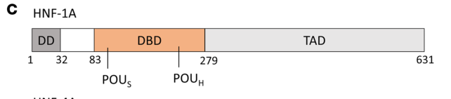

## Question

# Gene Research for Functional Annotation

## ⚠️ CRITICAL: Gene/Protein Identification Context

**BEFORE YOU BEGIN RESEARCH:** You MUST verify you are researching the CORRECT gene/protein. Gene symbols can be ambiguous, especially for less well-characterized genes from non-model organisms.

### Target Gene/Protein Identity (from UniProt):
- **UniProt Accession:** P20823
- **Protein Description:** RecName: Full=Hepatocyte nuclear factor 1-alpha; Short=HNF-1-alpha; Short=HNF-1A; AltName: Full=Liver-specific transcription factor LF-B1; Short=LFB1; AltName: Full=Transcription factor 1; Short=TCF-1;
- **Gene Information:** Name=HNF1A; Synonyms=TCF1;
- **Organism (full):** Homo sapiens (Human).
- **Protein Family:** Belongs to the HNF1 homeobox family. .
- **Key Domains:** HD. (IPR001356); HNF-1. (IPR039066); HNF-1_N. (IPR006899); HNF-1_POU. (IPR044869); HNF1_dimer_N_dom_sf. (IPR023219)

### MANDATORY VERIFICATION STEPS:

1. **Check if the gene symbol "HNF1A" matches the protein description above**
2. **Verify the organism is correct:** Homo sapiens (Human).
3. **Check if protein family/domains align with what you find in literature**
4. **If you find literature for a DIFFERENT gene with the same or similar symbol, STOP**

### If Gene Symbol is Ambiguous or You Cannot Find Relevant Literature:

**DO NOT PROCEED WITH RESEARCH ON A DIFFERENT GENE.** Instead:
- State clearly: "The gene symbol 'HNF1A' is ambiguous or literature is limited for this specific protein"
- Explain what you found (e.g., "Found extensive literature on a different gene with the same symbol in a different organism")
- Describe the protein based ONLY on the UniProt information provided above
- Suggest that the protein function can be inferred from domain/family information

### Research Target:

Please provide a comprehensive research report on the gene **HNF1A** (gene ID: HNF1A, UniProt: P20823) in human.

The research report should be a detailed narrative explaining the function, biological processes, and localization of the gene product. Citations should be given for all claims.

You should prioritize authoritative reviews and primary scientific literature when conducting research. You can supplement
this with annotations you find in gene/protein databases, but these can be outdated or inaccurate.

We are specifically interested in the primary function of the gene - for enzymes, what reaction is catalyzed, and what is the substrate specificity? For transporters, what is the substrate? For structural proteins or adapters, what is the broader structural role? For signaling molecules, what is the role in the pathway.

We are interested in where in or outside the cell the gene product carries out its function.

We are also interested in the signaling or biochemical pathways in which the gene functions. We are less interested in broad pleiotropic effects, except where these elucidate the precise role.

Include evidence where possible. We are interested in both experimental evidence as well as inference from structure, evolution, or bioinformatic analysis. Precise studies should be prioritized over high-throughput, where available.

## Output

Question: You are an expert researcher providing comprehensive, well-cited information.

Provide detailed information focusing on:
1. Key concepts and definitions with current understanding
2. Recent developments and latest research (prioritize 2023-2024 sources)
3. Current applications and real-world implementations
4. Expert opinions and analysis from authoritative sources
5. Relevant statistics and data from recent studies

Format as a comprehensive research report with proper citations. Include URLs and publication dates where available.
Always prioritize recent, authoritative sources and provide specific citations for all major claims.

# Gene Research for Functional Annotation

## ⚠️ CRITICAL: Gene/Protein Identification Context

**BEFORE YOU BEGIN RESEARCH:** You MUST verify you are researching the CORRECT gene/protein. Gene symbols can be ambiguous, especially for less well-characterized genes from non-model organisms.

### Target Gene/Protein Identity (from UniProt):
- **UniProt Accession:** P20823
- **Protein Description:** RecName: Full=Hepatocyte nuclear factor 1-alpha; Short=HNF-1-alpha; Short=HNF-1A; AltName: Full=Liver-specific transcription factor LF-B1; Short=LFB1; AltName: Full=Transcription factor 1; Short=TCF-1;
- **Gene Information:** Name=HNF1A; Synonyms=TCF1;
- **Organism (full):** Homo sapiens (Human).
- **Protein Family:** Belongs to the HNF1 homeobox family. .
- **Key Domains:** HD. (IPR001356); HNF-1. (IPR039066); HNF-1_N. (IPR006899); HNF-1_POU. (IPR044869); HNF1_dimer_N_dom_sf. (IPR023219)

### MANDATORY VERIFICATION STEPS:

1. **Check if the gene symbol "HNF1A" matches the protein description above**
2. **Verify the organism is correct:** Homo sapiens (Human).
3. **Check if protein family/domains align with what you find in literature**
4. **If you find literature for a DIFFERENT gene with the same or similar symbol, STOP**

### If Gene Symbol is Ambiguous or You Cannot Find Relevant Literature:

**DO NOT PROCEED WITH RESEARCH ON A DIFFERENT GENE.** Instead:
- State clearly: "The gene symbol 'HNF1A' is ambiguous or literature is limited for this specific protein"
- Explain what you found (e.g., "Found extensive literature on a different gene with the same symbol in a different organism")
- Describe the protein based ONLY on the UniProt information provided above
- Suggest that the protein function can be inferred from domain/family information

### Research Target:

Please provide a comprehensive research report on the gene **HNF1A** (gene ID: HNF1A, UniProt: P20823) in human.

The research report should be a detailed narrative explaining the function, biological processes, and localization of the gene product. Citations should be given for all claims.

You should prioritize authoritative reviews and primary scientific literature when conducting research. You can supplement
this with annotations you find in gene/protein databases, but these can be outdated or inaccurate.

We are specifically interested in the primary function of the gene - for enzymes, what reaction is catalyzed, and what is the substrate specificity? For transporters, what is the substrate? For structural proteins or adapters, what is the broader structural role? For signaling molecules, what is the role in the pathway.

We are interested in where in or outside the cell the gene product carries out its function.

We are also interested in the signaling or biochemical pathways in which the gene functions. We are less interested in broad pleiotropic effects, except where these elucidate the precise role.

Include evidence where possible. We are interested in both experimental evidence as well as inference from structure, evolution, or bioinformatic analysis. Precise studies should be prioritized over high-throughput, where available.

# Human HNF1A (UniProt P20823): functional annotation and research report

## Identity and principal function

**Identity verified.** Human *HNF1A* encodes hepatocyte nuclear factor 1-alpha (HNF-1α; also called LF-B1 or TCF-1). A review explicitly maps the human HNF1A reference protein to **UniProt P20823** and distinguishes it from the related transcription factor HNF1B and the separate regulatory-network partner HNF4A. The protein belongs to the HNF1 homeobox/POU-related transcription-factor family. This report concerns the **human HNF1A protein**, not HNF1B, HNF4A or the HNF1A-AS1 RNA. (valkovicova2019novelinsightsinto pages 6-7, kind2023structuralpropertiesof pages 1-2, kind2022structuralandbiophysical pages 1-3)

HNF-1α’s primary molecular function is **sequence-specific regulation of gene transcription**. It is not an enzyme that catalyzes a metabolic reaction, nor a transporter with a transported substrate. Rather, a nuclear HNF-1α dimer recognizes regulatory DNA and, through its activation region and associated factors, changes expression of genes whose products perform metabolic, secretory and transport functions. Its preferred DNA-recognition sequence is the inverted palindrome **5′-GTTAATNATTAAC-3′**; affinity and transcriptional output vary with the sequence of a particular promoter. (kind2022structuralandbiophysical pages 1-3, kind2024molecularmechanismof pages 4-5, kind2024molecularmechanismof pages 5-7)

## Molecular architecture and site of action

The approximately 631-residue reference protein has an **N-terminal dimerization domain** (approximately residues 1–33), a central DNA-binding domain (approximately residues 83–279) comprising a **POU-specific region and an atypical POU homeodomain**, and a **C-terminal transactivation region** (approximately residues 280–631). These features agree with the supplied HNF-1, POU and homeodomain annotations. HNF-1α can homodimerize or heterodimerize with HNF-1β; PCBD1/DCoH can stabilize its dimer, although the dimerization-containing protein also dimerizes without that cofactor. The HNF-1α domain organization is depicted in the cropped domain schematic from the 2024 structural study. (kind2023structuralpropertiesof pages 1-2, kind2022structuralandbiophysical pages 1-3, kind2024molecularmechanismof media 10b05828, kind2021structuralandbiophysical pages 13-14)

**The nucleus is its functional subcellular site:** a nuclear-localization signal within the DNA-binding region supports import, and promoter binding takes place on nuclear chromatin. Nuclear localization was observed experimentally for wild-type protein and several DNA-binding-defective HNF1A variants; consequently, loss of transcriptional activity must not automatically be interpreted as failed nuclear import. HNF1A is expressed in liver, pancreatic endocrine tissue and renal proximal tubule, among other tissues; the *genes it regulates* depend on cell context. (kind2022structuralandbiophysical pages 1-3, haque2022hnf1apoudomain pages 6-8, chan2023hnf1abindsand pages 3-5, ng2024hnf4aandhnf1a pages 2-3)

In a [2023 biophysical study](https://doi.org/10.3389/fmolb.2023.1249939), small-angle X-ray scattering and circular dichroism supported an **intrinsically disordered C-terminal activation region**. Purified protein also showed phase-separation behavior under experimental conditions. A role for condensates in transcription is plausible, but these experiments do **not** establish physiologically functional HNF-1α condensates in living human β cells. (kind2023structuralpropertiesof pages 1-2, kind2023structuralpropertiesof pages 4-5)

## Tissue-specific mechanisms and pathways

The following experimentally investigated targets illustrate HNF1A’s *direct transcriptional role* across human-relevant systems. They should not be mistaken for intrinsic transport, receptor or enzymatic activities of HNF-1α. (kind2024molecularmechanismof pages 1-2, chan2023hnf1abindsand pages 5-8, li2009hepatocytenuclearfactor pages 5-6)

| Tissue / cell context | Direct HNF1A transcriptional target | Evidence and quantitative result | Biological outcome / interpretation | Publication |
|---|---|---|---|---|
| Pancreatic β cells | **HNF4A P2 promoter** | HNF1A–DNA crystal structure at **2.3 Å**; WT P2 affinity **KD = 304 ± 134 nM**. The P2 c.-169C>T variant weakened binding to **1.2 μM**. These are **HNF4A promoter variants, not HNF1A mutations**. (kind2024molecularmechanismof pages 7-8, kind2024molecularmechanismof pages 4-5, kind2024molecularmechanismof pages 5-7) | HNF1A is the nuclear regulator; HNF4A is a separate transcription factor in a cross-regulatory β-cell circuit supporting glucose-stimulated insulin secretion. | Kind et al., **2024**. [JCI Insight; DOI: 10.1172/jci.insight.175278](https://doi.org/10.1172/jci.insight.175278) |
| Pancreatic endocrine / β cells | **GPR39** | HNF1A ChIP-seq identified promoter-proximal binding; EndoC-βH1 knockdown and promoter-reporter assays supported regulation. Nearest-gene peak assignment alone is not definitive, and a specific physiological consequence was not established. (ng2024hnf4aandhnf1a pages 9-11, ng2024hnf4aandhnf1a pages 3-4) | HNF1A regulates transcription; GPR39 is a distinct G-protein-coupled receptor. The study supports target-gene regulation, not definitive GPR39-mediated β-cell physiology. | Ng et al., **2024**. [Nature Communications; DOI: 10.1038/s41467-024-48647-w](https://doi.org/10.1038/s41467-024-48647-w) |
| Hepatocytes / HepG2 | **PCSK9** | Mutation of the proximal HNF1 site reduced PCSK9 promoter activity to approximately **5% of WT**; HNF1A cooperated with SREBP2 and was the predominant HNF1-family activator. (li2009hepatocytenuclearfactor pages 5-6, li2009hepatocytenuclearfactor pages 9-10, li2009hepatocytenuclearfactor pages 1-2) | HNF1A activates transcription; PCSK9 is a distinct secreted protease that promotes **LDLR degradation**, thereby reducing hepatic LDL uptake. HNF1A is neither PCSK9 nor a lipid transporter. | Li et al., **2009**. [Journal of Biological Chemistry; DOI: 10.1074/jbc.M109.052407](https://doi.org/10.1074/jbc.M109.052407) |
| Renal proximal tubule | **SLC51B (OSTβ)** | HNF1A ChIP-qPCR and depletion established promoter binding and reduced SLC51B expression; HNF1A-deficient cells and MODY3 organoids had impaired estrone-sulfate uptake. Urinary validation included **7 HNF1A-MODY3**, **8 non-MODY3 diabetic**, and **8 healthy** participants. (chan2023hnf1abindsand pages 8-8, chan2023hnf1abindsand pages 5-8) | HNF1A is the nuclear regulator; SLC51B is the distinct transporter subunit mediating estrone-sulfate handling. Increased urinary estrone sulfate in MODY3 supports impaired tubular reabsorption. | Chan et al., **2023**. [Cell Death & Disease; DOI: 10.1038/s41419-023-05827-8](https://doi.org/10.1038/s41419-023-05827-8) |

*Table: Comparison of experimentally supported direct HNF1A transcriptional targets in human-relevant pancreatic, hepatic, and renal systems. The table distinguishes nuclear HNF1A regulation from the functions of its downstream receptor, protease, transporter, and transcription-factor targets.*

**Pancreatic endocrine transcription circuit.** HNF-1α binds the pancreatic **P2 promoter of *HNF4A***, linking two different transcription factors in a cross-regulatory network important to β-cell function and glucose-stimulated insulin secretion. The [June 2024 crystal-structure and functional study](https://doi.org/10.1172/jci.insight.175278) resolved an HNF-1α DNA-binding-domain–P2 complex at **2.3 Å**. Its POU-specific and homeodomain regions both contact DNA. For purified HNF-1α dimerization/DNA-binding domains, the measured dissociation constant was **304 ± 134 nM** for the P2 sequence versus **100 ± 50 nM** for the optimal rat-albumin reference sequence; P2 drove approximately **40%** of the reference reporter activity in HeLa cells and **50%** in MIN6 β-like cells. These are comparisons between *promoter sequences in specified assays*, not estimates of gene-expression differences in patients. (kind2024molecularmechanismof pages 4-5, kind2024molecularmechanismof pages 5-7)

That study also examined four **variants in the *HNF4A* P2 promoter** among **63 people from 21 families**, three within the HNF-1α binding site and one nearby. The c.-169C>T promoter substitution weakened measured HNF-1α binding to approximately **1.2 μM** versus approximately **0.3 μM** for wild-type P2. These variants illustrate how changing HNF-1α’s *DNA target* can disrupt the circuit; they are **not HNF1A protein variants**, and associated diabetes is classified in relation to *HNF4A*. (kind2024molecularmechanismof pages 1-2, kind2024molecularmechanismof pages 7-8, kind2024molecularmechanismof pages 2-4)

A separate [June 2024 human-cell ChIP-seq study](https://doi.org/10.1038/s41467-024-48647-w) identified tissue-dependent HNF1A chromatin occupancy and supported **GPR39** as a regulated pancreatic endocrine-cell target using binding, knockdown and promoter-reporter analyses. It reported **739 HNF1A peaks** in day-20 endocrine progenitors, **427** in human islets and **4,791** in HepG2 liver-derived cells, using its stated peak-calling threshold. These are *peaks in different experimental preparations*, not counts of proven functional targets or directly comparable measures of protein activity. In particular, assigning a ChIP peak to its nearest gene alone does not prove regulation of that gene; targeted perturbation strengthens, but does not establish every proposed downstream physiological link. (ng2024hnf4aandhnf1a pages 9-11, ng2024hnf4aandhnf1a pages 1-2, ng2024hnf4aandhnf1a pages 3-4)

**Hepatic cholesterol-regulatory transcription.** In human HepG2 cells, HNF-1α positively regulates ***PCSK9*** through a proximal promoter element adjacent to a sterol-response element. Mutating the HNF1-binding element reduced reporter activity to approximately **5% of wild type**; binding and knockdown experiments identified HNF-1α as the predominant HNF1-family activator and showed cooperation with SREBP2. PCSK9 subsequently promotes LDL-receptor degradation: the downstream cholesterol effect is therefore an **indirect consequence of HNF1A-dependent transcription**, not HNF-1α transporting cholesterol or degrading the receptor itself. In a complementary mouse intervention, hepatic HNF1α knockdown reduced hepatic/circulating PCSK9 by about **50%**, increased hepatic LDL-receptor protein approximately **1.9-fold**, and modestly lowered circulating LDL cholesterol; those in-vivo numbers are **mouse**, not human, outcomes. (li2009hepatocytenuclearfactor pages 5-6, li2009hepatocytenuclearfactor pages 9-10, shende2015reductionofcirculating pages 8-9)

**Human renal proximal-tubule program.** A [May 2023 primary study](https://doi.org/10.1038/s41419-023-05827-8) localized HNF1A chiefly to human proximal-tubule populations. ChIP and promoter testing identified ***SLC51B*** as a direct transcriptional target. HNF1A depletion reduced SLC51B expression and estrone-sulfate uptake in human proximal-tubule cells; HNF1A-variant patient-derived kidney organoids likewise showed impaired expression and uptake. SLC51B/OSTβ is the *downstream transporter component*; HNF-1α itself does not transport estrone sulfate. A small clinical comparison found increased urinary estrone sulfate in **seven HNF1A-MODY patients**, relative to **eight other diabetic participants** and **eight nondiabetic participants**. Whether altered local estradiol availability causes subsequent kidney disease remains a proposed mechanism, not established by that comparison. (chan2023hnf1abindsand pages 8-8, chan2023hnf1abindsand pages 5-8, chan2023hnf1abindsand pages 3-5)

## Disease mechanism, interpretation and applications

Pathogenic reduction of HNF1A function causes **HNF1A-MODY (historically MODY3)**, typically an inherited, progressive β-cell secretory disorder. Mechanisms differ among alleles. In the peer-reviewed [2022 structural/functional study](https://doi.org/10.1016/j.jbc.2022.101803), **P112L** destabilized the protein, whereas **R263C** and the investigated **N266S** variant weakened binding to a target promoter. Thus, a variant can impair folding, DNA recognition or transcription without eliminating nuclear localization; an experimental defect contributes evidence for classification but does not, by itself, settle the clinical interpretation of every carrier. (kind2022structuralandbiophysical pages 1-3, kind2021structuralandbiophysical pages 13-14, haque2022hnf1apoudomain pages 6-8)

The major established implementation is **molecular diagnosis followed by subtype-specific diabetes management**, rather than pharmacological inhibition of HNF1A itself. A [September 2024 clinical review](https://doi.org/10.3390/ijms251910501) describes sulfonylureas as first-line treatment for many patients with confirmed HNF1A-MODY; some people initially receiving insulin can transition under clinical supervision, while progressive disease may require additional treatment. A [July 2025 Australian–New Zealand joint-society consensus](https://doi.org/10.5694/mja2.52717) similarly recommends starting sulfonylureas at **low doses because of marked sensitivity**, acknowledges that some patients eventually need insulin, and recommends appropriate genetic counselling and testing of relatives after identification of a pathogenic or likely pathogenic familial variant. A **variant of uncertain significance is uninformative for treatment decisions**, not a confirmed HNF1A-MODY diagnosis. (serbis2024monogenicdefectsof pages 7-9, serbis2024monogenicdefectsof pages 9-10, sousa2025australianandnew pages 5-6)

For context, that expert consensus estimates **all monogenic diabetes combined** at approximately **2–5% of diabetes**, with **more than 80%** of affected individuals undiagnosed or misdiagnosed. These statistics must **not** be presented as HNF1A-specific prevalence. The practical screening recommendation is targeted molecular assessment when clinical features raise suspicion, including early-onset diabetes without typical type 1/type 2 markers, rather than treating glycosuria, a suggestive phenotype or a single uncertain sequence change as diagnostic. (sousa2025australianandnew pages 1-2, sousa2025australianandnew pages 2-3)

**Evidence assessment.** Strongest functional support comes from convergent structural DNA-binding measurements, targeted promoter mutation, chromatin occupancy, gene perturbation and functional readouts; genome-wide occupancy by itself is an annotation resource rather than proof that every nearby gene is a direct target. HNF1A is therefore best annotated as a **nuclear, sequence-specific dimeric transcriptional regulator** of cell-context-dependent pancreatic, hepatic and renal gene programs, with particularly well-supported roles in the HNF1A–HNF4A β-cell circuit, hepatic *PCSK9* transcription and renal *SLC51B* transcription. (kind2024molecularmechanismof pages 4-5, kind2024molecularmechanismof pages 5-7, ng2024hnf4aandhnf1a pages 9-11, chan2023hnf1abindsand pages 5-8, li2009hepatocytenuclearfactor pages 5-6)

References

1. (valkovicova2019novelinsightsinto pages 6-7): Terezia Valkovicova, Martina Skopkova, Juraj Stanik, and Daniela Gasperikova. Novel insights into genetics and clinics of the hnf1a-mody. Endocrine Regulations, 53:110-134, Apr 2019. URL: https://doi.org/10.2478/enr-2019-0013, doi:10.2478/enr-2019-0013. This article has 133 citations.

2. (kind2023structuralpropertiesof pages 1-2): Laura Kind, Mark Driver, Arne Raasakka, Patrick R. Onck, Pål Rasmus Njølstad, Thomas Arnesen, and Petri Kursula. Structural properties of the hnf-1a transactivation domain. Frontiers in Molecular Biosciences, Oct 2023. URL: https://doi.org/10.3389/fmolb.2023.1249939, doi:10.3389/fmolb.2023.1249939. This article has 9 citations.

3. (kind2022structuralandbiophysical pages 1-3): Laura Kind, Arne Raasakka, Janne Molnes, Ingvild Aukrust, Lise Bjørkhaug, Pål Rasmus Njølstad, Petri Kursula, and Thomas Arnesen. Structural and biophysical characterization of transcription factor hnf-1a as a tool to study mody3 diabetes variants. Journal of Biological Chemistry, 298:101803, Apr 2022. URL: https://doi.org/10.1016/j.jbc.2022.101803, doi:10.1016/j.jbc.2022.101803. This article has 14 citations and is from a domain leading peer-reviewed journal.

4. (kind2024molecularmechanismof pages 4-5): Laura Kind, Janne Molnes, Erling Tjora, Arne Raasakka, Matti Myllykoski, Kevin Colclough, Cécile Saint-Martin, Caroline Adelfalk, Petra Dusatkova, Stepanka Pruhova, Camilla Valtonen-André, Christine Bellanné-Chantelot, Thomas Arnesen, Petri Kursula, and Pål Rasmus Njølstad. Molecular mechanism of hnf-1a–mediated hnf4a gene regulation and promoter-driven hnf4a-mody diabetes. JCI Insight, Jun 2024. URL: https://doi.org/10.1172/jci.insight.175278, doi:10.1172/jci.insight.175278. This article has 15 citations and is from a domain leading peer-reviewed journal.

5. (kind2024molecularmechanismof pages 5-7): Laura Kind, Janne Molnes, Erling Tjora, Arne Raasakka, Matti Myllykoski, Kevin Colclough, Cécile Saint-Martin, Caroline Adelfalk, Petra Dusatkova, Stepanka Pruhova, Camilla Valtonen-André, Christine Bellanné-Chantelot, Thomas Arnesen, Petri Kursula, and Pål Rasmus Njølstad. Molecular mechanism of hnf-1a–mediated hnf4a gene regulation and promoter-driven hnf4a-mody diabetes. JCI Insight, Jun 2024. URL: https://doi.org/10.1172/jci.insight.175278, doi:10.1172/jci.insight.175278. This article has 15 citations and is from a domain leading peer-reviewed journal.

6. (kind2024molecularmechanismof media 10b05828): Laura Kind, Janne Molnes, Erling Tjora, Arne Raasakka, Matti Myllykoski, Kevin Colclough, Cécile Saint-Martin, Caroline Adelfalk, Petra Dusatkova, Stepanka Pruhova, Camilla Valtonen-André, Christine Bellanné-Chantelot, Thomas Arnesen, Petri Kursula, and Pål Rasmus Njølstad. Molecular mechanism of hnf-1a–mediated hnf4a gene regulation and promoter-driven hnf4a-mody diabetes. JCI Insight, Jun 2024. URL: https://doi.org/10.1172/jci.insight.175278, doi:10.1172/jci.insight.175278. This article has 15 citations and is from a domain leading peer-reviewed journal.

7. (kind2021structuralandbiophysical pages 13-14): Laura Kind, Arne Raasakka, Janne Molnes, Ingvild Aukrust, Lise Bjørkhaug, Pål Rasmus Njølstad, Petri Kursula, and Thomas Arnesen. Structural and biophysical characterization of hnf-1a as a tool to study mody3 diabetes variants. bioRxiv, Dec 2021. URL: https://doi.org/10.1101/2021.12.20.473529, doi:10.1101/2021.12.20.473529. This article has 0 citations.

8. (haque2022hnf1apoudomain pages 6-8): Effi Haque, Aamir Salam Teeli, Dawid Winiarczyk, Masahiko Taguchi, Shun Sakuraba, Hidetoshi Kono, Paweł Leszczyński, Mariusz Pierzchała, and Hiroaki Taniguchi. Hnf1a pou domain mutations found in japanese liver cancer patients cause downregulation of hnf4a promoter activity with possible disruption in transcription networks. Genes, 13:413, Feb 2022. URL: https://doi.org/10.3390/genes13030413, doi:10.3390/genes13030413. This article has 11 citations.

9. (chan2023hnf1abindsand pages 3-5): Jun Wei Chan, Claire Wen Ying Neo, Soumita Ghosh, Hyungwon Choi, Su Chi Lim, E. Shyong Tai, and Adrian Kee Keong Teo. Hnf1a binds and regulates the expression of slc51b to facilitate the uptake of estrone sulfate in human renal proximal tubule epithelial cells. Cell Death &amp; Disease, May 2023. URL: https://doi.org/10.1038/s41419-023-05827-8, doi:10.1038/s41419-023-05827-8. This article has 11 citations and is from a peer-reviewed journal.

10. (ng2024hnf4aandhnf1a pages 2-3): Natasha Hui Jin Ng, Soumita Ghosh, Chek Mei Bok, Carmen Ching, Blaise Su Jun Low, Juin Ting Chen, Euodia Lim, María Clara Miserendino, Yaw Sing Tan, Shawn Hoon, and Adrian Kee Keong Teo. Hnf4a and hnf1a exhibit tissue specific target gene regulation in pancreatic beta cells and hepatocytes. Nature Communications, Jun 2024. URL: https://doi.org/10.1038/s41467-024-48647-w, doi:10.1038/s41467-024-48647-w. This article has 71 citations and is from a highest quality peer-reviewed journal.

11. (kind2023structuralpropertiesof pages 4-5): Laura Kind, Mark Driver, Arne Raasakka, Patrick R. Onck, Pål Rasmus Njølstad, Thomas Arnesen, and Petri Kursula. Structural properties of the hnf-1a transactivation domain. Frontiers in Molecular Biosciences, Oct 2023. URL: https://doi.org/10.3389/fmolb.2023.1249939, doi:10.3389/fmolb.2023.1249939. This article has 9 citations.

12. (kind2024molecularmechanismof pages 1-2): Laura Kind, Janne Molnes, Erling Tjora, Arne Raasakka, Matti Myllykoski, Kevin Colclough, Cécile Saint-Martin, Caroline Adelfalk, Petra Dusatkova, Stepanka Pruhova, Camilla Valtonen-André, Christine Bellanné-Chantelot, Thomas Arnesen, Petri Kursula, and Pål Rasmus Njølstad. Molecular mechanism of hnf-1a–mediated hnf4a gene regulation and promoter-driven hnf4a-mody diabetes. JCI Insight, Jun 2024. URL: https://doi.org/10.1172/jci.insight.175278, doi:10.1172/jci.insight.175278. This article has 15 citations and is from a domain leading peer-reviewed journal.

13. (chan2023hnf1abindsand pages 5-8): Jun Wei Chan, Claire Wen Ying Neo, Soumita Ghosh, Hyungwon Choi, Su Chi Lim, E. Shyong Tai, and Adrian Kee Keong Teo. Hnf1a binds and regulates the expression of slc51b to facilitate the uptake of estrone sulfate in human renal proximal tubule epithelial cells. Cell Death &amp; Disease, May 2023. URL: https://doi.org/10.1038/s41419-023-05827-8, doi:10.1038/s41419-023-05827-8. This article has 11 citations and is from a peer-reviewed journal.

14. (li2009hepatocytenuclearfactor pages 5-6): Hai Li, Bin Dong, Sahng Wook Park, Hyun-Sook Lee, Wei Chen, and Jingwen Liu. Hepatocyte nuclear factor 1α plays a critical role in pcsk9 gene transcription and regulation by the natural hypocholesterolemic compound berberine. Journal of Biological Chemistry, 284:28885-28895, Oct 2009. URL: https://doi.org/10.1074/jbc.m109.052407, doi:10.1074/jbc.m109.052407. This article has 436 citations and is from a domain leading peer-reviewed journal.

15. (kind2024molecularmechanismof pages 7-8): Laura Kind, Janne Molnes, Erling Tjora, Arne Raasakka, Matti Myllykoski, Kevin Colclough, Cécile Saint-Martin, Caroline Adelfalk, Petra Dusatkova, Stepanka Pruhova, Camilla Valtonen-André, Christine Bellanné-Chantelot, Thomas Arnesen, Petri Kursula, and Pål Rasmus Njølstad. Molecular mechanism of hnf-1a–mediated hnf4a gene regulation and promoter-driven hnf4a-mody diabetes. JCI Insight, Jun 2024. URL: https://doi.org/10.1172/jci.insight.175278, doi:10.1172/jci.insight.175278. This article has 15 citations and is from a domain leading peer-reviewed journal.

16. (ng2024hnf4aandhnf1a pages 9-11): Natasha Hui Jin Ng, Soumita Ghosh, Chek Mei Bok, Carmen Ching, Blaise Su Jun Low, Juin Ting Chen, Euodia Lim, María Clara Miserendino, Yaw Sing Tan, Shawn Hoon, and Adrian Kee Keong Teo. Hnf4a and hnf1a exhibit tissue specific target gene regulation in pancreatic beta cells and hepatocytes. Nature Communications, Jun 2024. URL: https://doi.org/10.1038/s41467-024-48647-w, doi:10.1038/s41467-024-48647-w. This article has 71 citations and is from a highest quality peer-reviewed journal.

17. (ng2024hnf4aandhnf1a pages 3-4): Natasha Hui Jin Ng, Soumita Ghosh, Chek Mei Bok, Carmen Ching, Blaise Su Jun Low, Juin Ting Chen, Euodia Lim, María Clara Miserendino, Yaw Sing Tan, Shawn Hoon, and Adrian Kee Keong Teo. Hnf4a and hnf1a exhibit tissue specific target gene regulation in pancreatic beta cells and hepatocytes. Nature Communications, Jun 2024. URL: https://doi.org/10.1038/s41467-024-48647-w, doi:10.1038/s41467-024-48647-w. This article has 71 citations and is from a highest quality peer-reviewed journal.

18. (li2009hepatocytenuclearfactor pages 9-10): Hai Li, Bin Dong, Sahng Wook Park, Hyun-Sook Lee, Wei Chen, and Jingwen Liu. Hepatocyte nuclear factor 1α plays a critical role in pcsk9 gene transcription and regulation by the natural hypocholesterolemic compound berberine. Journal of Biological Chemistry, 284:28885-28895, Oct 2009. URL: https://doi.org/10.1074/jbc.m109.052407, doi:10.1074/jbc.m109.052407. This article has 436 citations and is from a domain leading peer-reviewed journal.

19. (li2009hepatocytenuclearfactor pages 1-2): Hai Li, Bin Dong, Sahng Wook Park, Hyun-Sook Lee, Wei Chen, and Jingwen Liu. Hepatocyte nuclear factor 1α plays a critical role in pcsk9 gene transcription and regulation by the natural hypocholesterolemic compound berberine. Journal of Biological Chemistry, 284:28885-28895, Oct 2009. URL: https://doi.org/10.1074/jbc.m109.052407, doi:10.1074/jbc.m109.052407. This article has 436 citations and is from a domain leading peer-reviewed journal.

20. (chan2023hnf1abindsand pages 8-8): Jun Wei Chan, Claire Wen Ying Neo, Soumita Ghosh, Hyungwon Choi, Su Chi Lim, E. Shyong Tai, and Adrian Kee Keong Teo. Hnf1a binds and regulates the expression of slc51b to facilitate the uptake of estrone sulfate in human renal proximal tubule epithelial cells. Cell Death &amp; Disease, May 2023. URL: https://doi.org/10.1038/s41419-023-05827-8, doi:10.1038/s41419-023-05827-8. This article has 11 citations and is from a peer-reviewed journal.

21. (kind2024molecularmechanismof pages 2-4): Laura Kind, Janne Molnes, Erling Tjora, Arne Raasakka, Matti Myllykoski, Kevin Colclough, Cécile Saint-Martin, Caroline Adelfalk, Petra Dusatkova, Stepanka Pruhova, Camilla Valtonen-André, Christine Bellanné-Chantelot, Thomas Arnesen, Petri Kursula, and Pål Rasmus Njølstad. Molecular mechanism of hnf-1a–mediated hnf4a gene regulation and promoter-driven hnf4a-mody diabetes. JCI Insight, Jun 2024. URL: https://doi.org/10.1172/jci.insight.175278, doi:10.1172/jci.insight.175278. This article has 15 citations and is from a domain leading peer-reviewed journal.

22. (ng2024hnf4aandhnf1a pages 1-2): Natasha Hui Jin Ng, Soumita Ghosh, Chek Mei Bok, Carmen Ching, Blaise Su Jun Low, Juin Ting Chen, Euodia Lim, María Clara Miserendino, Yaw Sing Tan, Shawn Hoon, and Adrian Kee Keong Teo. Hnf4a and hnf1a exhibit tissue specific target gene regulation in pancreatic beta cells and hepatocytes. Nature Communications, Jun 2024. URL: https://doi.org/10.1038/s41467-024-48647-w, doi:10.1038/s41467-024-48647-w. This article has 71 citations and is from a highest quality peer-reviewed journal.

23. (shende2015reductionofcirculating pages 8-9): Vikram Ravindra Shende, Minhao Wu, Amar Bahadur Singh, Bin Dong, Chin Fung Kelvin Kan, and Jingwen Liu. Reduction of circulating pcsk9 and ldl-c levels by liver-specific knockdown of hnf1α in normolipidemic mice[s]. Journal of Lipid Research, 56:801-809, Apr 2015. URL: https://doi.org/10.1194/jlr.m052969, doi:10.1194/jlr.m052969. This article has 80 citations and is from a peer-reviewed journal.

24. (serbis2024monogenicdefectsof pages 7-9): Anastasios Serbis, Evanthia Kantza, Ekaterini Siomou, Assimina Galli-Tsinopoulou, Christina Kanaka-Gantenbein, and Stelios Tigas. Monogenic defects of beta cell function: from clinical suspicion to genetic diagnosis and management of rare types of diabetes. International Journal of Molecular Sciences, 25:10501, Sep 2024. URL: https://doi.org/10.3390/ijms251910501, doi:10.3390/ijms251910501. This article has 15 citations.

25. (serbis2024monogenicdefectsof pages 9-10): Anastasios Serbis, Evanthia Kantza, Ekaterini Siomou, Assimina Galli-Tsinopoulou, Christina Kanaka-Gantenbein, and Stelios Tigas. Monogenic defects of beta cell function: from clinical suspicion to genetic diagnosis and management of rare types of diabetes. International Journal of Molecular Sciences, 25:10501, Sep 2024. URL: https://doi.org/10.3390/ijms251910501, doi:10.3390/ijms251910501. This article has 15 citations.

26. (sousa2025australianandnew pages 5-6): Sunita MC De Sousa, Timothy ME Davis, James Harraway, Mark Greenslade, Kathy HC Wu, Ryan G Paul, Juliet Taylor, Aleena S Ali, Elif I Ekinci, Rinki Murphy, and Jerry R Greenfield. Australian and new zealand joint society consensus statement on genetic testing for monogenic diabetes in adults. The Medical journal of Australia, Jul 2025. URL: https://doi.org/10.5694/mja2.52717, doi:10.5694/mja2.52717. This article has 9 citations.

27. (sousa2025australianandnew pages 1-2): Sunita MC De Sousa, Timothy ME Davis, James Harraway, Mark Greenslade, Kathy HC Wu, Ryan G Paul, Juliet Taylor, Aleena S Ali, Elif I Ekinci, Rinki Murphy, and Jerry R Greenfield. Australian and new zealand joint society consensus statement on genetic testing for monogenic diabetes in adults. The Medical journal of Australia, Jul 2025. URL: https://doi.org/10.5694/mja2.52717, doi:10.5694/mja2.52717. This article has 9 citations.

28. (sousa2025australianandnew pages 2-3): Sunita MC De Sousa, Timothy ME Davis, James Harraway, Mark Greenslade, Kathy HC Wu, Ryan G Paul, Juliet Taylor, Aleena S Ali, Elif I Ekinci, Rinki Murphy, and Jerry R Greenfield. Australian and new zealand joint society consensus statement on genetic testing for monogenic diabetes in adults. The Medical journal of Australia, Jul 2025. URL: https://doi.org/10.5694/mja2.52717, doi:10.5694/mja2.52717. This article has 9 citations.

## Artifacts

- [Edison artifact artifact-00](HNF1A-deep-research-falcon_artifacts/artifact-00.md)

## Citations

1. valkovicova2019novelinsightsinto pages 6-7
2. kind2023structuralpropertiesof pages 1-2
3. kind2022structuralandbiophysical pages 1-3
4. kind2024molecularmechanismof pages 4-5
5. kind2024molecularmechanismof pages 5-7
6. kind2021structuralandbiophysical pages 13-14
7. kind2023structuralpropertiesof pages 4-5
8. kind2024molecularmechanismof pages 1-2
9. li2009hepatocytenuclearfactor pages 5-6
10. kind2024molecularmechanismof pages 7-8
11. li2009hepatocytenuclearfactor pages 9-10
12. li2009hepatocytenuclearfactor pages 1-2
13. kind2024molecularmechanismof pages 2-4
14. shende2015reductionofcirculating pages 8-9
15. serbis2024monogenicdefectsof pages 7-9
16. serbis2024monogenicdefectsof pages 9-10
17. sousa2025australianandnew pages 5-6
18. sousa2025australianandnew pages 1-2
19. sousa2025australianandnew pages 2-3
20. 2023 biophysical study
21. JCI Insight; DOI: 10.1172/jci.insight.175278
22. Nature Communications; DOI: 10.1038/s41467-024-48647-w
23. Journal of Biological Chemistry; DOI: 10.1074/jbc.M109.052407
24. Cell Death & Disease; DOI: 10.1038/s41419-023-05827-8
25. June 2024 crystal-structure and functional study
26. June 2024 human-cell ChIP-seq study
27. May 2023 primary study
28. 2022 structural/functional study
29. September 2024 clinical review
30. July 2025 Australian–New Zealand joint-society consensus
31. s
32. https://doi.org/10.3389/fmolb.2023.1249939
33. https://doi.org/10.1172/jci.insight.175278
34. https://doi.org/10.1038/s41467-024-48647-w
35. https://doi.org/10.1074/jbc.M109.052407
36. https://doi.org/10.1038/s41419-023-05827-8
37. https://doi.org/10.1016/j.jbc.2022.101803
38. https://doi.org/10.3390/ijms251910501
39. https://doi.org/10.5694/mja2.52717
40. https://doi.org/10.2478/enr-2019-0013,
41. https://doi.org/10.3389/fmolb.2023.1249939,
42. https://doi.org/10.1016/j.jbc.2022.101803,
43. https://doi.org/10.1172/jci.insight.175278,
44. https://doi.org/10.1101/2021.12.20.473529,
45. https://doi.org/10.3390/genes13030413,
46. https://doi.org/10.1038/s41419-023-05827-8,
47. https://doi.org/10.1038/s41467-024-48647-w,
48. https://doi.org/10.1074/jbc.m109.052407,
49. https://doi.org/10.1194/jlr.m052969,
50. https://doi.org/10.3390/ijms251910501,
51. https://doi.org/10.5694/mja2.52717,