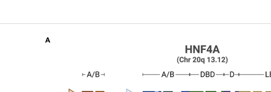

## Question

# Gene Research for Functional Annotation

## ⚠️ CRITICAL: Gene/Protein Identification Context

**BEFORE YOU BEGIN RESEARCH:** You MUST verify you are researching the CORRECT gene/protein. Gene symbols can be ambiguous, especially for less well-characterized genes from non-model organisms.

### Target Gene/Protein Identity (from UniProt):
- **UniProt Accession:** P41235
- **Protein Description:** RecName: Full=Hepatocyte nuclear factor 4-alpha; Short=HNF-4-alpha; AltName: Full=Nuclear receptor subfamily 2 group A member 1; AltName: Full=Transcription factor 14; Short=TCF-14; AltName: Full=Transcription factor HNF-4;
- **Gene Information:** Name=HNF4A; Synonyms=HNF4, NR2A1, TCF14;
- **Organism (full):** Homo sapiens (Human).
- **Protein Family:** Belongs to the nuclear hormone receptor family. NR2
- **Key Domains:** HNF4-like_DBD. (IPR049636); HNF4_LBD. (IPR049635); NHR-like_dom_sf. (IPR035500); Nucl_hrmn_rcpt_lig-bd. (IPR000536); Nuclear_hormone_rcpt_NR2. (IPR050274)

### MANDATORY VERIFICATION STEPS:

1. **Check if the gene symbol "HNF4A" matches the protein description above**
2. **Verify the organism is correct:** Homo sapiens (Human).
3. **Check if protein family/domains align with what you find in literature**
4. **If you find literature for a DIFFERENT gene with the same or similar symbol, STOP**

### If Gene Symbol is Ambiguous or You Cannot Find Relevant Literature:

**DO NOT PROCEED WITH RESEARCH ON A DIFFERENT GENE.** Instead:
- State clearly: "The gene symbol 'HNF4A' is ambiguous or literature is limited for this specific protein"
- Explain what you found (e.g., "Found extensive literature on a different gene with the same symbol in a different organism")
- Describe the protein based ONLY on the UniProt information provided above
- Suggest that the protein function can be inferred from domain/family information

### Research Target:

Please provide a comprehensive research report on the gene **HNF4A** (gene ID: HNF4A, UniProt: P41235) in human.

The research report should be a detailed narrative explaining the function, biological processes, and localization of the gene product. Citations should be given for all claims.

You should prioritize authoritative reviews and primary scientific literature when conducting research. You can supplement
this with annotations you find in gene/protein databases, but these can be outdated or inaccurate.

We are specifically interested in the primary function of the gene - for enzymes, what reaction is catalyzed, and what is the substrate specificity? For transporters, what is the substrate? For structural proteins or adapters, what is the broader structural role? For signaling molecules, what is the role in the pathway.

We are interested in where in or outside the cell the gene product carries out its function.

We are also interested in the signaling or biochemical pathways in which the gene functions. We are less interested in broad pleiotropic effects, except where these elucidate the precise role.

Include evidence where possible. We are interested in both experimental evidence as well as inference from structure, evolution, or bioinformatic analysis. Precise studies should be prioritized over high-throughput, where available.

## Output

Question: You are an expert researcher providing comprehensive, well-cited information.

Provide detailed information focusing on:
1. Key concepts and definitions with current understanding
2. Recent developments and latest research (prioritize 2023-2024 sources)
3. Current applications and real-world implementations
4. Expert opinions and analysis from authoritative sources
5. Relevant statistics and data from recent studies

Format as a comprehensive research report with proper citations. Include URLs and publication dates where available.
Always prioritize recent, authoritative sources and provide specific citations for all major claims.

# Gene Research for Functional Annotation

## ⚠️ CRITICAL: Gene/Protein Identification Context

**BEFORE YOU BEGIN RESEARCH:** You MUST verify you are researching the CORRECT gene/protein. Gene symbols can be ambiguous, especially for less well-characterized genes from non-model organisms.

### Target Gene/Protein Identity (from UniProt):
- **UniProt Accession:** P41235
- **Protein Description:** RecName: Full=Hepatocyte nuclear factor 4-alpha; Short=HNF-4-alpha; AltName: Full=Nuclear receptor subfamily 2 group A member 1; AltName: Full=Transcription factor 14; Short=TCF-14; AltName: Full=Transcription factor HNF-4;
- **Gene Information:** Name=HNF4A; Synonyms=HNF4, NR2A1, TCF14;
- **Organism (full):** Homo sapiens (Human).
- **Protein Family:** Belongs to the nuclear hormone receptor family. NR2
- **Key Domains:** HNF4-like_DBD. (IPR049636); HNF4_LBD. (IPR049635); NHR-like_dom_sf. (IPR035500); Nucl_hrmn_rcpt_lig-bd. (IPR000536); Nuclear_hormone_rcpt_NR2. (IPR050274)

### MANDATORY VERIFICATION STEPS:

1. **Check if the gene symbol "HNF4A" matches the protein description above**
2. **Verify the organism is correct:** Homo sapiens (Human).
3. **Check if protein family/domains align with what you find in literature**
4. **If you find literature for a DIFFERENT gene with the same or similar symbol, STOP**

### If Gene Symbol is Ambiguous or You Cannot Find Relevant Literature:

**DO NOT PROCEED WITH RESEARCH ON A DIFFERENT GENE.** Instead:
- State clearly: "The gene symbol 'HNF4A' is ambiguous or literature is limited for this specific protein"
- Explain what you found (e.g., "Found extensive literature on a different gene with the same symbol in a different organism")
- Describe the protein based ONLY on the UniProt information provided above
- Suggest that the protein function can be inferred from domain/family information

### Research Target:

Please provide a comprehensive research report on the gene **HNF4A** (gene ID: HNF4A, UniProt: P41235) in human.

The research report should be a detailed narrative explaining the function, biological processes, and localization of the gene product. Citations should be given for all claims.

You should prioritize authoritative reviews and primary scientific literature when conducting research. You can supplement
this with annotations you find in gene/protein databases, but these can be outdated or inaccurate.

We are specifically interested in the primary function of the gene - for enzymes, what reaction is catalyzed, and what is the substrate specificity? For transporters, what is the substrate? For structural proteins or adapters, what is the broader structural role? For signaling molecules, what is the role in the pathway.

We are interested in where in or outside the cell the gene product carries out its function.

We are also interested in the signaling or biochemical pathways in which the gene functions. We are less interested in broad pleiotropic effects, except where these elucidate the precise role.

Include evidence where possible. We are interested in both experimental evidence as well as inference from structure, evolution, or bioinformatic analysis. Precise studies should be prioritized over high-throughput, where available.

# Human HNF4A: functional annotation and research report

**Identity verified.** The subject is human **HNF4A** (*Homo sapiens*; UniProt **P41235**, nuclear receptor **NR2A1**), which encodes hepatocyte nuclear factor 4α (HNF4α). A 2024 human-variant study explicitly uses the canonical P41235-1 protein sequence. HNF4A is distinct from its paralog **HNF4G** and from **HNF1A**, a separate transcription-factor gene that HNF4α regulates. Its zinc-finger DNA-binding domain (DBD), hinge, and nuclear-receptor ligand-binding domain (LBD) agree with the supplied protein-family and domain annotations. (radi2023hnf4αisoformsthe pages 2-4, kaci2024functionalcharacterizationof pages 1-2)

## Primary molecular function and cellular location

**HNF4α is principally a nuclear, sequence-specific transcriptional regulator—not an enzyme, transporter, or extracellular signaling protein.** It forms homodimers that bind regulatory DNA, most characteristically a **DR1 element** comprising two AGGTCA-like half-sites separated by one nucleotide. Its DBD contains two zinc-finger modules; its hinge contains a nuclear-localization signal; and its LBD supports dimerization and recruitment of transcriptional co-regulators. Depending on the locus and cell state, HNF4α can promote or repress transcription. In human-cell experiments, tested HNF4A proteins were generally nuclear, whereas the disease-associated R89W variant showed reduced nuclear abundance. (kaci2024functionalcharacterizationof pages 1-2, kaci2024functionalcharacterizationof pages 3-3, chandra2013multidomainintegrationin pages 2-4, ehle2024downregulationofhnf4a pages 6-7, radi2023hnf4αisoformsthe pages 2-4)

The molecular mechanism has unusually direct structural support: a **2.9 Å crystal structure** captured a *human HNF4α multidomain construct*—residues 46–368, **not the entire protein**—as a DNA-bound homodimer with coactivator-derived peptides. Including the LBD strengthened measured DR1 binding from approximately **6,000 nM** for DBD–hinge alone to **82 nM** for the multidomain construct. Thus the LBD has an experimentally demonstrated allosteric role in DNA binding, even when transcription does not require an added ligand. (chandra2013multidomainintegrationin pages 1-2, chandra2013multidomainintegrationin pages 9-14)

**Ligand qualification matters.** Native HNF4α can reversibly bind the dietary essential fatty acid **linoleic acid**: occupancy was observed in mammalian cells and fed mouse liver and decreased after fasting. Yet ligand-free HNF4α still bound DNA, and adding linoleic acid did **not** detectably activate HNF4α transcription in the tested reporter systems. HNF4α should therefore not be annotated as requiring linoleic acid for transcriptional activation; fatty-acid binding and ligand-dependent physiological control are different claims. (yuan2009identificationofan pages 4-5, yuan2009identificationofan pages 1-2)

Human *HNF4A* has two promoters and multiple splice products: **P1 gives rise to HNF4α1–6 and P2 to HNF4α7–12**. These isoforms differ in expression and regulatory behavior; P1 products predominate in adult liver, whereas P2 products are particularly important in the developing pancreas and intestinal crypt compartment. Figure 3A of the 2023 isoform review depicts the human promoters and domain arrangement, including the hinge nuclear-localization region. (radi2023hnf4αisoformsthe pages 4-5, vemuri2023multiplerolesand pages 2-3, radi2023hnf4αisoformsthe media 314591c8)

## Biological processes and pathway placement

**Liver.** HNF4α is a central component of the differentiated hepatocyte transcriptional program, acting at genes involved in glucose production, lipid handling, lipoprotein production, bile-acid physiology, and xenobiotic metabolism. Established hepatic targets include **APOA1, APOB, PCK1, and PKLR**; evidence also links HNF4α to **G6PC** regulation. Its precise contribution depends on promoter, isoform, and co-regulators rather than representing one biochemical reaction. Much of the causal evidence for whole-organ metabolic outcomes comes from mouse perturbation studies, whereas human-cell experiments establish regulation at particular loci. (ehle2024downregulationofhnf4a pages 6-7, kotulkar2023hnf4αinhepatocyte pages 5-7, radi2023hnf4αisoformsthe pages 4-5, radi2023hnf4αisoformsthe pages 8-9)

A **2024** human hepatocyte-derived-cell study sharpened this description: HNF4α maintained accessibility at the metabolic **G6PC1** promoter but restricted accessibility and transcription at selected acute-phase loci, including **HP, SAA1/2, and FGG**. Inflammatory stimulation lowered HNF4α protein within approximately **3–6 hours**; enforced HNF4α expression impeded acute-phase induction. HNF4α therefore helps gate the transition between hepatic homeostasis and inflammatory transcription, rather than acting exclusively as a transcriptional activator. These findings are from experimental hepatic models and should not be read as proof that every acute-phase gene is directly repressed in patients. (ehle2024downregulationofhnf4a pages 1-2, ehle2024downregulationofhnf4a pages 7-8, ehle2024downregulationofhnf4a pages 6-7)

**Pancreatic β cells.** HNF4α participates in a transcriptional network supporting β-cell development and function and **cross-regulates HNF1A**. In a **2024** study using human islets, β-cell models, and hepatic models, ChIP-seq plus ChIP-qPCR and expression perturbation supported HNF4α binding and regulation near **HNF1A, ACY3, HAAO, MAP3K11, USH1C, and VIL1**. The investigators identified **63 shared β-cell binding-associated targets**, narrowing these to **44 promoter-proximal high-confidence targets**; binding alone must not be mistaken for functional regulation of every nearby gene. Individual ChIP-seq datasets yielded **430** HNF4α peaks in stem-cell-derived β-like cells, **1,186** in EndoC-βH1 cells, **1,724** in human islets, **16,697** in hepatoblasts, and **2,824** in HepG2 cells. These counts describe specific experimental datasets, not a fixed genome-wide target number for either tissue. (ng2024hnf4aandhnf1a pages 1-2, ng2024hnf4aandhnf1a pages 4-6, ng2024hnf4aandhnf1a pages 3-4)

**Intestinal epithelium.** HNF4 factors support epithelial maturation, enhancer accessibility, brush-border and nutrient-absorption programs, and barrier-associated functions. P1-HNF4α is enriched in differentiated luminal colonic epithelium, whereas P2-HNF4α is enriched in proliferative crypts. **HNF4G can compensate for some HNF4A functions**, so intestinal results obtained after perturbing both paralogs cannot be assigned solely to HNF4A. Much of the causal intestinal evidence comes from mouse genetics; the precise division of labor among human isoforms remains less certain. (vemuri2023multiplerolesand pages 2-3, vemuri2023multiplerolesand pages 5-7, vemuri2023multiplerolesand pages 12-13)

**Kidney.** HNF4α is present in renal proximal-tubule epithelium, where the broader evidence implicates transcriptional maintenance of differentiated transport and metabolic functions. Human damaging variants can accompany **renal Fanconi syndrome**, supporting clinical relevance. Specific renal transporter-to-HNF4A regulatory assignments should nevertheless be treated cautiously unless demonstrated in human renal cells: mechanistic target maps rely substantially on nonhuman or model-system evidence. (kaci2024functionalcharacterizationof pages 1-2, kaci2024functionalcharacterizationof pages 1-1)

The following table separates direct molecular observations from tissue-level inference and clinical application.

| Setting | Specific evidence | Interpretation/limitation |
|---|---|---|
| Molecular action and localization | A 2.9 Å structure of human HNF4α residues 46–368 shows a homodimer bound head-to-tail to DR1 DNA and NCOA2-derived LXXLL peptides. Including the ligand-binding domain strengthened DNA affinity from approximately 6,000 nM for DBD–hinge to approximately 82 nM. The hinge contains a nuclear-localization signal; human variant assays generally detected HNF4A in nuclei, although R89W reduced nuclear abundance. (chandra2013multidomainintegrationin pages 1-2, chandra2013multidomainintegrationin pages 9-14, kaci2024functionalcharacterizationof pages 1-1, radi2023hnf4αisoformsthe pages 2-4) | HNF4A is primarily a nuclear, sequence-specific transcription factor—not an enzyme or transporter. Its ligand-binding domain contributes allosterically to DNA binding and co-regulator recruitment. |
| Liver | Direct or established targets include **APOA1, APOB, PCK1, PKLR**, and context-dependent **G6PC** regulation. In human hepatocyte-derived cells, HNF4A maintained G6PC1-promoter accessibility while repressing acute-phase loci **HP, SAA1/2,** and **FGG**; inflammation reduced HNF4A within 3–6 hours. Hepatic ChIP-seq datasets yielded 16,697 peaks in human hepatoblasts and 2,824 in HepG2 cells. (ng2024hnf4aandhnf1a pages 3-4, ehle2024downregulationofhnf4a pages 1-2, ehle2024downregulationofhnf4a pages 6-7, radi2023hnf4αisoformsthe pages 4-5) | HNF4A maintains differentiated hepatic programs spanning glucose, lipid, bile-acid, and xenobiotic metabolism while restraining selected inflammatory genes. A ChIP peak indicates occupancy, not automatically functional regulation. |
| Pancreatic β cells | Human HNF4A ChIP-seq produced 430 peaks in stem-cell-derived β-like cells, 1,186 in EndoC-βH1 cells, and 1,724 in human islets. Cross-dataset analysis yielded 63 shared β-cell targets and 44 high-confidence promoter-proximal targets; ChIP-qPCR plus knockdown/rescue supported direct regulation of **ACY3, HAAO, HNF1A, MAP3K11, USH1C,** and **VIL1**. (ng2024hnf4aandhnf1a pages 4-6, ng2024hnf4aandhnf1a pages 3-4, ng2024hnf4aandhnf1a pages 6-6) | HNF4A controls a β-cell-specific transcriptional network linked to insulin secretion, cAMP signaling, and cell architecture. Peak counts must not be confused with the smaller set of functionally validated direct targets. |
| Intestine | P1-HNF4A is enriched in differentiated luminal epithelium, whereas P2 isoforms are enriched in proliferative crypts. HNF4 factors promote enhancer accessibility and enhancer–promoter looping and cooperate with CDX2 in brush-border and lipid-absorption programs; HNF4G provides partial redundancy. (vemuri2023multiplerolesand pages 2-3, vemuri2023multiplerolesand pages 5-7, vemuri2023multiplerolesand pages 12-13) | Supports epithelial maturation, barrier function, and regeneration. Much causal evidence comes from mouse genetics; paralog and isoform compensation limits direct extrapolation to human HNF4A alone. |
| Kidney proximal tubule | HNF4A is expressed in proximal tubular epithelium, and damaging human variants can cause renal Fanconi syndrome. Developmental and loss-of-function studies associate HNF4A with solute-transport and metabolic programs, including proximal-tubule transporters. (kaci2024functionalcharacterizationof pages 1-2, kaci2024functionalcharacterizationof pages 1-1) | Human phenotype strongly supports renal relevance, but detailed target-network evidence is predominantly from mouse or organoid models; specific transporter regulation should therefore be annotated as inferred unless validated in human tissue. |
| MODY mechanism and diagnosis | Four variants in the HNF1A-binding region of the **HNF4A P2 promoter**, found in 63 individuals from 21 families, altered HNF1A binding or promoter activity. Coding variants can sharply reduce DNA binding—for example, R85W, S87N, and R89W retained 35%, 13%, and 9% binding at an HNF1A-promoter element. (kaci2024functionalcharacterizationof pages 1-1, kind2024molecularmechanismof pages 1-2) | Molecular genetic testing is clinically implemented for diagnosing HNF4A-MODY/MODY1, distinguishing it from type 1 or type 2 diabetes and enabling family counseling. Promoter, isoform, and cell-context effects complicate variant classification. |
| MODY treatment evidence | A 2024 systematic review found separately extractable HNF4A treatment data in only three studies totaling 16 individuals. Some patients responded to sulfonylureas, but evidence was observational and markedly weaker than for HNF1A-diabetes. (naylor2024precisiontreatmentof pages 4-5, naylor2024precisiontreatmentof pages 10-11, naylor2024precisiontreatmentof pages 3-4) | Genotype-informed treatment is used in practice, but HNF4A-specific comparative evidence is insufficient for strong efficacy estimates or universal treatment recommendations. |
| Direct HNF4A chemical modulation | A 480-fragment screen identified eight candidate activators and three inverse agonists; selected compounds modulated reporters or hepatocyte **FBP1**, and three bound the recombinant ligand-binding domain with micromolar affinity. Native linoleic-acid binding is reversible, yet no obligatory ligand-dependent transcriptional activation was detected. (yuan2009identificationofan pages 4-5, yuan2009identificationofan pages 1-2, meijer2020chemicalstartingmatter pages 1-3) | HNF4A is chemically tractable, but these compounds are preclinical starting points—not approved therapies or demonstrated clinical implementations. Linoleic-acid occupancy should not be equated with classical hormone-dependent activation. |

*Table: Evidence-calibrated summary of human HNF4A molecular function, tissue-specific programs, disease implementation, and therapeutic maturity. Quantitative findings are separated from limitations and mouse-to-human inferences.*

## Recent mechanistic and clinical developments

**Variant interpretation, 2024.** Functional assays of seven human HNF4A DBD variants showed that R85W, S87N, and R89W retained only **35%, 13%, and 9%**, respectively, of reference binding at the tested **HNF1A-promoter** element. However, reporter effects varied by promoter and cell line; some variants with impaired binding increased activity in particular assay contexts. A single DNA-binding score therefore does not establish a uniform loss of transcriptional function across all tissues. (kaci2024functionalcharacterizationof pages 3-3, kaci2024functionalcharacterizationof pages 1-1)

**Promoter-driven MODY, 2024.** HNF1A binds and regulates the pancreatic **HNF4A P2 promoter**, making HNF1A an upstream regulator here, not another name for HNF4A. Investigators examined **four P2-promoter variants found in 63 individuals from 21 families**; structural, binding, and reporter experiments found altered HNF1A binding or promoter activity for all four. This provides a mechanism by which a pathogenic change **outside the HNF4A coding sequence** can disturb its β-cell expression. (kind2024molecularmechanismof pages 4-5, kind2024molecularmechanismof pages 1-2)

**Real-world implementation and limitations.** Identifying pathogenic *HNF4A* variants informs molecular diagnosis of **HNF4A-MODY (MODY1)**, family assessment, and consideration of genotype-informed diabetes treatment. Sulfonylureas are used for some affected patients, but the evidence should not be borrowed uncritically from HNF1A-MODY: a **July 2024 systematic review** found separately extractable HNF4A treatment data from only **three studies comprising 16 individuals**, with no strong HNF4A-specific comparative efficacy estimate. Direct HNF4α-activating or inverse-agonist compounds remain **experimental chemical starting points**, not established HNF4A-targeted clinical therapies. (kind2024molecularmechanismof pages 1-2, naylor2024precisiontreatmentof pages 4-5, meijer2020chemicalstartingmatter pages 1-3, naylor2024precisiontreatmentof pages 10-11)

**Overall assessment.** The most secure functional annotation is **nuclear DNA-binding transcription factor that coordinates tissue-specific gene expression**, with especially strong structural, human-cell, and genetic evidence in liver and pancreatic β cells. Fatty-acid occupancy, isoform-specific effects, and intestinal or renal roles add important context, but require qualification by experimental system and should not be elevated into a universal ligand-switch or a single identical target program across tissues. (chandra2013multidomainintegrationin pages 2-4, yuan2009identificationofan pages 4-5, ng2024hnf4aandhnf1a pages 4-6, vemuri2023multiplerolesand pages 2-3)

### Selected sources with publication dates and URLs

- Chandra *et al.*, **March 2013**, *Nature*, human HNF4α–DNA multidomain structure: https://doi.org/10.1038/nature11966. (chandra2013multidomainintegrationin pages 1-2)
- Yuan *et al.*, **May 2009**, *PLoS ONE*, reversible endogenous linoleic-acid binding: https://doi.org/10.1371/journal.pone.0005609. (yuan2009identificationofan pages 4-5, yuan2009identificationofan pages 1-2)
- Radi *et al.*, **August 2023**, *Frontiers in Endocrinology*, isoform and liver-function review: https://doi.org/10.3389/fendo.2023.1226173. (radi2023hnf4αisoformsthe pages 4-5, radi2023hnf4αisoformsthe media 314591c8)
- Vemuri *et al.*, **August 2023**, *Frontiers in Endocrinology*, intestinal HNF4 review: https://doi.org/10.3389/fendo.2023.1232569. (vemuri2023multiplerolesand pages 2-3)
- Ehle *et al.*, **May 2024**, *Communications Biology*, hepatic acute-phase regulation: https://doi.org/10.1038/s42003-024-06288-1. (ehle2024downregulationofhnf4a pages 6-7)
- Ng *et al.*, **June 2024**, *Nature Communications*, human β-cell/hepatic binding and target regulation: https://doi.org/10.1038/s41467-024-48647-w. (ng2024hnf4aandhnf1a pages 4-6, ng2024hnf4aandhnf1a pages 3-4)
- Kind *et al.*, **June 2024**, *JCI Insight*, P2-promoter mechanism: https://doi.org/10.1172/jci.insight.175278. (kind2024molecularmechanismof pages 1-2)
- Kaci *et al.*, **March 2024**, *Human Molecular Genetics*, functional testing of human variants: https://doi.org/10.1093/hmg/ddae027. (kaci2024functionalcharacterizationof pages 1-1)
- Naylor *et al.*, **July 2024**, *Communications Medicine*, systematic review of monogenic-diabetes treatment: https://doi.org/10.1038/s43856-024-00556-1. (naylor2024precisiontreatmentof pages 4-5, naylor2024precisiontreatmentof pages 10-11)

References

1. (radi2023hnf4αisoformsthe pages 2-4): Sarah H. Radi, Kiranmayi Vemuri, Jose Martinez-Lomeli, and Frances M. Sladek. Hnf4α isoforms: the fraternal twin master regulators of liver function. Frontiers in Endocrinology, Aug 2023. URL: https://doi.org/10.3389/fendo.2023.1226173, doi:10.3389/fendo.2023.1226173. This article has 43 citations.

2. (kaci2024functionalcharacterizationof pages 1-2): Alba Kaci, Marie Holm Solheim, Trine Silgjerd, Jorunn Hjaltadottir, Lorentze Hope Hornnes, Janne Molnes, Andre Madsen, Gry Sjøholt, Christine Bellanné-Chantelot, Richard Caswell, Jørn V Sagen, Pål R Njølstad, Ingvild Aukrust, and Lise Bjørkhaug. Functional characterization of hnf4a gene variants identify promoter and cell line specific transactivation effects. Human Molecular Genetics, 33:894-904, Mar 2024. URL: https://doi.org/10.1093/hmg/ddae027, doi:10.1093/hmg/ddae027. This article has 10 citations and is from a domain leading peer-reviewed journal.

3. (kaci2024functionalcharacterizationof pages 3-3): Alba Kaci, Marie Holm Solheim, Trine Silgjerd, Jorunn Hjaltadottir, Lorentze Hope Hornnes, Janne Molnes, Andre Madsen, Gry Sjøholt, Christine Bellanné-Chantelot, Richard Caswell, Jørn V Sagen, Pål R Njølstad, Ingvild Aukrust, and Lise Bjørkhaug. Functional characterization of hnf4a gene variants identify promoter and cell line specific transactivation effects. Human Molecular Genetics, 33:894-904, Mar 2024. URL: https://doi.org/10.1093/hmg/ddae027, doi:10.1093/hmg/ddae027. This article has 10 citations and is from a domain leading peer-reviewed journal.

4. (chandra2013multidomainintegrationin pages 2-4): Vikas Chandra, Pengxiang Huang, Nalini Potluri, Dalei Wu, Youngchang Kim, and Fraydoon Rastinejad. Multidomain integration in the structure of the hnf-4α nuclear receptor complex. Nature, 495:394-398, Mar 2013. URL: https://doi.org/10.1038/nature11966, doi:10.1038/nature11966. This article has 269 citations and is from a highest quality peer-reviewed journal.

5. (ehle2024downregulationofhnf4a pages 6-7): Charlotte Ehle, Aishwarya Iyer-Bierhoff, Yunchen Wu, Shaojun Xing, Michael Kiehntopf, Alexander S. Mosig, Maren Godmann, and Thorsten Heinzel. Downregulation of hnf4a enables transcriptomic reprogramming during the hepatic acute-phase response. Communications Biology, May 2024. URL: https://doi.org/10.1038/s42003-024-06288-1, doi:10.1038/s42003-024-06288-1. This article has 38 citations and is from a peer-reviewed journal.

6. (chandra2013multidomainintegrationin pages 1-2): Vikas Chandra, Pengxiang Huang, Nalini Potluri, Dalei Wu, Youngchang Kim, and Fraydoon Rastinejad. Multidomain integration in the structure of the hnf-4α nuclear receptor complex. Nature, 495:394-398, Mar 2013. URL: https://doi.org/10.1038/nature11966, doi:10.1038/nature11966. This article has 269 citations and is from a highest quality peer-reviewed journal.

7. (chandra2013multidomainintegrationin pages 9-14): Vikas Chandra, Pengxiang Huang, Nalini Potluri, Dalei Wu, Youngchang Kim, and Fraydoon Rastinejad. Multidomain integration in the structure of the hnf-4α nuclear receptor complex. Nature, 495:394-398, Mar 2013. URL: https://doi.org/10.1038/nature11966, doi:10.1038/nature11966. This article has 269 citations and is from a highest quality peer-reviewed journal.

8. (yuan2009identificationofan pages 4-5): Xiaohui Yuan, Tuong Chi Ta, Min Lin, Jane R. Evans, Yinchen Dong, Eugene Bolotin, Mark A. Sherman, Barry M. Forman, and Frances M. Sladek. Identification of an endogenous ligand bound to a native orphan nuclear receptor. PLoS ONE, 4:e5609, May 2009. URL: https://doi.org/10.1371/journal.pone.0005609, doi:10.1371/journal.pone.0005609. This article has 275 citations and is from a peer-reviewed journal.

9. (yuan2009identificationofan pages 1-2): Xiaohui Yuan, Tuong Chi Ta, Min Lin, Jane R. Evans, Yinchen Dong, Eugene Bolotin, Mark A. Sherman, Barry M. Forman, and Frances M. Sladek. Identification of an endogenous ligand bound to a native orphan nuclear receptor. PLoS ONE, 4:e5609, May 2009. URL: https://doi.org/10.1371/journal.pone.0005609, doi:10.1371/journal.pone.0005609. This article has 275 citations and is from a peer-reviewed journal.

10. (radi2023hnf4αisoformsthe pages 4-5): Sarah H. Radi, Kiranmayi Vemuri, Jose Martinez-Lomeli, and Frances M. Sladek. Hnf4α isoforms: the fraternal twin master regulators of liver function. Frontiers in Endocrinology, Aug 2023. URL: https://doi.org/10.3389/fendo.2023.1226173, doi:10.3389/fendo.2023.1226173. This article has 43 citations.

11. (vemuri2023multiplerolesand pages 2-3): Kiranmayi Vemuri, Sarah H. Radi, Frances M. Sladek, and Michael P. Verzi. Multiple roles and regulatory mechanisms of the transcription factor hnf4 in the intestine. Frontiers in Endocrinology, Aug 2023. URL: https://doi.org/10.3389/fendo.2023.1232569, doi:10.3389/fendo.2023.1232569. This article has 51 citations.

12. (radi2023hnf4αisoformsthe media 314591c8): Sarah H. Radi, Kiranmayi Vemuri, Jose Martinez-Lomeli, and Frances M. Sladek. Hnf4α isoforms: the fraternal twin master regulators of liver function. Frontiers in Endocrinology, Aug 2023. URL: https://doi.org/10.3389/fendo.2023.1226173, doi:10.3389/fendo.2023.1226173. This article has 43 citations.

13. (kotulkar2023hnf4αinhepatocyte pages 5-7): Manasi Kotulkar, Dakota R. Robarts, and Udayan Apte. Hnf4α in hepatocyte health and disease. Seminars in Liver Disease, 43:234-244, May 2023. URL: https://doi.org/10.1055/a-2097-0660, doi:10.1055/a-2097-0660. This article has 53 citations and is from a peer-reviewed journal.

14. (radi2023hnf4αisoformsthe pages 8-9): Sarah H. Radi, Kiranmayi Vemuri, Jose Martinez-Lomeli, and Frances M. Sladek. Hnf4α isoforms: the fraternal twin master regulators of liver function. Frontiers in Endocrinology, Aug 2023. URL: https://doi.org/10.3389/fendo.2023.1226173, doi:10.3389/fendo.2023.1226173. This article has 43 citations.

15. (ehle2024downregulationofhnf4a pages 1-2): Charlotte Ehle, Aishwarya Iyer-Bierhoff, Yunchen Wu, Shaojun Xing, Michael Kiehntopf, Alexander S. Mosig, Maren Godmann, and Thorsten Heinzel. Downregulation of hnf4a enables transcriptomic reprogramming during the hepatic acute-phase response. Communications Biology, May 2024. URL: https://doi.org/10.1038/s42003-024-06288-1, doi:10.1038/s42003-024-06288-1. This article has 38 citations and is from a peer-reviewed journal.

16. (ehle2024downregulationofhnf4a pages 7-8): Charlotte Ehle, Aishwarya Iyer-Bierhoff, Yunchen Wu, Shaojun Xing, Michael Kiehntopf, Alexander S. Mosig, Maren Godmann, and Thorsten Heinzel. Downregulation of hnf4a enables transcriptomic reprogramming during the hepatic acute-phase response. Communications Biology, May 2024. URL: https://doi.org/10.1038/s42003-024-06288-1, doi:10.1038/s42003-024-06288-1. This article has 38 citations and is from a peer-reviewed journal.

17. (ng2024hnf4aandhnf1a pages 1-2): Natasha Hui Jin Ng, Soumita Ghosh, Chek Mei Bok, Carmen Ching, Blaise Su Jun Low, Juin Ting Chen, Euodia Lim, María Clara Miserendino, Yaw Sing Tan, Shawn Hoon, and Adrian Kee Keong Teo. Hnf4a and hnf1a exhibit tissue specific target gene regulation in pancreatic beta cells and hepatocytes. Nature Communications, Jun 2024. URL: https://doi.org/10.1038/s41467-024-48647-w, doi:10.1038/s41467-024-48647-w. This article has 71 citations and is from a highest quality peer-reviewed journal.

18. (ng2024hnf4aandhnf1a pages 4-6): Natasha Hui Jin Ng, Soumita Ghosh, Chek Mei Bok, Carmen Ching, Blaise Su Jun Low, Juin Ting Chen, Euodia Lim, María Clara Miserendino, Yaw Sing Tan, Shawn Hoon, and Adrian Kee Keong Teo. Hnf4a and hnf1a exhibit tissue specific target gene regulation in pancreatic beta cells and hepatocytes. Nature Communications, Jun 2024. URL: https://doi.org/10.1038/s41467-024-48647-w, doi:10.1038/s41467-024-48647-w. This article has 71 citations and is from a highest quality peer-reviewed journal.

19. (ng2024hnf4aandhnf1a pages 3-4): Natasha Hui Jin Ng, Soumita Ghosh, Chek Mei Bok, Carmen Ching, Blaise Su Jun Low, Juin Ting Chen, Euodia Lim, María Clara Miserendino, Yaw Sing Tan, Shawn Hoon, and Adrian Kee Keong Teo. Hnf4a and hnf1a exhibit tissue specific target gene regulation in pancreatic beta cells and hepatocytes. Nature Communications, Jun 2024. URL: https://doi.org/10.1038/s41467-024-48647-w, doi:10.1038/s41467-024-48647-w. This article has 71 citations and is from a highest quality peer-reviewed journal.

20. (vemuri2023multiplerolesand pages 5-7): Kiranmayi Vemuri, Sarah H. Radi, Frances M. Sladek, and Michael P. Verzi. Multiple roles and regulatory mechanisms of the transcription factor hnf4 in the intestine. Frontiers in Endocrinology, Aug 2023. URL: https://doi.org/10.3389/fendo.2023.1232569, doi:10.3389/fendo.2023.1232569. This article has 51 citations.

21. (vemuri2023multiplerolesand pages 12-13): Kiranmayi Vemuri, Sarah H. Radi, Frances M. Sladek, and Michael P. Verzi. Multiple roles and regulatory mechanisms of the transcription factor hnf4 in the intestine. Frontiers in Endocrinology, Aug 2023. URL: https://doi.org/10.3389/fendo.2023.1232569, doi:10.3389/fendo.2023.1232569. This article has 51 citations.

22. (kaci2024functionalcharacterizationof pages 1-1): Alba Kaci, Marie Holm Solheim, Trine Silgjerd, Jorunn Hjaltadottir, Lorentze Hope Hornnes, Janne Molnes, Andre Madsen, Gry Sjøholt, Christine Bellanné-Chantelot, Richard Caswell, Jørn V Sagen, Pål R Njølstad, Ingvild Aukrust, and Lise Bjørkhaug. Functional characterization of hnf4a gene variants identify promoter and cell line specific transactivation effects. Human Molecular Genetics, 33:894-904, Mar 2024. URL: https://doi.org/10.1093/hmg/ddae027, doi:10.1093/hmg/ddae027. This article has 10 citations and is from a domain leading peer-reviewed journal.

23. (ng2024hnf4aandhnf1a pages 6-6): Natasha Hui Jin Ng, Soumita Ghosh, Chek Mei Bok, Carmen Ching, Blaise Su Jun Low, Juin Ting Chen, Euodia Lim, María Clara Miserendino, Yaw Sing Tan, Shawn Hoon, and Adrian Kee Keong Teo. Hnf4a and hnf1a exhibit tissue specific target gene regulation in pancreatic beta cells and hepatocytes. Nature Communications, Jun 2024. URL: https://doi.org/10.1038/s41467-024-48647-w, doi:10.1038/s41467-024-48647-w. This article has 71 citations and is from a highest quality peer-reviewed journal.

24. (kind2024molecularmechanismof pages 1-2): Laura Kind, Janne Molnes, Erling Tjora, Arne Raasakka, Matti Myllykoski, Kevin Colclough, Cécile Saint-Martin, Caroline Adelfalk, Petra Dusatkova, Stepanka Pruhova, Camilla Valtonen-André, Christine Bellanné-Chantelot, Thomas Arnesen, Petri Kursula, and Pål Rasmus Njølstad. Molecular mechanism of hnf-1a–mediated hnf4a gene regulation and promoter-driven hnf4a-mody diabetes. JCI Insight, Jun 2024. URL: https://doi.org/10.1172/jci.insight.175278, doi:10.1172/jci.insight.175278. This article has 15 citations and is from a domain leading peer-reviewed journal.

25. (naylor2024precisiontreatmentof pages 4-5): Rochelle N. Naylor, Kashyap A. Patel, Jarno L. T. Kettunen, Jonna M. E. Männistö, Julie Støy, Jacques Beltrand, Michel Polak, Deirdre K. Tobias, Jordi Merino, Abrar Ahmad, Catherine Aiken, Jamie L. Benham, Dhanasekaran Bodhini, Amy L. Clark, Kevin Colclough, Rosa Corcoy, Sara J. Cromer, Daisy Duan, Jamie L. Felton, Ellen C. Francis, Pieter Gillard, Véronique Gingras, Romy Gaillard, Eram Haider, Alice Hughes, Jennifer M. Ikle, Laura M. Jacobsen, Anna R. Kahkoska, Raymond J. Kreienkamp, Lee-Ling Lim, Robert Massey, Niamh-Maire Mclennan, Rachel G. Miller, Mario Luca Morieri, Jasper Most, Bige Ozkan, Kashyap Amratlal Patel, Scott J. Pilla, Katsiaryna Prystupa, Sridharan Raghavan, Mary R. Rooney, Martin Schön, Zhila Semnani-Azad, Magdalena Sevilla-Gonzalez, Pernille Svalastoga, Wubet Worku Takele, Claudia Ha-ting Tam, Anne Cathrine B. Thuesen, Mustafa Tosur, Amelia S. Wallace, Caroline C. Wang, Jessie J. Wong, Jennifer M. Yamamoto, Katherine Young, Chloé Amouyal, Mette K. Andersen, Maxine P. Bonham, Mingling Chen, Feifei Cheng, Tinashe Chikowore, Sian C. Chivers, Christoffer Clemmensen, Dana Dabelea, Adem Y. Dawed, Aaron J. Deutsch, Laura T. Dickens, Linda A. DiMeglio, Monika Dudenhöffer-Pfeifer, Carmella Evans-Molina, María Mercè Fernández-Balsells, Hugo Fitipaldi, Stephanie L. Fitzpatrick, Stephen E. Gitelman, Mark O. Goodarzi, Jessica A. Grieger, Marta Guasch-Ferré, Nahal Habibi, Torben Hansen, Chuiguo Huang, Arianna Harris-Kawano, Heba M. Ismail, Benjamin Hoag, Randi K. Johnson, Angus G. Jones, Robert W. Koivula, Aaron Leong, Gloria K. W. Leung, Ingrid M. Libman, Kai Liu, S. Alice Long, William L. Lowe, Robert W. Morton, Ayesha A. Motala, Suna Onengut-Gumuscu, James S. Pankow, Maleesa Pathirana, Sofia Pazmino, Dianna Perez, John R. Petrie, Camille E. Powe, Alejandra Quinteros, Rashmi Jain, Debashree Ray, Mathias Ried-Larsen, Zeb Saeed, Vanessa Santhakumar, Sarah Kanbour, Sudipa Sarkar, Gabriela S. F. Monaco, Denise M. Scholtens, Elizabeth Selvin, Wayne Huey-Herng Sheu, Cate Speake, Maggie A. Stanislawski, Nele Steenackers, Andrea K. Steck, Norbert Stefan, Julie Støy, Rachael Taylor, Sok Cin Tye, Gebresilasea Gendisha Ukke, Marzhan Urazbayeva, Bart Van der Schueren, Camille Vatier, John M. Wentworth, Wesley Hannah, Sara L. White, Gechang Yu, Yingchai Zhang, Shao J. Zhou, Jacques Beltrand, Michel Polak, Ingvild Aukrust, Elisa de Franco, Sarah E. Flanagan, Kristin A. Maloney, Andrew McGovern, Janne Molnes, Mariam Nakabuye, Pål Rasmus Njølstad, Hugo Pomares-Millan, Michele Provenzano, Cécile Saint-Martin, Cuilin Zhang, Yeyi Zhu, Sungyoung Auh, Russell de Souza, Andrea J. Fawcett, Chandra Gruber, Eskedar Getie Mekonnen, Emily Mixter, Diana Sherifali, Robert H. Eckel, John J. Nolan, Louis H. Philipson, Rebecca J. Brown, Liana K. Billings, Kristen Boyle, Tina Costacou, John M. Dennis, Jose C. Florez, Anna L. Gloyn, Maria F. Gomez, Peter A. Gottlieb, Siri Atma W. Greeley, Kurt Griffin, Andrew T. Hattersley, Irl B. Hirsch, Marie-France Hivert, Korey K. Hood, Jami L. Josefson, Soo Heon Kwak, Lori M. Laffel, Siew S. Lim, Ruth J. F. Loos, Ronald C. W. Ma, Chantal Mathieu, Nestoras Mathioudakis, James B. Meigs, Shivani Misra, Viswanathan Mohan, Rinki Murphy, Richard Oram, Katharine R. Owen, Susan E. Ozanne, Ewan R. Pearson, Wei Perng, Toni I. Pollin, Rodica Pop-Busui, Richard E. Pratley, Leanne M. Redman, Maria J. Redondo, Rebecca M. Reynolds, Robert K. Semple, Jennifer L. Sherr, Emily K. Sims, Arianne Sweeting, Tiinamaija Tuomi, Miriam S. Udler, Kimberly K. Vesco, Tina Vilsbøll, Robert Wagner, Stephen S. Rich, Paul W. Franks, Tina Vilsbøll, Siri A. W. Greeley, Andrew T. Hattersley, and Tiinamaija Tuomi. Precision treatment of beta-cell monogenic diabetes: a systematic review. Communications Medicine, Jul 2024. URL: https://doi.org/10.1038/s43856-024-00556-1, doi:10.1038/s43856-024-00556-1. This article has 40 citations and is from a peer-reviewed journal.

26. (naylor2024precisiontreatmentof pages 10-11): Rochelle N. Naylor, Kashyap A. Patel, Jarno L. T. Kettunen, Jonna M. E. Männistö, Julie Støy, Jacques Beltrand, Michel Polak, Deirdre K. Tobias, Jordi Merino, Abrar Ahmad, Catherine Aiken, Jamie L. Benham, Dhanasekaran Bodhini, Amy L. Clark, Kevin Colclough, Rosa Corcoy, Sara J. Cromer, Daisy Duan, Jamie L. Felton, Ellen C. Francis, Pieter Gillard, Véronique Gingras, Romy Gaillard, Eram Haider, Alice Hughes, Jennifer M. Ikle, Laura M. Jacobsen, Anna R. Kahkoska, Raymond J. Kreienkamp, Lee-Ling Lim, Robert Massey, Niamh-Maire Mclennan, Rachel G. Miller, Mario Luca Morieri, Jasper Most, Bige Ozkan, Kashyap Amratlal Patel, Scott J. Pilla, Katsiaryna Prystupa, Sridharan Raghavan, Mary R. Rooney, Martin Schön, Zhila Semnani-Azad, Magdalena Sevilla-Gonzalez, Pernille Svalastoga, Wubet Worku Takele, Claudia Ha-ting Tam, Anne Cathrine B. Thuesen, Mustafa Tosur, Amelia S. Wallace, Caroline C. Wang, Jessie J. Wong, Jennifer M. Yamamoto, Katherine Young, Chloé Amouyal, Mette K. Andersen, Maxine P. Bonham, Mingling Chen, Feifei Cheng, Tinashe Chikowore, Sian C. Chivers, Christoffer Clemmensen, Dana Dabelea, Adem Y. Dawed, Aaron J. Deutsch, Laura T. Dickens, Linda A. DiMeglio, Monika Dudenhöffer-Pfeifer, Carmella Evans-Molina, María Mercè Fernández-Balsells, Hugo Fitipaldi, Stephanie L. Fitzpatrick, Stephen E. Gitelman, Mark O. Goodarzi, Jessica A. Grieger, Marta Guasch-Ferré, Nahal Habibi, Torben Hansen, Chuiguo Huang, Arianna Harris-Kawano, Heba M. Ismail, Benjamin Hoag, Randi K. Johnson, Angus G. Jones, Robert W. Koivula, Aaron Leong, Gloria K. W. Leung, Ingrid M. Libman, Kai Liu, S. Alice Long, William L. Lowe, Robert W. Morton, Ayesha A. Motala, Suna Onengut-Gumuscu, James S. Pankow, Maleesa Pathirana, Sofia Pazmino, Dianna Perez, John R. Petrie, Camille E. Powe, Alejandra Quinteros, Rashmi Jain, Debashree Ray, Mathias Ried-Larsen, Zeb Saeed, Vanessa Santhakumar, Sarah Kanbour, Sudipa Sarkar, Gabriela S. F. Monaco, Denise M. Scholtens, Elizabeth Selvin, Wayne Huey-Herng Sheu, Cate Speake, Maggie A. Stanislawski, Nele Steenackers, Andrea K. Steck, Norbert Stefan, Julie Støy, Rachael Taylor, Sok Cin Tye, Gebresilasea Gendisha Ukke, Marzhan Urazbayeva, Bart Van der Schueren, Camille Vatier, John M. Wentworth, Wesley Hannah, Sara L. White, Gechang Yu, Yingchai Zhang, Shao J. Zhou, Jacques Beltrand, Michel Polak, Ingvild Aukrust, Elisa de Franco, Sarah E. Flanagan, Kristin A. Maloney, Andrew McGovern, Janne Molnes, Mariam Nakabuye, Pål Rasmus Njølstad, Hugo Pomares-Millan, Michele Provenzano, Cécile Saint-Martin, Cuilin Zhang, Yeyi Zhu, Sungyoung Auh, Russell de Souza, Andrea J. Fawcett, Chandra Gruber, Eskedar Getie Mekonnen, Emily Mixter, Diana Sherifali, Robert H. Eckel, John J. Nolan, Louis H. Philipson, Rebecca J. Brown, Liana K. Billings, Kristen Boyle, Tina Costacou, John M. Dennis, Jose C. Florez, Anna L. Gloyn, Maria F. Gomez, Peter A. Gottlieb, Siri Atma W. Greeley, Kurt Griffin, Andrew T. Hattersley, Irl B. Hirsch, Marie-France Hivert, Korey K. Hood, Jami L. Josefson, Soo Heon Kwak, Lori M. Laffel, Siew S. Lim, Ruth J. F. Loos, Ronald C. W. Ma, Chantal Mathieu, Nestoras Mathioudakis, James B. Meigs, Shivani Misra, Viswanathan Mohan, Rinki Murphy, Richard Oram, Katharine R. Owen, Susan E. Ozanne, Ewan R. Pearson, Wei Perng, Toni I. Pollin, Rodica Pop-Busui, Richard E. Pratley, Leanne M. Redman, Maria J. Redondo, Rebecca M. Reynolds, Robert K. Semple, Jennifer L. Sherr, Emily K. Sims, Arianne Sweeting, Tiinamaija Tuomi, Miriam S. Udler, Kimberly K. Vesco, Tina Vilsbøll, Robert Wagner, Stephen S. Rich, Paul W. Franks, Tina Vilsbøll, Siri A. W. Greeley, Andrew T. Hattersley, and Tiinamaija Tuomi. Precision treatment of beta-cell monogenic diabetes: a systematic review. Communications Medicine, Jul 2024. URL: https://doi.org/10.1038/s43856-024-00556-1, doi:10.1038/s43856-024-00556-1. This article has 40 citations and is from a peer-reviewed journal.

27. (naylor2024precisiontreatmentof pages 3-4): Rochelle N. Naylor, Kashyap A. Patel, Jarno L. T. Kettunen, Jonna M. E. Männistö, Julie Støy, Jacques Beltrand, Michel Polak, Deirdre K. Tobias, Jordi Merino, Abrar Ahmad, Catherine Aiken, Jamie L. Benham, Dhanasekaran Bodhini, Amy L. Clark, Kevin Colclough, Rosa Corcoy, Sara J. Cromer, Daisy Duan, Jamie L. Felton, Ellen C. Francis, Pieter Gillard, Véronique Gingras, Romy Gaillard, Eram Haider, Alice Hughes, Jennifer M. Ikle, Laura M. Jacobsen, Anna R. Kahkoska, Raymond J. Kreienkamp, Lee-Ling Lim, Robert Massey, Niamh-Maire Mclennan, Rachel G. Miller, Mario Luca Morieri, Jasper Most, Bige Ozkan, Kashyap Amratlal Patel, Scott J. Pilla, Katsiaryna Prystupa, Sridharan Raghavan, Mary R. Rooney, Martin Schön, Zhila Semnani-Azad, Magdalena Sevilla-Gonzalez, Pernille Svalastoga, Wubet Worku Takele, Claudia Ha-ting Tam, Anne Cathrine B. Thuesen, Mustafa Tosur, Amelia S. Wallace, Caroline C. Wang, Jessie J. Wong, Jennifer M. Yamamoto, Katherine Young, Chloé Amouyal, Mette K. Andersen, Maxine P. Bonham, Mingling Chen, Feifei Cheng, Tinashe Chikowore, Sian C. Chivers, Christoffer Clemmensen, Dana Dabelea, Adem Y. Dawed, Aaron J. Deutsch, Laura T. Dickens, Linda A. DiMeglio, Monika Dudenhöffer-Pfeifer, Carmella Evans-Molina, María Mercè Fernández-Balsells, Hugo Fitipaldi, Stephanie L. Fitzpatrick, Stephen E. Gitelman, Mark O. Goodarzi, Jessica A. Grieger, Marta Guasch-Ferré, Nahal Habibi, Torben Hansen, Chuiguo Huang, Arianna Harris-Kawano, Heba M. Ismail, Benjamin Hoag, Randi K. Johnson, Angus G. Jones, Robert W. Koivula, Aaron Leong, Gloria K. W. Leung, Ingrid M. Libman, Kai Liu, S. Alice Long, William L. Lowe, Robert W. Morton, Ayesha A. Motala, Suna Onengut-Gumuscu, James S. Pankow, Maleesa Pathirana, Sofia Pazmino, Dianna Perez, John R. Petrie, Camille E. Powe, Alejandra Quinteros, Rashmi Jain, Debashree Ray, Mathias Ried-Larsen, Zeb Saeed, Vanessa Santhakumar, Sarah Kanbour, Sudipa Sarkar, Gabriela S. F. Monaco, Denise M. Scholtens, Elizabeth Selvin, Wayne Huey-Herng Sheu, Cate Speake, Maggie A. Stanislawski, Nele Steenackers, Andrea K. Steck, Norbert Stefan, Julie Støy, Rachael Taylor, Sok Cin Tye, Gebresilasea Gendisha Ukke, Marzhan Urazbayeva, Bart Van der Schueren, Camille Vatier, John M. Wentworth, Wesley Hannah, Sara L. White, Gechang Yu, Yingchai Zhang, Shao J. Zhou, Jacques Beltrand, Michel Polak, Ingvild Aukrust, Elisa de Franco, Sarah E. Flanagan, Kristin A. Maloney, Andrew McGovern, Janne Molnes, Mariam Nakabuye, Pål Rasmus Njølstad, Hugo Pomares-Millan, Michele Provenzano, Cécile Saint-Martin, Cuilin Zhang, Yeyi Zhu, Sungyoung Auh, Russell de Souza, Andrea J. Fawcett, Chandra Gruber, Eskedar Getie Mekonnen, Emily Mixter, Diana Sherifali, Robert H. Eckel, John J. Nolan, Louis H. Philipson, Rebecca J. Brown, Liana K. Billings, Kristen Boyle, Tina Costacou, John M. Dennis, Jose C. Florez, Anna L. Gloyn, Maria F. Gomez, Peter A. Gottlieb, Siri Atma W. Greeley, Kurt Griffin, Andrew T. Hattersley, Irl B. Hirsch, Marie-France Hivert, Korey K. Hood, Jami L. Josefson, Soo Heon Kwak, Lori M. Laffel, Siew S. Lim, Ruth J. F. Loos, Ronald C. W. Ma, Chantal Mathieu, Nestoras Mathioudakis, James B. Meigs, Shivani Misra, Viswanathan Mohan, Rinki Murphy, Richard Oram, Katharine R. Owen, Susan E. Ozanne, Ewan R. Pearson, Wei Perng, Toni I. Pollin, Rodica Pop-Busui, Richard E. Pratley, Leanne M. Redman, Maria J. Redondo, Rebecca M. Reynolds, Robert K. Semple, Jennifer L. Sherr, Emily K. Sims, Arianne Sweeting, Tiinamaija Tuomi, Miriam S. Udler, Kimberly K. Vesco, Tina Vilsbøll, Robert Wagner, Stephen S. Rich, Paul W. Franks, Tina Vilsbøll, Siri A. W. Greeley, Andrew T. Hattersley, and Tiinamaija Tuomi. Precision treatment of beta-cell monogenic diabetes: a systematic review. Communications Medicine, Jul 2024. URL: https://doi.org/10.1038/s43856-024-00556-1, doi:10.1038/s43856-024-00556-1. This article has 40 citations and is from a peer-reviewed journal.

28. (meijer2020chemicalstartingmatter pages 1-3): Isabelle Meijer, Sabine Willems, Xiaomin Ni, Jan Heering, Apirat Chaikuad, and Daniel Merk. Chemical starting matter for hnf4α ligand discovery and chemogenomics. International Journal of Molecular Sciences, 21:7895, Oct 2020. URL: https://doi.org/10.3390/ijms21217895, doi:10.3390/ijms21217895. This article has 28 citations.

29. (kind2024molecularmechanismof pages 4-5): Laura Kind, Janne Molnes, Erling Tjora, Arne Raasakka, Matti Myllykoski, Kevin Colclough, Cécile Saint-Martin, Caroline Adelfalk, Petra Dusatkova, Stepanka Pruhova, Camilla Valtonen-André, Christine Bellanné-Chantelot, Thomas Arnesen, Petri Kursula, and Pål Rasmus Njølstad. Molecular mechanism of hnf-1a–mediated hnf4a gene regulation and promoter-driven hnf4a-mody diabetes. JCI Insight, Jun 2024. URL: https://doi.org/10.1172/jci.insight.175278, doi:10.1172/jci.insight.175278. This article has 15 citations and is from a domain leading peer-reviewed journal.

## Artifacts

- [Edison artifact artifact-00](HNF4A-deep-research-falcon_artifacts/artifact-00.md)

## Citations

1. chandra2013multidomainintegrationin pages 1-2
2. vemuri2023multiplerolesand pages 2-3
3. kind2024molecularmechanismof pages 1-2
4. kaci2024functionalcharacterizationof pages 1-1
5. kaci2024functionalcharacterizationof pages 1-2
6. kaci2024functionalcharacterizationof pages 3-3
7. chandra2013multidomainintegrationin pages 2-4
8. chandra2013multidomainintegrationin pages 9-14
9. yuan2009identificationofan pages 4-5
10. yuan2009identificationofan pages 1-2
11. vemuri2023multiplerolesand pages 5-7
12. vemuri2023multiplerolesand pages 12-13
13. naylor2024precisiontreatmentof pages 4-5
14. naylor2024precisiontreatmentof pages 10-11
15. naylor2024precisiontreatmentof pages 3-4
16. meijer2020chemicalstartingmatter pages 1-3
17. kind2024molecularmechanismof pages 4-5
18. https://doi.org/10.1038/nature11966.
19. https://doi.org/10.1371/journal.pone.0005609.
20. https://doi.org/10.3389/fendo.2023.1226173.
21. https://doi.org/10.3389/fendo.2023.1232569.
22. https://doi.org/10.1038/s42003-024-06288-1.
23. https://doi.org/10.1038/s41467-024-48647-w.
24. https://doi.org/10.1172/jci.insight.175278.
25. https://doi.org/10.1093/hmg/ddae027.
26. https://doi.org/10.1038/s43856-024-00556-1.
27. https://doi.org/10.3389/fendo.2023.1226173,
28. https://doi.org/10.1093/hmg/ddae027,
29. https://doi.org/10.1038/nature11966,
30. https://doi.org/10.1038/s42003-024-06288-1,
31. https://doi.org/10.1371/journal.pone.0005609,
32. https://doi.org/10.3389/fendo.2023.1232569,
33. https://doi.org/10.1055/a-2097-0660,
34. https://doi.org/10.1038/s41467-024-48647-w,
35. https://doi.org/10.1172/jci.insight.175278,
36. https://doi.org/10.1038/s43856-024-00556-1,
37. https://doi.org/10.3390/ijms21217895,