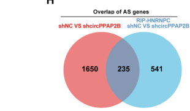

## Question

# Gene Research for Functional Annotation

## ⚠️ CRITICAL: Gene/Protein Identification Context

**BEFORE YOU BEGIN RESEARCH:** You MUST verify you are researching the CORRECT gene/protein. Gene symbols can be ambiguous, especially for less well-characterized genes from non-model organisms.

### Target Gene/Protein Identity (from UniProt):
- **UniProt Accession:** P07910
- **Protein Description:** RecName: Full=Heterogeneous nuclear ribonucleoproteins C1/C2; Short=hnRNP C1/C2;
- **Gene Information:** Name=HNRNPC; Synonyms=HNRPC;
- **Organism (full):** Homo sapiens (Human).
- **Protein Family:** Belongs to the RRM HNRPC family. RALY subfamily.
- **Key Domains:** hnRNP_C. (IPR017347); Nucleotide-bd_a/b_plait_sf. (IPR012677); RBD_domain_sf. (IPR035979); RRM_dom. (IPR000504); RRM_HNRPC/RALY_subfam. (IPR051186)

### MANDATORY VERIFICATION STEPS:

1. **Check if the gene symbol "HNRNPC" matches the protein description above**
2. **Verify the organism is correct:** Homo sapiens (Human).
3. **Check if protein family/domains align with what you find in literature**
4. **If you find literature for a DIFFERENT gene with the same or similar symbol, STOP**

### If Gene Symbol is Ambiguous or You Cannot Find Relevant Literature:

**DO NOT PROCEED WITH RESEARCH ON A DIFFERENT GENE.** Instead:
- State clearly: "The gene symbol 'HNRNPC' is ambiguous or literature is limited for this specific protein"
- Explain what you found (e.g., "Found extensive literature on a different gene with the same symbol in a different organism")
- Describe the protein based ONLY on the UniProt information provided above
- Suggest that the protein function can be inferred from domain/family information

### Research Target:

Please provide a comprehensive research report on the gene **HNRNPC** (gene ID: HNRNPC, UniProt: P07910) in human.

The research report should be a detailed narrative explaining the function, biological processes, and localization of the gene product. Citations should be given for all claims.

You should prioritize authoritative reviews and primary scientific literature when conducting research. You can supplement
this with annotations you find in gene/protein databases, but these can be outdated or inaccurate.

We are specifically interested in the primary function of the gene - for enzymes, what reaction is catalyzed, and what is the substrate specificity? For transporters, what is the substrate? For structural proteins or adapters, what is the broader structural role? For signaling molecules, what is the role in the pathway.

We are interested in where in or outside the cell the gene product carries out its function.

We are also interested in the signaling or biochemical pathways in which the gene functions. We are less interested in broad pleiotropic effects, except where these elucidate the precise role.

Include evidence where possible. We are interested in both experimental evidence as well as inference from structure, evolution, or bioinformatic analysis. Precise studies should be prioritized over high-throughput, where available.

## Output

Question: You are an expert researcher providing comprehensive, well-cited information.

Provide detailed information focusing on:
1. Key concepts and definitions with current understanding
2. Recent developments and latest research (prioritize 2023-2024 sources)
3. Current applications and real-world implementations
4. Expert opinions and analysis from authoritative sources
5. Relevant statistics and data from recent studies

Format as a comprehensive research report with proper citations. Include URLs and publication dates where available.
Always prioritize recent, authoritative sources and provide specific citations for all major claims.

# Gene Research for Functional Annotation

## ⚠️ CRITICAL: Gene/Protein Identification Context

**BEFORE YOU BEGIN RESEARCH:** You MUST verify you are researching the CORRECT gene/protein. Gene symbols can be ambiguous, especially for less well-characterized genes from non-model organisms.

### Target Gene/Protein Identity (from UniProt):
- **UniProt Accession:** P07910
- **Protein Description:** RecName: Full=Heterogeneous nuclear ribonucleoproteins C1/C2; Short=hnRNP C1/C2;
- **Gene Information:** Name=HNRNPC; Synonyms=HNRPC;
- **Organism (full):** Homo sapiens (Human).
- **Protein Family:** Belongs to the RRM HNRPC family. RALY subfamily.
- **Key Domains:** hnRNP_C. (IPR017347); Nucleotide-bd_a/b_plait_sf. (IPR012677); RBD_domain_sf. (IPR035979); RRM_dom. (IPR000504); RRM_HNRPC/RALY_subfam. (IPR051186)

### MANDATORY VERIFICATION STEPS:

1. **Check if the gene symbol "HNRNPC" matches the protein description above**
2. **Verify the organism is correct:** Homo sapiens (Human).
3. **Check if protein family/domains align with what you find in literature**
4. **If you find literature for a DIFFERENT gene with the same or similar symbol, STOP**

### If Gene Symbol is Ambiguous or You Cannot Find Relevant Literature:

**DO NOT PROCEED WITH RESEARCH ON A DIFFERENT GENE.** Instead:
- State clearly: "The gene symbol 'HNRNPC' is ambiguous or literature is limited for this specific protein"
- Explain what you found (e.g., "Found extensive literature on a different gene with the same symbol in a different organism")
- Describe the protein based ONLY on the UniProt information provided above
- Suggest that the protein function can be inferred from domain/family information

### Research Target:

Please provide a comprehensive research report on the gene **HNRNPC** (gene ID: HNRNPC, UniProt: P07910) in human.

The research report should be a detailed narrative explaining the function, biological processes, and localization of the gene product. Citations should be given for all claims.

You should prioritize authoritative reviews and primary scientific literature when conducting research. You can supplement
this with annotations you find in gene/protein databases, but these can be outdated or inaccurate.

We are specifically interested in the primary function of the gene - for enzymes, what reaction is catalyzed, and what is the substrate specificity? For transporters, what is the substrate? For structural proteins or adapters, what is the broader structural role? For signaling molecules, what is the role in the pathway.

We are interested in where in or outside the cell the gene product carries out its function.

We are also interested in the signaling or biochemical pathways in which the gene functions. We are less interested in broad pleiotropic effects, except where these elucidate the precise role.

Include evidence where possible. We are interested in both experimental evidence as well as inference from structure, evolution, or bioinformatic analysis. Precise studies should be prioritized over high-throughput, where available.

# Human HNRNPC (UniProt P07910): functional annotation research report

## Identity and principal function

**Identity verified.** Human **HNRNPC** (also called **HNRPC**) encodes heterogeneous nuclear ribonucleoproteins **C1/C2**, collectively termed **hnRNP C**. The accession **P07910** maps to the human hnRNP-C group; **RALY** and **HNRNPU** are different genes, not alternative names for this protein. The supplied InterPro annotations—an RNA-recognition motif (RRM), its associated RNA-binding folds, and an HNRPC/RALY *subfamily* assignment—are consistent with the experimentally characterized human hnRNP C RRM. Subfamily membership does not make HNRNPC identical to RALY. (busch2012evolutionofsr pages 21-22, cienikova2014structuralandmechanistic pages 1-5)

**Primary molecular role:** hnRNP C is a predominantly **nuclear, sequence-selective RNA-binding and pre-mRNA-packaging protein**. It recognizes exposed, continuous uridine-rich RNA, organizes ribonucleoprotein complexes, and controls access of splicing and 3′-end-processing factors to their RNA substrates. It is **not an enzyme**: its immediate substrate is RNA, and its experimentally established activity is binding and regulation rather than catalysis of a chemical reaction. Nuclear pre-mRNA splicing—especially protection against cryptic splice-site use—is its most clearly established genome-wide function; alternative polyadenylation is another directly supported processing role. (cienikova2014structuralandmechanistic pages 1-5, zarnack2013directcompetitionbetween pages 2-4, zarnack2013directcompetitionbetween pages 6-7, navickas2023anmrnaprocessing pages 5-6)

The following matrix separates well-supported molecular mechanisms from context-specific findings and inference. (zarnack2013directcompetitionbetween pages 2-4, navickas2023anmrnaprocessing pages 5-6, shenasa2023premrnasplicingand pages 7-9, zheng2024circppap2bcontrolsmetastasis pages 9-13)

| Mechanism | Principal location | Evidence and quantitative result | Evidential qualifier |
|---|---|---|---|
| **U-rich RNA recognition and tetrameric packaging.** The N-terminal RRM directly recognizes exposed poly(U) tracts; C1 and C2 are alternative HNRNPC isoforms, not RALY. C1/C2 assemble into tetramers that organize long pre-mRNA segments. | Predominantly nucleoplasm; nascent pre-mRNP/40S hnRNP particles | NMR and biochemical studies used the human hnRNP C RRM (residues 2–106) and identified direct contacts with poly(U) RNA. Earlier primary work reported a tetramer footprint of approximately **230–240 nt** and transcript-length discrimination during nuclear export. P07910 maps to the human hnRNP-C group (cienikova2014structuralandmechanistic pages 1-5, busch2012evolutionofsr pages 21-22, levari2025repurposedhnrnpcbinds pages 17-19). | Direct structural evidence supports RRM–poly(U) recognition. The footprint/export results derive from older primary studies; available evidence does not establish separate cellular functions for C1 versus C2. |
| **U-tract-dependent splice regulation.** At antisense Alu elements, hnRNP C occupies continuous U tracts and excludes U2AF2/U2AF65 from cryptic 3′ splice sites; at *MAPT*, binding to intronic U tracts instead promotes exon 10 inclusion. | Nuclear pre-mRNA adjacent to regulated splice sites | HNRNPC depletion exposed **1,023 Alu exons**, and hnRNP C bound **72,625 intronic antisense Alus**; 39/43 statistically called events and 16/20 events changing more than twofold were RT-PCR validated. Recombinant hnRNP C1 nearly abolished U2AF2 binding to U10 RNA at equimolar concentration. For *MAPT*, knockdown induced exon-10 skipping, overexpression promoted inclusion, and mutation of U tracts in introns 9/10 abolished binding and regulation (zarnack2013directcompetitionbetween pages 2-4, zarnack2013directcompetitionbetween pages 6-7, zarnack2013directcompetitionbetween pages 4-6, xing2022identificationofhnrnpc pages 1-3). | Strong direct and perturbational evidence. Direction is **position- and transcript-dependent**: HNRNPC is not intrinsically a universal splicing repressor. |
| **Alternative polyadenylation coupled to translation through PABPC4.** HNRNPC occupancy near proximal poly(A) sites favors shorter 3′-UTR isoforms in a defined breast-cancer regulon; loss causes distal-site switching and downstream translational repression. MAPP independently identifies coordinated, U-rich motif-associated control of splicing and polyadenylation. | Nuclear 3′-end processing; translational consequences occur after export to the cytoplasm | In MDA-MB-231/MDA-LM2 models, **96%** of HNRNPC 3′-UTR targets were also bound by PABPC4; **1,263 mRNAs** were co-bound. PABPC4 depletion phenocopied APA changes, and double-knockdown epistasis supported a shared pathway. In 2024, MAPP identified **penta-U** as the strongest HNRNPC-associated motif around 3′/5′ splice sites and poly(A) sites, with ENCODE eCLIP support (navickas2023anmrnaprocessing pages 7-8, navickas2023anmrnaprocessing pages 5-6, navickas2023anmrnaprocessing pages 4-5, bak2024mappunravelsfrequent pages 3-6, bak2024mappunravelsfrequent pages 2-3). | Navickas et al. provide mechanistic perturbation, reporter, epistasis, and mouse-metastasis evidence. MAPP is motif/perturbation inference supported by eCLIP—not proof that HNRNPC represses every poly(A) site. |
| **Indirect m6A-sensitive binding (“m6A switch”).** m6A destabilizes local RNA structure and exposes a neighboring U tract to HNRNPC. | Mainly intronic/nuclear RNA structures affecting abundance and alternative splicing | The original study identified **39 experimentally analyzed m6A-switch sites**; expanded transcriptome analysis proposed **39,060 candidates**, including **2,798 high-confidence sites** whose HNRNPC binding decreased after METTL3/METTL14 depletion. Three examined switches showed approximately **3–8-fold** affinity enhancement (liu2017n6methyladenosinedependentrnastructural pages 57-63, shenasa2023premrnasplicingand pages 7-9). | HNRNPC recognizes the newly exposed U-rich sequence, not the methyl group; it should therefore be described as an **indirect, structure-dependent m6A effector**, not a canonical chemical reader such as a YTH-domain protein. |
| **Compartment- and disease-context-dependent circRNA scaffolding.** In ccRCC, m6A-modified circPPAP2B promotes HNRNPC nuclear import and assembly with splicing factors; in ESCC, cytoplasmic circ-FIRRE recruits HNRNPC to stabilize *GLI2* mRNA. | circPPAP2B axis: nuclear import/nucleus; circ-FIRRE axis: cytoplasm | circPPAP2B stabilized an HNRNPC–Vimentin–Importin-α7 complex; RNA-seq/RIP-seq shared **235 alternatively spliced genes** and **40 skipped-exon events**, with *CD44* exon 8 validated. A separate circPPAP2B–miR-182-5p–CYP1B1 branch must not be attributed to HNRNPC. In ESCC cells, pulldown, RIP, actinomycin-D decay assays, 3′-UTR reporters, and rescue experiments supported cytoplasmic circ-FIRRE/HNRNPC-dependent *GLI2* stabilization and Hedgehog signaling (zheng2024circppap2bcontrolsmetastasis pages 7-9, zheng2024circppap2bcontrolsmetastasis pages 9-13, zheng2024circppap2bcontrolsmetastasis media b54cdfef, zhou2023circularrnacirc‐firre pages 11-13). | Mechanistically detailed cancer-cell and xenograft studies, but context-specific and not evidence that cytoplasmic signaling is HNRNPC’s universal primary function. Neither pathway is yet a clinically validated HNRNPC-targeted therapy. |

*Table: A compact evidence matrix distinguishing HNRNPC’s established nuclear RNA-processing functions from context-specific cancer mechanisms. Quantitative findings and evidential limitations prevent conflation of direct biochemical mechanisms with computational inference or disease association.*

## RNA recognition, assembly, and localization

The N-terminal RRM binds **single-stranded poly(U) tracts**. A structural/biophysical investigation of the human RRM, residues **2–106**, used NMR and binding experiments to characterize contacts with U-rich oligoribonucleotides. Cellular iCLIP found particularly strong hnRNP C binding on uninterrupted tracts of **at least nine uridines**; experimentally inserting cytidines into a U₁₀ tract strongly impaired hnRNP C1 binding, whereas U2AF65 tolerated the substitutions. Thus RNA accessibility and tract continuity, not merely a generic pyrimidine-rich sequence, help specify its targets. **Cieniková et al., *Journal of the American Chemical Society*, September 2014:** https://doi.org/10.1021/ja507690d. **Zarnack et al., *Cell*, January 2013:** https://doi.org/10.1016/j.cell.2012.12.023. (cienikova2014structuralandmechanistic pages 1-5, zarnack2013directcompetitionbetween pages 2-4, zarnack2013directcompetitionbetween pages 4-6)

C1 and C2 are closely related protein isoforms that participate in hnRNP C assemblies; the established nuclear particle model involves a **tetramer** that packages a long segment of pre-mRNA. Older primary studies reported a footprint of approximately **230–240 nucleotides** per C-protein tetramer and implicated the tetramer in measuring RNA length when classifying RNA-polymerase-II transcripts for nuclear export. These packaging/export observations are useful context, but their underlying primary full texts were not available for independent inspection here; the footprint and export claims should not be mistaken for measurements from the 2014 isolated-RRM experiment. **Huang et al., *Molecular and Cellular Biology*, January 1994:** https://doi.org/10.1128/mcb.14.1.518-533.1994. **McCloskey et al., *Science*, March 2012:** https://doi.org/10.1126/science.1218469. (levari2025repurposedhnrnpcbinds pages 17-19, cienikova2014structuralandmechanistic pages 1-5)

**Site of action:** the principal location is the **nucleoplasm**, on newly synthesized or processing pre-mRNAs and nuclear ribonucleoprotein particles; splicing and cleavage/polyadenylation occur there. This does **not** mean HNRNPC is exclusively nuclear. Specific carcinoma-cell experiments observed cytoplasmic HNRNPC associated with a circular RNA and an mRNA-stabilization pathway, while another cancer study showed regulated *import into* the nucleus. These are demonstrated, **condition-dependent** localizations rather than grounds for redefining the protein as a constitutive cytoplasmic signaling component. (moro2013functionalcharacterizationof pages 10-13, navickas2023anmrnaprocessing pages 5-6, zhou2023circularrnacirc‐firre pages 11-13, zheng2024circppap2bcontrolsmetastasis pages 7-9)

## Core biochemical pathway: splice-site selection and transcriptome protection

The strongest direct mechanism is competition with the 3′-splice-site recognition factor **U2AF65/U2AF2**. Many intronic antisense **Alu** elements transcribe long U tracts next to latent splice sites. hnRNP C occupancy prevents U2AF2 from recognizing those sites; when HNRNPC is depleted, U2AF2 gains access and cryptic Alu sequence is incorporated into mRNA. In vitro, increasing recombinant hnRNP C1 almost eliminated U2AF2-RRM binding to U₁₀ RNA at equimolar concentrations; substituting cytidines largely relieved this competition. iCLIP, two independent knockdowns, RNA-seq, and targeted RT-PCR linked the biochemical competition to splicing in human HeLa cells. **Zarnack et al., *Cell*, January 2013:** https://doi.org/10.1016/j.cell.2012.12.023. (zarnack2013directcompetitionbetween pages 1-2, zarnack2013directcompetitionbetween pages 2-4, zarnack2013directcompetitionbetween pages 4-6)

The scale is substantial but experimentally defined: the investigators detected hnRNP C binding at **72,625 intronic antisense Alu elements** and found **1,023 Alu-derived exons** with increased inclusion after HNRNPC depletion. They validated **39 of 43** statistically called Alu events and **16 of 20** events identified by a greater-than-twofold threshold by RT-PCR. At hnRNP-C-bound repressed exons, U2AF2 occupancy rose approximately **threefold** after knockdown. These numbers describe the assays and thresholds in that study, **not** a universal count of every HNRNPC-regulated exon in every tissue. (zarnack2013directcompetitionbetween pages 6-7, zarnack2013directcompetitionbetween pages 4-6)

HNRNPC's effect is **RNA- and position-dependent**, not invariably exon repression. A locus-specific study used RNA antisense purification–mass spectrometry, knockdown/overexpression, and U-tract mutagenesis to show that hnRNP C binds U-rich sequences in introns **9 and 10** of human **MAPT** pre-mRNA and **promotes exon 10 inclusion**. Mutating those tracts removed binding and the splicing effect. This supplies a precise counterexample to assigning one direction of splicing regulation to all HNRNPC targets. **Xing et al., *RNA Biology*, 2022:** https://doi.org/10.1080/15476286.2021.2015175. (xing2022identificationofhnrnpc pages 1-3)

## Alternative polyadenylation and downstream translation

A **2023 primary study** in breast-cancer models connected HNRNPC binding near alternative poly(A) sites to **3′-UTR isoform choice**. In the studied regulon, reduced HNRNPC shifted transcripts from **proximal to distal** poly(A) sites, lengthening their 3′ UTRs; those longer transcripts reached the cytoplasm but showed reduced translation. Perturbation and reporters supported an HNRNPC-dependent RNA-processing effect. **PABPC4** was implicated by binding and epistasis: **96%** of HNRNPC 3′-UTR targets were also PABPC4-bound, and **1,263 mRNAs** were co-bound in the reported analysis. Downstream, **PDLIM5** protein was reduced without a corresponding mRNA decrease. Thus the best-supported route to altered protein output is **nuclear poly(A)-site choice → exported 3′-UTR isoform → cytoplasmic translational regulation**, rather than catalytic translation by HNRNPC. **Navickas et al., *Nature Cell Biology*, 2023:** https://doi.org/10.1038/s41556-023-01141-9. (navickas2023anmrnaprocessing pages 7-8, navickas2023anmrnaprocessing pages 5-6, navickas2023anmrnaprocessing pages 4-5)

The biological direction of this pathway should not be generalized across cancers: in those breast-cancer xenograft systems, HNRNPC or PABPC4 depletion **increased lung metastatic colonization**, and reducing HNRNPC in a PABPC4-depleted background did not further increase it. Patient-expression/survival comparisons were **associations**, whereas the cellular, reporter, and mouse perturbations provided the functional evidence. Other tumors can show different HNRNPC-associated phenotypes. (navickas2023anmrnaprocessing pages 7-8, navickas2023anmrnaprocessing pages 5-6, navickas2023anmrnaprocessing pages 9-10, zheng2024circppap2bcontrolsmetastasis pages 1-2)

A **2024 computational/perturbation analysis**, MAPP, independently found **penta-U** to be the strongest motif associated with HNRNPC-dependent changes at **3′ splice sites, 5′ splice sites, and poly(A) sites**. ENCODE eCLIP supported HNRNPC occupancy near the implicated sites. It strengthens the view that splicing and 3′-end processing are coupled at U-rich RNA, but motif activity inferred from knockdown RNA-seq does not, on its own, prove the molecular mechanism or imply that hnRNP C represses every proximal or distal poly(A) site. **Bak et al., *Nature Communications*, May 2024:** https://doi.org/10.1038/s41467-024-48046-1. (bak2024mappunravelsfrequent pages 2-3, bak2024mappunravelsfrequent pages 3-6)

## RNA modification and context-dependent signaling pathways

**m⁶A–RNA-structure pathway.** An N⁶-methyladenosine modification can destabilize a local RNA stem and expose a previously paired **U tract** for HNRNPC binding. HNRNPC therefore responds **indirectly** to m⁶A-dependent RNA folding; calling it a direct methyl-group-reading protein in the manner of a canonical YTH-domain reader would misstate the supported mechanism. Altered access to these sites has been linked experimentally to RNA abundance and alternative splicing. Reported catalogs range from originally examined sites to thousands of candidate switches, so candidate counts should not be interpreted as individually biophysically validated structures. **Liu et al., *Nature*, 2015:** https://doi.org/10.1038/nature14234. **Shenasa and Bentley, *Trends in Genetics*, 2023:** https://doi.org/10.1016/j.tig.2023.04.008. (shenasa2023premrnasplicingand pages 7-9, liu2017n6methyladenosinedependentrnastructural pages 57-63, liu2017n6methyladenosinedependentrnastructural pages 113-118)

**Renal-carcinoma circRNA and nuclear import, 2024.** In clear-cell renal carcinoma models, methylated **circPPAP2B** associated with HNRNPC and favored its import through an HNRNPC–vimentin–importin-α7 complex. Perturbation of the circRNA's candidate m⁶A site reduced HNRNPC association; changes in its interactions with **PTBP1** and **HNRNPK** accompanied altered alternative splicing. Combined RNA-seq/RIP-seq identified **235 shared alternatively spliced genes** and **40 shared skipped-exon events**; **CD44 exon 8** regulation was followed up experimentally. The authors also described a **separate** circPPAP2B→miR-182-5p→CYP1B1 branch: CYP1B1 must **not** be presented as a demonstrated direct HNRNPC splice target on that basis. These are carcinoma-model findings, not an established universal HNRNPC pathway or a validated clinical treatment. **Zheng et al., *Molecular Cancer*, January 2024:** https://doi.org/10.1186/s12943-023-01912-w. (zheng2024circppap2bcontrolsmetastasis pages 7-9, zheng2024circppap2bcontrolsmetastasis pages 9-13, zheng2024circppap2bcontrolsmetastasis pages 13-15, zheng2024circppap2bcontrolsmetastasis media b54cdfef)

**Esophageal-carcinoma cytoplasmic function, 2023.** In esophageal squamous carcinoma cells, imaging showed cytoplasmic colocalization of HNRNPC with **circ-FIRRE**. RNA pulldown/RIP, transcription-arrest decay assays, 3′-UTR deletion reporters, and HNRNPC rescue supported stabilization of **GLI2 mRNA** by this complex. GLI2 is the pathway-relevant downstream transcription factor; increasing its expression promoted a **Hedgehog-associated** transcriptional program. This is a mechanistically investigated example of HNRNPC acting *upstream* of signaling through mRNA regulation, **not** evidence that HNRNPC itself is a Hedgehog receptor or kinase. **Zhou et al., *Cancer Science*, July 2023:** https://doi.org/10.1111/cas.15899. (zhou2023circularrnacirc‐firre pages 11-13, zhou2023circularrnacirc‐firre pages 9-11)

## Human relevance and assessment

Evidence beyond cell-line expression correlations comes from **13 individuals** reported with heterozygous germline **HNRNPC** variants and neurodevelopmental phenotypes; **five** carried the same nine-amino-acid C-terminal deletion. Patient-derived cells showed reduced HNRNPC abundance, while that recurrent deletion did **not** measurably disrupt its localization or oligomerization. An HNRNPC-dependent alternative-splicing signature derived from three cell-line datasets was observed in an affected individual's fibroblasts and enriched for intellectual-disability-associated genes. This supports sensitivity to HNRNPC dosage and RNA-processing defects, although it does not establish that any *one* misspliced transcript explains the entire phenotype. **Niggl et al., *American Journal of Human Genetics*, August 3, 2023:** https://doi.org/10.1016/j.ajhg.2023.07.005. (niggl2023hnrnpchaploinsufficiencyaffects pages 1-3)

**Functional-annotation conclusion:** annotate **HNRNPC/P07910** first as a **predominantly nucleoplasmic poly(U)-binding pre-mRNP organizer and regulator of splice-site accessibility and alternative 3′-end processing**. Its clearest defined biochemical interaction is occupancy of continuous U-rich RNA, which can competitively block U2AF2 at cryptic Alu splice sites; transcript-specific exon promotion, nuclear APA control, RNA-length-dependent export, and conditional cytoplasmic mRNA stabilization refine—not replace—that annotation. Evidence for targeting HNRNPC therapeutically remains substantially less mature than evidence for these molecular functions. (zarnack2013directcompetitionbetween pages 2-4, zarnack2013directcompetitionbetween pages 6-7, navickas2023anmrnaprocessing pages 5-6, levari2025repurposedhnrnpcbinds pages 17-19, zhou2023circularrnacirc‐firre pages 11-13)

References

1. (busch2012evolutionofsr pages 21-22): Anke Busch and Klemens J. Hertel. Evolution of sr protein and hnrnp splicing regulatory factors. Wiley Interdisciplinary Reviews: RNA, 3:1-12, Sep 2012. URL: https://doi.org/10.1002/wrna.100, doi:10.1002/wrna.100. This article has 568 citations.

2. (cienikova2014structuralandmechanistic pages 1-5): Zuzana Cieniková, Fred F. Damberger, Jonathan Hall, Frédéric H.-T. Allain, and Christophe Maris. Structural and mechanistic insights into poly(uridine) tract recognition by the hnrnp c rna recognition motif. Journal of the American Chemical Society, 136 41:14536-44, Sep 2014. URL: https://doi.org/10.1021/ja507690d, doi:10.1021/ja507690d. This article has 104 citations and is from a highest quality peer-reviewed journal.

3. (zarnack2013directcompetitionbetween pages 2-4): Kathi Zarnack, Julian König, Mojca Tajnik, Iñigo Martincorena, Sebastian Eustermann, Isabelle Stévant, Alejandro Reyes, Simon Anders, Nicholas M. Luscombe, and Jernej Ule. Direct competition between hnrnp c and u2af65 protects the transcriptome from the exonization of alu elements. Cell, 152:453-466, Jan 2013. URL: https://doi.org/10.1016/j.cell.2012.12.023, doi:10.1016/j.cell.2012.12.023. This article has 588 citations and is from a highest quality peer-reviewed journal.

4. (zarnack2013directcompetitionbetween pages 6-7): Kathi Zarnack, Julian König, Mojca Tajnik, Iñigo Martincorena, Sebastian Eustermann, Isabelle Stévant, Alejandro Reyes, Simon Anders, Nicholas M. Luscombe, and Jernej Ule. Direct competition between hnrnp c and u2af65 protects the transcriptome from the exonization of alu elements. Cell, 152:453-466, Jan 2013. URL: https://doi.org/10.1016/j.cell.2012.12.023, doi:10.1016/j.cell.2012.12.023. This article has 588 citations and is from a highest quality peer-reviewed journal.

5. (navickas2023anmrnaprocessing pages 5-6): Albertas Navickas, Hosseinali Asgharian, Juliane Winkler, Lisa Fish, Kristle Garcia, Daniel Markett, Martin Dodel, Bruce Culbertson, Sohit Miglani, Tanvi Joshi, Phi Nguyen, Steven Zhang, Nicholas Stevers, Hun-Way Hwang, Faraz Mardakheh, Andrei Goga, and Hani Goodarzi. An mrna processing pathway suppresses metastasis by governing translational control from the nucleus. Nature Cell Biology, 25:892-903, Oct 2023. URL: https://doi.org/10.1038/s41556-023-01141-9, doi:10.1038/s41556-023-01141-9. This article has 50 citations and is from a highest quality peer-reviewed journal.

6. (shenasa2023premrnasplicingand pages 7-9): Hossein Shenasa and David L. Bentley. Pre-mrna splicing and its cotranscriptional connections. Trends in Genetics, 39:672-685, Sep 2023. URL: https://doi.org/10.1016/j.tig.2023.04.008, doi:10.1016/j.tig.2023.04.008. This article has 107 citations and is from a domain leading peer-reviewed journal.

7. (zheng2024circppap2bcontrolsmetastasis pages 9-13): Zaosong Zheng, Xiangbo Zeng, Yuanchao Zhu, Mengxin Leng, Zhiyong Zhang, Qiong Wang, Xiaocen Liu, Siying Zeng, Yongyuan Xiao, Chenxi Hu, Shiyu Pang, Tong Wang, Bihong Xu, Peidan Peng, Fei Li, and Wanlong Tan. Circppap2b controls metastasis of clear cell renal cell carcinoma via hnrnpc-dependent alternative splicing and targeting the mir-182-5p/cyp1b1 axis. Molecular Cancer, Jan 2024. URL: https://doi.org/10.1186/s12943-023-01912-w, doi:10.1186/s12943-023-01912-w. This article has 84 citations and is from a highest quality peer-reviewed journal.

8. (levari2025repurposedhnrnpcbinds pages 17-19): Liat Lev-Ari, Sandra Laster, Andrea Atzmon, Daniel Blumenkrants, Daniel Benhalevy, and Orna Elroy-Stein. Repurposed hnrnpc binds mature mrnas and safeguards the mitotic transcriptome. BioRxiv, Sep 2026. URL: https://doi.org/10.1101/2025.09.11.675670, doi:10.1101/2025.09.11.675670. This article has 2 citations.

9. (zarnack2013directcompetitionbetween pages 4-6): Kathi Zarnack, Julian König, Mojca Tajnik, Iñigo Martincorena, Sebastian Eustermann, Isabelle Stévant, Alejandro Reyes, Simon Anders, Nicholas M. Luscombe, and Jernej Ule. Direct competition between hnrnp c and u2af65 protects the transcriptome from the exonization of alu elements. Cell, 152:453-466, Jan 2013. URL: https://doi.org/10.1016/j.cell.2012.12.023, doi:10.1016/j.cell.2012.12.023. This article has 588 citations and is from a highest quality peer-reviewed journal.

10. (xing2022identificationofhnrnpc pages 1-3): Sansi Xing, Jane Wang, Ruilin Wu, Marco M. Hefti, John F. Crary, and Yu Lu. Identification of hnrnpc as a novel tau exon 10 splicing factor using rna antisense purification mass spectrometry. RNA Biology, 19:104-116, Dec 2022. URL: https://doi.org/10.1080/15476286.2021.2015175, doi:10.1080/15476286.2021.2015175. This article has 23 citations and is from a peer-reviewed journal.

11. (navickas2023anmrnaprocessing pages 7-8): Albertas Navickas, Hosseinali Asgharian, Juliane Winkler, Lisa Fish, Kristle Garcia, Daniel Markett, Martin Dodel, Bruce Culbertson, Sohit Miglani, Tanvi Joshi, Phi Nguyen, Steven Zhang, Nicholas Stevers, Hun-Way Hwang, Faraz Mardakheh, Andrei Goga, and Hani Goodarzi. An mrna processing pathway suppresses metastasis by governing translational control from the nucleus. Nature Cell Biology, 25:892-903, Oct 2023. URL: https://doi.org/10.1038/s41556-023-01141-9, doi:10.1038/s41556-023-01141-9. This article has 50 citations and is from a highest quality peer-reviewed journal.

12. (navickas2023anmrnaprocessing pages 4-5): Albertas Navickas, Hosseinali Asgharian, Juliane Winkler, Lisa Fish, Kristle Garcia, Daniel Markett, Martin Dodel, Bruce Culbertson, Sohit Miglani, Tanvi Joshi, Phi Nguyen, Steven Zhang, Nicholas Stevers, Hun-Way Hwang, Faraz Mardakheh, Andrei Goga, and Hani Goodarzi. An mrna processing pathway suppresses metastasis by governing translational control from the nucleus. Nature Cell Biology, 25:892-903, Oct 2023. URL: https://doi.org/10.1038/s41556-023-01141-9, doi:10.1038/s41556-023-01141-9. This article has 50 citations and is from a highest quality peer-reviewed journal.

13. (bak2024mappunravelsfrequent pages 3-6): Maciej Bak, Erik van Nimwegen, Ian U. Kouzel, Tamer Gur, Ralf Schmidt, Mihaela Zavolan, and Andreas J. Gruber. Mapp unravels frequent co-regulation of splicing and polyadenylation by rna-binding proteins and their dysregulation in cancer. Nature Communications, May 2024. URL: https://doi.org/10.1038/s41467-024-48046-1, doi:10.1038/s41467-024-48046-1. This article has 21 citations and is from a highest quality peer-reviewed journal.

14. (bak2024mappunravelsfrequent pages 2-3): Maciej Bak, Erik van Nimwegen, Ian U. Kouzel, Tamer Gur, Ralf Schmidt, Mihaela Zavolan, and Andreas J. Gruber. Mapp unravels frequent co-regulation of splicing and polyadenylation by rna-binding proteins and their dysregulation in cancer. Nature Communications, May 2024. URL: https://doi.org/10.1038/s41467-024-48046-1, doi:10.1038/s41467-024-48046-1. This article has 21 citations and is from a highest quality peer-reviewed journal.

15. (liu2017n6methyladenosinedependentrnastructural pages 57-63): Nian Liu. N6-methyladenosine-dependent rna structural switches modulate rna-protein interactions. Other, Jan 2017. URL: https://doi.org/10.6082/m1s75d8t, doi:10.6082/m1s75d8t. This article has 2 citations.

16. (zheng2024circppap2bcontrolsmetastasis pages 7-9): Zaosong Zheng, Xiangbo Zeng, Yuanchao Zhu, Mengxin Leng, Zhiyong Zhang, Qiong Wang, Xiaocen Liu, Siying Zeng, Yongyuan Xiao, Chenxi Hu, Shiyu Pang, Tong Wang, Bihong Xu, Peidan Peng, Fei Li, and Wanlong Tan. Circppap2b controls metastasis of clear cell renal cell carcinoma via hnrnpc-dependent alternative splicing and targeting the mir-182-5p/cyp1b1 axis. Molecular Cancer, Jan 2024. URL: https://doi.org/10.1186/s12943-023-01912-w, doi:10.1186/s12943-023-01912-w. This article has 84 citations and is from a highest quality peer-reviewed journal.

17. (zheng2024circppap2bcontrolsmetastasis media b54cdfef): Zaosong Zheng, Xiangbo Zeng, Yuanchao Zhu, Mengxin Leng, Zhiyong Zhang, Qiong Wang, Xiaocen Liu, Siying Zeng, Yongyuan Xiao, Chenxi Hu, Shiyu Pang, Tong Wang, Bihong Xu, Peidan Peng, Fei Li, and Wanlong Tan. Circppap2b controls metastasis of clear cell renal cell carcinoma via hnrnpc-dependent alternative splicing and targeting the mir-182-5p/cyp1b1 axis. Molecular Cancer, Jan 2024. URL: https://doi.org/10.1186/s12943-023-01912-w, doi:10.1186/s12943-023-01912-w. This article has 84 citations and is from a highest quality peer-reviewed journal.

18. (zhou2023circularrnacirc‐firre pages 11-13): Yongjia Zhou, Xia Xue, Junwen Luo, Peiwei Li, Zhaohua Xiao, Wenhao Zhang, Jie Zhou, Peichao Li, Jiangfeng Zhao, Haibo Ge, Zhongxian Tian, and Xiaogang Zhao. Circular rna circ‐firre interacts with hnrnpc to promote esophageal squamous cell carcinoma progression by stabilizing gli2 mrna. Cancer Science, 114:3608-3622, Jul 2023. URL: https://doi.org/10.1111/cas.15899, doi:10.1111/cas.15899. This article has 32 citations and is from a peer-reviewed journal.

19. (moro2013functionalcharacterizationof pages 10-13): A Moro. Functional characterization of the rna binding protein raly. Unknown journal, 2013.

20. (zarnack2013directcompetitionbetween pages 1-2): Kathi Zarnack, Julian König, Mojca Tajnik, Iñigo Martincorena, Sebastian Eustermann, Isabelle Stévant, Alejandro Reyes, Simon Anders, Nicholas M. Luscombe, and Jernej Ule. Direct competition between hnrnp c and u2af65 protects the transcriptome from the exonization of alu elements. Cell, 152:453-466, Jan 2013. URL: https://doi.org/10.1016/j.cell.2012.12.023, doi:10.1016/j.cell.2012.12.023. This article has 588 citations and is from a highest quality peer-reviewed journal.

21. (navickas2023anmrnaprocessing pages 9-10): Albertas Navickas, Hosseinali Asgharian, Juliane Winkler, Lisa Fish, Kristle Garcia, Daniel Markett, Martin Dodel, Bruce Culbertson, Sohit Miglani, Tanvi Joshi, Phi Nguyen, Steven Zhang, Nicholas Stevers, Hun-Way Hwang, Faraz Mardakheh, Andrei Goga, and Hani Goodarzi. An mrna processing pathway suppresses metastasis by governing translational control from the nucleus. Nature Cell Biology, 25:892-903, Oct 2023. URL: https://doi.org/10.1038/s41556-023-01141-9, doi:10.1038/s41556-023-01141-9. This article has 50 citations and is from a highest quality peer-reviewed journal.

22. (zheng2024circppap2bcontrolsmetastasis pages 1-2): Zaosong Zheng, Xiangbo Zeng, Yuanchao Zhu, Mengxin Leng, Zhiyong Zhang, Qiong Wang, Xiaocen Liu, Siying Zeng, Yongyuan Xiao, Chenxi Hu, Shiyu Pang, Tong Wang, Bihong Xu, Peidan Peng, Fei Li, and Wanlong Tan. Circppap2b controls metastasis of clear cell renal cell carcinoma via hnrnpc-dependent alternative splicing and targeting the mir-182-5p/cyp1b1 axis. Molecular Cancer, Jan 2024. URL: https://doi.org/10.1186/s12943-023-01912-w, doi:10.1186/s12943-023-01912-w. This article has 84 citations and is from a highest quality peer-reviewed journal.

23. (liu2017n6methyladenosinedependentrnastructural pages 113-118): Nian Liu. N6-methyladenosine-dependent rna structural switches modulate rna-protein interactions. Other, Jan 2017. URL: https://doi.org/10.6082/m1s75d8t, doi:10.6082/m1s75d8t. This article has 2 citations.

24. (zheng2024circppap2bcontrolsmetastasis pages 13-15): Zaosong Zheng, Xiangbo Zeng, Yuanchao Zhu, Mengxin Leng, Zhiyong Zhang, Qiong Wang, Xiaocen Liu, Siying Zeng, Yongyuan Xiao, Chenxi Hu, Shiyu Pang, Tong Wang, Bihong Xu, Peidan Peng, Fei Li, and Wanlong Tan. Circppap2b controls metastasis of clear cell renal cell carcinoma via hnrnpc-dependent alternative splicing and targeting the mir-182-5p/cyp1b1 axis. Molecular Cancer, Jan 2024. URL: https://doi.org/10.1186/s12943-023-01912-w, doi:10.1186/s12943-023-01912-w. This article has 84 citations and is from a highest quality peer-reviewed journal.

25. (zhou2023circularrnacirc‐firre pages 9-11): Yongjia Zhou, Xia Xue, Junwen Luo, Peiwei Li, Zhaohua Xiao, Wenhao Zhang, Jie Zhou, Peichao Li, Jiangfeng Zhao, Haibo Ge, Zhongxian Tian, and Xiaogang Zhao. Circular rna circ‐firre interacts with hnrnpc to promote esophageal squamous cell carcinoma progression by stabilizing gli2 mrna. Cancer Science, 114:3608-3622, Jul 2023. URL: https://doi.org/10.1111/cas.15899, doi:10.1111/cas.15899. This article has 32 citations and is from a peer-reviewed journal.

26. (niggl2023hnrnpchaploinsufficiencyaffects pages 1-3): Eva Niggl, Arjan Bouman, Lauren C. Briere, Remco M. Hoogenboezem, Ilse Wallaard, Joohyun Park, Jakob Admard, Martina Wilke, Emilio D.R.O. Harris-Mostert, Minetta Elgersma, Jennifer Bain, Meena Balasubramanian, Siddharth Banka, Paul J. Benke, Miriam Bertrand, Alyssa E. Blesson, Jill Clayton-Smith, Jamie M. Ellingford, Madelyn A. Gillentine, Dana H. Goodloe, Tobias B. Haack, Mahim Jain, Ian Krantz, Sharon M. Luu, Molly McPheron, Candace L. Muss, Sarah E. Raible, Nathaniel H. Robin, Michael Spiller, Susan Starling, David A. Sweetser, Isabelle Thiffault, Francesco Vetrini, Dennis Witt, Emily Woods, Dihong Zhou, J.C. Ambrose, P. Arumugam, R. Bevers, M. Bleda, F. Boardman-Pretty, C.R. Boustred, H. Brittain, M.A. Brown, M.J. Caulfield, G.C. Chan, A. Giess, J.N. Griffin, A. Hamblin, S. Henderson, T.J.P. Hubbard, R. Jackson, L.J. Jones, D. Kasperaviciute, M. Kayikci, A. Kousathanas, L. Lahnstein, A. Lakey, S.E.A. Leigh, I.U.S. Leong, F.J. Lopez, F. Maleady-Crowe, M. McEntagart, F. Minneci, J. Mitchell, L. Moutsianas, M. Mueller, N. Murugaesu, A.C. Need, P. O‘Donovan, C.A. Odhams, C. Patch, D. Perez-Gil, M.B. Pereira, J. Pullinger, T. Rahim, A. Rendon, T. Rogers, K. Savage, K. Sawant, R.H. Scott, A. Siddiq, A. Sieghart, S.C. Smith, A. Sosinsky, A. Stuckey, M. Tanguy, A.L. Taylor Tavares, E.R.A. Thomas, S.R. Thompson, A. Tucci, M.J. Welland, E. Williams, K. Witkowska, S.M. Wood, M. Zarowiecki, Maria T. Acosta, David R. Adams, Raquel L. Alvarez, Justin Alvey, Aimee Allworth, Ashley Andrews, Euan A. Ashley, Ben Afzali, Carlos A. Bacino, Guney Bademci, Ashok Balasubramanyam, Dustin Baldridge, Jim Bale, Michael Bamshad, Deborah Barbouth, Pinar Bayrak-Toydemir, Anita Beck, Alan H. Beggs, Edward Behrens, Gill Bejerano, Hugo J. Bellen, Jimmy Bennet, Jonathan A. Bernstein, Gerard T. Berry, Anna Bican, Stephanie Bivona, Elizabeth Blue, John Bohnsack, Devon Bonner, Lorenzo Botto, Lauren C. Briere, Gabrielle Brown, Elizabeth A. Burke, Lindsay C. Burrage, Manish J. Butte, Peter Byers, William E. Byrd, John Carey, Olveen Carrasquillo, Thomas Cassini, Ta Chen Chang, Sirisak Chanprasert, Hsiao-Tuan Chao, Ivan Chinn, Gary D. Clark, Terra R. Coakley, Laurel A. Cobban, Joy D. Cogan, Matthew Coggins, F. Sessions Cole, Heather A. Colley, Heidi Cope, Rosario Corona, William J. Craigen, Andrew B. Crouse, Michael Cunningham, Precilla D'Souza, Hongzheng Dai, Surendra Dasari, Joie Davis, Jyoti G. Dayal, Margaret Delgado, Esteban C. Dell'Angelica, Katrina Dipple, Daniel Doherty, Naghmeh Dorrani, Argenia L. Doss, Emilie D. Douine, Dawn Earl, David J. Eckstein, Lisa T. Emrick, Christine M. Eng, Marni Falk, Elizabeth L. Fieg, Paul G. Fisher, Brent L. Fogel, Irman Forghani, Jiayu Fu, William A. Gahl, Ian Glass, Page C. Goddard, Rena A. Godfrey, Alana Grajewski, Meghan C. Halley, Rizwan Hamid, Neal Hanchard, Kelly Hassey, Nichole Hayes, Frances High, Anne Hing, Fuki M. Hisama, Ingrid A. Holm, Jason Hom, Martha Horike-Pyne, Alden Huang, Yan Huang, Sarah Hutchison, Wendy Introne, Rosario Isasi, Kosuke Izumi, Gail P. Jarvik, Jeffrey Jarvik, Suman Jayadev, Orpa Jean-Marie, Vaidehi Jobanputra, Emerald Kaitryn, Shamika Ketkar, Dana Kiley, Gonench Kilich, Shilpa N. Kobren, Isaac S. Kohane, Jennefer N. Kohler, Susan Korrick, Deborah Krakow, Donna M. Krasnewich, Elijah Kravets, Seema R. Lalani, Byron Lam, Christina Lam, Brendan C. Lanpher, Ian R. Lanza, Kimberly LeBlanc, Brendan H. Lee, Roy Levitt, Richard A. Lewis, Pengfei Liu, Xue Zhong Liu, Nicola Longo, Sandra K. Loo, Joseph Loscalzo, Richard L. Maas, Ellen F. Macnamara, Calum A. MacRae, Valerie V. Maduro, AudreyStephannie Maghiro, Rachel Mahoney, May Christine Malicdan, Laura A. Mamounas, Teri A. Manolio, Rong Mao, Ronit Marom, Gabor Marth, Beth A. Martin, Martin G. Martin, Julian A. Martínez-Agosto, Shruti Marwaha, Jacob McCauley, Allyn McConkie-Rosell, Alexa T. McCray, Elisabeth McGee, Matthew Might, Danny Miller, Ghayda Mirzaa, Eva Morava, Paolo Moretti, Marie Morimoto, John J. Mulvihill, Mariko Nakano-Okuno, Stanley F. Nelson, Shirley Nieves-Rodriguez, Donna Novacic, Devin Oglesbee, James P. Orengo, Laura Pace, Stephen Pak, J. Carl Pallais, Jeanette C. Papp, Neil H. Parker, Leoyklang Petcharet, John A. Phillips, Jennifer E. Posey, Lorraine Potocki, Barbara N. Swerdzewski, Aaron Quinlan, Deepak A. Rao, Anna Raper, Wendy Raskind, Genecee Renteria, Chloe Reuter, Lynette Rives, Amy K. Robertson, Lance H. Rodan, Jill A. Rosenfeld, Elizabeth Rosenthal, Francis Rossignol, Maura Ruzhnikov, Marla Sabaii, Ralph Sacco, Jacinda B. Sampson, Mario Saporta, Judy Schaechter, Timothy Schedl, Kelly Schoch, Daryl A. Scott, Elaine Seto, Prashant Sharma, Vandana Shashi, Emily Shelkowitz, Sam Sheppeard, Jimann Shin, Edwin Silverman, Janet Sinsheimer, Kathy Sisco, Edward Smith, Kevin Smith, Lilianna Solnica-Krezel, Ben Solomon, Rebecca Spillmann, Andrew Stergachis, Joan Stoler, Kathleen Sullivan, Jennifer Sullivan, Shirley Sutton, David A. Sweetser, Virginia Sybert, Holly K. Tabor, Queenie K.-G. Tan, Amelia L. Tan, Arjun Tarakad, Mustafa Tekin, Fred Telischi, Willa Thorson, Cynthia Tifft, Camilo Toro, Alyssa A. Tran, Rachel A. Ungar, Tiina K. Urv, Adeline Vanderver, Matt Velinder, Dave Viskochil, Tiphanie P. Vogel, Colleen E. Wahl, Melissa Walker, Nicole M. Walley, Jennifer Wambach, Jijun Wan, Lee-kai Wang, Michael F. Wangler, Patricia A. Ward, Daniel Wegner, Monika Weisz, Mark Wener, Tara Wenger, Monte Westerfield, Matthew T. Wheeler, Jordan Whitlock, Lynne A. Wolfe, Shinya Yamamoto, Zhe Zhang, Stephan Zuchner, Ype Elgersma, and Annelot C.M. van Esbroeck. Hnrnpc haploinsufficiency affects alternative splicing of intellectual disability-associated genes and causes a neurodevelopmental disorder. The American Journal of Human Genetics, 110:1414-1435, Aug 2023. URL: https://doi.org/10.1016/j.ajhg.2023.07.005, doi:10.1016/j.ajhg.2023.07.005. This article has 26 citations.

## Artifacts

- [Edison artifact artifact-00](HNRNPC-deep-research-falcon_artifacts/artifact-00.md)

## Citations

1. xing2022identificationofhnrnpc pages 1-3
2. niggl2023hnrnpchaploinsufficiencyaffects pages 1-3
3. busch2012evolutionofsr pages 21-22
4. cienikova2014structuralandmechanistic pages 1-5
5. zarnack2013directcompetitionbetween pages 2-4
6. zarnack2013directcompetitionbetween pages 6-7
7. navickas2023anmrnaprocessing pages 5-6
8. shenasa2023premrnasplicingand pages 7-9
9. levari2025repurposedhnrnpcbinds pages 17-19
10. zarnack2013directcompetitionbetween pages 4-6
11. navickas2023anmrnaprocessing pages 7-8
12. navickas2023anmrnaprocessing pages 4-5
13. bak2024mappunravelsfrequent pages 3-6
14. bak2024mappunravelsfrequent pages 2-3
15. moro2013functionalcharacterizationof pages 10-13
16. zarnack2013directcompetitionbetween pages 1-2
17. navickas2023anmrnaprocessing pages 9-10
18. https://doi.org/10.1021/ja507690d.
19. https://doi.org/10.1016/j.cell.2012.12.023.
20. https://doi.org/10.1128/mcb.14.1.518-533.1994.
21. https://doi.org/10.1126/science.1218469.
22. https://doi.org/10.1080/15476286.2021.2015175.
23. https://doi.org/10.1038/s41556-023-01141-9.
24. https://doi.org/10.1038/s41467-024-48046-1.
25. https://doi.org/10.1038/nature14234.
26. https://doi.org/10.1016/j.tig.2023.04.008.
27. https://doi.org/10.1186/s12943-023-01912-w.
28. https://doi.org/10.1111/cas.15899.
29. https://doi.org/10.1016/j.ajhg.2023.07.005.
30. https://doi.org/10.1002/wrna.100,
31. https://doi.org/10.1021/ja507690d,
32. https://doi.org/10.1016/j.cell.2012.12.023,
33. https://doi.org/10.1038/s41556-023-01141-9,
34. https://doi.org/10.1016/j.tig.2023.04.008,
35. https://doi.org/10.1186/s12943-023-01912-w,
36. https://doi.org/10.1101/2025.09.11.675670,
37. https://doi.org/10.1080/15476286.2021.2015175,
38. https://doi.org/10.1038/s41467-024-48046-1,
39. https://doi.org/10.6082/m1s75d8t,
40. https://doi.org/10.1111/cas.15899,
41. https://doi.org/10.1016/j.ajhg.2023.07.005,