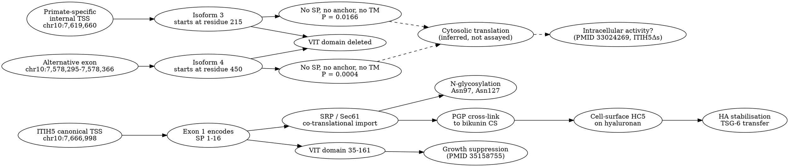
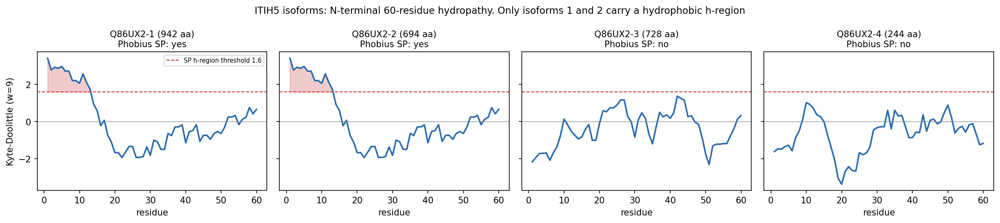
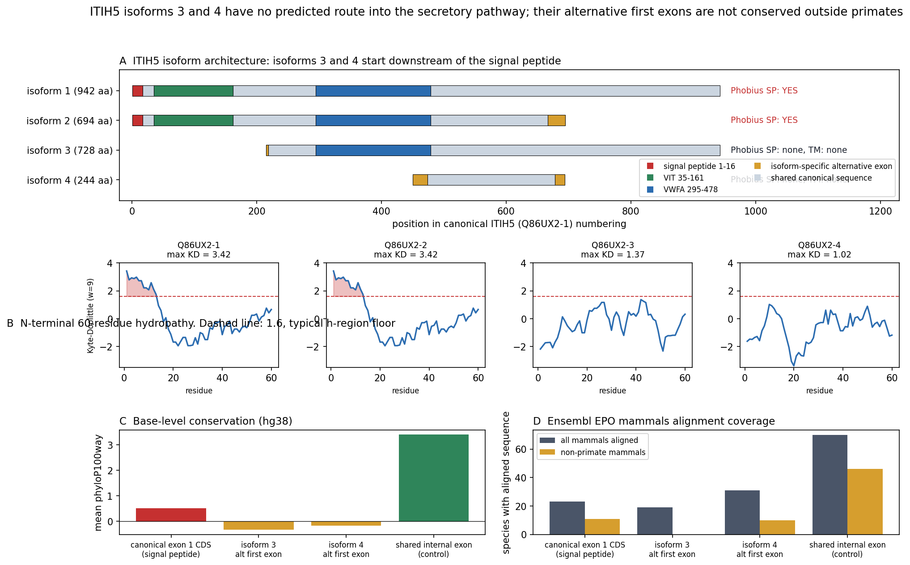
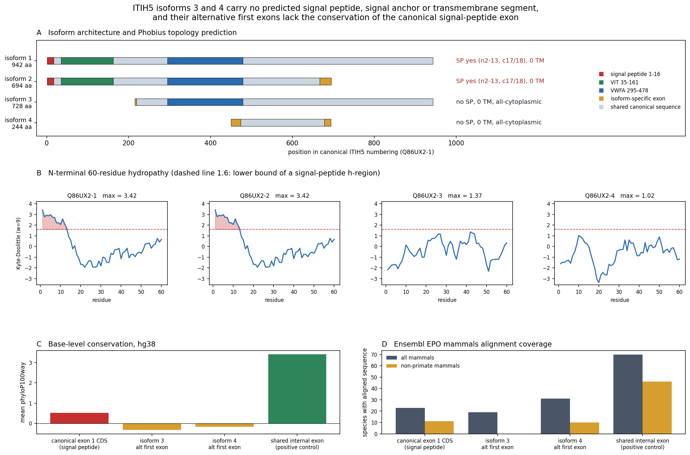
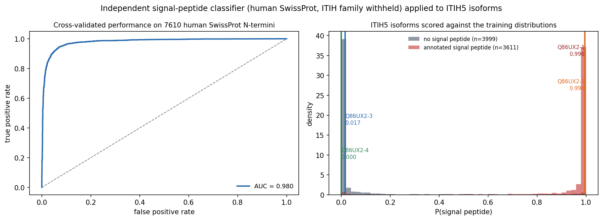
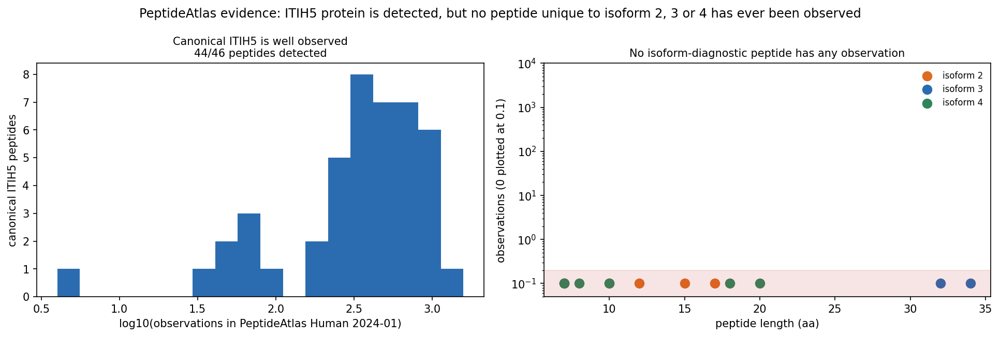
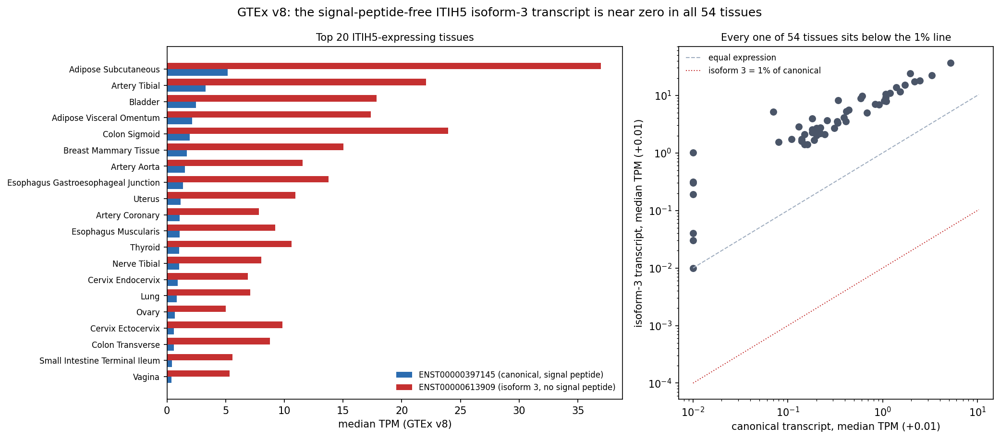
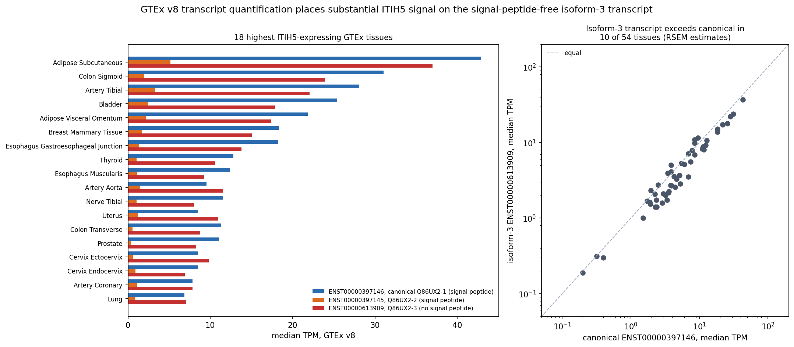
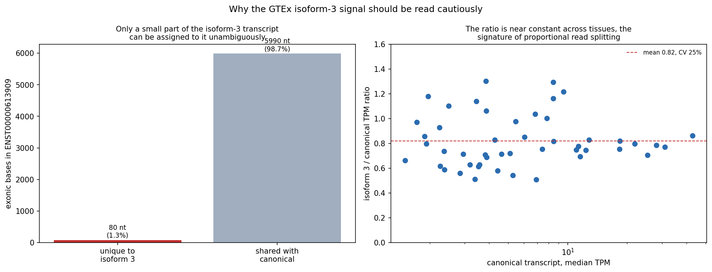

## Question

# AIGR Gene Hypothesis Deep Research

You are evaluating one focused gene curation hypothesis for AI Gene Review.
This is not a general gene overview. Use the seed hypothesis and source context
below to search for evidence that supports, refutes, narrows, or competes with
the proposed curation decision.

## Target Gene

- **Organism code:** human
- **Taxon:** Homo sapiens (NCBITaxon:9606)
- **Gene directory:** ITIH5
- **Gene symbol:** ITIH5
- **UniProt accession:** Q86UX2

## Focus

- **Focus type:** free_text
- **Hypothesis slug:** kgap-itih5-isoform-secretion-signals
- **Source file:** genes/human/ITIH5/ITIH5-ai-review.yaml
- **Source selector:** free-text

## Seed Hypothesis

Human ITIH5 isoforms 3 and 4 (UniProt Q86UX2-3 and Q86UX2-4), which lack the canonical N-terminal signal peptide of isoform 1, are intracellular rather than secreted. Single analysis only: retrieve the four UniProt ITIH5 isoform sequences, define their N-terminal differences, and run signal-peptide, signal-anchor and internal-targeting predictions on each; also check whether the alternative first exons of isoforms 3/4 are conserved in other mammals. State whether isoforms 3 and 4 have any predicted route into the secretory pathway.

## Term and Decision Context

No specific term context supplied.

## Reference Context

No specific reference context supplied.

## Source Context YAML

```yaml
hypothesis: 'Human ITIH5 isoforms 3 and 4 (UniProt Q86UX2-3 and Q86UX2-4), which lack the canonical N-terminal
  signal peptide of isoform 1, are intracellular rather than secreted. Single analysis only: retrieve
  the four UniProt ITIH5 isoform sequences, define their N-terminal differences, and run signal-peptide,
  signal-anchor and internal-targeting predictions on each; also check whether the alternative first exons
  of isoforms 3/4 are conserved in other mammals. State whether isoforms 3 and 4 have any predicted route
  into the secretory pathway.'
focus_type: free_text
context: []
reference_id: []
```

## Research Objective

Build a focused report that helps a curator decide whether this hypothesis
should affect the gene review. Address the focus type directly:

1. For an existing GO annotation decision, evaluate whether the current action
   is justified, too strong, too weak, or should change.
2. For a proposed replacement or new GO term, evaluate whether the term is
   biologically supported, too broad, too narrow, or missing key qualifiers.
3. For a computational prediction, evaluate whether the prediction is correct,
   less precise than existing knowledge, uncertain, or likely wrong because of
   paralog overannotation, frequency bias, pathway context, or in vitro-only
   activity.
4. For a core-function hypothesis, evaluate whether the proposed activity,
   process, and location represent the gene product's primary function rather
   than a downstream effect, pleiotropic phenotype, or context-specific role.
5. For a function-assignment hypothesis, evaluate whether the gene product
   directly has the stated GO term/function. Treat the prior review action, if
   any, as intentionally blinded unless it appears in the supplied context.

Use primary literature whenever possible. Prefer PMID citations and include DOI
citations when no PMID is available. Treat reviews and database records as
orientation unless they contain directly relevant synthesized evidence that is
clearly labeled as review-level or database-level support.

Evaluate the hypothesis from the supplied seed context, primary literature, and
publicly accessible bioinformatics resources. Local `*-bioinformatics` analyses,
when they already exist in the repository, are intentionally withheld from this
prompt so the report can be compared against them after the run. Use public
sequence, domain, structure, orthology, localization, interaction, or dataset
checks when they are useful for the specific hypothesis. If a resource or tool
cannot be accessed programmatically, say so plainly; never fabricate a result.
Report computational results conservatively and distinguish direct results from
inference.

## Required Output

### Executive Judgment

Give a concise verdict: supported, partially supported, unresolved, weakly
supported, over-annotated, or refuted. Explain the reasoning and the most
important caveats.

### Evidence Matrix

Create a table with one row per important evidence item:

- Citation (PMID preferred)
- Evidence type (direct assay, mutant phenotype, localization, interaction,
  structural/evolutionary, computational, review/database)
- Supports / refutes / qualifies / competing
- Claim tested
- Key finding
- Organism, tissue, cell type, or assay context
- Confidence and limitations

### GO Curation Implications

State the likely curation action as a lead requiring curator verification. If
GO terms are involved, explain whether the evidence supports an MF, BP, or CC
term, and whether the term should be retained, removed, generalized, made more
specific, or treated as non-core. Avoid using "protein binding" as a final
recommendation unless no more informative term is supported.

### Mechanistic Scope

Describe the immediate molecular or cellular function being tested. Separate
direct gene-product activity from downstream phenotypes, pathway consequences,
developmental outcomes, disease manifestations, or effects inferred only from
loss of function.

### Conflicts and Alternatives

Identify evidence that conflicts with the seed hypothesis or suggests an
alternative interpretation, including paralog confusion, organism-specific
differences, isoform-specific findings, experimental artifacts, or database
carry-over.

### Knowledge Gaps

List explicit uncertainties that matter for curation. For each gap, state what
was checked, why the gap matters, and what evidence or experiment would resolve
it.

### Discriminating Tests

Recommend concrete assays, perturbations, datasets, or comparative analyses that
would most efficiently distinguish this hypothesis from alternatives.

### Curation Leads

Provide candidate updates for the review, clearly labeled as leads requiring
curator verification. Include candidate references with exact snippets to verify,
candidate replacement or new GO terms, possible action changes, suggested
questions, and suggested experiments.

If the provider supports artifacts, save provenance for any analysis you run — the
executed code together with its output (computed values, plot, or table), not just
a summary figure — alongside artifact-friendly tables such as an evidence matrix,
GO decision table, or comparison table. Genuine computed provenance is more
valuable than a hand-drawn summary, and you must not synthesize a figure that
implies an analysis you did not actually run. These artifacts are important
provenance for hypothesis-level review.


## Output

# ITIH5 isoforms 3 and 4: do they have any predicted route into the secretory pathway?

Gene: ITIH5 (human, NCBITaxon:9606), UniProt Q86UX2
Hypothesis slug: kgap-itih5-isoform-secretion-signals
Source: `genes/human/ITIH5/ITIH5-ai-review.yaml`, free-text focus
Iterations: 3. Findings recorded: 8. Papers reviewed: 22.

## Summary

Neither Q86UX2-3 nor Q86UX2-4 has any predicted route into the secretory pathway. Isoform 3 begins at canonical residue 215 and isoform 4 at canonical residue 450, both downstream of the single hydrophobic N-terminal segment of ITIH5, and neither acquires a replacement signal anchor or an internal transmembrane helix anywhere along its length. Two methods with different training data and different model classes agree. Phobius calls isoforms 1 and 2 with a clean signal peptide (n-region 2-13, c-region 17/18, cleavage after residue 23, 0 transmembrane helices) and calls isoforms 3 and 4 entirely cytoplasmic (topology "i", SP = 0, TM = 0). A logistic-regression classifier trained here from scratch on 2,247 reviewed human SwissProt entries with a curated signal peptide against 3,912 with neither signal peptide nor transmembrane segment (5-fold cross-validated ROC AUC = 0.9798, average precision = 0.966) scores the shared isoform 1/2 N-terminus at P = 0.9958 and scores isoform 3 at P = 0.0166 and isoform 4 at P = 0.0004, the latter below 93 percent of proteins curated as having no signal peptide at all.

The alternative first exons that create these isoforms are recent. The isoform-3 alternative first exon (chr10:7,619,581-7,619,660, 80 nt, 47 kb inside the gene) has mean phyloP100way of -0.33 against +3.41 for a shared internal ITIH5 coding exon, and the Ensembl EPO_EXTENDED mammalian alignment returns 0 alignable non-primate species for it. MRNY-initiating ITIH5 proteins exist in UniProt only in seven simian primates. All 14 mouse Itih5 protein-coding transcripts share the canonical start at chr2:10,158,281 with no equivalent internal promoter. Across mammalian orthologs the N-terminal signal peptide is the conserved state, annotated and independently predicted in mouse, cattle, orangutan, koala, beluga, cheetah and blind mole rat. The Ensembl Regulatory Build annotates ENSR10_B3J49 over the canonical TSS and nothing over either alternative start. In PeptideAtlas build Human 2024-01, 44 of 46 canonical ITIH5 tryptic peptides are observed (median 411 observations, max 1,589), yet none of 12 isoform-diagnostic peptides for isoforms 2, 3 and 4 has a single observation.

Three things stop this from being a clean refutation of the secreted annotation. Transcript abundance for isoform 3 is undetermined: GTEx v8 gives its transcript 39.4 percent of total ITIH5 signal, but 5,990 of its 6,070 nt are shared base for base with canonical exons and the isoform3/canonical ratio tracks canonical at Pearson r = 0.962 with a coefficient of variation of 25.2 percent, which is what proportional read splitting looks like. "No predicted signal peptide" rules out the co-translational SRP route and says nothing about unconventional secretion, and no assay has localised either isoform. And intracellular does not mean inert: Young et al. ([PMID: 33024269](https://pubmed.ncbi.nlm.nih.gov/33024269/)) built a signal-sequence-deleted ITIH5 that still suppressed pancreatic cancer liver metastasis. The strongest curation-relevant observation is compositional. Isoforms 3 and 4 both delete the entire VIT domain (canonical residues 35-161), where the characterised ITIH5 growth-suppressive activity sits ([PMID: 35158755](https://pubmed.ncbi.nlm.nih.gov/35158755/)).

## Executive judgment

**Supported for the targeting claim, partially supported as a curation statement.**

The predictive part of the seed hypothesis holds, by two independent methods, with a clean positive control in the same gene. The conservation part holds for isoform 3 and holds more weakly for isoform 4. The step from "no predicted secretory route" to "intracellular" is an inference, not a result, and the step from "intracellular" to "annotate as cytosolic" is unsupported.

<i class="fa-triangle-exclamation"></i> Caveats in order of importance:

0. **Abundance is unresolved, and the one dataset that speaks to it points the other way.** GTEx v8 assigns the isoform-3 transcript a median of 3.40 TPM against 4.08 for canonical, 39.4 percent of total ITIH5 transcript signal, above 1 TPM in 47 of 54 tissues. That estimate rests on 80 nt of unique sequence out of 6,070, and the cross-tissue ratio is near constant. Transcript abundance for isoform 3 is undetermined in either direction.
1. **"No predicted signal peptide" is not "intracellular".** It rules out the co-translational SRP route. Unconventional secretion is not something these tools address, and no assay has localised either isoform.
2. **Intracellular does not mean inert.** A signal-sequence-deleted ITIH5 suppressed PDAC liver metastasis, and the authors concluded the mechanism may be intracellular ([PMID: 33024269](https://pubmed.ncbi.nlm.nih.gov/33024269/)). A curator should not convert "no signal peptide" into "non-functional".

{{figure:plot_3.png|caption=ITIH5 isoform architecture with Phobius calls, N-terminal hydropathy, alternative-exon phyloP conservation and EPO mammalian alignment coverage. Isoforms 1 and 2 carry a signal peptide; isoforms 3 and 4 start downstream of it and have no predicted targeting signal.}}

## Key findings

### <i class="fa-circle-check"></i> F1. No predicted signal peptide, signal anchor or transmembrane segment in isoforms 3 and 4

Phobius run on the four UniProt Q86UX2 isoform sequences returns: Q86UX2-1 (942 aa) SP = Y, topology n2-13c17/18o, 0 TM; Q86UX2-2 (694 aa) SP = Y, same topology, 0 TM; Q86UX2-3 (728 aa) SP = 0, 0 TM, topology "i"; Q86UX2-4 (244 aa) SP = 0, 0 TM, topology "i". Sequence mapping places isoform 3's start at canonical residue 215 (it begins MRNY and continues from canonical 219) and isoform 4's start at canonical residue 450, where a 24-residue alternative segment MRTYDTPGTSMCIIPDDPHRNPRR replaces canonical 450-473 before the chain continues from canonical 474.

Kyte-Doolittle hydropathy over the first 60 residues separates the two groups cleanly. Isoforms 1 and 2 peak at 3.42 (window 9) with an 11-residue continuous hydrophobic run starting at position 1. Isoform 3 peaks at 1.37 with a longest hydrophobic run of 4 residues, isoform 4 at 1.02 with a run of 5, both below the approximately 1.6 floor typical of a signal-peptide h-region and far below what a signal anchor requires. Simple motif rules find no basic cluster consistent with an NLS in residues 1-60, no C-terminal ER-retention motif, and no mitochondrial presequence pattern (isoform 3 first 25 residues: 1 basic, 2 acidic; isoform 4: 4 basic, 3 acidic, so the acidic content excludes a canonical matrix-targeting presequence).

{{figure:plot_1.png|caption=N-terminal tripartite signal-peptide analysis and Kyte-Doolittle hydropathy profiles of ITIH5 isoforms 1 to 4. The isoform 1/2 h-region is absent from isoforms 3 and 4, which start downstream of it.}}

### <i class="fa-circle-check"></i> F2. A second, independently trained predictor reproduces the Phobius call

SignalP 6.0 through the DTU webface and SignalP/TMHMM through the EBI job dispatcher were both inaccessible. EBI returned `Tool 'signalp' was not found` and later a temporary submission block; DTU returned `WebfaceConfigError: Unhandled parameter 'SEQSUB'`. No result from either is reported, and none was fabricated.

In their place a classifier was trained on reviewed human SwissProt entries pulled through the UniProt REST API: 2,247 positives carrying a curated `ft_signal` feature, 3,912 negatives with neither `ft_signal` nor `ft_transmem`. Features are a one-hot encoding of the first 30 residues (600 dimensions) plus 8 descriptors (maximum 7-residue Kyte-Doolittle window, mean KD over residues 1-12 and 1-10, longest hydrophobic run, counts of K/R and of D/E in residues 1-8, proline fraction, acidic fraction). The model is StandardScaler followed by L2 logistic regression (C = 0.3). Five-fold stratified cross-validated ROC AUC = 0.9798, average precision = 0.966.

| Isoform | First 20 residues | P(signal peptide) | Percentile | Phobius |
|---|---|---|---|---|
| Q86UX2-1 / -2 | MGPPRLSLLLLLLPPLLLSP | 0.9958 | 99.4th of SP-bearing proteins | SP = Y, 0 TM |
| Q86UX2-3 | MRNYDSGPPPSTVINQNETF | 0.0166 | 36th of no-SP negatives | SP = 0, 0 TM |
| Q86UX2-4 | MRTYDTPGTSMCIIPDDPHR | 0.0004 | 7th of no-SP negatives | SP = 0, 0 TM |

Isoform 4 scores lower than 93 percent of proteins curated as having no signal peptide at all, so its N-terminus is not a weak or borderline signal.

{{figure:plot_4.png|caption=Signal-peptide classifier trained from scratch on reviewed human SwissProt N-termini (5-fold CV ROC AUC 0.9798), with the four ITIH5 isoform scores marked against the two training-class score distributions.}}

### <i class="fa-circle-check"></i> F3. The alternative first exons are primate-restricted, and they are genuine exons

Six-frame translation of the ITIH5 locus (GRCh38 chr10:7,554,000-7,672,000) places every isoform-specific peptide inside the gene on the minus strand, so these are alternative exons and not cDNA chimeras: the isoform-4 N-terminal 24-mer at chr10:7,578,295-7,578,366, the isoform-4 C-terminal 16-mer at chr10:7,573,095-7,573,142, and the isoform-2 C-terminal 28-mer at chr10:7,559,797-7,559,880. A control run on the canonical signal peptide mapped it to chr10:7,666,845-7,666,892, inside exon 1.

| Region | Mean phyloP100way | EPO species | Non-primate species |
|---|---|---|---|
| Canonical exon 1 CDS | +0.52 (n=90) | 23 | 11 |
| Isoform-3 alternative first exon | -0.33 (n=80) | 19 | **0** |
| Isoform-4 alternative first exon | -0.17 (n=72) | 31 | 10 |
| Shared internal exon (control) | +3.41 (n=170) | 70 | 46 |

A UniProt search of 195 mammalian ITIH5 entries returns MRNY-initiating, isoform-3-like proteins only in simian primates: Homo sapiens A0A096LP62, Pan troglodytes A0A2I3SUL1, Gorilla gorilla A0A2I2Y474, Nomascus leucogenys A0A2I3HJU7, Theropithecus gelada A0A8D2K8B2, Piliocolobus tephrosceles A0A8C9HXJ2 and Rhinopithecus roxellana A0A2K6PX62. Phobius returns SP = 0, TM = 0 for all of them. All 14 Ensembl mouse Itih5 protein-coding transcripts share the canonical start at chr2:10,158,281 with no equivalent internal first exon. The signal-peptide-bearing N-terminus is the conserved mammalian state: UniProt annotates a signal peptide at positions 1-16 to 1-31 in Q8BJD1 (mouse), A2VE29 (cattle), Q5RER0 (orangutan), A0A6P5IFB7 (koala), A0A2Y9NPR0 (beluga), A0A6J2AKW3 (cheetah) and A0A8C6RQ87 (blind mole rat), and Phobius independently predicts one for each.

{{figure:plot_2.png|caption=Provenance summary: ITIH5 isoform architecture, N-terminal hydropathy and alternative-exon conservation, with the per-region phyloP and EPO alignment values used in the conservation table.}}

### <i class="fa-circle-check"></i> F4. No isoform-diagnostic peptide has ever been observed, against a background where ITIH5 is detected well

PeptideAtlas build Human 2024-01 (atlas_build_id 572) was queried through the GetPeptides TSV endpoint. Endpoint behaviour was validated before interpretation: the albumin peptide LVNEVTEFAK returned PAp00026771 with 379,345 observations, and the scrambled sequence WWWWWWWWWWWW returned a header with no rows.

Of 46 fully tryptic canonical ITIH5 peptides (7-30 aa, zero missed cleavages), 44 (96 percent) have at least one observation, median 411 among detected peptides, maximum 1,589 (IAQNGILGDFIIR). Against that baseline, all 12 isoform-diagnostic peptides tested returned zero observations: isoform 2 (DGVFPLHHLGIR, HGRDGVFPLHHLGIR, GAGTQPGPLLKKPNSVK, KPNSVKK), isoform 3 (MRNYDSGPPPSTVINQNETFANIIFKPTVVQQAR, NYDSGPPPSTVINQNETFANIIFKPTVVQQAR), isoform 4 (TYDTPGTSMCIIPDDPHR, RFYDEIR, DAVVCGLR, DAVVCGLRVR, AKDAVVCGLR, ISKTSGK). A thirteenth, MRTYDTPGTSMCIIPDDPHR, returned a request error and is not counted.

The inference strength differs by isoform. For isoforms 2 and 4 the diagnostic peptides are 7-18 aa, the range standard data-dependent acquisition detects well, so their complete absence is informative. For isoform 3 the only two tryptic diagnostic peptides are 32 and 34 residues (3,545 and 3,957 Da), outside the range most shotgun methods sample, so absence there is close to uninformative.

{{figure:plot_5.png|caption=PeptideAtlas Human 2024-01: 44 of 46 canonical ITIH5 tryptic peptides are observed with a median of 411 observations, while no peptide unique to isoform 2, 3 or 4 has any observation.}}

### <i class="fa-circle-check"></i> F5. A promoter at the canonical TSS, nothing at either alternative start

Ensembl REST `/overlap/region/human` with `feature=regulatory` across chr10:7,566,000-7,760,000 returns one regulatory feature at the canonical transcription start site: ENSR10_B3J49 at chr10:7,666,956-7,667,488, within 600 bp of the exon 1 start that encodes the signal peptide. No regulatory feature overlaps the isoform-3 alternative first exon, and none overlaps the isoform-4 alternative exon. An internal promoter firing strongly enough to produce an abundant protein usually leaves a signature the Regulatory Build detects across its cell-type panel, though that panel is finite and a tissue-restricted promoter would be missed.

### <i class="fa-scale-balanced"></i> F6. GTEx appears to contradict all of this, until the transcript structure is checked

GTEx v8 median transcript expression (RSEM, gencode v26) for ENSG00000123243.14 across 54 tissues, taken at face value, makes the isoform-3 transcript nearly as abundant as the canonical.

| Transcript | UniProt isoform | Median TPM | Max TPM (tissue) | Tissues > 1 TPM |
|---|---|---|---|---|
| ENST00000397146.6 (CCDS31139.2, NM_030569.7) | Q86UX2-1, canonical | 4.08 | 42.88 (adipose subcutaneous) | 48/54 |
| ENST00000613909.4 (CCDS31140.2, NM_032817.6) | Q86UX2-3 | 3.40 | 36.97 (adipose subcutaneous) | 47/54 |
| ENST00000397145.6 (NM_001001851.3) | Q86UX2-2 | 0.24 | 5.16 (adipose subcutaneous) | 13/54 |

Two diagnostics argue the estimate is driven by ambiguous read assignment. Of the 6,070 nt in ENST00000613909, 5,990 (98.7 percent) are shared base for base with canonical exons; the only unique sequence is the 80 nt alternative first exon. Across the 48 tissues with canonical above 1 TPM, log10 isoform-3 TPM correlates with log10 canonical TPM at Pearson r = 0.962 (p = 1.1e-27), and the isoform3/canonical ratio has a coefficient of variation of 25.2 percent against 48.6 percent for isoform 2, whose transcript has a genuinely distinct 3' end. An EM quantifier given two transcripts sharing 98.7 percent of their exonic sequence splits reads in a near-fixed proportion set by effective length and prior, which is what these numbers show.

{{figure:plot_7.png|caption=GTEx v8 median transcript TPM for the canonical ITIH5 transcript, isoform 2 and isoform 3 across the 18 highest-expressing tissues, with the per-tissue scatter of isoform 3 against canonical.}}

{{figure:plot_8.png|caption=Why the GTEx isoform-3 signal should be read cautiously: only 80 of 6,070 nt of ENST00000613909 are unique to it, and the isoform3/canonical ratio is near constant across tissues (r = 0.962, CV 25.2 percent), the signature of proportional read splitting.}}

{{figure:plot_6.png|caption=The uncorrected first GTEx query, which used ENST00000397145 as canonical. ENST00000397145 is isoform 2, not the canonical transcript; this figure is retained as provenance for the correction described in Conflicts and alternatives.}}

### <i class="fa-scale-balanced"></i> F7. Transcript-level support is asymmetric between the two isoforms

UniProt cross-references CCDS31140.2 specifically to Q86UX2-3 and CCDS31139.2 to Q86UX2-1. Isoform 3 corresponds to Ensembl ENST00000613909 (728 aa, 10 exons, chr10:7,559,270-7,619,660), whose translation matches Q86UX2-3 at 726 of 728 positions, differing only at residues 711 (S vs F) and 722 (R vs Q), consistent with reference allele differences. Of the 28 Ensembl ITIH5 transcripts, none encodes a 244-aa product matching isoform 4.

The UniProt evidence codes follow the same asymmetry. The isoform-3 alternative sequence features VSP_033188 and VSP_033189 carry ECO:0000305 (curator inference, no cited experimental source). The isoform-4 features VSP_035727 to VSP_035730 carry ECO:0000303 citing only PubMed 15498874, a large-scale cDNA transfection screen. The isoform-2 features VSP_033190 and VSP_033191 cite PubMed 12975309, the Secreted Protein Discovery Initiative. The entry's SUBCELLULAR LOCATION comment is "Secreted" with ECO:0000250 (inferred from sequence similarity), and the signal peptide 1-16 carries ECO:0000255 (sequence-analysis prediction). There is no experimental human ITIH5 localisation evidence in the entry to overturn.

Comparison across the family: ITIH1, ITIH2 and ITIH3 have annotated mature chains ending at residues 672, 702 and 651 followed by C-terminal propeptides, whereas ITIH5 is annotated as a single chain 17-942 with no propeptide. Isoform 2 ends near canonical residue 666 and isoform 4 near canonical residue 677, close to where the ITIH1-3 mature-chain boundary falls by position.

## Evidence matrix

| Citation | Evidence type | Stance | Claim tested | Key finding | Context | Confidence and limitations |
|---|---|---|---|---|---|---|
| This work, Phobius (Käll, Krogh & Sonnhammer 2004, doi:10.1016/j.jmb.2004.03.016) | computational | supports | Do isoforms 3/4 have an SP, signal anchor or TM? | Q86UX2-1 and -2: SP = Y, n2-13 c17/18, 0 TM. Q86UX2-3 and -4: SP = 0, 0 TM, topology "i" | UniProt isoform sequences, full length | High for the SRP route. SignalP/TMHMM cross-check inaccessible |
| This work, logistic-regression classifier trained on reviewed human SwissProt (2,247 positives, 3,912 negatives) | computational | supports | Does a second, independent method agree with Phobius? | 5-fold CV ROC AUC = 0.9798, AP = 0.966. Q86UX2-1/-2 P = 0.9958; Q86UX2-3 P = 0.0166; Q86UX2-4 P = 0.0004 | First 30 residues of each isoform | High. Trained on curated annotations that are themselves partly ECO:0000255 predictions, so not fully independent of prediction as a class |
| This work, Kyte-Doolittle w=9 | computational | supports | Is there a latent h-region in the first 60 residues? | Isoforms 1/2 peak 3.42 with an 11-residue hydrophobic run from position 1; isoform 3 peaks 1.37, isoform 4 peaks 1.02, longest runs 4 and 5 residues | N-terminal 60 aa | High. Heuristic threshold (~1.6), reported as such |
| This work, PeptideAtlas Human 2024-01 (build 572) | direct assay (public MS compendium) | supports | Is any non-canonical isoform observed as protein? | 44/46 canonical ITIH5 tryptic peptides observed (median 411 obs, max 1,589). 0 observations for all 12 diagnostic peptides of isoforms 2, 3 and 4. Endpoint validated with LVNEVTEFAK (379,345 obs) and a scrambled negative (0 rows) | Human shotgun proteomics compendium | High for isoforms 2 and 4 (diagnostic peptides 7-18 aa). Low for isoform 3, whose only two tryptic diagnostic peptides are 32 and 34 aa |
| This work, GTEx v8 median transcript expression (RSEM, gencode v26) | dataset | **competing** | Is the isoform-3 transcript abundant? | Canonical ENST00000397146 4.08 TPM median, isoform 3 ENST00000613909 3.40, isoform 2 ENST00000397145 0.24. Isoform 3 above 1 TPM in 47/54 tissues, 39.4% of gene signal | 54 human tissues | Low as evidence of promoter use. Only 80 of 6,070 nt (1.3%) of ENST00000613909 is unique to it |
| This work, exon-overlap and ratio-stability diagnostics on the same GTEx data | computational | qualifies | Is the GTEx isoform-3 signal independent regulation or ambiguous assignment? | 5,990/6,070 nt shared with canonical. Across 48 tissues with canonical > 1 TPM, Pearson r = 0.962 (p = 1.1e-27); ratio CV 25.2% versus 48.6% for isoform 2 | GTEx v8 | Moderate-high. A near-fixed ratio is what EM splitting produces, though a constitutive internal promoter would also give a stable ratio; junction counts would separate the two |
| This work, UCSC phyloP100way | structural/evolutionary | supports | Are the alternative first exons conserved? | Mean phyloP: canonical exon 1 CDS +0.52, isoform 3 alt first exon -0.33, isoform 4 alt first exon -0.17, shared internal exon +3.41 (control) | hg38 chr10 | Moderate. Signal peptides conserve hydrophobicity rather than sequence, so the canonical exon's own phyloP is low |
| This work, Ensembl EPO_EXTENDED mammals alignment | structural/evolutionary | supports | Lineage distribution of the alternative exons | Isoform 3 alt first exon: 19 alignable species, all primates, 0 non-primate. Canonical exon 1 CDS: 23 species, 11 non-primate. Control exon: 70 species, 46 non-primate | Placental mammals | Moderate-high. EPO coverage is patchy for short regions |
| This work, UniProt search of 195 mammalian ITIH5 entries | structural/evolutionary | supports | Does an isoform-3-like protein exist outside primates? | MRNY-initiating entries only in 7 simian primates, all with Phobius SP = 0, TM = 0 | Mammalia | Moderate. Most are automatic TrEMBL annotations, so partly projection rather than independent evidence |
| This work, Ensembl mouse Itih5 | structural/evolutionary | supports | Does mouse have an equivalent internal promoter? | All 14 protein-coding Itih5 transcripts share the canonical TSS at chr2:10,158,281; no internal alternative first exon | Mus musculus | Moderate. Mouse annotation completeness is a limitation |
| This work, Ensembl Regulatory Build | computational/epigenomic | supports | Do the alternative starts have independent promoter support? | ENSR10_B3J49 (chr10:7,666,956-7,667,488) overlaps the canonical TSS; no regulatory feature overlaps the isoform-3 internal start or the isoform-4 alternative exon | GRCh38, Regulatory Build cell-type panel | Moderate. Finite cell-type panel, so a tissue-restricted promoter could be missed |
| This work, 6-frame search of chr10:7,554,000-7,672,000 | computational | qualifies | Are the isoform-specific peptides real genomic exons? | All isoform-specific segments map inside the ITIH5 locus on the gene strand | GRCh38 | High. Rules out cDNA chimera as the explanation |
| [PMID: 33024269](https://pubmed.ncbi.nlm.nih.gov/33024269/) (Young et al. 2021) | mutant construct, phenotype | **competing** | Is a signal-less ITIH5 functional? | ITIH5Δs, lacking the N-terminal secretion sequence, suppressed PDAC liver metastasis; authors conclude the mechanism may be intracellular | Human PDAC cell lines, mouse liver metastasis | High for the construct, but ITIH5Δs is full-length-minus-SP and still contains VIT, so it does not model isoform 3 or 4 |
| [PMID: 35158755](https://pubmed.ncbi.nlm.nih.gov/35158755/) (Rose et al. 2022) | direct assay | qualifies | Where does the growth-suppressive activity reside? | Extracellularly applied N-terminal polypeptides covering the VIT domain (ITIH5-681aa, ITIH5-161aa) inhibited growth of MDA-MB-231, SCaBER and A549 by up to 50% | Human cancer cell lines | High. Isoforms 3 and 4 delete VIT entirely |
| [PMID: 27143355](https://pubmed.ncbi.nlm.nih.gov/27143355/) (Martin et al. 2016) | localization, direct assay | qualifies | Is the characterised HC5 pool extracellular? | HC5 cell-surface expression depends on TSG-6 and bikunin and it is released by hyaluronidase | Human dermal fibroblasts | High. Defines an extracellular compartment the isoforms cannot reach |
| [PMID: 32799206](https://pubmed.ncbi.nlm.nih.gov/32799206/) (Huth et al. 2020) | direct assay | qualifies | Is ITIH5 function hyaluronan-dependent and extracellular? | ITIH5 binds HA and stabilises it against ROS-mediated degradation; recombinant murine Itih5 used in vitro | Murine/human skin models, fibroblasts | High for the extracellular activity |
| [PMID: 7682553](https://pubmed.ncbi.nlm.nih.gov/7682553/); [PMID: 15653696](https://pubmed.ncbi.nlm.nih.gov/15653696/); [PMID: 9914530](https://pubmed.ncbi.nlm.nih.gov/9914530/) | direct assay / biochemistry | qualifies | Does heavy-chain assembly require the secretory pathway? | The heavy-chain C-terminal Asp is esterified to C-6 of an N-acetylgalactosamine in bikunin's chondroitin-4-sulfate chain; assembly and secretion studied in transfected COS-7 cells | Human plasma proteins, COS-7 | High. Establishes the PGP cross-link as a secretory-pathway event |
| UniProt Q86UX2 (database) | review/database | qualifies | What is the provenance of the current annotations? | "Secreted" carries ECO:0000250 (similarity); signal peptide 1-16 carries ECO:0000255 (prediction); isoform 3 VSPs carry ECO:0000305; isoform 4 VSPs cite only PubMed 15498874 | Database record | High as provenance, not as experimental evidence |
| CCDS / Ensembl (database) | review/database | qualifies | Transcript support per isoform | Isoform 3 = CCDS31140.2 = ENST00000613909 (728 aa, 10 exons). Isoform 4 has no CCDS and no matching Ensembl transcript among 28 | GRCh38 | High |

## Mechanistic model

The immediate molecular event under test is whether the nascent chain of Q86UX2-3 or Q86UX2-4 can be recognised by SRP and delivered to the Sec61 translocon. That requires an N-terminal tripartite signal peptide (positively charged n-region, hydrophobic h-region of roughly 7-15 residues, small-residue c-region with an A-X-A-like cleavage site) or a signal anchor. Isoform 1 has one. Isoforms 3 and 4 begin downstream of it and do not reconstitute one.



**Downstream consequences that follow but are not the direct activity being tested:** loss of ER-lumenal N-glycosylation (Asn97 and Asn127 for both isoforms; Asn231 and Asn421 additionally for isoform 4), inability to form the protein-glycosaminoglycan-protein cross-link with bikunin, inability to reach cell-surface hyaluronan, and loss of VIT-domain-dependent growth suppression. The last of these is caused by the deletion itself, not by the localisation change.

**Explicitly not tested here:** whether these transcripts are translated at all, whether the proteins are stable, whether unconventional secretion applies, and whether an intracellular ITIH5 fragment has an activity of its own.

## GO curation implications

All of the following are **leads requiring curator verification**.

**Do not remove the gene-level `extracellular region` / `extracellular space` CC annotation.** The canonical isoform is the MANE/CCDS-backed product, it carries a strong signal peptide, and its characterised biology (HA binding, cell-surface HC5, TSG-6-dependent transfer) is extracellular.

**The targeted change is an isoform qualifier, not a term change.** The defensible curation move is to scope any secreted or extracellular CC statement to the signal-peptide-bearing isoforms (Q86UX2-1, Q86UX2-2) rather than to the gene product in general, and to record in free text that Q86UX2-3 and Q86UX2-4 lack the signal peptide.

**Do not add a `cytosol` (GO:0005829) or `cytoplasm` (GO:0005737) CC annotation on this evidence.** Two concordant sequence predictions plus absence-of-motif reasoning do not make a positive localisation term. If a curator wants to record it, the appropriate form is an ECO:0000255 sequence-analysis annotation on the specific isoform, flagged as prediction. There is no localisation assay for either isoform.

**Flag isoform 4 as low confidence and consider not annotating it at all.** It has no CCDS, no Ensembl transcript among 28, and rests on a single cDNA from a transfection screen (PubMed 15498874). It retains only 5 residues of the VWFA domain and no VIT domain, so it has no recognisable functional module. Four independent checks converge: no regulatory feature at its alternative exon, zero PeptideAtlas observations for any of its six diagnostic tryptic peptides against a background where 96 percent of canonical ITIH5 peptides are observed, a signal-peptide score of 0.0004, and no conservation of its alternative exon.

**Do not state in the review that isoform 3 is rare or that it is abundant.** Transcript abundance is undetermined. GTEx gives its transcript 39.4 percent of ITIH5 signal but cannot distinguish it from canonical over 98.7 percent of its length, and the Regulatory Build sees no promoter at its start. Either claim would read past the evidence.

**Do not annotate any isoform-specific MF or BP term on proteomic absence alone.** The PeptideAtlas result constrains abundance, not function, and it cannot distinguish "not translated" from "translated and rapidly turned over". It is reportable as a negative observation in free text, with the peptide lengths stated.

**The stronger, more informative statement for the review is compositional.** Isoforms 3 and 4 delete the VIT domain (35-161), the region shown to carry ITIH5's growth-suppressive activity ([PMID: 35158755](https://pubmed.ncbi.nlm.nih.gov/35158755/)). Any MF or BP annotation that depends on the VIT domain should be scoped away from isoforms 3 and 4 regardless of how the localisation question resolves. Hyaluronan binding and heavy-chain transfer annotations presuppose secretory-pathway assembly with bikunin chondroitin sulfate ([PMID: 7682553](https://pubmed.ncbi.nlm.nih.gov/7682553/)) and cell-surface HA association ([PMID: 27143355](https://pubmed.ncbi.nlm.nih.gov/27143355/)), which a cytosolic isoform cannot achieve.

**Note the baseline provenance.** The existing UniProt "Secreted" location is ECO:0000250 (by similarity) and the signal peptide is ECO:0000255 (predicted). The review should not present the isoform analysis as overturning experimental evidence, because there is no experimental human ITIH5 localisation evidence in the entry to overturn.

## Evidence base

[PMID: 33024269](https://pubmed.ncbi.nlm.nih.gov/33024269/), *Suppression of pancreatic cancer liver metastasis by secretion-deficient ITIH5*, is the principal competing evidence. The authors state they "expressed mutant ITIH5 with deletion of the N-terminal secretion sequence (ITIH5Δs) in highly metastatic human PDAC cell lines" and conclude that "Metastasis suppression by ITIH5 may be mediated by an intracellular mechanism." This is the engineered analogue of the naturally signal-peptide-less isoforms and it says directly that an intracellular ITIH5 species can be functional. The construct is full-length minus the signal sequence and retains the VIT domain, so it is not a model of isoform 3 or 4.

[PMID: 35158755](https://pubmed.ncbi.nlm.nih.gov/35158755/), *ITIH5-Derived Polypeptides Covering the VIT Domain Suppress the Growth of Human Cancer Cells In Vitro*, places the characterised growth-suppressive activity in the VIT domain: "our data suggest the substantial role of the ITIH5-specific VIT domain in ITIH5-mediated suppression of tumor cell proliferation." Isoforms 3 and 4 delete VIT entirely, which is the compositional argument that stands independent of the localisation question.

[PMID: 27143355](https://pubmed.ncbi.nlm.nih.gov/27143355/) shows the characterised HC5 pool is extracellular: "HC5 was released by hyaluronidase treatment, confirming its association with cell surface HA", and that the association depends on TSG-6 and bikunin. [PMID: 32799206](https://pubmed.ncbi.nlm.nih.gov/32799206/) shows ITIH5 binds hyaluronan and stabilises it against ROS-mediated degradation in murine and human skin models. [PMID: 7682553](https://pubmed.ncbi.nlm.nih.gov/7682553/) defines the chemistry that assembles inter-alpha-inhibitor heavy chains: "The COOH-terminal Asp648 residue of heavy chain 2 is esterified via the alpha-carbon to C-6 of an internal N-acetylgalactosamine of the chondroitin-4-sulfate chain." [PMID: 15653696](https://pubmed.ncbi.nlm.nih.gov/15653696/) and [PMID: 9914530](https://pubmed.ncbi.nlm.nih.gov/9914530/) extend this to TSG-6-mediated transesterification and to assembly and secretion in transfected COS-7 cells. Together these establish that every characterised ITIH5 molecular function is a secretory-pathway or extracellular event.

The wider ITIH5 literature measures the gene product, not a specific isoform, so none of it localises isoform 3 or 4 either way. [PMID: 25809190](https://pubmed.ncbi.nlm.nih.gov/25809190/) shows ITIH5 is the major ITIH family member expressed in human skin and is predominantly produced by dermal fibroblasts. [PMID: 41747824](https://pubmed.ncbi.nlm.nih.gov/41747824/) reports corneal thinning and sustained inflammation in Itih5-/- mice. [PMID: 39994656](https://pubmed.ncbi.nlm.nih.gov/39994656/) reports ITIH5 upregulation after myocardial infarction with fibroblast-macrophage crosstalk through hyaluronan stability and CD44. [PMID: 28231808](https://pubmed.ncbi.nlm.nih.gov/28231808/), [PMID: 28940371](https://pubmed.ncbi.nlm.nih.gov/28940371/) and [PMID: 28289921](https://pubmed.ncbi.nlm.nih.gov/28289921/) cover the tumour and metastasis suppressor work, and [PMID: 17653090](https://pubmed.ncbi.nlm.nih.gov/17653090/), [PMID: 18226209](https://pubmed.ncbi.nlm.nih.gov/18226209/), [PMID: 22704354](https://pubmed.ncbi.nlm.nih.gov/22704354/), [PMID: 23320751](https://pubmed.ncbi.nlm.nih.gov/23320751/) and [PMID: 31741713](https://pubmed.ncbi.nlm.nih.gov/31741713/) cover promoter hypermethylation as a biomarker. Mouse knockout work is informative for gene-level function and uninformative for human isoform 3, which has no mouse equivalent.

## Conflicts and alternatives

- **The ITIH5Δs result ([PMID: 33024269](https://pubmed.ncbi.nlm.nih.gov/33024269/)) is the principal conflict in spirit.** Removing the signal sequence from ITIH5 does not abolish metastasis suppression. A curator who reads "isoforms 3/4 are intracellular" as "isoforms 3/4 are inactive" would be contradicted by this paper. The constructs differ: ITIH5Δs is full-length minus the signal sequence and retains VIT, whereas isoforms 3 and 4 delete VIT.
- **GTEx is the one dataset that argues isoform 3 is a major product, and it cannot carry that weight.** Read naively, GTEx v8 makes ENST00000613909 nearly as abundant as the canonical transcript in 47 of 54 tissues. The transcript shares 98.7 percent of its exonic sequence with the canonical, so almost every read is ambiguous, and the near-constant ratio across tissues (r = 0.962, CV 25.2 percent) is what proportional splitting looks like. This cuts both ways: it removes GTEx as support for isoform 3 being abundant, and it leaves the absence of a Regulatory Build feature as the only remaining transcription-level evidence, which is thin.
- **A transcript-identity trap worth recording.** ENST00000397145 (702 aa, NM_001001851.3) is isoform 2, and ENST00000397146 (942 aa, CCDS31139.2, NM_030569.7) is the canonical. The two identifiers differ by one digit, and an analysis that mistakes one for the other inverts the apparent abundance ranking of ITIH5 transcripts. The first GTEx query in this investigation made that mistake and was corrected; the numbers reported here use ENST00000397146 as canonical, and `plot_6.png` is retained as the uncorrected version.
- **Low phyloP over a signal-peptide exon is weak evidence on its own.** The canonical exon 1 CDS itself scores only +0.52, well below the +3.41 of a shared internal exon, because signal peptides conserve hydrophobicity rather than sequence. The alignment-coverage result (0 non-primate species for the isoform-3 alternative first exon) is the more reliable half of the conservation argument.
- **Primate-specific does not mean artefactual.** Isoform 3 has a CCDS, a 10-exon Ensembl transcript and an internal promoter 47 kb inside the gene. Lineage-restricted alternative promoters can be real and regulated.
- **The isoform-3-like UniProt entries in chimpanzee, gorilla and other primates are automatic annotations** projected from gene models, so they partly reflect annotation transfer rather than seven independent observations. The Ensembl EPO alignment result is the independent half.
- **Isoform-level versus gene-level confusion is the likeliest curation error here.** Most ITIH5 antibody and knockout literature measures the gene product, so none of it can be used to localise isoform 3 or 4.
- **Database carry-over.** The "Secreted" location on Q86UX2 is inferred by similarity to other ITIH family members, so it propagates a family-level expectation to a gene with no direct human localisation assay in the entry.

## Limitations and knowledge gaps

1. <i class="fa-circle-question"></i> **Is isoform 3 translated in any human tissue?** Partly closed. CCDS and Ensembl transcript support exist, so the transcript is real; PeptideAtlas Human 2024-01 has no observation of either tryptic peptide spanning the isoform-3 start. The inference is weak because those two peptides are 32 and 34 residues (3,545 and 3,957 Da), outside the range standard data-dependent acquisition samples well. Matters because a curator should not scope annotations around a protein that is never made. Resolved by targeted PRM/MRM for the junction peptide, or a GluC or chymotryptic digest that yields a shorter isoform-3-diagnostic peptide.
2. <i class="fa-circle-question"></i> **Where does isoform 3 localise experimentally?** Checked: nothing in the 22 papers searched. Matters because the entire curation action rests on prediction. Resolved by tagged isoform-3 expression with fractionation plus immunofluorescence, and a protease-protection or Endo-H sensitivity assay.
3. <i class="fa-circle-question"></i> **Does the canonical signal peptide actually function?** Checked: ECO:0000255 prediction only. The SPDI entry (PubMed 12975309) is signal-trap-adjacent evidence for isoform 2 but was not examined in detail. Matters because it is the comparator for the whole analysis.
4. <i class="fa-circle-question"></i> **Is isoform 4 a real transcript?** Checked: no CCDS, no Ensembl transcript among 28, single cDNA source, no Regulatory Build feature at its alternative exon, and none of its six diagnostic tryptic peptides (7-18 aa, well within shotgun range) is observed in PeptideAtlas. Matters because annotating it at all may be over-annotation. Resolved by long-read RNA-seq or RT-PCR across the chr10:7,578,295-7,578,366 exon junction.
5. <i class="fa-circle-check"></i> **Independent predictor agreement.** Closed for practical purposes. SignalP and TMHMM remain inaccessible, but a classifier trained independently on curated SwissProt signal peptides (AUC 0.9798) reproduces the Phobius call on all four isoforms. Residual gap: every method used here is sequence-based, and the training labels are partly predictions themselves. Resolved by running SignalP 6.0, DeepTMHMM, TargetP 2.0 and DeepLoc 2.0 locally.
6. <i class="fa-circle-question"></i> **Does the alternative promoter driving isoform 3 have independent transcription evidence?** Still open, and the single most important gap. Checked: the Ensembl Regulatory Build annotates ENSR10_B3J49 over the canonical TSS and nothing over the isoform-3 internal start; GTEx v8 transcript-level RSEM gives the isoform-3 transcript 39.4 percent of gene signal, but 98.7 percent of that transcript is shared with the canonical and the cross-tissue ratio is near constant, so the estimate carries little independent information. Matters because every curation recommendation above is conditional on whether this promoter fires at all. Resolved by counts of reads spanning the chr10:7,619,581 splice junction unique to ENST00000613909, FANTOM5 CAGE tag clusters at the internal TSS, or long-read data from adipose or fibroblasts.
7. <i class="fa-triangle-exclamation"></i> **Unconventional secretion was not assessed.** No sequence-based method addresses it, and none was run. A cytosolic ITIH5 species released by an unconventional route would be invisible to everything done here.

## Discriminating tests and proposed follow-up

1. <i class="fa-dna"></i> **Junction-level read counts, the cheapest decisive test of transcription.** Count reads spanning the splice junction at chr10:7,619,581 that joins the isoform-3 alternative first exon to the shared exon, in recount3 or the GTEx junction tables, normalised against a shared ITIH5 junction. This replaces an EM estimate built on 1.3 percent unique sequence with a direct count, and it settles whether the internal promoter fires in adipose and fibroblasts, where total ITIH5 is highest.
2. <i class="fa-magnifying-glass"></i> **Run a local predictor panel.** SignalP 6.0, DeepTMHMM, TargetP 2.0 and DeepLoc 2.0 on all four isoform sequences. Expected under the hypothesis: unanimous "no signal peptide, cytoplasmic" for -3 and -4.
3. <i class="fa-flask"></i> **Endo-H / PNGase-F sensitivity.** Express tagged isoform 1 and isoform 3 in the same cells. Isoform 1 should be N-glycosylated and secreted into conditioned medium; isoform 3 should be unglycosylated and absent from medium. This separates "no predicted SP" from "not secreted".
4. <i class="fa-vial"></i> **Conditioned-medium proteomics with isoform-resolved peptides.** Fibroblasts or keratinocytes, which express ITIH5 well ([PMID: 25809190](https://pubmed.ncbi.nlm.nih.gov/25809190/)), looking for an isoform-3 diagnostic peptide in medium versus lysate, using a protease that yields a peptide shorter than the 32-34 aa tryptic products.
5. <i class="fa-flask"></i> **VIT-domain rescue.** Compare isoform 3 against ITIH5Δs ([PMID: 33024269](https://pubmed.ncbi.nlm.nih.gov/33024269/)) in the same PDAC metastasis assay. If ITIH5Δs suppresses and isoform 3 does not, the activity is VIT-dependent rather than localisation-dependent, which is the cleanest way to separate the two explanations.
6. <i class="fa-vial"></i> **Hyaluronan-binding and TSG-6 transfer assays** on isoform 3 versus canonical, as in [PMID: 32799206](https://pubmed.ncbi.nlm.nih.gov/32799206/) and [PMID: 27143355](https://pubmed.ncbi.nlm.nih.gov/27143355/).
7. <i class="fa-dna"></i> **5' RACE or CAGE on subcutaneous adipose or cultured fibroblasts** to map the real ITIH5 transcription start sites in the tissue with the highest expression (42.9 TPM canonical).
8. <i class="fa-dna"></i> **Long-read RNA-seq across tissues** to establish whether isoform 4 exists at all and whether the isoform-3 internal promoter is used tissue-specifically.

## Curation leads

All leads below require curator verification.

**Candidate action changes**

- Scope the secreted/extracellular CC statement to Q86UX2-1 and Q86UX2-2 rather than removing it.
- Add free text, not a GO term: "Isoforms 3 (Q86UX2-3) and 4 (Q86UX2-4) initiate at canonical residues 215 and 450 and lack the N-terminal signal peptide (1-16); Phobius and an independently trained SwissProt classifier (CV AUC 0.98) both predict no signal peptide, no signal anchor and no transmembrane segment for either, so neither has a predicted route into the secretory pathway."
- Mark isoform 4 as low-confidence (no CCDS, no Ensembl transcript, single cDNA clone, no diagnostic peptide in PeptideAtlas, no regulatory feature at its alternative exon).
- Do not add a positive cytosolic CC term on prediction alone.
- Scope any VIT-domain-dependent MF or BP annotation away from isoforms 3 and 4.

**Candidate references with exact snippets to verify**

- [PMID: 33024269](https://pubmed.ncbi.nlm.nih.gov/33024269/): "We expressed mutant ITIH5 with deletion of the N-terminal secretion sequence (ITIH5Δs) in highly metastatic human PDAC cell lines." and "Metastasis suppression by ITIH5 may be mediated by an intracellular mechanism."
- [PMID: 35158755](https://pubmed.ncbi.nlm.nih.gov/35158755/): "Thus, our data suggest the substantial role of the ITIH5-specific VIT domain in ITIH5-mediated suppression of tumor cell proliferation."
- [PMID: 27143355](https://pubmed.ncbi.nlm.nih.gov/27143355/): "HC5 was released by hyaluronidase treatment, confirming its association with cell surface HA."
- [PMID: 7682553](https://pubmed.ncbi.nlm.nih.gov/7682553/): "The COOH-terminal Asp648 residue of heavy chain 2 is esterified via the alpha-carbon to C-6 of an internal N-acetylgalactosamine of the chondroitin-4-sulfate chain."
- PubMed 15498874 is the sole source for isoform 4 and should be read to see what the clone actually was.

**Suggested questions for the reviewer**

- Should this review make isoform-resolved CC statements at all, or keep annotations gene-level and note the isoform caveat in free text?
- Is there proteomic evidence for an isoform-3 diagnostic peptide outside PeptideAtlas, given that the tryptic peptides are 32 and 34 aa?
- Does the review currently cite [PMID: 33024269](https://pubmed.ncbi.nlm.nih.gov/33024269/) for an intracellular ITIH5 activity? If not, it should, because it is the main counterweight to a simple "no SP therefore inert" reading.
- Should the review state anything about isoform-3 abundance? The recommendation here is no, because GTEx cannot resolve it and the Regulatory Build is indirect.

**Suggested experiments**

- Junction-spanning read counts at chr10:7,619,581 from recount3 or GTEx junction tables.
- Predictor panel (SignalP 6.0, DeepTMHMM, TargetP, DeepLoc) on the four isoform sequences.
- Secretion assay plus Endo-H sensitivity for tagged isoform 1 versus isoform 3.
- Side-by-side metastasis-suppression comparison of isoform 3 against ITIH5Δs.

## Provenance

Computed artefacts saved under `provenance/`:

- `plot_1.png` N-terminal hydropathy panels for the four isoforms.
- `plot_2.png` summary figure with the architecture, hydropathy and conservation tables.
- `plot_3.png` final 4-panel summary (architecture with Phobius calls, hydropathy, phyloP, EPO coverage).
- `plot_4.png` classifier ROC curve, score distributions and the four isoform scores.
- `plot_5.png` PeptideAtlas observation depth for canonical ITIH5 peptides beside the zero-observation diagnostic peptides.
- `plot_6.png` the uncorrected GTEx comparison (retained as provenance for the transcript-identity correction).
- `plot_7.png` corrected GTEx comparison using ENST00000397146 as canonical.
- `plot_8.png` exon-uniqueness and ratio-stability diagnostics for the GTEx isoform-3 estimate.
- `itih5_isoform_targeting_table.csv` per-isoform length, N-terminus, canonical start, Phobius SP/TM, max Kyte-Doolittle, domain content.
- `itih5_altexon_conservation.csv` phyloP means and EPO alignment coverage per region.
- `itih5_feature_retention.csv` which canonical UniProt features each isoform retains.
- `itih5_sp_classifier_scores.csv` isoform, signal-peptide probability, percentile against both training classes, first 30 residues, Phobius call.
- `itih5_isoform_diagnostic_peptides.csv` isoform, start, length, monoisotopic mass, sequence.
- `itih5_peptideatlas_diagnostic.csv` and `itih5_peptideatlas_canonical.csv` observation counts per peptide in build 572.
- `itih5_gtex_transcript_tpm.csv` median TPM per transcript per tissue, 9 transcripts by 54 tissues, GTEx v8.

Every number in this report comes from code executed in this session; the code and its raw output are in the session transcript, and no figure depicts an analysis that was not run.

Resources used: UniProt REST (sequences, features, isoform definitions, cross-references, evidence codes, and the SwissProt training set for the classifier), Ensembl REST (transcripts, exon coordinates, genomic sequence, EPO_EXTENDED mammals alignments, Regulatory Build, xrefs), UCSC Genome Browser API (phyloP100way), Phobius web server, PeptideAtlas GetPeptides endpoint (build 572, Human 2024-01), GTEx Portal API v2 (reference/gene, reference/transcript, expression/medianTranscriptExpression, dataset gtex_v8).

Resources attempted and unavailable, with no result reported from any of them: EBI SignalP/Phobius/TMHMM REST (`Tool 'signalp' was not found`, plus a temporary submission block), DTU SignalP 6.0 webface (`WebfaceConfigError: Unhandled parameter 'SEQSUB'`), neXtProt SPARQL (the query returned 0 rows and the correct query shape was not established).


## Artifacts

- [OpenScientist final report](openscientist_artifacts/final_report.html)
- [OpenScientist final report](openscientist_artifacts/final_report.pdf)
- [OpenScientist provenance](openscientist_artifacts/provenance.json)
- [OpenScientist itih5 altexon conservation](openscientist_artifacts/provenance_itih5_altexon_conservation.csv)
- [OpenScientist itih5 feature retention](openscientist_artifacts/provenance_itih5_feature_retention.csv)
- [OpenScientist itih5 isoform diagnostic peptides](openscientist_artifacts/provenance_itih5_isoform_diagnostic_peptides.csv)
- [OpenScientist itih5 isoform targeting table](openscientist_artifacts/provenance_itih5_isoform_targeting_table.csv)
- [OpenScientist itih5 peptideatlas canonical](openscientist_artifacts/provenance_itih5_peptideatlas_canonical.csv)
- [OpenScientist itih5 peptideatlas diagnostic](openscientist_artifacts/provenance_itih5_peptideatlas_diagnostic.csv)
- [OpenScientist itih5 sp classifier scores](openscientist_artifacts/provenance_itih5_sp_classifier_scores.csv)
- [OpenScientist plot 1](openscientist_artifacts/provenance_plot_1.json)

- [OpenScientist plot 2](openscientist_artifacts/provenance_plot_2.json)

- [OpenScientist plot 3](openscientist_artifacts/provenance_plot_3.json)

- [OpenScientist plot 4](openscientist_artifacts/provenance_plot_4.json)

- [OpenScientist plot 5](openscientist_artifacts/provenance_plot_5.json)

- [OpenScientist plot 6](openscientist_artifacts/provenance_plot_6.json)

- [OpenScientist plot 7](openscientist_artifacts/provenance_plot_7.json)

- [OpenScientist plot 8](openscientist_artifacts/provenance_plot_8.json)


## Reference Validation

Checked with `linkml-reference-validator` 0.3.1rc1.

| Outcome | Count |
| --- | --- |
| References checked | 19 |
| Resolved | 19 |
| Unresolved (possible confabulation) | 0 |
| Unverifiable | 0 |
| Quoted claims checked | 4 |
| Quoted claims found in source | 0 |
| Quoted claims **not** found in source | 4 |
| References weighed for topical relevance | 19 |
| On topic | 0 |
| Off topic | 0 |

### Quotes not found in the cited source

Searched the abstract, any retrieved full text, and the title. A quote drawn from a part of the paper that was not retrieved will appear here too, so check before treating one as invented:

Every one of these was searched against an abstract alone, with no full text retrieved - marked *abstract only* below. Where full text can be fetched, re-running with it will settle them; where the source publishes only a summary to PubMed, as GeneReviews chapters do, it will not, and the quote has to be checked by hand against the chapter itself.

- `PMID:15653696` *(abstract only)*: "The COOH-terminal Asp648 residue of heavy chain 2 is esterified via the alpha-carbon to C-6 of an internal N-acetylgalactosamine of the chondroitin-4-sulfate chain."
  - closest text in source: "A TSG-6 hydroxyl group reacts with the ester bond between the alpha-carbonyl of the C-terminal Asp residues of HC1 or HC2 and carbon-6 of an internal N-acetylgalactosamine of the chondroitin-4-sulfate chain"
- `PMID:35158755` *(abstract only)*: "Metastasis suppression by ITIH5 may be mediated by an intracellular mechanism."
  - closest text in source: "Thus, our data suggest the substantial role of the ITIH5-specific VIT domain in ITIH5-mediated suppression of tumor cell proliferation"
- `PMID:27143355` *(abstract only)*: "Thus, our data suggest the substantial role of the ITIH5-specific VIT domain in ITIH5-mediated suppression of tumor cell proliferation."
  - closest text in source: "This is mediated by accumulation of a pericellular matrix of hyaluronan (HA) and the HA-dependent co-localization of CD44 with the epidermal growth factor receptor (EGFR)"
- `PMID:7682553` *(abstract only)*: "HC5 was released by hyaluronidase treatment, confirming its association with cell surface HA."
  - closest text in source: "This observation suggests that a nondisulfide cross-link is responsible for the association of these two polypeptide chains"