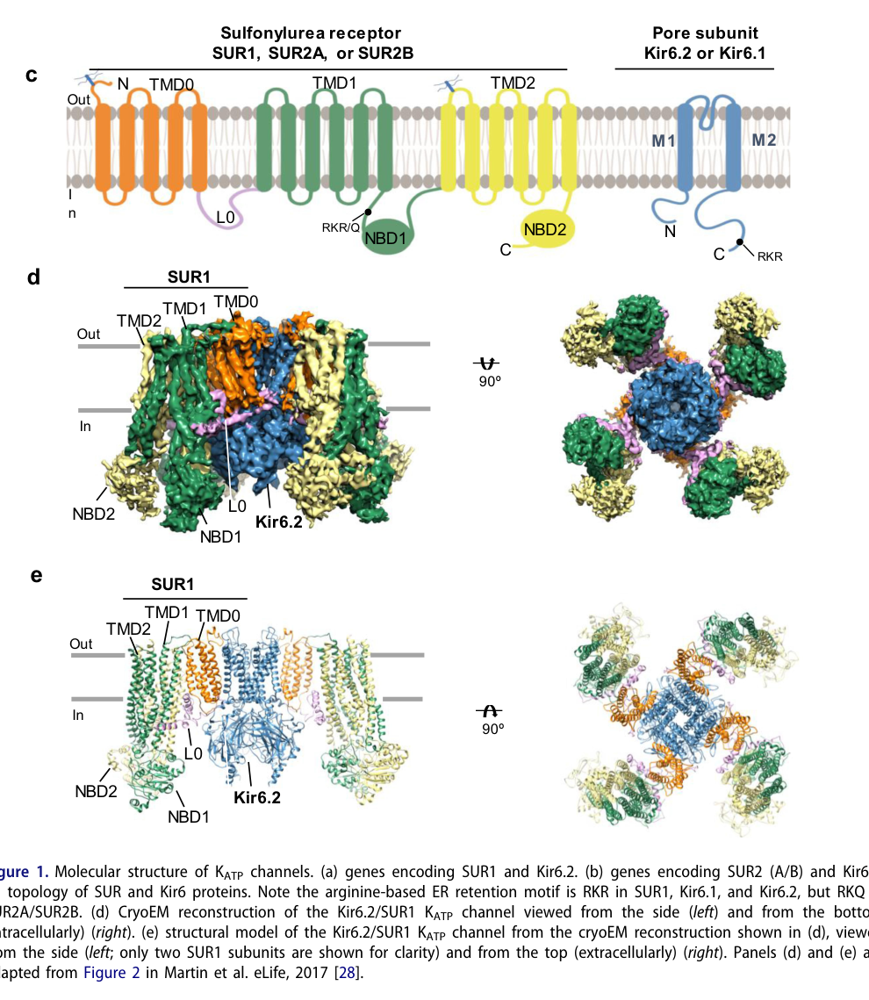

## Question

# Gene Research for Functional Annotation

## ⚠️ CRITICAL: Gene/Protein Identification Context

**BEFORE YOU BEGIN RESEARCH:** You MUST verify you are researching the CORRECT gene/protein. Gene symbols can be ambiguous, especially for less well-characterized genes from non-model organisms.

### Target Gene/Protein Identity (from UniProt):
- **UniProt Accession:** Q14654
- **Protein Description:** RecName: Full=ATP-sensitive inward rectifier potassium channel 11; AltName: Full=IKATP {ECO:0000303|PubMed:7502040}; AltName: Full=Inward rectifier K(+) channel Kir6.2 {ECO:0000303|PubMed:9831708}; AltName: Full=Potassium channel, inwardly rectifying subfamily J member 11;
- **Gene Information:** Name=KCNJ11;
- **Organism (full):** Homo sapiens (Human).
- **Protein Family:** Belongs to the inward rectifier-type potassium channel
- **Key Domains:** Ig_E-set. (IPR014756); IRK_C. (IPR041647); K_chnl_inward-rec_Kir. (IPR016449); K_chnl_inward-rec_Kir6.2. (IPR003279); K_chnl_inward-rec_Kir_cyto. (IPR013518)

### MANDATORY VERIFICATION STEPS:

1. **Check if the gene symbol "KCNJ11" matches the protein description above**
2. **Verify the organism is correct:** Homo sapiens (Human).
3. **Check if protein family/domains align with what you find in literature**
4. **If you find literature for a DIFFERENT gene with the same or similar symbol, STOP**

### If Gene Symbol is Ambiguous or You Cannot Find Relevant Literature:

**DO NOT PROCEED WITH RESEARCH ON A DIFFERENT GENE.** Instead:
- State clearly: "The gene symbol 'KCNJ11' is ambiguous or literature is limited for this specific protein"
- Explain what you found (e.g., "Found extensive literature on a different gene with the same symbol in a different organism")
- Describe the protein based ONLY on the UniProt information provided above
- Suggest that the protein function can be inferred from domain/family information

### Research Target:

Please provide a comprehensive research report on the gene **KCNJ11** (gene ID: KCNJ11, UniProt: Q14654) in human.

The research report should be a detailed narrative explaining the function, biological processes, and localization of the gene product. Citations should be given for all claims.

You should prioritize authoritative reviews and primary scientific literature when conducting research. You can supplement
this with annotations you find in gene/protein databases, but these can be outdated or inaccurate.

We are specifically interested in the primary function of the gene - for enzymes, what reaction is catalyzed, and what is the substrate specificity? For transporters, what is the substrate? For structural proteins or adapters, what is the broader structural role? For signaling molecules, what is the role in the pathway.

We are interested in where in or outside the cell the gene product carries out its function.

We are also interested in the signaling or biochemical pathways in which the gene functions. We are less interested in broad pleiotropic effects, except where these elucidate the precise role.

Include evidence where possible. We are interested in both experimental evidence as well as inference from structure, evolution, or bioinformatic analysis. Precise studies should be prioritized over high-throughput, where available.

## Output

Question: You are an expert researcher providing comprehensive, well-cited information.

Provide detailed information focusing on:
1. Key concepts and definitions with current understanding
2. Recent developments and latest research (prioritize 2023-2024 sources)
3. Current applications and real-world implementations
4. Expert opinions and analysis from authoritative sources
5. Relevant statistics and data from recent studies

Format as a comprehensive research report with proper citations. Include URLs and publication dates where available.
Always prioritize recent, authoritative sources and provide specific citations for all major claims.

# Gene Research for Functional Annotation

## ⚠️ CRITICAL: Gene/Protein Identification Context

**BEFORE YOU BEGIN RESEARCH:** You MUST verify you are researching the CORRECT gene/protein. Gene symbols can be ambiguous, especially for less well-characterized genes from non-model organisms.

### Target Gene/Protein Identity (from UniProt):
- **UniProt Accession:** Q14654
- **Protein Description:** RecName: Full=ATP-sensitive inward rectifier potassium channel 11; AltName: Full=IKATP {ECO:0000303|PubMed:7502040}; AltName: Full=Inward rectifier K(+) channel Kir6.2 {ECO:0000303|PubMed:9831708}; AltName: Full=Potassium channel, inwardly rectifying subfamily J member 11;
- **Gene Information:** Name=KCNJ11;
- **Organism (full):** Homo sapiens (Human).
- **Protein Family:** Belongs to the inward rectifier-type potassium channel
- **Key Domains:** Ig_E-set. (IPR014756); IRK_C. (IPR041647); K_chnl_inward-rec_Kir. (IPR016449); K_chnl_inward-rec_Kir6.2. (IPR003279); K_chnl_inward-rec_Kir_cyto. (IPR013518)

### MANDATORY VERIFICATION STEPS:

1. **Check if the gene symbol "KCNJ11" matches the protein description above**
2. **Verify the organism is correct:** Homo sapiens (Human).
3. **Check if protein family/domains align with what you find in literature**
4. **If you find literature for a DIFFERENT gene with the same or similar symbol, STOP**

### If Gene Symbol is Ambiguous or You Cannot Find Relevant Literature:

**DO NOT PROCEED WITH RESEARCH ON A DIFFERENT GENE.** Instead:
- State clearly: "The gene symbol 'KCNJ11' is ambiguous or literature is limited for this specific protein"
- Explain what you found (e.g., "Found extensive literature on a different gene with the same symbol in a different organism")
- Describe the protein based ONLY on the UniProt information provided above
- Suggest that the protein function can be inferred from domain/family information

### Research Target:

Please provide a comprehensive research report on the gene **KCNJ11** (gene ID: KCNJ11, UniProt: Q14654) in human.

The research report should be a detailed narrative explaining the function, biological processes, and localization of the gene product. Citations should be given for all claims.

You should prioritize authoritative reviews and primary scientific literature when conducting research. You can supplement
this with annotations you find in gene/protein databases, but these can be outdated or inaccurate.

We are specifically interested in the primary function of the gene - for enzymes, what reaction is catalyzed, and what is the substrate specificity? For transporters, what is the substrate? For structural proteins or adapters, what is the broader structural role? For signaling molecules, what is the role in the pathway.

We are interested in where in or outside the cell the gene product carries out its function.

We are also interested in the signaling or biochemical pathways in which the gene functions. We are less interested in broad pleiotropic effects, except where these elucidate the precise role.

Include evidence where possible. We are interested in both experimental evidence as well as inference from structure, evolution, or bioinformatic analysis. Precise studies should be prioritized over high-throughput, where available.

# Human KCNJ11 (Kir6.2): functional research report

## Identity and primary molecular function

**Identity verified.** Human **KCNJ11**, the gene specified by UniProt **Q14654**, encodes **Kir6.2**, the pore-forming inward-rectifier subunit of an ATP-sensitive potassium channel (**KATP**). It is distinct from **KCNJ8/Kir6.1** and from the regulatory subunit **ABCC8/SUR1**. Its two membrane-spanning helices, intervening potassium-selective pore loop, and cytoplasmic termini agree with the inward-rectifier family annotation supplied in the question; the predominant pancreatic channel contains **four Kir6.2 and four SUR1 subunits**. SUR1 is an ABC-transporter-family protein that regulates this complex rather than transporting its cargo across the membrane. See the cropped channel-topology and octameric-structure illustration in Patton and colleagues’ 2024 review. [Patton et al., *Channels*, March 2024](https://doi.org/10.1080/19336950.2024.2327708). (patton2024dynamicduokir6 pages 1-3, patton2024dynamicduokir6 media 46182589)

**Kir6.2 conducts K⁺, not ATP or glucose.** Its selectivity filter discriminates K⁺ from Na⁺; the reported channel permeability ratio, PNa/PK, is approximately **0.01**. In a pancreatic β-cell, an open channel permits K⁺ efflux down the prevailing electrochemical gradient, holding the plasma membrane relatively hyperpolarized. “Inward rectifier” describes the channel family’s voltage-dependent current characteristics, not an exclusive inward direction of physiological K⁺ movement; Kir6 channels exhibit comparatively mild inward rectification. ATP is an intracellular **inhibitory gating ligand**, not the ion transported through the pore, and Kir6.2 is not an enzyme. [Tinker et al., *Comprehensive Physiology*, September 2018](https://doi.org/10.1002/cphy.c170048); [Patton et al., March 2024](https://doi.org/10.1080/19336950.2024.2327708). (tinker2018atpsensitivepotassiumchannels pages 8-10, tinker2018atpsensitivepotassiumchannels pages 1-2, patton2024dynamicduokir6 pages 1-3)

## Where it acts and how it is regulated

Kir6.2 performs its best-established function **at the cell-surface plasma membrane**, particularly in the pancreatic β-cell membrane. Correct assembly with SUR helps the channel pass intracellular quality control and reach that surface; therefore a variant can reduce function either by changing the gating of channels already present or by reducing their surface abundance. In β-cells and many neurons Kir6.2 predominantly partners with SUR1, whereas ventricular cardiomyocytes predominantly use **Kir6.2/SUR2A**; SUR2A is encoded by **ABCC9**, not KCNJ11. These assignments should not be generalized to every cell expressing a KATP channel: for example, vascular smooth muscle predominantly uses Kir6.1/SUR2B. [Patton et al., March 2024](https://doi.org/10.1080/19336950.2024.2327708); [Tinker et al., September 2018](https://doi.org/10.1002/cphy.c170048). (tinker2018atpsensitivepotassiumchannels pages 6-8, patton2024dynamicduokir6 pages 3-4, patton2024dynamicduokir6 pages 1-3)

Intracellular **ATP inhibits** Kir6.2-containing channels through binding at the Kir6.2 regulatory interface; **MgADP promotes opening through SUR nucleotide-binding domains**. Thus channel activity integrates opposing nucleotide signals rather than simply measuring total cellular ATP. Plasma-membrane phosphatidylinositol 4,5-bisphosphate, **PI(4,5)P₂ (PIP₂)**, stabilizes opening and antagonizes ATP inhibition. These regulatory effects explain how cellular energy availability is converted into electrical activity. [Patton et al., March 2024](https://doi.org/10.1080/19336950.2024.2327708); [Nichols, *Annual Review of Pharmacology and Toxicology*, January 2023](https://doi.org/10.1146/annurev-pharmtox-051921-123023). (patton2024dynamicduokir6 pages 3-4, patton2024dynamicduokir6 pages 4-6, nichols2023personalizedtherapeuticsfor pages 1-3)

A particularly informative **2024 cryo-electron-microscopy and electrophysiology study** resolved an open, neonatal-diabetes-associated **Kir6.2-Q52R/SUR1** complex with **two adjacent lipid densities** at its inner-membrane interface: one at a conserved Kir PIP₂ site and another shared by Kir6.2 and SUR1. Mutating residues at either site impaired opening. Kir6.2-Q52R also interacted with SUR1-W51 in a way that favored the open state: ATP-inhibition IC₅₀ was **6.25 μM** for wild-type channel versus **161.2 μM** for Q52R, falling to **8.98 μM** when SUR1-W51C was combined with Q52R. The authors modeled the densities as natural long-chain PIP₂ **consistent with**, rather than chemically proving, that lipid identity. Critically, this structure used **rodent Kir6.2/SUR1 constructs**; it provides mechanistic evidence relevant to human Kir6.2, not a direct structure of the Q14654 human protein. [Driggers et al., *Nature Communications*, March 2024](https://doi.org/10.1038/s41467-024-46751-5). (driggers2024structureofan pages 1-2, driggers2024structureofan pages 3-4, driggers2024structureofan pages 7-7, driggers2024structureofan pages 2-3)

## Core biological pathway: glucose-stimulated insulin secretion

At **low glucose**, β-cell ATP relative to MgADP is lower; Kir6.2/SUR1 channels remain comparatively open, K⁺ efflux maintains a negative membrane potential, and insulin secretion is restrained. **Glucose metabolism** increases the ATP-to-MgADP ratio; inhibitory ATP action together with reduced MgADP-driven activation closes KATP channels. The resulting decrease in K⁺ efflux **depolarizes** the β-cell, opens voltage-dependent **Ca²⁺ channels**, and allows Ca²⁺ influx to trigger **insulin-granule exocytosis**. This is the precise glucose-metabolism-to-excitation pathway in which KCNJ11 acts; glucose itself is not a Kir6.2 substrate. [Ashcroft, *Diabetes*, May 2023](https://doi.org/10.2337/dbi22-0030); [ElSheikh and Shyng, *Frontiers in Endocrinology*, March 2023](https://doi.org/10.3389/fendo.2023.1161117). (ashcroft2023katpchannelsand pages 1-2, elsheikh2023katpchannelmutations pages 2-4)

The direction of human disease caused by KCNJ11 variants strongly tests that mechanism. **Gain of channel function**—for example reduced ATP-mediated inhibition or stabilization of opening—maintains K⁺ current when glucose should close the channel, suppressing insulin release and causing transient or permanent **neonatal diabetes**. Severe activating variants can also produce developmental delay and epilepsy (**DEND** or intermediate DEND), consistent with channel activity in neurons. Conversely, **loss of functional surface current** allows inappropriate depolarization and insulin release even when glucose is low, causing **congenital hyperinsulinism and hypoglycaemia**. Effects depend on the particular allele and whether it changes gating, assembly, or trafficking. [Nichols, January 2023](https://doi.org/10.1146/annurev-pharmtox-051921-123023); [Vedovato et al., *Diabetologia*, published February 17, 2024](https://doi.org/10.1007/s00125-024-06103-w). (nichols2023personalizedtherapeuticsfor pages 3-4, vedovato2024alossoffunctionmutation pages 1-3)

The following compact annotation distinguishes channel states and tissue-dependent subunit partners. (patton2024dynamicduokir6 pages 1-3, nichols2023personalizedtherapeuticsfor pages 3-4, lithovius2024noninvasivequantificationof pages 5-7)

| State or context | Mechanism and physical K⁺ current | Cellular or tissue consequence | Evidence strength and source |
|---|---|---|---|
| Normal pancreatic Kir6.2/SUR1 | Four KCNJ11-encoded Kir6.2 pore subunits and four ABCC8-encoded SUR1 regulatory subunits form a plasma-membrane KATP channel. Low glucose favors MgADP-supported opening and outward K⁺ current; an increased ATP-to-MgADP ratio closes it. | Reduced K⁺ efflux depolarizes the β-cell, opens voltage-dependent Ca²⁺ channels, and triggers insulin-granule exocytosis. | Established by electrophysiology, genetics, and structural biology. Ashcroft review, May 2023, [DOI](https://doi.org/10.2337/dbi22-0030); Patton et al., March 2024, [DOI](https://doi.org/10.1080/19336950.2024.2327708). (ashcroft2023katpchannelsand pages 1-2, patton2024dynamicduokir6 pages 1-3) |
| Gain-of-function KCNJ11 | Reduced ATP inhibition, enhanced open-state stability, or altered gating leaves excessive K⁺ current despite glucose metabolism. Human CRISPR KCNJ11 R201H heterozygous stem-cell islets remained glucose-unresponsive but responded strongly to the channel inhibitor glibenclamide. | Persistent hyperpolarization limits Ca²⁺ entry and glucose-stimulated insulin secretion, causing neonatal diabetes; stronger neuronal effects can cause DEND or intermediate DEND. | Causal human genetics plus functional models. Lithovius et al., June 2024, [DOI](https://doi.org/10.1007/s00125-024-06194-5); Nichols review, January 2023, [DOI](https://doi.org/10.1146/annurev-pharmtox-051921-123023). (lithovius2024noninvasivequantificationof pages 5-7, nichols2023personalizedtherapeuticsfor pages 3-4) |
| Loss-of-function KCNJ11 | Absent, poorly trafficked, or non-opening Kir6.2 lowers plasma-membrane K⁺ current. CRISPR KCNJ11-null human stem-cell β-cells secreted about threefold more insulin at low glucose than wild type and did not respond further to glibenclamide. | Constitutive depolarization and inappropriate insulin secretion cause congenital hyperinsulinism; severe trafficking defects may be diazoxide-unresponsive because few functional surface channels remain. | Causal human genetics and direct human stem-cell-islet validation. Lithovius et al., June 2024, [DOI](https://doi.org/10.1007/s00125-024-06194-5); ElSheikh and Shyng, March 2023, [DOI](https://doi.org/10.3389/fendo.2023.1161117). (lithovius2024noninvasivequantificationof pages 5-7, elsheikh2023katpchannelmutations pages 1-2) |
| p.Ser118Leu adult-onset exception | This heterozygous pore-helix variant reduced Kir6.2/SUR1 surface expression by approximately 40%, but ATP sensitivity, MgADP stimulation, and metabolic regulation of channels reaching the membrane were unchanged. | Mild loss of function was paradoxically associated with gestational and early-adult sulfonylurea-sensitive diabetes; undetected early hyperinsulinism followed by β-cell dysfunction is proposed, not proven. | Single patient plus Xenopus-oocyte and HEK-293T assays. Vedovato et al., February 17, 2024, [DOI](https://doi.org/10.1007/s00125-024-06103-w). (vedovato2024alossoffunctionmutation pages 1-3, vedovato2024alossoffunctionmutation pages 6-7) |
| Cardiac Kir6.2/SUR2A | Kir6.2 pairs predominantly with ABCC9-encoded SUR2A in ventricular sarcolemmal KATP channels; falling energetic state promotes K⁺ efflux, repolarization, and action-potential shortening. | Activity is usually limited at rest, but channel opening during ischemia or hypoxia reduces electrical and contractile demand and can sustain cardiac function during metabolic stress. | Strong animal physiology and native-channel evidence, with fewer direct human causal data than for β-cells. Patton et al., March 2024, [DOI](https://doi.org/10.1080/19336950.2024.2327708); Shyng, January 2022, [DOI](https://doi.org/10.1093/function/zqab070). (patton2024dynamicduokir6 pages 1-3, shyng2022katpchannelfunction pages 1-2) |

*Table: Compact annotation connecting Kir6.2 channel states with K⁺ conductance, cellular effects, disease mechanisms, and supporting evidence. It distinguishes pancreatic Kir6.2/SUR1 from cardiac Kir6.2/SUR2A and highlights the atypical p.Ser118Leu phenotype.*

## Experimental updates and strength of evidence

**Edited human islets, 2024.** Lithovius and colleagues generated human stem-cell-derived islets with **KCNJ11 knockout** or a heterozygous **R201H** gain-of-function allele and measured *insulin secretion directly in vitro*. At low glucose, knockout β-cells released approximately **three times** as much insulin as wild-type cells and did not respond further to the channel inhibitor glibenclamide; R201H cells did not increase secretion in response to glucose but responded strongly to glibenclamide. These are particularly direct human-cell demonstrations of the opposite functional consequences of losing versus overactivating Kir6.2. The study’s principal application was testing positron-emission-tomography imaging of subsequently transplanted islet grafts, **not** clinical transplantation of KCNJ11-edited cells. [Lithovius et al., *Diabetologia*, June 2024](https://doi.org/10.1007/s00125-024-06194-5). (lithovius2024noninvasivequantificationof pages 3-4, lithovius2024noninvasivequantificationof pages 5-7)

**An informative exception, 2024.** A woman with gestational and early-adult diabetes carried heterozygous **p.Ser118Leu**. In oocyte and HEK-293T experiments, the variant lowered channel **surface expression by approximately 40%** without appreciably changing the ATP sensitivity or metabolic regulation of channels that reached the surface. Thus *diabetes in a KCNJ11 carrier does not establish that the allele activates the channel*: this allele was experimentally loss-of-function. The proposed transition from undetected early hyperinsulinism to later diabetes remains an interpretation of a **single clinical case**, not a demonstrated trajectory in that patient. [Vedovato et al., published February 17, 2024](https://doi.org/10.1007/s00125-024-06103-w). (vedovato2024alossoffunctionmutation pages 1-3, vedovato2024alossoffunctionmutation pages 6-7)

**Other sites of action.** In ventricular myocytes, cell-surface Kir6.2/SUR2A channels open during severe metabolic stress and shorten cardiac action potentials, reducing electrical and contractile demand; evidence for this protective function is strongest from electrophysiology and animal physiology, rather than from the pancreatic human variant data. Neuronal Kir6.2-containing channels have a more direct disease connection: mouse experiments restricting activating Kir6.2 variants to neurons reproduced motor or hippocampal learning defects, whereas restriction to β-cells produced diabetes without the neuronal phenotype. Those tissue-targeting experiments support a direct neuronal contribution to human DEND symptoms, while remaining **mouse**, not direct human-brain, experiments. [Patton et al., March 2024](https://doi.org/10.1080/19336950.2024.2327708); [Shyng, *Function*, January 2022](https://doi.org/10.1093/function/zqab070). (patton2024dynamicduokir6 pages 1-3, shyng2022katpchannelfunction pages 1-2)

**Localization boundary.** Reports of “mitochondrial KATP” activity must **not** automatically be annotated as mitochondrial KCNJ11/Kir6.2. Channel-opening drugs can independently affect mitochondrial respiratory proteins, and a definitive molecular assignment of those mitochondrial currents to Kir6.2 is not established by the cited evidence. Plasma-membrane K⁺ conductance is the high-confidence functional localization for this gene product. [Tinker et al., September 2018](https://doi.org/10.1002/cphy.c170048). (tinker2018atpsensitivepotassiumchannels pages 27-28)

## Clinical applications and recent population data

**Genotype-guided treatment.** Sulfonylureas such as **glibenclamide/glyburide inhibit the Kir6.2-containing complex primarily through SUR1**, allowing activating KCNJ11 neonatal-diabetes variants to be treated by stimulating endogenous insulin secretion, often in place of injected insulin. They are not Kir6.2-substrate replacements and do not correct every variant. A systematic review of **502** genetically characterized cases found successful transfer from insulin to sulfonylureas in **91% of 413 KCNJ11 cases**, compared with **86.5% of 89 ABCC8 cases**; response and dose varied by allele. Conversely, the channel opener **diazoxide** can suppress secretion in some congenital-hyperinsulinism cases with residual surface-channel activity, but may fail when a variant prevents functional channels reaching the membrane. [Garcin et al., *Pediatric Diabetes*, July 2020](https://doi.org/10.1111/pedi.13041); [ElSheikh and Shyng, March 2023](https://doi.org/10.3389/fendo.2023.1161117); [Patton et al., March 2024](https://doi.org/10.1080/19336950.2024.2327708). (garcin2020neonataldiabetesdue pages 1-7, elsheikh2023katpchannelmutations pages 1-2, patton2024dynamicduokir6 pages 1-3)

In an international KCNJ11 neonatal-diabetes follow-up, **75/81 patients (93%)** remained on sulfonylureas **without regular insulin** at a median **10.2 years**. Among **64** with paired measurements, median HbA₁c was **8.1% before transfer, 5.9% after one year, and 6.4% at long-term follow-up**. There was **no severe hypoglycaemia across 809 patient-years**. These are powerful long-term implementation data, although neurological features could persist despite good glycaemic control. [Bowman et al., *The Lancet Diabetes & Endocrinology*, August 2018](https://doi.org/10.1016/S2213-8587(18)30106-2). (bowman2018effectivenessandsafety pages 1-1, bowman2018effectivenessandsafety pages 4-4, bowman2018effectivenessandsafety pages 1-2)

**2024 epidemiology, interpreted narrowly.** An Italian multicentre study counted **96 neonatal-diabetes cases** arising during 2003–2022, including **20 KCNJ11-associated permanent cases**; its reported **1 in 103,340 live births** is the incidence of **neonatal diabetes from all causes**, *not* a KCNJ11-specific incidence. Nearly all permanent neonatal-diabetes patients with KCNJ11 or ABCC8 pathogenic variants in that series were switched from insulin to sulfonylureas, with one exception. These observations support early molecular diagnosis, while the individual variant remains essential to interpreting treatment response. [Rapini et al., *Journal of Clinical Endocrinology & Metabolism*, published February 2024](https://doi.org/10.1210/clinem/dgae095). (rapini2024thechanginglandscape pages 2-3, rapini2024thechanginglandscape pages 3-4, rapini2024thechanginglandscape pages 5-6)

Finally, the frequent **p.Glu23Lys/E23K** KCNJ11 allele is associated with *type 2 diabetes susceptibility*, but its effects are small compared with highly penetrant neonatal-diabetes variants, and linkage with a SUR1 variant complicates causal interpretation. Ashcroft’s 2023 proposal that impaired glucose metabolism leaves KATP channels excessively open in some type 2 diabetes is explicitly a **conjecture**, not a general explanation proven for every case. The strongest functional annotation for KCNJ11 therefore remains **nucleotide- and PIP₂-regulated K⁺ conductance at the plasma membrane, coupling β-cell metabolism to electrical excitability and insulin secretion**. [Ashcroft, May 2023](https://doi.org/10.2337/dbi22-0030); [Patton et al., March 2024](https://doi.org/10.1080/19336950.2024.2327708). (ashcroft2023katpchannelsand pages 4-6, ashcroft2023katpchannelsand pages 1-2, patton2024dynamicduokir6 pages 1-3)

References

1. (patton2024dynamicduokir6 pages 1-3): Bruce L. Patton, Phillip Zhu, Assmaa ElSheikh, Camden M. Driggers, and Show-Ling Shyng. Dynamic duo: kir6 and sur in katp channel structure and function. Channels, Mar 2024. URL: https://doi.org/10.1080/19336950.2024.2327708, doi:10.1080/19336950.2024.2327708. This article has 21 citations and is from a peer-reviewed journal.

2. (patton2024dynamicduokir6 media 46182589): Bruce L. Patton, Phillip Zhu, Assmaa ElSheikh, Camden M. Driggers, and Show-Ling Shyng. Dynamic duo: kir6 and sur in katp channel structure and function. Channels, Mar 2024. URL: https://doi.org/10.1080/19336950.2024.2327708, doi:10.1080/19336950.2024.2327708. This article has 21 citations and is from a peer-reviewed journal.

3. (tinker2018atpsensitivepotassiumchannels pages 8-10): Andrew Tinker, Qadeer Aziz, Yiwen Li, and Mark Specterman. Atp-sensitive potassium channels and their physiological and pathophysiological roles. Comprehensive Physiology, 8 4:1463-1511, Sep 2018. URL: https://doi.org/10.1002/cphy.c170048, doi:10.1002/cphy.c170048. This article has 167 citations and is from a peer-reviewed journal.

4. (tinker2018atpsensitivepotassiumchannels pages 1-2): Andrew Tinker, Qadeer Aziz, Yiwen Li, and Mark Specterman. Atp-sensitive potassium channels and their physiological and pathophysiological roles. Comprehensive Physiology, 8 4:1463-1511, Sep 2018. URL: https://doi.org/10.1002/cphy.c170048, doi:10.1002/cphy.c170048. This article has 167 citations and is from a peer-reviewed journal.

5. (tinker2018atpsensitivepotassiumchannels pages 6-8): Andrew Tinker, Qadeer Aziz, Yiwen Li, and Mark Specterman. Atp-sensitive potassium channels and their physiological and pathophysiological roles. Comprehensive Physiology, 8 4:1463-1511, Sep 2018. URL: https://doi.org/10.1002/cphy.c170048, doi:10.1002/cphy.c170048. This article has 167 citations and is from a peer-reviewed journal.

6. (patton2024dynamicduokir6 pages 3-4): Bruce L. Patton, Phillip Zhu, Assmaa ElSheikh, Camden M. Driggers, and Show-Ling Shyng. Dynamic duo: kir6 and sur in katp channel structure and function. Channels, Mar 2024. URL: https://doi.org/10.1080/19336950.2024.2327708, doi:10.1080/19336950.2024.2327708. This article has 21 citations and is from a peer-reviewed journal.

7. (patton2024dynamicduokir6 pages 4-6): Bruce L. Patton, Phillip Zhu, Assmaa ElSheikh, Camden M. Driggers, and Show-Ling Shyng. Dynamic duo: kir6 and sur in katp channel structure and function. Channels, Mar 2024. URL: https://doi.org/10.1080/19336950.2024.2327708, doi:10.1080/19336950.2024.2327708. This article has 21 citations and is from a peer-reviewed journal.

8. (nichols2023personalizedtherapeuticsfor pages 1-3): Colin G. Nichols. Personalized therapeutics for katp-dependent pathologies. Annual Review of Pharmacology and Toxicology, 63:541-563, Jan 2023. URL: https://doi.org/10.1146/annurev-pharmtox-051921-123023, doi:10.1146/annurev-pharmtox-051921-123023. This article has 32 citations and is from a highest quality peer-reviewed journal.

9. (driggers2024structureofan pages 1-2): Camden M. Driggers, Yi-Ying Kuo, Phillip Zhu, Assmaa ElSheikh, and Show-Ling Shyng. Structure of an open katp channel reveals tandem pip2 binding sites mediating the kir6.2 and sur1 regulatory interface. Nature Communications, Mar 2024. URL: https://doi.org/10.1038/s41467-024-46751-5, doi:10.1038/s41467-024-46751-5. This article has 39 citations and is from a highest quality peer-reviewed journal.

10. (driggers2024structureofan pages 3-4): Camden M. Driggers, Yi-Ying Kuo, Phillip Zhu, Assmaa ElSheikh, and Show-Ling Shyng. Structure of an open katp channel reveals tandem pip2 binding sites mediating the kir6.2 and sur1 regulatory interface. Nature Communications, Mar 2024. URL: https://doi.org/10.1038/s41467-024-46751-5, doi:10.1038/s41467-024-46751-5. This article has 39 citations and is from a highest quality peer-reviewed journal.

11. (driggers2024structureofan pages 7-7): Camden M. Driggers, Yi-Ying Kuo, Phillip Zhu, Assmaa ElSheikh, and Show-Ling Shyng. Structure of an open katp channel reveals tandem pip2 binding sites mediating the kir6.2 and sur1 regulatory interface. Nature Communications, Mar 2024. URL: https://doi.org/10.1038/s41467-024-46751-5, doi:10.1038/s41467-024-46751-5. This article has 39 citations and is from a highest quality peer-reviewed journal.

12. (driggers2024structureofan pages 2-3): Camden M. Driggers, Yi-Ying Kuo, Phillip Zhu, Assmaa ElSheikh, and Show-Ling Shyng. Structure of an open katp channel reveals tandem pip2 binding sites mediating the kir6.2 and sur1 regulatory interface. Nature Communications, Mar 2024. URL: https://doi.org/10.1038/s41467-024-46751-5, doi:10.1038/s41467-024-46751-5. This article has 39 citations and is from a highest quality peer-reviewed journal.

13. (ashcroft2023katpchannelsand pages 1-2): Frances M. Ashcroft. Katp channels and the metabolic regulation of insulin secretion in health and disease: the 2022 banting medal for scientific achievement award lecture. Diabetes, 72:693-702, May 2023. URL: https://doi.org/10.2337/dbi22-0030, doi:10.2337/dbi22-0030. This article has 51 citations and is from a highest quality peer-reviewed journal.

14. (elsheikh2023katpchannelmutations pages 2-4): Assmaa ElSheikh and Show-Ling Shyng. Katp channel mutations in congenital hyperinsulinism: progress and challenges towards mechanism-based therapies. Frontiers in Endocrinology, Mar 2023. URL: https://doi.org/10.3389/fendo.2023.1161117, doi:10.3389/fendo.2023.1161117. This article has 22 citations.

15. (nichols2023personalizedtherapeuticsfor pages 3-4): Colin G. Nichols. Personalized therapeutics for katp-dependent pathologies. Annual Review of Pharmacology and Toxicology, 63:541-563, Jan 2023. URL: https://doi.org/10.1146/annurev-pharmtox-051921-123023, doi:10.1146/annurev-pharmtox-051921-123023. This article has 32 citations and is from a highest quality peer-reviewed journal.

16. (vedovato2024alossoffunctionmutation pages 1-3): Natascia Vedovato, Maria V. Salguero, Siri Atma W. Greeley, Christine H. Yu, Louis H. Philipson, and Frances M. Ashcroft. A loss-of-function mutation in kcnj11 causing sulfonylurea-sensitive diabetes in early adult life. Diabetologia, 67:940-951, Feb 2024. URL: https://doi.org/10.1007/s00125-024-06103-w, doi:10.1007/s00125-024-06103-w. This article has 17 citations and is from a highest quality peer-reviewed journal.

17. (lithovius2024noninvasivequantificationof pages 5-7): Väinö Lithovius, Salla Lahdenpohja, Hazem Ibrahim, Jonna Saarimäki-Vire, Lotta Uusitalo, Hossam Montaser, Kirsi Mikkola, Cheng-Bin Yim, Thomas Keller, Johan Rajander, Diego Balboa, Tom Barsby, Olof Solin, Pirjo Nuutila, Tove J. Grönroos, and Timo Otonkoski. Non-invasive quantification of stem cell-derived islet graft size and composition. Diabetologia, 67:1912-1929, Jun 2024. URL: https://doi.org/10.1007/s00125-024-06194-5, doi:10.1007/s00125-024-06194-5. This article has 11 citations and is from a highest quality peer-reviewed journal.

18. (elsheikh2023katpchannelmutations pages 1-2): Assmaa ElSheikh and Show-Ling Shyng. Katp channel mutations in congenital hyperinsulinism: progress and challenges towards mechanism-based therapies. Frontiers in Endocrinology, Mar 2023. URL: https://doi.org/10.3389/fendo.2023.1161117, doi:10.3389/fendo.2023.1161117. This article has 22 citations.

19. (vedovato2024alossoffunctionmutation pages 6-7): Natascia Vedovato, Maria V. Salguero, Siri Atma W. Greeley, Christine H. Yu, Louis H. Philipson, and Frances M. Ashcroft. A loss-of-function mutation in kcnj11 causing sulfonylurea-sensitive diabetes in early adult life. Diabetologia, 67:940-951, Feb 2024. URL: https://doi.org/10.1007/s00125-024-06103-w, doi:10.1007/s00125-024-06103-w. This article has 17 citations and is from a highest quality peer-reviewed journal.

20. (shyng2022katpchannelfunction pages 1-2): Show-Ling Shyng. Katp channel function: more than meets the eye. Function, Jan 2022. URL: https://doi.org/10.1093/function/zqab070, doi:10.1093/function/zqab070. This article has 9 citations.

21. (lithovius2024noninvasivequantificationof pages 3-4): Väinö Lithovius, Salla Lahdenpohja, Hazem Ibrahim, Jonna Saarimäki-Vire, Lotta Uusitalo, Hossam Montaser, Kirsi Mikkola, Cheng-Bin Yim, Thomas Keller, Johan Rajander, Diego Balboa, Tom Barsby, Olof Solin, Pirjo Nuutila, Tove J. Grönroos, and Timo Otonkoski. Non-invasive quantification of stem cell-derived islet graft size and composition. Diabetologia, 67:1912-1929, Jun 2024. URL: https://doi.org/10.1007/s00125-024-06194-5, doi:10.1007/s00125-024-06194-5. This article has 11 citations and is from a highest quality peer-reviewed journal.

22. (tinker2018atpsensitivepotassiumchannels pages 27-28): Andrew Tinker, Qadeer Aziz, Yiwen Li, and Mark Specterman. Atp-sensitive potassium channels and their physiological and pathophysiological roles. Comprehensive Physiology, 8 4:1463-1511, Sep 2018. URL: https://doi.org/10.1002/cphy.c170048, doi:10.1002/cphy.c170048. This article has 167 citations and is from a peer-reviewed journal.

23. (garcin2020neonataldiabetesdue pages 1-7): Laure Garcin, Veronica Mericq, Anne‐Laure Fauret‐Amsellem, Helene Cave, Michel Polak, and Jacques Beltrand. Neonatal diabetes due to potassium channel mutation: response to sulfonylurea according to the genotype. Pediatric Diabetes, 21:932-941, Jul 2020. URL: https://doi.org/10.1111/pedi.13041, doi:10.1111/pedi.13041. This article has 48 citations and is from a domain leading peer-reviewed journal.

24. (bowman2018effectivenessandsafety pages 1-1): Pamela Bowman, Åsta Sulen, Fabrizio Barbetti, Jacques Beltrand, Pernille Svalastoga, Ethel Codner, Ellen H Tessmann, Petur B Juliusson, Torild Skrivarhaug, Ewan R Pearson, Sarah E Flanagan, Tarig Babiker, Nicholas J Thomas, Maggie H Shepherd, Sian Ellard, Iwar Klimes, Magdalena Szopa, Michel Polak, Dario Iafusco, Andrew T Hattersley, Pål R Njølstad, Javier Aisenberg, Ilker Akkurt, Hussein Abdul-Latif, Anees Al-Abdullah, Lubomir Barak, Joop Van Den Bergh, Anne-Marie Bertrand, Carla Bizzarri, Riccardo Bonfanti, Henri Bruel, Anthony Burrows, Francesco Cadario, Fergus J. Cameron, Dennis Carson, Maryse Cartigny, Vittoria Cauvin, Helene Cave, Ali Chakera, Ravi Chetan, Giovanni Chiari, Bob Couch, Régis Coutant, Elizabeth Cummings, Adriana Dankovcikova, Liz Davis, Dorothee Deiss, Maurizio Delvecchio, Elena Faleschini, Anne-Laure Fauret, Roisin Finn, Tamsin Ford, Elisa De Franco, Bastian De Gallen, Daniela Gasperíková, Padma Guntamukkala, Vaseem Hakeem, Shinji Hasegawa, Eba H. Hathout, Emmeline Heffernan, David Hill, Josephine Ho, Marie Hoarau, Reinhard Holl, Rebecca Hoddinott, Jane Houghton, Neville Howard, Natalie Hughes, Ian Hunter, Anne Kirsti Høgåsen, Helena Kuulasmaa, Sorin Ioacara, Violeta Iotova, Henrik Irgens, Alan Jaap, Kenneth Jones, Thomas Kapellen, Ellen Kaufman, Andreas Klinge, Tomasz Klupa, Ramaiyer Krishnaswamy, Tony Lafferty, Laurent LeGault, Paul Lambert, Maciej T Malecki, Olag Malievsky, Revi Mathew, Frances Mathews, Robert McVie, Ulrike Menzel, Chantale Metz, John Van Der Meulen, Gita Modgil, Dick Mul, Silvia Muther, Roos Nuboer, Susan M. O'Connell, Stephen O'Riordan, Miroslav Palko, Kashyap Amratlal Patel, Roberta Pesavento, Elvira Piccinno, Janani Kumaraguru Pillai, Stephanka Pruhova, Zubin Punthakee, Ivana Rabbone, Klemens Raile, Marielisa Rincon, Danette Rose, Janine Sanchez, Susan Sandereson, Vinay Saxena, Martin Schebek, Dorothee Schmidt, Naim Shehadeh, Julian P.H. Shiels, Jose M. C. L Silva, Juraj Stanik, Tracy Tinklin, Erling Tjora, Stefano Tumini, Tiinamaija Tuomi, Akiko Uehara, Robert Van der Velde, Guido Vermeulen, Uma Visser, Paul Voorhoeve, Jan Walker, Jaques Weill, Tobias Weisner, Andrea Werner, Toni Williams, Helen Woodhead, and Rønnaug øddegård. Effectiveness and safety of long-term treatment with sulfonylureas in patients with neonatal diabetes due to kcnj11 mutations: an international cohort study. The Lancet Diabetes &amp; Endocrinology, 6:637-646, Aug 2018. URL: https://doi.org/10.1016/s2213-8587(18)30106-2, doi:10.1016/s2213-8587(18)30106-2. This article has 229 citations and is from a highest quality peer-reviewed journal.

25. (bowman2018effectivenessandsafety pages 4-4): Pamela Bowman, Åsta Sulen, Fabrizio Barbetti, Jacques Beltrand, Pernille Svalastoga, Ethel Codner, Ellen H Tessmann, Petur B Juliusson, Torild Skrivarhaug, Ewan R Pearson, Sarah E Flanagan, Tarig Babiker, Nicholas J Thomas, Maggie H Shepherd, Sian Ellard, Iwar Klimes, Magdalena Szopa, Michel Polak, Dario Iafusco, Andrew T Hattersley, Pål R Njølstad, Javier Aisenberg, Ilker Akkurt, Hussein Abdul-Latif, Anees Al-Abdullah, Lubomir Barak, Joop Van Den Bergh, Anne-Marie Bertrand, Carla Bizzarri, Riccardo Bonfanti, Henri Bruel, Anthony Burrows, Francesco Cadario, Fergus J. Cameron, Dennis Carson, Maryse Cartigny, Vittoria Cauvin, Helene Cave, Ali Chakera, Ravi Chetan, Giovanni Chiari, Bob Couch, Régis Coutant, Elizabeth Cummings, Adriana Dankovcikova, Liz Davis, Dorothee Deiss, Maurizio Delvecchio, Elena Faleschini, Anne-Laure Fauret, Roisin Finn, Tamsin Ford, Elisa De Franco, Bastian De Gallen, Daniela Gasperíková, Padma Guntamukkala, Vaseem Hakeem, Shinji Hasegawa, Eba H. Hathout, Emmeline Heffernan, David Hill, Josephine Ho, Marie Hoarau, Reinhard Holl, Rebecca Hoddinott, Jane Houghton, Neville Howard, Natalie Hughes, Ian Hunter, Anne Kirsti Høgåsen, Helena Kuulasmaa, Sorin Ioacara, Violeta Iotova, Henrik Irgens, Alan Jaap, Kenneth Jones, Thomas Kapellen, Ellen Kaufman, Andreas Klinge, Tomasz Klupa, Ramaiyer Krishnaswamy, Tony Lafferty, Laurent LeGault, Paul Lambert, Maciej T Malecki, Olag Malievsky, Revi Mathew, Frances Mathews, Robert McVie, Ulrike Menzel, Chantale Metz, John Van Der Meulen, Gita Modgil, Dick Mul, Silvia Muther, Roos Nuboer, Susan M. O'Connell, Stephen O'Riordan, Miroslav Palko, Kashyap Amratlal Patel, Roberta Pesavento, Elvira Piccinno, Janani Kumaraguru Pillai, Stephanka Pruhova, Zubin Punthakee, Ivana Rabbone, Klemens Raile, Marielisa Rincon, Danette Rose, Janine Sanchez, Susan Sandereson, Vinay Saxena, Martin Schebek, Dorothee Schmidt, Naim Shehadeh, Julian P.H. Shiels, Jose M. C. L Silva, Juraj Stanik, Tracy Tinklin, Erling Tjora, Stefano Tumini, Tiinamaija Tuomi, Akiko Uehara, Robert Van der Velde, Guido Vermeulen, Uma Visser, Paul Voorhoeve, Jan Walker, Jaques Weill, Tobias Weisner, Andrea Werner, Toni Williams, Helen Woodhead, and Rønnaug øddegård. Effectiveness and safety of long-term treatment with sulfonylureas in patients with neonatal diabetes due to kcnj11 mutations: an international cohort study. The Lancet Diabetes &amp; Endocrinology, 6:637-646, Aug 2018. URL: https://doi.org/10.1016/s2213-8587(18)30106-2, doi:10.1016/s2213-8587(18)30106-2. This article has 229 citations and is from a highest quality peer-reviewed journal.

26. (bowman2018effectivenessandsafety pages 1-2): Pamela Bowman, Åsta Sulen, Fabrizio Barbetti, Jacques Beltrand, Pernille Svalastoga, Ethel Codner, Ellen H Tessmann, Petur B Juliusson, Torild Skrivarhaug, Ewan R Pearson, Sarah E Flanagan, Tarig Babiker, Nicholas J Thomas, Maggie H Shepherd, Sian Ellard, Iwar Klimes, Magdalena Szopa, Michel Polak, Dario Iafusco, Andrew T Hattersley, Pål R Njølstad, Javier Aisenberg, Ilker Akkurt, Hussein Abdul-Latif, Anees Al-Abdullah, Lubomir Barak, Joop Van Den Bergh, Anne-Marie Bertrand, Carla Bizzarri, Riccardo Bonfanti, Henri Bruel, Anthony Burrows, Francesco Cadario, Fergus J. Cameron, Dennis Carson, Maryse Cartigny, Vittoria Cauvin, Helene Cave, Ali Chakera, Ravi Chetan, Giovanni Chiari, Bob Couch, Régis Coutant, Elizabeth Cummings, Adriana Dankovcikova, Liz Davis, Dorothee Deiss, Maurizio Delvecchio, Elena Faleschini, Anne-Laure Fauret, Roisin Finn, Tamsin Ford, Elisa De Franco, Bastian De Gallen, Daniela Gasperíková, Padma Guntamukkala, Vaseem Hakeem, Shinji Hasegawa, Eba H. Hathout, Emmeline Heffernan, David Hill, Josephine Ho, Marie Hoarau, Reinhard Holl, Rebecca Hoddinott, Jane Houghton, Neville Howard, Natalie Hughes, Ian Hunter, Anne Kirsti Høgåsen, Helena Kuulasmaa, Sorin Ioacara, Violeta Iotova, Henrik Irgens, Alan Jaap, Kenneth Jones, Thomas Kapellen, Ellen Kaufman, Andreas Klinge, Tomasz Klupa, Ramaiyer Krishnaswamy, Tony Lafferty, Laurent LeGault, Paul Lambert, Maciej T Malecki, Olag Malievsky, Revi Mathew, Frances Mathews, Robert McVie, Ulrike Menzel, Chantale Metz, John Van Der Meulen, Gita Modgil, Dick Mul, Silvia Muther, Roos Nuboer, Susan M. O'Connell, Stephen O'Riordan, Miroslav Palko, Kashyap Amratlal Patel, Roberta Pesavento, Elvira Piccinno, Janani Kumaraguru Pillai, Stephanka Pruhova, Zubin Punthakee, Ivana Rabbone, Klemens Raile, Marielisa Rincon, Danette Rose, Janine Sanchez, Susan Sandereson, Vinay Saxena, Martin Schebek, Dorothee Schmidt, Naim Shehadeh, Julian P.H. Shiels, Jose M. C. L Silva, Juraj Stanik, Tracy Tinklin, Erling Tjora, Stefano Tumini, Tiinamaija Tuomi, Akiko Uehara, Robert Van der Velde, Guido Vermeulen, Uma Visser, Paul Voorhoeve, Jan Walker, Jaques Weill, Tobias Weisner, Andrea Werner, Toni Williams, Helen Woodhead, and Rønnaug øddegård. Effectiveness and safety of long-term treatment with sulfonylureas in patients with neonatal diabetes due to kcnj11 mutations: an international cohort study. The Lancet Diabetes &amp; Endocrinology, 6:637-646, Aug 2018. URL: https://doi.org/10.1016/s2213-8587(18)30106-2, doi:10.1016/s2213-8587(18)30106-2. This article has 229 citations and is from a highest quality peer-reviewed journal.

27. (rapini2024thechanginglandscape pages 2-3): Novella Rapini, Maurizio Delvecchio, Mafalda Mucciolo, Rosario Ruta, Ivana Rabbone, Valentino Cherubini, Stefano Zucchini, Stefano Cianfarani, Elena Prandi, Riccardo Schiaffini, Carla Bizzarri, Barbara Piccini, Giulio Maltoni, Barbara Predieri, Nicola Minuto, Rossella Di Paola, Mara Giordano, Nadia Tinto, Valeria Grasso, Lucia Russo, Valentina Tiberi, Andrea Scaramuzza, Giulio Frontino, Maria Cristina Maggio, Gianluca Musolino, Elvira Piccinno, Davide Tinti, Paola Carrera, Enza Mozzillo, Marco Cappa, Dario Iafusco, Riccardo Bonfanti, Antonio Novelli, Fabrizio Barbetti, Luciano Beccaria, Francesco Candia, Vittoria Cauvin, Roberta Cardani, Francesca Cardella, Anna Favia, Francesco Gallo, Patrizia Garzia, Paolo Ghirri, Stefania Innaurato, Lorenzo Iughetti, Nicola Laforgia, Donatella Lo Presti, Alberto Marsciani, Franco Meschi, Rossana Panzeca, Bruno Pasquino, Roberta Pesavento, Giulia Pezzino, Petra Reinstadler, Carlo Ripoli, Silvia Savastio, Tiziana Timpanaro, Stefano Tumini, and Gianni Vento. The changing landscape of neonatal diabetes mellitus in italy between 2003 and 2022. The Journal of Clinical Endocrinology and Metabolism, 109:2349-2357, Feb 2024. URL: https://doi.org/10.1210/clinem/dgae095, doi:10.1210/clinem/dgae095. This article has 22 citations.

28. (rapini2024thechanginglandscape pages 3-4): Novella Rapini, Maurizio Delvecchio, Mafalda Mucciolo, Rosario Ruta, Ivana Rabbone, Valentino Cherubini, Stefano Zucchini, Stefano Cianfarani, Elena Prandi, Riccardo Schiaffini, Carla Bizzarri, Barbara Piccini, Giulio Maltoni, Barbara Predieri, Nicola Minuto, Rossella Di Paola, Mara Giordano, Nadia Tinto, Valeria Grasso, Lucia Russo, Valentina Tiberi, Andrea Scaramuzza, Giulio Frontino, Maria Cristina Maggio, Gianluca Musolino, Elvira Piccinno, Davide Tinti, Paola Carrera, Enza Mozzillo, Marco Cappa, Dario Iafusco, Riccardo Bonfanti, Antonio Novelli, Fabrizio Barbetti, Luciano Beccaria, Francesco Candia, Vittoria Cauvin, Roberta Cardani, Francesca Cardella, Anna Favia, Francesco Gallo, Patrizia Garzia, Paolo Ghirri, Stefania Innaurato, Lorenzo Iughetti, Nicola Laforgia, Donatella Lo Presti, Alberto Marsciani, Franco Meschi, Rossana Panzeca, Bruno Pasquino, Roberta Pesavento, Giulia Pezzino, Petra Reinstadler, Carlo Ripoli, Silvia Savastio, Tiziana Timpanaro, Stefano Tumini, and Gianni Vento. The changing landscape of neonatal diabetes mellitus in italy between 2003 and 2022. The Journal of Clinical Endocrinology and Metabolism, 109:2349-2357, Feb 2024. URL: https://doi.org/10.1210/clinem/dgae095, doi:10.1210/clinem/dgae095. This article has 22 citations.

29. (rapini2024thechanginglandscape pages 5-6): Novella Rapini, Maurizio Delvecchio, Mafalda Mucciolo, Rosario Ruta, Ivana Rabbone, Valentino Cherubini, Stefano Zucchini, Stefano Cianfarani, Elena Prandi, Riccardo Schiaffini, Carla Bizzarri, Barbara Piccini, Giulio Maltoni, Barbara Predieri, Nicola Minuto, Rossella Di Paola, Mara Giordano, Nadia Tinto, Valeria Grasso, Lucia Russo, Valentina Tiberi, Andrea Scaramuzza, Giulio Frontino, Maria Cristina Maggio, Gianluca Musolino, Elvira Piccinno, Davide Tinti, Paola Carrera, Enza Mozzillo, Marco Cappa, Dario Iafusco, Riccardo Bonfanti, Antonio Novelli, Fabrizio Barbetti, Luciano Beccaria, Francesco Candia, Vittoria Cauvin, Roberta Cardani, Francesca Cardella, Anna Favia, Francesco Gallo, Patrizia Garzia, Paolo Ghirri, Stefania Innaurato, Lorenzo Iughetti, Nicola Laforgia, Donatella Lo Presti, Alberto Marsciani, Franco Meschi, Rossana Panzeca, Bruno Pasquino, Roberta Pesavento, Giulia Pezzino, Petra Reinstadler, Carlo Ripoli, Silvia Savastio, Tiziana Timpanaro, Stefano Tumini, and Gianni Vento. The changing landscape of neonatal diabetes mellitus in italy between 2003 and 2022. The Journal of Clinical Endocrinology and Metabolism, 109:2349-2357, Feb 2024. URL: https://doi.org/10.1210/clinem/dgae095, doi:10.1210/clinem/dgae095. This article has 22 citations.

30. (ashcroft2023katpchannelsand pages 4-6): Frances M. Ashcroft. Katp channels and the metabolic regulation of insulin secretion in health and disease: the 2022 banting medal for scientific achievement award lecture. Diabetes, 72:693-702, May 2023. URL: https://doi.org/10.2337/dbi22-0030, doi:10.2337/dbi22-0030. This article has 51 citations and is from a highest quality peer-reviewed journal.

## Artifacts

- [Edison artifact artifact-00](KCNJ11-deep-research-falcon_artifacts/artifact-00.md)

## Citations

1. tinker2018atpsensitivepotassiumchannels pages 27-28
2. tinker2018atpsensitivepotassiumchannels pages 8-10
3. tinker2018atpsensitivepotassiumchannels pages 1-2
4. tinker2018atpsensitivepotassiumchannels pages 6-8
5. nichols2023personalizedtherapeuticsfor pages 1-3
6. driggers2024structureofan pages 1-2
7. driggers2024structureofan pages 3-4
8. driggers2024structureofan pages 7-7
9. driggers2024structureofan pages 2-3
10. ashcroft2023katpchannelsand pages 1-2
11. elsheikh2023katpchannelmutations pages 2-4
12. nichols2023personalizedtherapeuticsfor pages 3-4
13. vedovato2024alossoffunctionmutation pages 1-3
14. lithovius2024noninvasivequantificationof pages 5-7
15. elsheikh2023katpchannelmutations pages 1-2
16. vedovato2024alossoffunctionmutation pages 6-7
17. shyng2022katpchannelfunction pages 1-2
18. lithovius2024noninvasivequantificationof pages 3-4
19. garcin2020neonataldiabetesdue pages 1-7
20. bowman2018effectivenessandsafety pages 1-1
21. bowman2018effectivenessandsafety pages 4-4
22. bowman2018effectivenessandsafety pages 1-2
23. rapini2024thechanginglandscape pages 2-3
24. rapini2024thechanginglandscape pages 3-4
25. rapini2024thechanginglandscape pages 5-6
26. ashcroft2023katpchannelsand pages 4-6
27. Patton et al., *Channels*, March 2024
28. Tinker et al., *Comprehensive Physiology*, September 2018
29. Patton et al., March 2024
30. Tinker et al., September 2018
31. Nichols, *Annual Review of Pharmacology and Toxicology*, January 2023
32. Driggers et al., *Nature Communications*, March 2024
33. Ashcroft, *Diabetes*, May 2023
34. ElSheikh and Shyng, *Frontiers in Endocrinology*, March 2023
35. Nichols, January 2023
36. Vedovato et al., *Diabetologia*, published February 17, 2024
37. DOI
38. Lithovius et al., *Diabetologia*, June 2024
39. Vedovato et al., published February 17, 2024
40. Shyng, *Function*, January 2022
41. Garcin et al., *Pediatric Diabetes*, July 2020
42. ElSheikh and Shyng, March 2023
43. Bowman et al., *The Lancet Diabetes & Endocrinology*, August 2018
44. Rapini et al., *Journal of Clinical Endocrinology & Metabolism*, published February 2024
45. Ashcroft, May 2023
46. https://doi.org/10.1080/19336950.2024.2327708
47. https://doi.org/10.1002/cphy.c170048
48. https://doi.org/10.1146/annurev-pharmtox-051921-123023
49. https://doi.org/10.1038/s41467-024-46751-5
50. https://doi.org/10.2337/dbi22-0030
51. https://doi.org/10.3389/fendo.2023.1161117
52. https://doi.org/10.1007/s00125-024-06103-w
53. https://doi.org/10.1007/s00125-024-06194-5
54. https://doi.org/10.1093/function/zqab070
55. https://doi.org/10.1111/pedi.13041
56. https://doi.org/10.1016/S2213-8587(18
57. https://doi.org/10.1210/clinem/dgae095
58. https://doi.org/10.1080/19336950.2024.2327708,
59. https://doi.org/10.1002/cphy.c170048,
60. https://doi.org/10.1146/annurev-pharmtox-051921-123023,
61. https://doi.org/10.1038/s41467-024-46751-5,
62. https://doi.org/10.2337/dbi22-0030,
63. https://doi.org/10.3389/fendo.2023.1161117,
64. https://doi.org/10.1007/s00125-024-06103-w,
65. https://doi.org/10.1007/s00125-024-06194-5,
66. https://doi.org/10.1093/function/zqab070,
67. https://doi.org/10.1111/pedi.13041,
68. https://doi.org/10.1016/s2213-8587(18
69. https://doi.org/10.1210/clinem/dgae095,