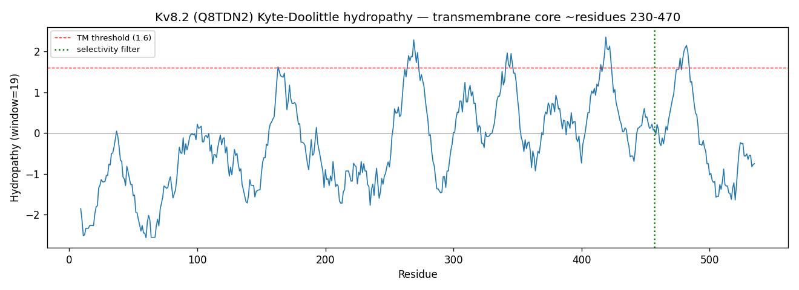

## Question

# Gene Research for Functional Annotation

## ⚠️ CRITICAL: Gene/Protein Identification Context

**BEFORE YOU BEGIN RESEARCH:** You MUST verify you are researching the CORRECT gene/protein. Gene symbols can be ambiguous, especially for less well-characterized genes from non-model organisms.

### Target Gene/Protein Identity (from UniProt):
- **UniProt Accession:** Q8TDN2
- **Protein Description:** RecName: Full=Potassium voltage-gated channel subfamily V member 2; AltName: Full=Voltage-gated potassium channel subunit Kv8.2;
- **Gene Information:** Name=KCNV2;
- **Organism (full):** Homo sapiens (Human).
- **Protein Family:** Belongs to the potassium channel family. V (TC 1.A.1.2)
- **Key Domains:** Ion_trans_dom. (IPR005821); K_chnl_volt-dep_Kv. (IPR003968); K_chnl_volt-dep_Kv5/Kv9. (IPR003971); SKP1/BTB/POZ_sf. (IPR011333); T1-type_BTB. (IPR003131)

### MANDATORY VERIFICATION STEPS:

1. **Check if the gene symbol "KCNV2" matches the protein description above**
2. **Verify the organism is correct:** Homo sapiens (Human).
3. **Check if protein family/domains align with what you find in literature**
4. **If you find literature for a DIFFERENT gene with the same or similar symbol, STOP**

### If Gene Symbol is Ambiguous or You Cannot Find Relevant Literature:

**DO NOT PROCEED WITH RESEARCH ON A DIFFERENT GENE.** Instead:
- State clearly: "The gene symbol 'KCNV2' is ambiguous or literature is limited for this specific protein"
- Explain what you found (e.g., "Found extensive literature on a different gene with the same symbol in a different organism")
- Describe the protein based ONLY on the UniProt information provided above
- Suggest that the protein function can be inferred from domain/family information

### Research Target:

Please provide a comprehensive research report on the gene **KCNV2** (gene ID: KCNV2, UniProt: Q8TDN2) in human.

The research report should be a detailed narrative explaining the function, biological processes, and localization of the gene product. Citations should be given for all claims.

You should prioritize authoritative reviews and primary scientific literature when conducting research. You can supplement
this with annotations you find in gene/protein databases, but these can be outdated or inaccurate.

We are specifically interested in the primary function of the gene - for enzymes, what reaction is catalyzed, and what is the substrate specificity? For transporters, what is the substrate? For structural proteins or adapters, what is the broader structural role? For signaling molecules, what is the role in the pathway.

We are interested in where in or outside the cell the gene product carries out its function.

We are also interested in the signaling or biochemical pathways in which the gene functions. We are less interested in broad pleiotropic effects, except where these elucidate the precise role.

Include evidence where possible. We are interested in both experimental evidence as well as inference from structure, evolution, or bioinformatic analysis. Precise studies should be prioritized over high-throughput, where available.

## Output

# KCNV2 (Kv8.2, UniProt Q8TDN2): A Silent Potassium-Channel Subunit that Builds the Photoreceptor IKx Current

**Target:** KCNV2 / Potassium voltage-gated channel subfamily V member 2 (Kv8.2)
**UniProt:** Q8TDN2 · **Organism:** *Homo sapiens* (Human)
**Family:** Voltage-gated potassium (Kv) channel family, subfamily V (KvS: Kv5/Kv9 clade); T1-type BTB tetramerization domain + 6-TM Ion_trans pore domain

---

## Summary

**KCNV2 encodes Kv8.2, an electrically silent (modulatory) voltage-gated potassium (Kv) channel α-subunit.** Despite possessing the full canonical architecture of a Kv channel — a six-transmembrane core, an S4 voltage sensor, an intact T-V-G-Y-G potassium selectivity filter, and an N-terminal T1 tetramerization domain — Kv8.2 cannot form a functional, conducting channel on its own. Instead it is a dedicated *partner* subunit: it obligately co-assembles with the pore-forming, near-ubiquitous Kv2.1 subunit (KCNB1) to form heterotetrameric Kv2.1/Kv8.2 channels. In this role Kv8.2 is best understood not as a transporter in its own right but as a **tissue-specific tuning module** that reshapes the biophysics of a generic potassium channel.

The functional consequence of this partnership is specific and physiologically decisive. By shifting the voltage-dependence of Kv2.1 activation to more negative potentials without altering its inactivation, Kv8.2 creates a sustained "window" current in the −40 to −10 mV range. This heteromeric current reconstitutes the native photoreceptor potassium current historically termed **IKx**. IKx operates in the **inner segment plasma membrane of rod and cone photoreceptors**, where it is largely responsible for setting the photoreceptor resting membrane potential and shaping the voltage response to light by counterbalancing the dark current. Kv8.2 is therefore the molecular device that customizes a housekeeping channel (Kv2.1) for the unique signaling demands of the photoreceptor.

The medical importance of this mechanism is unambiguous. Biallelic loss-of-function mutations in KCNV2 cause **Cone Dystrophy with Supernormal Rod Response (CDSRR; OMIM 610356)**, an autosomal-recessive retinal dystrophy with a pathognomonic electroretinogram. Functional dissection of disease alleles reveals two distinct molecular failure modes that map cleanly onto Kv8.2's two functional modules: (1) mutations in the **pore domain** (hitting the outer-pore tryptophans and the selectivity-filter glycine) yield assembled-but-non-conducting Kv2.1/Kv8.2 heteromers; and (2) mutations in the **T1 tetramerization domain** prevent heteromer assembly entirely, leaving only Kv2.1 homomers. A Kcnv2 knockout/truncation mouse recapitulates the human supernormal-rod phenotype and photoreceptor degeneration, confirming causality. Taken together, the evidence establishes KCNV2/Kv8.2 as the silent, assembly-and-gating partner of Kv2.1 whose single essential job is to build and tune photoreceptor IKx.

---

## Gene/Protein Identity Verification

Before presenting findings, the identity of the target was confirmed against the UniProt record and the literature:

| Criterion | Expected (UniProt Q8TDN2) | Found in literature | Match |
|---|---|---|---|
| Gene symbol | KCNV2 | KCNV2 used throughout retinal-disease and channel literature | ✓ |
| Protein | Kv8.2 / Potassium voltage-gated channel subfamily V member 2 | "Kv8.2 (KCNV2)" consistently | ✓ |
| Organism | *Homo sapiens* | Human patient and heterologous-expression studies | ✓ |
| Family | Kv family, subfamily V (KvS, Kv5/Kv9 clade) | "electrically silent KvS subunit" | ✓ |
| Domains | Ion_trans pore; Kv voltage-dependent; T1-type BTB | Intact pore + T1 tetramerization domain confirmed by sequence analysis | ✓ |

The gene symbol is **unambiguous** and the literature is specific to this human protein. No conflicting-organism homonym problem was encountered. Research proceeded with high confidence.

---

## Key Findings

### Finding 1 — Kv8.2 is an electrically silent subunit that cannot form homomers and obligately co-assembles with Kv2.1

Kv8.2 belongs to the **electrically silent Kv (KvS) group** — the Kv5, Kv6, Kv8, and Kv9 subfamilies — whose defining property is that they do not form functional homotetrameric channels but instead co-assemble with Kv2 subunits to create functional heterotetramers. Direct heterologous-expression experiments establish this for Kv8.2 specifically: when expressed alone in *Xenopus* oocytes or mammalian cells, Kv8.2 produces no measurable potassium current, but when co-expressed with Kv2.1 (KCNB1) it is incorporated into conducting heteromeric channels. As the primary biophysical study states, *"Kv8.2 (KCNV2) subunits do not form homotetrameric potassium channels, although they coassemble with Kv2.1 to constitute functional heteromers"* ([PMID: 17652418](https://pubmed.ncbi.nlm.nih.gov/17652418/)). The disease literature reiterates that KCNV2 *"codes for the modulatory voltage-gated potassium channel α-subunit, Kv8.2, which is incapable of forming functional channels on its own"* ([PMID: 23115240](https://pubmed.ncbi.nlm.nih.gov/23115240/)).

This behavior is the general rule for the KvS family. A review of the broader group notes that *"Electrically silent voltage-gated potassium (KvS) channel subunits (i.e. Kv5-Kv6 and Kv8-Kv9) do not form functional homotetrameric Kv channels, but co-assemble with Kv2 subunits, generating functional heterotetrameric Kv2–KvS channel complexes in which the KvS subunits modulate the Kv2 channel properties"* ([PMID: 27677211](https://pubmed.ncbi.nlm.nih.gov/27677211/)). The UniProt family annotation (subfamily V, Kv5/Kv9 clade) and the architectural domains — a T1-type BTB tetramerization domain (IPR003131) and an Ion_trans pore domain (IPR005821) — are fully consistent with this role. **The primary "function" of Kv8.2 is therefore not independent ion conduction but obligate partnership with and modulation of Kv2.1.**

### Finding 2 — Kv8.2 shifts Kv2.1 voltage-dependence negatively, creating a window current that reconstitutes photoreceptor IKx

Co-assembly with Kv8.2 does not merely dilute Kv2.1; it specifically retunes its gating. In *Xenopus* oocytes, co-expression of Kv8.2 with Kv2.1 **shifted steady-state activation to more negative potentials without affecting the voltage-dependence of inactivation**. The report states precisely: *"Kv8.2 shifted the steady-state activation of Kv2.1 to more negative potentials, without affecting the voltage dependence of inactivation. This gave rise to a window current within the −40 to −10 mV membrane potential range"* ([PMID: 17652418](https://pubmed.ncbi.nlm.nih.gov/17652418/)).

A **window current** arises where the activation and inactivation curves overlap, producing a sustained, non-inactivating conductance in a defined voltage band — exactly the kind of steady current needed to hold a cell at a stable sub-threshold potential. Critically, the biophysical and pharmacological fingerprint (barium sensitivity, activation range) of the Kv2.1/Kv8.2 heteromer matched the native retinal current: *"These electrophysiological and pharmacological properties resemble those of the voltage-gated K+ current (named IKx) described in amphibian retinal rods"* ([PMID: 17652418](https://pubmed.ncbi.nlm.nih.gov/17652418/)). IKx had been described physiologically in rod photoreceptors long before its molecular identity was known; this work supplied the molecular correlate. **Kv8.2's defining mechanistic contribution is this leftward (hyperpolarizing) shift of Kv2.1 activation that manufactures IKx.**

### Finding 3 — The Kv2.1/Kv8.2 channel localizes to the photoreceptor inner segment and sets the resting membrane potential / dark current

Where does this channel do its work? Kv8.2 is abundantly expressed in the **photoreceptor layer** of the mammalian retina (both rods and cones), overlapping the expression of its partner Kv2.1: *"We detected abundant Kv8.2 expression in the photoreceptor layer of mouse retina, where Kv2.1 is also known to be present"* ([PMID: 17652418](https://pubmed.ncbi.nlm.nih.gov/17652418/)). At the subcellular level, the heteromeric channel is targeted to the **inner segment** plasma membrane, where IKx performs its physiological function: *"Heteromeric Kv2.1/Kv8.2 channels are voltage-gated potassium channels localized to the photoreceptor inner segment. They carry IKx, which is largely responsible for setting the photoreceptor resting membrane potential"* ([PMID: 34652420](https://pubmed.ncbi.nlm.nih.gov/34652420/)).

The physiological logic is that photoreceptors maintain a continuous depolarizing "dark current" in darkness; IKx provides an opposing, voltage-stabilizing potassium conductance in the inner segment that sets the operating point of the cell and shapes the kinetics of the light response. Loss-of-function studies confirm this role in vivo, connecting Kv8.2 deficiency to a dark-current deficit: the knockout work provides *"insight into how a deficit in the dark current affects the health and function of photoreceptors"* ([PMID: 34652420](https://pubmed.ncbi.nlm.nih.gov/34652420/)). **Thus the site of action is specifically the inner-segment membrane of rods and cones, and the function is electrical homeostasis of the photoreceptor's resting potential.**

{{figure:kv8.2_hydropathy.png|caption=Topology and motif analysis of human Kv8.2 (UniProt Q8TDN2). Kyte–Doolittle hydropathy reveals a 6-transmembrane core (S1–S6) consistent with the canonical Kv fold. The classic S4 voltage sensor (periodically spaced basic residues) and an intact T-V-G-Y-G potassium selectivity filter are both present, demonstrating that Kv8.2 is "silent" not because its pore or voltage sensor is broken but because of its assembly/gating behavior within the heterotetramer.}}

### Finding 4 — Recessive KCNV2 mutations cause CDSRR via two distinct molecular mechanisms

Biallelic KCNV2 variants cause **autosomal-recessive Cone Dystrophy with Supernormal Rod Response (CDSRR; OMIM 610356)**, a disorder with a pathognomonic electroretinogram: a delayed and reduced rod response to dim flashes but a *supernormal* b-wave to bright flashes, combined with cone dysfunction. Functional analysis of patient missense mutations revealed **two mechanistically distinct ways** the channel fails, mapping onto Kv8.2's two modules. As the definitive functional paper reports: *"two pore mutations (W467G and G478R) led to the formation of nonconducting heteromeric Kv2.1/Kv8.2 channels, whereas the mutations localized in the tetramerization domain prevented heteromer generation and resulted in the formation of homomeric Kv2.1 channels only"* ([PMID: 23115240](https://pubmed.ncbi.nlm.nih.gov/23115240/)).

| Mechanism class | Domain hit | Molecular consequence | Channel outcome |
|---|---|---|---|
| **Pore mutations** (e.g., W467G, G478R) | Pore / selectivity filter | Heteromer assembles but cannot conduct | Non-conducting Kv2.1/Kv8.2 |
| **T1 mutations** | N-terminal T1 tetramerization domain | Heteromer cannot form | Kv2.1 homomers only (no IKx) |
| **Null/expression mutations** | Various (truncations, misfolding) | No Kv8.2 protein or no Kv2.1 interaction | Loss of heteromer |

Patient-derived evidence corroborates the loss of partnership: compound-heterozygous variants caused *"the mutated alleles [to lead] the Kv8.2 proteins to fail in expressing and interacting with the Kv2.1 protein, respectively"* ([PMID: 34535971](https://pubmed.ncbi.nlm.nih.gov/34535971/)). Clinically, the *"no protein" (NOP)* versus *"altered protein" (ALP)* dichotomy is recognized in patient cohorts ([PMID: 23077521](https://pubmed.ncbi.nlm.nih.gov/23077521/)). An in-vivo model seals causality: a Kcnv2 mutant mouse *"showed markedly reduced photopic responses and reproduced the supernormal rod phenotype described in affected individuals"* ([PMID: 42680688](https://pubmed.ncbi.nlm.nih.gov/42680688/)), and lacks full-length Kv8.2 with accompanying photoreceptor loss. **The disease is, mechanistically, the failure of IKx — either through non-conducting heteromers or through failure to assemble heteromers at all.**

### Finding 5 — Kv8.2 exemplifies the KvS "modular" principle: silent subunits diversify Kv2 channels into tissue-specific complexes

Kv8.2's biology is a specific instance of a general design principle. Kv2.1 and Kv2.2 are near-ubiquitously expressed, but the electrically silent KvS subunits (Kv5, Kv6, Kv8, Kv9) confer unique biophysical properties and much more restricted, **tissue-specific expression** when incorporated into Kv2/KvS heterotetramers: *"The diversity of Kv2 current is increased by interacting with the electrically silent Kv (KvS) subunits Kv5-Kv6 and Kv8-Kv9, into functional heterotetrameric Kv2/KvS channels. These Kv2/KvS channels possess unique biophysical properties and display a more tissue-specific expression pattern"* ([PMID: 26505474](https://pubmed.ncbi.nlm.nih.gov/26505474/)).

Different KvS members assemble with variable stoichiometry — for example Kv2.1/Kv9.3 reported at 3:1 versus Kv2.1/Kv6.4 as a 2:2 complex with alternating positioning — and more than one silent subunit can be present per channel: *"The variability in Kv2/KvS assembly increases the diversity of heterotetrameric configurations and extends the regulatory possibilities of KvS by allowing the presence of more than one silent subunit"* ([PMID: 32284408](https://pubmed.ncbi.nlm.nih.gov/32284408/)). KvS subunits also modulate closed-state inactivation and drug sensitivity (e.g., to 4-aminopyridine, quinidine, flecainide) distinctly from Kv2.1 homomers ([PMID: 26505474](https://pubmed.ncbi.nlm.nih.gov/26505474/)). **Kv8.2 is thus the retina-specific "customization chip" within a modular Kv2-tuning toolkit; its role is to specialize a generic channel for photoreceptors.**

### Finding 6 — Kv8.2 retains full canonical Kv architecture despite being "silent"

A key mechanistic insight from bioinformatic analysis of the 545-residue human Kv8.2 sequence (UniProt Q8TDN2) is that its "silence" is **not** due to a degenerate pore or a broken voltage sensor. Sequence analysis identifies: (1) a canonical potassium-channel **selectivity-filter signature T-V-G-Y-G** at residues 457–461 (in the context ...AAVSIST**VGYG**DMYPET...); (2) a classic **S4 voltage-sensor** segment with periodically spaced basic residues (L376-R-V-M-R-L-M-R-I-F-R...); (3) a 6-transmembrane hydrophobic core consistent with the S1–S6 Kv fold; and (4) a large cytoplasmic N-terminal region (~residues 100–230) containing the **T1-type BTB/POZ tetramerization domain** (InterPro IPR003131/IPR011333). The GYG filter and S4 are intact, not degenerate.

The implication is mechanistically important: Kv8.2 carries a genuine, apparently functional pore and sensor, so its inability to conduct as a homomer reflects **assembly and gating behavior within the tetramer** — e.g., failure to traffic or gate as a homomer and a modulatory influence on the shared conduction pathway when embedded with Kv2.1 — rather than a structurally dead pore. This reframes "silent" as a property of the complex, not a defect in the subunit's conduction machinery.

### Finding 7 — CDSRR "pore" mutations map precisely onto Kv8.2's K⁺-permeation apparatus once numbering is reconciled

The classic functional study reported its two non-conducting-heteromer mutations as **W467G and G478R** ([PMID: 23115240](https://pubmed.ncbi.nlm.nih.gov/23115240/)), but those positions correspond to threonine and isoleucine in the canonical UniProt Q8TDN2 numbering — an apparent contradiction. Reconciling the two numbering schemes reveals a **constant +19-residue offset**. Correcting for it maps:

- **W467 → W448**, one of the outer-pore "turret" tryptophans (the W448-W449-W450 cluster) immediately preceding the selectivity filter; and
- **G478 → G459**, the first glycine of the **T-V-G-Y-G selectivity filter** (residues 457–461 identified by sequence analysis).

Thus both "pore" CDSRR mutations strike the **ion-conduction pathway directly** — one at the outer-pore aromatic cluster that stabilizes the filter, the other at the filter glycine itself — explaining why the resulting heteromers assemble but cannot conduct K⁺. This provides a satisfying structural rationale for the genotype-to-phenotype link and independently cross-validates the sequence-based pore annotation in Finding 6. The second disease class instead strikes the N-terminal T1 assembly domain, explaining the failure-to-assemble mechanism.

---

## Mechanistic Model / Interpretation

The findings integrate into a single, coherent mechanistic narrative in which Kv8.2 is the **assembly-and-gating partner** that converts a generic potassium channel into the photoreceptor's IKx current.

```
         Kv8.2 ALONE                      Kv8.2 + Kv2.1 (HEALTHY)
   ┌───────────────────┐          ┌──────────────────────────────┐
   │  Silent subunit    │          │  Heterotetramer (Kv2.1/Kv8.2)│
   │  • intact S4       │   co-    │  • conducts K+               │
   │  • intact GYG pore │  assembly│  • activation shifted − mV   │
   │  • T1 domain       │ ───────► │  • window current −40..−10mV │
   │  • NO current      │          │  = IKx                       │
   └───────────────────┘          └──────────────┬───────────────┘
                                                  │ localizes to
                                                  ▼
                                   PHOTORECEPTOR INNER SEGMENT
                                   • sets resting membrane potential
                                   • balances dark current
                                   • shapes light response
```

**Where CDSRR breaks this chain:**

```
  PORE mutations (W448, G459)        T1 mutations
  ┌───────────────────────┐          ┌───────────────────────┐
  │ Heteromer ASSEMBLES    │          │ Heteromer CANNOT form  │
  │ but does NOT conduct    │          │ → only Kv2.1 homomers  │
  │ → no IKx                │          │ → no IKx               │
  └───────────┬───────────┘          └───────────┬───────────┘
              └──────────────┬───────────────────┘
                             ▼
             Loss of IKx → abnormal resting potential &
             dark-current handling → CDSRR (supernormal rod ERG,
             cone dystrophy, photoreceptor degeneration)
```

The explanatory power of this model is that it ties **molecular architecture** (Finding 6: intact pore + sensor + T1), **biophysics** (Finding 2: negative activation shift → window current → IKx), **localization** (Finding 3: inner segment, resting potential/dark current), and **disease genetics** (Findings 4 and 7: two mutation classes hitting the two functional modules) into one chain of causation. Kv8.2 is best described functionally not as a channel in the usual sense but as a **dedicated, retina-specific modulatory subunit of Kv2.1** whose single essential output is IKx. The general principle (Finding 5) explains *why* evolution built such a subunit: silent KvS subunits are a modular toolkit for retuning ubiquitous Kv2 channels to the needs of particular tissues, and Kv8.2 is the module reserved for photoreceptors.

A noteworthy feature for the "supernormal rod" paradox is that disease alleles that destroy Kv8.2's contribution can leave **Kv2.1 homomers** behind (the T1 class). Because IKx normally stabilizes and limits the photoreceptor's gain, its loss — with residual, differently-gated Kv2.1 conductance — produces the characteristic steep, supernormal b-wave intensity-response relationship seen clinically ([PMID: 23077521](https://pubmed.ncbi.nlm.nih.gov/23077521/)), rather than a simple flat loss of response. The disease is, in essence, a **gain-control** failure arising from the absence of the Kv8.2-tuned current.

---

## Evidence Base

| PMID | Study (type) | How it supports the model |
|---|---|---|
| [17652418](https://pubmed.ncbi.nlm.nih.gov/17652418/) | *Characterization of the heteromeric channel formed by Kv2.1 and Kv8.2 in Xenopus oocytes* (heterologous electrophysiology) | Foundational: Kv8.2 is silent alone, co-assembles with Kv2.1, shifts activation negative → window current = IKx; abundant expression in photoreceptor layer. |
| [34652420](https://pubmed.ncbi.nlm.nih.gov/34652420/) | *Differential impact of Kv8.2 loss on rod and cone signaling and degeneration* (knockout mouse) | Localizes heteromer to inner segment; IKx sets resting potential; links Kv8.2 loss to dark-current deficit and photoreceptor health. |
| [23115240](https://pubmed.ncbi.nlm.nih.gov/23115240/) | *Functional analysis of missense mutations in Kv8.2 causing CDSRR* (mutagenesis + electrophysiology) | Defines two LOF mechanisms: non-conducting heteromers (pore) vs. failed assembly (T1). Source of the W467G/G478R "pore" alleles. |
| [34535971](https://pubmed.ncbi.nlm.nih.gov/34535971/) | *Compound heterozygous KCNV2 variants in a Chinese family* (patient genetics + function) | Patient alleles fail to express Kv8.2 or to interact with Kv2.1 — direct evidence the partnership is disrupted in disease. |
| [42680688](https://pubmed.ncbi.nlm.nih.gov/42680688/) | *Kcnv2 E151X mouse captures hallmarks of KCNV2 retinal dystrophy* (in-vivo model) | Reproduces supernormal rod phenotype + reduced photopic responses — establishes causality in vivo. |
| [27677211](https://pubmed.ncbi.nlm.nih.gov/27677211/) | *Targeted deletion of Kv6.4...* (KvS review/model context) | States the general KvS principle: silent subunits co-assemble with Kv2 and modulate it. |
| [26505474](https://pubmed.ncbi.nlm.nih.gov/26505474/) | *Modulation of closed-state inactivation in Kv2.1/Kv6.4* (biophysics) | Shows KvS subunits confer unique biophysics, tissue-specific expression, and altered drug sensitivity. |
| [32284408](https://pubmed.ncbi.nlm.nih.gov/32284408/) | *Stoichiometry of Kv2.1/Kv6.4 heterotetramers* (assembly) | Documents variable Kv2/KvS stoichiometry expanding regulatory diversity. |
| [23077521](https://pubmed.ncbi.nlm.nih.gov/23077521/) | *Rod and cone function in KCNV2 retinopathy* (clinical electrophysiology) | Defines NOP vs. ALP patient groups; shows phototransduction intact, defect is in resting potential/activation. |
| [38443311](https://pubmed.ncbi.nlm.nih.gov/38443311/) | *Natural history and biomarkers of KCNV2 retinopathy* (clinical) | Characterizes disproportionate b-wave jump, delayed peak times — ERG biomarkers and therapeutic window. |
| [30820446](https://pubmed.ncbi.nlm.nih.gov/30820446/) | *Role of Kv8.2 and Kv2.1 in vision and retinal disease* (review) | Synthesizes mouse knockout evidence on Kv8.2/Kv2.1 in vision. |

Supporting case and iPSC-model reports ([PMID: 33706576](https://pubmed.ncbi.nlm.nih.gov/33706576/), [PMID: 33960280](https://pubmed.ncbi.nlm.nih.gov/33960280/), [PMID: 29210963](https://pubmed.ncbi.nlm.nih.gov/29210963/), [PMID: 38630375](https://pubmed.ncbi.nlm.nih.gov/38630375/), [PMID: 37121194](https://pubmed.ncbi.nlm.nih.gov/37121194/), [PMID: 39083856](https://pubmed.ncbi.nlm.nih.gov/39083856/), [PMID: 34063002](https://pubmed.ncbi.nlm.nih.gov/34063002/)) reinforce the recessive inheritance, pathognomonic ERG, and progressive photoreceptor/ellipsoid-zone degeneration, and establish patient-derived iPSC resources for mechanistic and therapeutic work.

**Convergence of evidence types:** The conclusions rest on independent, mutually reinforcing lines — heterologous electrophysiology (biophysics), in-vivo knockout/knock-in mice (physiology and pathology), human genetics with functional validation (causality), and bioinformatic/structural analysis of the sequence (architecture). Precise, hypothesis-driven studies (single-mutation electrophysiology, defined knockouts) rather than high-throughput screens underpin the core mechanism.

---

## Limitations and Knowledge Gaps

1. **Numbering discrepancy required reconciliation.** The widely cited "pore" alleles W467G/G478R ([PMID: 23115240](https://pubmed.ncbi.nlm.nih.gov/23115240/)) use a numbering scheme offset by +19 relative to UniProt Q8TDN2. Finding 7 resolves this by alignment (W467→W448; G478→G459), but the offset is an inference from sequence and should be confirmed against the exact construct/isoform used in that study.

2. **Native stoichiometry of Kv2.1/Kv8.2 is not firmly established.** Stoichiometry data (2:2, 3:1) derive from *other* KvS members (Kv6.4, Kv9.3) ([PMID: 32284408](https://pubmed.ncbi.nlm.nih.gov/32284408/)). The precise subunit ratio and arrangement of Kv2.1/Kv8.2 in photoreceptors remain to be determined directly.

3. **No high-resolution structure of the Kv2.1/Kv8.2 heteromer.** Pore/S4 architecture here is inferred from sequence (Finding 6) and homology to canonical Kv channels; a cryo-EM structure of the heteromer (ideally with disease mutants) is lacking.

4. **Mechanism of "silence" at atomic resolution is unresolved.** Kv8.2 retains an intact GYG pore and S4, so the physical basis of homomeric non-conduction (trafficking failure vs. gating defect vs. assembly incompatibility) is not yet mechanistically defined.

5. **Cone vs. rod differential vulnerability is incompletely explained.** Clinical data show cone dystrophy with supernormal rod responses, and mouse work notes differential rod/cone impact ([PMID: 34652420](https://pubmed.ncbi.nlm.nih.gov/34652420/)), but why cones degenerate preferentially despite a shared channel is not fully understood.

6. **Links to degeneration are partly correlative.** How chronic IKx loss (altered resting potential / dark-current handling) mechanistically drives photoreceptor death — metabolic stress, calcium dysregulation, or otherwise — remains to be causally dissected.

---

## Proposed Follow-up Experiments / Actions

1. **Resolve the numbering and re-express the exact disease alleles.** Confirm the +19 offset against the original clone, then re-test W448G and G459R in UniProt-Q8TDN2 numbering via patch-clamp of Kv2.1/Kv8.2 heteromers to verify non-conducting assembly and localize the defect to the outer-pore Trp and filter Gly respectively.

2. **Determine native Kv2.1/Kv8.2 stoichiometry** in photoreceptors using single-molecule subunit counting (e.g., GFP-fusion photobleaching) or concatemer electrophysiology, resolving the open question left by KvS-general stoichiometry studies.

3. **Solve a cryo-EM structure** of the Kv2.1/Kv8.2 heterotetramer, ideally including a pore-domain CDSRR mutant, to define the physical basis of modulation, the window-current gating shift, and the non-conducting phenotype.

4. **Dissect the molecular basis of homomeric silence** by domain-swap/chimera experiments between Kv8.2 and a conducting Kv2.1, pinpointing which regions enforce non-conduction and trafficking dependence on Kv2.1.

5. **Use patient iPSC-derived retinal organoids** ([PMID: 37121194](https://pubmed.ncbi.nlm.nih.gov/37121194/), [PMID: 39083856](https://pubmed.ncbi.nlm.nih.gov/39083856/)) to measure IKx and resting potential directly in human photoreceptors carrying NOP vs. ALP alleles, and to test whether restoring Kv8.2 rescues the dark-current deficit.

6. **Evaluate gene-replacement / rescue strategies** for KCNV2, leveraging the Kcnv2 mouse ([PMID: 42680688](https://pubmed.ncbi.nlm.nih.gov/42680688/)) and the therapeutic-window insight from natural-history biomarkers ([PMID: 38443311](https://pubmed.ncbi.nlm.nih.gov/38443311/)) that the first three decades of life are likely the optimal intervention period.

7. **Investigate cone-selective vulnerability** by comparing rod vs. cone IKx magnitude, Kv8.2:Kv2.1 ratios, and metabolic consequences of IKx loss in the two photoreceptor types.

---

## Conclusion

KCNV2 encodes **Kv8.2**, an electrically silent, modulatory Kv α-subunit whose primary and essential function is to **obligately co-assemble with Kv2.1 (KCNB1)** and retune it. By shifting Kv2.1 activation to more negative voltages, Kv8.2 generates the sustained window current **IKx** in the **inner-segment membrane of rod and cone photoreceptors**, where it sets the resting membrane potential and balances the dark current to shape the light response. Although Kv8.2 retains an intact selectivity filter, S4 sensor, and T1 domain, it cannot conduct alone — its "function" is partnership and gating modulation. Biallelic loss-of-function mutations disable IKx through two routes — non-conducting pore mutations and assembly-blocking T1 mutations — causing autosomal-recessive Cone Dystrophy with Supernormal Rod Response. Kv8.2 thus serves as the photoreceptor-specific customization module within the broader KvS toolkit for diversifying ubiquitous Kv2 channels.


## Artifacts

- [OpenScientist final report](KCNV2-deep-research-openscientist_artifacts/final_report.html)
- [OpenScientist final report](KCNV2-deep-research-openscientist_artifacts/final_report.pdf)
- [OpenScientist kv8.2 hydropathy](KCNV2-deep-research-openscientist_artifacts/provenance_kv8.2_hydropathy.json)


## Citations

1. PMID:17652418
2. PMID:23115240
3. PMID:27677211
4. PMID:34652420
5. PMID:34535971
6. PMID:23077521
7. PMID:42680688
8. PMID:26505474
9. PMID:32284408
10. PMID:33706576
11. PMID:33960280
12. PMID:29210963
13. PMID:38630375
14. PMID:37121194
15. PMID:39083856
16. PMID:34063002
17. PMID:38443311