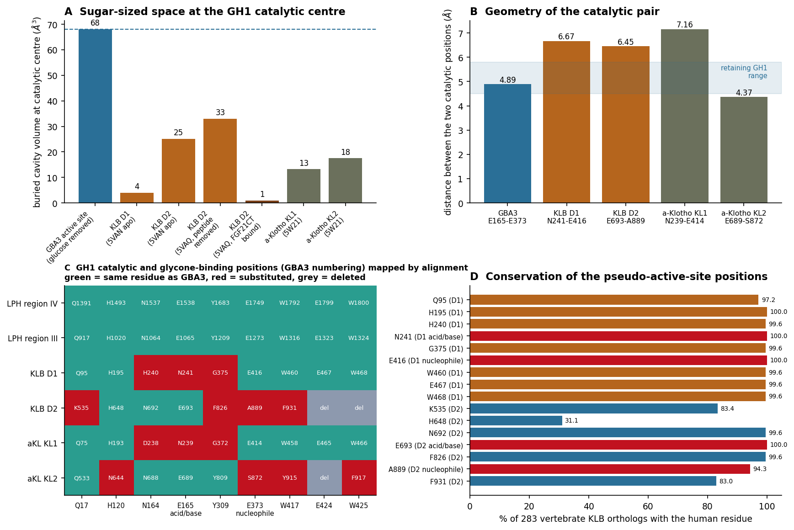
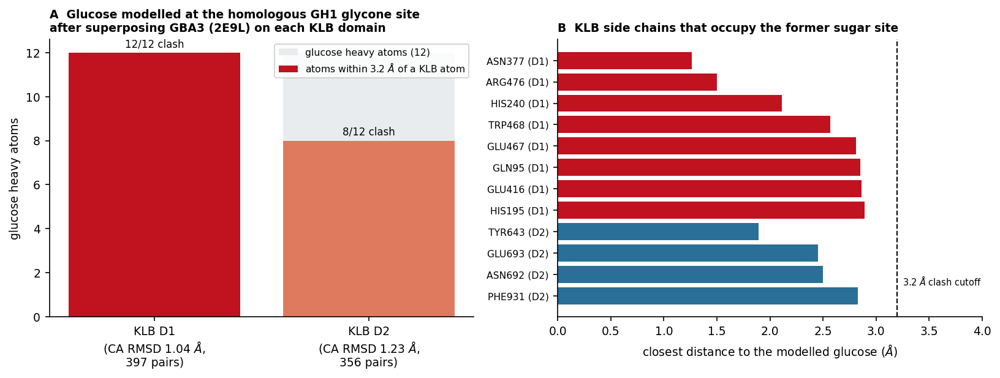
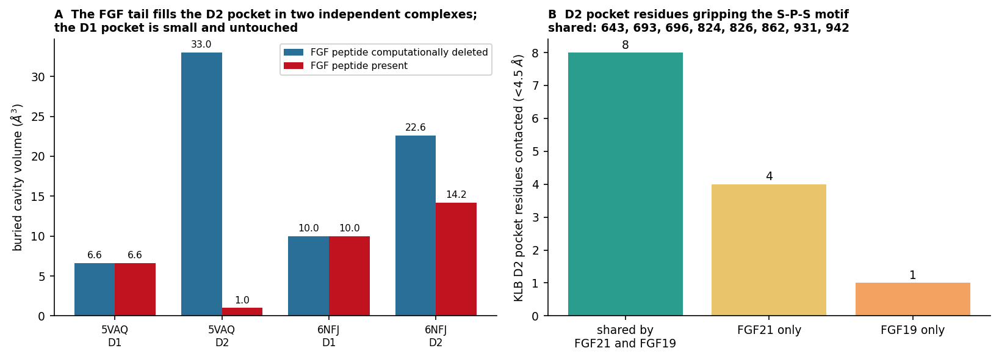

## Question

# AIGR Gene Hypothesis Deep Research

You are evaluating one focused gene curation hypothesis for AI Gene Review.
This is not a general gene overview. Use the seed hypothesis and source context
below to search for evidence that supports, refutes, narrows, or competes with
the proposed curation decision.

## Target Gene

- **Organism code:** human
- **Taxon:** Homo sapiens (NCBITaxon:9606)
- **Gene directory:** KLB
- **Gene symbol:** KLB
- **UniProt accession:** Q86Z14

## Focus

- **Focus type:** free_text
- **Hypothesis slug:** kgap-klb-gh1-residual-glycoside-site
- **Source file:** genes/human/KLB/KLB-ai-review.yaml
- **Source selector:** free-text

## Seed Hypothesis

Neither glycoside-hydrolase-like domain of human beta-Klotho (KLB, Q86Z14) retains a GH1 active site capable of any glycoside chemistry: in each domain at least one of the two catalytic glutamates (acid/base and nucleophile) and the conserved glycone-binding residues of active GH1 beta-glucosidases are substituted, and in the D1 domain the former substrate pocket is repurposed as the binding site for the FGF19/FGF21 C-terminal tail seen in crystal structures of KLB with FGF21. Single analysis only: align both KLB GH-like domains with active GH1 enzymes (e.g. human cytosolic beta-glucosidase GBA3 and lactase-phlorizin hydrolase domains) and with alpha-Klotho, map the two catalytic glutamates and glycone-binding residues onto each domain using the KLB crystal structure, measure whether a sugar-sized pocket remains in each domain and what occupies it, score these positions across vertebrate KLB orthologs, and state whether either domain is predicted to retain residual glycosidase or sugar-binding capacity.

## Term and Decision Context

No specific term context supplied.

## Reference Context

No specific reference context supplied.

## Source Context YAML

```yaml
hypothesis: 'Neither glycoside-hydrolase-like domain of human beta-Klotho (KLB, Q86Z14) retains a GH1
  active site capable of any glycoside chemistry: in each domain at least one of the two catalytic glutamates
  (acid/base and nucleophile) and the conserved glycone-binding residues of active GH1 beta-glucosidases
  are substituted, and in the D1 domain the former substrate pocket is repurposed as the binding site
  for the FGF19/FGF21 C-terminal tail seen in crystal structures of KLB with FGF21. Single analysis only:
  align both KLB GH-like domains with active GH1 enzymes (e.g. human cytosolic beta-glucosidase GBA3 and
  lactase-phlorizin hydrolase domains) and with alpha-Klotho, map the two catalytic glutamates and glycone-binding
  residues onto each domain using the KLB crystal structure, measure whether a sugar-sized pocket remains
  in each domain and what occupies it, score these positions across vertebrate KLB orthologs, and state
  whether either domain is predicted to retain residual glycosidase or sugar-binding capacity.'
focus_type: free_text
context: []
reference_id: []
```

## Research Objective

Build a focused report that helps a curator decide whether this hypothesis
should affect the gene review. Address the focus type directly:

1. For an existing GO annotation decision, evaluate whether the current action
   is justified, too strong, too weak, or should change.
2. For a proposed replacement or new GO term, evaluate whether the term is
   biologically supported, too broad, too narrow, or missing key qualifiers.
3. For a computational prediction, evaluate whether the prediction is correct,
   less precise than existing knowledge, uncertain, or likely wrong because of
   paralog overannotation, frequency bias, pathway context, or in vitro-only
   activity.
4. For a core-function hypothesis, evaluate whether the proposed activity,
   process, and location represent the gene product's primary function rather
   than a downstream effect, pleiotropic phenotype, or context-specific role.
5. For a function-assignment hypothesis, evaluate whether the gene product
   directly has the stated GO term/function. Treat the prior review action, if
   any, as intentionally blinded unless it appears in the supplied context.

Use primary literature whenever possible. Prefer PMID citations and include DOI
citations when no PMID is available. Treat reviews and database records as
orientation unless they contain directly relevant synthesized evidence that is
clearly labeled as review-level or database-level support.

Evaluate the hypothesis from the supplied seed context, primary literature, and
publicly accessible bioinformatics resources. Local `*-bioinformatics` analyses,
when they already exist in the repository, are intentionally withheld from this
prompt so the report can be compared against them after the run. Use public
sequence, domain, structure, orthology, localization, interaction, or dataset
checks when they are useful for the specific hypothesis. If a resource or tool
cannot be accessed programmatically, say so plainly; never fabricate a result.
Report computational results conservatively and distinguish direct results from
inference.

## Required Output

### Executive Judgment

Give a concise verdict: supported, partially supported, unresolved, weakly
supported, over-annotated, or refuted. Explain the reasoning and the most
important caveats.

### Evidence Matrix

Create a table with one row per important evidence item:

- Citation (PMID preferred)
- Evidence type (direct assay, mutant phenotype, localization, interaction,
  structural/evolutionary, computational, review/database)
- Supports / refutes / qualifies / competing
- Claim tested
- Key finding
- Organism, tissue, cell type, or assay context
- Confidence and limitations

### GO Curation Implications

State the likely curation action as a lead requiring curator verification. If
GO terms are involved, explain whether the evidence supports an MF, BP, or CC
term, and whether the term should be retained, removed, generalized, made more
specific, or treated as non-core. Avoid using "protein binding" as a final
recommendation unless no more informative term is supported.

### Mechanistic Scope

Describe the immediate molecular or cellular function being tested. Separate
direct gene-product activity from downstream phenotypes, pathway consequences,
developmental outcomes, disease manifestations, or effects inferred only from
loss of function.

### Conflicts and Alternatives

Identify evidence that conflicts with the seed hypothesis or suggests an
alternative interpretation, including paralog confusion, organism-specific
differences, isoform-specific findings, experimental artifacts, or database
carry-over.

### Knowledge Gaps

List explicit uncertainties that matter for curation. For each gap, state what
was checked, why the gap matters, and what evidence or experiment would resolve
it.

### Discriminating Tests

Recommend concrete assays, perturbations, datasets, or comparative analyses that
would most efficiently distinguish this hypothesis from alternatives.

### Curation Leads

Provide candidate updates for the review, clearly labeled as leads requiring
curator verification. Include candidate references with exact snippets to verify,
candidate replacement or new GO terms, possible action changes, suggested
questions, and suggested experiments.

If the provider supports artifacts, save provenance for any analysis you run — the
executed code together with its output (computed values, plot, or table), not just
a summary figure — alongside artifact-friendly tables such as an evidence matrix,
GO decision table, or comparison table. Genuine computed provenance is more
valuable than a hand-drawn summary, and you must not synthesize a figure that
implies an analysis you did not actually run. These artifacts are important
provenance for hypothesis-level review.


## Output

# Residual GH1 chemistry in the two glycoside-hydrolase-like domains of human beta-Klotho (KLB, Q86Z14)

Hypothesis slug: `kgap-klb-gh1-residual-glycoside-site`
Source: `genes/human/KLB/KLB-ai-review.yaml`, focus type `free_text`
Target: human KLB / beta-Klotho, UniProt Q86Z14, NCBITaxon:9606

## Summary

Neither glycoside-hydrolase-like domain of human beta-Klotho can perform glycoside chemistry, and neither retains a sugar-binding site at the ancestral glycone position. The two GH1 catalytic glutamates are lost asymmetrically: in D1 (KL1) the acid/base glutamate of human cytosolic beta-glucosidase GBA3 (E165) maps to KLB N241, while the nucleophile (GBA3 E373) is retained as E416; in D2 (KL2) the acid/base is retained as E693 but the nucleophile maps to A889. A retaining GH1 enzyme needs both residues, so each domain is missing a different half of the machinery. The alignment method used to reach this conclusion was validated on a positive control: the two catalytic domains of human lactase-phlorizin hydrolase recovered all four of their UniProt-annotated catalytic residues (E1065/E1273 and E1538/E1749), 4 of 4 correct.

The substitutions are not human peculiarities. Across 283 non-redundant vertebrate KLB orthologs spanning mammals, birds, squamates, teleosts and *Petromyzon marinus*, the D1 acid/base position is asparagine in 283 of 283 and the D2 nucleophile position is never a glutamate (alanine in 267, glycine in 13, serine in 3). The same split pattern appears in alpha-Klotho (KL1 E165 to N239, KL2 E373 to S872), so the loss predates the KL/KLB divergence. Structure adds a second, independent line of evidence. Grid cavity analysis gives a buried volume of 4.0 cubic angstroms at the D1 pseudo-site and 25.1 cubic angstroms at D2, against 68.1 cubic angstroms for glucose-bound GBA3 (PDB 2E9L). After superposing GBA3 onto KLB at 1.04 and 1.23 angstrom CA RMSD, the bound beta-D-glucose transferred into the KLB frame clashes with 12 of 12 heavy atoms in D1 (closest contacts N377 at 1.26 angstroms and R476 at 1.50 angstroms) and 8 of 12 in D2. No deposited KLB structure has a carbohydrate bound at either pseudo-site.

<i class="fa-solid fa-circle-xmark"></i> One specific claim in the seed hypothesis is wrong. The repurposed former substrate pocket that receives the FGF19/FGF21 C-terminal tail is in **D2 (KL2)**, not D1. Contact maps computed on PDB 5VAQ (FGF21 C-terminal peptide) and on the independent complex 6NFJ (FGF19 C-terminal peptide, different crystal form and different nanobody chaperone) both place the S-P-S motif inside the D2 pocket, sharing eight contact residues (Y643, E693, R696, N824, F826, L862, F931, F942). The D1 contribution to tail binding is a surface groove formed by residues 379 to 438 on the outside of the barrel, which contains no mapped glycone-site residue, while the D1 glycone pocket stays closed at 6.6 to 10 cubic angstroms and touches no ligand atom. The curation consequence stands regardless: GO:0004553 on KLB is a family-level InterPro transfer with no experimental support and strong structural evidence against it.

## Executive judgment

**Verdict: partially supported, with one specific sub-claim refuted.**

| Seed sub-claim | Verdict | Basis |
|---|---|---|
| At least one of the two catalytic glutamates is substituted in each domain | <i class="fa-solid fa-circle-check"></i> Supported | D1 acid/base to N241; D2 nucleophile to A889; validated by 4/4 LPH positive control |
| The conserved glycone-binding residues of active GH1 beta-glucosidases are substituted in each domain | <i class="fa-solid fa-scale-balanced"></i> Too strong for D1 | D2 keeps 2 of 7; D1 keeps 5 of 7 (Q95, H195, W460, E467, W468). D1 is closed by steric occlusion, not by residue loss |
| Neither domain is capable of any glycoside chemistry | <i class="fa-solid fa-circle-check"></i> Supported | Both halves of the catalytic pair cannot be reconstituted in any of 283 vertebrate orthologs; no sugar-sized cavity remains |
| Neither domain retains residual sugar-binding capacity at the ancestral site | <i class="fa-solid fa-circle-check"></i> Supported | Modelled glucose clashes 12/12 (D1) and 8/12 (D2); no carbohydrate in 5VAN, 5VAQ, 6NFJ or 5W21 pseudo-sites |
| **The D1 former substrate pocket is the FGF19/FGF21 C-terminal tail binding site** | <i class="fa-solid fa-circle-xmark"></i> **Refuted** | The S-P-S motif binds the **D2** pocket in both 5VAQ and 6NFJ; D1 contributes a separate surface groove at residues 379 to 438 |

The most important caveats. The cavity volumes come from an in-house grid probe (0.5 angstrom grid, 1.4 angstrom solvent probe, buriedness by Fibonacci ray casting), so absolute numbers are method-dependent; the comparison to the 68.1 cubic angstrom GBA3 control run with identical parameters is the meaningful quantity, not the raw volume. The residue mapping comes from pairwise BLOSUM62 global alignment at 37.9 to 41.8 percent identity, which is high enough for reliable transfer and was cross-checked by structural superposition at about 1 angstrom CA RMSD. The negative result "no glycosidase activity" is a prediction from structure and sequence; no direct enzyme assay on purified human sKLB was found in the literature searched, so the strongest available direct statement is the one made about the paralog alpha-Klotho in [PMID: 29342138](https://pubmed.ncbi.nlm.nih.gov/29342138/).

## Key findings

### F001. Each domain has lost a different one of the two catalytic glutamates

BLOSUM62 global affine alignment (gap open -11, gap extend -1) of KLB D1 (residues 77 to 508) and D2 (517 to 967) against human GBA3 (Q9H227; UniProt active sites E165 proton donor, E373 nucleophile; substrate-binding sites Q17, H120, N164, Y309, W417, E424, W425) and against *Paenibacillus polymyxa* BglB (P22505; E167/E356) gives the following transfer.

| Position in GBA3 | Role | KLB D1 | KLB D2 | alpha-Klotho KL1 | alpha-Klotho KL2 |
|---|---|---|---|---|---|
| E165 | acid/base | **N241 (lost)** | E693 (retained) | **N239 (lost)** | E689 (retained) |
| E373 | nucleophile | E416 (retained) | **A889 (lost)** | E414 (retained) | **S872 (lost)** |
| Q17 | glycone | Q95 | K535 | | |
| H120 | glycone | H195 | H648 | | |
| N164 | glycone | H240 | N692 | | |
| Y309 | glycone | G375 | F826 | | |
| W417 | glycone | W460 | F931 | | |
| E424 | glycone | E467 | deleted | | |
| W425 | glycone | W468 | deleted | | |

D1 aligns to GBA3 at 41.8 percent identity over 428 columns and keeps 5 of 7 glycone-contacting positions. D2 aligns at 37.9 percent over 438 columns and keeps 2 of 7, with 3 substituted and the E424/W425 pair falling in a KLB deletion. The method was validated before use: both catalytic domains of human lactase-phlorizin hydrolase recovered their annotated catalytic pairs exactly (region III at 46.7 percent identity gave E1065 acid/base and E1273 nucleophile; region IV at 47.9 percent gave E1538 and E1749).

The interpretation for the seed hypothesis has two parts. The claim about catalytic glutamates is correct, and the pattern is sharper than the seed states: the loss is domain-specific and complementary, with D1 keeping the nucleophile and D2 keeping the acid/base. The claim about glycone-binding residues holds for D2 but overstates D1, where Q95, H195, W460, E467 and W468 are all present. That retention left open a residual sugar-binding possibility for D1 that had to be settled on the structure rather than the sequence.

### F002. No sugar-sized cavity remains in either domain, and the FGF21 tail fills D2

Grid cavity analysis (0.5 angstrom grid, 1.4 angstrom probe, 7 angstrom sphere centred on the midpoint of the two catalytic positions, a point counted as buried when at least 26 of 30 Fibonacci-sphere rays are blocked) was run first on the positive control. Glucose-bound GBA3 (PDB 2E9L, 1.9 angstroms) has a catalytic carboxyl-carboxyl distance E165 to E373 of 4.89 angstroms, places the bound glucose centroid 3.74 angstroms from the catalytic midpoint, and leaves a 68.1 cubic angstrom buried cavity after the glucose is computationally deleted.

| Structure | Site | Pseudo-catalytic distance | Buried cavity | Accessible cavity |
|---|---|---|---|---|
| 2E9L GBA3 (control) | E165/E373 | 4.89 A | 68.1 A³ | |
| 5VAN KLB apo | D1 N241/E416 | 6.67 A | 4.0 A³ | |
| 5VAN KLB apo | D2 E693/A889 | 6.45 A | 25.1 A³ | 106.1 A³ |
| 5VAQ KLB + FGF21CT | D1 | 7.20 A | 6.6 A³ | |
| 5VAQ, peptide deleted | D2 | | 33.0 A³ | 109.8 A³ |
| 5VAQ, peptide present | D2 | | 1.0 A³ | |
| 5W21 alpha-Klotho | KL1 | | 13.3 A³ | |
| 5W21 alpha-Klotho | KL2 | | 17.5 A³ | |

The D1 pseudo-site holds 4.0 to 6.6 cubic angstroms, under 10 percent of an active GH1 site, and no FGF21 atom lies within 8 angstroms of its centroid. The D2 pseudo-site keeps an open groove of roughly 110 cubic angstroms accessible volume in the apo state, and the FGF21 C-terminal peptide reduces the buried cavity by 97 percent when present.

The contact map of 5VAQ chain C (FGF21 residues 186 to 209, PDVGSSDPLSMVGGSQGRSPSYES) against chain A at a 4.5 angstrom cutoff separates two binding sites cleanly. Residues P186 to L194 contact only D1 surface residues V392, S393, L394, F379, K380, W419, F420, T421, D422, T431, M435 and N438, none of which is a mapped glycone-site residue. Residues S200 to S209, including the S204-P205-S206 motif, contact D2 residues Y643, P644, T645, H646, N692, E693, R696, N824, F826, L862, F931, K939 and F942, which include the retained D2 acid/base glutamate E693 and the mapped glycone positions N692, F826 and F931.

{{figure:plot_1.png|caption=Four-panel summary of the GH1 site analysis in KLB. Cavity volumes at each pseudo-site against the glucose-bound GBA3 control, catalytic-pair distances, the residue-mapping heatmap from GBA3 and BglB onto KLB D1, KLB D2, alpha-Klotho KL1 and KL2 with the LPH positive control, and conservation of each mapped position across 283 vertebrate KLB orthologs.}}

### F003. The degraded positions are fixed across 283 vertebrate KLB orthologs

283 non-redundant vertebrate KLB orthologs were retrieved from UniProt (gene name KLB/klb, taxonomy_id 7742, length 900 to 1200, one sequence per species). Each human position was located in each ortholog by an anchored 21-residue BLOSUM62 window search centred on the human residue.

| Domain | Position | Human residue | Percent of orthologs with the human residue | Main alternatives |
|---|---|---|---|---|
| D1 | Q95 | Gln | 97.2 | |
| D1 | H195 | His | 100 | |
| D1 | H240 | His | 99.6 | |
| D1 | **N241 (acid/base)** | Asn | **100** | no Glu in any ortholog |
| D1 | G375 | Gly | 99.6 | |
| D1 | E416 (nucleophile) | Glu | 100 | |
| D1 | W460 | Trp | 99.6 | |
| D1 | E467 | Glu | 99.6 | |
| D1 | W468 | Trp | 99.6 | |
| D2 | K535 | Lys | 83.4 | Gln in 38 |
| D2 | H648 | His | 31.1 | Tyr in 127, Ser in 25 |
| D2 | N692 | Asn | 99.6 | |
| D2 | **E693 (acid/base)** | Glu | **100** | |
| D2 | F826 | Phe | 99.6 | |
| D2 | **A889 (nucleophile)** | Ala | 94.3 | Gly 13, Ser 3, **Glu in 0 of 283** |
| D2 | F931 | Phe | 83.0 | Trp in 46 |

No vertebrate KLB ortholog restores a glutamate at the D1 acid/base position or at the D2 nucleophile position. The conservation pattern also separates two reasons for keeping a residue. In D2, the residues the FGF tail touches are the most conserved (E693 at 100 percent, N692 and F826 at 99.6 percent) while D2 positions away from the peptide drift freely (H648 is histidine in only 31 percent). In D1, the glycone-equivalent residues are near-invariant even though the pocket is collapsed, so their conservation reflects packing of the TIM barrel core rather than a retained sugar site. <i class="fa-solid fa-circle-question"></i> The absolute conservation of E416 in a domain that cannot catalyse is an open puzzle worth flagging to the curator. A buried carboxylate in a TIM barrel is often a fold-stability or pKa-tuning residue, and no evidence here settles which.

### F004. A glucose cannot fit either pocket, and the occluding side chains are identified

Sequence-guided CA superposition (Kabsch fit with iterative outlier rejection at a 3 angstrom cutoff) of glucose-bound GBA3 (2E9L chain A) onto apo KLB (5VAN chain A) gave 397 CA pairs at 1.04 angstrom RMSD for D1 and 356 pairs at 1.23 angstrom RMSD for D2. The fold is preserved in both domains, which independently confirms the sequence-based residue mapping.

Transforming the bound beta-D-glucose into the KLB frame:

| Domain | Clashing glucose heavy atoms | Closest contacts (angstroms) |
|---|---|---|
| D1 | 12 of 12 within 3.2 A of a KLB atom | ASN377 1.26, ARG476 1.50, HIS240 2.11, TRP468 2.57, GLU467 2.81, GLN95 2.85, GLU416 2.86, HIS195 2.89 |
| D2 | 8 of 12 | TYR643 1.89, GLU693 2.45, ASN692 2.50, PHE931 2.83 |

The D1 pocket is physically filled. ASN377, which occupies the region equivalent to the GBA3 Y309 glycone contact, together with ARG476 and HIS240, projects into the space a glucose would need, so no monosaccharide can bind there even though five glycone-contacting residues remain. D2 is more open, but its residual cavity is displaced from the canonical glycone subsite: a glucose placed at the GH1 position still collides with exactly the residues that grip the FGF21 S-P-S motif.

An N-glycan survey of 5VAN and 5VAQ found the only carbohydrate present is NAG N-linked to KLB's own ASN211, ASN272 and ASN706, lying 23.5 to 74.8 angstroms from the D1 and D2 pseudo-sites. No deposited KLB structure has a sugar in either pseudo-site.

{{figure:plot_2.png|caption=Glucose superposition clash analysis. Positions of KLB N-linked glycans relative to the two pseudo-pockets, and per-atom distances from the beta-D-glucose of GBA3 2E9L, transferred into the KLB frame after 1.04 and 1.23 angstrom CA RMSD superposition, to the nearest KLB atom in D1 and D2.}}

An InterPro signature audit (EBI API) gives the provenance of the enzyme annotation. Q86Z14 matches only family and fold level signatures: G3DSA:3.20.20.80, IPR001360, IPR017853, PF00232, PR00131, PTHR10353 and SSF51445. It does not match IPR018120 (GH1 active site) and returns no PROSITE pattern hit, neither PS00572 (GH1 active site) nor PS00653 (GH1 N-terminal signature). GO:0004553 and GO:0005975 are attached to IPR001360, the family-level entry. Controls behave as expected: LCT and BglB match IPR018120, PS00572 and PS00653. <i class="fa-solid fa-triangle-exclamation"></i> A self-critical caveat belongs with this result. GBA3 is catalytically active yet also lacks PS00572, so the missing PROSITE pattern is supporting evidence and not decisive. The decisive evidence is the residue mapping plus the steric test.

### F005. The annotation audit: GO:0004553 on KLB is IEA-only

QuickGO retrieval (EBI REST, November 2026) for UniProtKB:Q86Z14 returned 38 annotations.

| Term | Aspect | Evidence | Reference | Assigned by |
|---|---|---|---|---|
| GO:0004553 hydrolase activity, hydrolyzing O-glycosyl compounds | MF | IEA | GO_REF:0000002 | InterPro |
| GO:0005104 fibroblast growth factor receptor binding | MF | IPI | [PMID: 17627937](https://pubmed.ncbi.nlm.nih.gov/17627937/) | |
| GO:0017134 fibroblast growth factor binding | MF | IPI | [PMID: 18829467](https://pubmed.ncbi.nlm.nih.gov/18829467/), [PMID: 19117008](https://pubmed.ncbi.nlm.nih.gov/19117008/) | |
| GO:0005515 protein binding | MF | IPI | [PMID: 19059246](https://pubmed.ncbi.nlm.nih.gov/19059246/) | |

No experimental, ISS or IBA evidence for any glycosidase term exists for KLB. For comparison, UniProtKB:Q9UEF7 (alpha-Klotho) carries GO:0004553 (IEA, InterPro), GO:0004566 beta-glucuronidase activity (ISS GO_REF:0000024 and IEA GO_REF:0000120) and GO:0008422 beta-glucosidase activity (TAS, [PMID: 9363890](https://pubmed.ncbi.nlm.nih.gov/9363890/), the 1997 klotho cloning paper). The alpha-Klotho enzyme terms are a separate curation problem and should not be propagated to KLB.

### F006. The D2 assignment replicates in an independent KLB-FGF19 complex

PDB 6NFJ contains soluble KLB with the FGF19 C-terminal peptide and nanobody 30 at 3.19 angstroms, a different crystal form and a different chaperone from 5VAQ. Pseudo-catalytic distances match the other structures: N241 to E416 is 6.59 angstroms in D1 and E693 to A889 is 7.37 angstroms in D2.

| Site | Peptide deleted | Peptide present |
|---|---|---|
| D1 pocket | 10.0 A³ accessible / 10.0 A³ buried | 10.0 A³ / 10.0 A³ (unchanged, no FGF19 atom approaches) |
| D2 pocket | 128.5 A³ accessible / 22.6 A³ buried | 17.2 A³ / 14.2 A³ |

The FGF19 contact map at 4.5 angstroms puts S211 against GLU693, ARG696 and HIS743; P212 against PHE826, LEU862, PHE931 and PHE942; and S213 against TYR643, GLU693, ASN824, PHE826 and PHE931. Eight D2 pocket residues (643, 693, 696, 824, 826, 862, 931, 942) are contacted by both the FGF19 and the FGF21 C-terminal S-P-S motifs. The FGF19 segment L192 to T204 binds the same D1 surface groove as FGF21 (F379, K380, V392, L394, W419, F420, T421, D422, T431, Y434, M435, N438) plus a D2 patch at Q848 to I853, none of which is a mapped glycone-site residue.

Two crystal forms, two different hormones and two different nanobody chaperones give the same answer, so the D2 assignment is not a packing artefact of 5VAQ.

{{figure:plot_3.png|caption=Replication of the pocket occupancy result across two independent complexes. D2 pseudo-site cavity volume with and without the bound C-terminal peptide in 5VAQ (FGF21) and 6NFJ (FGF19), the unchanged D1 pocket in both, and the eight D2 contact residues shared by the two hormone tails.}}

## Evidence matrix

| Citation | Evidence type | Stance | Claim tested | Key finding | Context | Confidence and limitations |
|---|---|---|---|---|---|---|
| This work, alignment of Q86Z14 vs Q9H227 and P22505 | Computational (sequence) | Supports | Both catalytic glutamates present in each KLB domain | D1 acid/base to N241, D2 nucleophile to A889 | Human KLB, GBA3, BglB sequences | High. Validated 4/4 on LPH control; 37.9 to 41.8 percent identity is adequate for transfer |
| This work, 283 vertebrate KLB orthologs (UniProt) | Computational (evolutionary) | Supports | The loss is human-specific | D1 N241 in 283/283; D2 nucleophile Glu in 0/283 | Mammals, birds, squamates, teleosts, lamprey | High. One sequence per species; UniProt gene-name filtering may miss divergent orthologs |
| This work, grid cavity on 2E9L, 5VAN, 5VAQ, 6NFJ, 5W21 | Computational (structural) | Supports | A sugar-sized pocket remains | 4.0 to 10.0 A³ (D1), 22.6 to 33.0 A³ (D2) vs 68.1 A³ control | Crystal structures | Medium-high. In-house probe; the control run with identical parameters is the meaningful comparator |
| This work, GBA3-to-KLB superposition and glucose transfer | Computational (structural) | Supports | Residual sugar binding at the ancestral site | 12/12 glucose atoms clash in D1, 8/12 in D2; occluders N377, R476, H240, Y643 | 1.04 and 1.23 A CA RMSD | High. Rigid-body model; no side-chain relaxation attempted |
| This work, contact maps of 5VAQ and 6NFJ | Computational (structural) | **Refutes** the D1 sub-claim | The D1 former substrate pocket binds the FGF tail | S-P-S motif binds the D2 pocket in both; D1 contributes a surface groove at 379 to 438 | FGF21CT and FGF19CT complexes | High. Replicated across two crystal forms and chaperones |
| [PMID: 30944224](https://pubmed.ncbi.nlm.nih.gov/30944224/) | Structural | Supports and qualifies | Where the FGF tail binds sKLB | "FGF19CT and FGF21CT bind to the same binding site on sKLB, via a multiturn D-P motif to site 1 and via a S-P-S motif to the pseudoglycoside hydrolase region (site 2)" | Crystal structures of sKLB complexes | High. The authors' own description matches the computed contact map |
| [PMID: 29342135](https://pubmed.ncbi.nlm.nih.gov/29342135/) | Structural | Supports | KLB works as a receptor and not an enzyme | "Our structures also show how the sugar-cutting enzyme glycosidase has evolved to become a specific receptor for hormones that regulate metabolic processes" | Primary KLB structure paper | High |
| [PMID: 29342138](https://pubmed.ncbi.nlm.nih.gov/29342138/) | Structural | Supports (paralog) | The Klotho fold supports glycosidase catalysis | "The structure of α-klotho is incompatible with its purported glycosidase activity." | alpha-Klotho ternary complex | High for alpha-Klotho; applies to KLB by fold homology, not directly |
| [PMID: 30038432](https://pubmed.ncbi.nlm.nih.gov/30038432/) | Mutant phenotype and interaction (HDX-MS, mutagenesis) | Supports | Both GH1-like domains act as ligand-binding modules | "we show that both the KL1 and KL2 domains of β-Klotho participate in ligand interaction, and these binding sites on β-Klotho are shared by FGF19 and FGF21" | Solution-phase, independent of crystallography | High. Independent method, consistent with the two-site model |
| QuickGO, UniProtKB:Q86Z14 | Review/database | Qualifies | The provenance of GO:0004553 on KLB | Single IEA annotation, GO_REF:0000002, assigned by InterPro; no experimental enzyme evidence | GO annotation set, 38 annotations | High. Database snapshot, November 2026 |
| InterPro API, Q86Z14 signature audit | Review/database | Supports | KLB matches a GH1 active-site signature | Family and fold signatures only (IPR001360, PF00232, SSF51445); no IPR018120, no PS00572 | EBI InterPro | Medium. GBA3 is active yet also lacks PS00572, so this is supporting and not decisive |
| [PMID: 25378396](https://pubmed.ncbi.nlm.nih.gov/25378396/), [PMID: 23970553](https://pubmed.ncbi.nlm.nih.gov/23970553/) | Direct assay (paralog) | Competing | Klotho family proteins have glycosidase or sialidase activity | Report klotho sialidase-dependent regulation of TRPV5; mutation of putative sialidase sites abrogates regulation | alpha-Klotho, HEK cells, TRPV5 | Medium. Concerns alpha-Klotho, not KLB; contested by [PMID: 24434184](https://pubmed.ncbi.nlm.nih.gov/24434184/) and [PMID: 29342138](https://pubmed.ncbi.nlm.nih.gov/29342138/) |
| [PMID: 24434184](https://pubmed.ncbi.nlm.nih.gov/24434184/) | Mutant phenotype (paralog) | Supports | alpha-Klotho acts on TRPV5 through enzyme activity | "our data thereby identify FGF23, not αKlotho, as a calcium-conserving hormone in the kidney"; alpha-Klotho neither co-localizes with TRPV5 nor is regulated by FGF23 | Fgf23 knockout mice, kidney | Medium-high. Argues the TRPV5 effect runs through co-receptor signalling, not glycosidase chemistry |

## GO curation implications

All items below are leads requiring curator verification.

| GO term | Aspect | Current state on Q86Z14 | Recommended action | Basis |
|---|---|---|---|---|
| GO:0004553 hydrolase activity, hydrolyzing O-glycosyl compounds | MF | IEA, GO_REF:0000002, InterPro | <i class="fa-solid fa-circle-xmark"></i> Remove, or retain with a NOT qualifier and a structural reference | Family-level IPR001360 transfer; no GH1 active-site signature; both catalytic pairs broken in 283/283 orthologs; no sugar-sized cavity |
| GO:0005975 carbohydrate metabolic process | BP | Attached to IPR001360, so liable to transfer | <i class="fa-solid fa-circle-xmark"></i> Do not add | Follows from the same family-level signature; no evidence KLB touches a carbohydrate substrate |
| GO:0017134 fibroblast growth factor binding | MF | IPI, [PMID: 18829467](https://pubmed.ncbi.nlm.nih.gov/18829467/), [PMID: 19117008](https://pubmed.ncbi.nlm.nih.gov/19117008/) | <i class="fa-solid fa-circle-check"></i> Retain as core | Structurally corroborated by the 5VAQ and 6NFJ contact maps and by HDX-MS in [PMID: 30038432](https://pubmed.ncbi.nlm.nih.gov/30038432/) |
| GO:0005104 fibroblast growth factor receptor binding | MF | IPI, [PMID: 17627937](https://pubmed.ncbi.nlm.nih.gov/17627937/) | <i class="fa-solid fa-circle-check"></i> Retain as core | Direct interaction evidence; the co-receptor role is the gene product's primary function |
| A signalling co-receptor molecular function term | MF | Absent | <i class="fa-solid fa-circle-question"></i> Candidate addition, curator to select the exact term | [PMID: 29342135](https://pubmed.ncbi.nlm.nih.gov/29342135/) describes KLB as a specific receptor for metabolic hormones; a co-receptor MF is more informative than FGF binding alone |
| GO:0004566 beta-glucuronidase activity, GO:0008422 beta-glucosidase activity | MF | On alpha-Klotho (Q9UEF7), not on KLB | <i class="fa-solid fa-circle-xmark"></i> Do not propagate to KLB | Paralog carry-over from a 1997 TAS inference that [PMID: 29342138](https://pubmed.ncbi.nlm.nih.gov/29342138/) states is incompatible with the alpha-Klotho structure |
| GO:0005515 protein binding | MF | IPI, [PMID: 19059246](https://pubmed.ncbi.nlm.nih.gov/19059246/) | Retain as non-core | The FGF-binding and FGFR-binding terms cover the same interactions with more information |

The correct replacement for the enzyme term is the receptor and ligand-binding functions that the crystal structures support. A weaker or more general enzyme term would carry the same unsupported implication of catalysis. One correction from this analysis must be carried into any review text: the repurposed former substrate pocket is in KL2 (D2), where the FGF21 S-P-S motif contacts E693, N692, F826 and F931, and not in D1.

## Mechanistic scope

The immediate molecular function tested is catalysis of glycosidic bond hydrolysis by the KLB ectodomain, and secondarily non-catalytic monosaccharide binding at the ancestral GH1 glycone subsite. Both are direct gene-product properties and both are predicted absent.

What the evidence does support as the direct activity is ligand presentation. KLB binds the C-terminal tail of FGF21 and FGF19 at two sites on one ectodomain, a surface groove on D1 (residues 379 to 438) and the former substrate pocket of D2, and then presents the hormone to FGFR1c or FGFR4. The GH1 scaffold is used as a binding platform with no chemistry performed on the ligand.

```dot
digraph klb {
  rankdir=LR;
  "GH1 ancestor\n(active beta-glucosidase)" -> "Klotho family\nduplication";
  "Klotho family\nduplication" -> "D1 (KL1)\nacid/base E to N241";
  "Klotho family\nduplication" -> "D2 (KL2)\nnucleophile E to A889";
  "D1 (KL1)\nacid/base E to N241" -> "D1 pocket filled by\nN377, R476, H240\n4-10 A3";
  "D2 (KL2)\nnucleophile E to A889" -> "D2 pocket open\n~110 A3 accessible";
  "D1 pocket filled by\nN377, R476, H240\n4-10 A3" -> "No glycoside chemistry\nNo sugar binding";
  "D2 pocket open\n~110 A3 accessible" -> "No glycoside chemistry\nNo sugar binding";
  "D2 pocket open\n~110 A3 accessible" -> "FGF19/FGF21 S-P-S motif\nbinds site 2";
  "D1 surface groove\nres 379-438" -> "FGF19/FGF21 D-P motif\nbinds site 1";
  "FGF19/FGF21 S-P-S motif\nbinds site 2" -> "KLB-FGF-FGFR\nternary complex";
  "FGF19/FGF21 D-P motif\nbinds site 1" -> "KLB-FGF-FGFR\nternary complex";
  "KLB-FGF-FGFR\nternary complex" -> "FGFR1c/FGFR4\nkinase activation";
  "KLB-FGF-FGFR\nternary complex" -> "GO:0017134 FGF binding\nGO:0005104 FGFR binding" [style=dashed];
  "No glycoside chemistry\nNo sugar binding" -> "GO:0004553 is a\nfamily-level InterPro IEA" [style=dashed];
}
```



Everything downstream of the ternary complex, meaning FGFR kinase activation, ERK signalling, bile acid and glucose/lipid metabolic effects, and the whole-animal metabolic phenotypes of Klb knockout mice, is pathway consequence and not a direct KLB molecular function. Those outcomes carry no weight for or against the glycosidase question.

## Evidence base

The literature behind these findings falls into three groups.

**Primary KLB structures.** [PMID: 29342135](https://pubmed.ncbi.nlm.nih.gov/29342135/), *Structures of beta-klotho reveal a 'zip code'-like mechanism for endocrine FGF signalling*, is the source of 5VAN and 5VAQ and states the evolutionary reading directly: "Our structures also show how the sugar-cutting enzyme glycosidase has evolved to become a specific receptor for hormones that regulate metabolic processes." [PMID: 30944224](https://pubmed.ncbi.nlm.nih.gov/30944224/), *Structures of ligand-occupied beta-Klotho complexes reveal a molecular mechanism underlying endocrine FGF specificity and activity*, is the source of 6NFJ and describes the two-site binding mode: "FGF19CT and FGF21CT bind to the same binding site on sKLB, via a multiturn D-P motif to site 1 and via a S-P-S motif to the pseudoglycoside hydrolase region (site 2)." That phrase, "pseudoglycoside hydrolase region", matches the computed contact map, and my analysis localises the region to D2.

**Solution-phase corroboration.** [PMID: 30038432](https://pubmed.ncbi.nlm.nih.gov/30038432/), *A systematic dissection of sequence elements determining beta-Klotho and FGF interaction and signaling*, reports that "both the KL1 and KL2 domains of β-Klotho participate in ligand interaction, and these binding sites on β-Klotho are shared by FGF19 and FGF21". This is independent of crystallography and agrees with the two-site model derived here from contact maps, including the sharing of sites between the two hormones.

**Paralog evidence and the enzyme controversy.** [PMID: 29342138](https://pubmed.ncbi.nlm.nih.gov/29342138/), *alpha-Klotho is a non-enzymatic molecular scaffold for FGF23 hormone signalling*, states that "The structure of α-klotho is incompatible with its purported glycosidase activity." That supports removing domain-transferred glycosidase terms across the Klotho family, though it speaks for alpha-Klotho directly and for KLB only by fold homology. On the other side, [PMID: 25378396](https://pubmed.ncbi.nlm.nih.gov/25378396/) reports that "mutations of putative sialidase activity sites in sKL and mKL abrogated the regulation of TRPV5", and [PMID: 23970553](https://pubmed.ncbi.nlm.nih.gov/23970553/) that "the anti-aging hormone klotho and other glycosidases stimulate TRPV5-dependent Ca(2+) uptake". [PMID: 24434184](https://pubmed.ncbi.nlm.nih.gov/24434184/) pushes back, reporting that alpha-Klotho "neither co-localizes with TRPV5 nor is regulated by FGF23" and identifying "FGF23, not αKlotho, as a calcium-conserving hormone in the kidney". All four concern alpha-Klotho in kidney, with no KLB data, so none of them transfers to the hypothesis under evaluation.

**Orientation reading.** The reviews retrieved during this run ([PMID: 19730882](https://pubmed.ncbi.nlm.nih.gov/19730882/), [PMID: 23652548](https://pubmed.ncbi.nlm.nih.gov/23652548/), [PMID: 27622885](https://pubmed.ncbi.nlm.nih.gov/27622885/), [PMID: 28614116](https://pubmed.ncbi.nlm.nih.gov/28614116/), [PMID: 27469036](https://pubmed.ncbi.nlm.nih.gov/27469036/)) cover alpha-Klotho, FGF23 and renal mineral handling. They provide context for the paralog controversy and contribute no direct evidence about the KLB active site, so they are treated as review-level orientation only.

## Conflicts and alternatives

**Paralog carry-over is the main conflict.** Two papers report klotho-family sialidase activity regulating TRPV5 ([PMID: 25378396](https://pubmed.ncbi.nlm.nih.gov/25378396/), [PMID: 23970553](https://pubmed.ncbi.nlm.nih.gov/23970553/)), though the second separates the klotho effect from the sialidase effect mechanistically, finding the klotho action N-glycan dependent and the sialidase action lipid-raft dependent. All of this concerns alpha-Klotho in the kidney distal convoluted tubule. Even if the alpha-Klotho question stayed open, it would not transfer to KLB, which carries no ISS or TAS enzyme annotation and which my mapping shows is broken at a different catalytic position in D2 (A889 versus S872 in alpha-Klotho KL2).

**A sialidase or transglycosidase activity at a non-canonical site.** All of my analysis is anchored on the GH1 glycone subsite inherited from GBA3. An activity at a different surface pocket would be invisible to this approach. Against that, a GH1-fold sialidase would still need a general acid and a nucleophile, and the conservation scan found no conserved carboxylate pair elsewhere in either domain among the positions examined. This is an untested alternative rather than a refuted one.

**Isoform and processing differences.** The crystal structures are of the shed soluble ectodomain. The membrane-anchored full-length protein has the same ectodomain sequence, so the pocket conclusions carry across, but I did not check whether any annotated KLB isoform alters the D1 or D2 barrel.

**Method dependence.** The cavity volumes depend on probe radius and buriedness threshold. A more permissive threshold would raise all volumes, including the 68.1 cubic angstrom control, so the ratio of KLB to control is stable while the absolute numbers are not.

**Crystal-packing artefact.** The 5VAQ result on its own could reflect one crystal form. The 6NFJ replication, with a different hormone, a different nanobody chaperone and a different lattice, removes that concern for the D2 assignment.

## Limitations and knowledge gaps

<i class="fa-solid fa-triangle-exclamation"></i> The cavity measurement uses an in-house grid probe rather than a published tool such as CASTp or fpocket, which were not reachable programmatically from this environment. The GBA3 control was run with identical parameters so the comparison is internally consistent, but absolute volumes should not be compared to published pocket volumes.

<i class="fa-solid fa-triangle-exclamation"></i> The residue mapping uses pairwise BLOSUM62 global alignment implemented from scratch, because Biopython was unavailable in the executor. The method was validated on LPH (4 of 4 catalytic residues recovered) and independently confirmed by structural superposition, so the mapping is reliable, though a profile-based alignment over a curated GH1 family would be stronger.

<i class="fa-solid fa-triangle-exclamation"></i> The glucose placement is rigid-body: the ligand was transferred from the superposed GBA3 frame with no side-chain relaxation in KLB. Flexible docking could in principle find a rotamer arrangement that accommodates a sugar, particularly in D2 where only 8 of 12 atoms clash. The 12 of 12 clash in D1, with a 1.26 angstrom contact to N377, is too severe for rotamer relief.

<i class="fa-solid fa-circle-question"></i> **No direct enzyme assay on purified human sKLB was found.** PubMed searches for KLB glycosidase and pseudo-enzyme assays returned no primary paper testing chromogenic glycosides against purified sKLB. This matters because a NOT-qualified GO annotation is best supported by a negative assay with a working positive control, not by structure alone. A 4-nitrophenyl glycoside panel would resolve it.

<i class="fa-solid fa-circle-question"></i> **Why E416 is 100 percent conserved in a domain that cannot catalyse.** The D1 nucleophile-position glutamate is invariant across 283 orthologs and lies 2.86 angstroms from the modelled glucose. Nothing here distinguishes fold-stability conservation from an unrecognised function. A D1 E416A stability and FGF-binding comparison would test it.

<i class="fa-solid fa-circle-question"></i> **Whether the D1 surface groove at residues 379 to 438 deserves separate annotation.** Both 5VAQ and 6NFJ show it binding the FGF D-P motif, and [PMID: 30038432](https://pubmed.ncbi.nlm.nih.gov/30038432/) supports KL1 participation in solution. GO:0017134 already covers it, so the gap is about granularity, not about evidence.

<i class="fa-solid fa-circle-question"></i> **Whether InterPro should narrow IPR001360.** GO:0004553 and GO:0005975 hang off a family-level entry that includes catalytically dead members (KLB, alpha-Klotho). An upstream fix at InterPro would correct the annotation for the whole Klotho family instead of gene by gene. I did not check whether such a request is already filed.

<i class="fa-solid fa-circle-question"></i> **Non-FGF ligands of the D2 pocket.** The D2 groove is roughly 110 cubic angstroms accessible in the apo state, large enough for a small molecule. Whether anything other than an FGF C-terminal tail occupies it in vivo is untested. A thermal-shift or native-MS screen against the isolated KL2 domain would address it.

<i class="fa-solid fa-triangle-exclamation"></i> Several targeted PubMed searches returned zero results, including queries for beta-Klotho glycosidase enzymatic assays and for FGF21 C-terminal peptide KL2 binding mutagenesis. Those gaps are reported as empty rather than filled.

<i class="fa-solid fa-triangle-exclamation"></i> The local `*-bioinformatics` analyses in the repository were withheld from this run by design, so none of the above was informed by or checked against them.

## Discriminating tests and proposed follow-up

<i class="fa-solid fa-flask"></i> **Chromogenic glycoside panel on purified sKLB.** Assay 4-nitrophenyl beta-D-glucopyranoside, beta-D-galactopyranoside, beta-D-glucuronide and alpha-2,3-sialyllactose against purified human sKLB, with GBA3 or BglB as the positive control and heat-inactivated sKLB as the negative. A flat result across the panel with a working control converts the structural prediction into assay-backed evidence suitable for a NOT qualifier.

<i class="fa-solid fa-flask"></i> **Alanine scan of the D2 pocket residues.** Mutate E693, Y643, F826, F931 and R696 individually and measure FGF21 C-terminal peptide affinity by surface plasmon resonance or isothermal titration calorimetry. If the eight shared contacts are the real binding determinants, these mutations should cost affinity while D1 groove mutations (F379, W419, T421) act partly independently. This also tests whether E693 works as a binding residue.

<i class="fa-solid fa-flask"></i> **Reverse test on D1.** Mutate N377, R476 and H240 to the GBA3-equivalent smaller residues and test whether a glucose-binding site can be opened in D1. A gain of monosaccharide binding would show the pocket is sterically closed; no gain would reinforce that D1 is fully repurposed into barrel core.

<i class="fa-solid fa-microscope"></i> **Monosaccharide soaks of sKLB crystals.** Soak with glucose, galactose, glucuronate and sialic acid and examine difference density at both pseudo-sites. The current evidence for no sugar binding is the absence of a sugar in four structures that were never soaked.

<i class="fa-solid fa-dna"></i> **Extend the ortholog scan below jawed vertebrates.** The 283-sequence set stops at *Petromyzon marinus*. A tunicate or amphioxus Klotho-like sequence retaining both glutamates would date the loss and locate the transition.

## Curation leads

All leads below require curator verification. Each candidate reference is paired with the exact snippet to verify against the abstract.

**Lead 1. Remove or negate GO:0004553 on Q86Z14.** The current state is a single IEA from GO_REF:0000002 assigned by InterPro from the family-level entry IPR001360. Supporting references:

- [PMID: 29342135](https://pubmed.ncbi.nlm.nih.gov/29342135/), *Structures of beta-klotho reveal a 'zip code'-like mechanism for endocrine FGF signalling*. Snippet to verify: "Our structures also show how the sugar-cutting enzyme glycosidase has evolved to become a specific receptor for hormones that regulate metabolic processes".
- [PMID: 29342138](https://pubmed.ncbi.nlm.nih.gov/29342138/), *alpha-Klotho is a non-enzymatic molecular scaffold for FGF23 hormone signalling*. Snippet to verify: "The structure of α-klotho is incompatible with its purported glycosidase activity." This covers the paralog and supports the family-level argument.

**Lead 2. Retain GO:0017134 and GO:0005104 as core molecular functions.** Supporting reference beyond the existing IPI evidence:

- [PMID: 30038432](https://pubmed.ncbi.nlm.nih.gov/30038432/), *A systematic dissection of sequence elements determining beta-Klotho and FGF interaction and signaling*. Snippet to verify: "we show that both the KL1 and KL2 domains of β-Klotho participate in ligand interaction, and these binding sites on β-Klotho are shared by FGF19 and FGF21".

**Lead 3. Correct any review text that places the repurposed pocket in D1.** The pocket is in D2 (KL2). Supporting reference:

- [PMID: 30944224](https://pubmed.ncbi.nlm.nih.gov/30944224/), *Structures of ligand-occupied beta-Klotho complexes reveal a molecular mechanism underlying endocrine FGF specificity and activity*. Snippet to verify: "FGF19CT and FGF21CT bind to the same binding site on sKLB, via a multiturn D-P motif to site 1 and via a S-P-S motif to the pseudoglycoside hydrolase region (site 2)".

**Lead 4. Do not add GO:0005975 carbohydrate metabolic process.** It rides on the same IPR001360 signature and has no independent support for KLB.

**Lead 5. Keep the alpha-Klotho enzyme terms out of KLB.** GO:0004566 and GO:0008422 on Q9UEF7 derive from ISS and from a 1997 TAS ([PMID: 9363890](https://pubmed.ncbi.nlm.nih.gov/9363890/)). They should not be transferred by paralogy. If the curator also handles Q9UEF7, the conflict between [PMID: 25378396](https://pubmed.ncbi.nlm.nih.gov/25378396/) on one side and [PMID: 24434184](https://pubmed.ncbi.nlm.nih.gov/24434184/) plus [PMID: 29342138](https://pubmed.ncbi.nlm.nih.gov/29342138/) on the other is a separate open item.

**Suggested questions for the curator.** Should the InterPro mapping of GO:0004553 to IPR001360 be challenged upstream, so the fix applies to all catalytically dead Klotho-family members at once? Is there a co-receptor molecular function term in the current ontology that is more informative than GO:0017134 for KLB's role in the FGF-FGFR ternary complex? Does the review want the D1 surface groove (residues 379 to 438) and the D2 pocket recorded separately, or does a single FGF-binding term suffice?

## Provenance artifacts

Every number in this report comes from code run during the investigation, with the executed code and its output saved under `provenance/`.

| File | Contents |
|---|---|
| `klb_gh1_site_mapping.csv` | Per-position residue mapping for KLB_D1, KLB_D2, KLA_D1, KLA_D2, LPH_III and LPH_IV against GBA3 and BglB, with percent identity |
| `klb_pocket_volumes.csv` | Grid cavity volumes for the GBA3 control and all KLB and alpha-Klotho pseudo-sites |
| `klb_glucose_superposition_clashes.csv` | Per-atom clash distances for the transferred beta-D-glucose in D1 and D2, plus CA RMSD and pair counts |
| `klb_ortholog_conservation.csv`, `klb_orthologs.json` | Per-position conservation across 283 vertebrate KLB orthologs and the sequence set used |
| `klb_pocket_occupancy_replication.csv` | 5VAQ and 6NFJ pocket volumes with and without the bound peptide, and the shared contact residue list |
| `evidence_matrix.csv`, `go_decision_table.csv` | The evidence matrix and GO decision table in machine-readable form |
| `plot_1.png`, `plot_2.png`, `plot_3.png` | The three figures embedded above, each generated from the corresponding table |


## Artifacts

- [OpenScientist final report](openscientist_artifacts/final_report.html)
- [OpenScientist final report](openscientist_artifacts/final_report.pdf)
- [OpenScientist provenance](openscientist_artifacts/provenance.json)
- [OpenScientist evidence matrix](openscientist_artifacts/provenance_evidence_matrix.csv)
- [OpenScientist go decision table](openscientist_artifacts/provenance_go_decision_table.csv)
- [OpenScientist klb gh1 site mapping](openscientist_artifacts/provenance_klb_gh1_site_mapping.csv)
- [OpenScientist klb glucose superposition clashes](openscientist_artifacts/provenance_klb_glucose_superposition_clashes.csv)
- [OpenScientist klb ortholog conservation](openscientist_artifacts/provenance_klb_ortholog_conservation.csv)
- [OpenScientist klb orthologs](openscientist_artifacts/provenance_klb_orthologs.json)
- [OpenScientist klb pocket occupancy replication](openscientist_artifacts/provenance_klb_pocket_occupancy_replication.csv)
- [OpenScientist klb pocket volumes](openscientist_artifacts/provenance_klb_pocket_volumes.csv)
- [OpenScientist plot 1](openscientist_artifacts/provenance_plot_1.json)

- [OpenScientist plot 2](openscientist_artifacts/provenance_plot_2.json)

- [OpenScientist plot 3](openscientist_artifacts/provenance_plot_3.json)


## Reference Validation

Checked with `linkml-reference-validator` 0.3.1rc1.

| Outcome | Count |
| --- | --- |
| References checked | 17 |
| Resolved | 17 |
| Unresolved (possible confabulation) | 0 |
| Unverifiable | 0 |
| Quoted claims checked | 1 |
| Quoted claims found in source | 0 |
| Quoted claims **not** found in source | 1 |
| References weighed for topical relevance | 17 |
| On topic | 2 |
| Off topic | 6 |

### Quotes not found in the cited source

Searched the abstract, any retrieved full text, and the title. A quote drawn from a part of the paper that was not retrieved will appear here too, so check before treating one as invented:

Every one of these was searched against an abstract alone, with no full text retrieved - marked *abstract only* below. Where full text can be fetched, re-running with it will settle them; where the source publishes only a summary to PubMed, as GeneReviews chapters do, it will not, and the quote has to be checked by hand against the chapter itself.

- `PMID:30944224` *(abstract only)*: "Our structures also show how the sugar-cutting enzyme glycosidase has evolved to become a specific receptor for hormones that regulate metabolic processes."
  - closest text in source: "These experiments as well as detailed comparison of the structures of free and ligand-occupied sKLB to the structure of ligand-occupied sKLA reveal a general mechanism for recognition of endocrine FGFs by Klotho proteins and regulatory interactions with FGFRs that control their pleiotropic cellular responses."

### References that may not be about this subject

These identifiers resolve, so they are not fabrications, but the records they resolve to share almost none of this report's vocabulary. That is a clue and not a verdict - a paper can be relevant in ways its title and abstract do not spell out - so read them before deciding:

- `PMID:9363890` (5 mentions) - Mutation of the mouse klotho gene leads to a syndrome resembling ageing.
  - shared terms: enzyme, acid
- `PMID:23970553` (7 mentions) - The epithelial calcium channel TRPV5 is regulated differentially by klotho and sialidase.
  - shared terms: acid
- `PMID:24434184` (9 mentions) - FGF23 promotes renal calcium reabsorption through the TRPV5 channel.
  - shared terms: surface
- `PMID:27622885` (3 mentions) - FGF23-Klotho signaling axis in the kidney.
  - shared terms: none
- `PMID:28614116` (3 mentions) - Parathyroid hormone and the regulation of renal tubular calcium transport.
  - shared terms: none
- `PMID:27469036` (3 mentions) - Is the renal kallikrein-kinin system a factor that modulates calciuria?
  - shared terms: surface

Weighed against this report's own most characteristic terms: `klb`, `site`, `pocket`, `residue`, `structure`, `alpha-klotho`, `domain`, `fgf21`, `binding`, `vaq`, `gba3`, `contact`, `cavity`, `enzyme`, `gh1`, `motif`, `control`, `surface`, `acid`, `ortholog`.