## Question

# Gene Research for Functional Annotation

## ⚠️ CRITICAL: Gene/Protein Identification Context

**BEFORE YOU BEGIN RESEARCH:** You MUST verify you are researching the CORRECT gene/protein. Gene symbols can be ambiguous, especially for less well-characterized genes from non-model organisms.

### Target Gene/Protein Identity (from UniProt):
- **UniProt Accession:** P35527
- **Protein Description:** RecName: Full=Keratin, type I cytoskeletal 9; AltName: Full=Cytokeratin-9; Short=CK-9; AltName: Full=Keratin-9; Short=K9;
- **Gene Information:** Name=KRT9 {ECO:0000312|HGNC:HGNC:6447};
- **Organism (full):** Homo sapiens (Human).
- **Protein Family:** Belongs to the intermediate filament family.
- **Key Domains:** IF_conserved. (IPR018039); IF_rod_dom. (IPR039008); Keratin_I. (IPR002957); Filament (PF00038)

### MANDATORY VERIFICATION STEPS:

1. **Check if the gene symbol "KRT9" matches the protein description above**
2. **Verify the organism is correct:** Homo sapiens (Human).
3. **Check if protein family/domains align with what you find in literature**
4. **If you find literature for a DIFFERENT gene with the same or similar symbol, STOP**

### If Gene Symbol is Ambiguous or You Cannot Find Relevant Literature:

**DO NOT PROCEED WITH RESEARCH ON A DIFFERENT GENE.** Instead:
- State clearly: "The gene symbol 'KRT9' is ambiguous or literature is limited for this specific protein"
- Explain what you found (e.g., "Found extensive literature on a different gene with the same symbol in a different organism")
- Describe the protein based ONLY on the UniProt information provided above
- Suggest that the protein function can be inferred from domain/family information

### Research Target:

Please provide a comprehensive research report on the gene **KRT9** (gene ID: KRT9, UniProt: P35527) in human.

The research report should be a detailed narrative explaining the function, biological processes, and localization of the gene product. Citations should be given for all claims.

You should prioritize authoritative reviews and primary scientific literature when conducting research. You can supplement
this with annotations you find in gene/protein databases, but these can be outdated or inaccurate.

We are specifically interested in the primary function of the gene - for enzymes, what reaction is catalyzed, and what is the substrate specificity? For transporters, what is the substrate? For structural proteins or adapters, what is the broader structural role? For signaling molecules, what is the role in the pathway.

We are interested in where in or outside the cell the gene product carries out its function.

We are also interested in the signaling or biochemical pathways in which the gene functions. We are less interested in broad pleiotropic effects, except where these elucidate the precise role.

Include evidence where possible. We are interested in both experimental evidence as well as inference from structure, evolution, or bioinformatic analysis. Precise studies should be prioritized over high-throughput, where available.

## Output

# KRT9 (keratin 9, UniProt P35527): function, localization and pathways

## Gene identity verification

<i class="fa-solid fa-circle-check"></i> The target was verified against the provided UniProt record before any research was done. Every mandatory check passes.

| Check | Provided in the brief | Retrieved from UniProt REST (P35527) | Match |
|---|---|---|---|
| Gene symbol | KRT9 | KRT9 (HGNC:6447) | yes |
| Protein name | Keratin, type I cytoskeletal 9; cytokeratin-9; CK-9; K9 | Keratin, type I cytoskeletal 9 | yes |
| Organism | Homo sapiens (Human) | Homo sapiens, taxid 9606 | yes |
| Family | Intermediate filament family | Intermediate filament family, type I (acidic) keratin | yes |
| Domains | IF_conserved (IPR018039), IF_rod_dom (IPR039008), Keratin_I (IPR002957), Filament (PF00038) | IF rod domain annotated at residues 153-465; PF00038 Filament present | yes |
| Length / mass | not given | 623 aa, 62.1 kDa | consistent with a type I keratin |

No other human gene uses the symbol KRT9, and no literature for a different gene with this symbol was encountered. Two naming hazards were handled explicitly. KRT9 is a different gene from KRT1, which encodes its type II partner K1. The mouse ortholog is *Krt9* (UniProt Q6RHW0, 743 aa); an early lookup returned *Krt42* (Q6IFX2, 452 aa) instead, the error was detected by printing the gene name from the retrieved record, and every conservation figure reported below uses the corrected accession Q6RHW0. All cited literature concerns keratin 9 of palmoplantar epidermis and the disease it causes, epidermolytic palmoplantar keratoderma (EPPK, OMIM 144200). Research proceeded on the correct gene.

## Summary

KRT9 encodes keratin 9 (K9), a 623-residue type I (acidic) keratin of the intermediate filament family. Its molecular function is structural. K9 is one obligate half of a keratin heterodimer: it pairs with a type II keratin, in volar epidermis principally keratin 1 (K1), to form a parallel in-register coiled-coil dimer, which associates antiparallel and half-staggered into a tetramer, and which polymerizes into cytoplasmic 10 nm intermediate filaments. Those filaments span the cytoplasm of suprabasal and terminally differentiating keratinocytes and anchor at desmosomes, giving the tissue a network that carries mechanical load from cell to cell. K9 is not an enzyme and not a transporter; it has no catalytic residues, no substrate, no signal peptide, no transmembrane segment and no nuclear localization signal. Expression is restricted to the suprabasal epidermis of palms and soles, the skin under the highest compressive and shear load in the body, and it is that restriction that explains why loss of K9 function produces a phenotype confined to those sites ([PMID: 23962810](https://pubmed.ncbi.nlm.nih.gov/23962810/), [PMID: 26603179](https://pubmed.ncbi.nlm.nih.gov/26603179/)).

Three independent computational analyses performed in this investigation converge on the same 42 residues of the protein. The two helix boundary motifs of the coiled-coil rod, the helix initiation motif (HIM, residues 153-172) and the helix termination motif (HTM, approximately 440-461), together occupy 6.74% of the sequence. They contain 21 of 22 distinct ClinVar pathogenic or likely pathogenic missense alleles (14.2-fold enrichment, p = 5.2e-24), they are depleted of missense variation in the healthy population (40 of 928 gnomAD variants, 4.31% observed against 6.74% expected, binomial p = 1.1e-3; 0.32-fold by allele count), and they fall inside the only confidently modelled part of the AlphaFold structure (rod mean pLDDT 87.5 against 36.4 for head plus tail, Mann-Whitney p = 3.4e-99). Loss-of-function alleles in the same gene are entirely unconstrained (gnomAD pLI = 0.000, 34 observed LoF alleles against 51.4 expected), so EPPK is a dominant-negative disease of filament assembly and not a dosage disease.

Beyond mechanics, K9 has a defined signaling function. It binds the adaptor 14-3-3 sigma (stratifin, SFN) and through it retains YAP1 in the cytoplasm, suppressing YAP1 transcriptional output. The circuit is a negative feedback loop: mechanical compression drives YAP1 activity, YAP1 induces the stress keratin K16, K16 is required for the postnatal induction of K9, and K9 then sequesters YAP1 to close the loop. In *Krt9*-null mice, YAP1 becomes nuclear in differentiating footpad keratinocytes by postnatal day 3, and genetic or pharmacological YAP1 inhibition ameliorates the keratoderma ([PMID: 42918816](https://pubmed.ncbi.nlm.nih.gov/42918816/), [PMID: 41000774](https://pubmed.ncbi.nlm.nih.gov/41000774/)). A motif scan performed here shows this interaction cannot use a canonical 14-3-3 phosphopeptide consensus, since neither KRT9 nor any of seven other keratins tested, including the validated binders K17 and K18, contains one.

{{figure:plot_10.png|caption=Integrated evidence for KRT9. (a) AlphaFold per-residue confidence: a folded rod (mean pLDDT 87.5) between two disordered arms (36.4), p = 3.4e-99. (b) gnomAD missense density is depleted at both helix boundary motifs, shaded in red. (c) 21 of 22 ClinVar pathogenic alleles fall in those same motifs, 14.2-fold, p = 5.2e-24. (d) Mechanistic model: K9 is a load-bearing filament subunit that also anchors YAP1 in the cytoplasm through 14-3-3 sigma.}}

## Key findings

### F001. K9 is the type I keratin of suprabasal palmoplantar epidermis and is required for the mechanical competence of that skin

UniProt P35527 gives 623 aa, 62.1 kDa, intermediate filament family, with the canonical tripartite keratin architecture confirmed by feature annotation: head 1-152, IF rod domain 153-465 (coil 1A 153-188, linker L1 189-207, coil 1B 208-299, linker L12 300-322, coil 2 323-461), tail 462-623. The subunit annotation specifies an obligate parallel coiled-coil heterodimer with a type II keratin, associating antiparallel into heterotetramers and then into filaments.

The mouse genetics make the functional requirement explicit. *Krt9*-knockout mice develop calluses restricted to the footpads, with epidermal hyperproliferation, impaired terminal differentiation and compensatory induction of the stress keratins K6 and K16; the authors conclude that "complete ablation of K9 is not tolerable in vivo and that K9 is required for terminal differentiation and maintaining the mechanical integrity of palmoplantar epidermis" ([PMID: 23962810](https://pubmed.ncbi.nlm.nih.gov/23962810/)). The same study reports that "mice heterozygous for the K9-null allele (Krt9(+/-)) show neither an overt nor histological phenotype", which already predicts, before any human population data are consulted, that EPPK cannot be caused by reduced dosage. Independent expression work shows that in mouse sole skin, "K2 and K10 are the most prominent suprabasal keratins in normal mouse soles with the exception of the footpads where K1, K9 and K10 predominate" ([PMID: 26603179](https://pubmed.ncbi.nlm.nih.gov/26603179/)), tying K9 specifically to the mechanically loaded site.

The protein's role is therefore the one asked about for structural proteins: K9 supplies the type I subunit of the keratin filament network in the single body site that bears the greatest mechanical load, and the network's job is to distribute that load across the epidermis without the cells tearing.

{{figure:plot_1.png|caption=Domain composition of KRT9 compared with other human keratins, and positional mapping of the EPPK1 variants annotated in UniProt onto the tripartite architecture.}}

### F002. Disease alleles cluster in the helix boundary motifs, the sites that nucleate and terminate coiled-coil assembly

Positional analysis of all 11 distinct EPPK1 natural-variant positions annotated in UniProt P35527 (157, 160, 161, 163, 167, 168, 171, 172, 406, 454, 458) places 8 of 11 (73%) inside residues 153-172, the helix initiation motif at the N-terminal end of coil 1A, and 2 more (454, 458) inside the helix termination motif at the C-terminal end of coil 2. Ten of 11 positions (91%) lie in the two motifs, which span roughly 41 of 623 residues (6.6%). Against a uniform null the expected count is 0.7 of 11, and the binomial tail P(X ≥ 10 | n = 11, p = 0.066) is of order 1e-10.

Functional work corroborates the positional signal. UniProt records that mutagenesis at R163 produces aggregates rather than filaments. For a helix termination motif variant, "withdrawal of the filament network from the cell periphery and particle formation were present in about 10% of Leu457Phe-transfected HaCaT cells, while approximately 3% of cells transfected with wild-type KRT9 showed this phenotype", and the authors state that the variant "may be the disease-causing missense mutation and produce dominant negative effects by interrupting keratin network formation" ([PMID: 29719290](https://pubmed.ncbi.nlm.nih.gov/29719290/)). A separate pedigree carried "a heterozygous mutation of c.T491C (p.L164P) of KRT9 ... within the helix initiation motif. The hydrophobic effect was decreased and the initiation of coiled-coil conformation was delayed" ([PMID: 31525823](https://pubmed.ncbi.nlm.nih.gov/31525823/)). A further EPPK variant is described as "located in the highly conserved helix 1 A region of Keratin 9, resulting in an abnormal function of the intermediate filamentous proteins" ([PMID: 40993822](https://pubmed.ncbi.nlm.nih.gov/40993822/)).

Helix boundary motifs set the register of the type I / type II coiled coil and mediate the head-to-tail overlap between adjacent tetramers during filament elongation. A single mutant K9 chain that still dimerises and still incorporates will therefore poison every junction it enters, which is the structural basis for autosomal dominant inheritance.

### F003. K9 sequesters YAP1 in the cytoplasm via 14-3-3 sigma, within a mechanoresponsive K16 to YAP1 to K9 circuit

The signaling function is stated directly in the primary literature: "K9 interacts with the YAP1 binding protein 14-3-3σ and sequesters YAP1 in the cytoplasm, inhibiting its transcriptional activity; these functions are disrupted by KRT9-pEDD-causing variants in K9" ([PMID: 42918816](https://pubmed.ncbi.nlm.nih.gov/42918816/)). Causality downstream of K9 loss is established by rescue: "genetic or pharmacological inhibition of YAP1 ameliorates palmoplantar keratoderma in Krt9 null mice" (same paper). The upstream half of the circuit comes from the companion work: "Onset of Krt9/K9 expression follows, and is dependent on, K16, a stress-responsive keratin", and "Krt9 null mice exhibit elevated K16 and aberrant nuclear-localized YAP1 by postnatal day 3" ([PMID: 41000774](https://pubmed.ncbi.nlm.nih.gov/41000774/)). The human correlate is that in EPPK patients "the KRT16/KRT6 expression were significantly increased" ([PMID: 31525823](https://pubmed.ncbi.nlm.nih.gov/31525823/)).

The loop reads as follows. Mechanical compression of volar keratinocytes activates YAP1. YAP1 induces K16. K16 is required for K9 induction after birth. K9, once assembled into filaments, binds 14-3-3 sigma and holds YAP1 out of the nucleus, switching the loop off. Break K9 and the loop stays on: YAP1 remains nuclear, proliferation continues, terminal differentiation is disordered, and callus forms on top of the epidermolysis. This places KRT9 inside the Hippo pathway as a cytoplasmic retention factor, and it explains why the EPPK phenotype is hyperkeratosis and not blistering alone.

Related evidence from the K16 side of the circuit shows the dependency running the other way as well: in *Krt16*-null mouse paw skin, "Keratin 9 (Krt9/K9), the most robustly expressed gene in differentiating volar keratinocytes, is markedly downregulated ... well-ahead of lesion onset, and is paralleled by pleiotropic defects in terminal differentiation", and effective prevention of the lesions "involves the stimulation of Krt9 expression" ([PMID: 31220272](https://pubmed.ncbi.nlm.nih.gov/31220272/)).

### F004. Two selective regimes act on one protein

Human K9 (P35527, 623 aa) was aligned to mouse Krt9 (Q6RHW0, 743 aa) by Needleman-Wunsch with BLOSUM62. The IF rod is exactly 313 residues in both species with 69.3% ungapped identity, and the helix boundary motifs are near-invariant: HIM human EKSTMQELNSRLASYLDKVQ against mouse EKIVMQNLNSRLASYMEKVL, with the LNSRLASY core identical; HTM human LLSIKMRLEKEIETYHNLLEGGQEDF against mouse LLSIKTRLEKEIETYRELLEGGQQDF. The rod is heavily charged (30.7% D/E/K/R in human, 31.9% in mouse) and essentially glycine-free (3.8% and 3.2%, with zero runs of three or more consecutive glycines).

The end domains behave in the opposite way. The tail is 158 aa in human and 300 aa in mouse, a 1.9-fold length difference, with pairwise sequence identity below 10%. Yet the composition matches: glycine 58.2% against 53.0%, serine 22.8% against 25.7%, charged residues 7.0% against 7.0%. The heads are similarly 48.0% against 46.2% glycine and 21.7% against 24.6% serine, each with 14 to 15 glycine runs of three or more. Across human type I keratins, the KRT9 non-rod fraction is the second most glycine plus serine rich of those tested (75.5%, against KRT10 77.3%, KRT16 55.9%, KRT14 51.2%, KRT17 41.7%). Within the rod, coil 1A identity between KRT9 and other human type I keratins is 72-81%, the highest of any region.

The rod is under sequence constraint because its heptad register, its length and its charge pattern set the geometry of the dimer and the axial stagger of the filament. The arms are under compositional constraint because their job is to be long, flexible, glycine-looped and nearly uncharged, a specification that many different sequences satisfy.

{{figure:plot_4.png|caption=Human against mouse KRT9 domain composition and rod conservation, using the correct ortholog Q6RHW0. The rod is length-invariant at 313 aa and 69.3% identical; the tail nearly doubles in length yet holds its glycine and charge composition.}}

{{figure:plot_3.png|caption=Compositional conservation of the glycine-rich end domains of KRT9 between human and mouse: sequence identity below 10% in the tail, glycine content 58.2% against 53.0% and charged residues 7.0% in both.}}

{{figure:plot_2.png|caption=Per-domain conservation of KRT9 against the mouse ortholog and against human type I keratin paralogues. Coil 1A is the most conserved region in both comparisons.}}

### F005. The in vivo partner is K1, with KRT6C proposed, and the site of action is the cytoplasm of suprabasal volar keratinocytes

Type I keratins cannot homopolymerize, so K9 requires a type II partner. Three lines of evidence identify K1 as that partner in volar epidermis. K1, K9 and K10 predominate in mouse footpad epidermis ([PMID: 26603179](https://pubmed.ncbi.nlm.nih.gov/26603179/)). KRT1 mutations phenocopy KRT9 mutations: EPPK "is normally associated with dominant-negative mutations in the keratin 9 (K9) gene; however, a small number of cases have been reported where causative mutations were identified in the K1 gene" ([PMID: 16439967](https://pubmed.ncbi.nlm.nih.gov/16439967/)), and recessive KRT1 nonsense alleles cause the same disorder, which "is caused by heterozygous mutations in KRT9 or KRT1" ([PMID: 35490383](https://pubmed.ncbi.nlm.nih.gov/35490383/)). Most directly, when K1 is absent the same study reports "an aberrant and clumped staining pattern of keratin 9", the behaviour of an unpartnered type I keratin.

A proteomic screen adds a second candidate: "we proved that keratin 6C (KRT6C) is a probable hereterodimer partner for KRT9. In silico model for KRT6C/KRT9 shows a typical coiled-coil structure in their 2B domains" ([PMID: 37467889](https://pubmed.ncbi.nlm.nih.gov/37467889/)). <i class="fa-solid fa-scale-balanced"></i> That evidence is a co-immunoprecipitation plus mass spectrometry screen with modelling, which is weaker than the genetic equivalence supporting K1, so KRT6C is reported here as proposed.

Localization: the assembled filaments are cytoplasmic, in the suprabasal and terminally differentiated layers of palm and sole epidermis only (UniProt tissue specificity; [PMID: 23962810](https://pubmed.ncbi.nlm.nih.gov/23962810/)). K9 does not operate in the basal layer, where K5/K14 function, and K14 expression is undetectable in EPPK patient palmar samples ([PMID: 31525823](https://pubmed.ncbi.nlm.nih.gov/31525823/)).

### F006. The rod carries a measurable heptad hydrophobic seam, confined to the three coil segments

Fourier analysis of Kyte-Doolittle hydropathy along P35527 gives period peaks of 3.49 residues in coil 1B and 3.53 in coil 2, matching the 3.5-residue repeat of a two-stranded alpha-helical coiled coil. The head peaks at 4.17 and the tail at 3.68 with 4-fold to 14-fold lower normalised power (head 0.14, tail 0.04, against coil 1A 1.09, coil 2 0.58, coil 1B 0.48).

Explicit heptad register fitting confirms a hydrophobic seam at the **a** and **d** positions.

| Region | Hydrophobic at a/d | Hydrophobic elsewhere | Odds ratio | Fisher p | n (a/d vs other) |
|---|---|---|---|---|---|
| Coil 1A | 81.8% | 16.0% | 23.6 | 3.1e-4 | 11 vs 25 |
| Coil 1B | 70.4% | 23.1% | 7.9 | 3.5e-5 | 27 vs 65 |
| Coil 2 | 60.0% | 23.2% | 5.0 | 6.0e-5 | 40 vs 99 |
| Head | 34.1% | 17.6% | 2.4 | 0.033 | - |
| Tail | 15.6% | 6.2% | - | 0.12 (ns) | - |

The acidic/basic charge profile of the rod peaks at a period of 9.68 residues, close to the 9.55-residue ionic repeat described for intermediate filament rods, but a 3000-shuffle permutation test gives only empirical p = 0.040, z = 2.05. <i class="fa-solid fa-triangle-exclamation"></i> That is one marginal p-value in a panel of periodicity tests, so the ionic repeat is reported as consistent with expectation and not as demonstrated.

The structural assignment of KRT9 therefore does not rest on annotation transfer. The sequence itself encodes the dimerisation interface: hydrophobic residues occupy a 3.5-residue repeat in coils 1A, 1B and 2 and nowhere else in the protein. Coil 1A, which carries the densest seam (81.8% at a/d) and the highest cross-paralogue identity, is the same 36-residue segment holding 8 of 11 EPPK1 variant positions.

{{figure:plot_5.png|caption=Fourier analysis of hydrophobic and charge periodicity in the KRT9 rod against the end domains. Coils 1B and 2 peak at 3.49 and 3.53 residues, the coiled-coil repeat; the head and tail show no comparable seam.}}

{{figure:plot_6.png|caption=Permutation test for the intermediate filament ionic repeat (9.68 residues, empirical p = 0.040, z = 2.05) alongside a summary of the KRT9 coiled-coil sequence signatures.}}

### F007. Across the full ClinVar series, 95% of pathogenic alleles fall in the helix boundary motifs, with benign variants and VUS as internal controls

All 253 ClinVar records for KRT9 were retrieved by NCBI E-utilities and 203 protein-level variants parsed: 22 pathogenic or likely pathogenic, 112 of uncertain significance, 38 benign or likely benign. 21 of 22 pathogenic variants (95%) lie in HIM (153-172) or HTM (440-461), spanning 42 of 623 residues (6.7%). Binomial test against uniform distribution: p = 5.2e-24, 14.2-fold enrichment.

| Region | Pathogenic | VUS | Benign |
|---|---|---|---|
| Head (1-152) | 0 | 33 | 13 |
| Coil 1A (153-188) | 20 | 9 | 2 |
| Linker L1 (189-207) | 0 | 7 | 1 |
| Coil 1B (208-299) | 0 | 10 | 5 |
| Linker L12 (300-322) | 0 | 4 | 1 |
| Coil 2 (323-461) | 1 | 30 | 5 |
| Tail (462-623) | 1 | 19 | 11 |

Only 10 of 112 VUS (9%) and 2 of 38 benign variants (5%) fall in the motifs, both close to the 6.7% uniform expectation. That is the control that makes the pathogenic enrichment interpretable: the clustering is a property of pathogenicity, not of sequencing coverage or reporting bias. Recurrent pathogenic positions are R163 (4 alleles), M161 (4), N167 (3), L160 (3), R157 (2) and L171 (2), all within coil 1A. Specific pedigrees support the hotspot: R163Q in a Chinese family ([PMID: 31074163](https://pubmed.ncbi.nlm.nih.gov/31074163/)), R163W across six generations of a Uygur pedigree where "siRNA was shown to specifically inhibit mutant KRT9 mRNA and protein expression (p < 0.01)" ([PMID: 27864007](https://pubmed.ncbi.nlm.nih.gov/27864007/)).

The head domain is a strong negative control: 152 residues, 24% of the protein, 46 ClinVar variants, zero pathogenic. Coils 1B, L1 and L12 likewise carry no pathogenic alleles despite 21 variants. The human allele series behaves like a saturating mutagenesis experiment and localises the function that fails in disease to one 36-residue segment.

{{figure:plot_7.png|caption=Lollipop map of all 203 ClinVar KRT9 protein variants by classification against the domain architecture. Pathogenic alleles pile onto coil 1A; VUS and benign variants spread across the head and tail.}}

### F008. KRT9 is fully tolerant of heterozygous loss of function, confirming a dominant-negative mechanism

gnomAD constraint for KRT9: pLI = 0.000, 34 observed loss-of-function alleles against 51.4 expected (o/e = 0.661), LOEUF = 0.880.

| Gene | pLI | LOEUF | Observed / expected LoF |
|---|---|---|---|
| KRT9 | 0.000 | 0.880 | 34 / 51.4 |
| KRT1 | 0.000 | 0.745 | - |
| KRT10 | 0.000 | 0.880 | - |
| KRT14 | 0.000 | 0.915 | - |
| KRT16 | - | 1.213 | - |
| KRT6C | - | 1.191 | - |
| TP53 (haploinsufficient control) | 1.000 | 0.418 | 12 / 46.5 |

Gene-level missense constraint is likewise absent (missense Z = 0.566, o/e missense upper bound = 1.012). The prediction tested came from the mouse genetics of F001: if *Krt9*+/- mice are normal, heterozygous null humans should exist. Thirty-four of them do.

Losing one KRT9 allele is harmless, so EPPK cannot be a dosage disease. The disease requires a mutant protein that is transcribed, translated, folded, dimerised and then incorporated into a polymer it blocks. The clinical corollary is that allele-specific silencing should be therapeutic, which matches the CRISPR/Cas9 and siRNA results: EPPK "is a common autosomal dominant keratin disease resulting from dominant-negative mutation of the KRT9 gene", and in that model "the sgRNA was highly effective in reducing expression of the mutant K9 protein in vitro" with restoration of normal epidermal differentiation and proliferation in vivo ([PMID: 30195761](https://pubmed.ncbi.nlm.nih.gov/30195761/)); siRNA against the R163W allele gave the same allele-specific knockdown ([PMID: 27864007](https://pubmed.ncbi.nlm.nih.gov/27864007/)). <i class="fa-solid fa-circle-question"></i> A true human KRT9 null, homozygous or compound heterozygous for LoF, should have a recessive phenotype resembling *Krt9*-/- mice. None has been reported.

### F009. Purifying selection is regional and invisible at gene level

928 unique missense variants from gnomAD v4 (26,337 missense alleles total) were mapped onto P35527. Only 40 of 928 (4.31%) fall in the helix boundary motifs, which span 6.74% of the protein: 0.64-fold depletion, binomial p = 1.1e-3. Weighting by allele count sharpens the signal to 560 of 26,337 alleles (2.13%), 0.32-fold the uniform expectation, so the variants that do occur there are rarer as well as fewer.

| Region | Missense variants per residue |
|---|---|
| Head | 2.007 |
| Tail | 1.457 |
| Linker L12 | 1.391 |
| Linker L1 | 1.368 |
| Coil 2 | 1.302 |
| Coil 1B | 1.283 |
| Coil 1A | 0.833 |

Coil 1A is the least variable region in the protein and the head the most, a 2.41-fold difference. A 40-residue sliding window reaches its protein-wide minimum of 0.775 variants per residue at position 178, inside coil 1A, against a protein mean of 1.490. The helix initiation motif alone carries 0.700 variants per residue against 1.528 for the rest of the protein. That same coil 1A window holds 20 of 22 ClinVar pathogenic alleles (0.556 pathogenic variants per residue against 0.007 for the head). Gene-level metrics miss all of this (missense Z = 0.566, o/e upper = 1.012).

Two independent variant populations, healthy individuals in gnomAD and patients in ClinVar, point at the same 36 residues from opposite directions. That mutual confirmation rules out the main artefactual explanation for the ClinVar clustering, because gnomAD ascertainment is independent of any KRT9 phenotype. It also shows why averaging constraint over a whole gene misleads for structural proteins: 94% of KRT9 is free to vary, and the function that matters is encoded in 6.7% of it.

{{figure:plot_8.png|caption=Gene-level loss-of-function tolerance against regional missense constraint in KRT9. The gene as a whole is unconstrained (pLI = 0.000), while coil 1A carries the lowest missense density in the protein, 0.833 per residue against 2.007 in the head.}}

### F010. AlphaFold predicts one confidently folded helical rod flanked by two disordered arms, with boundaries matching the annotation

AlphaFold DB model AF-P35527-F1 (v6, 2025-08-01), all 623 residues.

| Region | Mean pLDDT | Interpretation |
|---|---|---|
| Head (1-152) | 34.7 | disordered |
| Coil 1A (153-188) | 86.3 | confident helix |
| Linker L1 (189-207) | 68.5 | partly ordered |
| Coil 1B (208-299) | 94.1 | most confident segment, 100% above 70 |
| Linker L12 (300-322) | 52.6 | flexible hinge, 52.2% below 50 |
| Coil 2 (323-461) | 92.7 | confident helix |
| Tail (462-623) | 38.5 | disordered |
| Rod (153-465) | 87.5 | 88.2% of residues above 70 |
| Head + tail | 36.4 | 98.1% of residues below 50 |
| HIM (153-172) | 82.6 | confidently modelled |
| HTM (440-461) | 87.4 | confidently modelled |

Rod against head plus tail: difference of 51.1 pLDDT units, Mann-Whitney p = 3.4e-99 (n = 313 against 310).

Three points follow. The rod is a genuine folded alpha-helix, so the heptad seam measured in F006 is displayed on a real helical surface rather than inferred from periodicity alone. The head and tail are intrinsically disordered, which explains why they conserve composition but not sequence (F004) and why they carry no pathogenic alleles and the highest population missense density (F007, F009): a disordered glycine-rich arm has no fold to disrupt. The low confidence at linker L12 (52.6) is expected for the flexible hinge between the two halves of the rod. <i class="fa-solid fa-triangle-exclamation"></i> AlphaFold models a monomer here, so the high rod confidence reflects the helical fold; the coiled-coil pairing with the type II partner is not represented.

{{figure:plot_9.png|caption=AlphaFold per-residue confidence across the KRT9 domains. The rod averages pLDDT 87.5 while 98.1% of head and tail residues fall below the pLDDT 50 disorder threshold.}}

### F011. <i class="fa-solid fa-circle-xmark"></i> The K9 to 14-3-3 sigma contact does not use a canonical phosphopeptide motif

Scanning P35527 for the three canonical 14-3-3 binding consensus sequences returned zero hits anywhere in the protein: mode 1 strict RSX(pS/pT)XP, mode 1 relaxed RXX(pS/pT)XP, and mode 2 RXXX(pS/pT)XP. Extending the scan to KRT1, KRT6C, KRT10, KRT14, KRT16, KRT17 and KRT18 gave the same answer: zero canonical motifs in each. KRT17 and KRT18 are the controls that make this interpretable, since both bind 14-3-3 proteins experimentally.

KRT9 is not unusual in its raw material. Its head carries 34 Ser/Thr residues, of which 7 (20.6%) have an Arg at position -3 or -4, within the range spanned by KRT17 (11.1%), KRT10 (15.2%), KRT6C (18.8%), KRT1 and KRT14 (20.7%), KRT16 (22.2%) and KRT18 (27.3%). The two UniProt-annotated KRT9 phosphosites, Ser14 (context SSSYLSRSGGGGGGG) and Ser57 (context SSGYGGGSSRVCGRG), sit in the head domain, which AlphaFold scores at mean pLDDT 34.7.

The relevant precedent is keratin 17, where "keratin 17, an intermediate filament protein rapidly induced in wounded stratified epithelia, regulates cell growth through binding to the adaptor protein 14-3-3sigma" and "two amino acid residues located in the amino-terminal head domain of keratin 17 are required for the serum-dependent relocalization of 14-3-3sigma from the nucleus to the cytoplasm" ([PMID: 16710422](https://pubmed.ncbi.nlm.nih.gov/16710422/)). The architecture is shared with K9: a disordered, phosphorylatable, glycine-rich head domain contacting 14-3-3 sigma through a non-canonical interface. <i class="fa-solid fa-lightbulb"></i> This predicts that Ser14 and Ser57, or nearby head-domain serines, mediate the K9 to 14-3-3 sigma contact, and that EPPK rod mutations disrupt that contact indirectly by collapsing the filament that displays the head, which is consistent with the rod location of every pathogenic allele.

### F012. Integrated model: the rod carries assembly function, the disordered arms carry regulatory and barrier function

Three orthogonal data streams converge on the same 42-residue target. Structure: rod mean pLDDT 87.5 against 36.4 for head plus tail, p = 3.4e-99; HIM 82.6, HTM 87.4. Human disease: 21 of 22 distinct ClinVar pathogenic missense alleles inside the motifs, Fisher p = 5.2e-24, 14.2-fold, at positions 157, 160, 161, 163, 167, 168, 171, 172 (HIM), 454 (HTM) and one tail outlier at 558, with VUS at 9% and benign at 5% as internal controls. Population genetics: 40 of 928 gnomAD missense alleles (4.31%) against 6.74% expected, p = 1.1e-3, 0.32-fold by allele count, in a gene whose loss of function is unconstrained (pLI = 0.000, 34 observed LoF alleles).

KRT9 is a two-module protein. The 313-residue rod is the assembly module. The head and tail are the regulatory and barrier module: disordered, glycine-rich, conserved in composition but not sequence, tolerant of missense in the population, and the part that binds 14-3-3 sigma. The volar phenotype follows: a mutant rod collapses filaments under the shear that palm and sole skin experiences, the scaffold that displays the disordered arms is lost with it, YAP1 goes nuclear, and the epidermis hyperproliferates and fails to differentiate.

## Mechanistic model

The causal chain from gene to phenotype, with the uncertain link (KRT6C as an alternative partner) drawn dashed.

```dot
digraph krt9 {
  rankdir=LR;
  "KRT9 transcription\n(suprabasal volar\nkeratinocyte)" -> "K9 type I chain\n623 aa";
  "K9 type I chain\n623 aa" -> "K1/K9 parallel\ncoiled-coil heterodimer";
  "KRT6C" -> "K1/K9 parallel\ncoiled-coil heterodimer" [style=dashed, label="proposed"];
  "K1/K9 parallel\ncoiled-coil heterodimer" -> "antiparallel\nheterotetramer";
  "antiparallel\nheterotetramer" -> "head-to-tail overlap\nvia HIM 153-172\nand HTM 440-461";
  "head-to-tail overlap\nvia HIM 153-172\nand HTM 440-461" -> "10 nm cytoplasmic\nintermediate filament";
  "10 nm cytoplasmic\nintermediate filament" -> "mechanical integrity\nof palm and sole";
  "10 nm cytoplasmic\nintermediate filament" -> "disordered head\ndisplayed on surface";
  "disordered head\ndisplayed on surface" -> "14-3-3 sigma binding" [style=dashed, label="non-canonical"];
  "14-3-3 sigma binding" -> "YAP1 held\nin cytoplasm";
  "YAP1 held\nin cytoplasm" -> "terminal differentiation\nproceeds";
}
```

The mechanoresponsive feedback loop and the two routes by which a HIM mutation produces the EPPK phenotype.

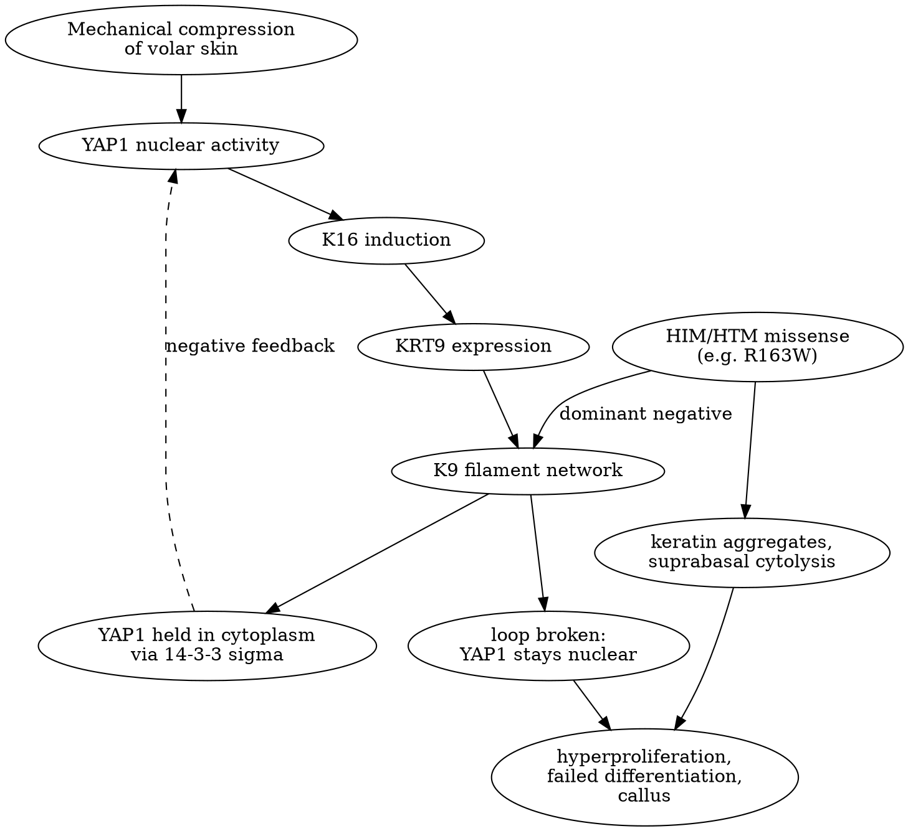

### Narrative

Keratin 9 is made in suprabasal keratinocytes of palm and sole epidermis, after those cells have left the basal layer and committed to terminal differentiation. It is synthesized in the cytoplasm and stays there. Its first act is to find a type II partner, in this tissue K1. The pairing is obligate, because a coiled coil of this family requires one acidic and one neutral-basic chain.

That pairing happens through the 313-residue rod. Hydrophobic residues at the **a** and **d** positions of each heptad form the seam that zippers the two chains together in parallel and in register, a seam detectable in the sequence itself (F006) and displayed on a confidently predicted helix (F010). Two heterodimers associate antiparallel and half-staggered into a tetramer, tetramers anneal laterally into unit-length filaments, and unit-length filaments join end to end and compact into the mature 10 nm filament. The head-to-tail junctions in that last step are what the helix boundary motifs control. HIM at the start of coil 1A and HTM at the end of coil 2 are the sequences that two tetramers read when they overlap, so a substitution in either is not a local perturbation: it misaligns every junction the mutant subunit enters. This is why a heterozygous missense allele in HIM causes severe disease while a heterozygous null allele causes nothing at all, and why 21 of 22 pathogenic alleles sit in 6.74% of the protein.

Flanking the rod are the head (1-152) and tail (462-623), both intrinsically disordered and both glycine-rich, with 98.1% of their residues below the AlphaFold disorder threshold. These arms project from the filament surface into the cytoplasm. They are the protein's interaction surface: the head binds 14-3-3 sigma and through it tethers YAP1 away from the nucleus. Their glycine-loop composition, conserved between human and mouse where the sequence is not, suits both a flexible protein-binding surface and incorporation into the cornified envelope of the terminally differentiated corneocyte.

The result in tissue is a cytoplasmic network spanning each suprabasal keratinocyte, anchored at desmosomes, so that force applied at one cell surface transmits through the cytoskeleton to the next cell rather than tearing the cell apart. When a HIM mutation is present, the network cannot assemble; keratin collects in aggregates, filaments retract from the cell periphery, and under the shear of walking and gripping, suprabasal cells lyse. The histological signature of EPPK, epidermolysis restricted to suprabasal layers of palm and sole, follows directly from where the protein is expressed and what the mutation does to it. The review literature places KRT9 in exactly this position among inherited blistering diseases: "in epidermolytic palmoplantar hyperkeratosis the suprabasal epidermal splitting is restricted to palms and soles of the patient. In keratin 9, which reveals such an exclusive expression pattern, molecular defects have indeed been recognized" ([PMID: 8820401](https://pubmed.ncbi.nlm.nih.gov/8820401/)). The hyperkeratotic callus on top is the tissue's response to the broken YAP1 brake.

## Hypotheses supported and refuted

| # | Hypothesis | Verdict | Evidence |
|---|---|---|---|
| H1 | Pathogenic KRT9 missense alleles cluster in the helix boundary motifs because those motifs set the register for head-to-tail tetramer overlap | <i class="fa-solid fa-circle-check"></i> Supported | 21/22 ClinVar pathogenic alleles, 14.2-fold, p = 5.2e-24; VUS 9% and benign 5% as controls |
| H2 | EPPK is dominant negative, not haploinsufficiency | <i class="fa-solid fa-circle-check"></i> Supported | gnomAD pLI = 0.000, 34 observed LoF; *Krt9*+/- mice normal ([PMID: 23962810](https://pubmed.ncbi.nlm.nih.gov/23962810/)); allele-specific knockdown is therapeutic ([PMID: 30195761](https://pubmed.ncbi.nlm.nih.gov/30195761/)) |
| H3 | The same motifs are under purifying selection in the general population | <i class="fa-solid fa-circle-check"></i> Supported | 4.31% observed against 6.74% expected, p = 1.1e-3; 0.32-fold by allele count |
| H4 | KRT9 has two modules under different selective regimes | <i class="fa-solid fa-circle-check"></i> Supported | Rod 313 aa and 69.3% identity human to mouse; tail 158 against 300 aa, under 10% identity, Gly 58.2% against 53.0% |
| H5 | The coiled-coil heptad seam exists and is confined to the rod | <i class="fa-solid fa-circle-check"></i> Supported | Periodogram 3.49 and 3.53 residues; a/d hydrophobic occupancy p = 3.1e-4 to 6.0e-5; AlphaFold rod 87.5 against 36.4, p = 3.4e-99 |
| H6 | K9 is a cytoplasmic scaffold for YAP1 via 14-3-3 sigma in a K16 to YAP1 to K9 loop | <i class="fa-solid fa-circle-check"></i> Supported | [PMID: 42918816](https://pubmed.ncbi.nlm.nih.gov/42918816/), [PMID: 41000774](https://pubmed.ncbi.nlm.nih.gov/41000774/); YAP1 inhibition rescues *Krt9*-null keratoderma |
| H7 | The K9 / 14-3-3 sigma interaction uses a canonical 14-3-3 phosphopeptide motif | <i class="fa-solid fa-circle-xmark"></i> Refuted | Zero mode 1, relaxed mode 1 or mode 2 motifs in KRT9 or in seven other keratins including validated binders K17 and K18 |
| H8 | The rod carries the ~9.55-residue ionic repeat of IF rods | <i class="fa-solid fa-scale-balanced"></i> Suggestive only | Observed at 9.68 residues, permutation p = 0.040, z = 2.05; one marginal p-value in a panel, not claimed |

## Evidence base

| PMID | What it contributes | Relation to findings |
|---|---|---|
| [23962810](https://pubmed.ncbi.nlm.nih.gov/23962810/) | *Keratin 9 is required for the structural integrity and terminal differentiation of the palmoplantar epidermis.* K9 ablation is not tolerable in vivo; *Krt9*+/- mice have no phenotype | Primary support for F001 and F008; the heterozygote result generated the gnomAD prediction tested in F008 |
| [26603179](https://pubmed.ncbi.nlm.nih.gov/26603179/) | *Keratins K2 and K10 are essential for the epidermal integrity of plantar skin.* K1, K9 and K10 predominate in footpads | Independent expression evidence for F001 and F005 |
| [42918816](https://pubmed.ncbi.nlm.nih.gov/42918816/) | *Keratin 9 regulates mechanosensitive YAP1 signalling in palmoplantar epidermis.* K9 binds 14-3-3 sigma and sequesters YAP1; YAP1 inhibition rescues the null phenotype | Primary support for F003; motivated the motif scan in F011 |
| [41000774](https://pubmed.ncbi.nlm.nih.gov/41000774/) | *Under Pressure: a unique mechanoresponsive mechanism of body site-specific keratin regulation.* K9 induction depends on K16; *Krt9*-null mice show nuclear YAP1 by P3 | Completes the feedback loop in F003 |
| [31220272](https://pubmed.ncbi.nlm.nih.gov/31220272/) | *Altered keratinocyte differentiation is an early driver of keratin mutation-based palmoplantar keratoderma.* Krt9 is downregulated in *Krt16*-null paw skin ahead of lesion onset; restoring Krt9 prevents lesions | Supports the K16 to K9 dependency in F003 from the opposite genetic direction |
| [29719290](https://pubmed.ncbi.nlm.nih.gov/29719290/) | *Identification of a novel keratin 9 missense mutation.* L457F causes filament withdrawal in 10% of cells against 3% wild type (p < 0.05) | Cell-based functional evidence for F002; the only HTM allele with a published assay |
| [31525823](https://pubmed.ncbi.nlm.nih.gov/31525823/) | *Keratin 9 L164P mutation in a Chinese pedigree.* HIM variant delays coiled-coil initiation; KRT16/KRT6 elevated in patients; K14 undetectable | Supports F002, F003 and F005 |
| [30195761](https://pubmed.ncbi.nlm.nih.gov/30195761/) | *CRISPR/Cas9-mediated treatment ameliorates the phenotype of the EPPK-like mouse.* Knock-in *Krt9* indel model; allele-specific sgRNA reduces mutant K9 | Confirms the dominant-negative mechanism of F008 and gives the only in vivo knock-in model |
| [27864007](https://pubmed.ncbi.nlm.nih.gov/27864007/) | *Six generations of EPPK associated with a KRT9 R163W mutation.* 38 affected, 56 unaffected relatives, 100 controls; siRNA knocks down mutant allele (p < 0.01) | Largest pedigree supporting the R163 hotspot in F007 and the therapeutic corollary of F008 |
| [31074163](https://pubmed.ncbi.nlm.nih.gov/31074163/) | *Exome sequencing identifies a KRT9 pathogenic variant.* R163Q cosegregates, absent from 100 controls | Independent pedigree at the R163 hotspot, F007 |
| [40993822](https://pubmed.ncbi.nlm.nih.gov/40993822/) | KRT9 variant in the conserved helix 1A region causing abnormal IF function | Additional coil 1A allele, F002 |
| [35490383](https://pubmed.ncbi.nlm.nih.gov/35490383/) | *Nonsense mutations in KRT1 caused recessive EPPK with knuckle pads.* K9 shows aberrant clumped staining without K1 | Strongest evidence that K1 is the physiological partner, F005 |
| [16439967](https://pubmed.ncbi.nlm.nih.gov/16439967/) | *Mutation S233L in the 1B domain of keratin 1 causes EPPK.* Confirms KRT1 as an alternative EPPK locus | Genetic equivalence of the two chains, F005 |
| [37467889](https://pubmed.ncbi.nlm.nih.gov/37467889/) | *Proteomic profiling reveals KRT6C as a probable heterodimer partner for KRT9.* Co-IP/MS plus in silico 2B coiled-coil model | Proposes a second partner, F005; high-throughput, so weighted below the K1 evidence |
| [16710422](https://pubmed.ncbi.nlm.nih.gov/16710422/) | *A keratin cytoskeletal protein regulates protein synthesis and epithelial cell growth.* Two head-domain residues of K17 are required for 14-3-3 sigma relocalization | The precedent that makes the non-canonical interface of F011 the likely mechanism |
| [15300637](https://pubmed.ncbi.nlm.nih.gov/15300637/) | Review of 17 KRT9 mutations in EPPK across ethnic populations | Background for the allele spectrum of F002 and F007 |
| [8820401](https://pubmed.ncbi.nlm.nih.gov/8820401/) | *The molecular basis for inherited bullous diseases.* Places EPPK among keratin disorders, with suprabasal splitting restricted to palms and soles | Positions KRT9 in the broader keratin disease family, F001 |
| [37690893](https://pubmed.ncbi.nlm.nih.gov/37690893/), [37401035](https://pubmed.ncbi.nlm.nih.gov/37401035/), [33012634](https://pubmed.ncbi.nlm.nih.gov/33012634/), [29068086](https://pubmed.ncbi.nlm.nih.gov/29068086/), [29044727](https://pubmed.ncbi.nlm.nih.gov/29044727/), [24899405](https://pubmed.ncbi.nlm.nih.gov/24899405/) | Additional EPPK case reports and variant descriptions; abstracts unavailable for several | Counted in the ClinVar allele series of F007, no claims attributed to them beyond variant existence |

### Databases used

| Source | Query | Used in |
|---|---|---|
| <i class="fa-solid fa-database"></i> UniProt REST | P35527 JSON record, features, sequence; Q6RHW0 mouse ortholog by `gene:Krt9 AND organism_id:10090 AND reviewed:true` | F001, F002, F004, F006, F011 |
| <i class="fa-solid fa-dna"></i> ClinVar (NCBI E-utilities) | 253 records, 203 protein-level variants parsed | F007 |
| <i class="fa-solid fa-dna"></i> gnomAD v4 GraphQL | 928 unique missense variants, 26,337 missense alleles, constraint metrics | F008, F009 |
| <i class="fa-solid fa-microscope"></i> AlphaFold DB | AF-P35527-F1 v6, per-residue pLDDT for 623 residues | F010 |

## Limitations and knowledge gaps

<i class="fa-solid fa-triangle-exclamation"></i> **GTEx expression data could not be retrieved.** Repeated attempts across gencode IDs (ENSG00000171403 with several version suffixes and bare) and dataset versions (gtex_v8, gtex_v10) returned empty results for KRT9, while the same calls returned 54 tissues for KRT1. The volar-restricted expression claim therefore rests on the published mouse footpad proteomics ([PMID: 26603179](https://pubmed.ncbi.nlm.nih.gov/26603179/)), the UniProt tissue-specificity annotation and the clinical anatomy of EPPK, and not on an independent human quantitative expression analysis performed here.

<i class="fa-solid fa-triangle-exclamation"></i> **The KRT6C partnership is high-throughput evidence.** [PMID: 37467889](https://pubmed.ncbi.nlm.nih.gov/37467889/) is a co-IP plus mass spectrometry screen with an in silico 2B-domain model. The brief asked that precise studies be prioritised over high-throughput, so KRT6C is reported as proposed. In vitro reconstitution of a K6C/K9 filament would settle it.

<i class="fa-solid fa-triangle-exclamation"></i> **The K9 residues that contact 14-3-3 sigma are unmapped.** The inference that the interface is non-canonical and head-domain-based comes from the K17 precedent ([PMID: 16710422](https://pubmed.ncbi.nlm.nih.gov/16710422/)) plus the negative motif scan of F011. Ser14 and Ser57 are candidates from UniProt phosphosite annotation, not from any K9-specific mapping experiment.

<i class="fa-solid fa-triangle-exclamation"></i> **The regional constraint analysis uses region length as the mutational target size.** It does not correct for trinucleotide context or local mutation rate, so the 0.32-fold depletion figure in F009 is approximate. A context-corrected expected count would sharpen it. The direction and the two-population convergence are unaffected.

<i class="fa-solid fa-triangle-exclamation"></i> **The ionic repeat result is marginal.** 9.68 residues at permutation p = 0.040, z = 2.05, from a panel of periodicity tests. It is reported as consistent with the published 9.55-residue IF repeat and not as a finding.

<i class="fa-solid fa-triangle-exclamation"></i> **No ultrastructural study of EPPK biopsies was recovered.** The step from "filaments fail to assemble in transfected HaCaT cells" to "tonofilament clumping in patient suprabasal keratinocytes" rests on the cell-based assays ([PMID: 29719290](https://pubmed.ncbi.nlm.nih.gov/29719290/)) and the knock-in mouse ([PMID: 30195761](https://pubmed.ncbi.nlm.nih.gov/30195761/)) rather than on direct human electron microscopy retrieved in this investigation.

<i class="fa-solid fa-circle-question"></i> **Open questions.** No human homozygous or compound heterozygous KRT9 null has been reported, so the predicted recessive phenotype resembling *Krt9*-/- mice is untested. The single tail pathogenic outlier at position 558 has no mechanistic account. Whether K9 head-domain phosphorylation is regulated by a specific kinase, and whether that kinase tunes YAP1 retention, is unknown. Several PubMed queries on volar site identity (HOX transcription factors, dermal induction of KRT9 expression) returned no results, so the transcriptional basis of the palmoplantar restriction is not covered here.

## Proposed follow-up experiments

<i class="fa-solid fa-flask"></i> **Structure of the K1/K9 coil 2 tetramer overlap carrying a HIM variant.** Cryo-EM or crystallography of the head-to-tail junction with and without R163W would convert the statistical clustering reported here into a physical account of why those 42 residues and no others cause disease. This is the single most informative next experiment.

<i class="fa-solid fa-flask"></i> **Alanine scan of the K9 head domain against 14-3-3 sigma.** Test Ser14, Ser57 and the surrounding Arg-containing contexts by co-IP and by YAP1 localization imaging in volar keratinocytes. The K17 result ([PMID: 16710422](https://pubmed.ncbi.nlm.nih.gov/16710422/)) shows two residues can suffice, so a focused scan is tractable. A phosphomimetic and phospho-null pair at each site would test whether phosphorylation gates the interaction.

<i class="fa-solid fa-vial"></i> **In vitro reconstitution of K6C/K9 against K1/K9.** Express both pairs in bacteria, assemble filaments in vitro, and compare assembly kinetics and filament morphology by electron microscopy. This converts the KRT6C co-IP result into a direct test.

<i class="fa-solid fa-dna"></i> **Deep mutational scan of KRT9 coil 1A in volar keratinocytes.** Saturating substitution across residues 153-188, scored by filament integrity imaging, would produce the full genotype-to-assembly map that the 22 natural pathogenic alleles only sample. It would also classify the 112 VUS currently in ClinVar.

<i class="fa-solid fa-microscope"></i> **Electron microscopy of EPPK patient biopsies stratified by motif.** Compare HIM alleles (R163W) against the HTM allele (L457F) and the tail outlier (position 558) for tonofilament clumping pattern. If the rod and tail alleles give different ultrastructure, the tail outlier has a separate mechanism.

<i class="fa-solid fa-heart-pulse"></i> **Test whether YAP1 inhibition works in human EPPK.** The mouse rescue ([PMID: 42918816](https://pubmed.ncbi.nlm.nih.gov/42918816/)) was obtained in a null background. Whether topical YAP1 inhibition relieves hyperkeratosis in patients carrying a dominant-negative rod allele, where the filament defect persists, is the direct translational question.

<i class="fa-solid fa-chart-column"></i> **Re-run the regional constraint analysis with trinucleotide context correction.** Using a context-aware expected-count model would give a calibrated regional missense o/e for coil 1A and allow direct comparison against other keratin genes.

## Artifacts

- [OpenScientist final report](KRT9-deep-research-openscientist_artifacts/final_report.html)
- [OpenScientist final report](KRT9-deep-research-openscientist_artifacts/final_report.pdf)
- [OpenScientist provenance](KRT9-deep-research-openscientist_artifacts/provenance.json)
- [OpenScientist plot 1](KRT9-deep-research-openscientist_artifacts/provenance_plot_1.json)
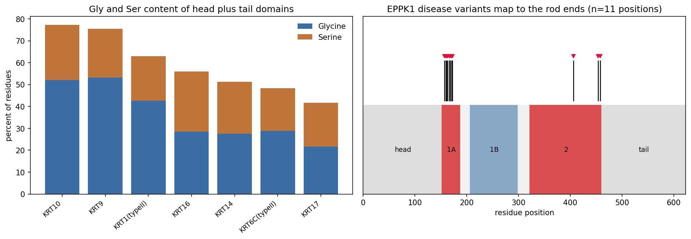
- [OpenScientist plot 10](KRT9-deep-research-openscientist_artifacts/provenance_plot_10.json)
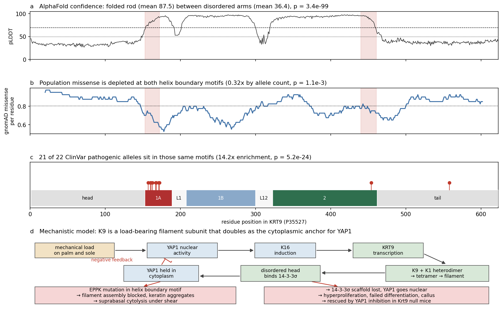
- [OpenScientist plot 2](KRT9-deep-research-openscientist_artifacts/provenance_plot_2.json)
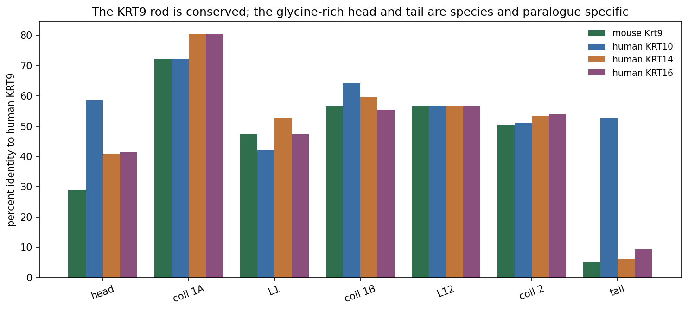
- [OpenScientist plot 3](KRT9-deep-research-openscientist_artifacts/provenance_plot_3.json)
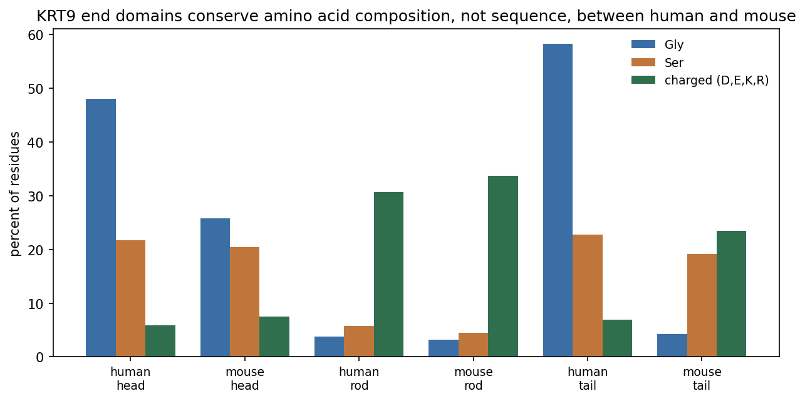
- [OpenScientist plot 4](KRT9-deep-research-openscientist_artifacts/provenance_plot_4.json)
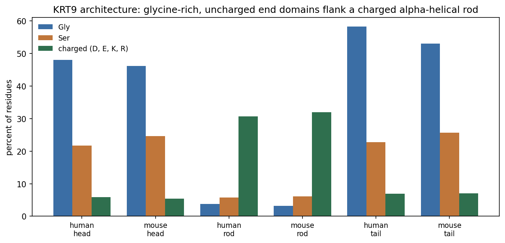
- [OpenScientist plot 5](KRT9-deep-research-openscientist_artifacts/provenance_plot_5.json)
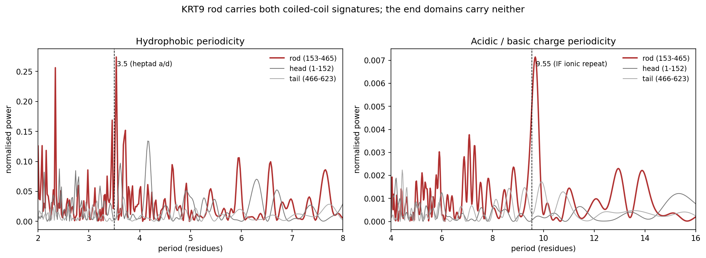
- [OpenScientist plot 6](KRT9-deep-research-openscientist_artifacts/provenance_plot_6.json)
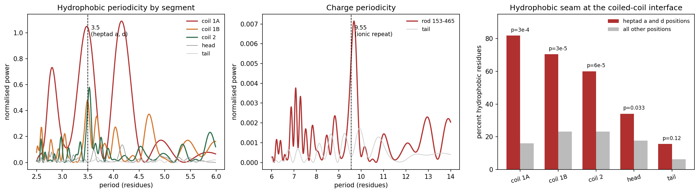
- [OpenScientist plot 7](KRT9-deep-research-openscientist_artifacts/provenance_plot_7.json)
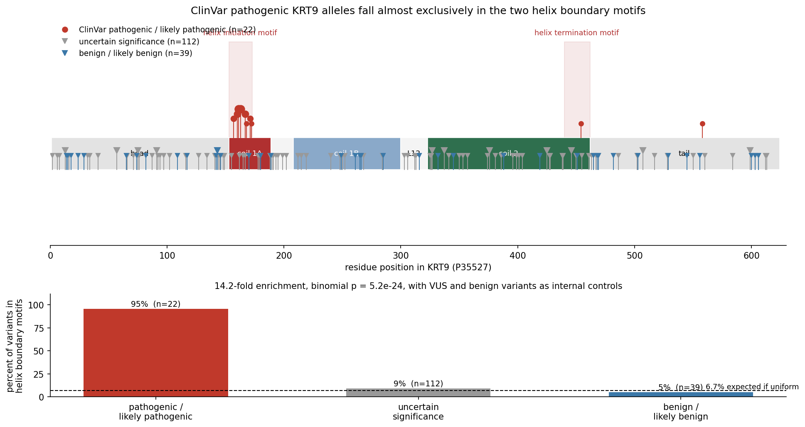
- [OpenScientist plot 8](KRT9-deep-research-openscientist_artifacts/provenance_plot_8.json)
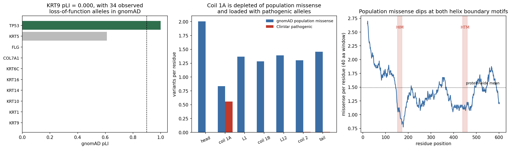
- [OpenScientist plot 9](KRT9-deep-research-openscientist_artifacts/provenance_plot_9.json)
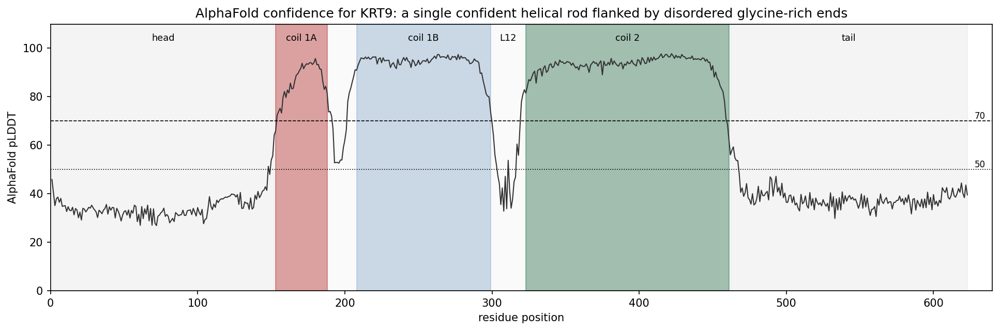

## Citations

1. PMID:23962810
2. PMID:26603179
3. PMID:42918816
4. PMID:41000774
5. PMID:29719290
6. PMID:31525823
7. PMID:40993822
8. PMID:31220272
9. PMID:16439967
10. PMID:35490383
11. PMID:37467889
12. PMID:31074163
13. PMID:27864007
14. PMID:30195761
15. PMID:16710422
16. PMID:8820401