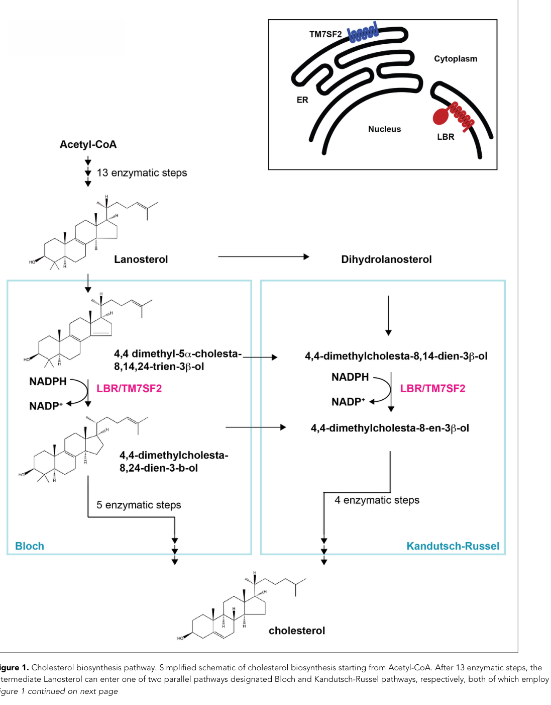

## Question

# Gene Research for Functional Annotation

## ⚠️ CRITICAL: Gene/Protein Identification Context

**BEFORE YOU BEGIN RESEARCH:** You MUST verify you are researching the CORRECT gene/protein. Gene symbols can be ambiguous, especially for less well-characterized genes from non-model organisms.

### Target Gene/Protein Identity (from UniProt):
- **UniProt Accession:** Q14739
- **Protein Description:** RecName: Full=Delta(14)-sterol reductase LBR; Short=Delta-14-SR; EC=1.3.1.70 {ECO:0000269|PubMed:12618959, ECO:0000269|PubMed:9630650}; AltName: Full=3-beta-hydroxysterol Delta (14)-reductase {ECO:0000303|PubMed:16784888}; AltName: Full=C-14 sterol reductase; Short=C14SR; AltName: Full=Integral nuclear envelope inner membrane protein {ECO:0000303|PubMed:10828963}; AltName: Full=LMN2R; AltName: Full=Lamin-B receptor {ECO:0000303|PubMed:8157662, ECO:0000303|PubMed:8157663}; AltName: Full=Sterol C14-reductase;
- **Gene Information:** Name=LBR;
- **Organism (full):** Homo sapiens (Human).
- **Protein Family:** Belongs to the ERG4/ERG24 family. .
- **Key Domains:** ERG24_DHCR-like. (IPR001171); Lamin-B_rcpt_of_tudor. (IPR019023); Sterol_reductase_CS. (IPR018083); Tudor. (IPR002999); ERG4_ERG24 (PF01222)

### MANDATORY VERIFICATION STEPS:

1. **Check if the gene symbol "LBR" matches the protein description above**
2. **Verify the organism is correct:** Homo sapiens (Human).
3. **Check if protein family/domains align with what you find in literature**
4. **If you find literature for a DIFFERENT gene with the same or similar symbol, STOP**

### If Gene Symbol is Ambiguous or You Cannot Find Relevant Literature:

**DO NOT PROCEED WITH RESEARCH ON A DIFFERENT GENE.** Instead:
- State clearly: "The gene symbol 'LBR' is ambiguous or literature is limited for this specific protein"
- Explain what you found (e.g., "Found extensive literature on a different gene with the same symbol in a different organism")
- Describe the protein based ONLY on the UniProt information provided above
- Suggest that the protein function can be inferred from domain/family information

### Research Target:

Please provide a comprehensive research report on the gene **LBR** (gene ID: LBR, UniProt: Q14739) in human.

The research report should be a detailed narrative explaining the function, biological processes, and localization of the gene product. Citations should be given for all claims.

You should prioritize authoritative reviews and primary scientific literature when conducting research. You can supplement
this with annotations you find in gene/protein databases, but these can be outdated or inaccurate.

We are specifically interested in the primary function of the gene - for enzymes, what reaction is catalyzed, and what is the substrate specificity? For transporters, what is the substrate? For structural proteins or adapters, what is the broader structural role? For signaling molecules, what is the role in the pathway.

We are interested in where in or outside the cell the gene product carries out its function.

We are also interested in the signaling or biochemical pathways in which the gene functions. We are less interested in broad pleiotropic effects, except where these elucidate the precise role.

Include evidence where possible. We are interested in both experimental evidence as well as inference from structure, evolution, or bioinformatic analysis. Precise studies should be prioritized over high-throughput, where available.

## Output

Question: You are an expert researcher providing comprehensive, well-cited information.

Provide detailed information focusing on:
1. Key concepts and definitions with current understanding
2. Recent developments and latest research (prioritize 2023-2024 sources)
3. Current applications and real-world implementations
4. Expert opinions and analysis from authoritative sources
5. Relevant statistics and data from recent studies

Format as a comprehensive research report with proper citations. Include URLs and publication dates where available.
Always prioritize recent, authoritative sources and provide specific citations for all major claims.

# Gene Research for Functional Annotation

## ⚠️ CRITICAL: Gene/Protein Identification Context

**BEFORE YOU BEGIN RESEARCH:** You MUST verify you are researching the CORRECT gene/protein. Gene symbols can be ambiguous, especially for less well-characterized genes from non-model organisms.

### Target Gene/Protein Identity (from UniProt):
- **UniProt Accession:** Q14739
- **Protein Description:** RecName: Full=Delta(14)-sterol reductase LBR; Short=Delta-14-SR; EC=1.3.1.70 {ECO:0000269|PubMed:12618959, ECO:0000269|PubMed:9630650}; AltName: Full=3-beta-hydroxysterol Delta (14)-reductase {ECO:0000303|PubMed:16784888}; AltName: Full=C-14 sterol reductase; Short=C14SR; AltName: Full=Integral nuclear envelope inner membrane protein {ECO:0000303|PubMed:10828963}; AltName: Full=LMN2R; AltName: Full=Lamin-B receptor {ECO:0000303|PubMed:8157662, ECO:0000303|PubMed:8157663}; AltName: Full=Sterol C14-reductase;
- **Gene Information:** Name=LBR;
- **Organism (full):** Homo sapiens (Human).
- **Protein Family:** Belongs to the ERG4/ERG24 family. .
- **Key Domains:** ERG24_DHCR-like. (IPR001171); Lamin-B_rcpt_of_tudor. (IPR019023); Sterol_reductase_CS. (IPR018083); Tudor. (IPR002999); ERG4_ERG24 (PF01222)

### MANDATORY VERIFICATION STEPS:

1. **Check if the gene symbol "LBR" matches the protein description above**
2. **Verify the organism is correct:** Homo sapiens (Human).
3. **Check if protein family/domains align with what you find in literature**
4. **If you find literature for a DIFFERENT gene with the same or similar symbol, STOP**

### If Gene Symbol is Ambiguous or You Cannot Find Relevant Literature:

**DO NOT PROCEED WITH RESEARCH ON A DIFFERENT GENE.** Instead:
- State clearly: "The gene symbol 'LBR' is ambiguous or literature is limited for this specific protein"
- Explain what you found (e.g., "Found extensive literature on a different gene with the same symbol in a different organism")
- Describe the protein based ONLY on the UniProt information provided above
- Suggest that the protein function can be inferred from domain/family information

### Research Target:

Please provide a comprehensive research report on the gene **LBR** (gene ID: LBR, UniProt: Q14739) in human.

The research report should be a detailed narrative explaining the function, biological processes, and localization of the gene product. Citations should be given for all claims.

You should prioritize authoritative reviews and primary scientific literature when conducting research. You can supplement
this with annotations you find in gene/protein databases, but these can be outdated or inaccurate.

We are specifically interested in the primary function of the gene - for enzymes, what reaction is catalyzed, and what is the substrate specificity? For transporters, what is the substrate? For structural proteins or adapters, what is the broader structural role? For signaling molecules, what is the role in the pathway.

We are interested in where in or outside the cell the gene product carries out its function.

We are also interested in the signaling or biochemical pathways in which the gene functions. We are less interested in broad pleiotropic effects, except where these elucidate the precise role.

Include evidence where possible. We are interested in both experimental evidence as well as inference from structure, evolution, or bioinformatic analysis. Precise studies should be prioritized over high-throughput, where available.

# Human LBR (UniProt Q14739): functional annotation and research report

## Identity and principal functions

**Identity verified.** The specified human gene **LBR** encodes lamin B receptor, also called **Δ14-sterol reductase LBR**. This is the protein studied in the cited human-cell experiments, not the related but distinct sterol reductase **TM7SF2**. Its architecture matches the supplied ERG4/ERG24-family annotation: a nucleoplasm-facing amino terminus containing Tudor and arginine/serine-rich regions, followed by a multipass, approximately eight-transmembrane-segment carboxyl terminus with sterol-reductase activity. Functional complementation distinguishes its **ERG24-like C14-reductase** activity from ERG4-like C24-reductase activity. (nikolakaki2017laminbreceptor pages 1-3, olins2010laminbreceptor pages 8-9, tsai2016thelaminb pages 2-5)

LBR has **two experimentally supported, separable primary roles**: its membrane domain participates in cholesterol biosynthesis by reducing a sterol **C14–C15 double bond**, while its nucleoplasmic domain connects heterochromatin and the nuclear lamina to the **inner nuclear membrane (INM)**. It is therefore best annotated as both a sterol-metabolic enzyme and a context-dependent nuclear-architecture tether, rather than solely as a lamin-binding structural protein. (tsai2016thelaminb pages 1-2, tsai2016thelaminb pages 18-20, solovei2013lbrandlamin pages 1-4)

The following evidence table separates established functions from less direct recent observations.

| Molecular function | Substrate/partner and site | Best direct evidence and quantitative result | Interpretation / limitations |
|---|---|---|---|
| **Sterol C14 reduction — high confidence** | NADPH-dependent reduction of the C14=C15 bond in Δ14 sterol intermediates; chiefly at the **inner nuclear membrane (INM)**, with a context-dependent LBR pool in the contiguous ER | Human LBR complemented fungal **ERG24/erg-3 C14-reductase** defects but not the ERG4 C24-reductase defect. Greenberg-dysplasia fibroblasts accumulated **cholesta-8,14-dien-3β-ol** and carried a truncating *LBR* mutation ([2010 review](https://doi.org/10.4161/nucl.1.1.10515)) (olins2010laminbreceptor pages 8-9). LBR also co-localized with the ER marker calnexin in fibroblasts and HeLa cells ([Clayton et al., 2010](https://doi.org/10.4161/nucl.1.4.12435)) (clayton2010mutationscausinggreenberg pages 6-8). | Strong genetic, complementation and cellular evidence establishes the reaction class. However, these studies do **not** provide purified-LBR substrate-to-product turnover kinetics for a specific human sterol; substrate breadth and exact physiological flux remain incompletely defined. |
| **Cholesterol biosynthesis — high confidence in tested human cells** | Δ14 sterol intermediates and NADPH at the INM; related enzyme **TM7SF2** resides mainly in the ER | CRISPR *LBR*-null HeLa cells had approximately **40% less total cholesterol** under restrictive conditions, showed near-complete loss of newly synthesized radiolabeled cholesterol, and died or detached by days **5–7**; free cholesterol or LDL rescued viability. Wild-type LBR and its isolated reductase domain rescued the defect, whereas endogenous TM7SF2 did not compensate ([Tsai et al., 2016](https://doi.org/10.7554/eLife.16011)) (tsai2016thelaminb pages 5-7, tsai2016thelaminb pages 9-11, tsai2016thelaminb pages 7-9, tsai2016thelaminb pages 2-5). | Establishes LBR as the dominant functional C14 reductase under these human-cell conditions. Earlier mouse genetics suggested greater LBR–TM7SF2 redundancy, so “essential” should not be generalized to every tissue, species or nutrient condition. |
| **NADPH binding and disease-variant mechanism — high confidence** | NADPH-binding pocket in the membrane-embedded C-terminal sterol-reductase domain | Purified wild-type LBR bound NADPH with a reported dissociation constant of **24.2 mM**; Greenberg-associated **N547D** and **R583Q** markedly weakened binding and failed to restore cholesterol synthesis. C-terminal disease truncations had **10–15-minute half-lives** and underwent ubiquitin–proteasome-dependent degradation ([Tsai et al., 2016](https://doi.org/10.7554/eLife.16011)) (tsai2016thelaminb pages 11-13, tsai2016thelaminb pages 13-16). | Supports defective cofactor binding and protein instability as pathogenic mechanisms, but it is not a complete catalytic-kinetics analysis. The reported millimolar affinity should be interpreted exactly as reported rather than as a turnover constant. |
| **Recognition and compaction of heterochromatin — high-confidence biochemistry; context-dependent in vivo** | N-terminal Tudor domain, especially **W16**, recognizes histone **H4K20me2** on nucleoplasmic chromatin at the INM; RS and globular regions also contact histones, HP1, MeCP2 and lamin B | Peptide arrays, recombinant-H4 pull-downs and ChIP supported H4K20me2 recognition; **W16A** abolished selective binding. Tudor-pocket mutants diffused about **sevenfold faster** than wild-type LBR, and the full nucleoplasmic domain compacted reconstituted chromatin and repressed a reporter ([Hirano et al., 2012](https://doi.org/10.1074/jbc.M112.397950)) (hirano2012laminbreceptor pages 3-5, hirano2012laminbreceptor pages 5-6). | Direct binding and compaction are well supported, but Tudor binding alone does not explain all repression: the entire nucleoplasmic region is required. HP1 and methylated histones also occur away from the nuclear periphery, so binding does not prove universal locus anchoring or silencing. |
| **Peripheral heterochromatin tethering and nuclear architecture — high confidence, developmentally conditional** | LBR links peripheral heterochromatin to the INM; lamin A/C supplies a later or alternative tether | Loss of both LBR and lamin A/C caused peripheral heterochromatin loss and “inverted” nuclear architecture; ectopic LBR restored peripheral positioning. The study proposed sequential use of LBR early and lamin A/C later during differentiation ([Solovei et al., 2013](https://doi.org/10.1016/j.cell.2013.01.009)) (nikolakaki2017laminbreceptor pages 3-6, solovei2013lbrandlamin pages 1-4). | LBR is a major architectural tether, not necessarily the sole tether. Cell lineage, differentiation state, lamins and other INM proteins determine whether loss of LBR alone produces a strong phenotype. |
| **Granulocyte nuclear segmentation / Pelger–Huët mechanism — moderate-to-high confidence** | N-terminal Tudor/RS structural regions interacting with heterochromatin and the lamina at the INM | A mouse **236-bp N-terminal deletion** predicted to remove Tudor/RS domains while retaining the transmembrane reductase region reproduced Pelger–Huët-like blood-cell nuclear defects without severe skin or skeletal dysplasia; X-inactivation effects were minor, although homozygous crosses showed approximately **35% perinatal mortality** ([Young et al., 2021](https://doi.org/10.1038/s42003-021-01944-2)) (young2021deletionoflbr pages 1-2, young2021deletionoflbr pages 2-3). | Supports domain-level separation of nuclear architecture from sterol metabolism, but preserved reductase activity was inferred from retention of the domain rather than established by a complete biochemical assay. Mouse findings do not fully define human genotype–phenotype relationships. |
| **Allelic separation of metabolic and structural disease — high confidence** | C-terminal reductase variants **N547D/R583Q** versus truncating alleles affecting broader LBR structure | N547D and R583Q impaired rescue of yeast C14-reductase deficiency. A heterozygous R583Q carrier had normally segmented neutrophils, whereas a carrier of a truncating allele showed Pelger morphology ([Clayton et al., 2010](https://doi.org/10.4161/nucl.1.4.12435)) (clayton2010mutationscausinggreenberg pages 3-4, clayton2010mutationscausinggreenberg pages 4-6). | Demonstrates that lethal Greenberg dysplasia can arise from loss of enzymatic activity without an overt heterozygous nuclear-shape phenotype. Dosage, residual activity and protein stability nevertheless complicate simple domain-based predictions. |
| **Recent sterol-pathway evidence — moderate and indirect for substrate specificity** | **14-Dehydrozymostenol** was monitored as a DHCR14-pathway intermediate in human Huh-7 cells | High-dose AY9944 increased 14-dehydrozymostenol, and *LBR*-, *TM7SF2*- and *EBP*-ablated cells were used to exclude upstream-enzyme inhibition as the principal ferroptosis-protective mechanism ([Yamada et al., 2024](https://doi.org/10.1038/s41467-024-46386-6)) (yamada2024inhibitionof7dehydrocholesterol pages 4-5). | This peer-reviewed study supports pathway placement but does **not** directly demonstrate purified human LBR converting 14-dehydrozymostenol into a specific product. It is not definitive substrate-specificity or catalytic-kinetics evidence. |
| **Recent nuclear-envelope dynamics — moderate confidence** | LBR and nesprin-1 during human neutrophil extracellular-trap formation | Microscopy indicated early LBR disintegration; calcium-dependent calpain-1 degraded nesprin-1, weakening the envelope before later actin collapse ([Singh et al., 2024](https://doi.org/10.1186/s12964-024-01785-6)) (singh2024calpain1weakensthe pages 1-2). | Extends LBR biology to dynamic envelope breakdown during NET release but does not redefine its primary enzymatic or chromatin-tethering functions; numerical effect sizes were unavailable in the retrieved excerpt. |
| **Exploratory transcriptomic effects — preliminary** | Golgi-, ribosome- and nucleolus-associated processes in LBR-depleted human HL-60/S4 myeloid cells | An **8–10-fold LBR mRNA reduction** prevented retinoic-acid-induced nuclear lobulation. The analysis identified **638** knockdown-specific downregulated and **696** upregulated genes; approximately **70%** of control versus **45%** of knockdown nuclei contained more than two nucleoli ([Welch et al., bioRxiv, 2024](https://doi.org/10.1101/2024.06.19.598074)) (welch2024theeffectsof pages 3-6, welch2024theeffectsof pages 25-27, welch2024theeffectsof pages 20-25). | This is an unreviewed preprint using one leukemia-derived cell model. Golgi, ribosome and nucleolar associations are hypothesis-generating and should not yet be annotated as primary LBR molecular functions. |

*Table: Direct and recent evidence for the enzymatic and nuclear-architectural functions of human LBR (Q14739), with quantitative findings and explicit limitations. The table distinguishes established molecular functions from indirect or preliminary 2023–2024 observations.*

## Catalytic reaction, substrates and pathway

**Reaction.** LBR is annotated as a sterol Δ14-reductase (**EC 1.3.1.70**, as specified in the supplied UniProt record). It uses **NADPH** to reduce the Δ14 double bond of a 3β-hydroxysterol intermediate in the post-lanosterol cholesterol-synthesis pathway. At the reaction-class level, this can be expressed as *Δ14-sterol + NADPH + H⁺ → corresponding 14,15-saturated sterol + NADP⁺*. The Bloch and Kandutsch–Russell branches each include a C14-reduction step that can be supplied by LBR or TM7SF2; the pathway and their different membrane locations are depicted in Tsai and colleagues’ Figure 1. This is **C14**, not the C24 or terminal 7-dehydrocholesterol reduction step. (olins2010laminbreceptor pages 8-9, tsai2016thelaminb pages 2-5, tsai2016thelaminb media f8e1e067)

**What is established about substrate specificity.** Fibroblasts from a fetus with biallelic *LBR*-associated Greenberg dysplasia accumulated **cholesta-8,14-dien-3β-ol**, a sterol bearing the relevant Δ14 bond; human LBR also rescued fungal **ERG24/erg-3 C14-reductase** defects, but did **not** rescue an **ERG4 C24-reductase** defect. Together these are strong evidence for the bond and reaction class. They do **not**, by themselves, constitute a purified-human-LBR experiment measuring conversion of that named sterol into a named product or establish a ranked substrate-specificity series. A 2024 study monitored **14-dehydrozymostenol** as a C14-reductase-pathway intermediate and observed its accumulation at higher AY9944 concentrations, but likewise did not demonstrate direct turnover by purified human LBR. Assignments of individual intermediates to LBR should therefore be distinguished from the well-established assignment of **Δ14-reductase activity**. (olins2010laminbreceptor pages 8-9, yamada2024inhibitionof7dehydrocholesterol pages 4-5)

**Human-cell tests establish physiological importance.** In CRISPR-edited HeLa cells, *LBR* loss nearly abolished incorporation of radiolabeled acetate into newly synthesized cholesterol under cholesterol-restrictive conditions. Total cellular cholesterol was approximately **40% lower** than in controls; cells became rounded, detached and died over **5–7 days**, whereas supplied free cholesterol or LDL rescued growth. Re-expression of full-length LBR **or the isolated membrane sterol-reductase domain** rescued the cholesterol-dependent growth defect; an amino-terminal construct lacking most of that domain did not. The result localizes the metabolic rescue activity to the reductase region, not the Tudor domain. Similar dependence on LBR was observed after its depletion in additional tested human cells. (tsai2016thelaminb pages 5-7, tsai2016thelaminb pages 9-11, tsai2016thelaminb pages 11-13)

TM7SF2 is an **ER-localized, related C14 reductase**, whereas LBR concentrates at the INM. Despite expression of TM7SF2 and a sterol-regulatory response, TM7SF2 did not compensate for LBR deletion in those human-cell experiments. Earlier mouse work had suggested greater functional redundancy; the defensible conclusion is that **LBR is necessary for efficient cholesterol synthesis in the tested human cells under restricted cholesterol supply**, not that TM7SF2 is inactive or LBR indispensable in every tissue and nutritional state. (tsai2016thelaminb pages 7-9, tsai2016thelaminb pages 16-18, tsai2016thelaminb pages 2-5)

There is a useful structure–mechanism link: disease-associated **N547D** and **R583Q** map to conserved residues corresponding to a related reductase’s NADPH-binding pocket. Purified wild-type LBR bound NADPH in a spectroscopic assay, whereas both variants had substantially weakened binding and failed to restore de novo cholesterol synthesis in *LBR*-null cells. The paper reports a wild-type binding **Kᴅ of 24.2 mM**; this is a reported *binding* value, **not** a substrate *Kₘ* or catalytic turnover rate. Disease-associated carboxyl-terminal truncations instead underwent rapid ubiquitin/proteasome-dependent turnover, with reported protein half-lives of approximately **10–15 minutes**. These are complementary routes to loss of cellular enzyme function. (tsai2016thelaminb pages 11-13, tsai2016thelaminb pages 13-16)

## Site of action and nuclear-architectural mechanism

LBR is an **integral INM protein**: its multipass reductase region resides in the membrane, whereas its amino-terminal Tudor/RS-containing region faces the **nucleoplasm**, where chromatin and lamins are accessible. It is not exclusively nuclear in every cell or condition. Microscopy and fractionation detected an additional **ER-associated LBR pool** in human fibroblasts and HeLa cells, including colocalization with calnexin. Because the INM is continuous with the ER membrane system, the available evidence establishes an INM site for LBR’s chromatin-facing activity and supports a possible ER contribution to sterol metabolism, but does not quantify precisely how much cholesterol-pathway flux occurs in each membrane. (nikolakaki2017laminbreceptor pages 1-3, tsai2016thelaminb pages 2-5, clayton2010mutationscausinggreenberg pages 6-8)

**Molecular contacts.** The human LBR Tudor region, approximately residues **1–62**, preferentially recognizes histone **H4K20me2** in peptide-binding and recombinant-histone experiments. Mutation of the Tudor-pocket residue **W16** disrupted selective binding. In HeLa-cell photobleaching experiments, Tudor-region binding mutants moved around **seven times faster** in the nuclear envelope than wild-type LBR, supporting a role for chromatin engagement in retaining LBR at the rim. The wider nucleoplasmic domain, including RS and other interaction regions, also contacts chromatin-associated proteins such as **HP1** and interacts with lamin B. Experiments with reconstituted nucleosomes and a reporter support chromatin compaction and transcriptional repression, but the **whole nucleoplasmic region**, rather than Tudor recognition alone, was required for the reported repression effect. (nikolakaki2017laminbreceptor pages 6-7, hirano2012laminbreceptor pages 3-5, hirano2012laminbreceptor pages 5-6)

**Broader structural role.** LBR helps position heterochromatin at the nuclear periphery during development and in particular cell states. In a landmark mouse comparative study, **LBR-dependent tethering tended to precede lamin-A/C-dependent tethering** during differentiation; loss of *both* tethers redistributed heterochromatin to the nuclear interior, creating an inverted nuclear arrangement. Expression of LBR could restore peripheral positioning in an appropriate model. The model explains why a single LBR perturbation does not always release all lamina-associated chromatin: tethering is **cell-state-dependent and partly replaceable**. Moreover, biochemical binding of H4K20me2 or HP1 alone cannot establish that every bound genomic locus is peripherally anchored or transcriptionally silent. (nikolakaki2017laminbreceptor pages 3-6, harr2016histonesandhistone pages 6-7, solovei2013lbrandlamin pages 1-4)

The nuclear-envelope role has a clear myeloid manifestation. Reduced or disrupted LBR is associated with **hypolobulated granulocyte nuclei**, the defining cellular feature of Pelger–Huët anomaly. In a domain-dissection mouse model, a **236-bp N-terminal *Lbr* deletion** predicted to remove Tudor/RS regions produced Pelger–Huët-like blood-cell morphology without the severe skeletal and skin manifestations of more extensive LBR deficiency. Retention of the membrane enzyme region supports separability of functions, although retention of a domain is not, alone, a complete enzymatic activity assay. That model also showed only minor effects on X-chromosome-inactivation readouts, arguing against annotating LBR as universally essential for that process. (young2021deletionoflbr pages 1-2, young2021deletionoflbr pages 3-6)

## Human disease and interpretation of alleles

**Heterozygous** disruptive *LBR* variants can produce Pelger–Huët granulocyte nuclear hyposegmentation; **biallelic** severe variants can produce **Greenberg skeletal dysplasia**, involving profound developmental and sterol-pathway abnormalities. However, allelic effects cannot be reduced to a simple “architecture versus metabolism” rule. In a particularly informative family, the heterozygous **R583Q** reductase-domain carrier had normally segmented neutrophils, whereas a carrier of a truncating allele displayed Pelger morphology. N547D and R583Q impaired rescue of sterol-reductase-deficient yeast, supporting a metabolic defect without an obligatory heterozygous nuclear-shape defect. Separately, patients’ sterol accumulation and human-cell enzyme-domain rescue support the importance of deficient C14 reduction for severe developmental disease; different variants can also change LBR abundance or stability. (olins2010laminbreceptor pages 8-9, tsai2016thelaminb pages 2-5, clayton2010mutationscausinggreenberg pages 3-4, clayton2010mutationscausinggreenberg pages 4-6)

## Developments from 2023–2024 and practical applications

- **Prenatal molecular diagnosis, 2023.** In **two affected fetuses** from recurrent pregnancies, exome sequencing identified homozygous *LBR* **p.Arg586His**; both parents carried the variant heterozygously. The reported skeletal phenotype was more moderate than classical lethal Greenberg dysplasia. The study illustrates clinical use of *LBR* sequencing alongside prenatal imaging, but does **not** establish the variant’s catalytic defect with a direct enzyme assay. [Shen *et al.*, *Frontiers in Genetics*, January 2023](https://doi.org/10.3389/fgene.2022.1020475). (shen2023prenataldiagnosisof pages 1-2)
- **Architectural perturbation in vivo, 2023.** Ectopic **mouse Lbr** expression in mature rod photoreceptors restored aspects of conventional peripheral chromatin positioning. Chromatin-accessibility changes were more pronounced than changes in measured gene expression. This experimentally extends the tethering model, but is **mouse overexpression**, not a direct measurement of endogenous human LBR function. [Herrera *et al.*, *Cell Death & Disease*, October 2023](https://doi.org/10.1038/s41419-023-06224-x). (herrera2023laminaupregulation pages 1-2)
- **Sterol-pathway discrimination, 2024.** In experiments focused chiefly on **DHCR7 and ferroptosis**, high-dose AY9944 also increased the C14-reductase-pathway intermediate **14-dehydrozymostenol**; the authors compared cells lacking LBR, TM7SF2 or EBP to distinguish upstream drug effects. This adds metabolomic and genetic context but should **not** be interpreted as evidence that LBR is itself an established ferroptosis-control enzyme or as a purified-LBR specificity assay. [Yamada *et al.*, *Nature Communications*, March 2024](https://doi.org/10.1038/s41467-024-46386-6). (yamada2024inhibitionof7dehydrocholesterol pages 4-5)
- **Neutrophil-envelope remodeling, 2024.** During neutrophil extracellular-trap formation, microscopy indicated early loss of intact LBR staining and calpain-1-associated degradation of the envelope linker nesprin-1 before later cytoskeletal collapse. This concerns dynamic dismantling of the nuclear-envelope architecture, not a newly demonstrated primary catalytic reaction of LBR. [Singh *et al.*, *Cell Communication and Signaling*, September 2024](https://doi.org/10.1186/s12964-024-01785-6). (singh2024calpain1weakensthe pages 1-2)
- **Exploratory human-cell knockdown, 2024.** In an **unreviewed bioRxiv preprint**, LBR knockdown in HL-60/S4 myeloid cells reduced *LBR* mRNA approximately **8–10-fold** and blocked retinoic-acid-induced nuclear lobulation. Transcript analysis reported **638 knockdown-specific downregulated** and **696 upregulated** genes; approximately **70%** of control versus **45%** of knockdown undifferentiated nuclei had more than two nucleoli. Golgi- and ribosome-associated expression patterns are interesting **hypotheses**, not established primary transport or ribosome functions of LBR. [Welch *et al.*, bioRxiv, posted June 20, 2024](https://doi.org/10.1101/2024.06.19.598074). (welch2024theeffectsof pages 3-6, welch2024theeffectsof pages 25-27, welch2024theeffectsof pages 20-25)

**Annotation conclusion.** The most defensible molecular description of human Q14739 is **an NADPH-dependent sterol C14 reductase of the cholesterol-biosynthesis pathway, embedded predominantly in the inner nuclear membrane, whose nucleoplasmic N terminus also tethers and organizes peripheral heterochromatin**. Evidence strongly identifies the reaction *class*, cofactor, principal cellular consequences and chromatin-binding partners; direct purified-enzyme comparisons of named physiological sterol substrates, compartment-specific reaction flux and the extent of context-specific chromatin repression remain less certain. (tsai2016thelaminb pages 11-13, hirano2012laminbreceptor pages 3-5, clayton2010mutationscausinggreenberg pages 6-8, olins2010laminbreceptor pages 8-9)

References

1. (nikolakaki2017laminbreceptor pages 1-3): Eleni Nikolakaki, Ilias Mylonis, and Thomas Giannakouros. Lamin b receptor: interplay between structure, function and localization. Cells, 6:28, Aug 2017. URL: https://doi.org/10.3390/cells6030028, doi:10.3390/cells6030028. This article has 89 citations.

2. (olins2010laminbreceptor pages 8-9): Ada L. Olins, Gale Rhodes, David B. Mark Welch, Monika Zwerger, and Donald E. Olins. Lamin b receptor. Nucleus, 1:53-70, Jan 2010. URL: https://doi.org/10.4161/nucl.1.1.10515, doi:10.4161/nucl.1.1.10515. This article has 207 citations and is from a peer-reviewed journal.

3. (tsai2016thelaminb pages 2-5): Pei-Ling Tsai, Chenguang Zhao, Elizabeth M. Turner, and Christian Schlieker. The lamin b receptor is essential for cholesterol synthesis and perturbed by disease-causing mutations. eLife, Jun 2016. URL: https://doi.org/10.7554/elife.16011, doi:10.7554/elife.16011. This article has 130 citations and is from a domain leading peer-reviewed journal.

4. (tsai2016thelaminb pages 1-2): Pei-Ling Tsai, Chenguang Zhao, Elizabeth M. Turner, and Christian Schlieker. The lamin b receptor is essential for cholesterol synthesis and perturbed by disease-causing mutations. eLife, Jun 2016. URL: https://doi.org/10.7554/elife.16011, doi:10.7554/elife.16011. This article has 130 citations and is from a domain leading peer-reviewed journal.

5. (tsai2016thelaminb pages 18-20): Pei-Ling Tsai, Chenguang Zhao, Elizabeth M. Turner, and Christian Schlieker. The lamin b receptor is essential for cholesterol synthesis and perturbed by disease-causing mutations. eLife, Jun 2016. URL: https://doi.org/10.7554/elife.16011, doi:10.7554/elife.16011. This article has 130 citations and is from a domain leading peer-reviewed journal.

6. (solovei2013lbrandlamin pages 1-4): Irina Solovei, Audrey S. Wang, Katharina Thanisch, Christine S. Schmidt, Stefan Krebs, Monika Zwerger, Tatiana V. Cohen, Didier Devys, Roland Foisner, Leo Peichl, Harald Herrmann, Helmut Blum, Dieter Engelkamp, Colin L. Stewart, Heinrich Leonhardt, and Boris Joffe. Lbr and lamin a/c sequentially tether peripheral heterochromatin and inversely regulate differentiation. Cell, 152:584-598, Jan 2013. URL: https://doi.org/10.1016/j.cell.2013.01.009, doi:10.1016/j.cell.2013.01.009. This article has 1008 citations and is from a highest quality peer-reviewed journal.

7. (clayton2010mutationscausinggreenberg pages 6-8): Peter Clayton, Björn Fischer, Anuska Mann, Sahar Mansour, Eva Rossier, Markus Veen, Christine Lang, Sevjidmaa Baasanjav, Moritz Kieslich, Katja Brossuleit, Sophia Gravemann, Nele Schnipper, Mohsen Karbasyian, Ilja Demuth, Monika Zwerger, Amparo Vaya, Gerd Utermann, Stefan Mundlos, Sigmar Stricker, Karl Sperling, and Katrin Hoffmann. Mutations causing greenberg dysplasia but not pelger anomaly uncouple enzymatic from structural functions of a nuclear membrane protein. Nucleus, 1:354-366, Jul 2010. URL: https://doi.org/10.4161/nucl.1.4.12435, doi:10.4161/nucl.1.4.12435. This article has 68 citations and is from a peer-reviewed journal.

8. (tsai2016thelaminb pages 5-7): Pei-Ling Tsai, Chenguang Zhao, Elizabeth M. Turner, and Christian Schlieker. The lamin b receptor is essential for cholesterol synthesis and perturbed by disease-causing mutations. eLife, Jun 2016. URL: https://doi.org/10.7554/elife.16011, doi:10.7554/elife.16011. This article has 130 citations and is from a domain leading peer-reviewed journal.

9. (tsai2016thelaminb pages 9-11): Pei-Ling Tsai, Chenguang Zhao, Elizabeth M. Turner, and Christian Schlieker. The lamin b receptor is essential for cholesterol synthesis and perturbed by disease-causing mutations. eLife, Jun 2016. URL: https://doi.org/10.7554/elife.16011, doi:10.7554/elife.16011. This article has 130 citations and is from a domain leading peer-reviewed journal.

10. (tsai2016thelaminb pages 7-9): Pei-Ling Tsai, Chenguang Zhao, Elizabeth M. Turner, and Christian Schlieker. The lamin b receptor is essential for cholesterol synthesis and perturbed by disease-causing mutations. eLife, Jun 2016. URL: https://doi.org/10.7554/elife.16011, doi:10.7554/elife.16011. This article has 130 citations and is from a domain leading peer-reviewed journal.

11. (tsai2016thelaminb pages 11-13): Pei-Ling Tsai, Chenguang Zhao, Elizabeth M. Turner, and Christian Schlieker. The lamin b receptor is essential for cholesterol synthesis and perturbed by disease-causing mutations. eLife, Jun 2016. URL: https://doi.org/10.7554/elife.16011, doi:10.7554/elife.16011. This article has 130 citations and is from a domain leading peer-reviewed journal.

12. (tsai2016thelaminb pages 13-16): Pei-Ling Tsai, Chenguang Zhao, Elizabeth M. Turner, and Christian Schlieker. The lamin b receptor is essential for cholesterol synthesis and perturbed by disease-causing mutations. eLife, Jun 2016. URL: https://doi.org/10.7554/elife.16011, doi:10.7554/elife.16011. This article has 130 citations and is from a domain leading peer-reviewed journal.

13. (hirano2012laminbreceptor pages 3-5): Yasuhiro Hirano, Kohji Hizume, Hiroshi Kimura, Kunio Takeyasu, Tokuko Haraguchi, and Yasushi Hiraoka. Lamin b receptor recognizes specific modifications of histone h4 in heterochromatin formation. Journal of Biological Chemistry, 287:42654-42663, Dec 2012. URL: https://doi.org/10.1074/jbc.m112.397950, doi:10.1074/jbc.m112.397950. This article has 148 citations and is from a domain leading peer-reviewed journal.

14. (hirano2012laminbreceptor pages 5-6): Yasuhiro Hirano, Kohji Hizume, Hiroshi Kimura, Kunio Takeyasu, Tokuko Haraguchi, and Yasushi Hiraoka. Lamin b receptor recognizes specific modifications of histone h4 in heterochromatin formation. Journal of Biological Chemistry, 287:42654-42663, Dec 2012. URL: https://doi.org/10.1074/jbc.m112.397950, doi:10.1074/jbc.m112.397950. This article has 148 citations and is from a domain leading peer-reviewed journal.

15. (nikolakaki2017laminbreceptor pages 3-6): Eleni Nikolakaki, Ilias Mylonis, and Thomas Giannakouros. Lamin b receptor: interplay between structure, function and localization. Cells, 6:28, Aug 2017. URL: https://doi.org/10.3390/cells6030028, doi:10.3390/cells6030028. This article has 89 citations.

16. (young2021deletionoflbr pages 1-2): Alexander Neil Young, Emerald Perlas, Nerea Ruiz-Blanes, Andreas Hierholzer, Nicola Pomella, Belen Martin-Martin, Alessandra Liverziani, Joanna W. Jachowicz, Thomas Giannakouros, and Andrea Cerase. Deletion of lbr n-terminal domains recapitulates pelger-huet anomaly phenotypes in mouse without disrupting x chromosome inactivation. Communications Biology, Apr 2021. URL: https://doi.org/10.1038/s42003-021-01944-2, doi:10.1038/s42003-021-01944-2. This article has 20 citations and is from a peer-reviewed journal.

17. (young2021deletionoflbr pages 2-3): Alexander Neil Young, Emerald Perlas, Nerea Ruiz-Blanes, Andreas Hierholzer, Nicola Pomella, Belen Martin-Martin, Alessandra Liverziani, Joanna W. Jachowicz, Thomas Giannakouros, and Andrea Cerase. Deletion of lbr n-terminal domains recapitulates pelger-huet anomaly phenotypes in mouse without disrupting x chromosome inactivation. Communications Biology, Apr 2021. URL: https://doi.org/10.1038/s42003-021-01944-2, doi:10.1038/s42003-021-01944-2. This article has 20 citations and is from a peer-reviewed journal.

18. (clayton2010mutationscausinggreenberg pages 3-4): Peter Clayton, Björn Fischer, Anuska Mann, Sahar Mansour, Eva Rossier, Markus Veen, Christine Lang, Sevjidmaa Baasanjav, Moritz Kieslich, Katja Brossuleit, Sophia Gravemann, Nele Schnipper, Mohsen Karbasyian, Ilja Demuth, Monika Zwerger, Amparo Vaya, Gerd Utermann, Stefan Mundlos, Sigmar Stricker, Karl Sperling, and Katrin Hoffmann. Mutations causing greenberg dysplasia but not pelger anomaly uncouple enzymatic from structural functions of a nuclear membrane protein. Nucleus, 1:354-366, Jul 2010. URL: https://doi.org/10.4161/nucl.1.4.12435, doi:10.4161/nucl.1.4.12435. This article has 68 citations and is from a peer-reviewed journal.

19. (clayton2010mutationscausinggreenberg pages 4-6): Peter Clayton, Björn Fischer, Anuska Mann, Sahar Mansour, Eva Rossier, Markus Veen, Christine Lang, Sevjidmaa Baasanjav, Moritz Kieslich, Katja Brossuleit, Sophia Gravemann, Nele Schnipper, Mohsen Karbasyian, Ilja Demuth, Monika Zwerger, Amparo Vaya, Gerd Utermann, Stefan Mundlos, Sigmar Stricker, Karl Sperling, and Katrin Hoffmann. Mutations causing greenberg dysplasia but not pelger anomaly uncouple enzymatic from structural functions of a nuclear membrane protein. Nucleus, 1:354-366, Jul 2010. URL: https://doi.org/10.4161/nucl.1.4.12435, doi:10.4161/nucl.1.4.12435. This article has 68 citations and is from a peer-reviewed journal.

20. (yamada2024inhibitionof7dehydrocholesterol pages 4-5): Naoya Yamada, Tadayoshi Karasawa, Junya Ito, Daisuke Yamamuro, Kazushi Morimoto, Toshitaka Nakamura, Takanori Komada, Chintogtokh Baatarjav, Yuma Saimoto, Yuka Jinnouchi, Kazuhisa Watanabe, Kouichi Miura, Naoya Yahagi, Kiyotaka Nakagawa, Takayoshi Matsumura, Ken-ichi Yamada, Shun Ishibashi, Naohiro Sata, Marcus Conrad, and Masafumi Takahashi. Inhibition of 7-dehydrocholesterol reductase prevents hepatic ferroptosis under an active state of sterol synthesis. Nature Communications, Mar 2024. URL: https://doi.org/10.1038/s41467-024-46386-6, doi:10.1038/s41467-024-46386-6. This article has 88 citations and is from a highest quality peer-reviewed journal.

21. (singh2024calpain1weakensthe pages 1-2): Jeeshan Singh, Leticija Zlatar, Marco Muñoz-Becerra, Günter Lochnit, Irmgard Herrmann, Felix Pfister, Christina Janko, Jasmin Knopf, Moritz Leppkes, Janina Schoen, Luis E. Muñoz, Georg Schett, Martin Herrmann, Christine Schauer, and Aparna Mahajan. Calpain-1 weakens the nuclear envelope and promotes the release of neutrophil extracellular traps. Cell Communication and Signaling : CCS, Sep 2024. URL: https://doi.org/10.1186/s12964-024-01785-6, doi:10.1186/s12964-024-01785-6. This article has 24 citations.

22. (welch2024theeffectsof pages 3-6): David B. Mark Welch, Ada L. Olins, and Donald E. Olins. The effects of lamin b receptor knockdown on a myeloid leukemia cell. bioRxiv, Jun 2024. URL: https://doi.org/10.1101/2024.06.19.598074, doi:10.1101/2024.06.19.598074. This article has 3 citations.

23. (welch2024theeffectsof pages 25-27): David B. Mark Welch, Ada L. Olins, and Donald E. Olins. The effects of lamin b receptor knockdown on a myeloid leukemia cell. bioRxiv, Jun 2024. URL: https://doi.org/10.1101/2024.06.19.598074, doi:10.1101/2024.06.19.598074. This article has 3 citations.

24. (welch2024theeffectsof pages 20-25): David B. Mark Welch, Ada L. Olins, and Donald E. Olins. The effects of lamin b receptor knockdown on a myeloid leukemia cell. bioRxiv, Jun 2024. URL: https://doi.org/10.1101/2024.06.19.598074, doi:10.1101/2024.06.19.598074. This article has 3 citations.

25. (tsai2016thelaminb media f8e1e067): Pei-Ling Tsai, Chenguang Zhao, Elizabeth M. Turner, and Christian Schlieker. The lamin b receptor is essential for cholesterol synthesis and perturbed by disease-causing mutations. eLife, Jun 2016. URL: https://doi.org/10.7554/elife.16011, doi:10.7554/elife.16011. This article has 130 citations and is from a domain leading peer-reviewed journal.

26. (tsai2016thelaminb pages 16-18): Pei-Ling Tsai, Chenguang Zhao, Elizabeth M. Turner, and Christian Schlieker. The lamin b receptor is essential for cholesterol synthesis and perturbed by disease-causing mutations. eLife, Jun 2016. URL: https://doi.org/10.7554/elife.16011, doi:10.7554/elife.16011. This article has 130 citations and is from a domain leading peer-reviewed journal.

27. (nikolakaki2017laminbreceptor pages 6-7): Eleni Nikolakaki, Ilias Mylonis, and Thomas Giannakouros. Lamin b receptor: interplay between structure, function and localization. Cells, 6:28, Aug 2017. URL: https://doi.org/10.3390/cells6030028, doi:10.3390/cells6030028. This article has 89 citations.

28. (harr2016histonesandhistone pages 6-7): Jennifer C Harr, Adriana Gonzalez‐Sandoval, and Susan M Gasser. Histones and histone modifications in perinuclear chromatin anchoring: from yeast to man. EMBO Reports, 17:139-155, Jan 2016. URL: https://doi.org/10.15252/embr.201541809, doi:10.15252/embr.201541809. This article has 154 citations and is from a highest quality peer-reviewed journal.

29. (young2021deletionoflbr pages 3-6): Alexander Neil Young, Emerald Perlas, Nerea Ruiz-Blanes, Andreas Hierholzer, Nicola Pomella, Belen Martin-Martin, Alessandra Liverziani, Joanna W. Jachowicz, Thomas Giannakouros, and Andrea Cerase. Deletion of lbr n-terminal domains recapitulates pelger-huet anomaly phenotypes in mouse without disrupting x chromosome inactivation. Communications Biology, Apr 2021. URL: https://doi.org/10.1038/s42003-021-01944-2, doi:10.1038/s42003-021-01944-2. This article has 20 citations and is from a peer-reviewed journal.

30. (shen2023prenataldiagnosisof pages 1-2): Xueping Shen, Zhi Li, Xuekui Pan, Juan Yao, Guosong Shen, Su Zhang, Minyue Dong, and Lihong Fan. Prenatal diagnosis of recurrent moderate skeletal dysplasias in lamin b receptors. Frontiers in Genetics, Jan 2023. URL: https://doi.org/10.3389/fgene.2022.1020475, doi:10.3389/fgene.2022.1020475. This article has 5 citations and is from a peer-reviewed journal.

31. (herrera2023laminaupregulation pages 1-2): Ivana Herrera, José Alex Lourenço Fernandes, Khatereh Shir-Mohammadi, Jasmine Levesque, and Pierre Mattar. Lamin a upregulation reorganizes the genome during rod photoreceptor degeneration. Cell Death &amp; Disease, Oct 2023. URL: https://doi.org/10.1038/s41419-023-06224-x, doi:10.1038/s41419-023-06224-x. This article has 11 citations and is from a peer-reviewed journal.

## Artifacts

- [Edison artifact artifact-00](LBR-deep-research-falcon_artifacts/artifact-00.md)

## Citations

1. olins2010laminbreceptor pages 8-9
2. clayton2010mutationscausinggreenberg pages 6-8
3. shen2023prenataldiagnosisof pages 1-2
4. herrera2023laminaupregulation pages 1-2
5. nikolakaki2017laminbreceptor pages 1-3
6. tsai2016thelaminb pages 2-5
7. tsai2016thelaminb pages 1-2
8. tsai2016thelaminb pages 18-20
9. solovei2013lbrandlamin pages 1-4
10. tsai2016thelaminb pages 5-7
11. tsai2016thelaminb pages 9-11
12. tsai2016thelaminb pages 7-9
13. tsai2016thelaminb pages 11-13
14. tsai2016thelaminb pages 13-16
15. hirano2012laminbreceptor pages 3-5
16. hirano2012laminbreceptor pages 5-6
17. nikolakaki2017laminbreceptor pages 3-6
18. young2021deletionoflbr pages 1-2
19. young2021deletionoflbr pages 2-3
20. clayton2010mutationscausinggreenberg pages 3-4
21. clayton2010mutationscausinggreenberg pages 4-6
22. welch2024theeffectsof pages 3-6
23. welch2024theeffectsof pages 25-27
24. welch2024theeffectsof pages 20-25
25. tsai2016thelaminb pages 16-18
26. nikolakaki2017laminbreceptor pages 6-7
27. harr2016histonesandhistone pages 6-7
28. young2021deletionoflbr pages 3-6
29. 2010 review
30. Clayton et al., 2010
31. Tsai et al., 2016
32. Hirano et al., 2012
33. Solovei et al., 2013
34. Young et al., 2021
35. Yamada et al., 2024
36. Singh et al., 2024
37. Welch et al., bioRxiv, 2024
38. Shen *et al.*, *Frontiers in Genetics*, January 2023
39. Herrera *et al.*, *Cell Death & Disease*, October 2023
40. Yamada *et al.*, *Nature Communications*, March 2024
41. Singh *et al.*, *Cell Communication and Signaling*, September 2024
42. Welch *et al.*, bioRxiv, posted June 20, 2024
43. https://doi.org/10.4161/nucl.1.1.10515
44. https://doi.org/10.4161/nucl.1.4.12435
45. https://doi.org/10.7554/eLife.16011
46. https://doi.org/10.1074/jbc.M112.397950
47. https://doi.org/10.1016/j.cell.2013.01.009
48. https://doi.org/10.1038/s42003-021-01944-2
49. https://doi.org/10.1038/s41467-024-46386-6
50. https://doi.org/10.1186/s12964-024-01785-6
51. https://doi.org/10.1101/2024.06.19.598074
52. https://doi.org/10.3389/fgene.2022.1020475
53. https://doi.org/10.1038/s41419-023-06224-x
54. https://doi.org/10.3390/cells6030028,
55. https://doi.org/10.4161/nucl.1.1.10515,
56. https://doi.org/10.7554/elife.16011,
57. https://doi.org/10.1016/j.cell.2013.01.009,
58. https://doi.org/10.4161/nucl.1.4.12435,
59. https://doi.org/10.1074/jbc.m112.397950,
60. https://doi.org/10.1038/s42003-021-01944-2,
61. https://doi.org/10.1038/s41467-024-46386-6,
62. https://doi.org/10.1186/s12964-024-01785-6,
63. https://doi.org/10.1101/2024.06.19.598074,
64. https://doi.org/10.15252/embr.201541809,
65. https://doi.org/10.3389/fgene.2022.1020475,
66. https://doi.org/10.1038/s41419-023-06224-x,