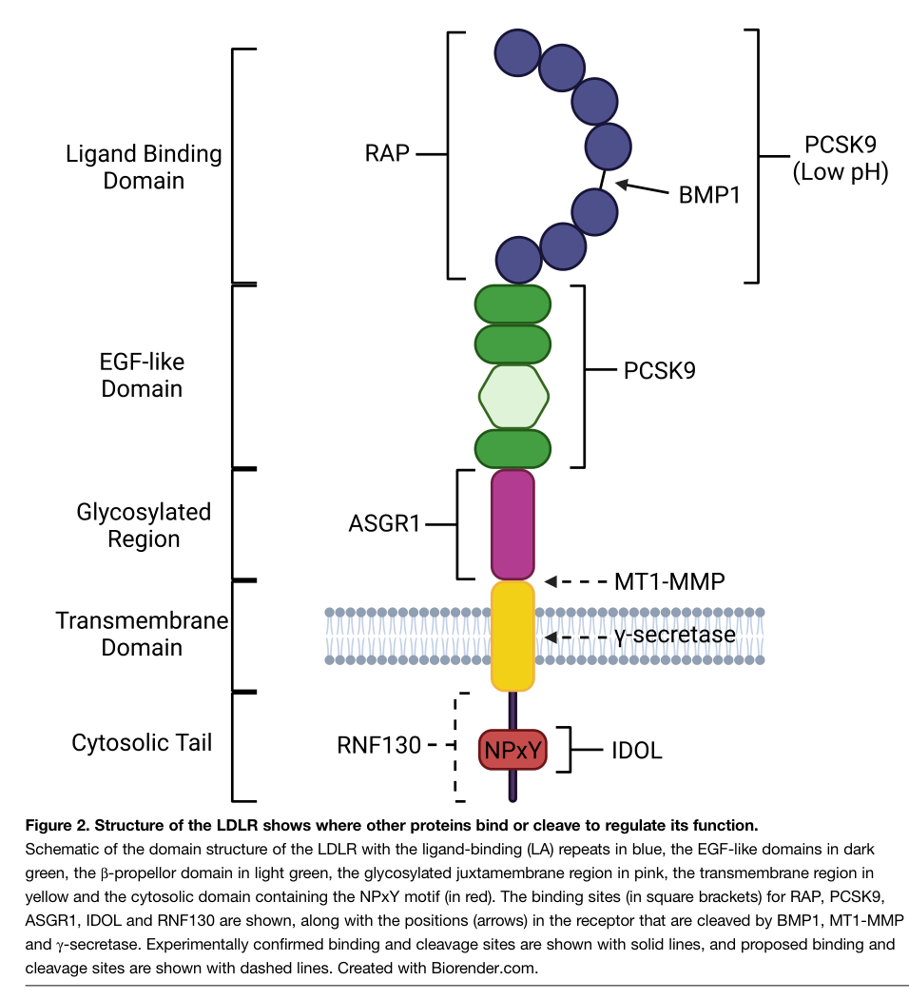

## Question

# Gene Research for Functional Annotation

## ⚠️ CRITICAL: Gene/Protein Identification Context

**BEFORE YOU BEGIN RESEARCH:** You MUST verify you are researching the CORRECT gene/protein. Gene symbols can be ambiguous, especially for less well-characterized genes from non-model organisms.

### Target Gene/Protein Identity (from UniProt):
- **UniProt Accession:** P01130
- **Protein Description:** RecName: Full=Low-density lipoprotein receptor; Short=LDL receptor; Flags: Precursor;
- **Gene Information:** Name=LDLR;
- **Organism (full):** Homo sapiens (Human).
- **Protein Family:** Belongs to the LDLR family. .
- **Key Domains:** 6-blade_b-propeller_TolB-like. (IPR011042); EGF. (IPR000742); EGF-like_Ca-bd_dom. (IPR001881); EGF-type_Asp/Asn_hydroxyl_site. (IPR000152); EGF_Ca-bd_CS. (IPR018097)

### MANDATORY VERIFICATION STEPS:

1. **Check if the gene symbol "LDLR" matches the protein description above**
2. **Verify the organism is correct:** Homo sapiens (Human).
3. **Check if protein family/domains align with what you find in literature**
4. **If you find literature for a DIFFERENT gene with the same or similar symbol, STOP**

### If Gene Symbol is Ambiguous or You Cannot Find Relevant Literature:

**DO NOT PROCEED WITH RESEARCH ON A DIFFERENT GENE.** Instead:
- State clearly: "The gene symbol 'LDLR' is ambiguous or literature is limited for this specific protein"
- Explain what you found (e.g., "Found extensive literature on a different gene with the same symbol in a different organism")
- Describe the protein based ONLY on the UniProt information provided above
- Suggest that the protein function can be inferred from domain/family information

### Research Target:

Please provide a comprehensive research report on the gene **LDLR** (gene ID: LDLR, UniProt: P01130) in human.

The research report should be a detailed narrative explaining the function, biological processes, and localization of the gene product. Citations should be given for all claims.

You should prioritize authoritative reviews and primary scientific literature when conducting research. You can supplement
this with annotations you find in gene/protein databases, but these can be outdated or inaccurate.

We are specifically interested in the primary function of the gene - for enzymes, what reaction is catalyzed, and what is the substrate specificity? For transporters, what is the substrate? For structural proteins or adapters, what is the broader structural role? For signaling molecules, what is the role in the pathway.

We are interested in where in or outside the cell the gene product carries out its function.

We are also interested in the signaling or biochemical pathways in which the gene functions. We are less interested in broad pleiotropic effects, except where these elucidate the precise role.

Include evidence where possible. We are interested in both experimental evidence as well as inference from structure, evolution, or bioinformatic analysis. Precise studies should be prioritized over high-throughput, where available.

## Output

Question: You are an expert researcher providing comprehensive, well-cited information.

Provide detailed information focusing on:
1. Key concepts and definitions with current understanding
2. Recent developments and latest research (prioritize 2023-2024 sources)
3. Current applications and real-world implementations
4. Expert opinions and analysis from authoritative sources
5. Relevant statistics and data from recent studies

Format as a comprehensive research report with proper citations. Include URLs and publication dates where available.
Always prioritize recent, authoritative sources and provide specific citations for all major claims.

# Gene Research for Functional Annotation

## ⚠️ CRITICAL: Gene/Protein Identification Context

**BEFORE YOU BEGIN RESEARCH:** You MUST verify you are researching the CORRECT gene/protein. Gene symbols can be ambiguous, especially for less well-characterized genes from non-model organisms.

### Target Gene/Protein Identity (from UniProt):
- **UniProt Accession:** P01130
- **Protein Description:** RecName: Full=Low-density lipoprotein receptor; Short=LDL receptor; Flags: Precursor;
- **Gene Information:** Name=LDLR;
- **Organism (full):** Homo sapiens (Human).
- **Protein Family:** Belongs to the LDLR family. .
- **Key Domains:** 6-blade_b-propeller_TolB-like. (IPR011042); EGF. (IPR000742); EGF-like_Ca-bd_dom. (IPR001881); EGF-type_Asp/Asn_hydroxyl_site. (IPR000152); EGF_Ca-bd_CS. (IPR018097)

### MANDATORY VERIFICATION STEPS:

1. **Check if the gene symbol "LDLR" matches the protein description above**
2. **Verify the organism is correct:** Homo sapiens (Human).
3. **Check if protein family/domains align with what you find in literature**
4. **If you find literature for a DIFFERENT gene with the same or similar symbol, STOP**

### If Gene Symbol is Ambiguous or You Cannot Find Relevant Literature:

**DO NOT PROCEED WITH RESEARCH ON A DIFFERENT GENE.** Instead:
- State clearly: "The gene symbol 'LDLR' is ambiguous or literature is limited for this specific protein"
- Explain what you found (e.g., "Found extensive literature on a different gene with the same symbol in a different organism")
- Describe the protein based ONLY on the UniProt information provided above
- Suggest that the protein function can be inferred from domain/family information

### Research Target:

Please provide a comprehensive research report on the gene **LDLR** (gene ID: LDLR, UniProt: P01130) in human.

The research report should be a detailed narrative explaining the function, biological processes, and localization of the gene product. Citations should be given for all claims.

You should prioritize authoritative reviews and primary scientific literature when conducting research. You can supplement
this with annotations you find in gene/protein databases, but these can be outdated or inaccurate.

We are specifically interested in the primary function of the gene - for enzymes, what reaction is catalyzed, and what is the substrate specificity? For transporters, what is the substrate? For structural proteins or adapters, what is the broader structural role? For signaling molecules, what is the role in the pathway.

We are interested in where in or outside the cell the gene product carries out its function.

We are also interested in the signaling or biochemical pathways in which the gene functions. We are less interested in broad pleiotropic effects, except where these elucidate the precise role.

Include evidence where possible. We are interested in both experimental evidence as well as inference from structure, evolution, or bioinformatic analysis. Precise studies should be prioritized over high-throughput, where available.

# Human LDLR (UniProt P01130): functional annotation and research report

## Identity and principal function

**Identity verified.** A 2024 study explicitly identifies UniProt **P01130** as the wild-type **human LDL receptor (LDLR)** sequence. The literature describes the same protein as a member of the LDLR receptor family, not the related protein **LRP1**. Its 860-amino-acid precursor has an extracellular ligand-binding region with seven calcium-binding, cysteine-rich LDLR type-A repeats; EGF-like modules surrounding a six-bladed YWTD β-propeller; an O-glycosylated membrane-proximal region; a single transmembrane segment; and a short cytosolic tail containing an NPxY sorting motif. The EGF and β-propeller annotations supplied in the question therefore match experimental structural descriptions. The receptor-domain arrangement and regulatory interaction sites are illustrated in a cropped figure from a 2024 review. [UniProt P01130](https://www.uniprot.org/uniprotkb/P01130/entry). (larrea‐sebal2024optimo‐ldlranintegrated pages 2-3, nogi2018howmultiscalestructural pages 2-4, larrea‐sebal2024optimo‐ldlranintegrated pages 1-2, aldworth2024posttranslationalregulationof media 9fa54fea)

**Primary molecular role.** LDLR is a **cell-surface, receptor-mediated lipoprotein-uptake protein**, not an enzyme or a channel that transports free cholesterol across a membrane. Its extracellular repeats recognize **apolipoprotein B100 (apoB100) on LDL particles** and also bind **apoE-bearing lipoproteins**, including triglyceride-rich lipoproteins and their remnants. By internalizing these particles—particularly at the hepatocyte surface—LDLR delivers their cholesterol cargo into cells and removes cholesterol-carrying particles from blood. LDLR can also function in other receptor-expressing tissues, but hepatic clearance is the dominant systemic consequence. The substrate is thus the **apolipoprotein-bearing particle**, rather than LDL cholesterol considered in isolation. (aldworth2024posttranslationalregulationof pages 2-5, aldworth2024posttranslationalregulationof pages 1-2, larrea‐sebal2024optimo‐ldlranintegrated pages 1-2)

The following evidence map locates each major molecular step and distinguishes observations on LDLR from findings made with other LDLR-family proteins.

| Functional step and cellular location | Molecular mechanism or cargo | Evidence quality and exact studies | Direct citations |
|---|---|---|---|
| **Identity and architecture — secretory pathway/plasma membrane** | Verified target is **human LDLR, UniProt P01130**, a single-pass LDLR-family receptor with seven cysteine-rich LA repeats, EGF-like modules, a six-bladed YWTD β-propeller, an O-glycosylated juxtamembrane stalk, transmembrane helix, and cytosolic NPxY-containing tail. It is not LRP1. | Direct accession use in the 2024 OptiMo-LDLr study; architecture independently supported by structural and functional literature and a 2024 domain/regulation review. | (larrea‐sebal2024optimo‐ldlranintegrated pages 2-3, nogi2018howmultiscalestructural pages 2-4, aldworth2024posttranslationalregulationof pages 2-5, aldworth2024posttranslationalregulationof media 9fa54fea) |
| **Lipoprotein capture — extracellular face of plasma membrane** | Extracellular LA repeats recognize **apoB100 on LDL** and **apoE-containing lipoprotein remnants**. Recent cryo-EM resolved LDLR-bound apoB100 through two interfaces: LA modules contact basic regions of the apoB100 β-belt, while the LDLR β-propeller contacts the apoB100 N-terminal domain. | Established biochemical annotation plus high-quality cryo-EM primary study by Reimund *et al.*: online 11 December 2024, *Nature* 2025; maps were moderate resolution, so broad interfaces are stronger than residue-level assignments. | (aldworth2024posttranslationalregulationof pages 2-5, reimund2025structureofapolipoprotein pages 1-2, reimund2025structureofapolipoprotein pages 2-3) |
| **Internalization — clathrin-coated pits and vesicles** | The cytosolic **NPxY motif** recruits the LDLR adaptor **LDLRAP1/ARH**, coupling ligand-bound LDLR to clathrin-mediated endocytosis. Defects in this step constitute an LDLR internalization phenotype. | Supported by established receptor biology and functional-variant assay literature; direct binding and uptake are commonly tested by surface expression, 4 °C LDL binding, and 37 °C DiI-LDL uptake. | (lopez2025functionalanalysisof pages 4-6, renon2025regulationofldlcholesterol pages 17-23, galiciagarcia2020mutationtypeclassification pages 1-2) |
| **Ligand release and receptor recycling — acidified endosome to plasma membrane** | Acidification drives LDLR from an open ligand-binding state toward a closed conformation in which LA repeats engage the EGF/YWTD β-propeller region, displacing lipoprotein cargo. LDLR can then recycle to the surface; WASH and the COMMD–CCDC22–CCDC93 **CCC complex** support efficient endosomal recycling. | Structural and cellular evidence supports acid-dependent release and recycling. The 2024 Commander study directly established cargo-regulated SNX17–Retriever coupling using **LRP1 and other cargoes, not LDLR**; it therefore informs the general pathway but is not direct LDLR-specific proof. | (nogi2018howmultiscalestructural pages 4-5, galiciagarcia2020mutationtypeclassification pages 1-2, aldworth2024posttranslationalregulationof pages 2-5, butkovic2024mechanismandregulationa pages 7-8) |
| **Cargo degradation — late endosome/lysosome** | Released LDL or remnant particles proceed to lysosomes, where apolipoproteins and lipids are degraded and cholesterol is liberated; LDLR normally avoids this fate when successfully recycled. | Canonical pathway supported by targeted LDLR trafficking and functional studies; disease variants that prevent release can cause receptor–cargo co-degradation and defective recycling. | (galiciagarcia2020mutationtypeclassification pages 1-2, aldworth2024posttranslationalregulationof pages 2-5) |
| **Sterol-sensitive transcription — ER, Golgi and nucleus** | Low cellular cholesterol permits **SCAP–SREBP2** trafficking to the Golgi, SREBP2 activation, and increased *LDLR* transcription. High cholesterol retains SCAP–SREBP2 in the ER, reducing receptor synthesis. | Authoritative 2024 mechanistic review integrating established sterol-sensing experiments. | (aldworth2024posttranslationalregulationof pages 2-5) |
| **PCSK9 regulation — cell surface/endosome and trans-Golgi network** | Secreted PCSK9 binds LDLR **EGF-A**, enters through clathrin-coated vesicles, binds more strongly under acidic conditions, blocks the recycling conformation, and redirects LDLR to lysosomes. An intracellular route can also divert nascent LDLR from the trans-Golgi network. | Strong structural, cellular, genetic, and clinical evidence. A 2024 primary study further implicated the PCSK9 M2 region and MHC-I proteins in lysosomal sorting, while acknowledging that the complete sorting machinery remains unresolved. | (mikaeeli2024insightsintopcsk9ldlr pages 1-2, aldworth2024posttranslationalregulationof pages 5-6, asikhia2024exploringalternateconfirmations pages 22-26) |
| **IDOL/MYLIP regulation — plasma membrane/endosome/lysosome** | Oxysterol-activated **LXR** induces the E3 ligase **IDOL/MYLIP**. IDOL binds the LDLR NPxY region through its FERM domain and, with UBE2D, ubiquitinates the cytosolic tail, promoting epsin/ESCRT-dependent multivesicular-body sorting and lysosomal degradation. | Strong pathway evidence summarized in a 2024 review; the precise role of USP8-mediated deubiquitination remains contradictory. Species differences caution against directly extrapolating mouse hepatic LXR–IDOL responses to humans. | (aldworth2024posttranslationalregulationof pages 5-6) |
| **Functional variant assays — cell surface, binding, uptake and recycling** | Sixteen EGF-precursor-homology-domain variants were tested in LDLR-deficient CHO-ldlA7 cells using Western blotting, surface expression, LDL binding, uptake, and recycling. Ten were functionally pathogenic and six non-pathogenic, resolving defects in processing, binding, or recycling. | Direct targeted experimental evidence: Galicia-Garcia *et al.*, *Scientific Reports*, 2020. More informative for individual tested variants than prediction alone, though based on a heterologous cell system. | (galiciagarcia2020mutationtypeclassification pages 1-2, galiciagarcia2020mutationtypeclassification pages 2-3) |
| **Variant prediction and clinical annotation — sequence/structure interpretation** | **OptiMo-LDLr** integrates six prediction tools using human P01130. It was trained/validated against ClinVar and independently checked against 93 later expert-panel classifications, correctly predicting 95.7% overall; it maps predicted pathogenic hotspots across functional domains. | Peer-reviewed computational study: Larrea-Sebal *et al.*, *Advanced Science*, 2024. Reported optimized-model sensitivity and specificity were high, but predictions remain supporting evidence and should not replace functional assays, segregation, phenotype, or expert curation. | (larrea‐sebal2024optimo‐ldlranintegrated pages 1-2, larrea‐sebal2024optimo‐ldlranintegrated pages 9-10) |

*Table: Compact evidence map for verified human LDLR P01130, linking molecular function and cellular location to direct structural, trafficking, regulatory, and variant evidence. It explicitly separates LDLR-specific findings from 2024 Commander experiments performed with LRP1.*

## Where and how LDLR acts

Newly synthesized LDLR folds and passes through the **endoplasmic reticulum and Golgi** before reaching the plasma membrane; defective folding can retain pathogenic variants in the ER. Its extracellular domains capture circulating lipoproteins at the cell surface, while its intracellular **NPxY motif** engages endocytic machinery, including the adaptor **LDLRAP1/ARH**, for clathrin-mediated uptake. LDL binding can be measured experimentally at 4 °C and subsequent internalization at 37 °C, allowing binding and uptake defects to be distinguished. (aldworth2024posttranslationalregulationof pages 2-5, lopez2025functionalanalysisof pages 4-6)

After internalization, acidification of the **endosome** promotes lipoprotein release. Structural and functional work supports a conformational transition in the ectodomain: the ligand-binding repeats interact with the EGF/YWTD β-propeller region, favoring release rather than continued cargo binding. The freed lipoprotein proceeds to **lysosomes**, where degradation liberates its lipid cargo; functional LDLR ordinarily returns through the endosomal recycling pathway to the plasma membrane for another uptake cycle. Endosomal WASH and COMMD–CCDC22–CCDC93 (**CCC**) machinery support efficient recycling. LDLR therefore acts at the **extracellular face of the plasma membrane and along the endocytic itinerary**, rather than as a soluble plasma protein or lysosomal cholesterol-synthesizing enzyme. (nogi2018howmultiscalestructural pages 4-5, galiciagarcia2020mutationtypeclassification pages 1-2, aldworth2024posttranslationalregulationof pages 2-5)

**Specificity caveat for recycling research:** a 2024 *Nature Communications* study established cargo-dependent interaction between SNX17 and the Retriever/Commander recycling machinery, but its direct cargo-binding experiments examined **LRP1 and other cargos, not LDLR**. It supports a general model of receptor recycling; it must not be presented as direct LDLR-specific proof of an SNX17-to-Retriever handoff. [Butkovič and colleagues, August 2024](https://doi.org/10.1038/s41467-024-50971-0). (butkovic2024mechanismandregulationa pages 7-8, butkovic2024mechanismandregulationa pages 2-3, butkovic2024mechanismandregulationa pages 6-7)

## Biochemical pathways and control of surface receptor abundance

LDLR lies at the intersection of **plasma lipoprotein clearance and intracellular sterol feedback**. When cellular cholesterol is low, SCAP permits SREBP2 processing in the Golgi; activated SREBP2 increases *LDLR* transcription, raising surface receptor abundance and LDL uptake. When cholesterol is plentiful, retention of SCAP–SREBP2 in the ER attenuates this transcriptional response. Thus, receptor abundance is responsive to the cell’s sterol needs as well as to receptor trafficking. [Aldworth and Hooper, February 2024](https://doi.org/10.1042/BST20230918). (aldworth2024posttranslationalregulationof pages 2-5)

Two major negative controls determine whether LDLR **recycles or is degraded**. Secreted **PCSK9** binds the extracellular LDLR **EGF-A** module; unlike LDL, PCSK9 remains tightly associated in acidic endosomes, reducing recycling and directing the receptor to lysosomes. An intracellular route can also divert nascent LDLR from the trans-Golgi network. Independently, oxysterol-activated **LXR** induces the E3 ligase **MYLIP/IDOL**. IDOL recognizes the cytosolic LDLR tail, ubiquitinates it with an E2 partner, and favors endosomal/lysosomal sorting. The details of some downstream regulators, including the contribution of USP8 deubiquitination, remain contested. Experimental work published in May 2024 further implicates PCSK9’s M2 region and MHC-I-associated proteins in sorting, but does not completely resolve the lysosomal-routing machinery. [Aldworth and Hooper, February 2024](https://doi.org/10.1042/BST20230918); [Mikaeeli and colleagues, 17 May 2024](https://doi.org/10.3390/cells13100857). (aldworth2024posttranslationalregulationof pages 5-6, mikaeeli2024insightsintopcsk9ldlr pages 1-2)

## Recent structural and functional developments

**Direct view of lipoprotein recognition.** Reimund and colleagues reported cryo-electron-microscopy structures of **apoB100-containing LDL bound to LDLR**. The reconstruction supports two broad contacts: ligand-binding LA modules engage basic regions along apoB100’s particle-encircling β-belt, and the LDLR β-propeller contacts apoB100’s N-terminal region. Reconstructions included one- and two-LDL-particle assemblies, with approximately **5.61 Å** and **7.89 Å** overall resolutions, respectively. This is direct structural evidence for particle recognition, although the resolution and reconstructed assembly warrant caution about treating every proposed residue-level contact or higher-order arrangement as conclusively established *in vivo*. The article appeared **online on 11 December 2024** and in **Nature volume 638 in February 2025**; the date of the DOI alone should not be mistaken for the print-publication date. [Reimund and colleagues](https://doi.org/10.1038/s41586-024-08223-0). (reimund2025structureofapolipoprotein pages 1-2, reimund2025structureofapolipoprotein pages 2-3)

**Variants dissect the uptake cycle.** A targeted study of **16** EGF-precursor-homology-domain variants measured expression, LDL binding, uptake and receptor recycling in LDLR-deficient cells. **Ten** variants showed pathogenic functional defects and **six** were classified as non-pathogenic; defective maturation, binding and recycling were experimentally distinguishable. These are direct assays of the receptor’s proposed activities, although results from transfected cells still require clinical interpretation. [Galicia-Garcia and colleagues, February 2020](https://doi.org/10.1038/s41598-020-58734-9). (galiciagarcia2020mutationtypeclassification pages 1-2, galiciagarcia2020mutationtypeclassification pages 2-3)

A complementary **2024 computational** study, OptiMo-LDLr, combined six variant-prediction programs using the human P01130 sequence. Its authors report **96.71% specificity and 98.36% sensitivity** for their optimized prediction, and separately report correct agreement for **89 of 93** later expert-classified variants (**95.7%**). Its training/validation table uses different sample partitions and reports different partition-specific percentages; these figures should therefore **not** be interpreted as measured LDL uptake, population-wide diagnostic performance or a replacement for functional assays and expert variant curation. [Larrea-Sebal and colleagues, January 2024](https://doi.org/10.1002/advs.202305177). (larrea‐sebal2024optimo‐ldlranintegrated pages 1-2, larrea‐sebal2024optimo‐ldlranintegrated pages 9-10)

## Human genetics and real-world application

Loss of functional LDLR reduces LDL-particle clearance, producing elevated circulating LDL cholesterol and, in familial hypercholesterolaemia (**FH**), heightened premature atherosclerotic risk. Pathogenic *LDLR* variants are a major cause of FH, but **APOB, PCSK9 and LDLRAP1** defects and other phenocopies can yield overlapping presentations; an FH phenotype alone does not identify which molecular step is defective. A 2023 genetics review estimated heterozygous FH prevalence at approximately **1 in 300**, while a 2024 LDLR-variant study cited estimates of approximately **1 in 200–250** in several populations. These are population estimates for FH, **not** frequencies of a single LDLR mutation. [Di Taranto and Fortunato, February 2023](https://doi.org/10.3390/ijms24043224); [Larrea-Sebal and colleagues, January 2024](https://doi.org/10.1002/advs.202305177). (taranto2023geneticheterogeneityof pages 2-4, larrea‐sebal2024optimo‐ldlranintegrated pages 1-2)

The receptor’s mechanism directly informs **clinical testing and treatment**: genetic identification of a familial pathogenic variant enables family cascade screening; functional measurements of LDLR surface expression, LDL binding, uptake and recycling clarify uncertain variants; and treatments that increase receptor production or preserve its recycling lower LDL cholesterol when sufficient receptor function remains. The **2023 European Atherosclerosis Society consensus** recommends investigating homozygous FH when untreated LDL cholesterol exceeds approximately **10 mmol/L (400 mg/dL)** and emphasizes early, multimodal care. Its phenotype-based evaluation recognizes that variants in more than one gene can underlie severe disease. [Cuchel and colleagues, online 2 May 2023, *European Heart Journal*](https://doi.org/10.1093/eurheartj/ehad197). (cuchel20232023updateon pages 2-4, cuchel20232023updateon pages 1-2, lopez2025functionalanalysisof pages 4-6)

Statins increase LDLR through the sterol-response pathway; PCSK9-directed antibodies or hepatic PCSK9-silencing therapy preserve more LDLR for repeated uptake. The mechanistic limitation is important: a treatment that **preserves LDLR cannot fully restore uptake when little functional LDLR exists**. Consistent with this, a **2025 meta-analysis of 23 randomized FH trials involving 4,282 participants** estimated LDL-C reductions of approximately **48.50% in heterozygous FH versus 25.98% in homozygous FH**, with variation across patients and therapies. For particularly severe receptor-deficient disease, lipoprotein apheresis removes circulating particles directly, while lomitapide and evinacumab provide LDLR-independent pharmacological approaches. These treatment responses illustrate LDLR’s biological importance; they do not imply every patient with FH has an *LDLR* variant. [Ho and colleagues, July 2025](https://doi.org/10.1136/openhrt-2025-003490); [Cegla and colleagues, May 2025](https://doi.org/10.1016/j.jacadv.2025.101708); [Cuchel and colleagues, 2023](https://doi.org/10.1093/eurheartj/ehad197). (ho2025pcsk9targetingtherapies pages 5-6, cegla2025treatmentofhomozygous pages 1-2, cuchel20232023updateon pages 2-4)

**Functional conclusion:** For the verified human protein **LDLR/P01130**, the highest-confidence annotation is **surface recognition and endocytosis of apoB100- and apoE-bearing lipoproteins, coupled to acid-dependent cargo release and receptor recycling**. Its effects on systemic cholesterol reflect the number of functional receptors at the hepatocyte surface and their repeated passage through that uptake cycle, rather than an intrinsic catalytic reaction. (larrea‐sebal2024optimo‐ldlranintegrated pages 2-3, aldworth2024posttranslationalregulationof pages 2-5, galiciagarcia2020mutationtypeclassification pages 1-2, reimund2025structureofapolipoprotein pages 1-2)

References

1. (larrea‐sebal2024optimo‐ldlranintegrated pages 2-3): Asier Larrea‐Sebal, Iñaki Sasiain, Shifa Jebari‐Benslaiman, Unai Galicia‐Garcia, Kepa B. Uribe, Asier Benito‐Vicente, Irene Gracia‐Rubio, Harbil Bediaga‐Bañeres, Sonia Arrasate, Ana Cenarro, Fernando Civeira, Humberto González‐Díaz, and Cesar Martín. Optimo‐ldlr: an integrated in silico model with enhanced predictive power for ldl receptor variants, unraveling hot spot pathogenic residues. Advanced Science, Jan 2024. URL: https://doi.org/10.1002/advs.202305177, doi:10.1002/advs.202305177. This article has 4 citations and is from a peer-reviewed journal.

2. (nogi2018howmultiscalestructural pages 2-4): Terukazu Nogi. How multi-scale structural biology elucidated context-dependent variability in ectodomain conformation along with the ligand capture and release cycle for ldlr family members. Biophysical Reviews, 10:481-492, Dec 2018. URL: https://doi.org/10.1007/s12551-017-0362-7, doi:10.1007/s12551-017-0362-7. This article has 5 citations and is from a peer-reviewed journal.

3. (larrea‐sebal2024optimo‐ldlranintegrated pages 1-2): Asier Larrea‐Sebal, Iñaki Sasiain, Shifa Jebari‐Benslaiman, Unai Galicia‐Garcia, Kepa B. Uribe, Asier Benito‐Vicente, Irene Gracia‐Rubio, Harbil Bediaga‐Bañeres, Sonia Arrasate, Ana Cenarro, Fernando Civeira, Humberto González‐Díaz, and Cesar Martín. Optimo‐ldlr: an integrated in silico model with enhanced predictive power for ldl receptor variants, unraveling hot spot pathogenic residues. Advanced Science, Jan 2024. URL: https://doi.org/10.1002/advs.202305177, doi:10.1002/advs.202305177. This article has 4 citations and is from a peer-reviewed journal.

4. (aldworth2024posttranslationalregulationof media 9fa54fea): Harry Aldworth and Nigel M. Hooper. Post-translational regulation of the low-density lipoprotein receptor provides new targets for cholesterol regulation. Biochemical Society Transactions, 52:431-440, Feb 2024. URL: https://doi.org/10.1042/bst20230918, doi:10.1042/bst20230918. This article has 16 citations and is from a peer-reviewed journal.

5. (aldworth2024posttranslationalregulationof pages 2-5): Harry Aldworth and Nigel M. Hooper. Post-translational regulation of the low-density lipoprotein receptor provides new targets for cholesterol regulation. Biochemical Society Transactions, 52:431-440, Feb 2024. URL: https://doi.org/10.1042/bst20230918, doi:10.1042/bst20230918. This article has 16 citations and is from a peer-reviewed journal.

6. (aldworth2024posttranslationalregulationof pages 1-2): Harry Aldworth and Nigel M. Hooper. Post-translational regulation of the low-density lipoprotein receptor provides new targets for cholesterol regulation. Biochemical Society Transactions, 52:431-440, Feb 2024. URL: https://doi.org/10.1042/bst20230918, doi:10.1042/bst20230918. This article has 16 citations and is from a peer-reviewed journal.

7. (reimund2025structureofapolipoprotein pages 1-2): Mart Reimund, Altaira D. Dearborn, Giorgio Graziano, Haotian Lei, Anthony M. Ciancone, Ashish Kumar, Ronald Holewinski, Edward B. Neufeld, Francis J. O’Reilly, Alan T. Remaley, and Joseph Marcotrigiano. Structure of apolipoprotein b100 bound to the low-density lipoprotein receptor. Nature, 638:829-835, Dec 2025. URL: https://doi.org/10.1038/s41586-024-08223-0, doi:10.1038/s41586-024-08223-0. This article has 67 citations and is from a highest quality peer-reviewed journal.

8. (reimund2025structureofapolipoprotein pages 2-3): Mart Reimund, Altaira D. Dearborn, Giorgio Graziano, Haotian Lei, Anthony M. Ciancone, Ashish Kumar, Ronald Holewinski, Edward B. Neufeld, Francis J. O’Reilly, Alan T. Remaley, and Joseph Marcotrigiano. Structure of apolipoprotein b100 bound to the low-density lipoprotein receptor. Nature, 638:829-835, Dec 2025. URL: https://doi.org/10.1038/s41586-024-08223-0, doi:10.1038/s41586-024-08223-0. This article has 67 citations and is from a highest quality peer-reviewed journal.

9. (lopez2025functionalanalysisof pages 4-6): Cris Ortiz López, Neila Rodríguez Roca, Irene Hidalgo Mayoral, Amanda Herranz Cecilia, Carlos Rodríguez Antolín, Pedro Martínez Hernández, Ana Carazo Álvarez, Francisco Jesús, Arrieta Blanco, Sara Fernández Hernández, M. J. Delgado-Martos, Carmen Rodríguez Jiménez, Sonia Rodríguez-Nóvoa, and Carmen Rodríguez Jiménez. Functional analysis of ldlr variants reveals that the novel p.(ser610tyr) variant in the ymdd motif drastically impacts ldl uptake. MedRxiv, May 2025. URL: https://doi.org/10.1101/2025.05.16.25325576, doi:10.1101/2025.05.16.25325576. This article has 0 citations.

10. (renon2025regulationofldlcholesterol pages 17-23): A Renon. Regulation of ldl-cholesterol by circulating pcsk9 and its natural variants. Unknown journal, 2025.

11. (galiciagarcia2020mutationtypeclassification pages 1-2): Unai Galicia-Garcia, Asier Benito-Vicente, Kepa B. Uribe, Shifa Jebari, Asier Larrea-Sebal, Rocio Alonso-Estrada, Joseba Aguilo-Arce, Helena Ostolaza, Lourdes Palacios, and Cesar Martin. Mutation type classification and pathogenicity assignment of sixteen missense variants located in the egf-precursor homology domain of the ldlr. Scientific Reports, Feb 2020. URL: https://doi.org/10.1038/s41598-020-58734-9, doi:10.1038/s41598-020-58734-9. This article has 65 citations and is from a peer-reviewed journal.

12. (nogi2018howmultiscalestructural pages 4-5): Terukazu Nogi. How multi-scale structural biology elucidated context-dependent variability in ectodomain conformation along with the ligand capture and release cycle for ldlr family members. Biophysical Reviews, 10:481-492, Dec 2018. URL: https://doi.org/10.1007/s12551-017-0362-7, doi:10.1007/s12551-017-0362-7. This article has 5 citations and is from a peer-reviewed journal.

13. (butkovic2024mechanismandregulationa pages 7-8): Rebeka Butkovič, Alexander P. Walker, Michael D. Healy, Kerrie E. McNally, Meihan Liu, Tineke Veenendaal, Kohji Kato, Nalan Liv, Judith Klumperman, Brett M. Collins, and Peter J. Cullen. Mechanism and regulation of cargo entry into the commander endosomal recycling pathway. Nature Communications, Aug 2024. URL: https://doi.org/10.1038/s41467-024-50971-0, doi:10.1038/s41467-024-50971-0. This article has 27 citations and is from a highest quality peer-reviewed journal.

14. (mikaeeli2024insightsintopcsk9ldlr pages 1-2): Sepideh Mikaeeli, Ali Ben Djoudi Ouadda, Alexandra Evagelidis, Rachid Essalmani, Oscar Henrique Pereira Ramos, Carole Fruchart-Gaillard, and Nabil G. Seidah. Insights into pcsk9-ldlr regulation and trafficking via the differential functions of mhc-i proteins hfe and hla-c. Cells, 13:857, May 2024. URL: https://doi.org/10.3390/cells13100857, doi:10.3390/cells13100857. This article has 6 citations.

15. (aldworth2024posttranslationalregulationof pages 5-6): Harry Aldworth and Nigel M. Hooper. Post-translational regulation of the low-density lipoprotein receptor provides new targets for cholesterol regulation. Biochemical Society Transactions, 52:431-440, Feb 2024. URL: https://doi.org/10.1042/bst20230918, doi:10.1042/bst20230918. This article has 16 citations and is from a peer-reviewed journal.

16. (asikhia2024exploringalternateconfirmations pages 22-26): Ikhuosho Charity Asikhia. Exploring alternate confirmations of pcsk9: effects on ldl, ldl receptor binding, and inflammation. Text, Apr 2024. URL: https://doi.org/10.20381/ruor-30245, doi:10.20381/ruor-30245. This article has 0 citations and is from a peer-reviewed journal.

17. (galiciagarcia2020mutationtypeclassification pages 2-3): Unai Galicia-Garcia, Asier Benito-Vicente, Kepa B. Uribe, Shifa Jebari, Asier Larrea-Sebal, Rocio Alonso-Estrada, Joseba Aguilo-Arce, Helena Ostolaza, Lourdes Palacios, and Cesar Martin. Mutation type classification and pathogenicity assignment of sixteen missense variants located in the egf-precursor homology domain of the ldlr. Scientific Reports, Feb 2020. URL: https://doi.org/10.1038/s41598-020-58734-9, doi:10.1038/s41598-020-58734-9. This article has 65 citations and is from a peer-reviewed journal.

18. (larrea‐sebal2024optimo‐ldlranintegrated pages 9-10): Asier Larrea‐Sebal, Iñaki Sasiain, Shifa Jebari‐Benslaiman, Unai Galicia‐Garcia, Kepa B. Uribe, Asier Benito‐Vicente, Irene Gracia‐Rubio, Harbil Bediaga‐Bañeres, Sonia Arrasate, Ana Cenarro, Fernando Civeira, Humberto González‐Díaz, and Cesar Martín. Optimo‐ldlr: an integrated in silico model with enhanced predictive power for ldl receptor variants, unraveling hot spot pathogenic residues. Advanced Science, Jan 2024. URL: https://doi.org/10.1002/advs.202305177, doi:10.1002/advs.202305177. This article has 4 citations and is from a peer-reviewed journal.

19. (butkovic2024mechanismandregulationa pages 2-3): Rebeka Butkovič, Alexander P. Walker, Michael D. Healy, Kerrie E. McNally, Meihan Liu, Tineke Veenendaal, Kohji Kato, Nalan Liv, Judith Klumperman, Brett M. Collins, and Peter J. Cullen. Mechanism and regulation of cargo entry into the commander endosomal recycling pathway. Nature Communications, Aug 2024. URL: https://doi.org/10.1038/s41467-024-50971-0, doi:10.1038/s41467-024-50971-0. This article has 27 citations and is from a highest quality peer-reviewed journal.

20. (butkovic2024mechanismandregulationa pages 6-7): Rebeka Butkovič, Alexander P. Walker, Michael D. Healy, Kerrie E. McNally, Meihan Liu, Tineke Veenendaal, Kohji Kato, Nalan Liv, Judith Klumperman, Brett M. Collins, and Peter J. Cullen. Mechanism and regulation of cargo entry into the commander endosomal recycling pathway. Nature Communications, Aug 2024. URL: https://doi.org/10.1038/s41467-024-50971-0, doi:10.1038/s41467-024-50971-0. This article has 27 citations and is from a highest quality peer-reviewed journal.

21. (taranto2023geneticheterogeneityof pages 2-4): Maria Donata Di Taranto and Giuliana Fortunato. Genetic heterogeneity of familial hypercholesterolemia: repercussions for molecular diagnosis. International Journal of Molecular Sciences, 24:3224, Feb 2023. URL: https://doi.org/10.3390/ijms24043224, doi:10.3390/ijms24043224. This article has 58 citations.

22. (cuchel20232023updateon pages 2-4): Cuchel M, Raal FJ, Hegele RA, Al-Rasadi K, Arca M, Averna M, Bruckert E, Freiberger T, Gaudet D, Harada-Shiba M, Hudgins LC, Kayikcioglu M, Masana L, Parhofer KG, Roeters van Lennep JE, Santos RD, Stroes ESG, Watts GF, Wiegman A, Stock JK, Tokgozoğlu LS, Catapano AL, and Ray KK. 2023 update on european atherosclerosis society consensus statement on homozygous familial hypercholesterolaemia: new treatments and clinical guidance. Yearbook of Paediatric Endocrinology, Sep 2023. URL: https://doi.org/10.1530/ey.20.10.11, doi:10.1530/ey.20.10.11. This article has 0 citations.

23. (cuchel20232023updateon pages 1-2): Cuchel M, Raal FJ, Hegele RA, Al-Rasadi K, Arca M, Averna M, Bruckert E, Freiberger T, Gaudet D, Harada-Shiba M, Hudgins LC, Kayikcioglu M, Masana L, Parhofer KG, Roeters van Lennep JE, Santos RD, Stroes ESG, Watts GF, Wiegman A, Stock JK, Tokgozoğlu LS, Catapano AL, and Ray KK. 2023 update on european atherosclerosis society consensus statement on homozygous familial hypercholesterolaemia: new treatments and clinical guidance. Yearbook of Paediatric Endocrinology, Sep 2023. URL: https://doi.org/10.1530/ey.20.10.11, doi:10.1530/ey.20.10.11. This article has 0 citations.

24. (ho2025pcsk9targetingtherapies pages 5-6): Vinh Q T Ho, Nghi Bao Tran, Nhan Nguyen, Giang Son Arrighini, David Downes, Mrunalini Dandamudi, Victoria Zecchin Ferrara, Tri Huynh Quang Ho, Hemank Walia, Alejandro Barbagelata, Thorsten M Leucker, and Juliana Giorgi. Pcsk9 targeting therapies for familial hypercholesterolaemia: a meta-analysis of efficacy on lipid biomarkers and safety in adults and children across 23 rcts. Open Heart, 12:e003490, Jul 2025. URL: https://doi.org/10.1136/openhrt-2025-003490, doi:10.1136/openhrt-2025-003490. This article has 12 citations and is from a peer-reviewed journal.

25. (cegla2025treatmentofhomozygous pages 1-2): Jaimini Cegla, Shahenaz Walji, Lucy Barton, Clare Neuwirth, and Gilbert R. Thompson. Treatment of homozygous familial hypercholesterolemia. JACC: Advances, 4:101708, May 2025. URL: https://doi.org/10.1016/j.jacadv.2025.101708, doi:10.1016/j.jacadv.2025.101708. This article has 10 citations.

## Artifacts

- [Edison artifact artifact-00](LDLR-deep-research-falcon_artifacts/artifact-00.md)

## Citations

1. aldworth2024posttranslationalregulationof pages 2-5
2. aldworth2024posttranslationalregulationof pages 5-6
3. nogi2018howmultiscalestructural pages 2-4
4. aldworth2024posttranslationalregulationof pages 1-2
5. reimund2025structureofapolipoprotein pages 1-2
6. reimund2025structureofapolipoprotein pages 2-3
7. lopez2025functionalanalysisof pages 4-6
8. renon2025regulationofldlcholesterol pages 17-23
9. galiciagarcia2020mutationtypeclassification pages 1-2
10. nogi2018howmultiscalestructural pages 4-5
11. butkovic2024mechanismandregulationa pages 7-8
12. asikhia2024exploringalternateconfirmations pages 22-26
13. galiciagarcia2020mutationtypeclassification pages 2-3
14. butkovic2024mechanismandregulationa pages 2-3
15. butkovic2024mechanismandregulationa pages 6-7
16. taranto2023geneticheterogeneityof pages 2-4
17. cegla2025treatmentofhomozygous pages 1-2
18. UniProt P01130
19. Butkovič and colleagues, August 2024
20. Aldworth and Hooper, February 2024
21. Mikaeeli and colleagues, 17 May 2024
22. Reimund and colleagues
23. Galicia-Garcia and colleagues, February 2020
24. Larrea-Sebal and colleagues, January 2024
25. Di Taranto and Fortunato, February 2023
26. Cuchel and colleagues, online 2 May 2023, *European Heart Journal*
27. Ho and colleagues, July 2025
28. Cegla and colleagues, May 2025
29. Cuchel and colleagues, 2023
30. https://www.uniprot.org/uniprotkb/P01130/entry
31. https://doi.org/10.1038/s41467-024-50971-0
32. https://doi.org/10.1042/BST20230918
33. https://doi.org/10.3390/cells13100857
34. https://doi.org/10.1038/s41586-024-08223-0
35. https://doi.org/10.1038/s41598-020-58734-9
36. https://doi.org/10.1002/advs.202305177
37. https://doi.org/10.3390/ijms24043224
38. https://doi.org/10.1093/eurheartj/ehad197
39. https://doi.org/10.1136/openhrt-2025-003490
40. https://doi.org/10.1016/j.jacadv.2025.101708
41. https://doi.org/10.1002/advs.202305177,
42. https://doi.org/10.1007/s12551-017-0362-7,
43. https://doi.org/10.1042/bst20230918,
44. https://doi.org/10.1038/s41586-024-08223-0,
45. https://doi.org/10.1101/2025.05.16.25325576,
46. https://doi.org/10.1038/s41598-020-58734-9,
47. https://doi.org/10.1038/s41467-024-50971-0,
48. https://doi.org/10.3390/cells13100857,
49. https://doi.org/10.20381/ruor-30245,
50. https://doi.org/10.3390/ijms24043224,
51. https://doi.org/10.1530/ey.20.10.11,
52. https://doi.org/10.1136/openhrt-2025-003490,
53. https://doi.org/10.1016/j.jacadv.2025.101708,