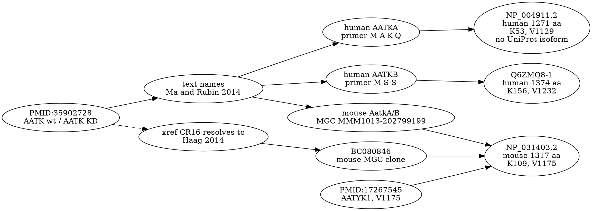
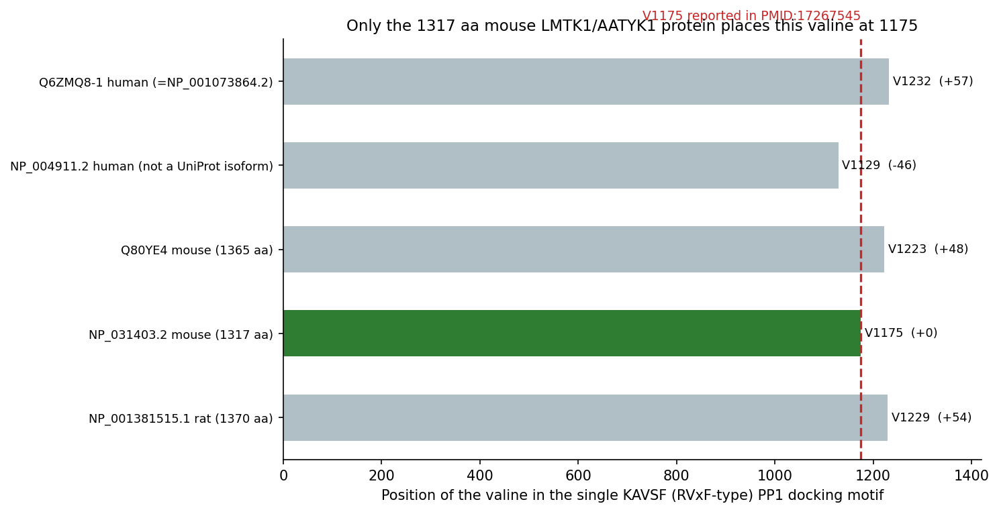
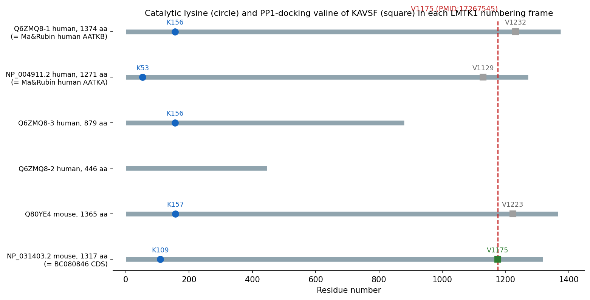
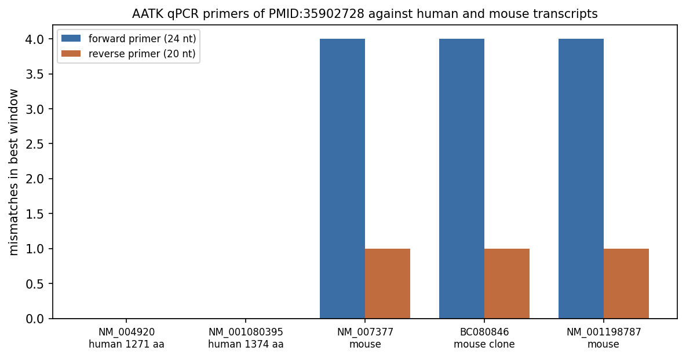
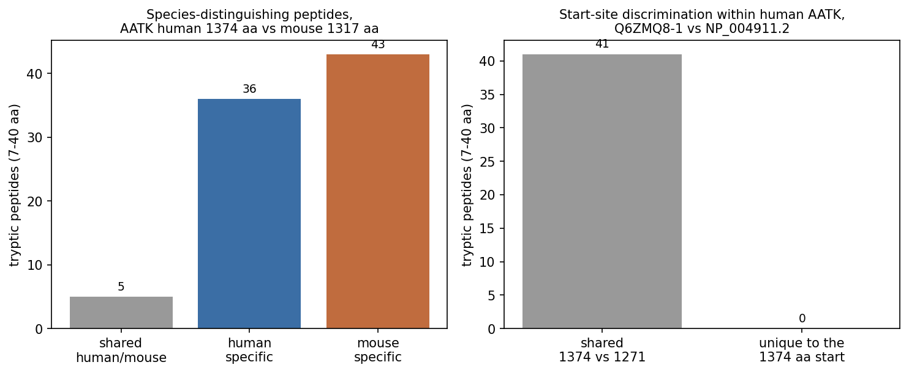
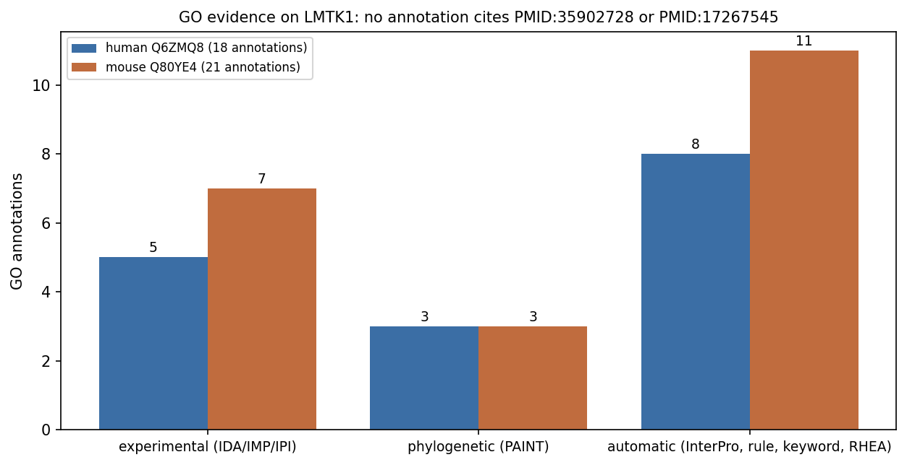

## Question

# AIGR Gene Hypothesis Deep Research

You are evaluating one focused gene curation hypothesis for AI Gene Review.
This is not a general gene overview. Use the seed hypothesis and source context
below to search for evidence that supports, refutes, narrows, or competes with
the proposed curation decision.

## Target Gene

- **Organism code:** human
- **Taxon:** Homo sapiens (NCBITaxon:9606)
- **Gene directory:** LMTK1
- **Gene symbol:** LMTK1
- **UniProt accession:** Q6ZMQ8

## Focus

- **Focus type:** free_text
- **Hypothesis slug:** kgap-lmtk1-construct-isoform
- **Source file:** genes/human/LMTK1/LMTK1-ai-review.yaml
- **Source selector:** free-text

## Seed Hypothesis

Which current Q6ZMQ8 isoform the human construct in PMID:35902728 corresponds to should be decidable from the paper itself and from sequence. That Q6ZMQ8-2 lacks residues 1-433 including the kinase domain while Q6ZMQ8-1 and Q6ZMQ8-3 retain it is already recorded, so do not re-derive the isoform inventory. Single analysis only: retrieve the methods and any sequence, accession, residue numbering or mutant designation given for the human LMTK1 construct in PMID:35902728, quoting the relevant text, and state which current isoform it matches and how confidently, or state plainly that the paper does not specify enough to decide; do the same for the construct in PMID:17267545, reporting explicitly whether the full text states the species of the AATYK1 clone and quoting the statement if it does; where a residue number is given for a kinase-domain residue or a mutated position, check which isoform numbering makes that residue the expected one and report the arithmetic; and note any accession the papers cite that has since been split, merged or retired. State for each paper what can and cannot be concluded, and do not infer an isoform from a figure label alone.

## Term and Decision Context

No specific term context supplied.

## Reference Context

No specific reference context supplied.

## Source Context YAML

```yaml
hypothesis: 'Which current Q6ZMQ8 isoform the human construct in PMID:35902728 corresponds to should be
  decidable from the paper itself and from sequence. That Q6ZMQ8-2 lacks residues 1-433 including the
  kinase domain while Q6ZMQ8-1 and Q6ZMQ8-3 retain it is already recorded, so do not re-derive the isoform
  inventory. Single analysis only: retrieve the methods and any sequence, accession, residue numbering
  or mutant designation given for the human LMTK1 construct in PMID:35902728, quoting the relevant text,
  and state which current isoform it matches and how confidently, or state plainly that the paper does
  not specify enough to decide; do the same for the construct in PMID:17267545, reporting explicitly whether
  the full text states the species of the AATYK1 clone and quoting the statement if it does; where a residue
  number is given for a kinase-domain residue or a mutated position, check which isoform numbering makes
  that residue the expected one and report the arithmetic; and note any accession the papers cite that
  has since been split, merged or retired. State for each paper what can and cannot be concluded, and
  do not infer an isoform from a figure label alone.'
focus_type: free_text
context: []
reference_id: []
```

## Research Objective

Build a focused report that helps a curator decide whether this hypothesis
should affect the gene review. Address the focus type directly:

1. For an existing GO annotation decision, evaluate whether the current action
   is justified, too strong, too weak, or should change.
2. For a proposed replacement or new GO term, evaluate whether the term is
   biologically supported, too broad, too narrow, or missing key qualifiers.
3. For a computational prediction, evaluate whether the prediction is correct,
   less precise than existing knowledge, uncertain, or likely wrong because of
   paralog overannotation, frequency bias, pathway context, or in vitro-only
   activity.
4. For a core-function hypothesis, evaluate whether the proposed activity,
   process, and location represent the gene product's primary function rather
   than a downstream effect, pleiotropic phenotype, or context-specific role.
5. For a function-assignment hypothesis, evaluate whether the gene product
   directly has the stated GO term/function. Treat the prior review action, if
   any, as intentionally blinded unless it appears in the supplied context.

Use primary literature whenever possible. Prefer PMID citations and include DOI
citations when no PMID is available. Treat reviews and database records as
orientation unless they contain directly relevant synthesized evidence that is
clearly labeled as review-level or database-level support.

Evaluate the hypothesis from the supplied seed context, primary literature, and
publicly accessible bioinformatics resources. Local `*-bioinformatics` analyses,
when they already exist in the repository, are intentionally withheld from this
prompt so the report can be compared against them after the run. Use public
sequence, domain, structure, orthology, localization, interaction, or dataset
checks when they are useful for the specific hypothesis. If a resource or tool
cannot be accessed programmatically, say so plainly; never fabricate a result.
Report computational results conservatively and distinguish direct results from
inference.

## Required Output

### Executive Judgment

Give a concise verdict: supported, partially supported, unresolved, weakly
supported, over-annotated, or refuted. Explain the reasoning and the most
important caveats.

### Evidence Matrix

Create a table with one row per important evidence item:

- Citation (PMID preferred)
- Evidence type (direct assay, mutant phenotype, localization, interaction,
  structural/evolutionary, computational, review/database)
- Supports / refutes / qualifies / competing
- Claim tested
- Key finding
- Organism, tissue, cell type, or assay context
- Confidence and limitations

### GO Curation Implications

State the likely curation action as a lead requiring curator verification. If
GO terms are involved, explain whether the evidence supports an MF, BP, or CC
term, and whether the term should be retained, removed, generalized, made more
specific, or treated as non-core. Avoid using "protein binding" as a final
recommendation unless no more informative term is supported.

### Mechanistic Scope

Describe the immediate molecular or cellular function being tested. Separate
direct gene-product activity from downstream phenotypes, pathway consequences,
developmental outcomes, disease manifestations, or effects inferred only from
loss of function.

### Conflicts and Alternatives

Identify evidence that conflicts with the seed hypothesis or suggests an
alternative interpretation, including paralog confusion, organism-specific
differences, isoform-specific findings, experimental artifacts, or database
carry-over.

### Knowledge Gaps

List explicit uncertainties that matter for curation. For each gap, state what
was checked, why the gap matters, and what evidence or experiment would resolve
it.

### Discriminating Tests

Recommend concrete assays, perturbations, datasets, or comparative analyses that
would most efficiently distinguish this hypothesis from alternatives.

### Curation Leads

Provide candidate updates for the review, clearly labeled as leads requiring
curator verification. Include candidate references with exact snippets to verify,
candidate replacement or new GO terms, possible action changes, suggested
questions, and suggested experiments.

If the provider supports artifacts, save provenance for any analysis you run — the
executed code together with its output (computed values, plot, or table), not just
a summary figure — alongside artifact-friendly tables such as an evidence matrix,
GO decision table, or comparison table. Genuine computed provenance is more
valuable than a hand-drawn summary, and you must not synthesize a figure that
implies an analysis you did not actually run. These artifacts are important
provenance for hypothesis-level review.


## Output

# LMTK1/AATK construct identity in PMID:35902728 and PMID:17267545

Hypothesis slug: `kgap-lmtk1-construct-isoform`
Gene: human LMTK1 (AATK), UniProt Q6ZMQ8, NCBITaxon:9606
Source file: `genes/human/LMTK1/LMTK1-ai-review.yaml`, free-text focus
Iterations completed: 3. Findings recorded: 7. Papers read: 4.

## Summary

The seed hypothesis asserts that the Q6ZMQ8 isoform of the human construct in
[PMID: 35902728](https://pubmed.ncbi.nlm.nih.gov/35902728/) "should be decidable from
the paper itself and from sequence". It is not. The 161 kB Europe PMC full text
contains no sequence accession, no AATK residue number, no protein size, no isoform
or transcript-variant statement, and no cloning or mutagenesis primers. The entire
construct description is two sentences, and the first of them carries an internal
citation conflict: the text credits "Ma and Rubin [16]" while the XML cross-reference
`rid="CR16"` resolves to Haag et al. 2014
([PMID: 25352953](https://pubmed.ncbi.nlm.nih.gov/25352953/)), whose construct is the
mouse clone BC080846. Ma and Rubin is reference 17. The two readings point to
different species and to four different proteins, so the construct cannot be assigned.

The second half of the hypothesis resolves. [PMID:
17267545](https://pubmed.ncbi.nlm.nih.gov/17267545/) does not state the species of its
AATYK1 clone in the abstract, and its full text could not be retrieved
(journals.physiology.org returns HTTP 403, the record has no PMCID, and Unpaywall,
OpenAlex and Europe PMC all report no open copy). The single residue number it gives
settles the question by arithmetic: across 22 UniProt entries and 21 RefSeq proteins
from human, mouse and rat, the valine of the only RVxF-type PP1 docking motif, KAVSF,
sits at position 1175 only in the 1317-residue mouse AATYK1A protein (NP_031403.2,
identical to the BC080846 coding sequence). The human positions are 1232 in Q6ZMQ8-1
and 1129 in NP_004911.2; Q6ZMQ8-2 (446 aa) and Q6ZMQ8-3 (879 aa) are too short to
contain the motif at all.

A third result reframes the question for curation. The candidate set in the seed is
Q6ZMQ8-1, -2 and -3. The human protein most likely to appear in a published AATK
expression construct, the 1271-residue product of NM_004920.3 (NP_004911.2), is none
of them. The UniProt flat file tags one RefSeq pair and not the other:
`DR RefSeq; NP_001073864.2; NM_001080395.3. [Q6ZMQ8-1]` against
`DR RefSeq; NP_004911.2; NM_004920.3.` with no isoform assignment. An isoform
assignment restricted to the three UniProt isoforms can therefore be unsatisfiable.
Separately, QuickGO shows that neither paper has yet been curated into GO
(`numberOfHits: 0` for both), so this is a prospective decision rather than a cleanup
of an existing annotation.

## Executive judgment

<i class="fa-scale-balanced"></i> **Partially supported, with the decisive half
refuted.**

The premise fails for PMID:35902728. Nothing in the paper, its supplementary files,
or its deposited dataset reports the species, the start codon, the length or the
accession of the expressed protein. The kinase-dead allele is described only as "The
ATP binding pocket of AATK was mutated (Ala>Lys)", written in reverse order (a
kinase-dead ATP-pocket mutation is Lys to Ala) and with no position, so there is no
arithmetic to run on it. If a position had been given, it would have separated
NP_004911.2 (catalytic Lys K53) from Q6ZMQ8-1 and Q6ZMQ8-3 (both K156), but it would
not have separated Q6ZMQ8-1 from Q6ZMQ8-3, which share residues 1-467 verbatim.

The hypothesis holds for PMID:17267545 only in the weaker form the seed allows: the
species is not stated, and the identity follows from sequence. The V1175 arithmetic is
unambiguous, with no second RVxF-type candidate motif anywhere in the protein family
to confuse it.

<i class="fa-triangle-exclamation"></i> The most important caveats. First, the mouse
assignment for PMID:17267545 is a sequence inference, not a quotation; the methods
section was never read because no accessible copy exists. Second, the V1175 inference
assumes the "PP1 docking motif" of the abstract is the canonical KAVSF; that is the
only consensus hit present, but the assumption is not independently confirmed. Third,
for PMID:35902728 the citation fork is irreducible from the published record, and both
readings are internally plausible: Dammann is senior author of both PMID:35902728 and
PMID:25352953, which makes reuse of their own mouse clone likely, while authors rarely
thank themselves by name, which favours the "Ma and Rubin" wording being accurate.

## Key findings

### <i class="fa-circle-xmark"></i> F1. PMID:35902728 does not specify the construct well enough to assign an isoform

The complete construct description in the methods, section "Generation of AATK wt and
AATK KD (kinase dead) stable cell lines", quoted verbatim from the Europe PMC full
text:

> "AATK coding sequence was kindly provided by Ma and Rubin [16] and cloned into,
> pEYFP-C2 (Clontech) and pCMVTag1 (Flag; Agilent). The ATP binding pocket of AATK was
> mutated (Ala>Lys) by site-directed mutagenesis (Agilent). DNA of AATK wt or AATK KD
> were cloned into pcDNATo/Myc/His vector (Thermo Fisher Scientific)."

and from the results:

> "we generated an inducible clone pool for an AATK kinase-dead (KD) variant in the
> TREx system, in which the ATP binding pocket was mutated to obliterate ATP binding."

Programmatic string counts over the de-tagged full text:

| Token | Occurrences | What it means |
|---|---|---|
| `NM_`, `NP_`, `Q6ZMQ8` | 0 | no sequence accession anywhere in the paper |
| `kDa`, `amino acid`, `full-length` | 0 | no protein size claim to work from |
| `1374`, `1271` | 0 | neither candidate human length is stated |
| `isoform` | 1 | refers to the UniProt MaxQuant search database, not to AATK |
| `variant` | 1 | refers to the kinase-dead variant, not a transcript variant |

The only residue number in the paper is TP53 Ser366, a substrate site. Supplementary
Table S1, retrieved from Springer static content, lists bisulfite, CoBRA,
pyrosequencing, CRISPR-guide and qPCR primers, with no cloning or mutagenesis primers.
The AATK qPCR pair (`TGGCCTGGCTCACTGCAAGTACAG` / `CCCAGATGGTCACGCCCAGG`) gives a 170 nt
amplicon in both human transcripts (NM_004920.3 nt 680-849, codon 169; NM_001080395.3
nt 1045-1214, codon 272, a 103-codon offset), so even the expression assay does not
discriminate transcript variants.

The abstract gives no more than the methods do. The only construct description it
offers is "The kinase activity of AATK in comparison to the kinase-dead mutant
mediates a decreased expression of the key cell cycle regulators Cyclin D1 and WEE1"
([PMID: 35902728](https://pubmed.ncbi.nlm.nih.gov/35902728/)), with no residue number,
accession or isoform.

### <i class="fa-dna"></i> F2. The two candidate source constructs resolve to mouse Aatk or to human proteins that are not all UniProt isoforms

Haag et al. 2014, the reference linked by `xref rid="CR16"`, states in its methods:

> "The cDNA of Aatk was obtained as a full length cDNA vector IRAVp968F06121D
> (Accession Number: BC080846; 5277 bp in pYX-Asc; imaGenes GmbH, Berlin, Germany) and
> cloned into the NotI and EcoRI sites of pcDNA3.1+."

GenBank BC080846.1 is "Mus musculus apoptosis-associated tyrosine kinase, mRNA (cDNA
clone MGC:90718 IMAGE:6856191), complete cds", 5277 bp, CDS 221..4174, protein
AAH80846.1. Its translation is 1317 aa and byte-identical to mouse NP_031403.2. It is
not identical to Q6ZMQ8-1 (1374 aa), Q6ZMQ8-2 (446 aa), Q6ZMQ8-3 (879 aa), Q80YE4
(1365 aa) or NP_004911.2 (1271 aa). That clone is 5'-incomplete: the first ATG lies at
nt 115 while the annotated CDS starts at nt 221, and the in-frame upstream translation
reads `...DGAPLSELSWSSSLAVVAVSFSGIFTVVIL`, matching Q80YE4 residues 19-48. The
annotated start is Met49 of Q80YE4, inside the transmembrane helix at 32-52, so the
1317 aa protein lacks the membrane anchor. Haag et al. report that their construct is
functional in the relevant assay: "We further show that overexpression of Aatk
significantly suppresses colony formation in cancer cell lines"
([PMID: 25352953](https://pubmed.ncbi.nlm.nih.gov/25352953/)).

Ma and Rubin 2014, the reference named in the text, made four constructs:

> "Full-length human AATKA-FLAG, human AATKB-FLAG, mouse AatkA-FLAG, and mouse
> AatkB-FLAG were inserted into the hygromycin-pBABE expression vector with FLAG at
> the C terminus."

Their Supplementary Table 1 primers, extracted from the deposited .doc files, fix the
two human open reading frames. The human AATKA forward primer carries
`GCCACC ATG GCC AAG C` (M-A-K-Q); `MAKQPG` occurs at residue 104 of Q6ZMQ8-1, and the
string comparison `Q6ZMQ8-1[103:] == NP_004911.2` returns True, so human AATKA is
Q6ZMQ8-1 residues 104-1374, a 1271 aa protein. The human AATKB forward primer carries
`GCCACC ATG TCG TCG` (M-S-S); `MSSSFF` is residue 1 of Q6ZMQ8-1, so human AATKB is the
canonical 1374 aa form. Their mouse AatkA came from "pYX-Asc-MGC Mouse Aatk cDNA
(MMM1013-202799199)", the same pYX-Asc MGC clone family as BC080846. Their own prose
("AATKA encodes a cytoplasmic protein with an open reading frame of 1317 amino acids,
whereas AATKB contains an additional transmembrane domain at the N-terminus, which
adds 57 amino acids") conflicts with their own primers, where the human difference is
103 residues. The primers are the more reliable record.

Five distinct proteins are therefore live candidates for the PMID:35902728 construct,
and only one of them, human AATKB, equals a current Q6ZMQ8 isoform.

### <i class="fa-circle-check"></i> F3. V1175 in PMID:17267545 matches only the 1317 aa mouse AATYK1

The abstract reports one residue number:

> "We identified a PP1 docking motif in AATYK1 and demonstrated interaction using
> yeast-2-hybrid analysis. Mutation of a key valine residue (V1175) within this motif
> prevented protein-protein interaction."
> ([PMID: 17267545](https://pubmed.ncbi.nlm.nih.gov/17267545/))

A regular-expression scan for the canonical PP1 docking consensus
`[RK]-x(0,1)-[VI]-x-[FW]` returns exactly one hit, `KAVSF`, in every full-length
LMTK1/AATK protein examined. The valine positions:

| Sequence | Length | PP1-docking Val | Catalytic Lys (VVVKEL) | Offset vs V1175 |
|---|---|---|---|---|
| **NP_031403.2 mouse (= BC080846 CDS)** | **1317** | **1175** | **K109** | **0** |
| XP_006532056.1 / XP_006532057.1 mouse X4 | 1323 | 1175 | not computed | 0 |
| Q80YE4 mouse (UniProt canonical) | 1365 | 1223 | K157 | +48 |
| Q6ZMQ8-1 human (= NP_001073864.2) | 1374 | 1232 | K156 | +57 |
| NP_004911.2 human | 1271 | 1129 | K53 | -46 |
| NP_001381515.1 rat | 1370 | 1229 | not computed | +54 |
| XP_087490457.1 rat | 1313 | 1172 | not computed | -3 |
| Q6ZMQ8-3 human | 879 | none (protein ends at 879) | K156 | n/a |
| Q6ZMQ8-2 human | 446 | none (no kinase domain, no RVxF) | none | n/a |

The two SPAK docking motifs mentioned in the same abstract, SRFTV and SRFSI, are
present in both human and mouse, so they carry no species information. The only
organism named in the abstract is the expression host: "Heterologous expression of
AATYK1 in NKCC1-injected Xenopus laevis oocytes markedly inhibited cotransporter
activity under isosmotic conditions"
([PMID: 17267545](https://pubmed.ncbi.nlm.nih.gov/17267545/)). The species of the clone
is not stated.

{{figure:plot_1.png|caption=Position of the valine in the single KAVSF PP1 docking motif across human, mouse and rat LMTK1/AATK proteins. The horizontal line marks V1175, the residue reported in PMID:17267545. Only the 1317 aa mouse protein (NP_031403.2, identical to the BC080846 coding sequence) places the valine at that position.}}

The earlier Delpire-lab screen that found the SPAK-AATYK interaction does not help
either. Its abstract describes the interaction partners as cotransporters and never
names AATYK or its clone source: "The interaction was identified using yeast
two-hybrid assays and confirmed via glutathione S-transferase pull-down experiments"
([PMID: 12386165](https://pubmed.ncbi.nlm.nih.gov/12386165/)).

### <i class="fa-table"></i> F4. Five numbering frames, three of which are not UniProt isoforms

UniProt Q6ZMQ8 (entry version 171, sequence version 2, 1374 aa) annotates a
transmembrane helix at 32-52, a protein kinase domain at 125-395, ATP binding at
131-139 and 156, and an active site at 253. The VAR_SEQ features are VSP_020225
(removes 1-433 in isoform 2), VSP_020226 (removes 468-503 in isoforms 2 and 3),
VSP_020227 (replaces 897-915) and VSP_020228 (removes 916-1374 in isoforms 2 and 3),
giving 446 aa for Q6ZMQ8-2 and 879 aa for Q6ZMQ8-3. The comparison
`Q6ZMQ8-1[0:467] == Q6ZMQ8-3[0:467]` returns True, so no residue number inside the
kinase domain can separate isoform 1 from isoform 3.

The catalytic lysine, located by the conserved `VVVKEL` motif, is K156 in Q6ZMQ8-1 and
Q6ZMQ8-3, K53 in NP_004911.2, K157 in Q80YE4 and K109 in NP_031403.2. The two offsets
most likely to produce silent curation errors are the 103-residue human shift
(Q6ZMQ8-1 versus NP_004911.2) and the 57-residue human-to-mouse-clone shift (Q6ZMQ8-1
versus NP_031403.2).

{{figure:plot_2.png|caption=Catalytic lysine (circle) and PP1-docking valine (square) in each of six LMTK1 numbering frames: Q6ZMQ8-1 (1374 aa), NP_004911.2 (1271 aa), Q6ZMQ8-3 (879 aa), Q6ZMQ8-2 (446 aa), Q80YE4 (1365 aa) and NP_031403.2 (1317 aa). Three of these frames are not UniProt Q6ZMQ8 isoforms.}}

On accession status, Q6ZMQ8 has absorbed three secondary accessions that a curator may
meet in older records: O75136 (KIAA0641), Q6ZN31 and Q86X28. BC080846.1, NM_004920.3 /
NP_004911.2 and NM_001080395.3 / NP_001073864.2 are all current; none is retired or
split. The official RefSeq symbol is now LMTK1 ("lemur tail kinase 1") with AATK and
AATYK as synonyms. PMID:35902728 cites no sequence accession at all; its only accession
is ArrayExpress E-MTAB-11198. Accessions cited in PMID:17267545 could not be checked
because the full text is not retrievable.

### <i class="fa-database"></i> F5. The deposited dataset records the host cell line, not the construct

E-MTAB-11198 was retrieved live from the EBI BioStudies API (HTTP 200) with its IDF and
SDRF files. The record is "Analysis of Apoptosis-associated Tyrosine Kinase (AATK)
function in T-Rex-293 cells", with three samples on array design A-GEOD-23159 and
`Factor Value[genotype]` of "wild type genotype", "AATK[WT] expression" and
"AATK[kinase-dead] expression". `Characteristics[organism]` reads Homo sapiens for all
three samples, but that field describes the T-REx-293 host (cell line T-REx-293,
developmental stage embryo, sex female, organism part kidney), not the transgene. The
five protocols (P-MTAB-116300 to P-MTAB-116304) cover Trizol lysis, RNA extraction,
labelling, hybridization and scanning. No construct, vector, accession, plasmid or
mutagenesis protocol appears anywhere in the IDF, SDRF or study attributes.

A re-scan of the full text for deposition accessions returned E-MTAB-11198 and nothing
else: zero hits for PXD, SRA/ENA, GenBank and RefSeq patterns. The GSE numbers present
(GSE16011, GSE3141, GSE363133, GSE7307) are public datasets the authors reanalysed.
The GFP-Trap proteomics raw files are not deposited.

### <i class="fa-circle-xmark"></i> F6. No assay in the paper discriminates the construct species

The AATK qPCR primer pair was aligned to five transcripts by exhaustive sliding-window
Hamming scan. Human: 0/24 forward and 0/20 reverse mismatches in both NM_004920.3 and
NM_001080395.3. Mouse: 4/24 forward and 1/20 reverse mismatches in NM_007377.4,
BC080846.1 and NM_001198787.1, with identical 170 nt spacing. The forward mismatches
fall at primer positions 8, 10, 13 and 19 of 24 (`TGGCCTGGCTCACTGCAAGTACAG` against
mouse `TGGCCTGTCGCATTGCAAATACAG`), so the pair is human-specific by design, though the
matched 3' terminus leaves residual mouse amplification possible at high template load.

{{figure:plot_3.png|caption=Mismatch counts for the AATK qPCR primers of PMID:35902728 against two human and three mouse transcripts. The pair is a perfect match to both human transcripts and carries four forward-primer mismatches against all three mouse transcripts.}}

This does not settle anything, because the paper never applies qPCR to the transgene.
A sentence-level scan shows that transgene expression is read only through the EYFP and
Flag/Myc tags, through the pan-AATK antibody ab56625, and through doxycycline induction
("The induction of AATK wt or AATK KD was performed using doxycycline (2 µg/ml)"). The
AATK qPCR assay belongs to the separate "RNA expression analysis" of endogenous AATK in
cancer lines, where its human specificity is an asset.

In silico digestion quantifies what a retrospective proteomics check could settle. Of
41 fully tryptic peptides of 7-40 aa from human Q6ZMQ8-1, only 5 are shared with mouse
NP_031403.2 (12.2 percent), leaving 36 human-specific and 43 mouse-specific peptides,
so a combined human and mouse database search would separate the species decisively.
The same digest gives 0 tryptic peptides of 7-40 aa that distinguish the 1374 aa start
from the 1271 aa start: residues 1-103 yield only `GGIGFK` (6 aa) and a 43 aa peptide
`EFENAEGDEYAADLAQGSPATAAQNGPDVYVLPLTEVSLPMAK`. GluC digestion of the same region
yields `GAPLSE`, `VYVLPLTE`, `LAQGSPATAAQNGPD` and `MSSSFFNPSFAFSSHFDPD`, which are
usable start-site diagnostics.

{{figure:plot_4.png|caption=In silico tryptic digestion. Left: shared and species-specific peptides of 7-40 aa for human Q6ZMQ8-1 versus mouse NP_031403.2, showing that a proteomics re-search would separate the species. Right: the same digest gives no peptide that distinguishes the 1374 aa human start from the 1271 aa start.}}

### <i class="fa-book-open"></i> F7. Neither paper is in GO, and human LMTK1 has no experimental kinase annotation

QuickGO queries run live return `numberOfHits: 0` for `reference=PMID:35902728` and for
`reference=PMID:17267545`. Human UniProtKB:Q6ZMQ8 carries 18 annotation rows (16 unique
term/evidence/reference triples):

| Evidence class | Count | Terms |
|---|---|---|
| Automatic (InterPro, UniProt rule, keyword, RHEA) | 8 | GO:0004672 protein kinase activity, GO:0004713 protein tyrosine kinase activity, GO:0005524 ATP binding, GO:0004674 protein serine/threonine kinase activity, GO:0005737 cytoplasm, GO:0016020 membrane, GO:0048471 perinuclear region of cytoplasm, GO:0106310 protein serine kinase activity |
| Phylogenetic (PAINT, ECO:0000318) | 3 | GO:0004713, GO:0007420 brain development, GO:0051402 neuron apoptotic process |
| Experimental (ECO:0000353, IntAct) | 5 | GO:0005515 protein binding only (PMID:22321011, 25852190, 28065597, 32296183, 35384245) |

Mouse UniProtKB:Q80YE4 carries 21 annotations, including seven experimental ones:
GO:0004713, GO:0038083 peptidyl-tyrosine autophosphorylation and GO:0051402 from
PMID:11314040, GO:0006915 from PMID:9444961, GO:0007420 from PMID:22573681, and
GO:0005515 from PMID:18691334.

{{figure:plot_5.png|caption=GO evidence composition for human Q6ZMQ8 and mouse Q80YE4 from QuickGO. Human LMTK1 has no experimental annotation other than five IntAct protein-binding entries, and no annotation on either protein cites PMID:35902728 or PMID:17267545.}}

The Europe PMC annotations API for MED:17267545 returns 43 annotations, all drawn from
the abstract. Its organism annotations are Xenopus laevis (twice) and yeast, with no
mammalian species. The pipeline maps AATYK to mouse Lmtk1 Q80YE4, which matches the
V1175 inference, but it also maps PP1 to Apopt1 (Q32Q90) and WNK4 to a rice gene
(OsJ_007637), so its species call carries no weight as independent evidence.

## Evidence matrix

| Citation | Evidence type | Stance | Claim tested | Key finding | Organism / assay context | Confidence and limitations |
|---|---|---|---|---|---|---|
| [PMID: 35902728](https://pubmed.ncbi.nlm.nih.gov/35902728/) | Primary text, methods | <i class="fa-circle-xmark"></i> Refutes | The isoform is decidable from the paper | No accession, no AATK residue number, no size, no isoform statement; kinase-dead given only as "the ATP binding pocket of AATK was mutated (Ala>Lys)" | HEK293 TREx, MCF-7, U343, HCT116 | High. Full text read programmatically; supplementary PDFs retrieved from Springer static content |
| [PMID: 35902728](https://pubmed.ncbi.nlm.nih.gov/35902728/) | Text vs XML cross-check | Qualifies | Construct provenance | In-text "Ma and Rubin" but `xref rid="CR16"` resolves to Haag 2014; Ma and Rubin is reference 17 | Europe PMC XML | High for the XML fact; which attribution is correct is unknown |
| [PMID: 25352953](https://pubmed.ncbi.nlm.nih.gov/25352953/) | Primary text, methods | Competing | The construct is human | "Accession Number: BC080846" is *Mus musculus* Aatk, 1317 aa CDS | Same senior author as PMID:35902728 | High for the accession; applies to PMID:35902728 only if the xref, not the name, is correct |
| GenBank BC080846.1 / NP_031403.2 | Computational, sequence | Supports mouse identity | Identity of the BC080846 CDS | Translation is 1317 aa, byte-identical to NP_031403.2; equals Q80YE4 residues 49-1365, so the TM anchor is absent | NCBI, retrieved live | High, direct sequence comparison |
| [PMID: 24589855](https://pubmed.ncbi.nlm.nih.gov/24589855/) | Primary text plus supplementary primers | Qualifies | Which construct was shared | Four constructs exist: human AATKA (1271 aa = NP_004911.2), human AATKB (1374 aa = Q6ZMQ8-1), mouse AatkA (1317 aa), mouse AatkB | Human melanoma lines | High for the primer mapping; which construct was shared is stated nowhere |
| [PMID: 17267545](https://pubmed.ncbi.nlm.nih.gov/17267545/) | Primary abstract | Qualifies | Does the paper state the clone species | Species is not stated in the abstract; the only organism named is the Xenopus oocyte expression host | Xenopus oocytes, yeast two-hybrid | High for the abstract; full text unavailable (403, no PMCID, not OA in Unpaywall, OpenAlex or Europe PMC) |
| [PMID: 17267545](https://pubmed.ncbi.nlm.nih.gov/17267545/) plus UniProt/RefSeq | Computational, sequence | <i class="fa-circle-check"></i> Supports mouse identity | Which frame makes V1175 the PP1 valine | KAVSF valine is at 1175 only in the 1317 aa mouse protein; human 1232 or 1129, mouse canonical 1223, rat 1229 or 1172 | 22 UniProt + 21 RefSeq proteins, human/mouse/rat | High as arithmetic; rests on the assumption that V1175 refers to the canonical RVxF motif |
| E-MTAB-11198 (BioStudies) | Database | Qualifies | Can the deposit identify the construct | Records only the T-REx-293 host and genotype labels; no vector, accession or mutagenesis protocol | Three Affymetrix A-GEOD-23159 arrays | High; retrieved live. The Homo sapiens field describes the cells, not the transgene |
| PMID:35902728 Table S1 plus NCBI transcripts | Computational, primer alignment | Qualifies | Could the paper's qPCR report species | Primers are human-specific (0/24 and 0/20 human; 4/24 and 1/20 mouse) but are applied only to endogenous AATK | Human cancer lines and T-REx-293 | High for the alignment; the matched 3' end means it would be weak evidence even if applied |
| In silico digestion of Q6ZMQ8-1 and NP_031403.2 | Computational | Qualifies | Feasibility of resolving species or start site by proteomics | 5 of 41 human tryptic peptides shared with mouse; 0 tryptic peptides distinguish the 1374 from the 1271 aa start; GluC gives four | Applies to the GFP-Trap MaxQuant data | High as computation; depends on the authors still holding the raw files |
| QuickGO annotation API | Database | Qualifies | Has either paper been curated | 0 annotations cite either paper; human Q6ZMQ8 has no experimental annotation beyond 5 IntAct GO:0005515 | Human Q6ZMQ8 and mouse Q80YE4 | High; retrieved live. Makes this a prospective decision |
| Europe PMC annotations API (MED:17267545) | Database, text mining | Qualifies | Does indexed text name a mammalian species | 43 annotations, abstract only; organisms are Xenopus laevis and yeast. AATYK maps to mouse Q80YE4, but PP1 maps to Apopt1 and WNK4 to a rice gene | Automated text mining | Low as species evidence; mapping errors show the pipeline is unreliable |
| UniProt Q6ZMQ8 (v171) | Database | Qualifies | Completeness of the isoform inventory | NP_004911.2 carries no `[Q6ZMQ8-n]` tag while NP_001073864.2 is tagged `[Q6ZMQ8-1]`; VSP_020225 removes 1-433 in isoform 2 | UniProt flat file | High; database-level evidence |

Machine-readable copies: `provenance/evidence_matrix.csv` and
`provenance/construct_identity_table.csv`.

## Mechanistic model and interpretation

The construct question is a provenance chain with one fork and two terminal states. The
chain is reconstructed below from text, cross-references, accessions and primers.



The two papers sit at opposite ends of the same problem. PMID:17267545 published one
residue number and thereby fixed its numbering frame permanently, even though it never
named a species. PMID:35902728 published no residue number, no accession and no length,
and so fixed nothing, even though its construct is the one a human LMTK1 curator needs.
The lesson generalises: a single residue number in a stated frame is worth more to
downstream curation than a paragraph of vector names.

The practical reading of each frame:

| If the construct is | Then the protein is | Catalytic Lys | PP1 Val | Status for human LMTK1 curation |
|---|---|---|---|---|
| Haag's BC080846 | mouse, 1317 aa, no TM anchor | K109 | V1175 | Cross-species; human annotation needs ISS/ISO handling |
| Ma and Rubin human AATKA | human, 1271 aa | K53 | V1129 | No matching UniProt isoform |
| Ma and Rubin human AATKB | human, 1374 aa | K156 | V1232 | Equals Q6ZMQ8-1 |
| Ma and Rubin mouse AatkA | mouse, 1317 aa | K109 | V1175 | Cross-species |
| Q6ZMQ8-3 | human, 879 aa | K156 | absent | Excluded only by size, not by any datum in the paper |
| Q6ZMQ8-2 | human, 446 aa | absent | absent | Cannot support any kinase assay |

Q6ZMQ8-2 can be excluded on biology: it lacks residues 1-433 and therefore the entire
kinase domain, so it cannot produce the in vitro kinase activity or the kinase-dead
contrast reported in PMID:35902728. Q6ZMQ8-3 cannot be excluded by any statement in
the paper, only by the prior expectation that a "full-length" shared construct is not a
truncated 879 aa form. That expectation is reasonable and is not evidence.

## Evidence base

| Paper | Role in this analysis |
|---|---|
| *Epigenetically silenced apoptosis-associated tyrosine kinase (AATK) facilitates a decreased expression of Cyclin D1 and WEE1, phosphorylates TP53 and reduces cell proliferation in a kinase-dependent manner.* [PMID: 35902728](https://pubmed.ncbi.nlm.nih.gov/35902728/) | The target paper. Supplies the construct sentence, the kinase-dead description and the citation fork. Its abstract describes the pair only as AATK versus "the kinase-dead mutant", matching the absence of detail in the methods. |
| *Apoptosis-associated tyrosine kinase scaffolding of protein phosphatase 1 and SPAK reveals a novel pathway for Na-K-2C1 cotransporter regulation.* [PMID: 17267545](https://pubmed.ncbi.nlm.nih.gov/17267545/) | The second target. Supplies V1175, the only residue number available for frame-matching, and confirms by omission that the clone species is not in the abstract. Full text inaccessible. |
| *The apoptosis associated tyrosine kinase gene is frequently hypermethylated in human cancer and is regulated by epigenetic mechanisms.* [PMID: 25352953](https://pubmed.ncbi.nlm.nih.gov/25352953/) | The reference actually linked by CR16. Names BC080846 as its Aatk cDNA and reports that "overexpression of Aatk significantly suppresses colony formation in cancer cell lines", so a mouse construct in a human-cell assay is an established practice in this lab. |
| *Cation chloride cotransporters interact with the stress-related kinases Ste20-related proline-alanine-rich kinase (SPAK) and oxidative stress response 1 (OSR1).* [PMID: 12386165](https://pubmed.ncbi.nlm.nih.gov/12386165/) | The Delpire-lab yeast two-hybrid work that preceded PMID:17267545. Its abstract describes the screen and the (R/K)FX(V/I) binding motif on the cotransporters but does not name AATYK or a clone species, so it cannot supply the missing statement. |
| Ma and Rubin 2014, Lab Invest 94:430-8, [PMID: 24589855](https://pubmed.ncbi.nlm.nih.gov/24589855/) | The reference named in the construct sentence. Read from the open-access PDF and its supplementary .doc primer tables, which fix human AATKA at 1271 aa and human AATKB at 1374 aa. |

Database-level sources used as orientation and as direct computed input: UniProt
Q6ZMQ8 and Q80YE4 (REST, `.fasta`, `.json`, `.txt`), NCBI E-utilities (nuccore and
protein), EBI BioStudies (E-MTAB-11198), QuickGO annotation and ontology APIs, Europe
PMC `search`, `fullTextXML` and annotations APIs, Unpaywall and OpenAlex.

## GO curation implications

All of the following are leads requiring curator verification.

Current state: no GO annotation cites either paper. Human Q6ZMQ8 has no experimental
annotation of any kinase activity; its five experimental annotations are all
GO:0005515 protein binding from IntAct. The construct ambiguity is therefore a
prospective problem, not an existing error.

1. **Do not attach an isoform qualifier to annotations sourced from PMID:35902728.**
   The paper does not support one. If the review currently assigns the construct to a
   specific Q6ZMQ8 isoform, withdraw that assignment and record instead that the
   construct is unspecified, with the citation fork noted.

2. **Flag a possible organism mismatch.** The only traceable construct in this lab's
   lineage is the mouse clone BC080846. Annotations made to human AATK from
   PMID:35902728 may rest on a mouse coding sequence expressed in human cells. If that
   is confirmed, the correct handling is an ISS/ISO-style transfer from mouse rather
   than a direct human IDA, or an explicit annotation comment. The molecular claim is
   not invalidated by this, since the kinase domain is shared, which is exactly why the
   discrepancy is easy to miss.

3. **MF term from PMID:35902728.** The in vitro kinase assay on TP53 plus the loss of
   signal with the ATP-pocket mutant and the STK peptide array support a
   serine/threonine kinase term (GO:0004674, or GO:0106310 protein serine kinase
   activity) over a tyrosine kinase term. If curated, this would be the first
   experimental MF evidence on human LMTK1. It sits against GO:0004713 protein tyrosine
   kinase activity, which on the human protein comes only from InterPro (ECO:0000256)
   and PAINT (ECO:0000318); the experimental tyrosine evidence (GO:0004713 ECO:0000314,
   GO:0038083) is on the mouse protein from PMID:11314040. A curator can treat
   GO:0004713 on human Q6ZMQ8 as an automatic inference pending the species question,
   and should not generalise it to a direct human claim. The kinase-domain residues are
   identical in Q6ZMQ8-1 and Q6ZMQ8-3 and absent from Q6ZMQ8-2, so any MF annotation is
   isoform-agnostic between isoforms 1 and 3 and must not propagate to isoform 2.

4. **Treat the TP53 Ser366 substrate claim as a weaker, separate lead.** The construct
   ambiguity means the assay may have used a protein lacking the transmembrane anchor
   (the 1317 aa mouse form starts inside the 32-52 helix), which changes the
   subcellular context in which the kinase would meet TP53.

5. **Label PMID:17267545-derived annotations as mouse-derived.** The V1175 arithmetic
   places that clone in mouse AATYK1A. Any human LMTK1 annotation from it is a
   cross-species inference and should carry the matching evidence code. The claims in
   that paper (PP1 docking through an RVxF motif, SPAK scaffolding, NKCC1 inhibition
   independent of kinase activity) are interaction and scaffolding claims, so a direct
   human CC or BP assertion would over-reach from this paper alone.

6. **Raise the NP_004911.2 gap with UniProt.** The 1271 aa human protein is a current
   RefSeq with its own transcript and is the form encoded by the Ma and Rubin human
   AATKA primers, yet it maps to no Q6ZMQ8 isoform. This is a database gap that affects
   every residue-level curation decision on this gene.

## Mechanistic scope

The immediate molecular activity under test in PMID:35902728 is ATP-dependent
serine/threonine phosphotransferase activity of the AATK kinase domain, read out by an
in vitro kinase assay on TP53 and by kinome-profiling peptide arrays, with the
ATP-pocket mutant as the specificity control. Everything else in that paper is
downstream: Cyclin D1 and WEE1 transcript levels, proliferation, viability, colony
formation and the patient-survival correlations. The construct question bears only on
the first of these.

In PMID:17267545 the immediate activity tested is protein-protein scaffolding, not
catalysis. The abstract states that "mutation of key residues in the catalytic domain
of AATYK1 revealed that the kinase activity does not play a role in the suppression of
NKCC1 function" and that mutating the two SPAK-binding motifs abolished the effect. The
NKCC1 transport change is a downstream consequence measured in a heterologous Xenopus
oocyte system. The V1175 mutation is the only direct structure-function handle in the
paper, and it reports on PP1 docking.

## Conflicts and alternatives

The risk here is ortholog and numbering-frame confusion, not paralog confusion. LMTK2
and LMTK3 are distinct genes and were not implicated in either paper. What circulates
under the single label "AATK" is one mouse construct and three incompatible human
numbering frames.

The citation fork in PMID:35902728 cannot be reduced from the published record. Both
readings are plausible for opposite reasons, as set out in the executive judgment.

The inverted mutation direction ("Ala>Lys") is most simply a writing error, but with no
position given it cannot be checked, so the kinase-dead control is described but
unverifiable.

The V1175 inference assumes the PP1 motif in question is the canonical KAVSF. If
Gagnon et al. called a non-canonical motif a PP1 docking site, the arithmetic would be
anchored to the wrong position. The abstract's phrase "a PP1 docking motif" with "a key
valine residue" fits KAVSF, and no competing RVxF-type motif exists in any of these
proteins, but the assumption stands.

Ma and Rubin's own length statement conflicts with their own primers: they write that
AATKB "adds 57 amino acids" to a 1317 aa AATKA, while their primers give 1374 and 1271,
a 103-residue difference. The 1317 and 57 figures are carried over from the mouse and
rat AATYK1A/1B nomenclature.

## Limitations and knowledge gaps

| Gap | What was checked | Why it matters | What would resolve it |
|---|---|---|---|
| <i class="fa-circle-question"></i> Which construct PMID:35902728 used | Full text, Table S1, qPCR primer mapping, both candidate source papers, E-MTAB-11198 IDF and SDRF | Determines whether human LMTK1 annotations from this paper are direct or cross-species | Author correspondence, or sequencing the deposited pcDNA4TO-AATK plasmid; secondarily, reading band sizes against markers in the original-blot supplement |
| <i class="fa-circle-question"></i> Species statement in PMID:17267545 | Abstract read in full; publisher HTTP 403, no PMCID, Unpaywall and OpenAlex report no OA copy, Europe PMC `isOpenAccess: N` with annotations drawn from the abstract only; the earlier screen (PMID:12386165) does not name AATYK or its species in its abstract | The species claim rests on arithmetic alone | Library access to the PDF; the methods should name the clone source and any accession |
| <i class="fa-circle-question"></i> Accessions cited in PMID:17267545 | Could not be checked, text unavailable | The seed hypothesis asks explicitly about retired, split or merged accessions | Same as above |
| <i class="fa-circle-question"></i> Whether the 1271 aa human protein is a real expressed form | NM_004920.3 is a current RefSeq with a distinct 5' end; UniProt does not list it as a Q6ZMQ8 isoform | If real, the isoform inventory is incomplete and literature residue numbers are ambiguous by 103 | Ribo-seq or 5' RACE on AATK-expressing human tissue; N-terminal proteomics covering residues 2-103 |
| <i class="fa-triangle-exclamation"></i> Whether the construct retains the transmembrane anchor | Computed that NP_031403.2 begins at the equivalent of Q6ZMQ8-1 Met49, inside the 32-52 helix | A TM-less construct is cytosolic, which changes every CC annotation and the plausibility of a nuclear TP53 substrate | Immunofluorescence or membrane fractionation of the exact construct used |
| <i class="fa-triangle-exclamation"></i> Whether KAVSF is the motif Gagnon et al. mutated | Scanned all 43 LMTK1/AATK proteins for `[RK]-x(0,1)-[VI]-x-[FW]`; exactly one hit per protein | The entire species inference for PMID:17267545 depends on this | Reading the paper's figure legend and methods for the mutated sequence |

## Proposed follow-up experiments and actions

1. <i class="fa-dna"></i> **Sequence the plasmid.** The TREx293 pcDNA4TO-AATK wt and KD
   lines from PMID:35902728 would settle species, start codon, and the identity and
   position of the kinase-dead substitution with one Sanger read from the vector primer
   plus one across the ATP pocket. This is the most efficient single experiment.
2. <i class="fa-flask"></i> **Re-search the GFP-Trap mass spectrometry against a
   combined human and mouse database.** The digest computation shows 36 human-specific
   and 43 mouse-specific tryptic peptides with only 5 shared, so the species call would
   be unambiguous. The raw files are not deposited, so this needs the authors.
3. <i class="fa-vial"></i> **Use GluC, not trypsin, for the start-site question.**
   Tryptic peptides cannot distinguish the 1374 aa from the 1271 aa human form. GluC
   peptides `GAPLSE`, `VYVLPLTE`, `LAQGSPATAAQNGPD` and `MSSSFFNPSFAFSSHFDPD` can.
4. <i class="fa-microscope"></i> **Read molecular weights in the original-blot
   supplement** (41417_2022_513_MOESM4_ESM.pdf). YFP-AATK runs near 175 kDa for a
   1374 aa protein and near 165 kDa for a 1317 aa protein, which is a poor
   discriminator, but the 879 aa isoform 3 (near 97 kDa) and the 446 aa isoform 2 (near
   50 kDa) would be unmistakable. Use this to exclude, never to assign, and never from
   a figure label alone.
5. <i class="fa-book-open"></i> **Obtain the PMID:17267545 full text** and confirm the
   clone source and any accession against BC080846 and mouse NM_007377.
6. <i class="fa-dna"></i> **Confirm the 1271 aa human start experimentally** by
   N-terminal proteomics or 5' RACE in an AATK-expressing line, which would tell
   UniProt whether NM_004920 warrants a fourth isoform.
7. <i class="fa-arrow-right"></i> **Ask the authors of PMID:35902728 two questions.**
   Was the AATK coding sequence the mouse BC080846 clone used in Haag et al. 2014, or
   one of the four constructs from Ma and Rubin 2014, and if the latter, which? What is
   the position and direction of the ATP-pocket substitution in the kinase-dead line?

## Curation leads

Leads requiring curator verification, with exact snippets to check.

**Candidate references and snippets**

- PMID:35902728, methods, "Generation of AATK wt and AATK KD (kinase dead) stable cell
  lines": "AATK coding sequence was kindly provided by Ma and Rubin [16] and cloned
  into, pEYFP-C2 (Clontech) and pCMVTag1 (Flag; Agilent). The ATP binding pocket of
  AATK was mutated (Ala>Lys) by site-directed mutagenesis (Agilent)."
- PMID:25352953, methods, "Constructs": "The cDNA of Aatk was obtained as a full length
  cDNA vector IRAVp968F06121D (Accession Number: BC080846; 5277 bp in pYX-Asc;
  imaGenes GmbH, Berlin, Germany) and cloned into the NotI and EcoRI sites of
  pcDNA3.1+."
- PMID:24589855, methods, "Expression Vectors and ShRNA vectors": "Full-length human
  AATKA-FLAG, human AATKB-FLAG, mouse AatkA-FLAG, and mouse AatkB-FLAG were inserted
  into the hygromycin-pBABE expression vector with FLAG at the C terminus."
- PMID:17267545, abstract: "Mutation of a key valine residue (V1175) within this motif
  prevented protein-protein interaction."

**Action changes**

- Change any isoform assignment for the PMID:35902728 construct to "not specified by
  the publication" and record the citation fork between references 16 and 17.
- Add an organism caveat to PMID:35902728-derived annotations pending plasmid
  verification.
- Label PMID:17267545-derived annotations as mouse AATYK1A in the 1317 aa frame
  (NP_031403.2), noting that V1175 there equals V1232 in Q6ZMQ8-1.
- Record the five numbering frames in the gene review so future residue numbers can be
  placed: Q6ZMQ8-1 K156/V1232; NP_004911.2 K53/V1129; Q6ZMQ8-3 K156, no PP1 valine;
  Q80YE4 K157/V1223; NP_031403.2 K109/V1175.
- Note the merged secondary accessions O75136 (KIAA0641), Q6ZN31 and Q86X28, and that
  no accession cited by either paper has been retired or split.

**Candidate GO terms**

- For PMID:35902728, if the construct is verified as human: GO:0004674 protein
  serine/threonine kinase activity or GO:0106310 protein serine kinase activity (MF),
  with an IDA evidence code restricted to isoforms 1 and 3.
- GO:0004713 protein tyrosine kinase activity on human Q6ZMQ8: keep as the automatic
  inference it is, and do not upgrade it to experimental on the strength of the mouse
  PMID:11314040 data.

## Provenance

Computed artifacts in `provenance/`:

- `plot_1.png`, `plot_1.json`: PP1-docking valine position across human, mouse and rat
  LMTK1 proteins, tested against V1175.
- `plot_2.png`, `plot_2.json`: catalytic lysine and PP1 valine in each of the six
  numbering frames.
- `plot_3.png`, `plot_3.json`: mismatch counts for the PMID:35902728 AATK qPCR primers
  against two human and three mouse transcripts.
- `plot_4.png`, `plot_4.json`: shared and species-specific tryptic peptides for human
  Q6ZMQ8-1 versus mouse NP_031403.2, plus start-site discrimination within human AATK.
- `plot_5.png`, `plot_5.json`: GO evidence composition for human Q6ZMQ8 and mouse
  Q80YE4 from QuickGO.
- `evidence_matrix.csv`, `construct_identity_table.csv`: the two tables above in
  machine-readable form.
- `MaRubin2014_labinvest.pdf`, `MaRubin_MOESM8.doc` (primer table),
  `MaRubin_MOESM9.doc`, `MaRubin_MOESM11.doc`: sources for the Ma and Rubin construct
  mapping.
- `sm_MOESM1.pdf`, `sm_MOESM2.pdf`, `sm_MOESM5.pdf`: supplementary files of
  PMID:35902728.

All sequence data were retrieved live from UniProt REST and NCBI E-utilities during the
run. Full text of PMID:35902728 and PMID:25352953 came from the Europe PMC
`fullTextXML` endpoint. Full text of PMID:17267545 could not be retrieved, and nothing
beyond its abstract is quoted here.


## Artifacts

- [OpenScientist final report](openscientist_artifacts/final_report.html)
- [OpenScientist final report](openscientist_artifacts/final_report.pdf)
- [OpenScientist provenance](openscientist_artifacts/provenance.json)
- [OpenScientist MaRubin2014 labinvest](openscientist_artifacts/provenance_MaRubin2014_labinvest.pdf)
- [OpenScientist construct identity table](openscientist_artifacts/provenance_construct_identity_table.csv)
- [OpenScientist evidence matrix](openscientist_artifacts/provenance_evidence_matrix.csv)
- [OpenScientist plot 1](openscientist_artifacts/provenance_plot_1.json)

- [OpenScientist plot 2](openscientist_artifacts/provenance_plot_2.json)

- [OpenScientist plot 3](openscientist_artifacts/provenance_plot_3.json)

- [OpenScientist plot 4](openscientist_artifacts/provenance_plot_4.json)

- [OpenScientist plot 5](openscientist_artifacts/provenance_plot_5.json)

- [OpenScientist sm MOESM1](openscientist_artifacts/provenance_sm_MOESM1.pdf)
- [OpenScientist sm MOESM5](openscientist_artifacts/provenance_sm_MOESM5.pdf)

## Reference Validation

Checked with `linkml-reference-validator` 0.3.1rc1.

| Outcome | Count |
| --- | --- |
| References checked | 14 |
| Resolved | 13 |
| Unresolved (possible confabulation) | 1 |
| Unverifiable | 0 |
| References weighed for topical relevance | 13 |
| On topic | 1 |
| Off topic | 3 |

### Unresolved references

These identifiers did not resolve to a record and may be fabricated. A lookup that failed for transport reasons is indistinguishable from one that failed because the record does not exist, so spot-check before acting on them:

- `GEO:GSE363133` (1 mention) - Identifier did not resolve to a record

### References that may not be about this subject

These identifiers resolve, so they are not fabrications, but the records they resolve to share almost none of this report's vocabulary. That is a clue and not a verdict - a paper can be relevant in ways its title and abstract do not spell out - so read them before deciding:

- `GEO:GSE16011` (1 mention) - Intrinsic Gene Expression Profiles of Gliomas are a Better Predictor of Survival than Histology
  - shared terms: none
- `GEO:GSE3141` (1 mention) - Lung Cancer Dataset
  - shared terms: human
- `GEO:GSE7307` (1 mention) - Human body index - transcriptional profiling
  - shared terms: human

Weighed against this report's own most characteristic terms: `human`, `aatk`, `protein`, `construct`, `mouse`, `residue`, `primer`, `q6zmq8-1`, `kinase`, `abstract`, `specie`, `rubin`, `accession`, `class`, `sequence`, `isoform`, `motif`, `q6zmq8`, `v1175`, `bc080846`.