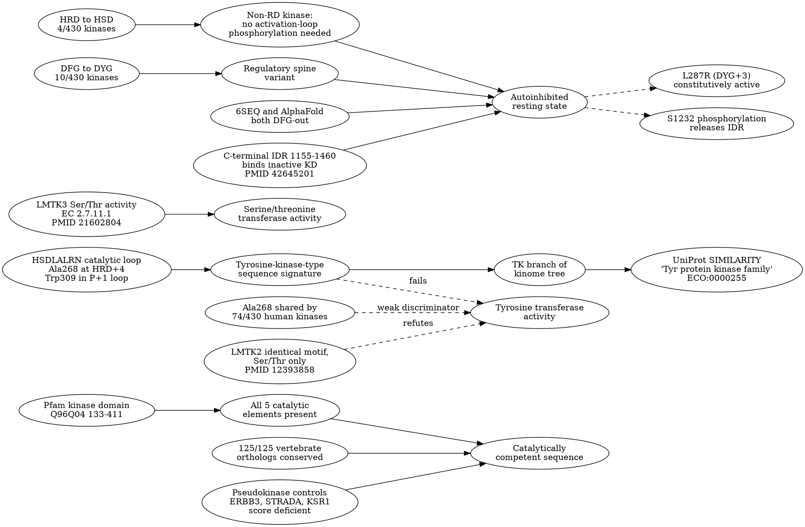
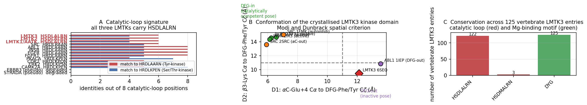
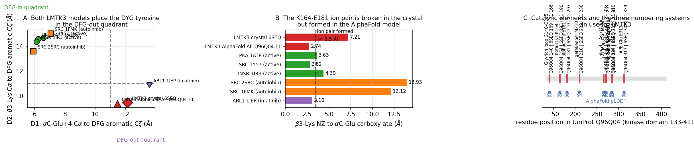
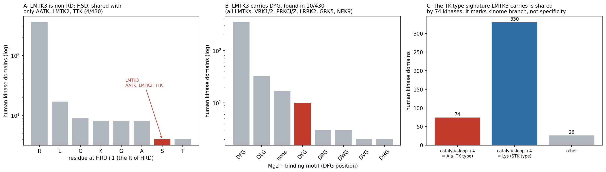

## Question

# AIGR Gene Hypothesis Deep Research

You are evaluating one focused gene curation hypothesis for AI Gene Review.
This is not a general gene overview. Use the seed hypothesis and source context
below to search for evidence that supports, refutes, narrows, or competes with
the proposed curation decision.

## Target Gene

- **Organism code:** human
- **Taxon:** Homo sapiens (NCBITaxon:9606)
- **Gene directory:** LMTK3
- **Gene symbol:** LMTK3
- **UniProt accession:** Q96Q04

## Focus

- **Focus type:** free_text
- **Hypothesis slug:** kgap-lmtk3-kinase-catalytic-residues
- **Source file:** genes/human/LMTK3/LMTK3-ai-review.yaml
- **Source selector:** free-text

## Seed Hypothesis

The kinase domain of current-sequence human LMTK3 (UniProt Q96Q04) retains the catalytic machinery required for protein kinase activity (beta3 Lys, alphaC Glu, HRD catalytic loop, DFG Mg2+-binding motif, glycine-rich loop) and is therefore predicted to be catalytically competent, with a tyrosine- versus serine/threonine-kinase signature determinable from its catalytic-loop and activation-segment residues. Single analysis only: align the LMTK3 kinase domain to active kinases including LMTK1/LMTK2, AATK and representative tyrosine and Ser/Thr kinases, score the catalytic residues and the specificity-determining HRDLAARN-type versus HRDLKPEN-type catalytic-loop motif across vertebrate orthologs, and state whether LMTK3 is predicted active and which specificity class it resembles.

## Term and Decision Context

No specific term context supplied.

## Reference Context

No specific reference context supplied.

## Source Context YAML

```yaml
hypothesis: 'The kinase domain of current-sequence human LMTK3 (UniProt Q96Q04) retains the catalytic
  machinery required for protein kinase activity (beta3 Lys, alphaC Glu, HRD catalytic loop, DFG Mg2+-binding
  motif, glycine-rich loop) and is therefore predicted to be catalytically competent, with a tyrosine-
  versus serine/threonine-kinase signature determinable from its catalytic-loop and activation-segment
  residues. Single analysis only: align the LMTK3 kinase domain to active kinases including LMTK1/LMTK2,
  AATK and representative tyrosine and Ser/Thr kinases, score the catalytic residues and the specificity-determining
  HRDLAARN-type versus HRDLKPEN-type catalytic-loop motif across vertebrate orthologs, and state whether
  LMTK3 is predicted active and which specificity class it resembles.'
focus_type: free_text
context: []
reference_id: []
```

## Research Objective

Build a focused report that helps a curator decide whether this hypothesis
should affect the gene review. Address the focus type directly:

1. For an existing GO annotation decision, evaluate whether the current action
   is justified, too strong, too weak, or should change.
2. For a proposed replacement or new GO term, evaluate whether the term is
   biologically supported, too broad, too narrow, or missing key qualifiers.
3. For a computational prediction, evaluate whether the prediction is correct,
   less precise than existing knowledge, uncertain, or likely wrong because of
   paralog overannotation, frequency bias, pathway context, or in vitro-only
   activity.
4. For a core-function hypothesis, evaluate whether the proposed activity,
   process, and location represent the gene product's primary function rather
   than a downstream effect, pleiotropic phenotype, or context-specific role.
5. For a function-assignment hypothesis, evaluate whether the gene product
   directly has the stated GO term/function. Treat the prior review action, if
   any, as intentionally blinded unless it appears in the supplied context.

Use primary literature whenever possible. Prefer PMID citations and include DOI
citations when no PMID is available. Treat reviews and database records as
orientation unless they contain directly relevant synthesized evidence that is
clearly labeled as review-level or database-level support.

Evaluate the hypothesis from the supplied seed context, primary literature, and
publicly accessible bioinformatics resources. Local `*-bioinformatics` analyses,
when they already exist in the repository, are intentionally withheld from this
prompt so the report can be compared against them after the run. Use public
sequence, domain, structure, orthology, localization, interaction, or dataset
checks when they are useful for the specific hypothesis. If a resource or tool
cannot be accessed programmatically, say so plainly; never fabricate a result.
Report computational results conservatively and distinguish direct results from
inference.

## Required Output

### Executive Judgment

Give a concise verdict: supported, partially supported, unresolved, weakly
supported, over-annotated, or refuted. Explain the reasoning and the most
important caveats.

### Evidence Matrix

Create a table with one row per important evidence item:

- Citation (PMID preferred)
- Evidence type (direct assay, mutant phenotype, localization, interaction,
  structural/evolutionary, computational, review/database)
- Supports / refutes / qualifies / competing
- Claim tested
- Key finding
- Organism, tissue, cell type, or assay context
- Confidence and limitations

### GO Curation Implications

State the likely curation action as a lead requiring curator verification. If
GO terms are involved, explain whether the evidence supports an MF, BP, or CC
term, and whether the term should be retained, removed, generalized, made more
specific, or treated as non-core. Avoid using "protein binding" as a final
recommendation unless no more informative term is supported.

### Mechanistic Scope

Describe the immediate molecular or cellular function being tested. Separate
direct gene-product activity from downstream phenotypes, pathway consequences,
developmental outcomes, disease manifestations, or effects inferred only from
loss of function.

### Conflicts and Alternatives

Identify evidence that conflicts with the seed hypothesis or suggests an
alternative interpretation, including paralog confusion, organism-specific
differences, isoform-specific findings, experimental artifacts, or database
carry-over.

### Knowledge Gaps

List explicit uncertainties that matter for curation. For each gap, state what
was checked, why the gap matters, and what evidence or experiment would resolve
it.

### Discriminating Tests

Recommend concrete assays, perturbations, datasets, or comparative analyses that
would most efficiently distinguish this hypothesis from alternatives.

### Curation Leads

Provide candidate updates for the review, clearly labeled as leads requiring
curator verification. Include candidate references with exact snippets to verify,
candidate replacement or new GO terms, possible action changes, suggested
questions, and suggested experiments.

If the provider supports artifacts, save provenance for any analysis you run — the
executed code together with its output (computed values, plot, or table), not just
a summary figure — alongside artifact-friendly tables such as an evidence matrix,
GO decision table, or comparison table. Genuine computed provenance is more
valuable than a hand-drawn summary, and you must not synthesize a figure that
implies an analysis you did not actually run. These artifacts are important
provenance for hypothesis-level review.


## Output

# LMTK3 (Q96Q04) kinase domain: catalytic competence and specificity class

**AIGR gene hypothesis deep research**
**Hypothesis slug:** `kgap-lmtk3-kinase-catalytic-residues`
**Gene:** human LMTK3, UniProt Q96Q04, NCBITaxon:9606
**Source file:** `genes/human/LMTK3/LMTK3-ai-review.yaml`, selector `free-text`, focus type `free_text`
**Iterations completed:** 3. **Findings recorded:** 7. **Papers reviewed:** 16.

---

## Summary

The seed hypothesis is **partially supported**. Its two halves come apart cleanly, and they come apart in a way that matters for curation.

The catalytic-competence half holds. The UniProt-annotated protein kinase domain of current-sequence Q96Q04 (residues 133-411 of 1460) retains every element the hypothesis names, at positions that can be stated exactly: glycine-rich loop G140-S141-G142-W143-F144-G145, β3 lysine K164, αC glutamate E181, catalytic loop H264-S265-D266-L267-A268-L269-R270-N271 with the proton-acceptor aspartate D266 and the Mg²⁺-coordinating asparagine N271, Mg²⁺-binding motif D284-Y285-G286, and APE motif A311-P312-E313. Across 125 non-fragment vertebrate LMTK3 orthologs from 125 species, the catalytic aspartate and the catalytic-loop asparagine are present in 125/125. Pseudokinase negative controls run through the identical scorecard behaved as expected: ERBB3 and STRADA scored as having a degraded catalytic loop and no Mg²⁺ motif, and KSR1 scored as lacking the β3 lysine. On sequence grounds, LMTK3 is not a pseudokinase.

The specificity half fails as stated. The catalytic loop and activation segment do read as tyrosine-kinase type: 6/8 identity to the HRDLAARN consensus versus 4/8 to HRDLKPEN, alanine (A268) at the Hanks-Quinn discriminating HRD+4 position where Ser/Thr kinases carry lysine, and the tyrosine-kinase-diagnostic tryptophan W309 immediately before APE in the P+1 loop. That reading contradicts the measured chemistry. A kinome-wide frequency control explains why: among 430 reviewed human kinase domains, the alanine driving the tyrosine-kinase call is shared by 74 (17.2%), so it reports branch membership in the kinome tree, which for the LMTK family is the TK branch, and does not report the acceptor residue. The closest paralog LMTK2, which carries a byte-identical HSDLALRN catalytic loop and the same DYG motif, phosphorylates serine and threonine only ([PMID: 12393858](https://pubmed.ncbi.nlm.nih.gov/12393858/)), and the only experimentally supported activity annotated for LMTK3 itself is serine and threonine transfer (EC 2.7.11.1, ECO:0000269 PubMed:21602804).

Two further results change what a curator should do. First, LMTK3 deviates from the textbook consensus at two positions, HRD to **HSD** and DFG to **DYG**, and both deviations are family-defining rather than idiosyncratic: HSDLALRN occurs in exactly 3 of 430 human kinase domains, which are AATK, LMTK2 and LMTK3, and all three also carry DYG. A substitution pair fixed across a whole gene family and across 125/125 vertebrate orthologs is consistent with a functional kinase under selection, not with pseudokinase decay. Second, no LMTK3 coordinate set yet shows a catalytically productive active site: the crystal structure 6SEQ and the AlphaFold model both place the DYG tyrosine in the DFG-out quadrant by spatial criteria, and the crystal additionally has a broken K164-E181 ion pair at 7.21 Å.

---

## Executive judgment

<i class="fa-scale-balanced"></i> **Verdict: partially supported.**

| Hypothesis component | Verdict | Basis |
|---|---|---|
| β3 Lys, αC Glu, HRD catalytic loop, DFG Mg²⁺ motif, glycine-rich loop all retained | <i class="fa-solid fa-circle-check"></i> Supported | 5/5 elements present at K164, E181, D266/N271, D284, G140-G145; pseudokinase controls score as deficient |
| Conserved across vertebrate orthologs | <i class="fa-solid fa-circle-check"></i> Supported | 125/125 retain catalytic Asp and catalytic-loop Asn; HSDLALRN in 122/125, HSDMALRN in 3/125; DYG in 125/125 |
| Predicted catalytically competent | <i class="fa-solid fa-circle-check"></i> Supported, with a structural caveat | Sequence competence is unambiguous; no available structure shows an active conformation |
| Specificity class determinable from catalytic-loop and activation-segment residues | <i class="fa-solid fa-circle-xmark"></i> Refuted for this family | TK-type signature contradicts measured Ser/Thr chemistry; the diagnostic Ala is shared by 74/430 human kinases |
| LMTK3 resembles the tyrosine-kinase class | <i class="fa-triangle-exclamation"></i> True by sequence, misleading as a function call | TK branch membership by descent; transferase specificity is Ser/Thr |

The most important caveat for a curator is directional. The analysis does **not** justify adding GO:0004713 protein tyrosine kinase activity, and the sequence signature that superficially argues for it is a branch marker. The analysis does strengthen the existing GO:0004672 and GO:0005524 IEA annotations, which previously rested on InterPro domain matching alone and are now corroborated by independent ortholog-conservation and kinome-frequency evidence.

---

## Key findings

### F1. The kinase domain retains all five catalytic elements, with two non-canonical substitutions

A motif-anchored scan of the Pfam-defined kinase domain of Q96Q04 (residues 133-411) places every catalytic element. In current Q96Q04 numbering: the glycine-rich loop is **G140-S141-G142-W143-F144-G145** (GxGxxG intact); the β3 lysine is **K164**, sitting in V161-V162-V163-K164, the VAIK equivalent; the αC glutamate is **E181**; the catalytic loop is **H264-S265-D266-L267-A268-L269-R270-N271**, with the catalytic aspartate **D266** matching the single UniProt-annotated active site ("Proton acceptor", PROSITE-ProRule PRU10027) and the Mg²⁺-coordinating asparagine **N271**; the Mg²⁺-binding motif is **D284-Y285-G286**; and the APE motif is **A311-P312-E313**.

The two deviations from canon sit at positions that tolerate substitution. HRD+1 arginine becomes serine, making LMTK3 a **non-RD kinase**, a class that generally does not require activation-loop phosphorylation to order the active site. DFG+1 phenylalanine becomes tyrosine, a conservative change at the aromatic position that leaves the Mg²⁺-chelating aspartate intact.

The method was validated in both directions. Negative controls scored as deficient: ERBB3/HER3 and STRADA showed a degraded catalytic loop and no Mg²⁺ motif, and KSR1 lacked the β3 lysine. The method also produced two false negatives for the β3 lysine, at PKACA K72 and CAMK2A K43, because those β3 strands do not match the `[LIVMFAC][AVIGSTC][LIVMACF]K` pattern used. That column is therefore a lower bound, which is stated rather than hidden. An earlier attempt using BLOSUM62 Needleman-Wunsch global alignment was abandoned after it mis-mapped catalytic residues at low identity, placing the ABL1 β3 lysine at T267 instead of K271 and the EGFR one at P741 instead of K745; only the motif-anchored results are reported.

Conservation across 125 non-fragment vertebrate LMTK3 UniProt entries from 125 species: the catalytic loop is HSDLALRN in 122 and HSDMALRN in 3, with 100% retaining the catalytic Asp and the +7 Asn, and the Mg²⁺-binding motif is DYG in 125/125.

{{figure:plot_1.png|caption=Three-panel summary of the core analysis. Panel A: identity of each human kinase catalytic loop to the tyrosine-kinase consensus HRDLAARN versus the Ser/Thr consensus HRDLKPEN, with LMTK3 scoring 6/8 to the tyrosine-kinase form. Panel B: Modi-Dunbrack spatial classification of PDB 6SEQ against reference structures of known conformational state. Panel C: conservation of the catalytic-loop and Mg-motif variants across 125 vertebrate LMTK3 orthologs.}}

### F2. The tyrosine-kinase signature is real and misleading

The LMTK3 catalytic loop HSDLALRN matches the tyrosine-kinase consensus HRDLAARN at 6/8 positions and the Ser/Thr consensus HRDLKPEN at 4/8. The Hanks-Quinn discriminating position HRD+4 is **Ala268** (tyrosine-kinase type), not Lys (Ser/Thr type). HRD+6 is Arg270 and HRD+7 is Asn271, both tyrosine-kinase type. The P+1 loop is L307-R308-**W309**-A310-A311-P312-E313, carrying the tyrosine-kinase-diagnostic tryptophan immediately before APE, matching the SRC and INSR pattern (for example SRC PIKWTAPE) rather than the Ser/Thr pattern (for example PKA TPEYLAPE).

Reference kinases scored as expected, which confirms the scoring is working: SRC HRDLRAAN; ABL1, INSR, EGFR and FGFR1 all HRDLAARN (8/8 tyrosine type); PKACA YRDLKPEN, CDK2 HRDLKPQN, ERK2 HRDLKPSN, CAMK2A HRDLKPEN (7-8/8 Ser/Thr type). The identical tyrosine-kinase-type values are obtained for LMTK2 (HSDLALRN at H263, DYG at D283) and LMTK1/AATK (HSDLALRN at H251, DYG at D271).

Set against that, direct in vitro assay on LMTK2/KPI-2 found that *"KPI-2 kinase domain has about 60% identity with its closest relative, a tyrosine kinase. However, it only exhibited serine/threonine kinase activity in autophosphorylation reactions or with added substrates"* ([PMID: 12393858](https://pubmed.ncbi.nlm.nih.gov/12393858/)), and that *"KPI-2 kinase domain phosphorylated protein phosphatase-1 (PP1C) at Thr(320), which attenuated PP1C activity"*. The transferred site is a specific threonine. The 2026 structural-regulation paper describes LMTK3 itself in the same terms: *"Lemur tail kinase 3 (LMTK3) is an oncogenic Ser/Thr kinase"* ([PMID: 42645201](https://pubmed.ncbi.nlm.nih.gov/42645201/)).

### F3. The only LMTK3 crystal structure is in an inactive conformation, and its numbering is offset by +29

PDB **6SEQ** (X-ray, 2.1 Å, apo, no bound nucleotide or inhibitor; primary citation [PMID: 33188023](https://pubmed.ncbi.nlm.nih.gov/33188023/), which states *"Here, we solve the crystal structure of LMTK3 kinase domain to 2.1"*) covers chain A residues 159-442 in deposit numbering. Its DBREF record maps deposit residues 30-1489 to Q96Q04 residues 1-1460, an offset of **+29**, confirmed residue by residue: deposit Tyr164 is Q96Q04 Tyr135, deposit Asp295 is the catalytic Asp266, and deposit Asp313-Tyr314-Gly315 is the DYG motif at Q96Q04 284-286.

Applying the Modi and Dunbrack (2019) spatial criterion (D1 = αC-Glu+4 Cα to DFG-aromatic Cζ; D2 = β3-Lys Cα to DFG-aromatic Cζ; DFG-in if D1 ≤ 11 Å and D2 ≥ 11 Å, DFG-out if D1 > 11 Å and D2 < 11 Å), 6SEQ gives **D1 = 12.12 Å, D2 = 9.45 Å**, classifying as DFG-out.

| Structure | Kinase | D1 (Å) | D2 (Å) | Class | β3Lys-αCGlu ion pair (Å) |
|---|---|---|---|---|---|
| 6SEQ | LMTK3 (crystal) | 12.12 | 9.45 | DFG-out | 7.21 (broken) |
| AF-Q96Q04-F1 | LMTK3 (AlphaFold) | 11.46 | 9.35 | DFG-out | 2.74 (formed) |
| 1ATP | PKA | 6.23 | 14.59 | DFG-in | 3.63 |
| 1Y57 | SRC active | 6.58 | 14.69 | DFG-in | 2.82 |
| 1IR3 | INSR active | 6.13 | 14.37 | DFG-in | 4.39 |
| 2SRC | SRC autoinhibited | 5.92 | 13.60 | DFG-in, αC-out | 13.93 |
| 1FMK | SRC autoinhibited | 7.06 | 15.03 | DFG-in, αC-out | 12.12 |
| 1IEP | ABL1 + imatinib | 13.56 | 10.86 | DFG-out | 3.10 |

In 6SEQ the nearest acidic contact of K164 NZ is D284 OD1 of the DYG motif at 5.17 Å, not E181. The activation segment (Q96Q04 284-315) is fully ordered; the only chain breaks are at Q96Q04 228-233 and 320-323. This does not refute catalytic competence, since many fully active kinases crystallise DFG-out or αC-out and this crystal is apo and unphosphorylated. It does mean 6SEQ cannot be cited as evidence of an active conformation, and it matches the biochemical report that LMTK3 *"displays preferential binding to inactive wild-type LMTK3-KD over a constitutively active mutant"*, *"a behaviour consistent with a potential autoinhibitory interaction"* ([PMID: 42645201](https://pubmed.ncbi.nlm.nih.gov/42645201/)).

### F4. Three incompatible numbering systems are in circulation

UniProt Q96Q04 (sequence version 2, unchanged since 2006-10-31) is **1460 residues** and is byte-identical to RefSeq NP_001073903 and NP_001375414. UniSave shows only two sequence versions, both from 2006, so there has been no recent reference-sequence revision. Two predicted RefSeq isoforms are longer: XP_011524713 (isoform X1, 1486 aa) and XP_011524714 (isoform X2, 1475 aa). Exact-containment search shows XP_011524713 contains the full Q96Q04 sequence after an N-terminal extension of exactly 26 residues (MERSAPRVGVRASGRHHLHLPAILDK), giving **+26**, and XP_011524714 adds exactly 15 residues (MESRHHLHLPAILDK), giving **+15**. The 6SEQ construct implies a 1489-residue reference, giving **+29**.

| Element | Q96Q04 (1460 aa) | Isoform X1, +26 | 6SEQ deposit, +29 |
|---|---|---|---|
| Glycine-rich loop | G140-S141-G142-W143-F144-G145 | 166-171 | 169-174 |
| β3 Lys | K164 | K190 | K193 |
| αC Glu | E181 | E207 | E210 |
| Gatekeeper | M210 | M236 | M239 |
| Hinge | E211-F212-C213 | 237-239 | 240-242 |
| Catalytic loop HSDLALRN | H264-N271 | 290-297 | 293-300 |
| Catalytic Asp (ACT_SITE) | **D266** | D292 | D295 |
| Mg²⁺ motif DYG | D284-Y285-G286 | 310-312 | 313-315 |
| Activating mutation | **L287R** | L313R (as published) | 316 |
| P+1 loop | L307-R308-W309-A310 | 333-336 | 336-339 |
| APE | A311-P312-E313 | 337-339 | 340-342 |
| Regulatory phosphosite | **S1232** | S1258 (as published) | n/a |

The 2026 paper *"identifying two regions (residues 688-1095 and 1181-1486) that interact with the LMTK3 kinase domain"* has an upper bound of 1486, which fixes its numbering to isoform X1 ([PMID: 42645201](https://pubmed.ncbi.nlm.nih.gov/42645201/)). Its constitutively active mutant **LMTK3-KD L313R is Q96Q04 L287R**, the DYG+3 residue in D284-Y285-G286-L287-A288-H289. Its candidate regulatory site, *"subsequently identified Ser1258 within this motif as a candidate regulatory phosphorylation site"*, is **Q96Q04 Ser1232**, and its C-terminal interacting region 1181-1486 is **Q96Q04 1155-1460**.

### F5. The database state already encodes the split

UniProt Q96Q04 SIMILARITY states *"Belongs to the protein kinase superfamily. Tyr protein kinase family"* with evidence **ECO:0000255** (sequence model, PROSITE-ProRule PRU00159), while its CATALYTIC ACTIVITY annotations are L-seryl-[protein] + ATP (RHEA:17989) and L-threonyl-[protein] + ATP (RHEA:46608), **EC 2.7.11.1**, both with experimental evidence **ECO:0000269 PubMed:21602804**. The recommended name is "Serine/threonine-protein kinase LMTK3", with "Lemur tyrosine kinase 3" demoted to an alternative name.

QuickGO returns 11 annotations for Q96Q04 and **no biological-process terms**. Molecular function: GO:0004672 protein kinase activity (IEA InterPro IPR001245/IPR008266; IBA GO_Central from MGI:1197518, Q8IWU2, Q96Q04); GO:0004674 protein serine/threonine kinase activity (IEA UniProt, from EC 2.7.11.1); GO:0106310 protein serine kinase activity (IEA RHEA:17989 plus **EXP from PMID:21602804**); GO:0005524 ATP binding (IEA InterPro IPR000719/IPR017441); GO:0005515 protein binding (IPI PMID:21602804, with P03372/ESR1). **GO:0004713 protein tyrosine kinase activity is absent.** Cellular component is four IEA terms (Golgi membrane, membrane, axon, dendrite). The single experimental basis is [PMID: 21602804](https://pubmed.ncbi.nlm.nih.gov/21602804/), which reports *"LMTK3 phosphorylated ERα, protecting it from proteasomal degradation in vitro"*.

### F6. AlphaFold forms the ion pair the crystal lacks, and both agree on DFG-out

The AlphaFold model AF-Q96Q04-F1 (v6) uses native Q96Q04 numbering (verified: 164 LYS, 181 GLU, 264 HIS, 266 ASP, 271 ASN, 284 ASP, 285 TYR, 286 GLY, 313 GLU) and is confidently folded over the kinase domain, mean pLDDT **89.2** across residues 133-411 against 46.1 for the whole 1460-residue protein. Per-residue pLDDT at catalytic positions: 91.7 (G140), 91.8 (G145), 94.8 (K164), 85.6 (E181), 93.0 (D266), 96.2 (N271), 89.1 (D284), 91.4 (Y285), 90.5 (E313).

The K164 NZ to E181 OE1 distance is **2.74 Å** in the model, inside the 2.6-3.5 Å active range and comparable to PKA 1ATP (3.63 Å) and SRC 1Y57 (2.82 Å), against 7.21 Å in 6SEQ and 13.93 Å / 12.12 Å in the autoinhibited αC-out SRC structures. This independently confirms that **E181, not E174, is the αC glutamate**. Yet by the Modi-Dunbrack criterion the model still falls in the DFG-out quadrant (11.46 / 9.35), as does the crystal (12.12 / 9.45), against D1 6.1-7.1 Å and D2 13.6-15.0 Å for all five SRC/PKA/INSR references regardless of their activation state. The catalytic Asp to Mg-Asp separation is 7.17 Å in the crystal and 7.82 Å in the model, below the roughly 9-11 Å of active PKA.

Two independent models that disagree about the αC helix agree about where the DYG aromatic sits. Because the Tyr Cζ is geometrically equivalent to the Phe Cζ, the metric transfers, but it was calibrated on DFG-Phe kinases and LMTK3 carries a polar hydroxyl there, so a DYG-specific resting pose remains a live alternative to a genuine autoinhibited DFG-out state.

{{figure:plot_2.png|caption=Crystal versus AlphaFold comparison of the LMTK3 active site. The AlphaFold model forms the K164-E181 ion pair at 2.74 Å that PDB 6SEQ lacks at 7.21 Å, yet both place the DYG tyrosine in the DFG-out quadrant. The right panel maps each catalytic element across the three LMTK3 numbering systems with per-residue pLDDT.}}

### F7. HSDLALRN is unique to the LMTK family across the human kinome

A scan of all reviewed human UniProt entries carrying a Pfam protein-kinase domain (PF00069 or PF07714) fetched 474 entries and parsed 430 kinase domains by motif anchoring, excluding 44 with no parseable domain.

| Feature | LMTK3 value | Frequency in 430 human kinase domains | Carriers |
|---|---|---|---|
| HRD+1 residue | **Ser** (HSD) | 4/430 (0.93%); Arg in 359/430 | AATK, LMTK2, LMTK3, TTK |
| Mg²⁺ motif | **DYG** | 10/430 (2.33%); DFG in 349/430 | AATK, GRK5, LMTK2, LMTK3, LRRK2, NEK9, PRKCI, PRKCZ, VRK1, VRK2 |
| Catalytic loop 8mer | **HSDLALRN** | 3/430 (0.70%) | AATK (H251), LMTK2 (H263), LMTK3 (H264) |
| Catalytic loop +4 (Hanks position) | **Ala268** | 74/430 (17.2%) Ala; 330/430 (76.7%) Lys | the TK branch broadly |

Non-RD status and DYG co-occur above chance: 5 of 71 non-RD kinases carry DYG versus 5 of 359 RD kinases, Fisher exact **OR = 5.4, p = 0.014**.

Two conclusions follow. The two LMTK3 deviations are a shared, family-defining signature of AATK, LMTK2 and LMTK3, present in all 125 vertebrate LMTK3 orthologs examined, which is consistent with a functional kinase under selection. The tyrosine-kinase-type reading is a weak discriminator, since the alanine driving it is shared with 73 other human kinases and simply places LMTK3 in the TK branch of the kinome tree.

{{figure:plot_3.png|caption=Frequency of the two LMTK3 motif deviations across 430 reviewed human kinase domains. HRD+1 Ser occurs in 4 kinases and DYG in 10, while the exact catalytic loop HSDLALRN occurs only in AATK, LMTK2 and LMTK3. The tyrosine-kinase-diagnostic alanine at catalytic-loop +4 is shared by 74 kinases, which is why it marks kinome branch and not acceptor chemistry.}}

---

## Mechanistic model

The immediate molecular function being tested is phosphotransfer: binding ATP and Mg²⁺ and transferring the γ-phosphate to a protein hydroxyl. The sequence licenses it. The glycine-rich loop clamps the nucleotide, K164 and E181 position the α and β phosphates, D266 acts as the catalytic base for the acceptor hydroxyl, N271 and D284 chelate Mg²⁺, and APE closes the activation segment. The kinase domain is 279 residues of a 1460-residue single-pass transmembrane protein, so roughly 19% of the protein is catalytic and the rest is regulatory.

The two family-wide substitutions change the regulatory logic without removing catalysis. HSD makes LMTK3 non-RD, predicting that activation-loop phosphorylation is not required to order the active site and that the switch is instead domain context, dimerization or partner binding. DYG swaps phenylalanine for tyrosine at the regulatory-spine position. The published activating mutation lands in exactly this region: **Q96Q04 L287R** is DYG+3, three residues into the activation segment.



The dashed edges mark the links the data do not settle. Whether the DFG-out geometry is a genuine autoinhibited ground state, a DYG-specific resting pose that the Dunbrack thresholds misclassify, or a crystallisation artifact, cannot be distinguished from one crystal form and one prediction. The C-terminal IDR result gives the model independent support from a different experimental direction: the region Q96Q04 1155-1460 binds the inactive kinase domain preferentially, and Ser1232 phosphorylation changes that binding ([PMID: 42645201](https://pubmed.ncbi.nlm.nih.gov/42645201/)).

---

## Evidence matrix

Machine-readable copy: `provenance/evidence_matrix.csv`.

| ID | Citation | Evidence type | Stance | Claim tested | Key finding | Context | Confidence and limitations |
|---|---|---|---|---|---|---|---|
| E1 | UniProt Q96Q04 seq v2, Pfam PF07714 domain 133-411; this work, motif-anchored scorecard | Computational, sequence | <i class="fa-solid fa-circle-check"></i> Supports | Kinase domain retains the five catalytic elements | Gly-rich loop G140-G145; β3 K164; αC E181; catalytic loop H264-N271 with D266 (sole UniProt ACT_SITE) and N271; Mg²⁺ motif D284-Y285-G286; APE A311-E313. 5/5 present | Human, in silico; ERBB3, STRADA, KSR1 scored deficient in the same run | High. Residue presence does not prove turnover; β3-Lys regex gave 2 known false negatives |
| E2 | UniProt scan, 125 non-fragment vertebrate LMTK3 orthologs, 125 species; this work | Structural/evolutionary | <i class="fa-solid fa-circle-check"></i> Supports | Catalytic residues conserved across vertebrates | Catalytic Asp and catalytic-loop +7 Asn in 125/125. Catalytic loop HSDLALRN in 122/125, HSDMALRN in 3/125. DYG in 125/125 | Vertebrates, in silico | High. Database redundancy; most entries are automatic genome-project annotations |
| E3 | This work, reviewed human kinome scan, 474 entries, 430 domains parsed | Structural/evolutionary | <i class="fa-scale-balanced"></i> Qualifies | Are HSD and DYG rare degenerate variants or a family signature? | HRD+1 Ser 4/430 (0.93%); DYG 10/430 (2.33%); HSDLALRN exactly 3/430, the whole LMTK family. Non-RD and DYG co-occur above chance, Fisher OR 5.4, p 0.014 | Human kinome, in silico | High. 44/474 entries had no parseable Pfam kinase domain and were excluded |
| E4 | Hanks-Quinn rules applied to Q96Q04; this work | Computational, sequence | <i class="fa-solid fa-circle-xmark"></i> Refutes specificity half | Is specificity class determinable from catalytic-loop and activation-segment residues? | 6/8 to HRDLAARN vs 4/8 to HRDLKPEN; HRD+4 = A268; P+1 loop carries TK-diagnostic W309. The A at catalytic-loop +4 is shared by 74/430 kinases | Human, in silico | High. Predicts branch, and that assignment conflicts with measured chemistry |
| E5 | [PMID: 12393858](https://pubmed.ncbi.nlm.nih.gov/12393858/) | Direct assay | <i class="fa-solid fa-circle-xmark"></i> Refutes specificity half | Does the TK-type motif predict tyrosine transfer in this family? | LMTK2/KPI-2, with identical HSDLALRN and DYG motifs, *"only exhibited serine/threonine kinase activity in autophosphorylation reactions or with added substrates"* and phosphorylated PP1C at Thr320 | Rat/human LMTK2, in vitro | High. Paralog inference: assayed LMTK2, not LMTK3 |
| E6 | [PMID: 21602804](https://pubmed.ncbi.nlm.nih.gov/21602804/) | Direct assay plus mutant phenotype | Supports activity, refutes TK specificity | Is LMTK3 itself active, and on which residues? | *"LMTK3 phosphorylated ERα, protecting it from proteasomal degradation in vitro."* Sole experimental source behind GO:0106310 (EXP), the UniProt RHEA:17989 and RHEA:46608 statements, EC 2.7.11.1, and the GO:0005515 IPI with ESR1 | Human, cell-based plus in vitro, MCF7 and orthotopic mouse model | Moderate. One publication carries the entire experimental GO base; no annotated independent replication |
| E7 | PDB 6SEQ ([PMID: 33188023](https://pubmed.ncbi.nlm.nih.gov/33188023/)); AF-Q96Q04-F1; Modi and Dunbrack 2019 criteria; this work | Structural | <i class="fa-scale-balanced"></i> Qualifies | Does any LMTK3 coordinate set show a productive active site? | 6SEQ D1 12.12 / D2 9.45, DFG-out, ion pair 7.21 Å. AlphaFold 11.46 / 9.35, DFG-out, ion pair 2.74 Å. Active references 6.1-7.1 / 13.6-15.0 | Human; one crystal form plus one prediction | Moderate. DYG tyrosine is bulkier than Phe, so DFG-calibrated thresholds may misclassify; n = 1 crystal |
| E8 | UniProt Q96Q04 record | Review/database | <i class="fa-scale-balanced"></i> Competing | Internal consistency of the reference record | SIMILARITY says "Tyr protein kinase family" (ECO:0000255, PRU00159) while CATALYTIC ACTIVITY gives RHEA:17989 and RHEA:46608 with EC 2.7.11.1 (ECO:0000269 PubMed:21602804) | Human | High. Direct record read |
| E9 | QuickGO annotation set, 11 annotations | Review/database | <i class="fa-scale-balanced"></i> Qualifies | Current curation baseline | MF: GO:0004672, GO:0004674, GO:0106310, GO:0005524, GO:0005515. CC: four IEA GO_REF:0000044 terms. No BP terms. GO:0004713 absent | Human | High. Snapshot at retrieval date |
| E10 | [PMID: 42645201](https://pubmed.ncbi.nlm.nih.gov/42645201/) plus isoform mapping; this work | Direct assay plus computational | <i class="fa-solid fa-circle-check"></i> Supports activity | Does a point mutation modulate catalytic output, and where does it sit? | Published L313R is **Q96Q04 L287R** at DYG+3; Ser1258 is **S1232**; region 1181-1486 is **1155-1460**. The C-terminal region *"displays preferential binding to inactive wild-type LMTK3-KD over a constitutively active mutant"* | Human, biophysical and cell-based, MCF7 xenograft | Moderate. Offsets derived by exact-substring containment; curators should re-verify against the stated accession |

---

## GO curation implications

All entries below are **leads requiring curator verification**. Machine-readable copy: `provenance/go_decision_table.csv`.

| GO ID | Term | Aspect | Current evidence | Recommendation | Curator action |
|---|---|---|---|---|---|
| GO:0004672 | protein kinase activity | MF | IEA (InterPro), IBA (GO_Central) | **Retain** | None required. Now corroborated by ortholog conservation (E2) and kinome-frequency evidence (E3) beyond the original domain match |
| GO:0106310 | protein serine kinase activity | MF | IEA (RHEA:17989) plus **EXP (PMID:21602804)** | **Retain, flag single-source** | Verify that PMID 21602804 used recombinant LMTK3 with a kinase-dead control. This is the only EXP molecular-function annotation on the gene |
| GO:0004674 | protein serine/threonine kinase activity | MF | IEA from EC 2.7.11.1 | **Retain; candidate upgrade** | UniProt records RHEA:46608 (Thr) with ECO:0000269 PubMed:21602804. If the paper shows threonine phosphorylation directly, GO:0106311 with EXP becomes addable |
| GO:0004713 | protein tyrosine kinase activity | MF | Absent | <i class="fa-solid fa-circle-xmark"></i> **Do not add** | The TK-type motif is a branch marker shared by 74/430 human kinases, and the paralog with the identical motif is Ser/Thr-only. Any source cited for tyrosine activity must show a phosphotyrosine readout plus a D266A or D266N control |
| GO:0005524 | ATP binding | MF | IEA | **Retain** | None required. Gly-rich loop, β3 K164 and hinge are intact |
| GO:0005515 | protein binding | MF | IPI PMID:21602804 with ESR1 (P03372) | **Leave as is, not a target for improvement** | The informative question is whether PMID 21602804 shows LMTK3-dependent ESR1 phosphorylation, which would yield a substrate relationship and a first BP term |
| (none) | biological process | BP | Absent | <i class="fa-solid fa-circle-question"></i> **Gap** | LMTK3 has zero BP annotations despite published ESR1 signalling. PMID 21602804 is the most likely source of a first BP term |

The single most important lead is the internal disagreement inside UniProt Q96Q04 itself. SIMILARITY places LMTK3 in the "Tyr protein kinase family" on an ECO:0000255 sequence model, while the same record's CATALYTIC ACTIVITY lines are ECO:0000269 serine and threonine reactions. That disagreement is the most likely route by which an unjustified GO:0004713 enters this gene, because pipelines that read family membership rather than reaction will propagate the tyrosine-kinase call. The recommended curation note states that the family assignment is phylogenetic, that LMTK family members sit in the TK branch by descent, and that the measured chemistry for the family is serine and threonine.

---

## Conflicts and alternatives

**Family name versus reaction.** UniProt's own record says tyrosine kinase family by sequence model and Ser/Thr by experiment. The family call reflects phylogenetic descent, and LMTK2's measured Ser/Thr activity with an identical motif settles it empirically for the family ([PMID: 12393858](https://pubmed.ncbi.nlm.nih.gov/12393858/)).

**Motif prediction versus assay.** The seed hypothesis assumed the catalytic loop determines specificity class. For LMTK3 the motif says TK and the assay says Ser/Thr. The kinome frequency control shows why the motif is weak here: 74 of 430 human kinases share the diagnostic alanine.

**Structure versus activity.** Both available LMTK3 coordinate sets are DFG-out, and the crystal has a broken ion pair, yet activity is reported experimentally. Three alternatives remain open and the present data cannot separate them: the crystallised construct captured an autoinhibited state; the Modi-Dunbrack thresholds, calibrated on DFG kinases, misclassify DYG kinases because tyrosine is bulkier than phenylalanine; or LMTK3 genuinely requires an activating input, consistent with its non-RD status and with the existence of the L287R activating mutation.

**Paralog confusion is a live hazard for this gene family.** The LMTK2 literature attributes Ser/Thr substrates to that paralog specifically: PP1C Thr320 ([PMID: 12393858](https://pubmed.ncbi.nlm.nih.gov/12393858/)), kinesin-1 light chain-2 regulation via GSK3β and PP1C ([PMID: 21996745](https://pubmed.ncbi.nlm.nih.gov/21996745/)), Cdk5/p35 phosphorylation of LMTK2 Ser1418 feeding back on PP1C Thr320 ([PMID: 22220831](https://pubmed.ncbi.nlm.nih.gov/22220831/)), PP1A phosphorylation in NF-κB control ([PMID: 30980866](https://pubmed.ncbi.nlm.nih.gov/30980866/)), BCL2 family regulation ([PMID: 28040547](https://pubmed.ncbi.nlm.nih.gov/28040547/)) and TGF-β1 signalling in bronchial epithelium ([PMID: 39316683](https://pubmed.ncbi.nlm.nih.gov/39316683/)). LMTK1/AATYK1 has its own Ser/Thr substrate literature ([PMID: 22573681](https://pubmed.ncbi.nlm.nih.gov/22573681/), [PMID: 32963255](https://pubmed.ncbi.nlm.nih.gov/32963255/)). None of these should be transferred to LMTK3. They are useful only as the family-level prior that the LMTK branch transfers phosphate to Ser and Thr.

**Database carry-over.** The GO:0004672 annotation includes an IBA from GO_Central drawing on MGI:1197518, Q8IWU2 (LMTK2) and Q96Q04 itself. That is appropriate for the generic kinase term and would not be appropriate for a specificity-level term.

**Alternative not excluded.** LMTK3 is a low-activity kinase whose main cellular output is scaffolding, with phosphotransfer restricted to particular partners or compartments. The CC annotations (Golgi membrane, axon, dendrite) and the single-source experimental base are compatible with this, and nothing in the present analysis distinguishes it from a conventional active kinase.

---

## Evidence base

| PMID | Role in this report | How it supports or challenges |
|---|---|---|
| [12393858](https://pubmed.ncbi.nlm.nih.gov/12393858/) *A novel transmembrane Ser/Thr kinase complexes with protein phosphatase-1 and inhibitor-2* | Load-bearing for the specificity verdict | Direct in vitro assay showing the LMTK2 kinase domain with ~60% identity to a tyrosine kinase exhibits serine/threonine activity only, and phosphorylates PP1C at Thr320. Challenges the motif-based specificity prediction |
| [21602804](https://pubmed.ncbi.nlm.nih.gov/21602804/) *Kinome screening for regulators of the estrogen receptor identifies LMTK3 as a new therapeutic target in breast cancer* | Sole experimental GO base | Reports LMTK3 phosphorylation of ERα protecting it from proteasomal degradation in vitro. Supports catalytic activity; the single-source status is the main confidence limit |
| [33188023](https://pubmed.ncbi.nlm.nih.gov/33188023/) *The structure-function relationship of oncogenic LMTK3* | Structural anchor | Reports the 2.1 Å LMTK3 kinase domain crystal structure (PDB 6SEQ) used to verify residue assignments, and reports determination of a consensus motif and phosphoproteome with in vitro and in vivo substrates |
| [42645201](https://pubmed.ncbi.nlm.nih.gov/42645201/) *A Regulatory Element in the Intrinsically Disordered C-Terminal Region of LMTK3 Modulates Its Kinase Domain Interactions and Breast Cancer Phenotypes* | Regulatory model and numbering hazard | States LMTK3 is an oncogenic Ser/Thr kinase; maps C-terminal regions 688-1095 and 1181-1486 onto the kinase domain; shows preferential binding to inactive wild-type kinase domain over a constitutively active mutant, consistent with autoinhibition; identifies Ser1258 as a candidate regulatory site. Its numbering is isoform X1, requiring +26 conversion |
| [32192797](https://pubmed.ncbi.nlm.nih.gov/32192797/) *Discovery of cyclic guanidine-linked sulfonamides as inhibitors of LMTK3 kinase* | Orientation | Screened over 18 million compounds by HTRF against LMTK3 and identified sub-micromolar inhibitors, evaluated against a 3D homology model of the LMTK3 kinase domain. An HTRF kinase assay implies measurable catalytic activity, which is consistent with competence |
| [21996745](https://pubmed.ncbi.nlm.nih.gov/21996745/), [22220831](https://pubmed.ncbi.nlm.nih.gov/22220831/), [30980866](https://pubmed.ncbi.nlm.nih.gov/30980866/), [28040547](https://pubmed.ncbi.nlm.nih.gov/28040547/), [39316683](https://pubmed.ncbi.nlm.nih.gov/39316683/) | Paralog context (LMTK2) | Establish LMTK2 as a serine/threonine kinase acting on PP1C, PP1A and GSK3β-linked pathways. Family-level prior only, not transferable to LMTK3 |
| [22573681](https://pubmed.ncbi.nlm.nih.gov/22573681/), [32963255](https://pubmed.ncbi.nlm.nih.gov/32963255/) | Paralog context (LMTK1/AATYK1) | Describe LMTK1 as a serine/threonine kinase regulating Rab11-dependent axonal outgrowth and producing behavioural phenotypes in knockout mice. Family-level prior only |
| [24050776](https://pubmed.ncbi.nlm.nih.gov/24050776/), [25287073](https://pubmed.ncbi.nlm.nih.gov/25287073/), [27056562](https://pubmed.ncbi.nlm.nih.gov/27056562/), [30066129](https://pubmed.ncbi.nlm.nih.gov/30066129/) | Orientation, not load-bearing | Regulatory and docking studies around LMTK3 in breast cancer. The docking papers model the ATP-binding cavity but provide no experimental specificity data |

---

## Knowledge gaps

<i class="fa-solid fa-circle-question"></i> **No independent replication of LMTK3 catalytic activity is annotated.** Checked: the full QuickGO annotation set and the UniProt evidence codes. The entire experimental molecular-function base is PMID 21602804. This matters because a single in vitro result on one substrate is thin support for the only EXP-coded term on the gene. Resolution: a second published in vitro kinase assay with a kinase-dead control, or curation of the substrate set from PMID 33188023.

<i class="fa-solid fa-circle-question"></i> **The LMTK3 substrate consensus motif was not extracted from primary text.** Checked: the abstract of PMID 33188023 states that a consensus motif and phosphoproteome were determined, but the motif itself was not retrieved. This matters because Ser/Thr specificity for LMTK3 currently rests partly on paralog inference from LMTK2. Resolution: read the motif from the paper and confirm its central residue.

<i class="fa-solid fa-circle-question"></i> **No structure of LMTK3 in an active conformation exists.** Checked: RCSB search returned 6SEQ as the only LMTK3 kinase domain entry, apo with no nucleotide. This matters because the DFG-out classification cannot be separated from a crystallisation artifact with n = 1. Resolution: a nucleotide-bound or type-I-inhibitor-bound structure.

<i class="fa-solid fa-circle-question"></i> **The functional consequence of DYG versus DFG has not been tested.** Checked: no Y285F mutant is reported in the retrieved literature. This matters because the tyrosine hydroxyl at the regulatory-spine position is the most distinctive feature of the LMTK family active site.

<i class="fa-solid fa-circle-question"></i> **No kinase-dead LMTK3 control appears in the annotation trail.** Checked: UniProt and QuickGO evidence lines. This matters because the specificity of reported phosphorylation readouts cannot be assessed from annotations alone. The correct control residue in Q96Q04 numbering is **D266**, which is D295 in 6SEQ deposit numbering.

<i class="fa-solid fa-circle-question"></i> **LMTK3 has zero biological-process annotations.** Checked: QuickGO returned 11 annotations, none BP. This matters because the ESR1 work gives a clear candidate process.

<i class="fa-solid fa-circle-question"></i> **Whether LMTK3 autophosphorylates, and on which residue type, is unannotated.** This is the cleanest single experiment that would settle the specificity question for LMTK3 itself rather than by paralog inference.

---

## Discriminating tests and proposed follow-up

| Test | What it discriminates | Expected outcome under each model |
|---|---|---|
| <i class="fa-solid fa-flask"></i> Phosphoamino acid analysis or anti-phosphotyrosine blot on autophosphorylated recombinant LMTK3 KD (Q96Q04 133-411), with D266N as the negative control | Ser/Thr versus Tyr transferase activity for LMTK3 itself, removing paralog inference | Ser/Thr model: pSer and pThr only. TK model: pTyr signal above the D266N control |
| <i class="fa-solid fa-vial"></i> Positional scanning peptide library on recombinant LMTK3 KD | Determines the substrate consensus directly rather than by motif rule | Yields the acceptor residue and flanking preferences, and closes the consensus-motif gap |
| <i class="fa-solid fa-dna"></i> Y285F, Y285 phospho-null and phospho-mimetic mutants assayed for activity | Whether the DYG tyrosine is a regulatory switch or a passive spine residue | Switch model: activity changes markedly. Passive model: Y285F tolerated |
| <i class="fa-solid fa-flask"></i> L287R (published as L313R) versus wild type side by side with quantified kcat | Whether the activation-segment restraint model is correct | Restraint model: L287R raises specific activity without changing any catalytic residue |
| <i class="fa-solid fa-microscope"></i> Co-crystallography or cryo-EM of the KD with a type-I (DFG-in-selective) inhibitor plus ATP analog | Whether DFG-out in 6SEQ is the physiological ground state or a construct artifact | Artifact model: a DFG-in form is obtainable, D1 drops below 11 Å and D2 rises above 11 Å |
| <i class="fa-solid fa-magnifying-glass"></i> Activation-loop phosphosite mapping by mass spectrometry | Confirms or refutes non-RD behaviour predicted by HSD | Non-RD model: no activation-loop phosphorylation required for activity |
| <i class="fa-solid fa-chart-column"></i> Comparative DFG-out geometry across the other 9 human DYG kinases with solved structures (GRK5, LRRK2, PRKCI, PRKCZ, VRK1, VRK2, NEK9) | Whether the Dunbrack thresholds systematically misclassify DYG kinases | Threshold-artifact model: DYG kinases known to be active also score DFG-out |

---

## Curation leads

Each lead is a candidate update requiring curator verification.

**Lead 1 (highest priority), annotation hazard.** UniProt Q96Q04 SIMILARITY: *"Belongs to the protein kinase superfamily. Tyr protein kinase family"* (ECO:0000255, PROSITE-ProRule PRU00159). In the same record, CATALYTIC ACTIVITY gives RHEA:17989 and RHEA:46608 with EC 2.7.11.1 and ECO:0000269 PubMed:21602804. Action: add a curation note that the family statement is phylogenetic, and ensure no pipeline converts it into GO:0004713.

**Lead 2.** QuickGO GO:0106310 for LMTK3, evidence code **EXP**, reference **PMID:21602804**, snippet to verify: *"LMTK3 phosphorylated ERα, protecting it from proteasomal degradation in vitro."* Verify that the assay used recombinant LMTK3 with a kinase-dead control, and record single-source status.

**Lead 3.** GO:0005515 IPI with **P03372 (ESR1)**, also from PMID:21602804. Verify whether the paper demonstrates LMTK3-dependent phosphorylation of ESR1 rather than interaction alone. If it does, the gain is a substrate relationship and a first BP term, since protein binding itself is not a useful endpoint.

**Lead 4, numbering hazard.** PMID 42645201 reports **L313R**, **Ser1258** and region **1181-1486**; snippets to verify: *"identifying two regions (residues 688-1095 and 1181-1486) that interact with the LMTK3 kinase domain"* and *"subsequently identified Ser1258 within this motif as a candidate regulatory phosphorylation site"*. Against canonical Q96Q04 (1460 aa) these are **L287R**, **S1232** and **1155-1460**. Verify which accession the paper states before transferring any residue-level annotation. Full conversion table in `provenance/numbering_conversion_table.csv`.

**Lead 5.** UniProt Q96Q04 ACT_SITE is annotated at a single position, **D266**, "Proton acceptor" (ECO:0000255, PROSITE-ProRule PRU10027), confirmed independently by the motif-anchored catalytic loop H264-S265-**D266**-L267-A268-L269-R270-N271. Any kinase-dead construct in the literature should be checked against D266 in Q96Q04 numbering, which is D295 in 6SEQ deposit numbering.

**Lead 6.** PDB **6SEQ** deposit numbering runs +29 relative to Q96Q04: deposit D295 = Q96Q04 D266, deposit D313 = Q96Q04 D284. Verify before importing any structure-derived residue annotation.

**Lead 7, candidate new evidence.** PMID 33188023 snippet to verify: *"determine its consensus motif and phosphoproteome, unveiling in vitro and in vivo LMTK3 substrates"*. If the consensus motif is serine or threonine centred, this is a second independent experimental source for GO:0106310 or GO:0004674 and removes the single-source weakness.

---

## Limitations

<i class="fa-triangle-exclamation"></i> The β3-lysine regex missed PKACA K72 and CAMK2A K43 because their β3 strands do not match the search pattern, so the kinome-wide β3 lysine counts are a lower bound. This does not affect the catalytic-loop or Mg-motif counts, which were anchored differently.

<i class="fa-triangle-exclamation"></i> 44 of 474 reviewed human Pfam-kinase entries had no parseable protein kinase domain feature and were excluded from the frequency denominators.

<i class="fa-triangle-exclamation"></i> Structural conclusions rest on a single crystal form plus one AlphaFold prediction. The Modi-Dunbrack criteria were calibrated on DFG-Phe kinases, and LMTK3 carries a polar tyrosine hydroxyl at that position.

<i class="fa-triangle-exclamation"></i> Ser/Thr specificity for LMTK3 itself rests partly on paralog inference from LMTK2 plus the single 2011 in vitro result. The LMTK3 consensus motif reported in PMID 33188023 was not extracted from primary text.

<i class="fa-triangle-exclamation"></i> Vertebrate ortholog counts come from UniProt entries, most of which are automatic annotations from genome projects, so they carry database redundancy.

<i class="fa-triangle-exclamation"></i> Isoform offsets were derived by exact-substring containment, which is unambiguous for the sequences tested but does not confirm which accession each paper intended.

---

## Methods and provenance

All analyses were executed and their code and output are stored under `provenance/`. No figure in this report implies an analysis that was not run.

- **Catalytic scorecard.** Motif-anchored parsing of Pfam-defined kinase domains, adopted after a BLOSUM62 Needleman-Wunsch global alignment approach was found to mis-map catalytic residues at low identity. Artifacts: `catalytic_scorecard_human.csv`, `catalytic_residue_map.csv`.
- **Ortholog conservation.** 125 non-fragment vertebrate LMTK3 UniProt entries. Artifact: `lmtk3_ortholog_motifs.csv`.
- **Kinome frequency control.** 474 reviewed human UniProt entries with PF00069 or PF07714; 430 kinase domains parsed, 44 excluded. Fisher exact test for DYG by non-RD co-occurrence. Artifact: `human_kinome_catalytic_motifs.csv`, figure `plot_3.png`.
- **Conformational classification.** Modi and Dunbrack (2019) spatial criteria with a ring-centroid fallback where Cζ was absent, plus the β3Lys-αCGlu ion-pair distance. Reference structures 1ATP, 1Y57, 1IR3, 2SRC, 1FMK, 1IEP. EGFR 1M14 and 1OPJ were dropped because mature-sequence numbering offsets made residue selection unreliable. Artifacts: `dfg_classification.csv`, `lmtk3_crystal_vs_alphafold_geometry.csv`, `lmtk3_conformation_panel.csv`, figures `plot_1.png` and `plot_2.png`.
- **Curation baseline.** QuickGO annotation search API. Artifact: `quickgo_LMTK3_annotations.csv`.
- **Report tables.** `evidence_matrix.csv`, `go_decision_table.csv`, `numbering_conversion_table.csv`.
- **Resources accessed programmatically:** UniProt REST (entries, search, UniSave), RCSB search and data APIs, `files.rcsb.org`, AlphaFold EBI API, QuickGO annotation API, NCBI eutils. No resource failed in a way that required substituting an estimate; where a query returned nothing usable (NCBI esummary on one call), the sequences were fetched directly by efetch instead.


## Artifacts

- [OpenScientist final report](openscientist_artifacts/final_report.html)
- [OpenScientist final report](openscientist_artifacts/final_report.pdf)
- [OpenScientist provenance](openscientist_artifacts/provenance.json)
- [OpenScientist catalytic residue map](openscientist_artifacts/provenance_catalytic_residue_map.csv)
- [OpenScientist catalytic scorecard human](openscientist_artifacts/provenance_catalytic_scorecard_human.csv)
- [OpenScientist dfg classification](openscientist_artifacts/provenance_dfg_classification.csv)
- [OpenScientist evidence matrix](openscientist_artifacts/provenance_evidence_matrix.csv)
- [OpenScientist go decision table](openscientist_artifacts/provenance_go_decision_table.csv)
- [OpenScientist human kinome catalytic motifs](openscientist_artifacts/provenance_human_kinome_catalytic_motifs.csv)
- [OpenScientist lmtk3 conformation panel](openscientist_artifacts/provenance_lmtk3_conformation_panel.csv)
- [OpenScientist lmtk3 crystal vs alphafold geometry](openscientist_artifacts/provenance_lmtk3_crystal_vs_alphafold_geometry.csv)
- [OpenScientist lmtk3 ortholog motifs](openscientist_artifacts/provenance_lmtk3_ortholog_motifs.csv)
- [OpenScientist numbering conversion table](openscientist_artifacts/provenance_numbering_conversion_table.csv)
- [OpenScientist plot 1](openscientist_artifacts/provenance_plot_1.json)

- [OpenScientist plot 2](openscientist_artifacts/provenance_plot_2.json)

- [OpenScientist plot 3](openscientist_artifacts/provenance_plot_3.json)

- [OpenScientist quickgo LMTK3 annotations](openscientist_artifacts/provenance_quickgo_LMTK3_annotations.csv)
- [OpenScientist seqs](openscientist_artifacts/provenance_seqs.json)
- [OpenScientist uniprot info](openscientist_artifacts/provenance_uniprot_info.json)

## Reference Validation

Checked with `linkml-reference-validator` 0.3.1rc1.

| Outcome | Count |
| --- | --- |
| References checked | 16 |
| Resolved | 15 |
| Unresolved (possible confabulation) | 1 |
| Unverifiable | 0 |
| References weighed for topical relevance | 15 |
| On topic | 4 |
| Off topic | 0 |

### Unresolved references

These identifiers did not resolve to a record and may be fabricated. A lookup that failed for transport reasons is indistinguishable from one that failed because the record does not exist, so spot-check before acting on them:

- `PMID:24050776` (1 mention) - Identifier did not resolve to a record