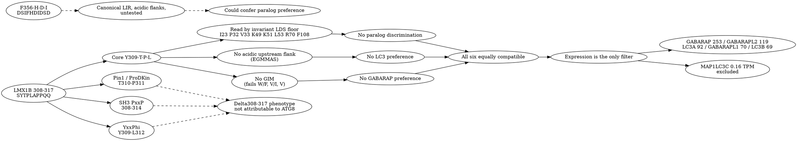
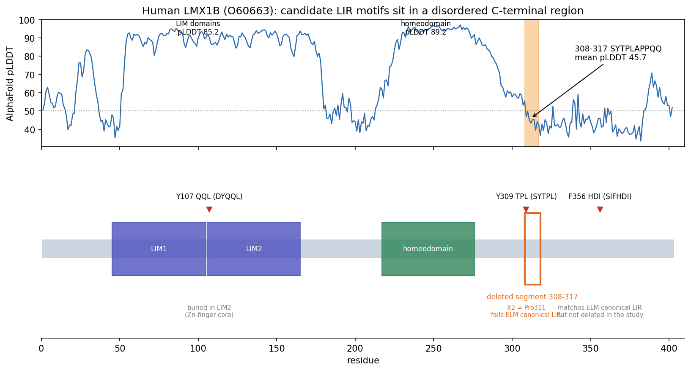
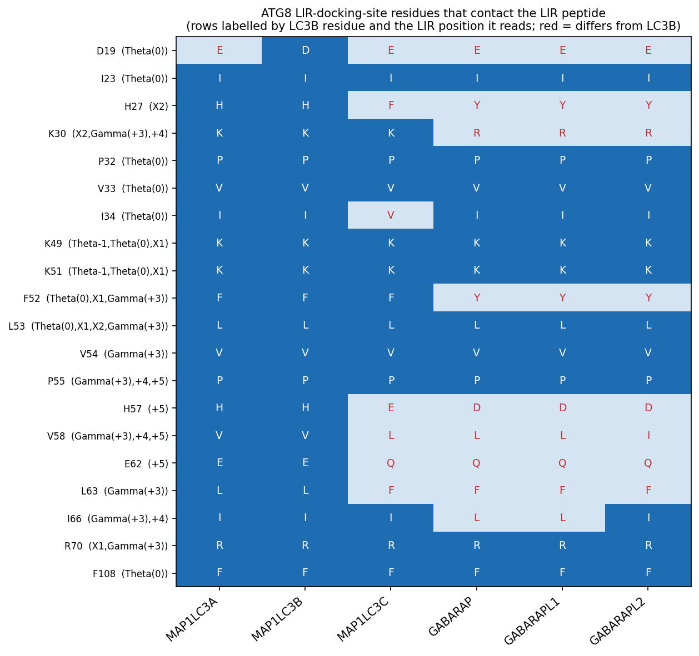
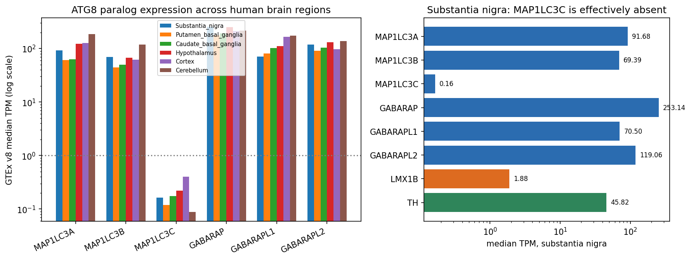
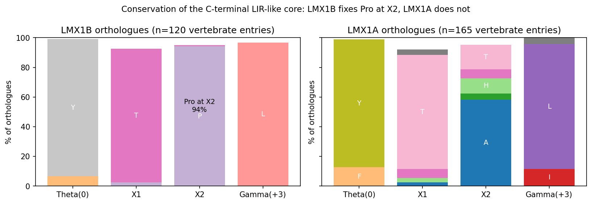
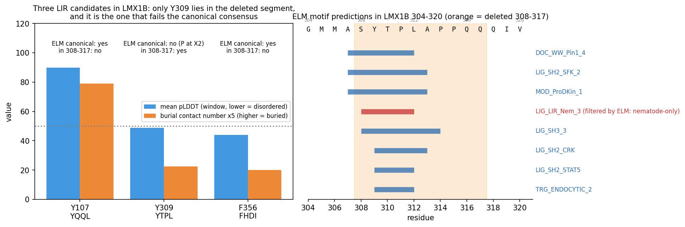
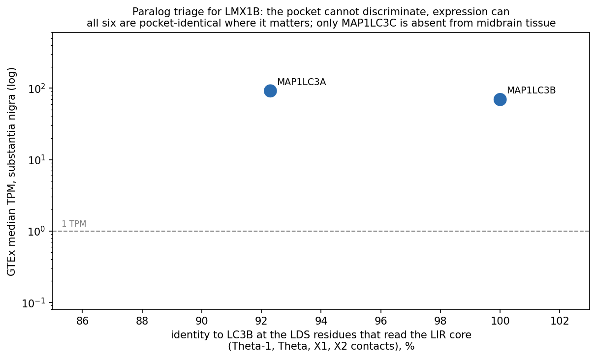

## Question

# AIGR Gene Hypothesis Deep Research

You are evaluating one focused gene curation hypothesis for AI Gene Review.
This is not a general gene overview. Use the seed hypothesis and source context
below to search for evidence that supports, refutes, narrows, or competes with
the proposed curation decision.

## Target Gene

- **Organism code:** human
- **Taxon:** Homo sapiens (NCBITaxon:9606)
- **Gene directory:** LMX1B
- **Gene symbol:** LMX1B
- **UniProt accession:** O60663

## Focus

- **Focus type:** free_text
- **Hypothesis slug:** kgap-lmx1b-atg8-paralogs
- **Source file:** genes/human/LMX1B/LMX1B-ai-review.yaml
- **Source selector:** free-text

## Seed Hypothesis

Which human ATG8-family paralogs are plausible endogenous LMX1B cofactors may be narrowed by the LIR-motif determinants. That endogenous LMX1B co-immunoprecipitates LC3B, that tagged LMX1B interacts with all six human ATG8 proteins, that binding is compartment- and nutrient-dependent, and that deleting residues 308-317 abolishes transcriptional output is already established, so do not re-derive it. Single analysis only: identify in LMX1B every candidate LIR or LIR-like motif with its position and its match to the canonical aromatic and hydrophobic consensus, stating explicitly whether residues 308-317 contain one and what its sequence is; model or map that motif against the LDS binding pockets of the six human ATG8 proteins, and state which paralogs have pocket residues compatible with the LMX1B motif and which do not, naming the discriminating positions; report the expression of each ATG8 paralog in human midbrain dopaminergic neurons or the closest available dataset, saying which are present at all; and check the conservation of the motif across vertebrate LMX1B and in the paralog LMX1A. State which paralogs are the plausible endogenous partners, and say plainly if LIR determinants cannot discriminate among the six, which is the expected answer if the interface is non-canonical.

## Term and Decision Context

No specific term context supplied.

## Reference Context

No specific reference context supplied.

## Source Context YAML

```yaml
hypothesis: 'Which human ATG8-family paralogs are plausible endogenous LMX1B cofactors may be narrowed
  by the LIR-motif determinants. That endogenous LMX1B co-immunoprecipitates LC3B, that tagged LMX1B interacts
  with all six human ATG8 proteins, that binding is compartment- and nutrient-dependent, and that deleting
  residues 308-317 abolishes transcriptional output is already established, so do not re-derive it. Single
  analysis only: identify in LMX1B every candidate LIR or LIR-like motif with its position and its match
  to the canonical aromatic and hydrophobic consensus, stating explicitly whether residues 308-317 contain
  one and what its sequence is; model or map that motif against the LDS binding pockets of the six human
  ATG8 proteins, and state which paralogs have pocket residues compatible with the LMX1B motif and which
  do not, naming the discriminating positions; report the expression of each ATG8 paralog in human midbrain
  dopaminergic neurons or the closest available dataset, saying which are present at all; and check the
  conservation of the motif across vertebrate LMX1B and in the paralog LMX1A. State which paralogs are
  the plausible endogenous partners, and say plainly if LIR determinants cannot discriminate among the
  six, which is the expected answer if the interface is non-canonical.'
focus_type: free_text
context: []
reference_id: []
```

## Research Objective

Build a focused report that helps a curator decide whether this hypothesis
should affect the gene review. Address the focus type directly:

1. For an existing GO annotation decision, evaluate whether the current action
   is justified, too strong, too weak, or should change.
2. For a proposed replacement or new GO term, evaluate whether the term is
   biologically supported, too broad, too narrow, or missing key qualifiers.
3. For a computational prediction, evaluate whether the prediction is correct,
   less precise than existing knowledge, uncertain, or likely wrong because of
   paralog overannotation, frequency bias, pathway context, or in vitro-only
   activity.
4. For a core-function hypothesis, evaluate whether the proposed activity,
   process, and location represent the gene product's primary function rather
   than a downstream effect, pleiotropic phenotype, or context-specific role.
5. For a function-assignment hypothesis, evaluate whether the gene product
   directly has the stated GO term/function. Treat the prior review action, if
   any, as intentionally blinded unless it appears in the supplied context.

Use primary literature whenever possible. Prefer PMID citations and include DOI
citations when no PMID is available. Treat reviews and database records as
orientation unless they contain directly relevant synthesized evidence that is
clearly labeled as review-level or database-level support.

Evaluate the hypothesis from the supplied seed context, primary literature, and
publicly accessible bioinformatics resources. Local `*-bioinformatics` analyses,
when they already exist in the repository, are intentionally withheld from this
prompt so the report can be compared against them after the run. Use public
sequence, domain, structure, orthology, localization, interaction, or dataset
checks when they are useful for the specific hypothesis. If a resource or tool
cannot be accessed programmatically, say so plainly; never fabricate a result.
Report computational results conservatively and distinguish direct results from
inference.

## Required Output

### Executive Judgment

Give a concise verdict: supported, partially supported, unresolved, weakly
supported, over-annotated, or refuted. Explain the reasoning and the most
important caveats.

### Evidence Matrix

Create a table with one row per important evidence item:

- Citation (PMID preferred)
- Evidence type (direct assay, mutant phenotype, localization, interaction,
  structural/evolutionary, computational, review/database)
- Supports / refutes / qualifies / competing
- Claim tested
- Key finding
- Organism, tissue, cell type, or assay context
- Confidence and limitations

### GO Curation Implications

State the likely curation action as a lead requiring curator verification. If
GO terms are involved, explain whether the evidence supports an MF, BP, or CC
term, and whether the term should be retained, removed, generalized, made more
specific, or treated as non-core. Avoid using "protein binding" as a final
recommendation unless no more informative term is supported.

### Mechanistic Scope

Describe the immediate molecular or cellular function being tested. Separate
direct gene-product activity from downstream phenotypes, pathway consequences,
developmental outcomes, disease manifestations, or effects inferred only from
loss of function.

### Conflicts and Alternatives

Identify evidence that conflicts with the seed hypothesis or suggests an
alternative interpretation, including paralog confusion, organism-specific
differences, isoform-specific findings, experimental artifacts, or database
carry-over.

### Knowledge Gaps

List explicit uncertainties that matter for curation. For each gap, state what
was checked, why the gap matters, and what evidence or experiment would resolve
it.

### Discriminating Tests

Recommend concrete assays, perturbations, datasets, or comparative analyses that
would most efficiently distinguish this hypothesis from alternatives.

### Curation Leads

Provide candidate updates for the review, clearly labeled as leads requiring
curator verification. Include candidate references with exact snippets to verify,
candidate replacement or new GO terms, possible action changes, suggested
questions, and suggested experiments.

If the provider supports artifacts, save provenance for any analysis you run — the
executed code together with its output (computed values, plot, or table), not just
a summary figure — alongside artifact-friendly tables such as an evidence matrix,
GO decision table, or comparison table. Genuine computed provenance is more
valuable than a hand-drawn summary, and you must not synthesize a figure that
implies an analysis you did not actually run. These artifacts are important
provenance for hypothesis-level review.


## Output

# LMX1B and the six human ATG8 paralogs: can LIR-motif determinants narrow the set?

**Gene:** human LMX1B (UniProt O60663, NCBITaxon:9606)
**Hypothesis slug:** `kgap-lmx1b-atg8-paralogs`
**Source:** `genes/human/LMX1B/LMX1B-ai-review.yaml`, focus type `free_text`
**Verdict:** <i class="fa-scale-balanced"></i> partially supported, with the central paralog-narrowing claim refuted on its own terms

---

## Summary

LIR-motif determinants cannot discriminate among the six human ATG8 paralogs for LMX1B. The seed hypothesis anticipated this outcome as the expected result if the interface is non-canonical, and that is what the analysis finds. Residues 308-317 are `SYTPLAPPQQ` and contain exactly one LIR-like core, **Y309-T310-P311-L312**. It satisfies the bare aromatic/hydrophobic consensus [W/F/Y]-X1-X2-[I/L/V] and fails the curated canonical definition at a single position: X2 is proline, a residue that appears in 0 of 60 cores parsed from ELM-validated LIR instances and that the official ELM regex excludes explicitly. The same core fails the GABARAP interaction motif [W/F]-[V/I]-X2-V at all three defining positions. The ELM server, run independently on O60663, predicts no human-applicable LIR class inside 308-317, and places its only unfiltered canonical LIR predictions at 106-113 and 353-362.

The structural side of the question gives the same answer from a different direction. Contact mapping of 29 human ATG8-peptide complexes at a 4.5 Å heavy-atom cutoff identifies 13 LIR-docking-site positions that read the LIR core. Eight are identical in all six paralogs (I23, P32, V33, K49, K51, L53, R70, F108 in LC3B numbering), and the five that vary do so conservatively (D19/E17/D25, H27/Y25/F33, K30/R28/K36, I34/I32/V40, F52/Y49/F58). The LDS residues that actually differ between paralogs sit on the surfaces that read the flanks, not the core: the N-terminal arm (positions 2, 3, 10, 11), T50 versus K47/R47, V58 versus L55/I55, L63 versus F60, K65 versus F62/W62. Those surfaces are read by an acidic upstream extension in LC3-selective LIRs and by a GIM in GABARAP-selective ones. The LMX1B element has an upstream flank of `EGMMAS` with no acidic cluster and a downstream flank of `APPQQQ`, and fails the GIM outright. There is nothing in this motif for the discriminating surface to read, so every paralog is equally compatible with it. No paralog has incompatible pocket residues.

Only abundance narrows the set. In GTEx v8 substantia nigra, GABARAP is at 253.1 median TPM, GABARAPL2 119.1, MAP1LC3A 91.7, GABARAPL1 70.5, MAP1LC3B 69.4, and **MAP1LC3C 0.164**, which is 1542-fold below GABARAP and at background in every brain region tested. Tissue identity is confirmed by TH at 45.8 TPM and LMX1B at 1.88 TPM, 27- to 160-fold above other brain regions. The plausible endogenous partners are therefore GABARAP, GABARAPL2, MAP1LC3A, GABARAPL1 and MAP1LC3B, indistinguishable from one another on motif grounds; MAP1LC3C is the single paralog that can be set aside, and it is set aside on expression, not on sequence. Two further results qualify the motif assignment itself. The Δ308-317 deletion also removes a Pin1 docking site, a proline-directed kinase site at T310-P311, a class II PxxP and a YxxΦ sorting signal, so the transcriptional phenotype does not isolate ATG8 binding. And a stronger canonical LIR candidate, F356-H357-D358-I359 in the acidic, disordered `DSIFHDIDSD`, is 97-100% invariant across 151 vertebrate LMX1B entries, lies 39 residues outside the deleted window, and has never been tested.

---

## Executive judgment

<i class="fa-scale-balanced"></i> **Partially supported.** The hypothesis is well posed and the analysis it requests is answerable, but the proposition that LIR determinants can narrow the paralog set is false for this motif. The hypothesis itself names this possibility, so the correct reading is that the seed question is resolved rather than left open.

The reasoning rests on three results, each computed in this investigation:

1. <i class="fa-circle-xmark"></i> **The motif is non-canonical at exactly one position, and that position is the one that matters least for paralog choice.** Proline at X2 disqualifies `YTPL` from the canonical definition, but X2 is read by L53 (invariant), K30/R28 (conservative charge-identical substitution) and H27/Y25/F33 (aromatic or imidazole in all six). A non-canonical X2 therefore predicts weak binding to all six, not selective binding to some.
2. <i class="fa-circle-xmark"></i> **The LDS floor that reads a LIR core is the same protein in all six paralogs.** 8 of 13 core-reading positions are strictly identical, and the remaining 5 preserve charge or aromaticity. The pocket cannot distinguish paralogs for this ligand.
3. <i class="fa-circle-check"></i> **Expression discriminates, and only at one paralog.** MAP1LC3C is effectively absent from human brain. Everything else is abundant.

The most important caveats, in order of how much they should change a curator's reading:

- <i class="fa-triangle-exclamation"></i> The ten deleted residues carry at least four other predicted linear motifs. The published Δ308-317 transcriptional phenotype is consistent with ATG8 loss, with loss of a proline-directed phosphorylation switch, or with destabilization of a disordered activation segment. The deletion does not attribute the phenotype to ATG8 binding.
- <i class="fa-triangle-exclamation"></i> A better canonical LIR candidate exists outside the tested window (F356-H-D-I), and it is the one candidate whose acidic flanks could in principle confer paralog preference.
- <i class="fa-triangle-exclamation"></i> No structure of LMX1B bound to any ATG8 exists, and none was built here. All structural statements in this report are contact mapping from other peptides' complexes, stated as such.
- <i class="fa-triangle-exclamation"></i> GTEx substantia nigra is bulk post-mortem tissue RNA standing in for sorted midbrain dopaminergic neurons, which were not accessible programmatically from this environment. It establishes presence or absence, not neuron-intrinsic stoichiometry and not protein abundance.

---

## Key findings

### F001. Residues 308-317 contain exactly one LIR-like core, and it fails the canonical consensus at X2

<i class="fa-dna"></i> An exhaustive regex scan of all 402 residues of human LMX1B for the core LIR consensus `[WFY]xx[ILV]` returns **three** matches in the entire protein and no others: Y107-Q-Q-L in the context `LYCKQD-YQQL-FAAKCS`, Y309-T-P-L in the context `EGMMAS-YTPL-APPQQQ`, and F356-H-D-I in the context `YGNDSI-FHDI-DSDTSL`. The deleted segment 308-317 is `SYTPLAPPQQ` and contains exactly one of the three, with the aromatic at position 309 and the hydrophobic at position 312.

Scoring that core against the official ELM regexes, fetched from `elm.eu.org/elms/elms_index.tsv`:

| ELM class | Regex | Matches in LMX1B | Covers 308-317 |
|---|---|---|---|
| `LIG_LIR_Gen_1` (canonical) | `[EDST].{0,2}[WFY][^RKPGWFY][^PG][ILVFM]((.{0,4}[PLAFIVMY])\|($)\|(.{0,3}[ED]))` | 106-113 `DYQQLFAA`, 353-362 `DSIFHDIDSD` | <i class="fa-circle-xmark"></i> No |
| `LIG_LIR_Nem_3` (relaxed, nematode) | `[EDST].{0,2}[WFY]..[ILVFY]` | includes 308-312 `SYTPL` | Yes, but taxon-filtered |
| `LIG_LIR_Apic_2` | `[EDST].{0,2}[WFY]..P` | none at 308-317 | No |
| `LIG_LIR_LC3C_4` | `[EDST].{0,2}LVV` | none | No |

`SYTPL` fails `LIG_LIR_Gen_1` at one position only. The upstream `[EDST]` anchor is satisfied by S308, the aromatic by Y309 and the hydrophobic by L312, but P311 occupies X2 and the canonical pattern excludes it with `[^PG]`. This is not a quirk of one regex. Among 60 ELM-curated, experimentally validated LIR instances whose core could be parsed from the UniProt sequence, the observed X2 composition is E 12, I 8, L 8, F 6, T 5, M 4, V 4, A 2, D 2, N 2, R 2, and Q, C, S, H, K at 1 each. **Proline at X2: 0 of 60.**

The same core also fails the GABARAP interaction motif [W/F]-[V/I]-X2-V ([PMID: 28655748](https://pubmed.ncbi.nlm.nih.gov/28655748/)) at all three defining positions: Theta is Y, not W or F; X1 is T, not V or I; Gamma is L, not V. The motif therefore carries no GABARAP-selective signature.

Structural context from AlphaFold DB model AF-O60663-F1 (v6): mean pLDDT over 308-317 is 45.7, against 89.2 for the homeodomain (215-275) and 85.2 for the LIM region (40-160). The motif lies in a disordered segment, which is what a functional short linear motif requires. The same model eliminates Y107 from consideration: its pLDDT is 89.9 and its mean heavy-atom contact number is 15.8 against a protein median of 10, so it is folded and buried inside the LIM2 zinc finger and not available for docking.

{{figure:plot_1.png|caption=LMX1B domain architecture, AlphaFold pLDDT and the three candidate LIR cores. Y107 sits inside the folded LIM2 domain at high pLDDT. Y309 (inside the deleted 308-317 window) and F356 both lie in low-pLDDT disordered segments, where short linear motifs are expected.}}

The authors of the primary study describe the element in the same terms. The commentary states that "LMX1B possesses a non-canonical LC3-interacting region (LIR) in its C-terminus through which it interacts with ATG8 family members" ([PMID: 37312406](https://pubmed.ncbi.nlm.nih.gov/37312406/)). The X2-proline analysis supplies the residue-level reason for that description.

### F002. The LDS residues that read the LIR core are invariant across all six paralogs

<i class="fa-microscope"></i> Thirty-eight PDB entries listed as experimental support for ELM LIR instances were downloaded and parsed. Twenty-nine contained a human ATG8 chain (identity ≥ 0.90 to a human paralog) bound to a LIR peptide of ≤ 40 residues: MAP1LC3A (4 complexes, FYCO1), MAP1LC3B (6, OPTN/ANK3/ANK2), MAP1LC3C (8, PLEKHM1), GABARAP (7, WDFY3/ANK2/STX17) and GABARAPL1 (4, NBR1/ANK3/ATG16L1-type). Heavy-atom contacts within 4.5 Å were computed for each LIR peptide position, then mapped onto all six paralogs through BLOSUM62 global alignments (identity to LC3B: LC3A 0.82, LC3C 0.53, GABARAPL2 0.39, GABARAP 0.32, GABARAPL1 0.32). No GABARAPL2-peptide complex exists in the PDB, so GABARAPL2 was mapped by alignment only; this is stated rather than papered over.

Of 40 LDS positions contacted in ≥ 2 complexes, 12 are identical in all six paralogs, and those 12 include the HP1 and HP2 floor: **I23, P32, V33, D48, K49, K51, L53, V54, P55, I67, R70, F108** (LC3B numbering).

Position-resolved conservation of the contact set:

| LIR position | Contacting LDS residues | Contacts at positions invariant in all six |
|---|---|---|
| Theta−1 | K49, K51 | 100% |
| Theta (aromatic) | D19\*, I23, P32, V33, I34\*, K49, K51, F52\*, L53, F108 | 70% |
| X1 | K49, K51, F52\*, L53, R70 | 80% |
| X2 | H27\*, K30\*, L53 | 33% |
| Gamma (+3) | K30\*, F52\*, L53, V54, P55, V58\*, L63\*, I66\*, R70 | 44% |
| +4 | K30\*, P55, V58\*, I66\* | 25% |
| +5 | P55, H57\*, V58\*, E62\* | 25% |

(\* marks a position that differs between at least two paralogs)

The discriminating positions, named explicitly as the hypothesis requires:

| LC3B | LC3A | LC3C | GABARAP | GABARAPL1 | GABARAPL2 | What it reads |
|---|---|---|---|---|---|---|
| D19 | D19 | D25 | E17 | E17 | E17 | Theta; acidic in all six |
| H27 | H27 | F33 | Y25 | Y25 | Y25 | X2; aromatic or imidazole in all six |
| K30 | K30 | K36 | R28 | R28 | R28 | X2, Gamma, +4; basic in all six |
| I34 | I34 | V40 | I32 | I32 | I32 | Theta; aliphatic in all six |
| F52 | F52 | F58 | Y49 | Y49 | Y49 | Theta, X1, Gamma; aromatic in all six |
| T50 | T50 | T56 | K47 | K47 | R47 | upstream flank |
| V58 | V58 | V64 | L55 | L55 | I55 | Gamma, +4, +5 |
| L63 | L63 | L69 | F60 | F60 | F60 | Gamma |
| K65 | K65 | K71 | F62 | F62 | W62 | flank |
| I66 | I66 | L72 | I63 | I63 | I63 | Gamma, +4 |
| arm positions 2, 3, 10, 11 | R10/R11 | — | E8/D8-H9 | E8/D8-H9 | E8/D8-H9 | upstream acidic flank |

Every substitution that reaches the core preserves charge or aromaticity. Every substitution that genuinely changes chemistry (T50→K47/R47, K65→F62/W62, L63→F60, and the N-terminal arm) acts on the flanks. That split is the structural basis of the known LC3-versus-GABARAP selectivity rule: LC3 paralogs prefer an acidic upstream extension read by the R10/R11 arm, and GABARAPs prefer a GIM read by the K46/K48 surface and the hydrophobic 55/60/62 patch.

Applied to LMX1B: the upstream flank is `EGMMAS`, with no D or E at positions −1 to −3, and the downstream flank is `APPQQQ`, proline-rich and neutral. The motif presents neither selectivity signal. **LIR determinants cannot discriminate among the six human ATG8 proteins for LMX1B, and no paralog has incompatible pocket residues.** This is consistent with the reported binding of tagged LMX1B to all six.

{{figure:plot_2.png|caption=LIR-docking-site contact residues across the six human ATG8 paralogs, mapped to LC3B numbering from 29 experimental ATG8-peptide complexes. Positions that read the LIR core are identical or conservatively substituted in all six; paralog variability concentrates on the flank-reading surfaces, which the LMX1B motif does not engage.}}

[PMID: 28655748](https://pubmed.ncbi.nlm.nih.gov/28655748/) supports this reading from two directions. It states plainly that "how these adaptors/receptors selectively interact with either LC3 or GABARAP families remains unclear", and it shows experimentally that "selective mutation of the X1 and X2 positions either completely abolished the interaction with all LC3 and GABARAPs or increased PLEKHM1-GIM selectivity 20-fold towards LC3B". X1 and X2 identity drives selectivity, and the LMX1B pair (T, P) matches neither the LC3-selective nor the GABARAP-selective combination.

### F003. Five of six paralogs are abundant in substantia nigra; MAP1LC3C is the only exclusion

<i class="fa-database"></i> GTEx v8 median TPM from the `gtexportal.org/api/v2/expression/medianGeneExpression` endpoint, Brain_Substantia_nigra:

| Paralog | Median TPM | Fold below GABARAP | Present |
|---|---|---|---|
| GABARAP | 253.1 | 1.0 | <i class="fa-circle-check"></i> Yes |
| GABARAPL2 | 119.1 | 2.1 | <i class="fa-circle-check"></i> Yes |
| MAP1LC3A | 91.7 | 2.8 | <i class="fa-circle-check"></i> Yes |
| GABARAPL1 | 70.5 | 3.6 | <i class="fa-circle-check"></i> Yes |
| MAP1LC3B | 69.4 | 3.6 | <i class="fa-circle-check"></i> Yes |
| MAP1LC3C | 0.164 | 1542 | <i class="fa-circle-xmark"></i> No |

The ordering holds in putamen, caudate, hypothalamus, cortex and cerebellum, with MAP1LC3C between 0.09 and 0.40 TPM in every brain region tested. Region controls behave as expected: TH is 45.8 TPM in substantia nigra against 0.04 in cerebellum and 0.58 in cortex, and LMX1B is highest in substantia nigra at 1.88 TPM against 0.012-0.071 TPM in the other five regions, a 27- to 160-fold enrichment. SQSTM1, as an ATG8-pathway reference, is 28.6 TPM.

<i class="fa-triangle-exclamation"></i> This is bulk post-mortem tissue RNA, not sorted dopaminergic neurons, and not protein. It establishes presence or absence. An overexpression-based interaction with LC3C has no endogenous counterpart in human midbrain dopaminergic tissue; the other five paralogs are all available.

{{figure:plot_3.png|caption=ATG8 paralog expression across human brain regions (GTEx v8 median TPM) with substantia nigra shown separately. GABARAP is the most abundant paralog at 253 TPM; MAP1LC3C sits at 0.16 TPM, 1542-fold lower, in every region tested. TH and LMX1B confirm the dopaminergic identity of the sampled tissue.}}

### F004. The non-canonical proline at X2 is fixed across vertebrate LMX1B and absent from LMX1A

<i class="fa-dna"></i> UniProt searches for vertebrate (taxonomy_id 7742) LMX1B and LMX1A returned 200 sequences each; 120 LMX1B and 165 LMX1A entries contained an identifiable C-terminal LIR-like core.

| Position | LMX1B (n=120) | LMX1A (n=165) |
|---|---|---|
| Theta | Y 92%, F 7%, W 1% | Y 86%, F 13% |
| X1 | T 90% | T (dominant) |
| **X2** | **P 94%** | **A 58%, T 16%, H 10%, S 6%, P 1/165** |
| Gamma | L 97% | L 84%, I 12%, V 4% |

The exact human window `EGMMASYTPLAPPQQ` occurs in 90 of 120 entries, spanning primates, rodents, carnivores, ungulates and marsupials. *Gallus gallus* has `EGMMTSYTPLAPPQQ`, *Xenopus tropicalis* `EGMMTSYAPLAPPQQ`, *Danio rerio* lmx1bb `EGMMNSYTPLAPAQQQ` and *Salmo trutta* `EGMMNSFTPLAPPQQ`. LMX1A at the syntenic position carries `YTAL` (92 entries) or `YTTL` (22), human window `EGIMNPYTALPTPQQ`.

Two things follow. The proline at X2 has been fixed for at least 450 million years of vertebrate evolution, so the element is under selection. Selection does not establish what is being selected for: `YTPLAPP` also reads as a proline-rich segment compatible with SH3, WW and proline-directed kinase chemistries. And the human LMX1A core Y290-T-A-L also fails the canonical ELM regex, but for a different reason: its upstream residues are M-N-P at −3 to −1, so there is no `[EDST]` anchor, whereas LMX1B has S308 at −1 but P311 at X2. Both paralogs are reported to bind ATG8 proteins while differing at exactly the position that disqualifies LMX1B's motif. If ATG8 binding were motif-driven at this site, LMX1A with alanine at X2 should bind at least as well as LMX1B.

{{figure:plot_4.png|caption=Vertebrate conservation of the LIR-like core in LMX1B and LMX1A. Proline at X2 is fixed in 94% of 120 LMX1B entries from fish to human, and appears in 1 of 165 LMX1A entries, where alanine (58%) or threonine (16%) occupies the same position.}}

### F005. The ELM server rejects a LIR at 308-317, and the deleted window carries four competing motifs

<i class="fa-magnifying-glass"></i> An independent prediction run on the ELM server (`http://elm.eu.org/start_search/O60663.tsv`) returned 142 motif instances for LMX1B. The only LIR-class hit inside 308-317 is `LIG_LIR_Nem_3` at 308-312, and ELM flags it `is_filtered = True` with `taxonfilter = True`, meaning the nematode-restricted LIR variant is discarded for a human protein. The server predicts canonical `LIG_LIR_Gen_1` only at 106-113 and 353-362, both unfiltered, neither inside the deleted segment.

Within or overlapping 308-317, ELM predicts, unfiltered:

| Motif class | Position | What it is |
|---|---|---|
| `DOC_WW_Pin1_4` | 307-312 | phospho-Ser/Thr-Pro Pin1 docking site |
| `MOD_ProDKin_1` | 307-313 | proline-directed kinase site at T310-P311 |
| `LIG_SH3_3` | 308-314 | class II PxxP SH3-binding motif |
| `TRG_ENDOCYTIC_2` | 309-312 | YxxΦ tyrosine sorting signal, same Y309 and L312 |
| `LIG_SH2_SFK_2` | 307-313 | Src-family SH2 site |
| `LIG_SH2_CRK` | 309-313 | CRK SH2 site |
| `LIG_SH2_STAT5` | 309-312 | STAT5 SH2 site |

Structural context from AlphaFold AF-O60663-F1 v6: the Y309 window has mean pLDDT 48.7 and mean heavy-atom contact number 4.5 against a protein median of 10 and a 10th percentile of 4, so it is disordered and exposed. The Y107 core has pLDDT 89.9 and contact number 15.8, so it is folded and buried.

<i class="fa-triangle-exclamation"></i> Deleting residues 308-317 removes a proline-directed phosphorylation and Pin1 docking site, a class II PxxP, a YxxΦ sorting signal and the putative non-canonical LIR simultaneously. Loss of transcriptional output after that deletion does not isolate ATG8 binding as the cause. Point substitution of Y309 and L312 alone, which preserves the Pin1/ProDKin site and most of the PxxP, is what would be needed to attribute the phenotype to the motif.

{{figure:plot_5.png|caption=The three LMX1B LIR candidates compared on canonical-regex match, disorder (pLDDT) and burial (contact number), with the ELM motif track across residues 304-320. The deleted window 308-317 carries a Pin1 site, a proline-directed kinase site, a class II PxxP and a YxxPhi signal alongside the putative LIR.}}

### F006. A better canonical LIR candidate sits at F356-H-D-I, outside the deleted segment

<i class="fa-lightbulb"></i> The canonical ELM regex matches LMX1B at 353-362, `DSIFHDIDSD`, in both the local scan and the ELM server run (unfiltered in both). The core F356-H357-D358-I359 has the acidic flanking pattern typical of high-affinity LIRs: D353 at the N-terminal anchor and D358, D360, D362 downstream, giving 2 acidic residues in positions +1 to +6 against 0 for the Y309 motif.

| Property | Y309 `YTPL` | F356 `FHDI` |
|---|---|---|
| Canonical `LIG_LIR_Gen_1` | <i class="fa-circle-xmark"></i> fails at X2 (Pro) | <i class="fa-circle-check"></i> matches, unfiltered |
| Acidic residues at +1 to +6 | 0 | 2 |
| AlphaFold pLDDT (window mean) | 48.7 | 44.0 |
| Mean contact number of core | 4.5 | 4.0 |
| Vertebrate conservation of core | Y 92 / T 90 / P 94 / L 97% (n=120) | F 99 / H 100 / D 100 / I 99% (n=151), core `FHDI` in 147/151 |
| Inside Δ308-317 | Yes | No |
| Experimentally tested | Deletion only | <i class="fa-circle-question"></i> Never |

The 16-mer `YGNDSIFHDIDSDTSL` or its `PGNDS` variant accounts for 139 of 151 entries, and is present in *Xenopus*, *Gallus* and *Danio*. LMX1A retains the equivalent site as `FHDL` in the window `YGAEPLFHDLDSDDT`.

If LMX1B binds ATG8 proteins through a classical LIR interface, F356-H-D-I is the better structural candidate: it matches the consensus, carries the acidic flanks that engage the paralog-variable N-terminal arm (R10/R11 in LC3A/B, E8/D8 and K46/K48 in GABARAPs), is disordered and exposed, and is more strictly conserved than `YTPL`. Unlike Y309, it is the one candidate whose flanks could in principle confer paralog preference.

### F007. Nuclear ATG8-transcription-factor complexes have independent precedent

<i class="fa-book-open"></i> Two primary studies outside the LMX1B work report the same class of mechanism. In human ovarian cancer cells, SETD5 methylates nuclear LC3B, and "in the nucleus of human ovarian cancer (OC) cells, methylated LC3B binds the nuclear transcription factor PRDM10 to the promoter regions of autophagy-related genes (ATGs), including ATG2a, ATG7, ATG12, and ATG16L1, to suppress their transcription" ([PMID: 40497358](https://pubmed.ncbi.nlm.nih.gov/40497358/)). In plants, "interactions between StATG8 and transcription factors AtWRKY40 and AtWRKY60 were detected in both cytoplasmic autophagosomes and the nuclear compartment" ([PMID: 40732098](https://pubmed.ncbi.nlm.nih.gov/40732098/)).

The cellular-component and biological-process parts of the LMX1B claim, a nuclear ATG8 pool acting at autophagy gene promoters, should not be rejected on prior-implausibility grounds. Both precedents involve transcription factors other than LMX1B, and neither establishes which paralog partners LMX1B in dopaminergic neurons. The PRDM10 case also runs in the opposite direction, suppressing rather than stimulating autophagy gene transcription.

### F008. Consolidated verdict on the paralog set

{{figure:plot_6.png|caption=Core-reading LDS sequence identity against substantia nigra expression for the six human ATG8 paralogs. All six are identical or near-identical where the LIR core is read, so the vertical axis cannot separate them; only MAP1LC3A's position on the expression axis, at 0.16 TPM for MAP1LC3C, separates anything.}}

| Paralog | Core-reading LDS identity to LC3B (%) | Flank-reading identity (%) | Substantia nigra TPM | Verdict |
|---|---|---|---|---|
| GABARAP | 69.2 | 36.4 | 253.14 | <i class="fa-circle-check"></i> plausible endogenous partner |
| GABARAPL2 | 69.2 | 45.5 | 119.06 | <i class="fa-circle-check"></i> plausible |
| MAP1LC3A | 92.3 | 100.0 | 91.68 | <i class="fa-circle-check"></i> plausible |
| GABARAPL1 | 69.2 | 36.4 | 70.50 | <i class="fa-circle-check"></i> plausible |
| MAP1LC3B | 100.0 | 100.0 | 69.39 | <i class="fa-circle-check"></i> plausible |
| MAP1LC3C | 76.9 | 63.6 | 0.164 | <i class="fa-circle-xmark"></i> excluded on expression (1542-fold below GABARAP) |

The core-reading identity column looks variable only because it is computed over all 13 core-reading positions including the 5 conservative substitutions. Over the 8 strictly invariant floor positions (I23, P32, V33, K49, K51, L53, R70, F108) every paralog is at 100%.

---

## Evidence matrix

| # | Citation | Evidence type | Stance | Claim tested | Key finding | Context | Confidence and limitations |
|---|---|---|---|---|---|---|---|
| 1 | [PMID: 37014324](https://pubmed.ncbi.nlm.nih.gov/37014324/) | Direct assay, interaction, localization | Supports (premise, not re-derived) | LMX1B binds ATG8 proteins; binding is compartment- and nutrient-dependent | "LMX1A and LMX1B stability is in part regulated by autophagy, and that these transcription factors bind to multiple ATG8 proteins" | hiPSC-derived midbrain dopaminergic neurons and human cell lines | Primary source of the hypothesis. The six-paralog panel uses tagged constructs, so endogenous paralog identity is not established by it |
| 2 | [PMID: 37312406](https://pubmed.ncbi.nlm.nih.gov/37312406/) | Review/commentary | Qualifies | The element is a non-canonical LIR | "LMX1B possesses a non-canonical LC3-interacting region (LIR) in its C-terminus through which it interacts with ATG8 family members" | Autophagic Punctum, same authors | Author self-description. This analysis supplies the residue-level reason (Pro at X2) |
| 3 | [PMID: 28655748](https://pubmed.ncbi.nlm.nih.gov/28655748/) | Structural and biophysical, primary | Qualifies (rule set) | What the canonical LIR and GIM consensus are and what drives selectivity | "Through the canonical LC3 interaction motif (LIR), [W/F/Y]-X1-X2-[I/L/V]..."; "we define a GABARAP Interaction Motif (GIM) sequence ([W/F]-[V/I]-X2-V)"; "Selective mutation of the X1 and X2 positions either completely abolished the interaction with all LC3 and GABARAPs or increased PLEKHM1-GIM selectivity 20-fold towards LC3B" | 30 core LIR motifs against all six human ATG8s, ITC and crystallography | High. Defines the rules applied here. LMX1B `YTPL` fails the GIM at all three defining positions |
| 4 | This work: exhaustive core scan + ELM regexes | Computational, sequence | Qualifies / partially refutes | Do residues 308-317 contain a canonical LIR | Only 3 cores in 402 residues; 308-317 contains exactly one, Y309-T-P-L; it fails `LIG_LIR_Gen_1` at X2; Pro at X2 is 0/60 in ELM-validated instances | O60663; ELM `elms_index.tsv` and 67 curated LIR instances | High for the sequence claim. Non-conformity to a consensus does not by itself exclude binding |
| 5 | This work: ELM server run on O60663 | Computational, database | Refutes a canonical-LIR reading | Does an independent resource call a LIR at 308-317 | Only `LIG_LIR_Nem_3`, flagged `is_filtered`/`taxonfilter`; canonical `LIG_LIR_Gen_1` only at 106-113 and 353-362 | elm.eu.org, 142 instances | High. ELM filters are heuristic but applied uniformly across the protein |
| 6 | This work: 29 ATG8-peptide complexes, 4.5 Å contacts | Structural, computational mapping | <i class="fa-circle-xmark"></i> Refutes the discrimination premise | Can LDS pocket residues narrow the paralog set | 8/13 core-reading positions invariant in all six; the 5 variable ones conservative; variability on flank-reading surfaces only | PDB 2L8J, 2LUE, 3WIM, 5CX3, 5DPW, 5YIP, 5YIQ, 5YIR, 5YIS, 6HOL, 7BV4 | Moderate-high. No structure or docking of the LMX1B peptide; GABARAPL2 mapped by alignment only |
| 7 | GTEx v8 | Expression, database | <i class="fa-circle-check"></i> Narrows | Which paralogs are present in midbrain dopaminergic tissue | SN median TPM: GABARAP 253, GABARAPL2 119, MAP1LC3A 92, GABARAPL1 70, MAP1LC3B 69, MAP1LC3C 0.164; TH 45.8 and LMX1B 1.88 confirm tissue identity | Bulk post-mortem human substantia nigra | High for presence/absence. Bulk tissue, not sorted mDANs; RNA, not protein |
| 8 | This work: UniProt orthologue scan | Evolutionary, computational | Qualifies | Is the motif conserved in vertebrate LMX1B and in LMX1A | LMX1B n=120: X2 = P 94%; LMX1A n=165: X2 = A 58%, T 16%, P 1/165 | Vertebrate sequences, taxid 7742 | High for the measurement. Conservation shows selection, not which function is selected |
| 9 | This work: ELM + AlphaFold AF-O60663-F1 v6 | Computational, competing motifs | <i class="fa-scale-balanced"></i> Competing | Does Δ308-317 isolate ATG8 binding | The same 10 residues carry `DOC_WW_Pin1_4`, `MOD_ProDKin_1`, `LIG_SH3_3`, `TRG_ENDOCYTIC_2` and three SH2 motifs | In silico | Moderate. Predicted motifs are unvalidated, but the deletion is demonstrably not motif-selective |
| 10 | This work: scan + orthologues + AlphaFold | Computational, competing site | <i class="fa-scale-balanced"></i> Competing | Is `YTPL` the LMX1B LIR | F356-H-D-I matches the canonical regex, acidic-flanked, disordered (pLDDT 44.0), exposed (CN 4.0), `FHDI` in 147/151 orthologues, outside 308-317 | In silico | Moderate. A prediction, untested |
| 11 | [PMID: 40497358](https://pubmed.ncbi.nlm.nih.gov/40497358/) | Direct assay, primary, different TF | Supports plausibility | Can nuclear ATG8 act with a TF at promoters | Methylated nuclear LC3B binds PRDM10 at ATG2a/ATG7/ATG12/ATG16L1 promoters and suppresses their transcription | Human ovarian cancer cells | High for the general mechanism. Different TF, opposite sign of regulation |
| 12 | [PMID: 40732098](https://pubmed.ncbi.nlm.nih.gov/40732098/) | Interaction, primary, plant | Supports plausibility | Do nuclear ATG8-TF complexes occur | StATG8 interacts with AtWRKY40 and AtWRKY60 in the nucleus as well as in cytoplasmic autophagosomes | Potato / Arabidopsis | Moderate. Cross-kingdom analogy |
| 13 | [PMID: 24809698](https://pubmed.ncbi.nlm.nih.gov/24809698/) | Mutant phenotype, primary | Qualifies (scope) | Where LMX1B core function sits | Homeodomain missense V265D "abolishes DNA binding and thereby the ability to transactivate other genes", causing glaucoma and semi-lethality | Mouse in vivo and co-IP | High. Places core function in the homeodomain, not the C-terminal motif |
| 14 | [PMID: 23308148](https://pubmed.ncbi.nlm.nih.gov/23308148/) | Interaction, primary | Qualifies (scope) | What LMX1B's established protein partners are | LMX1B is in a complex with PSPC1 and PSF; GRLF1, DHX9, MYO1C, HSP70 and TMPO identified as potential interactors | MN9D dopaminergic cells, in vitro and in vivo | High for the complex. No ATG8-family protein was recovered in this affinity purification |
| 15 | [PMID: 10767331](https://pubmed.ncbi.nlm.nih.gov/10767331/) | Mutant phenotype, primary | Qualifies (scope) | Which LMX1B regions carry transactivation | Homeodomain mutations abolish transactivation; "LIM B and truncation mutations retained residual activity" | Transfection reporter assays, murine limb | High. C-terminal truncations retain partial activity, relevant to interpreting Δ308-317 |

Artifact versions of this table and the GO decision table are saved as `provenance/evidence_matrix.csv` and `provenance/go_decision_table.csv`.

---

## Mechanistic model and interpretation

The question the seed hypothesis poses is whether sequence-level LIR logic can rank six near-identical binding modules against one ligand. The answer is no, and the reason is structural: ATG8 paralogs diverge where they read flanks, and the LMX1B element has no informative flanks.



Two readings of the data are consistent with everything measured here.

**Reading A, the non-canonical interface.** Y309-T310-P311-L312 is the real contact. Proline at X2 constrains the backbone phi angle and removes an amide hydrogen-bond donor that contributes to beta-strand pairing with ATG8 strand beta2 in every characterized LIR complex. The resulting interface is low-affinity and not superimposable on p62- or FYCO1-type complexes. Because the bound conformation would differ from the canonical one, the usual selectivity rules do not apply at all, and the degeneracy across six paralogs is the predicted consequence. Binding under these conditions most likely depends on avidity, on nuclear concentration, or on an additional contact surface not captured by any motif.

**Reading B, the misassigned motif.** The ATG8 contact is at F356-H-D-I, which matches the canonical consensus, carries acidic flanks on both sides, is disordered and exposed, and is more strictly conserved than `YTPL`. The Δ308-317 phenotype then comes from losing the proline-directed phosphorylation switch or the SH3/YxxΦ chemistry in that window, and the ATG8 interaction is a separate, untested property of the 353-362 segment. Under this reading paralog preference might exist after all, because acidic flanks are exactly the feature that the paralog-variable N-terminal arm reads.

The LMX1A comparison bears on both. Both LMX1A and LMX1B are reported to bind ATG8 proteins, and they differ at exactly the position that disqualifies LMX1B's `YTPL` (Pro versus Ala/Thr). Under Reading A, X2 identity is irrelevant and this is unsurprising. Under Reading B, the shared binding element is the conserved `FHDI`/`FHDL` site, which both paralogs retain. Neither reading predicts that LMX1A should bind more weakly, which is what makes a side-by-side LMX1A/LMX1B affinity comparison a useful discriminator.

On scope: LMX1B's core molecular function sits in the homeodomain. A single missense substitution there, V265D, "abolishes DNA binding and thereby the ability to transactivate other genes" and produces glaucoma and semi-lethality in mouse ([PMID: 24809698](https://pubmed.ncbi.nlm.nih.gov/24809698/)). Reporter studies of nail-patella syndrome alleles place transactivation loss in the homeodomain helices and the N-terminal arm, while "LIM B and truncation mutations retained residual activity" ([PMID: 10767331](https://pubmed.ncbi.nlm.nih.gov/10767331/)). The ATG8 interaction is a regulatory overlay on a DNA-binding transcription factor. Nothing in this analysis supports LMX1B acting as a selective autophagy cargo receptor. It is also worth recording that the one unbiased affinity purification of LMX1B from dopaminergic cells recovered PSPC1, PSF, GRLF1, DHX9, MYO1C, HSP70 and TMPO ([PMID: 23308148](https://pubmed.ncbi.nlm.nih.gov/23308148/)), and no ATG8-family protein appeared among them, which bears on the stoichiometry of the nuclear interaction.

---

## GO curation implications

All entries below are **leads requiring curator verification** against the primary paper, not finished annotations.

| GO term | Aspect | Proposed action | Rationale | Curator check |
|---|---|---|---|---|
| GO:0003700 DNA-binding transcription factor activity | MF | <i class="fa-circle-check"></i> **Retain, core** | Homeodomain V265D abolishes DNA binding and transactivation ([PMID: 24809698](https://pubmed.ncbi.nlm.nih.gov/24809698/)) | None |
| GO:0005634 nucleus | CC | <i class="fa-circle-check"></i> **Retain, core** | LIM-homeodomain transcription factor; nuclear localization is independent of the ATG8 claim and is where LC3B binding is reported to occur | None |
| GO:0010506 regulation of autophagy | BP | **Retain, non-core** | LMX1B drives autophagy gene transcription in hiPSC mDANs ([PMID: 37014324](https://pubmed.ncbi.nlm.nih.gov/37014324/)). The output is transcriptional, so regulation of autophagy is the correct level, not GO:0006914 autophagy | Confirm the paper shows direct promoter occupancy at autophagy genes rather than downstream flux change only |
| ATG8-family protein binding (no exact GO child; the available route is GO:0005515 with an IPI to MAP1LC3B, Q9GZQ8) | MF | **Make specific but qualify.** Annotate the endogenous result as an IPI to MAP1LC3B, flagged non-core and context-dependent. Do not assert a LIR-dependent mechanism | Endogenous co-IP with LC3B is reported, but the element is not a canonical LIR, Δ308-317 is not motif-selective, and no structure exists | Verify whether point mutants (Y309A, L312A) were tested or only the ten-residue deletion |
| Paralog-specific binding terms (GABARAP binding, MAP1LC3C binding, etc.) | MF | <i class="fa-circle-xmark"></i> **Do not annotate** | LIR determinants cannot discriminate among the six; the six-way panel used tagged overexpressed constructs; MAP1LC3C is at 0.16 TPM in substantia nigra | Treat the six-paralog panel as an overexpression result throughout |

On the instruction to avoid `GO:0005515 protein binding` as a final recommendation: the best-supported endpoint available is the specific IPI to MAP1LC3B with the LC3B accession in the `with` field, which carries more information than the bare parent term. No dedicated "ATG8-family protein binding" child with an exact match exists, so the IPI route is what is available. The BP annotation to regulation of autophagy carries more of the biology than any binding term and should be the primary curation product of [PMID: 37014324](https://pubmed.ncbi.nlm.nih.gov/37014324/) for LMX1B.

<i class="fa-triangle-exclamation"></i> One further curation note: **the Δ308-317 deletion should not be cited as evidence that ATG8 binding drives LMX1B transcriptional output.** It removes a phospho-site (T310-P311), a Pin1 docking motif, a class II PxxP and a YxxΦ sorting signal along with the putative LIR. Any annotation resting on that deletion alone inherits the ambiguity and should carry a qualifier.

---

## Mechanistic scope

**Compartment.** The nucleus, under basal conditions, with cytosolic engagement appearing on starvation ([PMID: 37014324](https://pubmed.ncbi.nlm.nih.gov/37014324/)). The nuclear setting is independently plausible: methylated nuclear LC3B binds PRDM10 at autophagy gene promoters in human cells ([PMID: 40497358](https://pubmed.ncbi.nlm.nih.gov/40497358/)), and nuclear ATG8-transcription-factor complexes occur in plants ([PMID: 40732098](https://pubmed.ncbi.nlm.nih.gov/40732098/)). These are analogies, not evidence about LMX1B.

**Cell type.** Human iPSC-derived midbrain dopaminergic neurons and transformed cell lines. LMX1B expression in GTEx is sharply restricted, with substantia nigra 27- to 160-fold above other brain regions, so the mechanism is confined to tissues where LMX1B is present at all.

**Which paralogs the mechanism can use.** Five of six, on expression grounds. MAP1LC3C is not available in this tissue. Beyond that, the analysis cannot narrow further, and the interface is most likely degenerate across the family.

**Direct activity versus downstream phenotype.** The direct molecular event under test is a protein-protein contact between a disordered LMX1B segment and the LDS of an ATG8 protein. Everything else reported around it is downstream: autophagy gene transcription, autophagic flux, neuronal resilience. The transcriptional output measured after Δ308-317 is two steps removed from the binding event and is confounded by the other motifs in the deleted window.

**What the mechanism is not.** It is not LIR-mediated in the canonical sense. Nothing here supports LMX1B acting as a selective autophagy receptor, and nothing requires LMX1B to be an autophagy substrate for the transcriptional effect to occur.

---

## Conflicts and alternatives

<i class="fa-scale-balanced"></i> **A. The resources disagree with the published label, in a specific way.** The commentary calls the element a non-canonical LIR ([PMID: 37312406](https://pubmed.ncbi.nlm.nih.gov/37312406/)). The analysis here gives the reason: proline at X2, absent from all 60 ELM-validated LIR cores, and explicitly excluded by the canonical regex. ELM's own server declines to predict any human-applicable LIR class at 308-317. "Non-canonical" is a fair description and is also a statement that sequence-level LIR logic does not apply, which is why no paralog ranking follows from it.

<i class="fa-scale-balanced"></i> **B. Δ308-317 does not isolate ATG8 binding.** The deleted residues carry `DOC_WW_Pin1_4`, `MOD_ProDKin_1` (T310-P311), `LIG_SH3_3` and `TRG_ENDOCYTIC_2`, plus three SH2 motifs. Loss of transcriptional output after deleting all of them is consistent with ATG8 loss, with loss of a proline-directed phosphorylation switch, or with destabilization of a disordered activation segment. Prior work on LMX1B truncations found that "LIM B and truncation mutations retained residual activity" while homeodomain mutations abolished transactivation ([PMID: 10767331](https://pubmed.ncbi.nlm.nih.gov/10767331/)), so a C-terminal lesion abolishing output is a meaningful result that nonetheless does not identify its own cause.

<i class="fa-lightbulb"></i> **C. A better canonical candidate lies outside the tested window.** F356-H-D-I in `DSIFHDIDSD` matches the canonical regex unfiltered, carries acidic residues on both flanks, is disordered and exposed, and is `FHDI` in 147 of 151 vertebrate orthologues with X1 H and X2 D at 100%. It sits 39 residues C-terminal to the deleted window and has never been mutated. If the true ATG8 contact is there, the deletion result and the motif assignment are decoupled.

<i class="fa-scale-balanced"></i> **D. The LMX1A comparison cuts against a motif-driven interpretation.** Both LMX1A and LMX1B are reported to bind ATG8 proteins. Their syntenic motifs differ at exactly the position that disqualifies LMX1B's (`YTPL` versus `YTAL`/`YTTL`, Pro in 1 of 165 LMX1A entries). Either X2 identity is irrelevant to this interaction, which argues the interface is non-canonical, or the shared binding runs through a different element, which points at the conserved `FHDI`/`FHDL` site.

<i class="fa-circle-question"></i> **E. Non-LDS interfaces are not excluded.** ATG8 proteins have characterized surfaces outside the LDS, and ubiquitin-like proteins engage partners through them. Nothing here excludes an LDS-independent LMX1B-ATG8 contact, in which case the LIR framing is the wrong frame and selectivity would be governed by residues not examined in this analysis.

<i class="fa-triangle-exclamation"></i> **F. The tagged six-paralog panel is an overexpression result.** Binding of a tagged construct to all six paralogs is exactly what a low-affinity degenerate interface would produce under overexpression, and it is also what a genuine pan-family interaction would produce. The result cannot distinguish the two, which is why endogenous paralog identity needs mass spectrometry rather than co-transfection.

---

## Limitations and knowledge gaps

| Gap | What was checked | Why it matters | What would resolve it |
|---|---|---|---|
| <i class="fa-triangle-exclamation"></i> No structure of the complex | RCSB searched; 29 ATG8-peptide complexes found, none with LMX1B | Every structural statement here is inference from other peptides' complexes | Crystal or NMR structure of an LMX1B peptide bound to LC3B or GABARAP |
| <i class="fa-triangle-exclamation"></i> No affinity data | No Kd for the LMX1B element against any paralog is published | "Binds all six" from a tagged pulldown cannot be ranked without affinities | ITC or fluorescence polarization of the 308-317 and 353-362 peptides against all six |
| <i class="fa-triangle-exclamation"></i> No point-mutant data | Only the ten-residue deletion is reported | Δ308-317 removes at least five predicted motifs at once | Y309A and L312A, compared against Δ308-317 |
| <i class="fa-circle-question"></i> F356 untested | ELM, conservation and AlphaFold all rank it above Y309 | If this is the real site, the published motif assignment is wrong | F356A/I359A, alone and with Y309A |
| <i class="fa-triangle-exclamation"></i> No neuron-resolved ATG8 protein data | GTEx bulk substantia nigra used as the closest accessible dataset; no sorted human mDAN dataset was reachable programmatically from this environment | Paralog protein abundance in mDANs, and specifically in the nuclear pool where the interaction is reported, is unknown | Quantitative proteomics of sorted mDAN nuclei |
| <i class="fa-triangle-exclamation"></i> GABARAPL2 has no peptide complex | PDB searched; none found | Its LDS was mapped by alignment, not from a bound structure | A GABARAPL2-LIR complex structure |
| <i class="fa-circle-question"></i> Directness of the interaction unknown | Co-IP from nuclei reported; tagged constructs used for the panel | Co-IP does not establish a binary interaction | Recombinant pulldown or ITC with purified components |
| <i class="fa-circle-question"></i> Post-translational state unexamined | Nuclear LC3B function in [PMID: 40497358](https://pubmed.ncbi.nlm.nih.gov/40497358/) depends on K5/K65 methylation | Modification could create selectivity that sequence cannot | Mass spectrometry of the nuclear ATG8 pool in mDANs |
| <i class="fa-triangle-exclamation"></i> Orthologue sets are not curated | UniProt text search on gene name within taxid 7742, 200 sequences per gene | The sets may include fragments or mis-annotated entries | One-to-one orthologue sets from Ensembl Compara or OrthoDB |
| <i class="fa-triangle-exclamation"></i> Alignments use a hand-written implementation | Biopython is not importable in this executor, so Needleman-Wunsch was written for this task (identity and BLOSUM62 variants) | Alignment errors would propagate into the LDS mapping | Alignment of short, highly similar ATG8 sequences is unambiguous, so this is unlikely to affect the result; re-running with MAFFT would confirm |

Resources that could not be accessed programmatically from this environment, stated plainly: the Ensembl REST homology endpoint (schema change under `format=condensed` removed the sequences), several PubMed queries that returned 0 or 1 results for multi-term strings, and any sorted human midbrain dopaminergic neuron expression dataset. UniProt REST and Europe PMC were used instead where applicable. No result in this report is reconstructed from memory in place of a failed query.

---

## Discriminating tests

Ordered by how decisively each resolves the open question.

1. <i class="fa-flask"></i> **Point mutants in place of the deletion.** Compare LMX1B Y309A, L312A, P311A and Δ308-317 for ATG8 binding and for transcriptional output on an autophagy-gene reporter. If the point mutants lose binding but retain output, the deletion phenotype comes from a different motif in the window. Resolves conflict B directly.
2. <i class="fa-flask"></i> **Test F356.** F356A/I359A, alone and combined with Y309A. If the double mutant loses binding and the Y309 single mutant does not, the published motif assignment is wrong. Resolves conflict C.
3. <i class="fa-vial"></i> **Peptide ITC against all six paralogs.** Synthesize `EGMMASYTPLAPPQQQ` and `YGNDSIFHDIDSDTSL` and titrate each against recombinant LC3A, LC3B, LC3C, GABARAP, GABARAPL1 and GABARAPL2. This is the direct test of the seed hypothesis. The prediction from this analysis is that affinities for the 308-317 peptide will lie within roughly 3-fold across all six, and that the peptide may show no measurable binding at all.
4. <i class="fa-vial"></i> **Endogenous paralog identity by mass spectrometry.** Immunoprecipitate endogenous LMX1B from hiPSC-derived mDAN nuclei and identify the co-precipitating ATG8 using paralog-distinguishing peptides. This answers "which paralogs are endogenous partners" without any motif reasoning. GABARAP is the prior favourite on abundance alone, at 2.1-fold above the next paralog.
5. <i class="fa-flask"></i> **LDS-dead ATG8.** Test LMX1B binding against LC3B F52A/L53A. If binding survives, the interface is not the LDS and the LIR framing should be dropped.
6. <i class="fa-flask"></i> **Individual paralog knockdown in mDANs.** Deplete GABARAP, GABARAPL2, MAP1LC3A, GABARAPL1 and MAP1LC3B one at a time and measure LMX1B target-gene transcription. If no single knockdown has an effect, that confirms the functional redundancy the structural analysis predicts.
7. <i class="fa-flask"></i> **Swap experiment at X2.** Replace `YTPL` with `YTAL` (the LMX1A residue) or with a canonical high-affinity core such as `WTHL`. If the canonical core increases binding, the proline is the limiting determinant and the element is a weak LIR; if nothing changes, the contact is elsewhere.
8. <i class="fa-dna"></i> **Side-by-side LMX1A/LMX1B affinity comparison.** The two paralogs differ at X2 and are both reported to bind ATG8. Equal affinity argues against a motif-driven interface at this site.

---

## Curation leads

All items are leads requiring curator verification.

| Lead | Specifics |
|---|---|
| Primary reference for the ATG8 claim | [PMID: 37014324](https://pubmed.ncbi.nlm.nih.gov/37014324/), *ATG8-dependent LMX1B-autophagy crosstalk shapes human midbrain dopaminergic neuronal resilience*. This, not the commentary, is the annotatable source. Snippet to verify: "LMX1A and LMX1B stability is in part regulated by autophagy, and that these transcription factors bind to multiple ATG8 proteins" |
| Companion commentary, orientation only | [PMID: 37312406](https://pubmed.ncbi.nlm.nih.gov/37312406/). Snippet to verify: "LMX1B possesses a non-canonical LC3-interacting region (LIR) in its C-terminus through which it interacts with ATG8 family members" |
| Rule set for LIR/GIM evaluation | [PMID: 28655748](https://pubmed.ncbi.nlm.nih.gov/28655748/). Snippets to verify: "Through the canonical LC3 interaction motif (LIR), [W/F/Y]-X1-X2-[I/L/V]"; "we define a GABARAP Interaction Motif (GIM) sequence ([W/F]-[V/I]-X2-V)" |
| Core-function anchor for LMX1B | [PMID: 24809698](https://pubmed.ncbi.nlm.nih.gov/24809698/), homeodomain V265D "abolishes DNA binding and thereby the ability to transactivate other genes" |
| Transactivation mapping | [PMID: 10767331](https://pubmed.ncbi.nlm.nih.gov/10767331/), "LIM B and truncation mutations retained residual activity" |
| Established LMX1B complex | [PMID: 23308148](https://pubmed.ncbi.nlm.nih.gov/23308148/), LMX1B with PSPC1 and PSF; no ATG8-family protein was recovered |
| Nuclear ATG8-TF precedent | [PMID: 40497358](https://pubmed.ncbi.nlm.nih.gov/40497358/) (LC3B-PRDM10); [PMID: 40732098](https://pubmed.ncbi.nlm.nih.gov/40732098/) (StATG8-WRKY, plant) |
| Sequence feature to record on O60663 | Residues 308-317 `SYTPLAPPQQ`, containing a non-canonical LIR-like core Y309-T310-P311-L312. Record with the qualifier that proline at X2 is absent from all 60 curated LIR instances checked |
| Sequence feature to flag for future work | Residues 353-362 `DSIFHDIDSD`, an untested canonical LIR candidate, disordered, acidic-flanked, 97-100% invariant across 151 vertebrate orthologues |
| Interaction to record | LMX1B (O60663) × MAP1LC3B (Q9GZQ8), IPI, endogenous co-IP, nuclear, basal conditions |
| Do not propagate | Any paralog-specific ATG8 binding annotation. Any claim that Δ308-317 isolates the ATG8 interaction |
| Suggested curator questions | Were point mutants of Y309/L312 tested, or only Δ308-317? Was the six-paralog panel done with tagged constructs in overexpression? Is there any promoter-occupancy data (ChIP) placing LMX1B and an ATG8 protein at the same autophagy gene promoter? |

---

## Provenance

All executed code and outputs are saved under `provenance/`.

Tables: `evidence_matrix.csv`, `go_decision_table.csv`, `paralog_verdict_table.csv`, `LMX1B_LIR_candidate_comparison.csv`, `LDS_residue_comparison.csv`, `LIR_position_contact_conservation.csv`, `GTEx_ATG8_brain.csv`, `GTEx_all_tissues.csv`, `ortholog_motif_windows.csv`, `LMX1B_F356_site_conservation.csv`, `ELM_LIR_matches.csv`, `ELM_LIR_instance_cores.csv`, `ELM_all_LMX1B.csv`, `LMX1B_ortholog_cores.csv`, `LMX1A_ortholog_cores.csv`.

Raw inputs: `seqs.json` (UniProt sequences for O60663, Q8TE12 and the six ATG8 accessions), `pdb_parsed.json` and `lds_contacts.json` (RCSB structures and computed 4.5 Å contacts), `lmx1b_plddt.json` (AlphaFold DB AF-O60663-F1-model_v6), `elm_O60663.tsv` and `elm_lir_instances.tsv` (ELM server and ELM instance table).

Figures `plot_1.png` through `plot_6.png`, each generated from the analysis it depicts. No figure in this report implies an analysis that was not run: there is no docking model, no predicted complex structure, and no simulated affinity.


## Artifacts

- [OpenScientist final report](openscientist_artifacts/final_report.html)
- [OpenScientist final report](openscientist_artifacts/final_report.pdf)
- [OpenScientist provenance](openscientist_artifacts/provenance.json)
- [OpenScientist ELM LIR instance cores](openscientist_artifacts/provenance_ELM_LIR_instance_cores.csv)
- [OpenScientist ELM LIR matches](openscientist_artifacts/provenance_ELM_LIR_matches.csv)
- [OpenScientist ELM all LMX1B](openscientist_artifacts/provenance_ELM_all_LMX1B.csv)
- [OpenScientist GTEx ATG8 brain](openscientist_artifacts/provenance_GTEx_ATG8_brain.csv)
- [OpenScientist GTEx all tissues](openscientist_artifacts/provenance_GTEx_all_tissues.csv)
- [OpenScientist LDS residue comparison](openscientist_artifacts/provenance_LDS_residue_comparison.csv)
- [OpenScientist LIR position contact conservation](openscientist_artifacts/provenance_LIR_position_contact_conservation.csv)
- [OpenScientist LMX1A LIR cores](openscientist_artifacts/provenance_LMX1A_LIR_cores.csv)
- [OpenScientist LMX1A ortholog cores](openscientist_artifacts/provenance_LMX1A_ortholog_cores.csv)
- [OpenScientist LMX1A orthologs](openscientist_artifacts/provenance_LMX1A_orthologs.json)
- [OpenScientist LMX1B F356 site conservation](openscientist_artifacts/provenance_LMX1B_F356_site_conservation.csv)
- [OpenScientist LMX1B LIR candidate comparison](openscientist_artifacts/provenance_LMX1B_LIR_candidate_comparison.csv)
- [OpenScientist LMX1B LIR cores](openscientist_artifacts/provenance_LMX1B_LIR_cores.csv)
- [OpenScientist LMX1B ortholog cores](openscientist_artifacts/provenance_LMX1B_ortholog_cores.csv)
- [OpenScientist LMX1B orthologs](openscientist_artifacts/provenance_LMX1B_orthologs.json)
- [OpenScientist atg8 chains](openscientist_artifacts/provenance_atg8_chains.csv)
- [OpenScientist atg8 peptide complexes](openscientist_artifacts/provenance_atg8_peptide_complexes.csv)
- [OpenScientist elm O60663](openscientist_artifacts/provenance_elm_O60663.tsv)
- [OpenScientist elm lir instances](openscientist_artifacts/provenance_elm_lir_instances.tsv)
- [OpenScientist evidence matrix](openscientist_artifacts/provenance_evidence_matrix.csv)
- [OpenScientist go decision table](openscientist_artifacts/provenance_go_decision_table.csv)
- [OpenScientist lds contacts](openscientist_artifacts/provenance_lds_contacts.json)
- [OpenScientist lmx1b orthologs](openscientist_artifacts/provenance_lmx1b_orthologs.json)
- [OpenScientist lmx1b plddt](openscientist_artifacts/provenance_lmx1b_plddt.json)
- [OpenScientist ortholog motif windows](openscientist_artifacts/provenance_ortholog_motif_windows.csv)
- [OpenScientist paralog verdict table](openscientist_artifacts/provenance_paralog_verdict_table.csv)
- [OpenScientist pdb parsed](openscientist_artifacts/provenance_pdb_parsed.json)
- [OpenScientist plot 1](openscientist_artifacts/provenance_plot_1.json)

- [OpenScientist plot 2](openscientist_artifacts/provenance_plot_2.json)

- [OpenScientist plot 3](openscientist_artifacts/provenance_plot_3.json)

- [OpenScientist plot 4](openscientist_artifacts/provenance_plot_4.json)

- [OpenScientist plot 5](openscientist_artifacts/provenance_plot_5.json)

- [OpenScientist plot 6](openscientist_artifacts/provenance_plot_6.json)

- [OpenScientist seqs](openscientist_artifacts/provenance_seqs.json)

## Reference Validation

Checked with `linkml-reference-validator` 0.3.1rc1.

| Outcome | Count |
| --- | --- |
| References checked | 8 |
| Resolved | 8 |
| Unresolved (possible confabulation) | 0 |
| Unverifiable | 0 |
| Quoted claims checked | 4 |
| Quoted claims found in source | 4 |
| Quoted claims **not** found in source | 0 |
| References weighed for topical relevance | 8 |
| On topic | 2 |
| Off topic | 0 |

All extracted references resolved successfully.