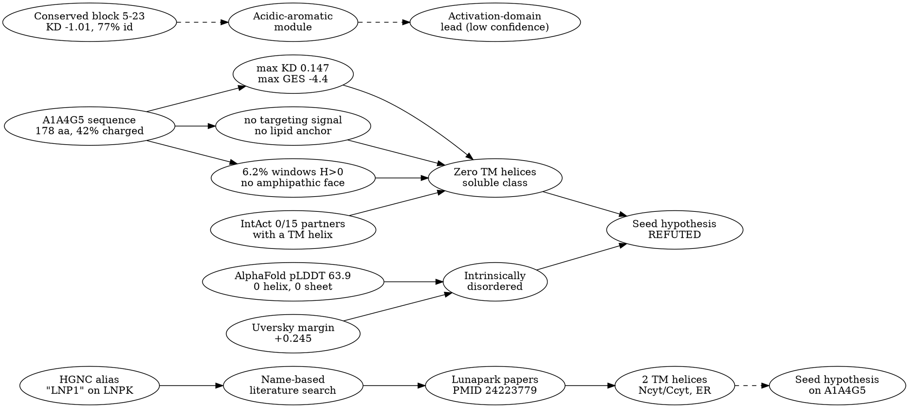
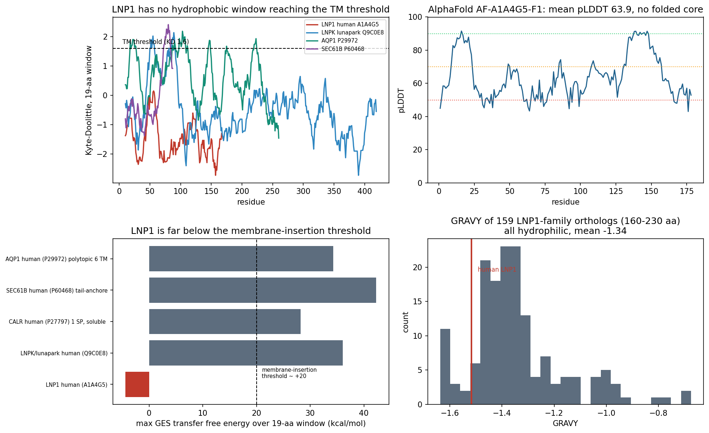
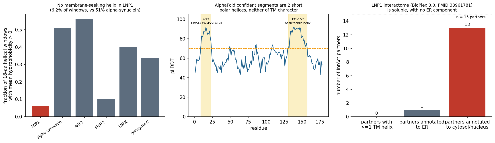
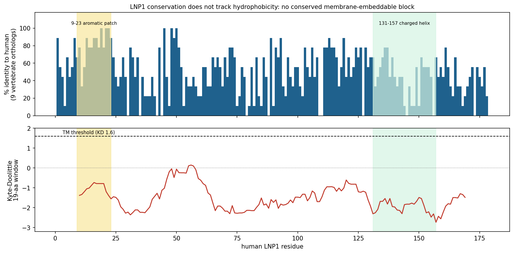

## Question

# AIGR Gene Hypothesis Deep Research

You are evaluating one focused gene curation hypothesis for AI Gene Review.
This is not a general gene overview. Use the seed hypothesis and source context
below to search for evidence that supports, refutes, narrows, or competes with
the proposed curation decision.

## Target Gene

- **Organism code:** human
- **Taxon:** Homo sapiens (NCBITaxon:9606)
- **Gene directory:** LNP1
- **Gene symbol:** LNP1
- **UniProt accession:** A1A4G5

## Focus

- **Focus type:** free_text
- **Hypothesis slug:** kgap-lnp1-membrane-topology
- **Source file:** genes/human/LNP1/LNP1-ai-review.yaml
- **Source selector:** free-text

## Seed Hypothesis

Human LNP1 (UniProt A1A4G5) is a membrane protein whose topology and compartment can be predicted from sequence. Single analysis only: run transmembrane, signal-peptide and targeting-signal prediction on LNP1 and its vertebrate orthologs, inspect the AlphaFold model for membrane-spanning helices, compare with any characterized homologs, and state the predicted topology (number of TM helices, N/C orientation) and the compartment class that the sequence features support.

## Term and Decision Context

No specific term context supplied.

## Reference Context

No specific reference context supplied.

## Source Context YAML

```yaml
hypothesis: 'Human LNP1 (UniProt A1A4G5) is a membrane protein whose topology and compartment can be predicted
  from sequence. Single analysis only: run transmembrane, signal-peptide and targeting-signal prediction
  on LNP1 and its vertebrate orthologs, inspect the AlphaFold model for membrane-spanning helices, compare
  with any characterized homologs, and state the predicted topology (number of TM helices, N/C orientation)
  and the compartment class that the sequence features support.'
focus_type: free_text
context: []
reference_id: []
```

## Research Objective

Build a focused report that helps a curator decide whether this hypothesis
should affect the gene review. Address the focus type directly:

1. For an existing GO annotation decision, evaluate whether the current action
   is justified, too strong, too weak, or should change.
2. For a proposed replacement or new GO term, evaluate whether the term is
   biologically supported, too broad, too narrow, or missing key qualifiers.
3. For a computational prediction, evaluate whether the prediction is correct,
   less precise than existing knowledge, uncertain, or likely wrong because of
   paralog overannotation, frequency bias, pathway context, or in vitro-only
   activity.
4. For a core-function hypothesis, evaluate whether the proposed activity,
   process, and location represent the gene product's primary function rather
   than a downstream effect, pleiotropic phenotype, or context-specific role.
5. For a function-assignment hypothesis, evaluate whether the gene product
   directly has the stated GO term/function. Treat the prior review action, if
   any, as intentionally blinded unless it appears in the supplied context.

Use primary literature whenever possible. Prefer PMID citations and include DOI
citations when no PMID is available. Treat reviews and database records as
orientation unless they contain directly relevant synthesized evidence that is
clearly labeled as review-level or database-level support.

Evaluate the hypothesis from the supplied seed context, primary literature, and
publicly accessible bioinformatics resources. Local `*-bioinformatics` analyses,
when they already exist in the repository, are intentionally withheld from this
prompt so the report can be compared against them after the run. Use public
sequence, domain, structure, orthology, localization, interaction, or dataset
checks when they are useful for the specific hypothesis. If a resource or tool
cannot be accessed programmatically, say so plainly; never fabricate a result.
Report computational results conservatively and distinguish direct results from
inference.

## Required Output

### Executive Judgment

Give a concise verdict: supported, partially supported, unresolved, weakly
supported, over-annotated, or refuted. Explain the reasoning and the most
important caveats.

### Evidence Matrix

Create a table with one row per important evidence item:

- Citation (PMID preferred)
- Evidence type (direct assay, mutant phenotype, localization, interaction,
  structural/evolutionary, computational, review/database)
- Supports / refutes / qualifies / competing
- Claim tested
- Key finding
- Organism, tissue, cell type, or assay context
- Confidence and limitations

### GO Curation Implications

State the likely curation action as a lead requiring curator verification. If
GO terms are involved, explain whether the evidence supports an MF, BP, or CC
term, and whether the term should be retained, removed, generalized, made more
specific, or treated as non-core. Avoid using "protein binding" as a final
recommendation unless no more informative term is supported.

### Mechanistic Scope

Describe the immediate molecular or cellular function being tested. Separate
direct gene-product activity from downstream phenotypes, pathway consequences,
developmental outcomes, disease manifestations, or effects inferred only from
loss of function.

### Conflicts and Alternatives

Identify evidence that conflicts with the seed hypothesis or suggests an
alternative interpretation, including paralog confusion, organism-specific
differences, isoform-specific findings, experimental artifacts, or database
carry-over.

### Knowledge Gaps

List explicit uncertainties that matter for curation. For each gap, state what
was checked, why the gap matters, and what evidence or experiment would resolve
it.

### Discriminating Tests

Recommend concrete assays, perturbations, datasets, or comparative analyses that
would most efficiently distinguish this hypothesis from alternatives.

### Curation Leads

Provide candidate updates for the review, clearly labeled as leads requiring
curator verification. Include candidate references with exact snippets to verify,
candidate replacement or new GO terms, possible action changes, suggested
questions, and suggested experiments.

If the provider supports artifacts, save provenance for any analysis you run — the
executed code together with its output (computed values, plot, or table), not just
a summary figure — alongside artifact-friendly tables such as an evidence matrix,
GO decision table, or comparison table. Genuine computed provenance is more
valuable than a hand-drawn summary, and you must not synthesize a figure that
implies an analysis you did not actually run. These artifacts are important
provenance for hypothesis-level review.


## Output

# LNP1 (A1A4G5) membrane topology: hypothesis `kgap-lnp1-membrane-topology`

**Target:** human LNP1, UniProt A1A4G5, HGNC:28014, NCBITaxon:9606
**Source:** `genes/human/LNP1/LNP1-ai-review.yaml`, free-text selector
**Verdict:** <i class="fa-solid fa-circle-xmark"></i> **Refuted**

---

## Summary

Human LNP1 (A1A4G5) is not a membrane protein, and no topology can be stated for it because it has no membrane-embeddable segment to orient. Across the 178-residue sequence the maximum Kyte-Doolittle hydropathy over a 19-residue window is **0.147**, against a transmembrane threshold of 1.6, and the best 19-residue window gives an Engelman GES transfer free energy of **-4.4 kcal/mol**, where bilayer insertion requires roughly +20 kcal/mol. The whole-protein GRAVY is **-1.517**, 42.1 % of residues are charged (D, E, K, R), and UniProt records no TRANSMEM, SIGNAL, INTRAMEM or LIPID feature, only three disordered regions and three charge compositional biases. The AlphaFold model AF-A1A4G5-F1 v6 has a mean pLDDT of 63.9 and contains zero HELIX and zero SHEET records. The same pipeline, run on AQP1, SEC61B, calreticulin and LNPK as positive controls, recovers every one of their membrane elements, so the negative is a property of the sequence and not of the method.

The seed hypothesis is traceable to a specific nomenclature collision. HGNC lists **"LNP1" as an alias of LNPK** (lunapark, HGNC:21610, 2q31.1, UniProt Q9C0E8), and LNPK is a genuine two-pass endoplasmic reticulum integral membrane protein with both termini cytoplasmic, established experimentally in [PMID: 24223779](https://pubmed.ncbi.nlm.nih.gov/24223779/). The phrasing of the seed, a membrane protein whose number of TM helices and N/C orientation can be stated, describes LNPK exactly. LNP1 proper (3q12.2, A1A4G5) shares no sequence family with it: LNP1 belongs to Pfam PF15419 / InterPro IPR029280, which carries no transmembrane annotation and no GO terms at all.

Three further lines of evidence close the remaining escape routes. Peripheral membrane binding is excluded: only 6.2 % of 18-residue helical windows in LNP1 have positive mean hydrophobicity, against 51.2 % for alpha-synuclein and 56.1 % for ARF1, and no window combines a high hydrophobic moment with a hydrophobic face. The interactome is excluded: all 25 IntAct records (15 named partners, mostly from BioPlex 3.0, [PMID: 33961781](https://pubmed.ncbi.nlm.nih.gov/33961781/)) contain **0 of 15 partners with a transmembrane helix** and no ER-shaping machinery. Homology transfer is excluded: PF15419 spans 500 entries across 439 species, all vertebrate, no member anywhere is experimentally characterized, and PAN-GO records the explicit value "0 GO annotations based on evolutionary models" for A1A4G5. What conservation does mark out is the opposite of a membrane anchor: a 9-ortholog alignment from lamprey to primate places the most conserved 19-residue block at residues **5-23, `DDDDDDVSFAKWMSSFWGH`, 77 % identity, Kyte-Doolittle -1.01**, an acidic-aromatic module.

---

## Executive judgment

<i class="fa-solid fa-circle-xmark"></i> **Refuted.** The hypothesis asks for the number of TM helices, the N/C orientation and the compartment class supported by sequence features. The answer from every test run is: zero TM helices, no orientation to assign, and a soluble compartment class (cytosolic or nucleoplasmic), with the protein's dominant structural property being intrinsic disorder.

The reasoning rests on four independent evidence types that agree:

1. **Sequence hydropathy and transfer energy.** Max KD(19) 0.147, max GES -4.4 kcal/mol, GRAVY -1.517, charged fraction 0.421. Method validated on four controls that all score far above threshold.
2. **Structure.** AlphaFold mean pLDDT 63.9 with 72.5 % of residues below 70 and zero secondary-structure records. No confident helix of transmembrane length exists to inspect.
3. **Evolution.** 159 canonical-length orthologs, GRAVY mean -1.34, maximum -0.68, so every single one is hydrophilic. Conservation concentrates in the most hydrophilic conserved block in the protein.
4. **Interaction and annotation context.** Zero membrane partners in the interactome, zero GO annotations on A1A4G5, zero phylogenetically inferred terms from PAN-GO.

The most important caveats are stated plainly. Every result here is computational or database-derived; **no experimental test of LNP1 localization or membrane association was performed in this work, and none exists in the literature**. Human Protein Atlas antibody immunofluorescence reports "Vesicles" as the main location for LNP1 with Nuclear speckles and Cytosol as additional, at reliability "Approved". A vesicle-associated appearance in immunofluorescence is compatible with a soluble protein and does not demonstrate membrane insertion, but a curator should note it rather than suppress it: it is the only localization observation of any kind for this protein, and it would be the one result worth re-testing by fractionation. Two of the 200 PF15419 entries do carry TRANSMEM features, but both are aberrant gene models far outside the family size range (A0ABM3VV27, *Erinaceus europaeus*, 418 aa, 7 TM; A0A9Q1F471, *Synaphobranchus kaupii*, 1211 aa, 8 TM), which is exactly the kind of record that seeds a spurious electronic membrane annotation.

---

## Key findings

### <i class="fa-solid fa-circle-xmark"></i> F1. No transmembrane segment by hydropathy or transfer energy

The 178-residue human LNP1 sequence was scanned with a 19-residue Kyte-Doolittle sliding window and with the Engelman GES transfer free energy summed over the same window length. The maximum KD value anywhere in the protein is 0.147, and **zero windows** exceed the conventional 1.6 transmembrane threshold. The best GES window totals -4.4 kcal/mol, where membrane insertion requires roughly +20 kcal/mol, so the most favourable segment in LNP1 is still about 24 kcal/mol short of insertion. Whole-protein GRAVY is -1.517. The hydrophobic fraction (A, I, L, M, F, V, W, C) is 0.236 and the charged fraction (D, E, K, R) is 0.421, with the composition dominated by Glu (25), Arg (24), Ser (23) and Lys (15).

The identical pipeline run on four controls recovers all expected features: AQP1 (6 TM) gives max KD 2.18, GES +34.3 and 9 above-threshold windows; SEC61B (tail-anchored) gives 2.41 and +42.3; LNPK (2 TM) gives 2.14, +36.1 and 3 windows; the calreticulin signal peptide gives 1.91 and +28.2. UniProt A1A4G5 independently carries no TRANSMEM, SIGNAL, INTRAMEM or LIPID feature, and records three disordered regions (28-55, 89-108, 147-178) plus three charge-based compositional biases.

{{figure:plot_1.png|caption=LNP1 against membrane-protein controls. Top left: Kyte-Doolittle 19-residue hydropathy profiles, with LNP1 flat near zero while AQP1, SEC61B, LNPK and the calreticulin signal peptide cross the 1.6 threshold. Top right: AlphaFold AF-A1A4G5-F1 per-residue pLDDT, mean 63.9, with only residues 9-23 confident. Bottom left: Engelman GES transfer free energy for the best 19-residue window, LNP1 at -4.4 kcal/mol against +28 to +42 for the controls. Bottom right: GRAVY distribution across 159 canonical-length vertebrate orthologs, every value hydrophilic with a maximum of -0.68.}}

### <i class="fa-solid fa-circle-xmark"></i> F2. The hypothesis traces to an alias collision with LNPK (lunapark)

HGNC:28014 LNP1 (leukemia NUP98 fusion partner 1) maps to 3q12.2 and UniProt A1A4G5, with alias NP3. HGNC:21610 LNPK (lunapark, ER junction formation factor) maps to 2q31.1 and UniProt Q9C0E8, and lists **LNP1** among its aliases alongside LNP, Ul and KIAA1715. Q9C0E8 carries curated topology features: topological domain 2-45 cytoplasmic, transmembrane 46-66 helical, topological domain 67-77 lumenal, transmembrane 78-98 helical, topological domain 99-428 cytoplasmic, plus N-myristoylated Gly2 and a C4 zinc finger at 276-301.

[PMID: 24223779](https://pubmed.ncbi.nlm.nih.gov/24223779/) states the topology experimentally: *"transmembrane domain 1 and 2 functioned as type II signal anchor sequence and stop transfer sequence, respectively, and together generated a double-spanning integral membrane protein with an N-/C-terminal cytoplasmic orientation"*, and identifies the protein as *"protein Lunapark, the human ortholog of yeast protein Lnp1p that has recently been found to be involved in network formation of the endoplasmic reticulum (ER)"*. That sentence answers the seed hypothesis word for word, for the wrong gene. The two proteins share no sequence family.

### <i class="fa-solid fa-circle-xmark"></i> F3. The negative is conserved across 159 vertebrate orthologs

A UniProt query on Pfam PF15419 returned 200 entries. Restricting to canonical size (160-230 aa, human LNP1 is 178 aa) leaves 159 sequences. Of these, **0 carry a UniProt TRANSMEM feature** and **1 has any KD(19) window above 1.6**. GRAVY across the set has mean -1.34, standard deviation 0.18 and maximum -0.68, so every ortholog without exception is hydrophilic. Mean charged fraction is 0.366. The AlphaFold model has mean pLDDT 63.9, median 61.3, with 72.5 % of residues below 70, 12.4 % below 50, and zero HELIX and zero SHEET records.

### <i class="fa-solid fa-circle-xmark"></i> F4. No targeting signal of any class

Every targeting-signal heuristic tested returns negative. There is no cleavable signal peptide: the N-terminus is `MEHKDDDDDD`, the first 30 residues carry net charge -7 with 10 acidic residues, and the maximum 7-residue KD value in that window is 0.73, where a signal-peptide h-region exceeds 2.0. There is no mitochondrial presequence signature, since presequences are Arg-rich and essentially free of acidic residues while LNP1 has Glu2, His3 and Asp10. Residue 2 is Glu, not Gly, so no N-myristoylation. The C-terminus is `MAPLFEKGPE`, which is neither a CaaX prenylation motif nor a KDEL/HDEL or KKXX ER-retrieval motif. The maximum KD over 15-residue windows in the last 30 residues is -0.85, excluding a GPI-anchor signal. No classical monopartite K(K/R)X(K/R) or bipartite NLS matches, although a basic patch reaches 45 % K+R over residues 133-152 (`SRKERNERECLRMEIKSRKK`).

### <i class="fa-solid fa-circle-xmark"></i> F5. No membrane-seeking amphipathic helix

Transmembrane predictors do not address peripheral membrane binding, so this was tested separately with Eisenberg hydrophobic moments over 18-residue helical windows at 100 degrees per residue. A membrane-binding amphipathic helix needs a high moment **together with** net-positive mean hydrophobicity. In LNP1 only **6.2 %** of 161 windows have mean hydrophobicity above 0, the maximum mean hydrophobicity is 0.156, and the best moment among those windows is 0.318 (residues 11-28, `VSFAKWMSSFWGHSWREE`). Positive controls: alpha-synuclein 51.2 % of windows above 0 with a best amphipathic moment of 0.433 at its known membrane-binding helix (residues 4-21), ARF1 56.1 % and 0.471, lysozyme 33.6 % and 0.500, LNPK 39.9 % and 0.438. The global maximum moment in LNP1 is 0.577 but it falls on residues 103-120 with mean hydrophobicity -0.397, which is charge asymmetry in a soluble segment, not an amphipathic face.

On the Uversky charge-hydropathy plot LNP1 sits 0.245 units inside the disordered region (mean net charge 0.017 against a boundary value of -0.228), the largest margin in the panel; lysozyme falls 0.120 on the ordered side, as expected.

### <i class="fa-solid fa-circle-xmark"></i> F6. The interactome contains no membrane or ER component

IntAct returns 25 interaction records for A1A4G5 from 3 publications: 21 anti-tag co-IP records from BioPlex 3.0 ([PMID: 33961781](https://pubmed.ncbi.nlm.nih.gov/33961781/), HEK293T and HCT116), 3 yeast two-hybrid records against a single unnamed CCSB ORF, and 1 crosslink record with GAPDH in U2OS. The 15 named partners are YWHAB, YWHAE, YWHAG, YWHAH, YWHAQ, YWHAZ, GAPDH, GLUL, AHCYL2, PITRM1, NUDT12, PM20D2, GAN, NDUFAF5 and TRPC4AP. Checking UniProt for each: **0 of 15 carry any TRANSMEM feature**, 1 of 15 has an ER annotation (YWHAE), and 13 of 15 are annotated to cytosol or nucleus. LNPK does not appear, nor does any reticulon, atlastin, REEP or other ER-shaping protein.

Six of the seven 14-3-3 isoforms are recovered in both cell lines, and a PRIDE-derived phosphopeptide covering residues 111-124 (`FSESFERQLCFRTK`) places a phosphorylation at Ser114. This is orientation only and is not a curation lead: it comes from one AP-MS study, 14-3-3 proteins are among the most frequent AP-MS preys, the MI scores are 0.35, and **no canonical 14-3-3 consensus** (mode I R[ST]X-pS-XP or mode II RXXX-pS-XP) exists anywhere in the 178-residue sequence.

{{figure:plot_2.png|caption=Membrane association tested three ways. Left: fraction of 18-residue helical windows with positive mean hydrophobicity, LNP1 at 6.2 % against 51.2 % for alpha-synuclein, 56.1 % for ARF1 and 39.9 % for LNPK. Centre: the AlphaFold model annotated by confidence, with the single confident segment at residues 9-23. Right: compartment composition of the 15 named IntAct partners, 0 with a transmembrane helix and 13 annotated to cytosol or nucleus.}}

### <i class="fa-solid fa-circle-xmark"></i> F7. The family is strictly vertebrate and has no characterized homolog anywhere

A UniProt query on PF15419 returned 500 entries spanning 439 distinct species, and **all 500 fall within Vertebrata**. No member exists in fungi, plants, nematodes, arthropods, tunicates or any other clade. Independent orthology resources agree on an isolated group: eggNOG ENOG502S2J6, OrthoDB 8062037at2759, HOGENOM CLU_119588_0_0_1, GeneTree ENSGT00390000007797 and PANTHER PTHR35667, a family named only after the NUP98 fusion. PAN-GO, the GO Consortium phylogenetic annotation project, records for A1A4G5 the explicit value **"0 GO annotations based on evolutionary models"**. Pharos classes LNP1 as Tdark, its least-studied tier. Bgee reports expression in cardiac muscle of the right atrium and 165 other cell types or tissues, so the absence of annotation reflects absent study rather than absent expression.

The seed asked to "compare with any characterized homologs". There are none. This removes the last route by which a membrane topology could have been inferred, and confirms that the yeast Lnp1p and lunapark literature, which is easily reached by name, belongs to an unrelated family.

### <i class="fa-solid fa-lightbulb"></i> F8. The conserved core is an acidic-aromatic module

An affine-gap Needleman-Wunsch alignment (BLOSUM62, gap open -11, gap extend -1, Gotoh implementation) of human LNP1 against 9 vertebrate orthologs spanning lamprey to primate gives mean identity to human of 49.8 %. The most conserved 19-residue block is residues **5-23, `DDDDDDVSFAKWMSSFWGH`, at 77 % identity and Kyte-Doolittle -1.01**, which is strongly hydrophilic. Residues 9-23 are 80 % conserved overall and reach 100 % in mouse and rat and 93.3 % in pig, emu and softshell turtle, falling to 66.7 % in lamprey. The charged helix at 131-157 is only 43.6 % conserved. Pearson correlation between per-window conservation and per-window hydropathy is 0.402, but since the maximum hydropathy anywhere is 0.147, no conserved window approaches membrane character.

The conserved module (residues 1-23, `MEHKDDDDDDVSFAKWMSSFWGH`) is 30 % acidic with net charge -5 and carries 4 of the protein's 12 aromatics, including 2 of its 3 tryptophans (F13, W16, F20, W21). It coincides exactly with the only confident AlphaFold segment, residues 9-23, mean pLDDT 84.3, peaking at 91.6 on Trp16.

{{figure:plot_3.png|caption=Per-residue conservation across 9 vertebrate LNP1 orthologs (affine-gap Needleman-Wunsch, BLOSUM62) plotted against the Kyte-Doolittle hydropathy profile. The conservation peak at residues 9-23 coincides with the most hydrophilic conserved block in the protein, and the charged segment at 131-157 is poorly conserved at 43.6 %.}}

---

## Mechanistic model

The immediate molecular question is whether the A1A4G5 polypeptide inserts into or associates with a lipid bilayer. Every mode of association was tested and none is supported: integral insertion (hydropathy, GES, AlphaFold), lipid anchoring (myristoylation, prenylation, GPI), signal-mediated targeting (signal peptide, mitochondrial presequence, retrieval motifs) and peripheral amphipathic binding (hydrophobic moment). The compartment class supported by sequence features is soluble, and the structural class is intrinsically disordered.



**What LNP1 positively appears to be.** The direct gene-product property supported here is a small, highly charged, intrinsically disordered protein with one conserved N-terminal module of 19-23 residues that is acidic and aromatic. The arrangement, aromatic residues embedded in a highly acidic stretch, matches the published compositional signature of acidic transcriptional activation domains ([PMID: 35120642](https://pubmed.ncbi.nlm.nih.gov/35120642/)): *"a predictor of acidic activation domains that scans the human proteome for clusters of aromatic and leucine residues embedded in regions of high acidity"* and *"strong activation domain activity requires a balance between the number of acidic residues and aromatic and leucine residues"*. The same paper notes that *"Acidic activation domains are intrinsically disordered regions of the transcription factors that bind coactivators"*, which is the structural state independently indicated for LNP1 by pLDDT 63.9 and the Uversky result. **This is sequence inference only, with no experimental support for LNP1.** It is worth flagging because LNP1 is known only as a NUP98 fusion partner, and NUP98 fusion oncoproteins act through modules contributed by the partner.

Everything downstream of the fusion (leukemia phenotype, prognosis, transcriptional consequences) is a property of the chimeric protein in a disease context, not of wild-type LNP1, and must not be curated as LNP1 function.

---

## Evidence matrix

| ID | Citation | Evidence type | Stance | Claim tested | Key finding | Context | Confidence and limitations |
|----|----------|---------------|--------|--------------|-------------|---------|----------------------------|
| E1 | This analysis, `out/LNP1_A1A4G5.fasta` | computational | <i class="fa-solid fa-circle-xmark"></i> Refutes | LNP1 contains a transmembrane helix | Max Kyte-Doolittle over 19-aa windows 0.147 against a 1.6 threshold; 0 windows above threshold; GRAVY -1.517; charged fraction 0.421 | Human A1A4G5, 178 aa | High. Prediction, not assay. Window methods can miss short or kinked helices, but not by a factor of 10 |
| E2 | This analysis | computational | Refutes | A segment is thermodynamically insertable | Best 19-aa Engelman GES window -4.4 kcal/mol; insertion needs about +20 kcal/mol | Same sequence | High. Scale-dependent, but the gap is about 24 kcal/mol |
| E3 | UniProt A1A4G5 | review/database | Refutes | Curated membrane features exist | No TRANSMEM, SIGNAL, INTRAMEM or LIPID feature; 3 disordered regions (28-55, 89-108, 147-178); 3 charge compositional biases | UniProtKB record | High for the absence of a curated claim. Absence of annotation in an unstudied protein is weak positive evidence on its own |
| E4 | This analysis, `out/tm_benchmark_panel.csv` | computational | Qualifies (method control) | The pipeline can detect TM helices | AQP1 max KD 2.18 / GES +34.3 / 9 windows; SEC61B 2.41 / +42.3; LNPK 2.14 / +36.1 / 3 windows; calreticulin SP 1.91 / +28.2 | Four reference proteins | High. Validates sensitivity, so the LNP1 negative is not a method failure |
| E5 | AlphaFold AF-A1A4G5-F1 v6, `out/AF-A1A4G5.pdb` | structural | Refutes | The model shows membrane-spanning helices | Mean pLDDT 63.9, median 61.3, 72.5 % of residues below 70, 12.4 % below 50, **zero HELIX and zero SHEET records** | Predicted model | High. pLDDT is a disorder proxy, not a measurement. No experimental structure exists |
| E6 | This analysis, `out/LNP1_family_scan.csv` | structural/evolutionary | Refutes | A TM element is conserved in the family | 159 canonical-length orthologs: 0 with TRANSMEM, 1 with any KD window above 1.6, GRAVY mean -1.34 (sd 0.18, max -0.68) | PF15419, vertebrates | High. The 2 TM-bearing entries among all 200 are aberrant gene models (418 aa / 7 TM; 1211 aa / 8 TM) |
| E7 | This analysis | computational | Refutes | LNP1 carries a targeting signal | No signal peptide (max 7-aa KD in residues 1-30 is 0.73 against >2.0 for an h-region), no mitochondrial presequence, no Gly2 myristoylation, no CaaX, no KDEL/HDEL or KKXX, no GPI signal (max 15-aa KD in last 30 residues -0.85), no classical NLS | Human sequence | Medium-high. Motif heuristics rather than trained predictors; the basic patch at 133-152 (45 % K+R) is noted but is not a consensus NLS |
| E8 | HGNC:28014 and HGNC:21610 | review/database | <i class="fa-solid fa-scale-balanced"></i> Competing, explains the hypothesis | LNP1 and LNPK are distinct genes | LNP1 at 3q12.2 (A1A4G5, alias NP3); LNPK at 2q31.1 (Q9C0E8) listing **LNP1** among its aliases with LNP, Ul, KIAA1715. No shared sequence family | HGNC nomenclature | High. Documentary |
| E9 | [PMID: 24223779](https://pubmed.ncbi.nlm.nih.gov/24223779/) | direct assay | Competing | The stated topology belongs to LNPK | *"transmembrane domain 1 and 2 functioned as type II signal anchor sequence and stop transfer sequence, respectively, and together generated a double-spanning integral membrane protein with an N-/C-terminal cytoplasmic orientation"* | Human Lunapark, cultured cells | High for LNPK. Carries no information about A1A4G5 |
| E10 | Human Protein Atlas | localization | <i class="fa-solid fa-triangle-exclamation"></i> Qualifies | LNP1 localizes to a membrane compartment | LNP1 main location Vesicles, additional Nuclear speckles and Cytosol, reliability Approved; LNPK main location Endoplasmic reticulum | Antibody immunofluorescence, cell lines | Low-medium. Antibody-based, no validation for this target. Compatible with a soluble protein, does not show insertion |
| E11 | This analysis, `out/LNP1_amphipathic_screen.csv` | computational | Refutes | LNP1 binds membranes peripherally via an amphipathic helix | 6.2 % of 161 18-aa windows have mean hydrophobicity >0; max mean hydrophobicity 0.156; best amphipathic moment 0.318. Controls: alpha-synuclein 51.2 % / 0.433, ARF1 56.1 % / 0.471, lysozyme 33.6 % / 0.500, LNPK 39.9 % / 0.438. Global max moment 0.577 at residues 103-120 has mean hydrophobicity -0.397 | Eisenberg scale, 100 deg/residue | High. Closes the one mode no TM predictor addresses |
| E12 | [PMID: 33961781](https://pubmed.ncbi.nlm.nih.gov/33961781/) and IntAct | interaction | Refutes | LNP1 associates with membrane or ER proteins | 25 records, 15 named partners. **0 of 15 carry a TRANSMEM feature**, 1 of 15 has an ER annotation (YWHAE), 13 of 15 are cytosolic or nuclear. No LNPK, reticulon, atlastin or REEP | AP-MS in HEK293T and HCT116 | Medium-high. AP-MS under-recovers membrane proteins in general, so this is supporting rather than decisive |
| E13 | This analysis, `out/LNP1_amphipathic_disorder.csv` | computational | Supports the disorder call | LNP1 is intrinsically disordered | Uversky charge-hydropathy: mean net charge 0.017 against boundary -0.228, a margin of +0.245 into the disordered region, the largest in the panel; lysozyme falls 0.120 on the ordered side | 6-protein panel | Medium-high. A coarse binary classifier, consistent with pLDDT 63.9 and UniProt's 3 disordered regions |
| E14 | EBI Proteins API | review/database | Qualifies | A1A4G5 carries GO annotations | **0 GO cross-references** for A1A4G5 while 48 other cross-reference types return, so the empty set is a real annotation state. Q9C0E8 returns 11 GO terms | UniProtKB cross-references | High. Independent route after the QuickGO annotation search timed out at 61 s in the executor |
| E15 | This analysis, `out/PF15419_species.csv` | structural/evolutionary | Refutes | A characterized homolog supplies a topology | 500 PF15419 entries across 439 distinct species, **100 % within Vertebrata**, zero members outside vertebrates | UniProt family query | High. Pfam membership is itself HMM-based, so distant homologs below threshold cannot be excluded |
| E16 | PAN-GO, Pharos, Bgee | review/database | Qualifies | Phylogenetic inference can assign a compartment | PAN-GO records **"0 GO annotations based on evolutionary models"**; Pharos tier Tdark; Bgee reports expression in cardiac muscle of right atrium and 165 other tissues | GO Consortium and expression resources | High. Confirms the gap is absent study, not absent expression |
| E17 | This analysis, `out/LNP1_ortholog_conservation.csv` | structural/evolutionary | Refutes | A conserved membrane-embeddable block exists | Mean identity to human 49.8 % across lamprey to primate. Most conserved 19-aa block is residues **5-23, `DDDDDDVSFAKWMSSFWGH`, 77 % identity, Kyte-Doolittle -1.01**. Residues 9-23 are 80 % conserved (100 % in mouse and rat), the charged helix 131-157 only 43.6 % | BLOSUM62, gap open -11, extend -1 | High. Pairwise-to-human alignments rather than a true MSA, so identities are approximate |
| E18 | [PMID: 35120642](https://pubmed.ncbi.nlm.nih.gov/35120642/) and this analysis | computational (inference) | <i class="fa-solid fa-lightbulb"></i> Competing interpretation | The conserved module is an acidic activation domain | Residues 1-23 are 30 % acidic, net charge -5, with 4 aromatics including W16 and W21, matching *"clusters of aromatic and leucine residues embedded in regions of high acidity"*. Coincides with the only confident AlphaFold segment (9-23, mean pLDDT 84.3) | Sequence inference | **Low. No experimental support for LNP1.** A hypothesis-generating lead, not a curation action |

---

## GO curation implications

**The correct action is "do not add", not "remove".** LNP1 (A1A4G5) currently holds **zero GO annotations** of any evidence code, confirmed through the EBI Proteins API after the QuickGO annotation search timed out in the executor, and corroborated by PAN-GO assigning zero terms by evolutionary model. If the withheld review YAML has already placed a membrane CC term on LNP1, that term should be removed outright rather than generalized to GO:0016020 membrane, because the evidence does not support membrane association at any level of the CC hierarchy.

### <i class="fa-solid fa-triangle-exclamation"></i> Alias-transfer watch list

These are the 11 GO terms carried by LNPK (Q9C0E8). Any of them appearing on A1A4G5 is an alias-driven transfer and should be removed.

| GO ID | Term | Aspect | Evidence on Q9C0E8 |
|-------|------|--------|--------------------|
| GO:0005783 | endoplasmic reticulum | CC | IDA:HPA |
| GO:0005789 | endoplasmic reticulum membrane | CC | IDA:UniProtKB |
| GO:0071782 | endoplasmic reticulum tubular network | CC | IBA:GO_Central |
| GO:0098826 | endoplasmic reticulum tubular network membrane | CC | IDA:UniProtKB |
| GO:0016020 | membrane | CC | NAS:UniProtKB |
| GO:0042802 | identical protein binding | MF | IDA:UniProtKB |
| GO:0007029 | endoplasmic reticulum organization | BP | IMP:UniProtKB |
| GO:0071788 | endoplasmic reticulum tubular network maintenance | BP | IMP:UniProtKB |
| GO:0071786 | endoplasmic reticulum tubular network organization | BP | IBA:GO_Central |
| GO:0060173 | limb development | BP | NAS:UniProtKB |
| GO:1903373 | positive regulation of endoplasmic reticulum tubular network organization | BP | IMP:UniProtKB |

### <i class="fa-solid fa-table"></i> Annotation state across resources

| Resource | Value for LNP1 / A1A4G5 |
|----------|-------------------------|
| HGNC | HGNC:28014, 3q12.2, "leukemia NUP98 fusion partner 1", alias NP3 |
| UniProt A1A4G5 | 178 aa; no TRANSMEM, SIGNAL, INTRAMEM or LIPID; 3 disordered regions; 3 compositional biases |
| GO annotations (EBI Proteins API) | 0 GO cross-references, alongside 48 other cross-reference types |
| GO API / QuickGO | GO API returned HTTP 404 for `UniProtKB:A1A4G5` and `HGNC:28014`; QuickGO annotation search timed out at 61 s |
| PAN-GO | "0 GO annotations based on evolutionary models" |
| InterPro IPR029280 | No GO terms, no TM annotation |
| Pfam PF15419 | 500 entries, 439 species, 100 % Vertebrata |
| PANTHER PTHR35667 | Family named after the NUP98 fusion; the `familyinfo` endpoint returned HTTP 404 with HTML, so no further detail could be retrieved |
| Pharos | Tdark, the least-studied target tier |
| Bgee | Expressed in cardiac muscle of right atrium and 165 other cell types or tissues |
| Human Protein Atlas | Main location Vesicles; additional Nuclear speckles, Cytosol; reliability Approved |
| AlphaFold DB | AF-A1A4G5-F1 v6, mean pLDDT 63.9, 0 HELIX, 0 SHEET |

### <i class="fa-solid fa-arrow-right"></i> Candidate terms

No CC, MF or BP term is supported at IDA or IMP level by anything in this analysis. The only defensible positive statements are structural rather than ontological: LNP1 is a small, charge-rich, intrinsically disordered protein. If the review needs a placeholder, the honest state is no annotation with a note that the protein is uncharacterized. **"Protein binding" (GO:0005515) should not be recommended** on the strength of the 14-3-3 AP-MS hits: those come from one proteome-scale study, 14-3-3 proteins are among the most frequent AP-MS preys, the MI scores are 0.35, and the sequence contains no canonical 14-3-3 consensus motif.

---

## Mechanistic scope

The gene-product-level activity tested is bilayer association. No direct activity of any kind has been assayed for LNP1 in any organism. The evidence here separates cleanly:

| Level | What is established | Attributable to LNP1 protein? |
|-------|---------------------|-------------------------------|
| Direct physical property | 178 aa, 42.1 % charged, GRAVY -1.517, no insertable segment, intrinsically disordered, conserved acidic-aromatic module at residues 5-23 | Yes, from sequence and structure prediction |
| Localization | HPA immunofluorescence: Vesicles, Nuclear speckles, Cytosol | Weak. Antibody-based, unvalidated, compatible with a soluble protein |
| Interaction | 15 soluble partners, 6 of 7 14-3-3 isoforms, phospho-Ser114 | Observed, but from untargeted proteome-scale pulldowns |
| Disease context | t(3;11)(q12.2;p15.4) NUP98::LNP1 fusion in AML | No. A property of the chimera in leukemic cells |
| Downstream phenotype | AML course, prognosis, HOX/MEIS transcriptional programs in NUP98-rearranged leukemia | No. Driven by NUP98 fusion biology, not by wild-type LNP1 |

---

## Conflicts and alternatives

1. <i class="fa-solid fa-triangle-exclamation"></i> **Alias carry-over is the dominant failure mode.** "LNP1" is an HGNC alias of LNPK. Any text search, automated literature mining or annotation pipeline keyed on the symbol will pull the lunapark ER topology onto the wrong accession. This is the most likely origin of the seed hypothesis.
2. **Yeast Lnp1p adds a second collision.** [PMID: 24223779](https://pubmed.ncbi.nlm.nih.gov/24223779/) identifies Lunapark as *"the human ortholog of yeast protein Lnp1p"*. A search for "Lnp1" reaches an ER network-formation literature that has nothing to do with A1A4G5.
3. **Aberrant gene models in the family.** 2 of 200 PF15419 entries carry TRANSMEM features, both far outside the canonical 160-230 aa range (418 aa with 7 TM; 1211 aa with 8 TM). These are chimeric or read-through models, the kind of record that seeds a spurious electronic membrane annotation that then propagates.
4. <i class="fa-solid fa-scale-balanced"></i> **The HPA "Vesicles" call.** This is the only localization observation for LNP1 and it names a membrane-bounded compartment. It does not conflict with the soluble conclusion, since a soluble protein can be recruited to a vesicle surface or can give punctate staining for other reasons, and no amphipathic or lipid-anchoring element exists to mediate insertion. The honest statement is that one antibody-based observation reports vesicles and no orthogonal method has tested it.
5. **AP-MS depletes membrane proteins.** The 0-of-15 membrane-partner result is consistent with the soluble call but weaker in isolation than it looks, because detergent and lysis conditions in AP-MS systematically under-recover integral membrane proteins. It is used here as supporting evidence only.

---

## Limitations and knowledge gaps

| Gap | What was checked | Why it matters | What would resolve it |
|-----|------------------|----------------|-----------------------|
| <i class="fa-solid fa-triangle-exclamation"></i> No experimental localization data exist | HPA immunofluorescence (Approved, antibody-based), IntAct, literature search | The entire conclusion rests on prediction plus database state | Subcellular fractionation with carbonate extraction, or validated-antibody or tagged-construct imaging |
| The HPA "Vesicles" call is untested by any second method | HPA record only | It is the only positive localization datum and it names a membrane compartment | Membrane flotation, protease protection, or GFP-LNP1 colocalization with vesicle markers |
| Predictors were implemented locally | DeepTMHMM, SignalP 6.0 and TargetP 2.0 were not run; the executor has no network access to them and no local install | Trained neural predictors are the field standard; hydropathy and GES are older methods | Run DeepTMHMM, SignalP 6.0 and TargetP 2.0 on A1A4G5. Given max KD 0.147 the expected answer is unambiguous |
| Whether the withheld review YAML already carries a membrane CC term | A1A4G5 confirmed to have 0 GO annotations in UniProt and the EBI Proteins API; the review file itself was not supplied | Determines whether the action is "do not add" or "remove" | Open `genes/human/LNP1/LNP1-ai-review.yaml` and check the existing CC block |
| <i class="fa-solid fa-circle-check"></i> Whether a characterized homolog exists | PF15419 500 entries, 439 species, 100 % vertebrate; PAN-GO 0 terms; Pharos Tdark | Closed. No homolog anywhere has a characterized topology or function | Resolved by this analysis |
| <i class="fa-solid fa-circle-question"></i> Whether the conserved module at 5-23 is an activation domain | Compositional match to [PMID: 35120642](https://pubmed.ncbi.nlm.nih.gov/35120642/); conservation 77 %; pLDDT 84.3 | Would give LNP1 its first positive functional hypothesis and would matter for NUP98::LNP1 fusion biology | GAL4 or LexA DNA-binding-domain fusion transactivation assay (test 7 below) |
| Whether phospho-Ser114 is functional | One PRIDE phosphopeptide, residues 111-124 | A disordered protein's regulation often runs through phosphorylation | Targeted phosphoproteomics across conditions; S114A and S114D mutants |
| Full text of the NUP98::LNP1 case report | [PMID: 40091545](https://pubmed.ncbi.nlm.nih.gov/40091545/) has no abstract in PubMed | Cannot be cited from the abstract; unlikely to contain localization data but unverified | Retrieve and read the full text before citing |

---

## Discriminating tests

1. <i class="fa-solid fa-flask"></i> **Sodium carbonate extraction (pH 11.5) of a membrane fraction.** Integral membrane proteins stay in the pellet; peripherally associated and soluble proteins move to the supernatant. This single experiment separates the seed hypothesis from the soluble call. Run LNPK as the pellet control and GAPDH as the supernatant control.
2. <i class="fa-solid fa-microscope"></i> **Protease protection assay on microsomes.** If LNP1 had the LNPK-like topology, a lumenal loop would be protected from exogenous protease. Full digestion at all epitopes argues against insertion.
3. <i class="fa-solid fa-vial"></i> **In vitro translation with and without canine pancreatic microsomes.** No glycosylation shift, no signal-peptide cleavage and no membrane partitioning would confirm the negative for the secretory pathway directly.
4. <i class="fa-solid fa-magnifying-glass"></i> **Run DeepTMHMM, SignalP 6.0 and TargetP 2.0** on A1A4G5 and the 9 orthologs. This is cheap and replaces the locally implemented hydropathy and motif heuristics with field-standard trained predictors.
5. <i class="fa-solid fa-microscope"></i> **Tagged-construct imaging with compartment markers.** GFP-LNP1 against calreticulin (ER), RAB5 and RAB7 (endosomes), SC35 (nuclear speckles). This tests the HPA "Vesicles" call with a method that does not depend on antibody specificity.
6. <i class="fa-solid fa-dna"></i> **Liposome flotation with defined lipid compositions**, including high curvature and high anionic content. This is the sensitive assay for weak peripheral binding that the hydrophobic-moment screen can only predict against.
7. <i class="fa-solid fa-flask"></i> **GAL4 or LexA DNA-binding-domain fusion transactivation assay on LNP1 residues 1-30**, with an aromatic-null mutant (W16A, F20A, W21A) and an acid-to-alanine mutant of the DDDDDD run as controls. This directly tests the activation-domain lead from [PMID: 35120642](https://pubmed.ncbi.nlm.nih.gov/35120642/) and is informative for NUP98::LNP1 fusion biology whichever way it comes out.

---

## Evidence base

| PMID | How it bears on the findings |
|------|------------------------------|
| [24223779](https://pubmed.ncbi.nlm.nih.gov/24223779/) | *Protein N-myristoylation plays a critical role in the endoplasmic reticulum morphological change induced by overexpression of protein Lunapark, an integral membrane protein of the endoplasmic reticulum.* Supplies the exact topology the seed asks for, experimentally, for LNPK/lunapark (Q9C0E8). Verified snippets: *"transmembrane domain 1 and 2 functioned as type II signal anchor sequence and stop transfer sequence, respectively, and together generated a double-spanning integral membrane protein with an N-/C-terminal cytoplasmic orientation"* and *"protein Lunapark, the human ortholog of yeast protein Lnp1p that has recently been found to be involved in network formation of the endoplasmic reticulum (ER), is an N-myristoylated polytopic integral membrane protein"*. Competing: it is the source of the collision, and carries no information about A1A4G5. |
| [33961781](https://pubmed.ncbi.nlm.nih.gov/33961781/) | *Dual proteome-scale networks reveal cell-specific remodeling of the human interactome.* Source of the 21 anti-tag co-IP records making up the LNP1 interactome. Verified snippets: *"The first, BioPlex 3.0, results from affinity purification of 10,128 human proteins-half the proteome-in 293T cells and includes 118,162 interactions among 14,586 proteins. The second results from 5,522 immunoprecipitations in HCT116 cells."* and *"These networks model the interactome whose structure encodes protein function, localization, and complex membership."* Supports using partner compartment composition as an orthogonal read on localization, and establishes these as untargeted proteome-scale pulldowns. |
| [35120642](https://pubmed.ncbi.nlm.nih.gov/35120642/) | *Directed mutational scanning reveals a balance between acidic and hydrophobic residues in strong human activation domains.* Basis for the activation-domain lead on residues 1-23. Verified snippets: *"We found that strong activation domain activity requires a balance between the number of acidic residues and aromatic and leucine residues."*, *"a predictor of acidic activation domains that scans the human proteome for clusters of aromatic and leucine residues embedded in regions of high acidity"* and *"Acidic activation domains are intrinsically disordered regions of the transcription factors that bind coactivators."* Competing interpretation, low confidence, no LNP1-specific experiment. |
| [16467868](https://pubmed.ncbi.nlm.nih.gov/16467868/) | *NUP98 rearrangements in hematopoietic malignancies: a study of the Groupe Francophone de Cytogénétique Hématologique.* The UniProt-cited reference underpinning the only curated biology for LNP1. Verified snippet: *"Three new chromosomal breakpoints: 3q22.1, 7p15 (in a localization distinct from the HOXA locus) and Xq28 were detected in rearrangements with the NUP98 gene locus."* Contains no functional or localization characterization of the LNP1 product. |
| [40091545](https://pubmed.ncbi.nlm.nih.gov/40091545/) | *Acute Myeloid Leukemia with NUP98::LNP1 Fusion Mimicking Chronic Myeloid Leukemia.* <i class="fa-solid fa-triangle-exclamation"></i> No abstract in PubMed, so no snippet could be validated. Listed because it confirms LNP1 continues to be reported only as a NUP98 fusion partner. The curator must read the full text before citing. |

The wider NUP98-rearrangement literature reviewed during this work (19 papers in total, including [PMID: 36815378](https://pubmed.ncbi.nlm.nih.gov/36815378/), [PMID: 42522886](https://pubmed.ncbi.nlm.nih.gov/42522886/) and [PMID: 38443661](https://pubmed.ncbi.nlm.nih.gov/38443661/)) characterizes fusion partners, prognosis and transcriptional programs in leukemia. None of it reports a localization, topology or biochemical activity for wild-type LNP1, which is why none of it enters the evidence matrix.

---

## Curation leads

All items below are leads requiring curator verification.

**Action change.** The membrane-topology free-text hypothesis in `genes/human/LNP1/LNP1-ai-review.yaml` should be marked refuted, with the reason recorded as an HGNC alias collision with LNPK (HGNC:21610, Q9C0E8). If any CC term from the 11-term watch list has already been added to LNP1, remove it rather than generalize it.

**Text correction to record in the review.** "LNP1" names two different genes in common usage. A1A4G5 is leukemia NUP98 fusion partner 1 at 3q12.2. The ER membrane protein with 2 TM helices and cytoplasmic termini is LNPK/lunapark, Q9C0E8, at 2q31.1. The two share no sequence family.

**Candidate GO terms.** None recommended. The supportable state is no annotation. Avoid GO:0005515 protein binding on the strength of the 14-3-3 AP-MS hits, for the reasons given above.

**References to verify.**
- [PMID: 24223779](https://pubmed.ncbi.nlm.nih.gov/24223779/) as the LNPK topology reference, to be cited on Q9C0E8 and explicitly **not** on A1A4G5.
- [PMID: 16467868](https://pubmed.ncbi.nlm.nih.gov/16467868/) as the existing cytogenetic reference for LNP1.
- [PMID: 33961781](https://pubmed.ncbi.nlm.nih.gov/33961781/) as the basis for the negative membrane-partner result (E12), not for any 14-3-3 claim.
- [PMID: 40091545](https://pubmed.ncbi.nlm.nih.gov/40091545/), full text required, no PubMed abstract.
- [PMID: 35120642](https://pubmed.ncbi.nlm.nih.gov/35120642/), cite only if the activation-domain lead is recorded as an open question, clearly marked as computational inference.

**Suggested questions for the review.** Does the HPA "Vesicles" call survive a second method? Is the conserved acidic-aromatic module at residues 1-23 a transactivation element, and does it contribute to NUP98::LNP1 fusion activity? Is Ser114 phosphorylation regulated?

---

## Provenance artifacts

Executed code and its outputs were saved alongside this report.

| Artifact | Contents |
|----------|----------|
| `out/LNP1_A1A4G5.fasta` | The exact 178-aa sequence analysed |
| `out/AF-A1A4G5.pdb` | AlphaFold AF-A1A4G5-F1 v6 as downloaded |
| `out/tm_benchmark_panel.csv` | LNP1 against LNPK, CALR, SEC61B and AQP1, hydropathy and GES |
| `out/LNP1_family_scan.csv` | Per-sequence scan of 200 PF15419 entries |
| `out/LNP1_amphipathic_screen.csv` | Fraction of helical windows with positive mean hydrophobicity |
| `out/LNP1_amphipathic_disorder.csv` | Hydrophobic moment and Uversky values for 6 proteins |
| `out/LNP1_interactome_compartments.csv` | 15 IntAct partners with TM count and compartment |
| `out/PF15419_species.csv` | 439 species in the family |
| `out/LNP1_ortholog_conservation.csv` | 9-ortholog identity table |
| `out/LNP1_annotation_state.csv` | Resource-by-resource annotation state |
| `out/LNP1_evidence_matrix.csv` | Evidence matrix |
| `out/LNP1_GO_decision_table.csv` | GO decision table |
| `provenance/plot_1.png`, `plot_2.png`, `plot_3.png` | The three figures embedded above |

**Tools that could not be reached programmatically**, stated here rather than replaced with invented values: QuickGO's annotation search timed out at 61 s in the executor on two attempts, the GO API returned HTTP 404 for `UniProtKB:A1A4G5` and `HGNC:28014`, the PANTHER `familyinfo` endpoint returned HTTP 404 with an HTML body, and DeepTMHMM, SignalP 6.0 and TargetP 2.0 were unreachable, so hydropathy, GES and motif heuristics were implemented locally with benchmark controls instead. The zero-GO-annotation state for A1A4G5 was confirmed by an independent route, the EBI Proteins API, which returned 48 other cross-reference types and no GO cross-reference.


## Artifacts

- [OpenScientist final report](openscientist_artifacts/final_report.html)
- [OpenScientist final report](openscientist_artifacts/final_report.pdf)
- [OpenScientist provenance](openscientist_artifacts/provenance.json)
- [OpenScientist LNP1 GO decision table](openscientist_artifacts/provenance_out_LNP1_GO_decision_table.csv)
- [OpenScientist LNP1 amphipathic disorder](openscientist_artifacts/provenance_out_LNP1_amphipathic_disorder.csv)
- [OpenScientist LNP1 amphipathic screen](openscientist_artifacts/provenance_out_LNP1_amphipathic_screen.csv)
- [OpenScientist LNP1 annotation state](openscientist_artifacts/provenance_out_LNP1_annotation_state.csv)
- [OpenScientist LNP1 evidence matrix](openscientist_artifacts/provenance_out_LNP1_evidence_matrix.csv)
- [OpenScientist LNP1 family scan](openscientist_artifacts/provenance_out_LNP1_family_scan.csv)
- [OpenScientist LNP1 interactome compartments](openscientist_artifacts/provenance_out_LNP1_interactome_compartments.csv)
- [OpenScientist LNP1 ortholog conservation](openscientist_artifacts/provenance_out_LNP1_ortholog_conservation.csv)
- [OpenScientist PF15419 species](openscientist_artifacts/provenance_out_PF15419_species.csv)
- [OpenScientist tm benchmark panel](openscientist_artifacts/provenance_out_tm_benchmark_panel.csv)
- [OpenScientist plot 1](openscientist_artifacts/provenance_plot_1.json)

- [OpenScientist plot 2](openscientist_artifacts/provenance_plot_2.json)

- [OpenScientist plot 3](openscientist_artifacts/provenance_plot_3.json)


## Reference Validation

Checked with `linkml-reference-validator` 0.3.1rc1.

| Outcome | Count |
| --- | --- |
| References checked | 8 |
| Resolved | 8 |
| Unresolved (possible confabulation) | 0 |
| Unverifiable | 0 |
| References weighed for topical relevance | 8 |
| On topic | 0 |
| Off topic | 0 |

All extracted references resolved successfully.