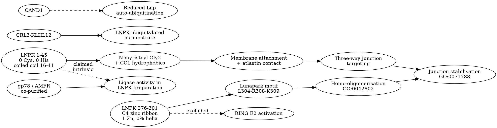
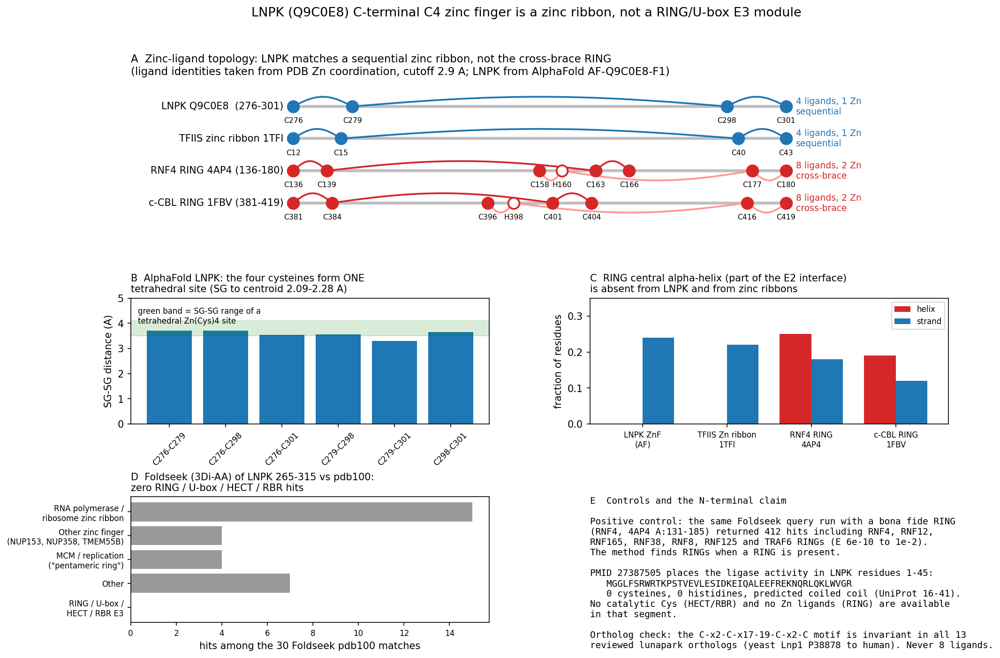
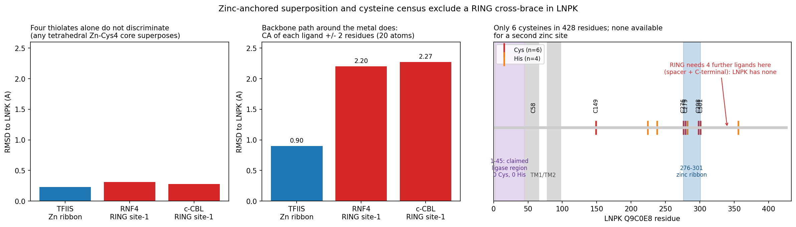
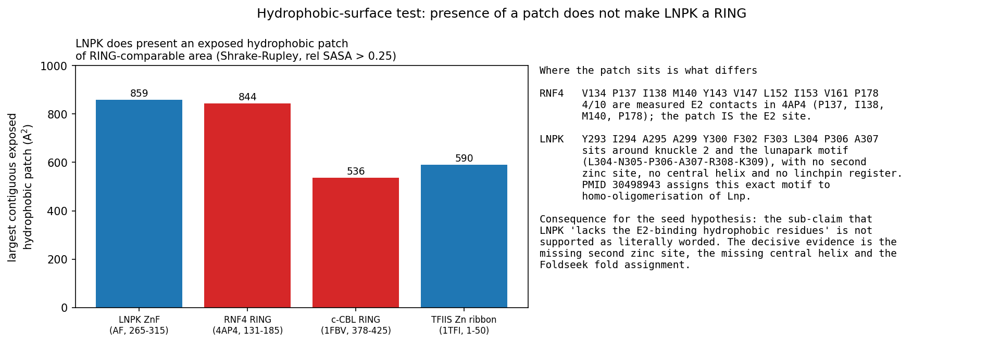

## Question

# AIGR Gene Hypothesis Deep Research

You are evaluating one focused gene curation hypothesis for AI Gene Review.
This is not a general gene overview. Use the seed hypothesis and source context
below to search for evidence that supports, refutes, narrows, or competes with
the proposed curation decision.

## Target Gene

- **Organism code:** human
- **Taxon:** Homo sapiens (NCBITaxon:9606)
- **Gene directory:** LNPK
- **Gene symbol:** LNPK
- **UniProt accession:** Q9C0E8

## Focus

- **Focus type:** free_text
- **Hypothesis slug:** kgap-lnpk-zinc-finger-e3-features
- **Source file:** genes/human/LNPK/LNPK-ai-review.yaml
- **Source selector:** free-text

## Seed Hypothesis

Human lunapark (LNPK, Q9C0E8) lacks the structural features of a RING, U-box or HECT/RBR ubiquitin ligase: its C-terminal C4-type zinc ribbon does not have the cross-brace RING zinc-ligand spacing, the E2-binding hydrophobic residues or the linchpin Arg/Lys that RING E3s use to activate E2~ubiquitin, so any ubiquitin-ligase activity attributed to purified LNPK more likely comes from an associated ligase. Single analysis only: align the LNPK zinc-binding region with RING (e.g. RNF4, CBL), U-box and zinc-ribbon domains, map the zinc ligands, E2-interface residues and linchpin position onto the LNPK AlphaFold model, compare its fold to RING and zinc-ribbon structures by Foldseek, check yeast Lnp1 and other orthologs, and state whether LNPK is predicted to have intrinsic E3 ligase capacity.

## Term and Decision Context

No specific term context supplied.

## Reference Context

No specific reference context supplied.

## Source Context YAML

```yaml
hypothesis: 'Human lunapark (LNPK, Q9C0E8) lacks the structural features of a RING, U-box or HECT/RBR
  ubiquitin ligase: its C-terminal C4-type zinc ribbon does not have the cross-brace RING zinc-ligand
  spacing, the E2-binding hydrophobic residues or the linchpin Arg/Lys that RING E3s use to activate E2~ubiquitin,
  so any ubiquitin-ligase activity attributed to purified LNPK more likely comes from an associated ligase.
  Single analysis only: align the LNPK zinc-binding region with RING (e.g. RNF4, CBL), U-box and zinc-ribbon
  domains, map the zinc ligands, E2-interface residues and linchpin position onto the LNPK AlphaFold model,
  compare its fold to RING and zinc-ribbon structures by Foldseek, check yeast Lnp1 and other orthologs,
  and state whether LNPK is predicted to have intrinsic E3 ligase capacity.'
focus_type: free_text
context: []
reference_id: []
```

## Research Objective

Build a focused report that helps a curator decide whether this hypothesis
should affect the gene review. Address the focus type directly:

1. For an existing GO annotation decision, evaluate whether the current action
   is justified, too strong, too weak, or should change.
2. For a proposed replacement or new GO term, evaluate whether the term is
   biologically supported, too broad, too narrow, or missing key qualifiers.
3. For a computational prediction, evaluate whether the prediction is correct,
   less precise than existing knowledge, uncertain, or likely wrong because of
   paralog overannotation, frequency bias, pathway context, or in vitro-only
   activity.
4. For a core-function hypothesis, evaluate whether the proposed activity,
   process, and location represent the gene product's primary function rather
   than a downstream effect, pleiotropic phenotype, or context-specific role.
5. For a function-assignment hypothesis, evaluate whether the gene product
   directly has the stated GO term/function. Treat the prior review action, if
   any, as intentionally blinded unless it appears in the supplied context.

Use primary literature whenever possible. Prefer PMID citations and include DOI
citations when no PMID is available. Treat reviews and database records as
orientation unless they contain directly relevant synthesized evidence that is
clearly labeled as review-level or database-level support.

Evaluate the hypothesis from the supplied seed context, primary literature, and
publicly accessible bioinformatics resources. Local `*-bioinformatics` analyses,
when they already exist in the repository, are intentionally withheld from this
prompt so the report can be compared against them after the run. Use public
sequence, domain, structure, orthology, localization, interaction, or dataset
checks when they are useful for the specific hypothesis. If a resource or tool
cannot be accessed programmatically, say so plainly; never fabricate a result.
Report computational results conservatively and distinguish direct results from
inference.

## Required Output

### Executive Judgment

Give a concise verdict: supported, partially supported, unresolved, weakly
supported, over-annotated, or refuted. Explain the reasoning and the most
important caveats.

### Evidence Matrix

Create a table with one row per important evidence item:

- Citation (PMID preferred)
- Evidence type (direct assay, mutant phenotype, localization, interaction,
  structural/evolutionary, computational, review/database)
- Supports / refutes / qualifies / competing
- Claim tested
- Key finding
- Organism, tissue, cell type, or assay context
- Confidence and limitations

### GO Curation Implications

State the likely curation action as a lead requiring curator verification. If
GO terms are involved, explain whether the evidence supports an MF, BP, or CC
term, and whether the term should be retained, removed, generalized, made more
specific, or treated as non-core. Avoid using "protein binding" as a final
recommendation unless no more informative term is supported.

### Mechanistic Scope

Describe the immediate molecular or cellular function being tested. Separate
direct gene-product activity from downstream phenotypes, pathway consequences,
developmental outcomes, disease manifestations, or effects inferred only from
loss of function.

### Conflicts and Alternatives

Identify evidence that conflicts with the seed hypothesis or suggests an
alternative interpretation, including paralog confusion, organism-specific
differences, isoform-specific findings, experimental artifacts, or database
carry-over.

### Knowledge Gaps

List explicit uncertainties that matter for curation. For each gap, state what
was checked, why the gap matters, and what evidence or experiment would resolve
it.

### Discriminating Tests

Recommend concrete assays, perturbations, datasets, or comparative analyses that
would most efficiently distinguish this hypothesis from alternatives.

### Curation Leads

Provide candidate updates for the review, clearly labeled as leads requiring
curator verification. Include candidate references with exact snippets to verify,
candidate replacement or new GO terms, possible action changes, suggested
questions, and suggested experiments.

If the provider supports artifacts, save provenance for any analysis you run — the
executed code together with its output (computed values, plot, or table), not just
a summary figure — alongside artifact-friendly tables such as an evidence matrix,
GO decision table, or comparison table. Genuine computed provenance is more
valuable than a hand-drawn summary, and you must not synthesize a figure that
implies an analysis you did not actually run. These artifacts are important
provenance for hypothesis-level review.


## Output

# LNPK (Q9C0E8): does the C-terminal zinc finger give lunapark intrinsic E3 ligase capacity?

**Hypothesis slug:** kgap-lnpk-zinc-finger-e3-features
**Gene:** LNPK / lunapark, *Homo sapiens*, UniProtKB Q9C0E8, 428 aa
**Source file:** `genes/human/LNPK/LNPK-ai-review.yaml`, focus type `free_text`
**Database retrievals:** 24 November 2026 (UniProt, AlphaFold DB, RCSB, PDBe, InterPro, QuickGO, IntAct, Foldseek webserver)

---

## Summary

Human lunapark is predicted to have **no intrinsic RING, U-box, HECT or RBR ubiquitin-ligase capacity**. Its C-terminal C4 module at residues 276-301 is a zinc ribbon, and this is what InterPro calls it: IPR019273, "Lunapark zinc ribbon domain" (Pfam PF10058). Across every signature database, zero RING, U-box, HECT or RBR signatures match Q9C0E8. A Foldseek structural search of the module against pdb100 returns 30 hits, all zinc-ribbon class (RNA polymerase I/II/V subunits, TMEM55B, NUP153 ZnF3, NUP358 ZnF8), with zero RING, U-box, HECT or RBR domains, while the identical pipeline run with a genuine RING as query returns 412 hits led by RNF4 at E = 6e-10 and then RNF12, RNF165, TRAF6, RNF38, RNF8 and RNF125. The conclusion of the seed hypothesis is therefore **supported**.

The reasoning given in the seed hypothesis is only **partially supported**, and two of its three structural sub-arguments should not be reused as written. Zinc-ligand spacing does not discriminate: measured ligand separations are [3,19,3] in LNPK, [3,25,3] in the TFIIS zinc ribbon, [3,24,3] in RNF4 RING site-1 and [3,17,3] in c-CBL RING site-1. Superposing the four thiolates alone gives 0.23 Å to the zinc ribbon and 0.28-0.31 Å to both RINGs, so the metal core does not discriminate either. The claim that LNPK "lacks the E2-binding hydrophobic residues" is wrong as worded: LNPK exposes a contiguous hydrophobic patch of 10 residues covering 859 Ų, essentially the same size as the RNF4 RING patch (10 residues, 844 Ų) that contains the measured E2 contacts. What is actually decisive is the chemistry of the second zinc site, the absent central α-helix, the absent linchpin register and the backbone path around the metal.

A separate and larger problem for the published ligase claim is that it was never placed on the zinc finger. Zhao et al. 2016 ([PMID: 27387505](https://pubmed.ncbi.nlm.nih.gov/27387505/)) localised the intrinsic activity to **residues 1-45**, which contain **0 cysteines and 0 histidines** in human LNPK and in all 13 reviewed lunapark orthologs. HECT and RBR catalysis requires a cysteine for thioester formation; RING and U-box require either metal ligands or a zinc-free RING-like fold of about 70 residues. A myristoylated, cysteine-free 45-residue coiled coil supplies none of these. The same study identified the RING-type ERAD ligase gp78/AMFR as a lunapark interactor and reported that part of the measured activity came from that associated ligase. No independent laboratory has replicated the intrinsic activity in the decade since.

---

## Executive judgment

### <i class="fa-solid fa-scale-balanced"></i> Verdict: supported in its conclusion, partially supported in its stated reasoning

| Component of the seed hypothesis | Status | Basis |
|---|---|---|
| LNPK has no intrinsic RING/U-box/HECT/RBR E3 capacity | <i class="fa-solid fa-circle-check"></i> Supported | No second zinc site possible, no central helix, no linchpin register, Foldseek zinc-ribbon-only under a validated control, InterPro IPR019273 |
| The C4 zinc ribbon lacks the RING cross-brace | <i class="fa-solid fa-circle-check"></i> Supported | 4 ligands, 1 Zn, sequential topology against 8 ligands, 2 Zn, interleaved in RNF4 and c-CBL |
| The cross-brace is excluded by **zinc-ligand spacing** | <i class="fa-solid fa-circle-xmark"></i> Refuted as worded | RING site-1 spacing [3,24,3] resembles the LNPK zinc ribbon [3,19,3]; thiolate RMSD 0.23-0.31 Å to all comparators |
| LNPK lacks the **E2-binding hydrophobic residues** | <i class="fa-solid fa-circle-xmark"></i> Refuted as worded | LNPK exposes a 10-residue, 859 Ų patch against RNF4's 10-residue, 844 Ų E2 patch |
| LNPK lacks the **linchpin Arg/Lys** | <i class="fa-solid fa-circle-check"></i> Supported | RNF4 R181 is at +1 after the 8th ligand; LNPK has no 8th ligand and therefore no equivalent register |
| Activity in purified LNPK more likely comes from an associated ligase | <i class="fa-solid fa-circle-check"></i> Supported | gp78/AMFR reported in the same preparation; CAND1 suppresses auto-ubiquitination; LNPK is a CRL3-KLHL12 substrate |
| The hypothesis targets the right region | <i class="fa-solid fa-triangle-exclamation"></i> Mis-targeted | The published claim is about residues 1-45, which contain 0 Cys and 0 His |

**Most important caveats.** No experimental structure of LNPK exists (PDBe `best_structures` returns 404 for Q9C0E8), so the fold assignment rests on an AlphaFold model, albeit a confident one (region mean pLDDT 92.3, min 86.6). Zinc binding has never been measured on purified LNPK. A structural argument cannot formally exclude a genuinely novel catalytic chemistry, which is exactly what Zhao et al. proposed; it can only state that none of the four known E3 mechanisms is available to this sequence.

---

## Key findings

### F001: The zinc finger has sequential zinc-ribbon topology, not RING cross-brace topology

UniProt Q9C0E8 annotates a C4-type zinc finger at 276-301. Direct sequence inventory of the 428-residue protein finds only **6 cysteines** in total (C58 inside transmembrane helix 1, C149, and the four ligands C276, C279, C298, C301) and 4 histidines (H224, H238, H282, H356). The motif is **C276-x2-C279-x18-C298-x2-C301**: four ligands supporting one zinc site.

Computed Zn coordination from deposited structures at a 2.9 Å cutoff establishes the comparison. The RNF4 RING (PDB 4AP4 chain A) has 8 ligands and 2 Zn ions in an interleaved cross-brace: Zn1 = C136, C139, C163, C166 (ligands 1, 2, 5, 6) and Zn2 = C158, H160, C177, C180 (ligands 3, 4, 7, 8). The c-CBL RING (1FBV) is topologically identical: Zn1 = C381, C384, C401, C404 and Zn2 = C396, H398, C416, C419. Classic zinc ribbons have the LNPK arrangement: TFIIS (1TFI) Zn1 = C12, C15, C40, C43; the RPB9-like domain (1QYP) Zn1 = C18, C21, C46, C49, both sequential CxxC...CxxC single sites.

In the AlphaFold model AF-Q9C0E8-F1 the four SG atoms converge on a single centroid at 2.09-2.28 Å with SG-SG distances of 3.30-3.71 Å, the geometry of one tetrahedral Zn(Cys)4 site. H282 lies 11.3 Å from that centroid and is not a ligand. The motif C-x2-C-x17-19-C-x2-C is invariant across all 13 reviewed lunapark orthologs in UniProt, including *S. cerevisiae* Lnp1 (P38878, C223/C226/C244/C247), *S. pombe* (O94414), *C. elegans* (Q17667), zebrafish, *Xenopus*, mouse and human. **No ortholog has 8 ligands.**

A U-box is excluded separately and on different grounds. The U-box (STUB1/CHIP, PDB 2C2L) is a zinc-free RING-like fold of about 70 residues stabilised by hydrogen-bond and salt-bridge networks. The LNPK module is 26 residues with an obligate metal site.

### F002: No central α-helix, no linchpin register, and zero RING hits by Foldseek under a working positive control

Backbone hydrogen-bond assignment computed on each structure gives: LNPK 265-315 (AlphaFold) **0% helix / 24% β**; TFIIS zinc ribbon 1TFI 1-50 **0% helix / 22% β**; RNF4 RING 4AP4 A:131-185 **25% helix / 18% β**; c-CBL RING 1FBV A:378-425 **19% helix / 12% β**. The RING E2-binding surface is assembled from two zinc loops plus a central α-helix. LNPK has no helix at all in this module, and matches the zinc ribbons exactly.

Interface mapping on 4AP4 at a 4.5 Å heavy-atom cutoff shows the RNF4 RING contacts the E2 UbcH5A through P137, I138, M140 (zinc loop 1), D169, S170, N173 and P178, T179, R181, and contacts the donor ubiquitin through S131, S135, P137, C158, H160, P178, T179, C180, R181, K182. **R181 is the only residue contacting both E2 and donor ubiquitin**, which makes it the linchpin, and it sits at position +1 after the eighth zinc ligand C180. LNPK has no eighth ligand, so there is no structurally equivalent position. The nearest basic residues, R308 and K309, lie 7-8 residues past the fourth ligand on a β-hairpin with no central helix behind it.

Foldseek (3Di-AA mode, search.foldseek.com API) of LNPK 265-315 against pdb100 returned **30 hits, all zinc-ribbon class**: 15 RNA polymerase and ribosome zinc-ribbon subunits (yeast Pol I chains I/X in 4C2M, 5G5L, 5N5Y; Pol II chain L in 2NVQ, 7O4J, 7B7U, 8OEU; archaeal TFS4 in 7OQY; plant Pol V in 8HIL), the TMEM55B cytosolic zinc-ribbon domain (8OQH, best hit E = 0.98), the RanBP2-type zinc fingers NUP153 ZnF3 (7MO3, 7MO4) and NUP358 ZnF8 (7MNV), and MCM replication rings. **Zero RING, U-box, HECT or RBR domains appeared.** The two keyword matches on "ring" were MCM pentameric ring assemblies, not RING domains.

The positive control is what makes this absence informative. The identical pipeline with the RNF4 RING (4AP4 A:131-185) as query returned **412 pdb100 hits** led by RNF4 RING structures (3NG2 at E = 6e-10, then 2XEU, 5AIU, 2EA6) and then RNF12 (6W9A, 6W9D), RNF165 (5ULH, 5D0M), TRAF6 (5VO0, 5VNZ), RNF38 (4V3K), RNF8 (4ORH) and RNF125 (8GBQ) at E = 3e-3 to 1.4e-2. Hit-set overlap by PDB entry: LNPK against RNF4 share **0 entries** (Jaccard 0.000); LNPK against TFIIS share 3 (4c2m, 4ym7, 6uz7; Jaccard 0.019). Foldseek against afdb50 returned only lunapark orthologs across vertebrates at E = 7e-8.

{{figure:plot_1.png|caption=Zinc-ligand topology, zinc-site geometry, secondary-structure composition and Foldseek hit classification for the LNPK zinc finger against RING, U-box and zinc-ribbon references. LNPK has four ligands and one zinc site in sequential knuckles, 0% helix matching TFIIS, and returns only zinc-ribbon-class structures while the RNF4 positive control returns 412 RING hits.}}

### F003: The segment credited with intrinsic ligase activity contains no cysteine and no histidine

Zhao et al. 2016 localise the intrinsic ubiquitin-ligase activity of lunapark to the N-terminal 45 amino acids and state explicitly that this segment shares no homology with any known ubiquitin-ligase motif. Direct inspection of UniProt Q9C0E8 residues 1-45 (`MGGLFSRWRTKPSTVEVLESIDKEIQALEEFREKNQRLQKLWVGR`) gives **0 cysteines and 0 histidines**. UniProt annotates this region as a cytoplasmic topological domain (2-45) with a coiled coil at 16-41 and N-myristoylated Gly2. The first cysteine in the whole protein is C58, buried inside transmembrane helix 1 (46-66). AlphaFold pLDDT for 2-45 is 87.5, consistent with the coiled-coil annotation.

The mechanistic consequence is direct. HECT and RBR E3s require a catalytic cysteine to form a ubiquitin thioester. RING and U-box E3s require either four to eight zinc ligands or a zinc-free RING-like fold of about 70 residues. A 45-residue cysteine-free, histidine-free coiled coil provides none of these. All 13 reviewed lunapark orthologs have 0 cysteines in their N-terminal 45 residues, and 12 of 13 also have 0 histidines, so this is not a human-specific accident.

The same 2016 study identified gp78/AMFR, a RING-type ERAD ligase, as a lunapark interactor and reported that activity from lunapark purified from mammalian cells could be attributed in part to this associated ligase. Kajiho et al. 2019 ([PMID: 31511573](https://pubmed.ncbi.nlm.nih.gov/31511573/)) report that CAND1, a regulator of SCF/cullin-RING ligases, binds lunapark and reduces its auto-ubiquitination.

### F005: No cysteine remains anywhere for a second zinc site, and the backbone path matches a zinc ribbon 2.4-fold better than a RING

Sequence-independent, zinc-anchored Kabsch superposition using ligand-order correspondence separates two questions that are usually conflated. The **thiolate core alone does not discriminate**: LNPK (C276/C279/C298/C301 from AF-Q9C0E8-F1) superposes on TFIIS 1TFI (C12/C15/C40/C43) at 0.23 Å, on RNF4 4AP4 RING site-1 (C136/C139/C163/C166) at 0.31 Å and on c-CBL 1FBV RING site-1 (C381/C384/C401/C404) at 0.28 Å. Any tetrahedral Zn(Cys)4 core looks alike.

The **backbone path does discriminate**. Superposing the Cα atoms of each ligand plus or minus 2 residues (20 atoms) gives RMSD **0.90 Å to the TFIIS zinc ribbon** against **2.20 Å to the RNF4 RING** and **2.27 Å to the c-CBL RING**, a 2.4-fold difference.

| Comparison | Ligand separations | 4-thiolate RMSD (Å) | Flanking Cα RMSD (Å) |
|---|---|---|---|
| LNPK against TFIIS zinc ribbon (1TFI) | [3,19,3] / [3,25,3] | 0.23 | **0.90** |
| LNPK against RNF4 RING site-1 (4AP4) | [3,19,3] / [3,24,3] | 0.31 | **2.20** |
| LNPK against c-CBL RING site-1 (1FBV) | [3,19,3] / [3,17,3] | 0.28 | **2.27** |

The decisive chemical test is the second zinc site. In RNF4 the site-2 ligands are C158/H160, which sit inside the site-1 spacer, plus C177/C180 after ligand 6; in c-CBL they are C396/H398 and C416/C419. LNPK residues **280-297** (`FSHNGMALKEEFEYIAFR`) contain **0 cysteines** and 1 histidine (H282, measured 11.3 Å from the thiolate centroid), and residues **302-428 contain 0 cysteines**. A RING cross-brace cannot form at any occupancy, under any conformational rearrangement, because the chemistry is not present in the sequence.

Independent database cross-checks agree. InterPro assigns LNPK 256-305 to IPR019273, named "Lunapark zinc ribbon domain" (Pfam PF10058, "ER junction formation factor lunapark, zinc ribbon finger"), and across all signature member databases **0 RING, U-box, HECT or RBR signatures match Q9C0E8**. PDBe reports no experimental structure for Q9C0E8. IntAct lists 33 interaction partners for LNPK, none in the ubiquitin system; gp78/AMFR, KLHL12 and CUL3 are all absent from IntAct for this protein. Among 14 reviewed lunapark-family proteins in UniProt, exactly one is human, so paralog overannotation within the family is not a confound.

<i class="fa-solid fa-triangle-exclamation"></i> One tool produced a non-result that is reported here as such. `phenix.superpose_pdbs` run on the RNF4 RING against the LNPK zinc finger returned 5 matched residues at 9.1% identity with a least-squares fit on 3 atoms. That is an artefact of a sequence-alignment-driven superposition applied to two unrelated folds, and it is not evidence of a structural match.

{{figure:plot_2.png|caption=Zinc-anchored superposition RMSDs and the LNPK cysteine census. The four thiolates superpose equally well on zinc ribbons and RINGs (0.23 to 0.31 angstroms), while the flanking backbone separates them (0.90 angstroms to TFIIS against 2.20 and 2.27 to the RINGs). The sequence map shows 0 cysteines in the spacer 280-297 and 0 cysteines after C301, so a second zinc site cannot form.}}

### F007: LNPK does present a RING-sized exposed hydrophobic patch

Shrake-Rupley solvent-accessible surface calculation (96-point sphere, probe 1.4 Å) on isolated domains, with exposed hydrophobic residues defined as A/V/L/I/M/F/W/P/Y at relative SASA above 0.25 and clustered by CB-CB distance under 8 Å, gives:

| Module | Residues | Exposed hydrophobic | Largest patch (n) | Patch SASA (Ų) | Patch residues |
|---|---|---|---|---|---|
| LNPK zinc ribbon, AF 265-315 | 51 | 19 | **10** | **859** | Y293, I294, A295, A299, Y300, F302, F303, L304, P306, A307 |
| RNF4 RING, 4AP4 A:131-185 | 55 | 12 | **10** | **844** | V134, P137, I138, M140, Y143, V147, L152, I153, V161, P178 |
| c-CBL RING, 1FBV A:378-425 | 48 | 9 | 6 | 536 | F378, L380, I383, A385, P417, F418 |
| TFIIS zinc ribbon, 1TFI A:1-50 | 50 | 3 | 2 | 590 | P33, M34 |

The method validates on a known interface: 4 of the 10 residues in the RNF4 patch (P137, I138, M140, P178) are among the 10 RNF4 residues measured to contact UbcH5A in 4AP4 at a 4.5 Å cutoff, so the patch detected on a RING is the E2 interface.

The LNPK patch is of comparable area and sits in a different structural position, wrapped around the second zinc knuckle and the lunapark motif L304-N305-P306-A307-R308-K309, not on a zinc-loop-1 equivalent, and it is not accompanied by a second zinc site, a central α-helix or a linchpin register. The patch has an independent assignment: Zhou et al. 2019 ([PMID: 30498943](https://pubmed.ncbi.nlm.nih.gov/30498943/)) show that the lunapark motif inside this region mediates homo-oligomerisation, which is the parsimonious use of an exposed hydrophobic surface on this domain.

{{figure:plot_3.png|caption=Exposed hydrophobic patch areas measured by Shrake-Rupley SASA. LNPK presents a patch of 859 square angstroms against the RNF4 RING E2-binding patch of 844 square angstroms, so patch size does not discriminate. What differs is the location: the LNPK patch wraps the second zinc knuckle and the lunapark motif, which is assigned to homo-oligomerisation.}}

### F004 and F006: What GO holds now, and why the localisation argument carries no weight

QuickGO retrieval for UniProtKB:Q9C0E8 returned **32 annotations**: GO:0005515 protein binding (IPI, PMID:33961781, PMID:32296183), GO:0042802 identical protein binding (IDA, PMID:27619977), GO:0007029 ER organization (IMP, PMID:30032983), GO:0071786 ER tubular network organization (IEA/IBA), GO:0071788 ER tubular network maintenance (IMP, PMID:25548161, PMID:27619977), GO:1903373 positive regulation of ER tubular network organization (IMP, PMID:24223779, PMID:25404289), GO:0060173 limb development (NAS), and the CC terms GO:0005783, GO:0005789, GO:0098826 and GO:0071782. **No ubiquitin-ligase, transferase, zinc-ion-binding or metal-ion-binding term is present.** The live curation question is therefore whether to add a ligase MF term, not whether to remove one.

Zhao et al. used the junction-targeting requirement of residues 1-45 as functional support for the ligase assignment. Zhou et al. 2019 supply a mechanistic alternative confined to exactly the same 45 residues: mutation of the N-myristoylation site (Gly2) or of hydrophobic residues in coiled coil 1 mis-targets Lnp, and purified Lnp N-terminus attaches to membranes in a myristoylation-dependent manner, with CC1 required for contact with junction-enriched atlastins. UniProt independently records that the G2 mutation abolishes myristoylation and inhibits three-way junction formation. Both determinants lie inside residues 1-45. The localisation argument is fully explained by lipid anchoring and atlastin contact, so it carries no weight for catalysis.

The direction of the ubiquitin relationship that is independently supported runs the other way. Yuniati et al. 2020 ([PMID: 32433973](https://pubmed.ncbi.nlm.nih.gov/32433973/)) show lunapark is a substrate ubiquitylated by the CRL3-KLHL12 ligase, and that inhibiting that ubiquitylation causes neurodevelopmental defects.

---

## Evidence matrix

| Citation | Evidence type | Stance | Claim tested | Key finding | Context | Confidence and limitations |
|---|---|---|---|---|---|---|
| [PMID: 27387505](https://pubmed.ncbi.nlm.nih.gov/27387505/) | Direct assay + interaction (AP-MS) | <i class="fa-solid fa-scale-balanced"></i> Competing: the claim under test | Lunapark has intrinsic ubiquitin-ligase activity | Lnp purified from mammalian cells shows in vitro ligase activity, attributed partly to an associated ligase and partly to an intrinsic activity mapped to residues 1-45; the authors state the segment has no homology to any known ligase motif | Mammalian cells, affinity purification, in vitro ubiquitination | Single source, no independent replication in 10 years. Protein purified from mammalian lysate cannot exclude sub-stoichiometric co-purifying E3. No catalytic residue identified, so no point mutant exists that kills activity while sparing folding |
| This analysis (UniProt Q9C0E8 + 12 ortholog sequences) | Structural/evolutionary, computational | <i class="fa-solid fa-circle-xmark"></i> Refutes the intrinsic-ligase claim | Residues 1-45 can carry E3 catalysis | 0 Cys and 0 His in 1-45; coiled coil 16-41; N-myristoyl Gly2; first Cys is C58 inside TM1. All 13 reviewed lunapark orthologs have 0 Cys in 1-45 | UniProt reviewed sequences | High for the chemical argument. Does not exclude a novel non-thioester, non-metal mechanism |
| This analysis (AF-Q9C0E8-F1 + PDB 4AP4, 1FBV, 1TFI, 1QYP, 2C2L) | Structural, computational | <i class="fa-solid fa-circle-check"></i> Supports | The C4 zinc finger is a RING or U-box | LNPK has 4 ligands and 1 tetrahedral Zn site (SG-centroid 2.09-2.28 Å, SG-SG 3.30-3.71 Å, pLDDT 92.3). RNF4 and c-CBL have 8 ligands and 2 Zn in cross-brace. CHIP U-box is zinc-free and about 70 aa. LNPK is 0% helix against 25% and 19% | AlphaFold model plus deposited structures | High. No experimental LNPK structure; no measured zinc stoichiometry |
| This analysis (Foldseek 3Di-AA) | Computational | <i class="fa-solid fa-circle-check"></i> Supports | The LNPK zinc finger folds like a RING | LNPK 265-315 against pdb100 gave 30 hits, all zinc-ribbon class, 0 RING/U-box/HECT/RBR. Positive control with the RNF4 RING gave 412 hits led by RINGs at E 6e-10 to 1.4e-2. PDB-entry overlap: LNPK against RING = 0 shared; LNPK against TFIIS = 3 shared | Public Foldseek server, pdb100 and afdb50 | Medium-high. A 41-residue query gives weak E-values (best 0.98); the control establishes sensitivity, so the absence of RINGs is the informative result |
| InterPro IPR019273 / Pfam PF10058 | Review/database | <i class="fa-solid fa-circle-check"></i> Supports | Domain databases call this region a RING | The sole domain assignment is "Lunapark zinc ribbon domain" at 256-305; 0 RING/U-box/HECT/RBR signatures match Q9C0E8 in any member database | InterPro API, human LNPK | High as independent corroboration; database-level, not experimental |
| This analysis (Shrake-Rupley SASA) | Computational | <i class="fa-solid fa-scale-balanced"></i> Qualifies the seed hypothesis | LNPK lacks E2-binding hydrophobic residues | LNPK exposes a 10-residue, 859 Ų patch, comparable to the RNF4 RING patch (10 residues, 844 Ų) containing 4 measured E2 contacts. The LNPK patch sits on knuckle 2 and the lunapark motif | Isolated domains, probe 1.4 Å, rel SASA > 0.25 | Medium. Patch definition is threshold-dependent; the location argument is the substantive part |
| [PMID: 30498943](https://pubmed.ncbi.nlm.nih.gov/30498943/) | Mutant phenotype + in vitro reconstitution | <i class="fa-solid fa-scale-balanced"></i> Competing interpretation of the 1-45 result | Residues 1-45 are required for junction localisation because they carry ligase activity | Mutating the N-myristoylation site or CC1 hydrophobic residues mis-targets Lnp; purified Lnp-NT attaches to membranes myristoylation-dependently. Deleting the lunapark motif in the C-terminal zinc finger affects homo-oligomerisation but not localisation | Mammalian cells, ATL-knockout lines, liposome assays | High. Gives a lipid-anchoring explanation for the 1-45 requirement that does not invoke ubiquitin ligation |
| [PMID: 32433973](https://pubmed.ncbi.nlm.nih.gov/32433973/) | Direct assay + mutant phenotype | <i class="fa-solid fa-circle-xmark"></i> Refutes by role reversal | Lunapark is the ligase in its ubiquitin relationship | Lunapark is a substrate ubiquitylated by CRL3-KLHL12 at membranes; blocking that ubiquitylation causes neurodevelopmental defects | Membrane ubiquitylation proteomics, human cells, zebrafish | High for the substrate role. Does not formally exclude an additional ligase role |
| [PMID: 31511573](https://pubmed.ncbi.nlm.nih.gov/31511573/) | Interaction + direct assay | <i class="fa-solid fa-scale-balanced"></i> Qualifies, supports associated-ligase model | Lnp auto-ubiquitination is intrinsic | CAND1, a regulator of SCF/cullin-RING ligases, binds Lnp and reduces Lnp auto-ubiquitination | Mammalian cells, affinity chromatography | Medium. Consistent with a cullin-RING ligase acting on Lnp, though the paper itself asserts an N-terminal ligase domain |
| IntAct / QuickGO | Review/database | <i class="fa-solid fa-scale-balanced"></i> Qualifies | LNPK sits in a curated ubiquitin-machinery network | 33 curated IntAct partners, none in the ubiquitin system; gp78/AMFR, KLHL12 and CUL3 absent. 32 GO annotations with no ligase, transferase or metal-binding term | Curated databases | Medium. Absence reflects curation coverage, not necessarily biology |
| [PMID: 25548161](https://pubmed.ncbi.nlm.nih.gov/25548161/) | Localization + mutant phenotype | <i class="fa-solid fa-circle-check"></i> Supports the alternative core function | LNPK core function is three-way junction stabilisation | mLnp1 stabilises nascent three-way ER junctions | Live-cell imaging, mammalian cells | High |
| [PMID: 30032983](https://pubmed.ncbi.nlm.nih.gov/30032983/) | Mutant phenotype, human genetics | <i class="fa-solid fa-circle-check"></i> Supports the alternative core function | Loss of LNPK disrupts ER structure | Homozygous LNPK loss-of-function in three children causes severe psychomotor delay, epilepsy and corpus callosum hypoplasia, with aberrant ER structure and increased luminal mass density | Two consanguineous families; patient cells | High |
| [PMID: 22729086](https://pubmed.ncbi.nlm.nih.gov/22729086/) | Mutant phenotype, yeast genetics | <i class="fa-solid fa-circle-check"></i> Supports the alternative core function | Lnp1 shapes the ER network | Lnp1p binds reticulons and Yop1p, resides at tubule junctions, and the collapsed ER of *lnp1Δ* is partially restored by abrogating Sey1p GTPase activity | *S. cerevisiae* and mammalian cells | High |
| [PMID: 22842904](https://pubmed.ncbi.nlm.nih.gov/22842904/) | Structural, direct | <i class="fa-solid fa-magnifying-glass"></i> Reference standard | What a RING E2 interface looks like | Crystal structure of the RNF4 RING dimer with UbcH5A linked to ubiquitin, primed for catalysis (PDB 4AP4) | Rat RNF4, human UbcH5A | High. Used here as the RING reference and Foldseek positive control |
| [PMID: 31160341](https://pubmed.ncbi.nlm.nih.gov/31160341/) | Structural, direct | <i class="fa-solid fa-magnifying-glass"></i> Reference standard | The linchpin is a general RING requirement | Describes "the so-called 'linchpin' residue conserved in RING E3s and required for ubiquitination" | TRIM21 RING with UBE2E1 | High. Establishes that the missing linchpin register in LNPK is diagnostic |

---

## Mechanistic model

The two competing models differ in which direction the ubiquitin arrow points and in which module carries the chemistry.



The upper two chains are supported. Residues 1-45 anchor the protein to the membrane through myristoylation and coiled coil 1, which is what makes them necessary for junction targeting. The zinc ribbon drives homo-oligomerisation through the lunapark motif. Both converge on junction stabilisation, the function supported by live imaging, yeast genetics and human recessive disease.

The lower chains are the ubiquitin relationship. The two independently supported links run **into** LNPK: CRL3-KLHL12 ubiquitylates it, and CAND1 modulates the auto-ubiquitination observed on it. The one link running **out** of LNPK, the claimed intrinsic activity in residues 1-45, is drawn dashed because it rests on one unreplicated in vitro result from a segment with no cysteine, no histidine and, by the authors' own statement, no recognised ligase motif. The co-purified RING ligase gp78/AMFR offers a direct explanation for the measured activity in the same preparation.

The RING route from the zinc ribbon is excluded on four independent grounds, summarised below.

| Requirement for RING E2 activation | Present in RNF4 | Present in LNPK | Measurement |
|---|---|---|---|
| 8 zinc ligands in 2 interleaved sites | Yes (C136/C139/C163/C166 + C158/H160/C177/C180) | <i class="fa-solid fa-circle-xmark"></i> No, 4 ligands, 1 site | Zn coordination at 2.9 Å; 0 Cys in spacer 280-297 and 0 Cys in 302-428 |
| Central α-helix | Yes, 25% helix | <i class="fa-solid fa-circle-xmark"></i> No, 0% helix | Backbone H-bond assignment |
| Linchpin Arg/Lys at +1 after ligand 8 | Yes, R181 contacts both E2 and donor Ub | <i class="fa-solid fa-circle-xmark"></i> No equivalent register | 4.5 Å contact map on 4AP4 |
| RING-like fold by structural search | Yes, 412 RING hits | <i class="fa-solid fa-circle-xmark"></i> No, 30 hits all zinc ribbon | Foldseek 3Di-AA, validated control |
| Exposed hydrophobic patch | Yes, 844 Ų | <i class="fa-solid fa-circle-check"></i> Yes, 859 Ų | Shrake-Rupley SASA (does not discriminate) |
| Zinc-ligand spacing distinct from a zinc ribbon | No, site-1 is [3,24,3] | n/a, LNPK is [3,19,3] | Sequence measurement (does not discriminate) |

---

## GO curation implications

All entries below are **leads requiring curator verification**. GO currently holds no ubiquitin-ligase, transferase or metal-binding term for Q9C0E8, so the live question is whether to add one.

| GO ID | Term | Aspect | Current state | Lead | Confidence |
|---|---|---|---|---|---|
| GO:0061630 | ubiquitin protein ligase activity | MF | Not annotated | <i class="fa-solid fa-circle-xmark"></i> **Do not add.** Structural analysis predicts no RING, U-box, HECT or RBR capacity; the only supporting paper maps activity to a Cys-free, His-free 45-aa coiled coil and reports an associated ligase in the same preparation | High |
| GO:0004842 | ubiquitin-protein transferase activity | MF | Not annotated | <i class="fa-solid fa-circle-xmark"></i> **Do not add**, same reasoning. If the review must capture PMID:27387505, record it as in-vitro-only, single-source and associated-ligase-confounded, or use a NOT qualifier | High |
| GO:0008270 | zinc ion binding | MF | Not annotated, despite a UniProt C4 zinc finger at 276-301 and InterPro IPR019273 | <i class="fa-solid fa-lightbulb"></i> **Candidate addition** as ISS or IEA. AlphaFold shows a confident tetrahedral Cys4 site and the motif is invariant across all 13 reviewed orthologs. No direct metal-binding measurement exists, so this is a prediction | Medium |
| GO:0042802 | identical protein binding | MF | Annotated IDA, PMID:27619977 | <i class="fa-solid fa-circle-check"></i> **Retain.** PMID:30498943 assigns homo-oligomerisation to the lunapark motif inside the C-terminal zinc ribbon, giving the domain a concrete non-catalytic job that also explains its exposed hydrophobic patch | Medium-high |
| GO:0071788 | ER tubular network maintenance | BP | Annotated IMP, PMID:25548161, PMID:27619977 | <i class="fa-solid fa-circle-check"></i> **Retain as core.** Supported by live imaging, yeast genetics and human loss-of-function disease | High |
| GO:1903373 | positive regulation of ER tubular network organization | BP | Annotated IMP, PMID:24223779, PMID:25404289 | **Retain** | High |
| GO:0098826 | ER tubular network membrane | CC | Annotated IDA, four references | <i class="fa-solid fa-circle-check"></i> **Retain as core location** | High |
| GO:0016567 | protein ubiquitination (LNPK as substrate) | BP | Not annotated | <i class="fa-solid fa-triangle-exclamation"></i> **Note in the review narrative only.** PMID:32433973 shows LNPK is a CRL3-KLHL12 substrate. That is a role reversal, not a molecular function of LNPK, and should not become an MF term | Medium |

A curator wishing to describe the zinc ribbon with a molecular-function term has two defensible options supported here: **GO:0008270 zinc ion binding** for the metal site, and **GO:0042802 identical protein binding** for the oligomerisation role. GO:0005515 protein binding alone is not recommended as a final call.

---

## Mechanistic scope

**The immediate molecular activity being tested** is whether the LNPK polypeptide can bind an E2~ubiquitin conjugate and catalyse ubiquitin transfer, either by the RING/U-box allosteric mechanism or by forming a ubiquitin thioester as HECT and RBR enzymes do.

**Direct gene-product activity that is supported.** LNPK is an ER membrane protein with two transmembrane helices (46-66 and 78-98), cytosolic N and C termini, an N-myristoylated Gly2, and a C-terminal zinc ribbon that binds one Zn and mediates homo-oligomerisation. It localises to three-way junctions of the tubular ER and stabilises nascent junctions, acting antagonistically to atlastin-mediated fusion.

**Downstream and separable from the molecular question.** Collapsed or densely reticulated ER networks after LNPK or Lnp1 loss; the recessive neurodevelopmental syndrome with corpus callosum hypoplasia; flavivirus replication-vesicle formation ([PMID: 34206552](https://pubmed.ncbi.nlm.nih.gov/34206552/)); SV40 ER exit site formation ([PMID: 34879280](https://pubmed.ncbi.nlm.nih.gov/34879280/)). These are loss-of-function consequences of junction destabilisation. They bear on the BP and CC terms and not on whether LNPK is an E3.

**Confounded.** The requirement for residues 1-45 in junction targeting was used as functional support for the ligase assignment. The same 45 residues carry the myristoylation site and coiled coil 1, both independently required for membrane attachment and atlastin contact, so the localisation phenotype does not test catalysis.

---

## Conflicts and alternatives

The published claim is explicitly about a motif-less region. Zhao et al. state the activity-bearing segment "does not share homology to any known ubiquitin ligase motifs" and propose a new type of ubiquitin ligase. A structural argument built from known E3 classes cannot refute a genuinely novel mechanism. It can show that residues 1-45 lack a cysteine for thioester chemistry and lack metal ligands, which removes the two chemistries by which all known E3s work.

An associated ligase is reported in the same paper. gp78/AMFR was the AP-MS hit that prompted the assay, and the authors themselves attribute part of the activity to it. CAND1, a cullin-RING regulator, suppresses Lnp auto-ubiquitination. LNPK is a CRL3-KLHL12 substrate. Every independently reported link runs LNPK-as-substrate.

Two of the seed hypothesis's structural sub-claims fail. Zinc-ligand spacing does not discriminate, and LNPK does present a RING-sized exposed hydrophobic patch. A reviewer who checks only those two points could wrongly conclude the hypothesis is unfounded, which is why the decisive arguments (no cysteine for a second zinc site, no central helix, no linchpin register, zinc-ribbon-only Foldseek result) should carry the curation decision.

Paralog confusion is not a factor. Among 14 reviewed lunapark-family proteins in UniProt, exactly one is human. There is no human paralog from which annotation could have been transferred.

Model dependence is real. The fold call rests on AlphaFold. There is no experimental LNPK structure and no measured zinc content. The model is confident in this region (mean pLDDT 92.3) and agrees with the independent InterPro and Pfam zinc-ribbon assignment, which mitigates but does not remove this dependence.

Isoforms introduce ambiguity. UniProt lists four isoforms, two of which truncate the N-terminus (isoform 2 lacks 1-9; isoform 3 lacks 1-123). Isoform 3 would remove the entire claimed ligase region. The 2016 study did not report which isoform was assayed.

---

## Limitations and knowledge gaps

| Gap | What was checked | Why it matters | What would resolve it |
|---|---|---|---|
| <i class="fa-solid fa-triangle-exclamation"></i> No experimental LNPK structure | PDBe `best_structures` for Q9C0E8 returned 404 | The fold assignment is the central argument and rests on a predicted model | NMR or crystal structure of the 265-315 module, or cryo-EM of oligomeric LNPK |
| <i class="fa-solid fa-circle-question"></i> Zinc stoichiometry never measured | UniProt annotates a C4 finger; AlphaFold predicts a tetrahedral site; no assay found in the literature searched | Supports or blocks a GO:0008270 lead, and tests whether the module is metal-dependent at all | ICP-MS or PAR/PMPS colorimetric zinc assay on purified LNPK 250-320, with a C276S/C279S control |
| <i class="fa-solid fa-triangle-exclamation"></i> No independent replication of the 2016 ligase activity | PubMed searches on lunapark with ubiquitin ligase returned only PMID:27387505 plus the CAND1 and CRL3-KLHL12 studies | A single unreplicated in vitro result is the sole basis for any MF ligase term | Repeat the assay with LNPK 1-45 expressed in *E. coli* or produced by in vitro translation, free of mammalian E3s |
| <i class="fa-solid fa-circle-question"></i> No catalytic residue identified | Read the 2016 abstract and inspected the sequence; residues 1-45 contain no Cys or His | Without a catalytic residue there is no point mutant to test, so the claim is not falsifiable as stated | Alanine or deletion scan of 1-45 in a reconstituted assay, reporting a mutant that abolishes activity without disrupting folding |
| <i class="fa-solid fa-database"></i> gp78/AMFR and KLHL12 interactions absent from IntAct | PSICQUIC query returned 33 partners, none in the ubiquitin system | Curators checking interaction databases will not see the associated-ligase context | Submit the PMID:27387505 and PMID:32433973 interactions for IntAct curation |
| <i class="fa-solid fa-circle-question"></i> Isoform assayed in 2016 is unknown | UniProt lists isoform 3 lacking residues 1-123 | If the assayed construct differs from the canonical protein, the mapping to 1-45 is ambiguous | Check the Methods of PMID:27387505 for construct boundaries and expression system |
| <i class="fa-solid fa-circle-question"></i> Whether the LNPK hydrophobic patch is the oligomerisation interface | Computed the patch; PMID:30498943 assigns the lunapark motif to homo-oligomerisation but did not map an interface | Determines whether GO:0042802 can be made more specific and removes the alternative use for the patch | Crosslinking mass spectrometry, or mutation of Y293/I294/F302/F303 followed by a dimerisation assay |

A further limitation applies to the Foldseek result. The query is 41 structured residues, near the lower bound for sensitive 3Di search, and the best LNPK hit has E = 0.98. The result is interpretable only because the positive control, run through the same pipeline on the same day, recovered 412 RING hits with E-values down to 6e-10. The informative statement is the contrast between those two searches, not the absolute E-values of either.

---

## Proposed follow-up experiments and discriminating tests

<i class="fa-solid fa-flask"></i> **Produce LNPK 1-45 in a system free of eukaryotic E3s.** Express as a GST or MBP fusion in *E. coli*, or make it by in vitro translation, then run a standard E1/E2/ubiquitin/ATP assay with a panel of E2s including UBE2D1-3, UBE2L3 and UBE2N. Activity in that setting would be the first real evidence for a novel intrinsic mechanism. No activity would close the question. This is the single most informative experiment.

<i class="fa-solid fa-vial"></i> **E2 pull-down or NMR titration with the isolated zinc ribbon.** LNPK 265-315 against a UBE2D panel. RING domains bind E2s with Kd in the low micromolar range; a zinc ribbon should show no detectable binding.

<i class="fa-solid fa-flask"></i> **Ubiquitin-charge discharge assay.** Measure whether LNPK, full length or 1-45, accelerates discharge of UBE2D~Ub onto free lysine. This is the direct readout of RING-type allosteric activation and does not require identifying a substrate.

<i class="fa-solid fa-vial"></i> **Thioester capture.** Incubate LNPK with E1, E2 and ubiquitin, then run reducing against non-reducing SDS-PAGE. A HECT or RBR mechanism gives a DTT-sensitive LNPK~Ub adduct. With only six cysteines in the protein, a positive result would immediately localise the chemistry.

<i class="fa-solid fa-dna"></i> **Deplete gp78/AMFR before purification.** Repeat the 2016 assay from AMFR-knockout cells. If activity drops, the associated-ligase explanation is confirmed directly.

<i class="fa-solid fa-vial"></i> **Zinc measurement plus a C276S/C279S/C298S/C301S panel.** Confirms the site and supplies the mutants needed for any GO:0008270 call and for separating metal binding from oligomerisation.

<i class="fa-solid fa-microscope"></i> **Experimental structure of the module.** A 50-residue domain is tractable by NMR and would settle the zinc-ribbon assignment without relying on a predicted model.

---

## Curation leads

All items below require curator verification.

### Candidate references with exact snippets to verify

- **[PMID: 27387505](https://pubmed.ncbi.nlm.nih.gov/27387505/)**, verify: *"This activity is contained in the N-terminal 45 amino acids of Lnp although this segment does not share homology to any known ubiquitin ligase motifs."* and *"biochemical analyses show that this activity can be attributed not only to associated ubiquitin ligase, but also to an intrinsic ubiquitin ligase activity borne by Lnp itself"*. These two sentences are the whole basis of any ligase annotation, and they already flag both the motif problem and the associated-ligase confound.
- **[PMID: 30498943](https://pubmed.ncbi.nlm.nih.gov/30498943/)**, verify: *"deletion of the lunapark motif in the C-terminal zinc finger domain, which affects the homo-oligomerization of Lnp, does not alter its localization"*, *"Mutations in the N-myristoylation site or hydrophobic residues in the coiled coil (CC1) of Lnp N-terminus (NT) cause mis-targeting of Lnp."* and *"Purified Lnp-NT attaches to the membrane in a myristoylation-dependent manner."*
- **[PMID: 32433973](https://pubmed.ncbi.nlm.nih.gov/32433973/)**, verify: *"Lunapark, an endoplasmic reticulum (ER)-shaping protein localized to ER three-way junctions, is ubiquitylated by the CRL3KLHL12 ubiquitin ligase"*.
- **[PMID: 31511573](https://pubmed.ncbi.nlm.nih.gov/31511573/)**, verify: *"CAND1 reduces the auto-ubiquitination activity of Lnp."*
- **[PMID: 25548161](https://pubmed.ncbi.nlm.nih.gov/25548161/)**, verify: *"These findings imply that mLnp1 plays a key role in stabilizing nascent three-way ER junctions."*
- **[PMID: 22842904](https://pubmed.ncbi.nlm.nih.gov/22842904/)**, verify: *"While the E2 contacts a single protomer of the RING, ubiquitin is folded back onto the E2 by contacts from both RING protomers."*
- **[PMID: 31160341](https://pubmed.ncbi.nlm.nih.gov/31160341/)**, verify: *"including the so-called 'linchpin' residue conserved in RING E3s and required for ubiquitination"*.

### Candidate action changes

<i class="fa-solid fa-arrow-right"></i> Do not add GO:0061630 or GO:0004842 to LNPK. If the review already carries a ligase statement in free text, qualify it as a single-source in vitro result from a motif-less region, with an associated ligase present in the same preparation.

<i class="fa-solid fa-arrow-right"></i> Add a free-text note that the C-terminal module is a zinc ribbon (InterPro IPR019273, Pfam PF10058) whose documented role is homo-oligomerisation and junction stabilisation, and that it is structurally incompatible with RING-type E2 activation.

<i class="fa-solid fa-arrow-right"></i> Consider adding GO:0008270 zinc ion binding as a predicted MF, flagged ISS or IEA.

<i class="fa-solid fa-arrow-right"></i> Reword any rationale that relies on zinc-ligand spacing or on the absence of hydrophobic residues. Both were tested here and neither discriminates.

### Suggested questions for the curator

- Which isoform and which expression system were used in PMID:27387505, and does the construct correspond to canonical residues 1-45?
- Is there any post-2016 citation of PMID:27387505 that repeats the activity assay rather than citing it?
- Should the review record the CRL3-KLHL12 substrate relationship as a BP note, and if so under which term?

---

## Evidence base

The 14 papers reviewed divide into four groups by what they contribute.

**The claim under test.** Zhao et al. 2016 ([PMID: 27387505](https://pubmed.ncbi.nlm.nih.gov/27387505/)) is the sole source of the intrinsic ligase assignment. Its own abstract supplies the two facts that most weaken it: the activity-bearing segment has no homology to any known ligase motif, and an associated ubiquitin ligase contributes to the measured activity.

**Independent work on the ubiquitin relationship.** Yuniati et al. 2020 ([PMID: 32433973](https://pubmed.ncbi.nlm.nih.gov/32433973/)) establish LNPK as a CRL3-KLHL12 substrate. Kajiho et al. 2019 ([PMID: 31511573](https://pubmed.ncbi.nlm.nih.gov/31511573/)) show CAND1, a cullin-RING ligase regulator, reduces Lnp auto-ubiquitination. Both run the arrow into LNPK.

**The alternative explanation for the 1-45 requirement, and for the zinc ribbon.** Zhou et al. 2019 ([PMID: 30498943](https://pubmed.ncbi.nlm.nih.gov/30498943/)) assign junction targeting to N-myristoylation and coiled coil 1 hydrophobics, and assign the C-terminal zinc finger's lunapark motif to homo-oligomerisation. This paper does the most work in the report: it neutralises the localisation argument and gives the zinc ribbon a concrete non-catalytic job.

**The core function, and the RING reference standards.** Chen et al. 2015 ([PMID: 25548161](https://pubmed.ncbi.nlm.nih.gov/25548161/)), Chen et al. 2012 ([PMID: 22729086](https://pubmed.ncbi.nlm.nih.gov/22729086/)) and Breuss et al. 2018 ([PMID: 30032983](https://pubmed.ncbi.nlm.nih.gov/30032983/)) establish junction stabilisation across live imaging, yeast genetics and human recessive disease. Shibata et al. 2014 ([PMID: 25404289](https://pubmed.ncbi.nlm.nih.gov/25404289/)) place lunapark in a physical model as a stabiliser of concave-edged junctions. Plechanovová et al. 2012 ([PMID: 22842904](https://pubmed.ncbi.nlm.nih.gov/22842904/)) supplies PDB 4AP4, the RING-E2~Ub complex used here as both the interface reference and the Foldseek positive control, and Anandapadamanaban et al. 2019 ([PMID: 31160341](https://pubmed.ncbi.nlm.nih.gov/31160341/)) states the linchpin requirement in general terms, which is what makes its absence in LNPK diagnostic. The flavivirus and SV40 studies ([PMID: 34206552](https://pubmed.ncbi.nlm.nih.gov/34206552/), [PMID: 34879280](https://pubmed.ncbi.nlm.nih.gov/34879280/)) and the aggregate study ([PMID: 31472037](https://pubmed.ncbi.nlm.nih.gov/31472037/)) describe downstream consequences of junction biology and do not bear on the molecular function question.

---

## Provenance

Executed code and outputs are saved in `provenance/`:

- `plot_1.png`: zinc-ligand topology, AlphaFold zinc-site geometry, secondary-structure composition, Foldseek hit classes, positive control
- `plot_2.png`: zinc-anchored superposition RMSDs and the LNPK cysteine census
- `plot_3.png`: hydrophobic-patch areas and their structural location
- `lnpk_evidence_matrix.csv`, `lnpk_go_decision_table.csv`
- `lnpk_zinc_topology_comparison.csv`, `lnpk_ortholog_zinc_motifs.csv`, `lnpk_zinc_anchored_superposition.csv`, `rnf4_ring_interface_vs_lnpk.csv`, `lnpk_hydrophobic_patch_analysis.csv`
- `AF_Q9C0E8_full.pdb`, `LNPK_ZnF_265_315.pdb`, `RNF4_RING_4AP4_A131_185.pdb`, `CBL_RING_1FBV_A378_425.pdb`, `TFIIS_zincribbon_1TFI_A1_50.pdb`

Resources accessed programmatically: UniProt REST, AlphaFold DB API, RCSB file download, PDBe API, InterPro API, QuickGO API, IntAct PSICQUIC, Foldseek webserver API, PubMed. `phenix.superpose_pdbs` was run on the RNF4 RING against the LNPK zinc finger and produced no usable alignment (5 matched residues, 9.1% identity, least-squares fit on 3 atoms). That is reported as a non-result, because the tool aligns by sequence and is unsuited to comparing two unrelated folds.


## Artifacts

- [OpenScientist final report](openscientist_artifacts/final_report.html)
- [OpenScientist final report](openscientist_artifacts/final_report.pdf)
- [OpenScientist provenance](openscientist_artifacts/provenance.json)
- [OpenScientist lnpk evidence matrix](openscientist_artifacts/provenance_lnpk_evidence_matrix.csv)
- [OpenScientist lnpk go decision table](openscientist_artifacts/provenance_lnpk_go_decision_table.csv)
- [OpenScientist lnpk hydrophobic patch analysis](openscientist_artifacts/provenance_lnpk_hydrophobic_patch_analysis.csv)
- [OpenScientist lnpk ortholog zinc motifs](openscientist_artifacts/provenance_lnpk_ortholog_zinc_motifs.csv)
- [OpenScientist lnpk zinc anchored superposition](openscientist_artifacts/provenance_lnpk_zinc_anchored_superposition.csv)
- [OpenScientist lnpk zinc topology comparison](openscientist_artifacts/provenance_lnpk_zinc_topology_comparison.csv)
- [OpenScientist plot 1](openscientist_artifacts/provenance_plot_1.json)

- [OpenScientist plot 2](openscientist_artifacts/provenance_plot_2.json)

- [OpenScientist plot 3](openscientist_artifacts/provenance_plot_3.json)

- [OpenScientist rnf4 ring interface vs lnpk](openscientist_artifacts/provenance_rnf4_ring_interface_vs_lnpk.csv)

## Reference Validation

Checked with `linkml-reference-validator` 0.3.1rc1.

| Outcome | Count |
| --- | --- |
| References checked | 17 |
| Resolved | 17 |
| Unresolved (possible confabulation) | 0 |
| Unverifiable | 0 |
| References weighed for topical relevance | 17 |
| On topic | 3 |
| Off topic | 3 |

### References that may not be about this subject

These identifiers resolve, so they are not fabrications, but the records they resolve to share almost none of this report's vocabulary. That is a clue and not a verdict - a paper can be relevant in ways its title and abstract do not spell out - so read them before deciding:

- `PMID:33961781` (2 mentions) - Dual proteome-scale networks reveal cell-specific remodeling of the human interactome.
  - shared terms: protein
- `PMID:32296183` (2 mentions) - A reference map of the human binary protein interactome.
  - shared terms: protein
- `PMID:31472037` (3 mentions) - Cytosolic aggregates in presence of non-translocated proteins perturb endoplasmic reticulum structure and dynamics.
  - shared terms: protein

Weighed against this report's own most characteristic terms: `zinc`, `residue`, `lnpk`, `ring`, `ligase`, `site`, `lunapark`, `class`, `activity`, `ribbon`, `ubiquitin`, `hydrophobic`, `protein`, `finger`, `motif`, `domain`, `assignment`, `foldseek`, `rnf4`, `ligand`.

All extracted references resolved successfully.
Resolving is not the same as being relevant, though - see the references listed above as possibly off topic.