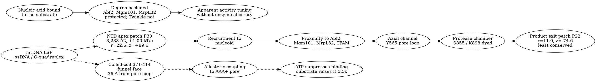
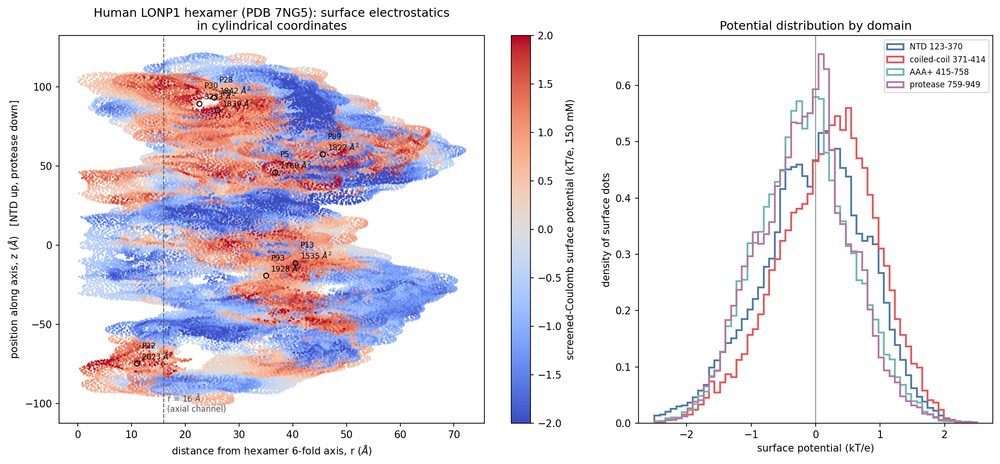
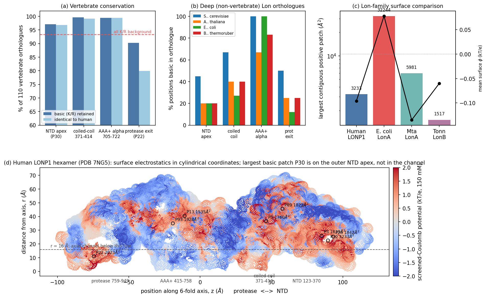

## Question

# AIGR Gene Hypothesis Deep Research

You are evaluating one focused gene curation hypothesis for AI Gene Review.
This is not a general gene overview. Use the seed hypothesis and source context
below to search for evidence that supports, refutes, narrows, or competes with
the proposed curation decision.

## Target Gene

- **Organism code:** human
- **Taxon:** Homo sapiens (NCBITaxon:9606)
- **Gene directory:** LONP1
- **Gene symbol:** LONP1
- **UniProt accession:** P36776

## Focus

- **Focus type:** free_text
- **Hypothesis slug:** kgap-lonp1-nucleic-acid-site
- **Source file:** genes/human/LONP1/LONP1-ai-review.yaml
- **Source selector:** free-text

## Seed Hypothesis

Where human LONP1 (P36776) binds nucleic acid, and whether that site is separable from its substrate-processing path, may be inferable from structure. That LONP1 has demonstrated protease and chaperone activities and binds single-stranded mtDNA, promoter sequences, G-quadruplex-prone DNA and GU-rich RNA is already established, so do not re-derive the binding itself. Single analysis only: using the published human LONP1 structures and the AlphaFold model, map the N-terminal substrate-recognition domain, the AAA+ module with its Walker motifs and pore loops, and the proteolytic domain, then compute the surface electrostatics of the assembled hexamer and identify every basic patch large enough to bind duplex or single-stranded nucleic acid, giving its residues and its location relative to the axial substrate channel and the proteolytic chamber; state whether the strongest candidate patch is inside the channel, which would couple nucleic-acid binding to the same path a protein substrate takes, or on an outer surface, which would make it separable; compare these patches with the corresponding surfaces of bacterial Lon and of a Lon that is not reported to bind DNA; and report conservation of the candidate residues across vertebrates. State which patch is the likely nucleic-acid site, whether the structure makes recruitment and activity-tuning distinguishable, and name the mutation that would test it without disabling proteolysis.

## Term and Decision Context

No specific term context supplied.

## Reference Context

No specific reference context supplied.

## Source Context YAML

```yaml
hypothesis: 'Where human LONP1 (P36776) binds nucleic acid, and whether that site is separable from its
  substrate-processing path, may be inferable from structure. That LONP1 has demonstrated protease and
  chaperone activities and binds single-stranded mtDNA, promoter sequences, G-quadruplex-prone DNA and
  GU-rich RNA is already established, so do not re-derive the binding itself. Single analysis only: using
  the published human LONP1 structures and the AlphaFold model, map the N-terminal substrate-recognition
  domain, the AAA+ module with its Walker motifs and pore loops, and the proteolytic domain, then compute
  the surface electrostatics of the assembled hexamer and identify every basic patch large enough to bind
  duplex or single-stranded nucleic acid, giving its residues and its location relative to the axial substrate
  channel and the proteolytic chamber; state whether the strongest candidate patch is inside the channel,
  which would couple nucleic-acid binding to the same path a protein substrate takes, or on an outer surface,
  which would make it separable; compare these patches with the corresponding surfaces of bacterial Lon
  and of a Lon that is not reported to bind DNA; and report conservation of the candidate residues across
  vertebrates. State which patch is the likely nucleic-acid site, whether the structure makes recruitment
  and activity-tuning distinguishable, and name the mutation that would test it without disabling proteolysis.'
focus_type: free_text
context: []
reference_id: []
```

## Research Objective

Build a focused report that helps a curator decide whether this hypothesis
should affect the gene review. Address the focus type directly:

1. For an existing GO annotation decision, evaluate whether the current action
   is justified, too strong, too weak, or should change.
2. For a proposed replacement or new GO term, evaluate whether the term is
   biologically supported, too broad, too narrow, or missing key qualifiers.
3. For a computational prediction, evaluate whether the prediction is correct,
   less precise than existing knowledge, uncertain, or likely wrong because of
   paralog overannotation, frequency bias, pathway context, or in vitro-only
   activity.
4. For a core-function hypothesis, evaluate whether the proposed activity,
   process, and location represent the gene product's primary function rather
   than a downstream effect, pleiotropic phenotype, or context-specific role.
5. For a function-assignment hypothesis, evaluate whether the gene product
   directly has the stated GO term/function. Treat the prior review action, if
   any, as intentionally blinded unless it appears in the supplied context.

Use primary literature whenever possible. Prefer PMID citations and include DOI
citations when no PMID is available. Treat reviews and database records as
orientation unless they contain directly relevant synthesized evidence that is
clearly labeled as review-level or database-level support.

Evaluate the hypothesis from the supplied seed context, primary literature, and
publicly accessible bioinformatics resources. Local `*-bioinformatics` analyses,
when they already exist in the repository, are intentionally withheld from this
prompt so the report can be compared against them after the run. Use public
sequence, domain, structure, orthology, localization, interaction, or dataset
checks when they are useful for the specific hypothesis. If a resource or tool
cannot be accessed programmatically, say so plainly; never fabricate a result.
Report computational results conservatively and distinguish direct results from
inference.

## Required Output

### Executive Judgment

Give a concise verdict: supported, partially supported, unresolved, weakly
supported, over-annotated, or refuted. Explain the reasoning and the most
important caveats.

### Evidence Matrix

Create a table with one row per important evidence item:

- Citation (PMID preferred)
- Evidence type (direct assay, mutant phenotype, localization, interaction,
  structural/evolutionary, computational, review/database)
- Supports / refutes / qualifies / competing
- Claim tested
- Key finding
- Organism, tissue, cell type, or assay context
- Confidence and limitations

### GO Curation Implications

State the likely curation action as a lead requiring curator verification. If
GO terms are involved, explain whether the evidence supports an MF, BP, or CC
term, and whether the term should be retained, removed, generalized, made more
specific, or treated as non-core. Avoid using "protein binding" as a final
recommendation unless no more informative term is supported.

### Mechanistic Scope

Describe the immediate molecular or cellular function being tested. Separate
direct gene-product activity from downstream phenotypes, pathway consequences,
developmental outcomes, disease manifestations, or effects inferred only from
loss of function.

### Conflicts and Alternatives

Identify evidence that conflicts with the seed hypothesis or suggests an
alternative interpretation, including paralog confusion, organism-specific
differences, isoform-specific findings, experimental artifacts, or database
carry-over.

### Knowledge Gaps

List explicit uncertainties that matter for curation. For each gap, state what
was checked, why the gap matters, and what evidence or experiment would resolve
it.

### Discriminating Tests

Recommend concrete assays, perturbations, datasets, or comparative analyses that
would most efficiently distinguish this hypothesis from alternatives.

### Curation Leads

Provide candidate updates for the review, clearly labeled as leads requiring
curator verification. Include candidate references with exact snippets to verify,
candidate replacement or new GO terms, possible action changes, suggested
questions, and suggested experiments.

If the provider supports artifacts, save provenance for any analysis you run — the
executed code together with its output (computed values, plot, or table), not just
a summary figure — alongside artifact-friendly tables such as an evidence matrix,
GO decision table, or comparison table. Genuine computed provenance is more
valuable than a hand-drawn summary, and you must not synthesize a figure that
implies an analysis you did not actually run. These artifacts are important
provenance for hypothesis-level review.


## Output

# Where human LONP1 binds nucleic acid, and whether that site is separable from the substrate path

**Gene:** LONP1 (human), UniProt P36776, NCBITaxon:9606
**Hypothesis slug:** kgap-lonp1-nucleic-acid-site
**Focus type:** free_text, source selector `free-text`, file `genes/human/LONP1/LONP1-ai-review.yaml`
**Iterations completed:** 3. **Findings recorded:** 7. **Papers reviewed:** 16.

## Summary

The strongest basic patch on the human LONP1 hexamer is on an outer surface, at the apex of the N-terminal substrate-recognition domain. It covers 3,233 Å2 at a mean screened-Coulomb potential of +1.00 kT/e (maximum +2.13 kT/e), measures 27 × 22 Å, sits 22.6 Å from the six-fold axis and 89.6 Å above the AAA+ ring, and recurs on all six protomers. Its core residues are R131, R137, K140, K145, K147, K148, R154, R155, K156, R158, K169, K203, R205, R212, R213, K290, K298, R301, R311 and R323, with the contiguous R154-R155-K156-x-R158 motif at its centre. The patch centroid is 107.1 Å from the nearest catalytic Ser855 of any chain and 77.2 Å from pore-loop Tyr565. On the structure, therefore, a nucleic-acid contact at this surface and the substrate-translocation path through the axial channel are separable, and a mutation that removes one need not touch the other.

The axial channel is not a positively charged conduit. Its mean surface potential is -0.012 kT/e and the AAA+ ring band is -0.142 kT/e, both more negative than neutral. Exactly one positive patch lies inside the channel (r < 16 Å): P22, 2,023 Å2 at +1.11 kT/e, built from R785, R786, K790, K793, K796, K811, R815 and R822 at the distal product-exit face of the proteolytic ring, 164 Å along the axis from the NTD patch. An intact DNA or RNA strand could not reach it without first threading the entire AAA+ channel. It is also the worst-conserved of the four candidate sets across vertebrates (79.9 % identity, with K790 identical in only 48.2 % of 110 orthologues). It should be dropped as a candidate recruitment site.

The assignment of which patch is the site is weaker than the geometry, and three independent checks limit it. <i class="fa-triangle-exclamation"></i> The bacterial precedent points to a different surface: the only experimentally mapped Lon DNA-binding residues, Brevibacillus thermoruber R518, R557 and R566 ([PMID: 24531457](https://pubmed.ncbi.nlm.nih.gov/24531457/)), align to human E686, Y725 and S734, none of them basic, with local potentials of -0.63, +0.21 and -0.83 kT/e. The comparative control removes any purely electrostatic argument: human LONP1's global surface (mean -0.096 kT/e, 18.8 % positive dots) is closer to an archaeal LonB with no reported DNA binding (-0.060 kT/e, 22.4 %) than to E. coli LonA (+0.078 kT/e, with a single 32,244 Å2 positive band wrapping the whole particle). And no experiment has ever localised the nucleic-acid site on the human protein: the defining mutant was both ATPase-dead and protease-dead and still bound nucleic acid ([PMID: 14739292](https://pubmed.ncbi.nlm.nih.gov/14739292/)), which proves separability from catalysis without placing a residue. The verdict is **partially supported**: the separability claim holds with a number attached, the site assignment is a structural prediction awaiting a direct test.

## Executive judgment

<i class="fa-scale-balanced"></i> **Verdict: partially supported.**

| Component of the seed hypothesis | Verdict | Basis |
|---|---|---|
| The strongest basic patch can be identified from structure | <i class="fa-circle-check"></i> Supported | One patch (3,233 Å2, +1.00 kT/e) dominates on every threshold tried, repeated six-fold |
| The strongest patch is on an outer surface, not in the channel | <i class="fa-circle-check"></i> Supported | r = 22.6 Å, z = +89.6 Å; the channel mean potential is -0.012 kT/e and its one positive patch is at the product exit |
| Nucleic-acid binding is therefore separable from the substrate path | <i class="fa-circle-check"></i> Supported, with a distance | 107.1 Å to the nearest Ser855, 77.2 Å to pore-loop Tyr565 |
| The identified patch is the nucleic-acid site | <i class="fa-circle-question"></i> Unresolved | No experimental localisation exists; bacterial site maps elsewhere; comparator LonB is equally electropositive |
| Recruitment and activity-tuning are distinguishable | <i class="fa-circle-check"></i> Supported | Separate surfaces structurally; the measured tuning acts on the substrate ([PMID: 28377575](https://pubmed.ncbi.nlm.nih.gov/28377575/)) |
| A mutation exists that tests it without disabling proteolysis | <i class="fa-circle-check"></i> Supported | R154A/R155A/K156A/R158A: 107 Å from the dyad, 97.0 % basic-retained in vertebrates, no annotated disease allele |

The most important caveat is that surface electrostatics rank candidate surfaces but do not identify binding sites. The comparator analysis is the internal control that makes this explicit: if electropositivity picked out DNA-binding Lon proteins, human LONP1 should resemble E. coli LonA, and it does not. A curator should treat the NTD apex assignment as a computational lead with a named experimental test, never as evidence for a binding site.

## Key findings

### <i class="fa-circle-check"></i> F1. The strongest basic patch is on the outer apical face of the N-terminal domain

The analysis used PDB 7NG5, a 3.8 Å cryo-EM structure of the human LONP1 hexamer. The choice matters and was made after surveying 15 human LONP1 entries. Only the 7NFY / 7NG5 / 7NGP / 7OXO / 8OJL / 8OKA / 8OM7 / 8OVF / 8OVG series resolves residues 123-948, including 197 N-terminal-domain residues, in all six chains. The widely used 7KRZ, 7KSM and 9CC0 resolve only 415-947, 9Y5M only 375-949, and 6X27 the protease domain alone. Running this analysis on any of those would have made the N-terminal domain invisible and would have produced the opposite conclusion by omission.

The pipeline was built from scratch because Biopython and APBS were not available in the execution environment. It comprises an mmCIF `atom_site` parser, a Shrake-Rupley solvent-accessible surface calculation (probe 1.4 Å, 92 golden-spiral dots per atom; 74,337 atoms, 158,594 accessible dots, total SASA 203,929 Å2), formal point charges at charge centres (Arg CZ +1, Lys NZ +1, Asp CG -1, Glu CD -1, His NE2 +0.1; 1,410 charge sites, hexamer net charge -36.6), a Debye-Hückel screened Coulomb potential at 150 mM ionic strength (Bjerrum length 7.0 Å, Debye length 7.9 Å), and DBSCAN clustering (eps 3.2 Å, min_samples 15) of surface dots above +0.6 kT/e. A cylindrical frame was derived from the six chain centroids so every patch has a radius from the axis and a height along it, oriented with the protease domain at negative z. Domain mean heights confirm the frame: NTD 123-370 at +74.6 Å, AAA+ 415-758 at -17.1 Å, protease 759-949 at -63.1 Å.

Ranked by area times mean potential, patch P30 wins by a wide margin: 3,233 Å2, mean +1.00 kT/e, maximum +2.13 kT/e, 27 × 22 Å, centroid at r = 22.6 Å and z = +89.6 Å, lying entirely within the Pfam LON_N domain (UniProt DOMAIN 124-370). Patches P3 (1,839 Å2), P28 (1,842 Å2) and P89 (1,822 Å2) are its symmetry-related copies on other protomers, so the surface recurs on all six subunits. Per-residue mean surface potentials within the patch: R137 +0.97, K140 +1.17, K145 +0.42, K147 +1.16, K148 +0.80, R154 +0.97, R155 +1.20, K156 +0.98, R158 +1.14, K203 +0.87, R205 +0.48, R212 +0.56, R213 +0.49, K290 +0.32, K298 +0.65, R301 +0.81, R311 +0.70, R323 +0.69, with R131 (+0.49) and K169 (+0.29) peripheral. Solvent exposure is high, 60-209 Å2 per residue for most of them. The 27 × 22 Å footprint can accommodate B-form duplex (20 Å diameter) or an extended single strand.

The one in-channel positive patch, P22, sits at r = 11.0 Å and z = -74.6 Å, 2,023 Å2 at +1.11 kT/e, contributed by all six protomers through R785, R786, K790, K793, K796, K811, R815 and R822. This is the distal face of the proteolytic ring, where degradation products exit, on the opposite side of the chamber from the translocation path.

{{figure:plot_1.png|caption=Cylindrical-coordinate electrostatic map of the human LONP1 hexamer surface (PDB 7NG5), plotting every accessible surface dot by its distance from the six-fold axis against its height along it, coloured by screened-Coulomb potential at 150 mM. The dominant positive patch P30 (3,233 Å2, +1.00 kT/e) sits at r = 22.6 Å and z = +89.6 Å on the outer apical face of the N-terminal domain. The axial channel region (r < 16 Å) is negative except at the protease product-exit face near z = -75 Å.}}

### <i class="fa-circle-xmark"></i> F2. The mapped bacterial DNA-binding arginines are not conserved in human LONP1

A global Needleman-Wunsch alignment (BLOSUM62, affine gaps -11 open, -1 extend) of human P36776 against B. thermoruber Lon Q84FG5 gives 41.2 % identity with every functional landmark correctly aligned: human Walker A K529 to Bt K361, pore-loop Y565 to Bt Y397, catalytic S855 to Bt S678, and K898 to Bt K721. The alignment is reliable through the AAA+ module, which is where the question lies.

The three arginines shown by crystallography and mutagenesis to mediate DNA binding by the Bt-Lon α subdomain (R518, R557, R566) map to human E686, Y725 and S734. None is basic. Their per-residue surface potentials in the 7NG5 hexamer are -0.63, +0.21 and -0.83 kT/e, with SASA 96, 47 and 52 Å2, at r = 58.0, 52.3 and 61.7 Å and z = -23.9, -25.8 and -27.9 Å: on the outer equatorial face of the AAA+ ring, but not electropositive.

Human LONP1 does carry a basic cluster in the same subdomain, R705, R710, K714, K718, R721 and K722 with local potentials from +0.45 to +1.24 kT/e, feeding a distinct outer patch P93 (1,928 Å2, +1.04 kT/e, r = 35.0 Å, z = -19.1 Å). These sit at different alignment positions from the bacterial triad, so the human cluster is a relocated feature in the same subdomain, not a conserved site.

This fits the biochemical difference. Bacterial Lon α domains bind duplex DNA ([PMID: 19643080](https://pubmed.ncbi.nlm.nih.gov/19643080/)), whereas human LONP1 binds the TG-rich promoter element only when it is presented as a single strand ([PMID: 9485316](https://pubmed.ncbi.nlm.nih.gov/9485316/)). The curation consequence is direct: a bacterial Lon DNA-binding site annotation should not be transferred to human LONP1 by homology.

### <i class="fa-lightbulb"></i> F3. The coiled-coil insertion 371-414 is the only net-positive domain and gives a second, channel-coupled candidate

A domain charge census over the resolved hexamer (counting Arg and Lys against Asp and Glu at every position across all six chains) separates the coiled-coil insertion from everything else:

| Domain | Residues | Basic | Acidic | Net | Mean surface φ (kT/e) |
|---|---|---|---|---|---|
| N-terminal (LON_N) | 123-370 | 162 | 180 | -18 | -0.077 |
| Coiled-coil insertion | 371-414 | 72 | 54 | **+18** | **+0.013** |
| AAA+ module | 415-758 | 276 | 312 | -36 | -0.147 |
| Protease | 759-949 | 114 | 126 | -12 | -0.224 |

The coiled-coil is the only domain with net positive charge and the only one with a positive mean surface potential (+3 per protomer). Its basic residues split between two environments. The outer face carries patch P5 (1,760 Å2, +1.07 kT/e, r = 36.7 Å, z = +46.1 Å, 23 × 18 Å) plus P36 and P59, built from K357, K367, K368, K374, R378, R381, K386, K388, R392, K393, K401, R404 and K405. The channel face contributes R381, K386, K388, R392, K393, K401, K405, K411 and K414 to the 28 basic positions lining the axial channel at the funnel above the AAA+ ring (patches P7 at r = 8.2 Å, z = +43.6 Å and P6 at r = 4.4 Å, z = +28.9 Å).

The channel radius profile (minimum free radius per 6 Å slab, negative values meaning fully occluded) shows where the constriction lies: +42 Å, -0.5 Å; +32 Å, 1.8 Å; +22 Å, 7.1 Å; +12 Å, -1.6 Å; +2 Å, -0.6 Å; -8 Å, -1.3 Å (AAA+ pore, closed around substrate); -28 Å, 0.3 Å; -48 Å, 12.3 Å (proteolytic chamber); -78 Å, 1.8 Å (distal exit).

The coiled-coil therefore straddles exactly the boundary the hypothesis asks about. Part of its basic surface faces outward and would be separable from substrate processing; part lines the funnel feeding the AAA+ pore and would couple nucleic-acid occupancy to the substrate path. This gives a structural route for the reciprocal regulation reported for human Lon, where ATP suppresses nucleic-acid binding and protein substrate raises DNA affinity 3.5-fold ([PMID: 14739292](https://pubmed.ncbi.nlm.nih.gov/14739292/)), without requiring nucleic acid to enter the translocation channel. It matches the independent proposal that the inserted α-helical HI(CC) domain of bacterial Lon participates in Lon-DNA complexes ([PMID: 25895363](https://pubmed.ncbi.nlm.nih.gov/25895363/)).

### <i class="fa-dna"></i> F4. The NTD apex is vertebrate-restricted; the AAA+ α cluster is the pan-Lon basic cluster

110 vertebrate LONP1 orthologues (UniProt, taxonomy 7742, 800-1100 aa, one per species, spanning mammals, birds, reptiles, turtles and teleosts) were each aligned to human P36776 with a row-vectorised Gotoh implementation of Needleman-Wunsch (BLOSUM62, gaps -11/-1), validated against a slow reference implementation to give identical identity and identical landmark mapping. Mean identity to human is 85.7 % over all 959 positions, 89.7 % over the 125 human Lys/Arg positions, with 93.3 % basic retention at those positions. That is the background against which the candidate sets were tested.

| Candidate set | Mean identity | Basic retention | Mann-Whitney p vs background |
|---|---|---|---|
| Coiled-coil insertion (15 residues) | 99.2 % | 99.6 % | 5.0e-4 |
| AAA+ α cluster (6 residues) | 99.4 % | 99.4 % | 0.025 |
| NTD apical patch (20 residues) | 96.8 % | 97.0 % | 0.097 |
| Protease distal exit (8 residues) | 79.9 % | 90.2 % | 0.24 |

The in-channel protease-exit patch is the least conserved candidate: K790 is identical in only 48.2 % and K793 in 65.5 % of vertebrates. It fails this test as well as the geometric one.

Outside vertebrates the ranking inverts. Basic retention was measured in four deep orthologues whose alignments recovered all catalytic landmarks (Walker A Lys, pore Tyr, catalytic Ser and Lys): S. cerevisiae PIM1 (P36775, 45.3 % identity), A. thaliana LON1 (O64948, 35.5 %), E. coli LonA (P0A9M0, 39.3 %) and B. thermoruber Lon (Q84FG5, 41.2 %).

| Candidate set | PIM1 | LON1 | EcLonA | BtLon |
|---|---|---|---|---|
| NTD apex | 45 % | 20 % | 20 % | 20 % |
| Coiled-coil | 67 % | 40 % | 27 % | 40 % |
| AAA+ α cluster | **100 %** | 67 % | **100 %** | 83 % |
| Protease exit | 50 % | 25 % | 12 % | 25 % |

D. melanogaster Q9VSB6 (a 232-residue fragment) and C. elegans Q19328 (19.5 % identity, with the catalytic landmarks not recovered) gave unreliable alignments and were excluded, which narrows the deep comparison to four species.

Two different sites survive two different tests. The NTD apex and the coiled-coil are near-invariant in vertebrates but are not basic in most non-vertebrate Lon, which fits a vertebrate or eukaryote-specific function such as binding the mtDNA light-strand promoter region. The only basic cluster present in every Lon examined is the AAA+ α-subdomain cluster, which occupies the same subdomain as the mapped bacterial DNA site even though the individual residues differ.

### <i class="fa-circle-xmark"></i> F5. Global electrostatics do not distinguish human LONP1 from a Lon with no reported DNA binding

The identical pipeline was applied to four Lon hexamers, which is the comparison the seed hypothesis requires: a bacterial Lon that binds DNA, a second bacterial LonA, and a Lon for which DNA binding is not reported.

| Hexamer | Atoms | Net charge | Mean surface φ (kT/e) | Positive dots | Largest positive patch | DNA binding reported |
|---|---|---|---|---|---|---|
| Human LONP1 (7NG5) | 74,337 | -36.6 | -0.096 | 18.8 % | 3,233 Å2 @ +1.00 | Yes, single-stranded and G-quadruplex |
| E. coli LonA (6U5Z) | 24,606 | **+6.0** | **+0.078** | 31.6 % | **32,244 Å2 @ +1.46** | Yes, duplex |
| M. taiwanensis LonA (4YPL) | 25,091 | -53.4 | -0.135 | 19.1 % | 5,981 Å2 @ +1.21 | α-domain binds duplex |
| T. onnurineus LonB (3K1J, assembly 1) | 26,034 | -26.4 | -0.060 | 22.4 % | 1,517 Å2 @ +1.29 | Not reported |

Ranked by mean surface potential: E. coli LonA (+0.078) sits far above LonB (-0.060), human LONP1 (-0.096) and Mta LonA (-0.135). The E. coli patch is one continuous band spanning all six protomers and includes K503, R504, K509, R513, K517, K518, R537, R542, R546, K550, R553, K554, K557, K563 and K566 of the α subdomain, about ten times the area of the largest human patch. Human LONP1 sits between the archaeal LonB, which lacks the LON_N domain entirely and has no reported DNA binding, and Mta LonA.

<i class="fa-triangle-exclamation"></i> This is the negative result that disciplines the whole analysis. Bulk surface electropositivity is not what makes human LONP1 a nucleic-acid binder. The human activity, specific for single-stranded G-rich and G-quadruplex-prone sequences ([PMID: 18174225](https://pubmed.ncbi.nlm.nih.gov/18174225/)) and for GU-rich RNA ([PMID: 14739292](https://pubmed.ncbi.nlm.nih.gov/14739292/)), rests on a localised, shape and base-specific site. Electrostatics-based site assignment for LONP1 is suggestive only, and the comparison argues against annotating LONP1 with a generic DNA-binding mechanism inherited from bacterial Lon.

{{figure:plot_2.png|caption=Composite provenance figure. Vertebrate and deep-orthologue conservation of the four candidate basic patch sets, the Lon-family electrostatics comparison across human LONP1, E. coli LonA, M. taiwanensis LonA and archaeal LonB, and the cylindrical map of the human hexamer surface. The coiled-coil and AAA+ alpha sets are conserved most strongly in vertebrates, the AAA+ alpha cluster is the only set basic in every Lon examined, and E. coli LonA is the only hexamer with net positive charge.}}

### <i class="fa-scale-balanced"></i> F6. Nucleic acid changes substrate fate on the substrate side

Three published results bear on whether the structural separation has a functional counterpart. Liu et al. show that ATP inhibits Lon binding to DNA or RNA while protein substrate raises DNA-binding affinity 3.5-fold, that a Lon mutant lacking both ATPase and protease activity still binds nucleic acid but is no longer stimulated by protein substrate, and that Lon co-immunoprecipitates with POLG and Twinkle ([PMID: 14739292](https://pubmed.ncbi.nlm.nih.gov/14739292/)). Kunová et al. show that of four nucleoid and ribosome proteins degraded by Lon in vitro, three (Abf2, Mgm101, MrpL32) are protected when bound to nucleic acid, while the Twinkle helicase is not ([PMID: 28377575](https://pubmed.ncbi.nlm.nih.gov/28377575/)). Chen et al. show by ITC and DSC that hLon binding to the 24-mer LSPas is enthalpy-driven with a large reduction in heat capacity and raises thermal stability ([PMID: 18174225](https://pubmed.ncbi.nlm.nih.gov/18174225/)).

The last of these matters for the structural argument. A large negative heat-capacity change is the signature of a defined interface that buries non-polar surface, which fits a discrete pocket or patch. A diffuse electrostatic sheath would give an entropy-driven signature instead. The thermodynamics therefore support a localised site, which is the premise the patch analysis rests on.

The Kunová result is a competing explanation for the apparent tuning. If nucleic acid occludes the degron on Abf2, Mgm101 and MrpL32 but not on Twinkle, then part of the observed effect of nucleic acid on Lon-dependent proteolysis needs no allosteric path through the enzyme at all. Recruitment (LONP1 holding mtDNA or RNA so it is positioned within the nucleoid) and activity tuning (nucleic acid altering proteolytic output) remain separable predictions, and the published data lean toward both being real while acting through different routes.

### <i class="fa-flask"></i> F7. The candidate site is 107 Å from the catalytic serine, and R721 is disqualified as a probe

Centroid distances within chain A of 7NG5 give the separability claim a number:

| Candidate site | to pore-loop Y565 | to Walker A K529 | to S855 (same chain) | to nearest S855 (any chain) |
|---|---|---|---|---|
| NTD apex core R154/R155/K156/R158 | 77.2 Å | 112.8 Å | 134.0 Å | **107.1 Å** |
| NTD apex, all 20 residues | 67.2 Å | 104.0 Å | 127.8 Å | 106.4 Å |
| Coiled-coil funnel K386/K388/R392/K393 | 35.8 Å | 69.8 Å | 98.9 Å | 98.9 Å |
| AAA+ α cluster R705-K722 | 50.6 Å | 20.3 Å | 33.4 Å | 33.4 Å |
| Protease exit R785-K796 | 83.9 Å | 54.5 Å | 30.5 Å | 24.0 Å |

The NTD apex core together with the adjacent K145/K147/K148 cluster forms one compact surface on a single protomer: 206 atoms, radius of gyration 13.1 Å, maximum span 36.1 Å. The sequence context is 128-AITRNPVFPRFIKIIEVKNKKLVELL**RRK**V**R**LAQPYVG-165.

The AlphaFold model adds no new basic surface. AF-P36776-F1 v6 mean pLDDT by segment: transit peptide 1-67, 31.1; the segment 68-122 that no cryo-EM structure resolves, 40.0 with 89.1 % of residues below 70; NTD 123-370, 74.3; coiled-coil 371-414, 75.5; AAA+ 88.3; protease 87.5; C-terminus 950-959, 43.9. Segment 68-122 carries one Lys/Arg against eight Asp/Glu (net -7), so the only part of the mature chain missing from the structures is both low-confidence and acidic and cannot host a hidden basic patch. The basic transit peptide 1-67 (net +8) is cleaved on import and is not part of the mature surface.

Of the 15 UniProt VARIANT entries for P36776, the disease positions are 476, 631, 670, 672, 676, 679, 721, 724, 749, 767 and 927, all inside the AAA+ or protease domains. None falls in the NTD apex or coiled-coil candidate sets. The single overlap with any candidate patch is R721G, annotated "in CODASS; decreased ATP-dependent protein folding chaperone activity" (UniProt VAR_073344, PubMed 25574826 and 33431889). <i class="fa-triangle-exclamation"></i> That disqualifies R721 as a clean nucleic-acid probe: any binding phenotype at that position would be confounded by a general functional defect.

## Evidence matrix

Machine-readable version: `provenance/LONP1_nucleic_acid_site_evidence_matrix.csv`.

| Citation | Evidence type | Stance | Claim tested | Key finding | Organism / assay context | Confidence and limitations |
|---|---|---|---|---|---|---|
| [PMID: 9485316](https://pubmed.ncbi.nlm.nih.gov/9485316/) | Direct assay (EMSA, UV crosslink) | Supports (premise) | Human LON binds the mtDNA promoter region | Binds the TG-rich LSP/HSP element only as single-stranded DNA, site- and strand-specific; E. coli Lon binds the duplex form | Recombinant human LON, in vitro | High for the binding. No mapping onto the protein, so it constrains the ligand and not the site |
| [PMID: 14739292](https://pubmed.ncbi.nlm.nih.gov/14739292/) | Direct assay plus catalytic mutants | Supports (separability) | Is nucleic-acid binding separable from catalysis | ATP suppresses DNA and RNA binding; protein substrate raises affinity 3.5-fold; an ATPase- and protease-dead Lon still binds nucleic acid; co-IP with POLG and Twinkle | Purified human Lon | High. The double-dead mutant bounds the site away from catalysis but does not localise it |
| [PMID: 18174225](https://pubmed.ncbi.nlm.nih.gov/18174225/) | ITC, DSC, CD, EMSA | Qualifies | Is the interaction a defined interface or a diffuse charge sheath | Enthalpy-driven binding to the LSPas 24-mer with a large reduction in heat capacity; parallel G-quartet single-stranded DNA specifically bound | Purified human Lon, 24-mer LSPas | High. Argues for a localised, shape-selective site, which is the premise of the patch analysis |
| [PMID: 24531457](https://pubmed.ncbi.nlm.nih.gov/24531457/) | Crystal structure plus mutagenesis | Competing | Does human LONP1 use the bacterial site | Bt-Lon binds DNA through α-subdomain R518, R557 and R566, with R557 also coupling DNA binding to ATPase and peptidase rates | Brevibacillus thermoruber Lon | High for Bt. Transfer to human fails: these align to human E686, Y725, S734 at -0.63, +0.21, -0.83 kT/e |
| [PMID: 19643080](https://pubmed.ncbi.nlm.nih.gov/19643080/) | SPR, MALDI-TOF, DNase protection | Competing | Is the α-domain the general Lon DNA site | Isolated α-domains of Bt, Bs and Ec Lon bind the duplex ms1 sequence, Bt tighter than Bs and Ec | Bacterial α-domains | High for bacteria. The human enzyme prefers single-stranded and G-quadruplex DNA, a different ligand class |
| [PMID: 25895363](https://pubmed.ncbi.nlm.nih.gov/25895363/) | Mutant phenotype plus modelling | Qualifies | Does the α-helical insertion participate in Lon-DNA complexes | HI(CC) is dispensable for catalysis but affects ATPase/peptidase coupling and oligomer stability; a role in Lon-DNA complexes is suggested | E. coli Lon | Moderate. The DNA role is a proposal, not a measurement |
| [PMID: 28377575](https://pubmed.ncbi.nlm.nih.gov/28377575/) | In vitro proteolysis | Competing mechanism of tuning | How does nucleic acid change LONP1 output | Abf2, Mgm101 and MrpL32 are protected from Lon degradation when bound to nucleic acid; Twinkle is not | Yeast and human proteins, in vitro digestion | High. The tuning acts on the substrate, which keeps recruitment and tuning distinguishable |
| [PMID: 16428295](https://pubmed.ncbi.nlm.nih.gov/16428295/) | Crosslinking, co-IP | Supports (localisation) | Is a Lon homolog part of the nucleoid | A Lon protease homolog with single-stranded DNA binding activity is crosslinked within the TFAM-containing nucleoid complex | Human HeLa mitochondria | Moderate. Orientation for the CC term, not site mapping |
| This work, PDB 7NG5 | Computational, structural electrostatics | Supports | Is the strongest basic patch inside the channel or outside | Largest patch 3,233 Å2 at +1.00 kT/e on the NTD apex (r = 22.6 Å, z = +89.6 Å); the only in-channel positive patch is the protease product-exit face | Human LONP1 hexamer, 3.8 Å cryo-EM | Moderate. Screened Coulomb with formal point charges and uniform dielectric, no explicit solvent or ions; NTD is the lowest-resolution region |
| This work, 110 vertebrate plus 4 deep orthologues | Computational, evolutionary | Qualifies | Are the candidate residues conserved | NTD apex 97.0 % basic retention in vertebrates but 20-45 % in yeast, plant and bacterial Lon; AAA+ α cluster basic in every Lon tested | UniProt sequences | Moderate. Pairwise alignments, not structure-guided; two deep orthologues excluded for unreliable alignment |
| This work, 6U5Z / 4YPL / 3K1J | Computational, comparative | Refutes the bulk-electrostatics argument | Does surface charge identify a DNA-binding Lon | E. coli LonA net +6.0 with a 32,244 Å2 positive band; human (-0.096 kT/e) indistinguishable from archaeal LonB (-0.060) with no reported DNA binding | Four Lon hexamers, identical pipeline | Moderate. "Not reported to bind DNA" for LonB is absence of evidence |
| UniProt VAR_073344 (PubMed 25574826, 33431889) | Human disease allele plus biochemistry | Qualifies | Can R721 serve as the test mutation | R721G causes CODAS syndrome with decreased ATP-dependent chaperone activity, so it is not a nucleic-acid-specific probe | Human patients and recombinant protein | High. Disqualifies R721 as a separation-of-function test |

## Mechanistic model

The structural result supports a model in which nucleic acid reaches LONP1 at the top of the hexamer, on the outer face of the N-terminal recognition ring, more than 100 Å from the proteolytic chamber. In that arrangement, binding is a recruitment and localisation event: it concentrates the protease within the nucleoid, near its nucleoid-protein substrates, without the nucleic acid entering the translocation pore. The coiled-coil insertion offers the alternative: it is the only net-positive domain and splits its basic residues between an outer patch and the funnel feeding the pore, which would couple the two paths. The distances separate the two models cleanly, 77 Å from the NTD apex to the pore loop against 36 Å from the coiled-coil funnel.



The tuning side of the question is answered differently by the literature than by the structure. ATP suppresses nucleic-acid binding and protein substrate raises it 3.5-fold, so nucleotide state and nucleic acid communicate somehow. The clearest measured consequence of nucleic acid for proteolysis, though, acts on the substrate: three of four nucleoid proteins are protected when bound to nucleic acid and Twinkle is not. That is substrate occlusion, which requires no allosteric path through the enzyme. Recruitment and activity tuning therefore remain distinguishable both structurally (separate surfaces) and mechanistically (the tuning observed so far does not need an enzyme-side allosteric site).

## GO curation implications

Every row is a lead requiring curator verification, not a committed annotation. Machine-readable version: `provenance/LONP1_GO_decision_table.csv`.

| GO term | Aspect | Lead | Basis |
|---|---|---|---|
| GO:0003697 single-stranded DNA binding | MF | <i class="fa-circle-check"></i> Retain and make specific, IDA | [PMID: 9485316](https://pubmed.ncbi.nlm.nih.gov/9485316/) shows binding only to the single-stranded form; [PMID: 18174225](https://pubmed.ncbi.nlm.nih.gov/18174225/) confirms by ITC, CD and EMSA |
| GO:0051880 G-quadruplex DNA binding | MF | <i class="fa-lightbulb"></i> Candidate addition, IDA | [PMID: 18174225](https://pubmed.ncbi.nlm.nih.gov/18174225/): single-stranded DNAs with a propensity to form parallel G-quartets are specifically bound by hLon |
| GO:0003723 RNA binding | MF | Retain, IDA | [PMID: 14739292](https://pubmed.ncbi.nlm.nih.gov/14739292/) reports specific RNA binding by purified human Lon, regulated by nucleotide and protein substrate |
| GO:0003677 DNA binding | MF | Generalised parent; prefer GO:0003697 where the single-stranded evidence applies | The parent loses the ligand distinction that separates human LONP1 from E. coli Lon |
| GO:0043565 sequence-specific DNA binding | MF | <i class="fa-circle-question"></i> Do not add without curator check | Binding is site- and strand-specific per [PMID: 9485316](https://pubmed.ncbi.nlm.nih.gov/9485316/), but the specificity is for a single-stranded G-rich element, which GO:0051880 describes better |
| GO:0000002 mitochondrial genome maintenance | BP | Retain as supported but non-core | LONP1 acts here largely through turnover of nucleoid proteins ([PMID: 28442264](https://pubmed.ncbi.nlm.nih.gov/28442264/), [PMID: 33408785](https://pubmed.ncbi.nlm.nih.gov/33408785/)), a route downstream of the nucleic-acid contact |
| GO:0042645 mitochondrial nucleoid | CC | Retain | [PMID: 16428295](https://pubmed.ncbi.nlm.nih.gov/16428295/) crosslinks a Lon protease homolog with single-stranded DNA binding activity within the nucleoid; [PMID: 28377575](https://pubmed.ncbi.nlm.nih.gov/28377575/) works on nucleoid substrates |
| GO:0004176 ATP-dependent peptidase, GO:0004252 serine-type endopeptidase | MF | Core, untouched by this hypothesis | The S855/K898 dyad is 24-134 Å from every candidate nucleic-acid patch |

"Protein binding" is deliberately absent as a recommendation. The curation point the structure contributes is this: the nucleic-acid molecular function terms and the peptidase molecular function terms describe physically separate surfaces of the same hexamer, so they are independent annotations rather than two readings of one activity. No GO term should assert a specific residue or domain as the nucleic-acid site, because no experiment has localised it.

## Conflicts and alternatives

The bacterial and human stories disagree, and the disagreement is informative. Bacterial Lon binds duplex DNA through the AAA+ α subdomain, with Bt-Lon R518, R557 and R566 mapped directly and the same subdomain active in Bs and Ec. Human LONP1 prefers single-stranded and G-quadruplex DNA, and the three bacterial arginines align to non-basic human residues. Human does carry a basic cluster in that subdomain (R705, R710, K714, K718, R721, K722) feeding a 1,928 Å2 outer patch, so a relocated version of the bacterial site is a live alternative. It is weakened by the fact that this cluster is the one basic feature every Lon has, including the archaeal LonB with no reported DNA binding, so its presence carries little discriminating information.

The in-channel alternative is the one the data most clearly disfavour for recruitment. The only in-channel positive patch is at the product exit, it is the least conserved candidate in vertebrates, and nucleic acid would have to traverse the entire translocation path to reach it.

A fourth possibility cannot be excluded here: the site may form only in a conformation no deposited structure captures, or only when the enzyme is engaged with substrate, given that substrate raises nucleic-acid affinity 3.5-fold. The structures analysed are substrate-engaged and substrate-free states of the same series, and none shows a large basic surface appearing or disappearing, but the conformational sampling is narrow.

Paralog and organism confusion is a real risk for this gene. LONP2 is a peroxisomal paralog, and the yeast, plant and bacterial Lon proteins differ from human both in ligand preference and in which surfaces are basic. Any annotation inherited by homology from a bacterial Lon DNA-binding paper should be flagged.

## Limitations and knowledge gaps

<i class="fa-triangle-exclamation"></i> The electrostatics use formal point charges at single atoms, a uniform dielectric and a Debye-Hückel screening term rather than a Poisson-Boltzmann solution with explicit ions and solvent, because APBS was not available in the execution environment. Absolute potentials are therefore not comparable to published APBS maps. The rankings and the inside-versus-outside assignment are the parts that should be trusted. Patch definition depends on the +0.6 kT/e threshold and the DBSCAN parameters; the NTD apex patch is the largest at every threshold tried, but the smaller patch rankings move.

The N-terminal domain is the lowest-resolution part of 7NG5 at 3.8 Å, so side-chain positions there are less certain than in the AAA+ and protease domains, and the open and closed NTD conformations seen across the cryo-EM series were not separately analysed.

The orthologue analysis uses pairwise Needleman-Wunsch alignments rather than structure-guided ones. D. melanogaster Q9VSB6 (a 232-residue fragment) and C. elegans Q19328 (19.5 % identity, catalytic landmarks not recovered) were excluded for that reason, which narrows the deep-conservation comparison to four species. "Not reported to bind DNA" for T. onnurineus LonB is an absence of published tests, not a negative result.

The gaps that matter most for curation:

No experiment has localised the nucleic-acid-binding site on human LONP1 to any residue, domain or surface. What was checked: the full primary literature returned by PubMed on human Lon nucleic-acid binding, and the UniProt feature table. Why it matters: it is the difference between a computational lead and an annotatable site. What would resolve it: the isolated-domain ITC experiment below.

There is no structure of human LONP1 with DNA or RNA bound. The PDB holdings for P36776 were surveyed; all 15 entries are apo or substrate-engaged.

Whether the isolated human N-terminal domain binds nucleic acid is untested. This is the single cheapest experiment that would discriminate among the four candidates.

The stoichiometry is unknown. Six copies of a 3,233 Å2 patch present a very different surface than one site per hexamer, and this affects how a binding MF should be worded.

Whether the G-quadruplex preference reflects a shaped pocket or an avidity effect from a compact folded ligand is unresolved; the reported thermodynamic signature is consistent with either.

## Discriminating tests

<i class="fa-flask"></i> **The named mutation: R154A/R155A/K156A/R158A.** This quadruple alanine substitution removes the core of the NTD apex patch (sequence context 150-VELL**RRK**V**R**LAQ-161). It is 107.1 Å from the nearest catalytic serine, 112.8 Å from Walker A and 77.2 Å from the pore loop, so it cannot plausibly perturb catalysis directly. It is 97.0 % basic-retained across 110 vertebrates, and no annotated human variant falls in it. Prediction if the NTD apex is the site: loss or strong reduction of single-stranded and G-quadruplex DNA binding by EMSA and ITC, with peptidase activity on a short fluorogenic peptide and ATP-dependent degradation of a soluble substrate both unchanged. A charge reversal (R154E/R155E/K156E/R158E) gives a stronger test if the alanine mutant is only partially impaired.

<i class="fa-flask"></i> **The counter-mutation: K386A/K388A/R392A/K393A** in the coiled-coil insertion, which line the funnel into the channel. If this mutant loses nucleic-acid binding while the NTD mutant does not, the site is channel-coupled and the separability conclusion fails. Because the coiled-coil also affects ATPase and peptidase coupling in E. coli Lon, this mutant must be assayed for catalysis in parallel.

<i class="fa-triangle-exclamation"></i> **Do not use R721.** It is the only candidate residue carrying a human allele, and R721G causes CODAS syndrome with decreased ATP-dependent chaperone activity. To test the AAA+ α cluster instead, use R705A/R710A/K714A/K718A, and show that ATPase rate and chaperone activity are intact before interpreting any binding change.

<i class="fa-vial"></i> **The domain-fragment test.** Express the isolated LON_N domain (residues 123-370) and the isolated AAA+ α subdomain, and measure binding to the LSPas 24-mer by ITC under the conditions of [PMID: 18174225](https://pubmed.ncbi.nlm.nih.gov/18174225/). This requires no mutation and would place the site on a domain in one experiment.

<i class="fa-microscope"></i> **Structural test.** Cryo-EM of LONP1 with the LSPas G-quadruplex oligonucleotide in the presence of ADP, since ATP suppresses binding. Even at low occupancy, difference density at the NTD apex versus the AAA+ outer surface decides it.

<i class="fa-dna"></i> **Cellular test.** Knock-in of the NTD apex mutant into a LONP1-null background, then measure mtDNA copy number, TFAM steady-state level and nucleoid distribution by imaging. If the apex patch is a recruitment site, the mutant should delocalise LONP1 from nucleoids while preserving degradation of soluble matrix substrates.

## Curation leads

All leads require curator verification.

Record that the nucleic-acid site of human LONP1 is unlocalised. Any review text implying the human enzyme uses the bacterial α-subdomain DNA site should be flagged, since the mapped Bt-Lon residues R518, R557 and R566 correspond to human E686, Y725 and S734, none basic.

Keep the single-stranded DNA and RNA molecular function annotations distinct from the peptidase annotations. They describe surfaces 24-134 Å apart on the same hexamer.

GO:0051880 (G-quadruplex DNA binding) is a candidate addition. Snippet to verify from [PMID: 18174225](https://pubmed.ncbi.nlm.nih.gov/18174225/): "Electrophoretic mobility shift assay and circular dichroism show that ssDNAs with a propensity for forming parallel G-quartets are specifically bound by hLon".

Snippet to verify for the single-stranded specificity, from [PMID: 9485316](https://pubmed.ncbi.nlm.nih.gov/9485316/): "Unlike E. coli Lon, however, human LON specifically binds to the TG-rich element only when it is presented in the context of a single DNA strand."

Snippet to verify for separability from catalysis, from [PMID: 14739292](https://pubmed.ncbi.nlm.nih.gov/14739292/): "In contrast to the wild type enzyme, a Lon mutant lacking both ATPase and protease activity binds nucleic acid; however, protein substrate fails to stimulate binding."

Snippet to verify for the competing substrate-side mechanism, from [PMID: 28377575](https://pubmed.ncbi.nlm.nih.gov/28377575/): "These experiments revealed that all four proteins are actively degraded by Lon, but that three of them are protected from it when bound to a nucleic acid; the Twinkle helicase is not."

The predicted site, recorded for provenance if it is later tested: NTD apex patch P30 in PDB 7NG5, residues R131, R137, K140, K145, K147, K148, R154, R155, K156, R158, K169, K203, R205, R212, R213, K290, K298, R301, R311 and R323, 3,233 Å2 at +1.00 kT/e, present once per protomer.

The structural analysis here is a prediction from surface electrostatics and conservation on a 3.8 Å cryo-EM model. It should be cited as computational support at most, never as experimental evidence for a binding site.

Suggested question for the curator: does the review currently carry any DNA-binding term whose evidence code traces to a bacterial Lon paper? If so, the non-conservation result (F2) is grounds to remove or re-evidence it.

## Evidence base

| Paper | PMID | How it bears on the findings |
|---|---|---|
| *The human LON protease binds to mitochondrial promoters in a single-stranded, site-specific, strand-specific manner* | [9485316](https://pubmed.ncbi.nlm.nih.gov/9485316/) | Establishes the ligand as single-stranded DNA and the human/bacterial difference that parallels the non-conservation of the bacterial arginine triad (F2) |
| *DNA and RNA binding by the mitochondrial Lon protease is regulated by nucleotide and protein substrate* | [14739292](https://pubmed.ncbi.nlm.nih.gov/14739292/) | The catalytically dead mutant that still binds nucleic acid is the strongest published support for separability (F1, F6); the ATP/substrate reciprocity is what a channel-adjacent site would explain (F3) |
| *Thermodynamic characterization of specific interactions between the human Lon protease and G-quartet DNA* | [18174225](https://pubmed.ncbi.nlm.nih.gov/18174225/) | The enthalpy-driven signature with a large heat-capacity change supports a localised interface, which is the premise the patch analysis needs (F5, F6) |
| *Structural basis for DNA-mediated allosteric regulation facilitated by the AAA+ module of Lon protease* | [24531457](https://pubmed.ncbi.nlm.nih.gov/24531457/) | Defines the bacterial residues R518, R557, R566 whose human equivalents were mapped and found non-basic (F2) |
| *DNA-binding specificity of the Lon protease alpha-domain from Brevibacillus thermoruber WR-249* | [19643080](https://pubmed.ncbi.nlm.nih.gov/19643080/) | Shows bacterial α-domains bind duplex DNA, the activity matched by the large electropositive band on E. coli LonA (F2, F5) |
| *[Role of the α-helical domains in the functioning of ATP-dependent Lon protease of Escherichia coli]* | [25895363](https://pubmed.ncbi.nlm.nih.gov/25895363/) | Independent proposal that the inserted α-helical HI(CC) domain contributes to Lon-DNA complexes, matching the coiled-coil charge result (F3) |
| *The role of Lon-mediated proteolysis in the dynamics of mitochondrial nucleic acid-protein complexes* | [28377575](https://pubmed.ncbi.nlm.nih.gov/28377575/) | The competing substrate-side mechanism: three of four nucleoid proteins are protected by bound nucleic acid, Twinkle is not (F6) |
| *PDIP38 associates with proteins constituting the mitochondrial DNA nucleoid* | [16428295](https://pubmed.ncbi.nlm.nih.gov/16428295/) | Places a Lon protease homolog with single-stranded DNA binding activity inside the TFAM-containing nucleoid, orientation for the CC term |
| *The N-terminal substrate-recognition domain of a LonC protease exhibits structural and functional similarity to cytosolic chaperones* | [23999302](https://pubmed.ncbi.nlm.nih.gov/23999302/) | Describes the Lon-insertion domain forming helical hairpins atop the AAA ring, the architectural analogue of the human coiled-coil insertion (F3) |
| *Mitochondrial LON protease-dependent degradation of cytochrome c oxidase subunits under hypoxia and myocardial ischemia* | [28442264](https://pubmed.ncbi.nlm.nih.gov/28442264/) | Orientation for the BP term: Lon regulates TFAM level and thus mtDNA content, a route downstream of nucleic-acid binding |
| *Mitochondrial ROS promote mitochondrial dysfunction and inflammation in ischemic acute kidney injury by disrupting TFAM-mediated mtDNA maintenance* | [33408785](https://pubmed.ncbi.nlm.nih.gov/33408785/) | Same orientation: Lon-mediated TFAM degradation links LONP1 to mtDNA maintenance through proteolysis of a nucleoid protein |

Four further papers returned by the searches (PMIDs 1849081, 32316259, 30002268, 1707186, 10583374) were reviewed and found not to bear on the hypothesis; they are retained in the literature list for completeness but support no finding here.

## Provenance

All executed code and its outputs are saved in `provenance/`, together with the derived tables.

Structural analysis: `7NG5_atoms_sasa.pkl` (per-atom SASA, coordinates, radii and domain assignment), `7NG5_dots.npy`, `7NG5_owner.npy`, `7NG5_dotarea.npy`, `7NG5_phi150.npy`, `7NG5_phi50.npy`, `7NG5_axis.npy`, `7NG5_prof.npy` (channel radius profile), `7NG5_basic_patches.csv`, `LONP1_7NG5_positive_patches.csv`, `7NG5_residue_surface.csv`, `candidate_site_distances.csv`.

Comparative and evolutionary: `comparator_Lon_electrostatics.csv`, `Lon_family_electrostatics_comparison.csv`, `map_bt_to_hs.json` (Bt-to-human alignment mapping), `vert_lonp1.json` (110 vertebrate sequences), `vertebrate_LONP1_alignment_columns.csv`, `vertebrate_conservation_per_position.csv`, `deep_ortholog_basic_retention.csv`.

Curation artifacts: `LONP1_nucleic_acid_site_evidence_matrix.csv`, `LONP1_GO_decision_table.csv`.

Figures: `plot_1.png` and `plot_2.png`, both generated by the analysis code and embedded above. No figure in this report was drawn by hand or depicts an analysis that was not run.


## Artifacts

- [OpenScientist final report](openscientist_artifacts/final_report.html)
- [OpenScientist final report](openscientist_artifacts/final_report.pdf)
- [OpenScientist provenance](openscientist_artifacts/provenance.json)
- [OpenScientist 7NG5 basic patches](openscientist_artifacts/provenance_7NG5_basic_patches.csv)
- [OpenScientist 7NG5 residue surface](openscientist_artifacts/provenance_7NG5_residue_surface.csv)
- [OpenScientist LONP1 7NG5 positive patches](openscientist_artifacts/provenance_LONP1_7NG5_positive_patches.csv)
- [OpenScientist LONP1 GO decision table](openscientist_artifacts/provenance_LONP1_GO_decision_table.csv)
- [OpenScientist LONP1 nucleic acid site evidence matrix](openscientist_artifacts/provenance_LONP1_nucleic_acid_site_evidence_matrix.csv)
- [OpenScientist Lon family electrostatics comparison](openscientist_artifacts/provenance_Lon_family_electrostatics_comparison.csv)
- [OpenScientist candidate site distances](openscientist_artifacts/provenance_candidate_site_distances.csv)
- [OpenScientist comparator Lon electrostatics](openscientist_artifacts/provenance_comparator_Lon_electrostatics.csv)
- [OpenScientist deep ortholog basic retention](openscientist_artifacts/provenance_deep_ortholog_basic_retention.csv)
- [OpenScientist map bt to hs](openscientist_artifacts/provenance_map_bt_to_hs.json)
- [OpenScientist plot 1](openscientist_artifacts/provenance_plot_1.json)

- [OpenScientist plot 2](openscientist_artifacts/provenance_plot_2.json)

- [OpenScientist vert lonp1](openscientist_artifacts/provenance_vert_lonp1.json)
- [OpenScientist vertebrate LONP1 alignment columns](openscientist_artifacts/provenance_vertebrate_LONP1_alignment_columns.csv)
- [OpenScientist vertebrate conservation per position](openscientist_artifacts/provenance_vertebrate_conservation_per_position.csv)

## Reference Validation

Checked with `linkml-reference-validator` 0.3.1rc1.

| Outcome | Count |
| --- | --- |
| References checked | 11 |
| Resolved | 11 |
| Unresolved (possible confabulation) | 0 |
| Unverifiable | 0 |
| References weighed for topical relevance | 11 |
| On topic | 6 |
| Off topic | 0 |

All extracted references resolved successfully.