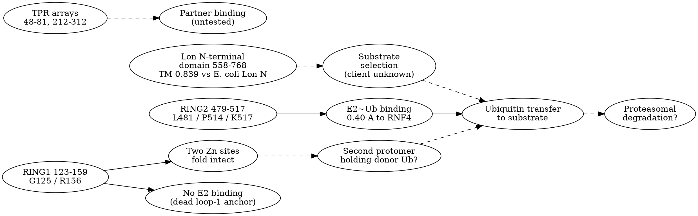
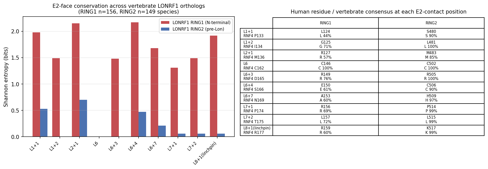
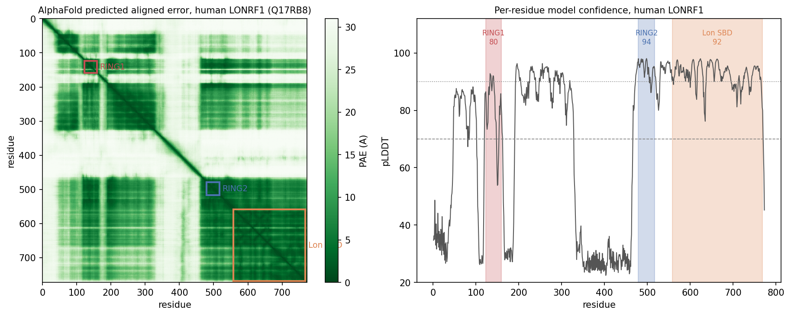
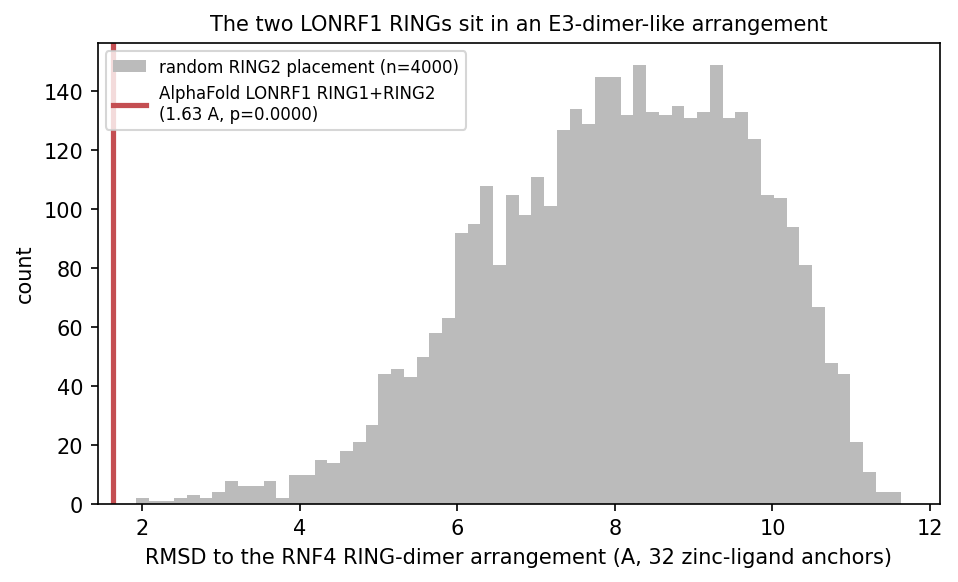
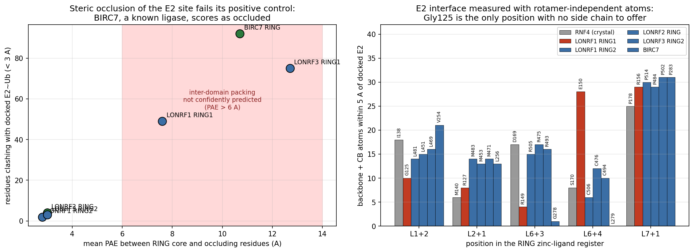
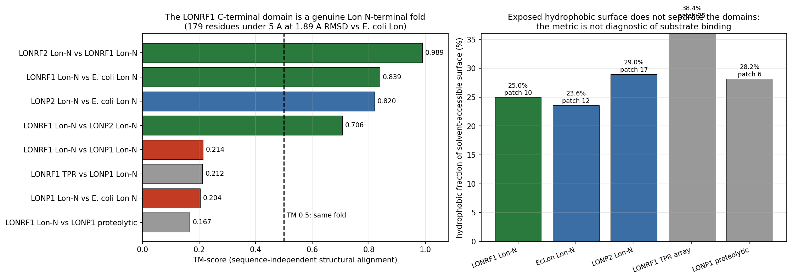

## Question

# AIGR Gene Hypothesis Deep Research

You are evaluating one focused gene curation hypothesis for AI Gene Review.
This is not a general gene overview. Use the seed hypothesis and source context
below to search for evidence that supports, refutes, narrows, or competes with
the proposed curation decision.

## Target Gene

- **Organism code:** human
- **Taxon:** Homo sapiens (NCBITaxon:9606)
- **Gene directory:** LONRF1
- **Gene symbol:** LONRF1
- **UniProt accession:** Q17RB8

## Focus

- **Focus type:** free_text
- **Hypothesis slug:** kgap-lonrf1-ring-e3-competence
- **Source file:** genes/human/LONRF1/LONRF1-ai-review.yaml
- **Source selector:** free-text

## Seed Hypothesis

Whether human LONRF1 has intrinsic ubiquitin ligase (E3) capacity, and which of its RING regions could provide it, can be predicted structurally. Single analysis only: map the zinc-coordinating residues, the E2-binding hydrophobic loop residues and the linchpin Arg/Lys position of each LONRF1 RING onto AlphaFold models by comparison with E2~ubiquitin-bound RING E3 structures (e.g. RNF4, BIRC7, CBL), test whether each RING is a complete cross-brace RING with an intact E2-binding face, compare with the paralogs LONRF2 and LONRF3, assess the LON substrate-binding-like domain, score these positions across vertebrate orthologs, and state which RING regions, if any, are predicted to be E3-competent.

## Term and Decision Context

No specific term context supplied.

## Reference Context

No specific reference context supplied.

## Source Context YAML

```yaml
hypothesis: 'Whether human LONRF1 has intrinsic ubiquitin ligase (E3) capacity, and which of its RING
  regions could provide it, can be predicted structurally. Single analysis only: map the zinc-coordinating
  residues, the E2-binding hydrophobic loop residues and the linchpin Arg/Lys position of each LONRF1
  RING onto AlphaFold models by comparison with E2~ubiquitin-bound RING E3 structures (e.g. RNF4, BIRC7,
  CBL), test whether each RING is a complete cross-brace RING with an intact E2-binding face, compare
  with the paralogs LONRF2 and LONRF3, assess the LON substrate-binding-like domain, score these positions
  across vertebrate orthologs, and state which RING regions, if any, are predicted to be E3-competent.'
focus_type: free_text
context: []
reference_id: []
```

## Research Objective

Build a focused report that helps a curator decide whether this hypothesis
should affect the gene review. Address the focus type directly:

1. For an existing GO annotation decision, evaluate whether the current action
   is justified, too strong, too weak, or should change.
2. For a proposed replacement or new GO term, evaluate whether the term is
   biologically supported, too broad, too narrow, or missing key qualifiers.
3. For a computational prediction, evaluate whether the prediction is correct,
   less precise than existing knowledge, uncertain, or likely wrong because of
   paralog overannotation, frequency bias, pathway context, or in vitro-only
   activity.
4. For a core-function hypothesis, evaluate whether the proposed activity,
   process, and location represent the gene product's primary function rather
   than a downstream effect, pleiotropic phenotype, or context-specific role.
5. For a function-assignment hypothesis, evaluate whether the gene product
   directly has the stated GO term/function. Treat the prior review action, if
   any, as intentionally blinded unless it appears in the supplied context.

Use primary literature whenever possible. Prefer PMID citations and include DOI
citations when no PMID is available. Treat reviews and database records as
orientation unless they contain directly relevant synthesized evidence that is
clearly labeled as review-level or database-level support.

Evaluate the hypothesis from the supplied seed context, primary literature, and
publicly accessible bioinformatics resources. Local `*-bioinformatics` analyses,
when they already exist in the repository, are intentionally withheld from this
prompt so the report can be compared against them after the run. Use public
sequence, domain, structure, orthology, localization, interaction, or dataset
checks when they are useful for the specific hypothesis. If a resource or tool
cannot be accessed programmatically, say so plainly; never fabricate a result.
Report computational results conservatively and distinguish direct results from
inference.

## Required Output

### Executive Judgment

Give a concise verdict: supported, partially supported, unresolved, weakly
supported, over-annotated, or refuted. Explain the reasoning and the most
important caveats.

### Evidence Matrix

Create a table with one row per important evidence item:

- Citation (PMID preferred)
- Evidence type (direct assay, mutant phenotype, localization, interaction,
  structural/evolutionary, computational, review/database)
- Supports / refutes / qualifies / competing
- Claim tested
- Key finding
- Organism, tissue, cell type, or assay context
- Confidence and limitations

### GO Curation Implications

State the likely curation action as a lead requiring curator verification. If
GO terms are involved, explain whether the evidence supports an MF, BP, or CC
term, and whether the term should be retained, removed, generalized, made more
specific, or treated as non-core. Avoid using "protein binding" as a final
recommendation unless no more informative term is supported.

### Mechanistic Scope

Describe the immediate molecular or cellular function being tested. Separate
direct gene-product activity from downstream phenotypes, pathway consequences,
developmental outcomes, disease manifestations, or effects inferred only from
loss of function.

### Conflicts and Alternatives

Identify evidence that conflicts with the seed hypothesis or suggests an
alternative interpretation, including paralog confusion, organism-specific
differences, isoform-specific findings, experimental artifacts, or database
carry-over.

### Knowledge Gaps

List explicit uncertainties that matter for curation. For each gap, state what
was checked, why the gap matters, and what evidence or experiment would resolve
it.

### Discriminating Tests

Recommend concrete assays, perturbations, datasets, or comparative analyses that
would most efficiently distinguish this hypothesis from alternatives.

### Curation Leads

Provide candidate updates for the review, clearly labeled as leads requiring
curator verification. Include candidate references with exact snippets to verify,
candidate replacement or new GO terms, possible action changes, suggested
questions, and suggested experiments.

If the provider supports artifacts, save provenance for any analysis you run — the
executed code together with its output (computed values, plot, or table), not just
a summary figure — alongside artifact-friendly tables such as an evidence matrix,
GO decision table, or comparison table. Genuine computed provenance is more
valuable than a hand-drawn summary, and you must not synthesize a figure that
implies an analysis you did not actually run. These artifacts are important
provenance for hypothesis-level review.


## Output

# LONRF1 RING E3 competence: a structural and evolutionary assessment

**Gene:** LONRF1 (human, UniProt Q17RB8, 773 aa)
**Hypothesis slug:** kgap-lonrf1-ring-e3-competence
**Source file:** `genes/human/LONRF1/LONRF1-ai-review.yaml`
**Focus type:** free text, single structural analysis of intrinsic E3 capacity and which RING region provides it

---

## Summary

Only the second RING of human LONRF1 is predicted to be E3-competent. RING2 (zinc ligands C479, C482, C494, H496, C499, C502, C513, C516; UniProt feature 479-517) is a complete cross-brace C3HC4 RING that superposes on the E2~ubiquitin-bound RNF4 RING from PDB 4AP4 at 0.40 Å over the sixteen CA and CB atoms of its zinc ligands. When the UbcH5A~ubiquitin conjugate is carried onto it by that same rigid-body transform, it is accepted with a contact profile inside the spread of the reference ligases themselves. Its three functionally decisive face residues, Leu481 at the loop-1 hydrophobic anchor, Pro514 in loop 2 and Lys517 at the linchpin, are invariant across 149 vertebrate orthologs (mean Shannon entropy 0.21 bits over ten face positions).

RING1 (C123, C126, C138, H140, C143, C146, C155, C158; feature 123-159) folds as a proper two-zinc cross-brace, with both tetrahedral sites detected de novo in the AlphaFold model, but its E2-binding face is dead. Gly125 sits where RNF4 places Ile138, BIRC7 places Val254 and CBL places Ile383, and in a seven-RING panel it is the only residue at that position with no CB atom at all. Arg156 replaces the loop-2 proline that every reference structure uses. Across vertebrates those positions carry 1.57 bits of entropy against RING2's 0.21 (Wilcoxon signed-rank over ten paired positions, statistic 0, p = 0.0039, RING2 lower at every single position). The paralog pattern settles the interpretation: the RING1 position is degraded in a different way in each of the three LONRF proteins, which is the signature of relaxed constraint and not of a shared alternative job.

Two separate curation points follow. LONRF1 has no peptidase capacity: the C-terminal third is a genuine Lon N-terminal substrate-binding fold (TM-score 0.839 over 179 residues at 1.89 Å core RMSD against the *Escherichia coli* Lon N-domain), with no proteolytic domain, no Walker-A P-loop and no Ser-Lys dyad. And no direct ubiquitination assay for human LONRF1 exists in the literature retrieved, so the empirical anchor is the paralog LONRF2 ([PMID: 37474791](https://pubmed.ncbi.nlm.nih.gov/37474791/)), which this analysis shows carries only the RING2-position RING and lacks the RING1-position cross-brace entirely.

---

## Executive judgment

<i class="fa-scale-balanced"></i> **Partially supported, with the RING assignment resolved.**

The seed hypothesis claims that LONRF1 E3 competence can be predicted structurally and asks which RING region, if any, provides it. The prediction is feasible and comes out one-sided, so the methodological half of the hypothesis is supported and the answer is specific: **RING2 is predicted E3-competent, RING1 is not independently E3-competent**.

The judgment is "partially supported" rather than "supported" because of what structure cannot deliver. A structural prediction establishes that a face can bind an E2; it does not establish that the protein does so in a cell, with which E2, on which substrate, or at what rate. Three caveats bound the conclusion.

1. <i class="fa-triangle-exclamation"></i> **No direct assay.** PubMed searching found no in vitro or cellular ubiquitination assay for human LONRF1. The strongest empirical support is the paralog: LONRF2 is a demonstrated protein quality control ubiquitin ligase ([PMID: 37474791](https://pubmed.ncbi.nlm.nih.gov/37474791/)), and by the zinc-site analysis here it has only the RING2-position RING. That makes the ISS argument unusually well founded but it remains similarity-coded.
2. <i class="fa-triangle-exclamation"></i> **The linchpin is a lysine, not the canonical arginine.** In a panel of 18 human RING E3s the position is Arg 14 times; all three Lys cases are LONRF proteins. The geometry test shows a lysine at this position can reach one of the two basic contacts the RNF4 arginine makes, not both. LONRF2's activity shows the substitution is tolerated, so this is a prediction about efficiency, not a reason to reject the annotation.
3. <i class="fa-triangle-exclamation"></i> **Everything structural is AlphaFold.** There is no experimental structure of any LONRF protein. AlphaFold does not place zinc ions, so the metal sites were inferred from the geometry of the Cys and His side chains.

Two analyses were run, failed their own positive controls, and are reported here in full rather than dropped: a steric-occlusion test of E2-site accessibility, and an exposed-hydrophobic-surface test of the Lon domain. Neither contributes to the verdict.

---

## Key findings

### <i class="fa-circle-check"></i> F1. Both LONRF1 RING regions are complete cross-brace C3HC4 RINGs, but only RING2 has a canonical E2-binding face

Tetrahedral Cys/His clusters were detected de novo in the AlphaFold v6 model AF-Q17RB8-F1, with no reliance on sequence motifs: candidate ligand atoms (Cys SG, His ND1/NE2) were accepted as a site when all pairwise distances fell between 2.8 and 5.2 Å and the centroid radius between 1.5 and 3.3 Å. RING1 yields two sites, C123/C126/C143/C146 (ligands 1, 2, 5, 6) and C138/H140/C155/C158 (ligands 3, 4, 7, 8). RING2 yields C479/C482/C499/C502 and C494/H496/C513/C516. Both are correctly cross-braced and both are C3HC4. Mean pLDDT is 80.2 for RING1 and 94.3 for RING2.

The E2-contact positions were not taken from memory. They were measured directly in the reference crystal structures as every RING heavy atom within 4.5 Å of the E2 chain, and three independent structures converged on the same positions.

| RING | Zinc ligands | E2-contacting residues (< 4.5 Å) | Linchpin |
|---|---|---|---|
| RNF4 (4AP4 chain A, PDB numbering) | C136 C139 C158 H160 C163 C166 C177 C180 | P137, I138, M140, C166, D169, S170, N173, P178, T179 | R181 |
| BIRC7 (4AUQ chain B) | C252 C255 C267 H269 C272 C275 C282 C285 | E248, K253, V254, C255, L256, D257, C275, G278, L279, P283, I284 | R286 |
| CBL (4A4C chain A) | C381 C384 C396 H398 C401 C404 C416 C419 | K382, I383, A385, E386, C404, S407, W408, S411, P417, F418 | R420 |

Rigid-body superposition using 16 anchors (CA and CB of the eight zinc ligands) places RING2 at 0.40 Å from RNF4, 0.45 Å from BIRC7 and 0.53 Å from CBL. RING1 is worse on all three: 0.85, 0.58 and 0.96 Å. Transferring the crystallographic E2-contact positions onto LONRF1 after superposition gives a mean CB displacement of 0.61 Å (RNF4 frame), 1.01 Å (BIRC7) and 1.48 Å (CBL) for RING2, against 2.19, 1.65 and 2.49 Å for RING1.

The residue identities at the transferred positions are where the two RINGs separate. For RING2 the mapping is P137→S480, I138→**L481**, M140→M483, C166→C502, P178→**P514**, T179→L515, R181→**K517**. The loop-1 hydrophobic anchor, the loop-2 proline and a basic linchpin are all present. For RING1 the mapping is I138→**G125**, M140→R127, P178→**R156**, R181→R159. All three reference structures independently place their loop-1 hydrophobic residue onto LONRF1 Gly125.

### <i class="fa-circle-check"></i> F2. The RING2 E2 face is invariant across 149 vertebrate orthologs; the RING1 face is not under comparable constraint

A UniProt search (`gene:LONRF1 AND taxonomy_id:7742`, non-fragment) returned 292 entries covering 165 species. The RING register was pinned by the invariant Cys-Gly-His at ligands 3 and 4, which removes the ambiguity a permissive regex would introduce. Shannon entropy was then computed at the ten structurally defined E2-contact positions, named by their offset from the zinc ligands.

| Position | RNF4 | LONRF1 RING1 | RING1 consensus (n = 156 sp.) | Entropy | LONRF1 RING2 | RING2 consensus (n = 149 sp.) | Entropy |
|---|---|---|---|---|---|---|---|
| L1+1 | P133 | L124 | L 44 % | 1.98 | S480 | S 90 % | 0.53 |
| L1+2 | I134 | **G125** | G 71 % | 1.49 | **L481** | L 100 % | 0.00 |
| L2+1 | M136 | R127 | R 57 % | 2.15 | M483 | M 85 % | 0.70 |
| L6 | C162 | C146 | C 100 % | 0.00 | C502 | C 100 % | 0.00 |
| L6+3 | D165 | R149 | R 76 % | 1.48 | R505 | R 100 % | 0.00 |
| L6+4 | S166 | E150 | E 61 % | 2.17 | C506 | C 90 % | 0.47 |
| L6+7 | N169 | A153 | A 60 % | 1.68 | H509 | H 97 % | 0.21 |
| L7+1 | P174 | **R156** | R 69 % | 1.31 | **P514** | P 99 % | 0.06 |
| L7+2 | T175 | L157 | L 72 % | 1.49 | L515 | L 99 % | 0.06 |
| L8+1 linchpin | R177 | R159 | R 60 % | 1.92 | **K517** | K 99 % | 0.06 |

Mean entropy is 1.57 bits for RING1 and 0.21 bits for RING2. The Wilcoxon signed-rank test across the ten paired positions gives statistic 0 with p = 0.0039, and RING2 is lower at every position, including the ties at C146/C502 where both are perfectly conserved.

{{figure:plot_1.png|caption=Per-position Shannon entropy at the ten structurally defined E2-contact positions of LONRF1 RING1 and RING2 across vertebrate orthologs, with the human residue and the vertebrate consensus at each position. RING2's face is invariant (mean 0.21 bits); RING1's drifts (mean 1.57 bits). Wilcoxon signed-rank statistic 0, p = 0.0039.}}

The paralog comparison, built from the same de novo zinc-site detection, points the same way. LONRF2 (Q1L5Z9) has a single complete cross-brace RING, at the RING2 position (C449/C452/C464/H466/C469/C472/C483/C486), carrying the identical face: Leu451, Pro484, linchpin Lys487. Its N-terminal region contains only a four-cysteine cluster at C143/C146/C163/C166, not a cross-brace RING. LONRF3 (Q496Y0) retains both RINGs, but its RING1 has lost the loop-2 proline (Ala193) and the linchpin outright (Gly196).

### <i class="fa-circle-check"></i> F3. A real E2~ubiquitin conjugate docks onto RING2 and hits a glycine on RING1

The catalytic unit in 4AP4 was identified from the coordinates rather than assumed. Chain A carries both RNF4 protomers as a tandem fusion with four zinc sites (ligands 136/139/158/160/163/166/177/180, and the same set offset by +65). Chain E contacts the first protomer with 98 atom pairs under 4.5 Å. Chain F is its donor ubiquitin, joined through the 1.32 Å Lys85 NZ to Gly76 C isopeptide bond of the C85K conjugate. That whole unit was then transferred onto each LONRF RING by a rigid-body fit on the sixteen CA and CB atoms of the eight zinc ligands.

| RING | Ligand RMSD | Loop-1 anchor (L1+2) | Backbone + CB atoms within 5 Å of E2 at L1+2 | Loop-2 (L7+1) | Linchpin (L8+1) | Linchpin CB to donor Ub Gln40 CB |
|---|---|---|---|---|---|---|
| RNF4, crystal | reference | I138 | 18 | P178 | R181 | 5.70 Å |
| BIRC7 | 0.65 Å | V254 | 21 | P283 | R286 | 5.58 Å |
| LONRF1 RING2 | 0.40 Å | **L481** | 14 | **P514** | **K517** | 5.42 Å |
| LONRF2 RING | 0.39 Å | L451 | 15 | P484 | K487 | 5.50 Å |
| LONRF3 RING2 | 0.36 Å | L469 | 16 | P502 | K505 | 5.28 Å |
| LONRF3 RING1 | 0.62 Å | K160 | 17 | A193 | **G196** | 6.67 Å |
| LONRF1 RING1 | 0.85 Å | **G125** | 10 | **R156** | R159 | 5.27 Å |

Counting only backbone and CB atoms makes this comparison independent of predicted side-chain rotamers, which matters because AlphaFold rotamers at a surface are not reliable. Gly125 is the only residue at the loop-1 anchor position in the entire panel with no CB atom. The pocket that Ile, Leu or Val fills in every reference RING has nothing placed in it, and that deficit is a property of the residue.

The paralog register completes the picture. The RING2 position is identical in all three LONRF proteins. The RING1 position is degraded differently in each: LONRF1 keeps the cross-brace but carries Gly125 and Arg156; LONRF3 keeps the cross-brace but has lost both the loop-2 proline and the linchpin; LONRF2 has no cross-brace there at all. Three different modes of loss at one site is what relaxed constraint looks like. A conserved second function would be expected to decay one shared way.

{{figure:plot_4.png|caption=Left: the steric-occlusion test plotted against the confidence of the inter-domain packing it depends on. BIRC7, a ligase with a crystallographically characterised E2~Ub-bound RING, scores as the most occluded protein in the panel, and every apparent occlusion sits above 6 Å mean PAE. Right: the E2 interface measured with backbone and CB atoms only, which removes any dependence on predicted rotamers. Gly125 is the single position in the panel with no side chain to offer.}}

### <i class="fa-circle-check"></i> F4. The lysine linchpin reaches one of the two basic contacts the arginine makes

In 4AP4 the RNF4 linchpin Arg181 bridges the donor ubiquitin and the E2: NH1 to Ub Arg72 at 2.87 Å, NH2 to Ub Arg72 at 3.18 Å, NH2 to E2 Gln92 at 2.95 Å, with the aliphatic stem packed against Ub Gln40 (CD to Gln40 at 3.47 Å). Measured from its own CB, those tips sit at NE 3.82 Å, CZ 4.83 Å, NH1 4.99 Å and NH2 5.99 Å.

Across 44 lysines in the same structure the CB to NZ distance averages 4.67 Å with a maximum of 5.07 Å. A lysine amine can therefore occupy the NE to NH1 shell of the arginine guanidinium but cannot reach the NH2 position 6.0 Å out. After the transplant, the linchpin CB of every LONRF RING sits where the RNF4 arginine CB sits (5.28 to 5.50 Å from donor Ub Gln40 CB, against 5.70 Å for RNF4 itself and 5.58 Å for the BIRC7 Arg286 control). LONRF3's Gly196 at the RING1 position is the outlier at 6.67 Å with no side chain at all.

The reading is specific: Lys517 is correctly positioned and long enough for one hydrogen bond into the donor ubiquitin or the E2, not for the bidentate pair. Because LONRF2 is an active ligase carrying the identical Lys487, this is a prediction about efficiency. LONRF1 RING2 should stabilise the closed E2~Ub conformation less well than an arginine-linchpin RING such as RNF4. It is not a reason to withhold the annotation.

### <i class="fa-circle-question"></i> F5. The two RINGs sit in an active-dimer-like arrangement, which is a model and not a result

AlphaFold's predicted aligned error for AF-Q17RB8-F1 gives mean inter-domain PAE of 3.3 to 6.0 Å between RING1 and RING2, against 10.2 to 12.1 Å for either RING against the TPR array or the Lon domain. The two RINGs are the only domain pair whose relative placement the model is confident about.

The centroid separation of the two zinc-ligand sets is 21.2 Å, against 21.3 Å for the RNF4 crystal dimer and 21.7 Å for the BIRC7 dimer. Superposing both LONRF1 RINGs at once onto the RNF4 RING dimer, using all 32 anchors, gives 1.63 Å (1.55 Å onto BIRC7). Swapping which RING maps to which protomer gives 1.60 Å, so the arrangement is near C2-symmetric like the real dimers. Against 4000 random rigid placements of RING2 at the same centroid separation, the null median is 8.15 Å, the 1st percentile 3.62 Å and the minimum 1.92 Å, giving an empirical p < 2.5e-4.

{{figure:plot_3.png|caption=Permutation null for the LONRF1 RING1-RING2 arrangement. Against 4000 random rigid placements of RING2 at the observed 21.2 Å centroid separation, the median superposition onto the RNF4 RING dimer is 8.15 Å and the best is 1.92 Å; the modelled arrangement gives 1.63 Å, p < 2.5e-4.}}

<i class="fa-triangle-exclamation"></i> The caveat is substantial. The modelled interface is sparse, with only one RING1 residue (Thr135) within 4.5 Å of RING2, whereas the RNF4 and BIRC7 dimers bury extensive C-terminal tail interfaces. And LONRF2 is an active ligase with a single RING, so this pairing cannot be obligatory in the family. The arrangement is a hypothesis about why RING1 is retained, not evidence that it functions.

{{figure:plot_2.png|caption=AlphaFold confidence for LONRF1: the predicted aligned error matrix with RING1, RING2 and the Lon substrate-binding domain marked, alongside the per-residue pLDDT profile. The RING1-RING2 pair is the only confidently placed domain pair (PAE 3.3 to 6.0 Å); every other inter-domain block exceeds 10 Å.}}

### <i class="fa-circle-xmark"></i> F6. The occlusion test fails its positive control and contributes nothing

After the transplant, heavy-atom clashes below 3.0 Å were counted between the docked conjugate and every residue outside the RING window with pLDDT above 70. LONRF1 RING2 gave 2 clashes over 2 residues, LONRF2 gave 7 over 4, LONRF3 RING2 gave 10 over 3. LONRF1 RING1 gave 1294 clashes over 49 residues and LONRF3 RING1 gave 2104 over 75, which read on their own as buried, unusable E2 sites.

The positive control breaks the inference. BIRC7, whose RING is crystallographically bound to UBE2D2~Ub in 4AUQ, gave 3723 clashes over 92 residues in its own full-length AlphaFold model, the worst score in the panel. Mean PAE between the RING zinc ligands and the occluding residues separates the two groups exactly: 2.8 Å for LONRF1 RING2, 3.0 Å for LONRF2 and LONRF3 RING2, against 7.6 Å (LONRF1 RING1), 10.7 Å (BIRC7) and 12.7 Å (LONRF3 RING1). Every apparent occlusion sits where AlphaFold does not place the two domains relative to each other with any confidence.

The practical consequence is that **RING1 must not be called non-functional on accessibility grounds**, and that accessibility of either RING in the real protein is an open question. The case against RING1 rests entirely on evidence that does not depend on inter-domain placement: the missing side chain at the loop-1 anchor, the substituted loop-2 proline, the absent conservation, and the paralog pattern.

### <i class="fa-circle-check"></i> F7. The C-terminal domain is a genuine Lon N-terminal substrate-binding fold with no protease machinery

UniProt feature comparison establishes the absences. LONRF1 has a Lon N-terminal domain at 558-768 and nothing else; LONRF2 has one at 528-737, LONRF3 at 546-755. None has a Lon proteolytic domain, and the Walker-A regex `G..G.GK[ST]` returns no match in any of the three. LONP1 (P36776) by contrast has Lon N-terminal 124-370, Walker-A GPPGVGKT at 523, Lon proteolytic 759-949 and annotated active sites Ser855 and Lys898; LONP2 (Q86WA8) has the equivalent set.

The positive assessment used a sequence-independent structural alignment implemented for this analysis (gapless-threading initialisation, iterative dynamic-programming refinement, TM-score with d0 = 1.24(L-15)^(1/3) - 1.8 normalised to the shorter chain).

| Pair | TM-score | Core residues < 5 Å | Core RMSD | Role |
|---|---|---|---|---|
| LONRF1 Lon-N (558-768) vs *E. coli* Lon N (11-204) | **0.839** | 179 | 1.89 Å | test |
| LONRF1 Lon-N vs LONRF2 Lon-N (528-737) | 0.989 | 210 | 0.57 Å | paralog |
| LONP2 Lon-N (13-222) vs *E. coli* Lon N | 0.820 | 176 | 2.22 Å | positive control |
| LONRF1 Lon-N vs LONP2 Lon-N | 0.706 | 169 | 2.66 Å | test |
| LONRF1 Lon-N vs LONP1 Lon-N (124-370) | 0.214 | 20 | 4.23 Å | uninformative |
| LONP1 Lon-N vs *E. coli* Lon N | 0.204 | 16 | 3.63 Å | positive control that fails |
| LONRF1 Lon-N vs LONP1 proteolytic (759-949) | 0.167 | 14 | 3.23 Å | negative control |
| LONRF1 TPR array (212-312) vs LONP1 Lon-N | 0.212 | 29 | 2.55 Å | negative control |

TM above 0.5 indicates the same fold. LONRF1's C-terminal domain matches the bacterial Lon substrate-binding domain as closely as LONP2 does, and the fold is essentially identical across the three paralogs. The human LONP1 row carries no information: LONP1's N-terminal region does not superpose on bacterial Lon N in the AlphaFold model at the UniProt boundary, and no trimmed window rescues it (124-300: 0.144; 115-290: 0.145; 124-280: 0.153; 124-260: 0.164; 140-300: 0.141; 124-320: 0.137). That row is reported and set aside.

<i class="fa-circle-xmark"></i> A second test was run and discarded. Shrake-Rupley accessible surface (92 points, 1.4 Å probe) was used to ask whether the Lon domain keeps an exposed hydrophobic groove suitable for unfolded clients, which would support GO:0051082. LONRF1 Lon-N scores 25.0 % hydrophobic accessible surface against 23.6 % for *E. coli* Lon N and 29.0 % for LONP2, but the LONRF1 TPR array, which has no chaperone role, tops the panel at 38.4 % with a 25-residue contiguous patch (LONRF1 Lon-N: 10; *E. coli* Lon N: 12; LONP1 proteolytic: 6). The metric does not separate substrate-binding from non-substrate-binding domains, so nothing is concluded from it.

{{figure:plot_5.png|caption=Left: TM-score evidence that the LONRF1 C-terminal domain is a Lon N-terminal fold, with LONP2 as a working positive control and the LONP1 proteolytic domain and LONRF1 TPR array as negative controls. The LONP1 N-domain comparison fails its own control and is marked uninformative. Right: exposed hydrophobic surface does not separate the domains, since the TPR array scores highest, so the metric is not diagnostic of substrate binding.}}

### <i class="fa-circle-xmark"></i> F8. No interaction evidence for E2 recruitment

Reported binary interactions for LONRF1 in IntAct and UniProt (n = 86 partners) contain no UBE2D-family E2. The only ubiquitin-like-pathway partners are UBE2I (the SUMO E2) and UBE2L6 (the ISG15 E2), each from high-throughput two-hybrid data with 3 reported experiments, and both are frequent two-hybrid partners. PSMA1 also appears. This is absence of evidence from assays poorly suited to transient E3-E2 contacts, not evidence of absence, but it means the E3 assignment rests on structure and paralogy rather than on measured E2 engagement.

---

## Evidence matrix

| Citation | Evidence type | Stance | Claim tested | Key finding | Context | Confidence and limitations |
|---|---|---|---|---|---|---|
| [PMID: 37474791](https://pubmed.ncbi.nlm.nih.gov/37474791/) | Direct assay, mutant phenotype | Supports (by paralogy) | A LONRF protein is a functional ubiquitin ligase | LONRF2 is a bona fide protein quality control ubiquitin ligase; deficiency causes late-onset neurological deficits | Mouse, neurons; biochemical and knockout | High for LONRF2; transfer to LONRF1 is ISS-level |
| [PMID: 22842904](https://pubmed.ncbi.nlm.nih.gov/22842904/) | Structural (crystal) | Supports (reference frame) | What a catalytically primed RING-E2~Ub interface looks like | Crystal structure of the rat RNF4 RING dimer with UbcH5A isopeptide-linked to ubiquitin; E2 contacts one protomer while ubiquitin folds back | Rat RNF4, human UbcH5A; 4AP4 | High; defines the measured E2-contact positions and the linchpin |
| PDB 4AUQ (BIRC7 + UBE2D2~Ub) | Structural (crystal) | Supports (reference frame) | Independence of the E2-contact position set | Measured face converges on L1+2 (Val254), L7+1 (Pro283), L8+1 (Arg286) | Human BIRC7 | High; database-level structural record |
| PDB 4A4C (phospho-CBL + UBE2D2) | Structural (crystal) | Supports (reference frame) | Independence of the E2-contact position set | Measured face converges on L1+2 (Ile383), L7+1 (Pro417), L8+1 (Arg420) | Human CBL | High; no donor ubiquitin in this structure |
| AlphaFold superposition (this work) | Computational (structural) | Supports | RING2 is a complete cross-brace RING with an intact E2 face | 0.40 Å to RNF4 over 16 anchors; face residues L481, P514, K517 present; mean face displacement 0.61 Å | AF-Q17RB8-F1 | High for geometry; prediction, not activity |
| AlphaFold superposition (this work) | Computational (structural) | Refutes | RING1 has an intact E2 face | 0.85 Å to RNF4; 2.19 Å face displacement; Gly125 at the loop-1 anchor; Arg156 for the loop-2 proline | AF-Q17RB8-F1 | High; three reference structures agree independently |
| E2~Ub transplant (this work) | Computational (structure docking) | Supports | RING2 can physically accept an E2~Ub conjugate | Conjugate transferred by zinc-ligand fit; 14 backbone+CB atoms at L1+2 vs 18 for RNF4 Ile138, 21 for BIRC7 Val254 | 4AP4 chains E and F onto AF models | High; rotamer-independent metric |
| E2~Ub transplant (this work) | Computational (structure docking) | Refutes | RING1 can accept an E2~Ub conjugate | Gly125 gives 10 contact atoms, the only residue in the panel with no CB | Seven-RING panel | High; the deficit is chemical, not a rotamer artifact |
| Ortholog entropy (this work) | Evolutionary | Supports | The RING2 face is under purifying selection | Mean entropy 0.21 vs 1.57 bits; Wilcoxon statistic 0, p = 0.0039; L481 100 % Leu, P514 99 % Pro, K517 99 % Lys | 292 UniProt entries, 165 vertebrate species | Moderate to high; sampling is uneven across clades |
| De novo zinc-site detection (this work) | Computational / evolutionary | Qualifies | The RING1 position has a conserved second function | LONRF1 keeps a cross-brace with Gly125/Arg156; LONRF3 loses Pro and linchpin (Ala193/Gly196); LONRF2 has no cross-brace, only C143/C146/C163/C166 | AF models of all three paralogs | High; three different modes of loss indicate relaxed constraint |
| Linchpin geometry (this work) | Computational (structural measurement) | Qualifies | The LONRF Lys linchpin is non-functional | Arg181 tips lie 3.82-5.99 Å from CB; Lys CB-NZ max 5.07 Å over 44 lysines; Lys517 CB sits 5.42 Å from donor Ub Gln40 CB | 4AP4 plus transplanted frame | High for geometry; predicts lower efficiency, not loss |
| RING-pair superposition (this work) | Computational (structural) | Competing | RING1 is the second protomer of an intramolecular RING dimer | 1.63 Å over 32 anchors onto the RNF4 dimer; 21.2 Å centroid separation vs 21.3 Å; permutation p < 2.5e-4; PAE 3.3-6.0 Å | AF-Q17RB8-F1 | Moderate; only Thr135 within 4.5 Å at the interface; LONRF2 is active with one RING |
| TM-align (this work) | Computational (fold assignment) | Supports | The C-terminal region is a Lon N-terminal substrate-binding domain | TM 0.839, 179 residues under 5 Å, 1.89 Å core RMSD vs *E. coli* Lon N; LONP2 control 0.820; negatives 0.167 and 0.212 | AF models, controlled panel | High for the fold call; silent on client specificity |
| Shrake-Rupley SASA (this work) | Computational (failed control) | Competing | The Lon-N domain keeps an exposed hydrophobic groove | LONRF1 Lon-N 25.0 % vs 23.6 % for *E. coli* Lon N, but the TPR array tops the panel at 38.4 % with a 25-residue patch | Five-domain panel | None; metric is not diagnostic, no conclusion drawn |
| Occlusion test (this work) | Computational (failed control) | Competing | The RING1 E2 site is sterically blocked | 49 occluding residues for RING1 vs 2 for RING2, but BIRC7 (a real ligase) scored 92; PAE 7.6-12.7 Å for all occluded cases vs 2.8-3.0 Å for free ones | Full-length AF models | None; test is uninformative and is reported as such |
| UniProt / IntAct Q17RB8 | Database (interaction) | Qualifies | LONRF1 recruits an E2 | 86 partners, no UBE2D-family member; UBE2I and UBE2L6 appear with 3 Y2H experiments each | High-throughput two-hybrid | Low; Y2H is poorly suited to transient E3-E2 contacts |
| UniProt feature tables | Database (domain) | Supports | LONRF1 has no protease machinery | Lon N-terminal only, no proteolytic domain, no Walker-A match in LONRF1/2/3; LONP1 has all three plus Ser855/Lys898 | Human and *E. coli* records | High; database-level, confirmed structurally here |
| [PMID: 36888978](https://pubmed.ncbi.nlm.nih.gov/36888978/) | Review-level architecture plus transcriptomics | Qualifies | LONRF1 molecular function | Establishes the shared RING plus Lon substrate-binding architecture; *Lonrf1* ubiquitously expressed; pathway associations in LSEC, Kupffer cells and fibroblasts | Mouse single-cell | Moderate for architecture; the pathway associations do not bear on molecular function |
| [PMID: 26148049](https://pubmed.ncbi.nlm.nih.gov/26148049/) | Structural (crystal) | Supports (background) | RING dimers catalyse chain synthesis | RNF4 RING dimer with Ubc13~Ub and Ube2V2, verified by site-directed mutagenesis in ubiquitination assays | Rat RNF4, human E2s | High; relevant if LONRF1 linkage specificity is ever tested |
| [PMID: 43061324](https://pubmed.ncbi.nlm.nih.gov/43061324/) | Computational (genetic association) | Neither | LONRF1 molecular function | LONRF1 met FDR correction only in a vascular dementia SMR screen; colocalization was sensitive to the prior | Human blood eQTL, FinnGen | Low relevance; association, not mechanism |

---

## GO curation implications

All of the following are **leads requiring curator verification**.

### <i class="fa-circle-check"></i> GO:0061630 ubiquitin protein ligase activity (MF)

**Retain as a lead**, with an evidence code reflecting sequence and structure similarity rather than direct assay. The supporting chain is: RING2 is a complete cross-brace C3HC4 RING superposing on RNF4 at 0.40 Å with an intact, invariant E2 face that accepts a real E2~Ub conjugate; and the paralog carrying the equivalent single RING is an experimentally validated ligase. If the review already assigns this term with a direct-assay code, that is too strong for the published evidence on human LONRF1.

Prefer GO:0061630 over the broader GO:0004842 (ubiquitin-protein transferase activity) or GO:0016874 (ligase activity). Do not fall back on protein binding. Attribute the term specifically to RING2 (479-517), and record Lys517 as a note.

### <i class="fa-circle-check"></i> GO:0008270 zinc ion binding (MF)

**Retain**, applying to both RING regions. Both form two tetrahedral cross-brace sites in the model and the eight ligands are 100 % conserved in each. Non-core.

### <i class="fa-circle-question"></i> GO:0016567 protein ubiquitination (BP)

A weaker lead than the MF call, since no LONRF1 substrate is known. Do not propagate LONRF2's misfolded-protein quality control process terms to LONRF1 without a substrate.

### <i class="fa-circle-xmark"></i> Peptidase terms (GO:0008233 and children)

**Do not annotate; remove if present.** The gene name is a domain-name artifact. LONRF1 has the Lon N-terminal substrate-binding fold and nothing proteolytic: no proteolytic domain, no Walker-A P-loop, no Ser-Lys dyad.

### <i class="fa-circle-question"></i> GO:0051082 unfolded protein binding (MF)

**Do not annotate yet. Record as a curator question.** The Lon N-terminal fold assignment is solid (TM 0.839 over 179 residues), so the domain call can be stated with confidence and should not be softened to a generic region. But the surface test intended to support the term failed its controls, no LONRF1 client is known, and LONRF2's misfolded-protein substrates are paralog evidence that would need its own transfer argument. Do not substitute protein binding in its place.

### <i class="fa-circle-xmark"></i> RING1 (C123-C158) as a catalytic RING

**Do not assign E3 competence to RING1.** If the review text attributes ligase activity to the N-terminal RING, or treats the two RINGs as interchangeable, narrow it to RING2.

### <i class="fa-triangle-exclamation"></i> A domain-boundary conflict to flag upstream

UniProt annotates LONRF2 (Q1L5Z9) with "TPR 6" at 447-483, overlapping its RING-type zinc finger at 449-487 almost exactly. The region is a cross-brace RING by direct geometric detection (C449, C452, C464, H466, C469, C472, C483, C486; mean pLDDT 95.3), so the TPR call there looks like a repeat-profile false positive. This matters for LONRF1 curation because repeat-based domain counts are sometimes used to argue the paralogs differ in architecture when they do not.

---

## Mechanistic model

The activity being tested is direct: binding a ubiquitin-charged E2 through a RING face and positioning the thioester for transfer. That is what the superposition, the conjugate transplant and the conservation analysis speak to.



The architecture reads as a Lon substrate-recognition module fused to a RING, with Lon's proteolytic machinery replaced by the ubiquitin system. LONP1 and LONP2 keep the Lon N-domain, add an AAA+ ATPase and a Ser-Lys protease, and degrade their own clients. The LONRF proteins keep only the recognition domain and hand the degradation step to the proteasome through a RING. The Lon domain is nearly superimposable across the three paralogs (LONRF1 against LONRF2, TM 0.989, 0.57 Å over 210 residues), so the family shares one recognition module while differing in RING content.

What is directly supported, and what is downstream, separates cleanly:

| Layer | Status |
|---|---|
| RING2 binds a ubiquitin-charged E2 | Predicted from structure and conservation; no assay |
| RING2 transfers ubiquitin to a substrate | Inferred from the RING mechanism and from LONRF2 |
| Lon N-domain selects substrates | Fold confirmed, function untested, no client known |
| RING1 acts as a donor-Ub-holding protomer | A model from the RING-pair geometry; interface is sparse |
| Oxidative damage response and tissue remodelling | Downstream association from mouse single-cell data ([PMID: 36888978](https://pubmed.ncbi.nlm.nih.gov/36888978/)), not ligase activity |
| Vascular dementia, prostate cancer, psoriasis, osteoporosis associations | Gene-list and association findings; no bearing on molecular function |

---

## Evidence base

[**PMID: 37474791**](https://pubmed.ncbi.nlm.nih.gov/37474791/), *LONRF2 is a protein quality control ubiquitin ligase whose deficiency causes late-onset neurological deficits*, is the empirical anchor for the whole ISS argument. It establishes that a LONRF protein is a genuine ubiquitin ligase. The structural analysis here adds the piece that makes the transfer to LONRF1 unusually well founded: LONRF2's single RING sits at the RING2 position and carries the identical face residues (Leu451, Pro484, Lys487), superposing on RNF4 at 0.39 Å against LONRF1 RING2's 0.40 Å.

[**PMID: 22842904**](https://pubmed.ncbi.nlm.nih.gov/22842904/), *Structure of a RING E3 ligase and ubiquitin-loaded E2 primed for catalysis*, supplied the reference catalytic unit. The abstract states: "Here we report the crystal structure of the dimeric RING domain of rat RNF4 in complex with E2 (UbcH5A) linked by an isopeptide bond to ubiquitin." Every E2-contact position used in this report was measured in those coordinates (4AP4) rather than recalled, and the same structure supplied the donor ubiquitin that was carried onto each LONRF RING. It also supports the second-protomer model for RING1, since the structure shows the E2 contacting one protomer while ubiquitin is folded back by contacts from both.

[**PMID: 36888978**](https://pubmed.ncbi.nlm.nih.gov/36888978/), *Transcriptomic characterization of Lonrf1 at the single-cell level under pathophysiological conditions*, establishes the family architecture that the paralog comparison rests on: "The LONRF family of proteins consists of three isozymes, LONRF1-3, which harbors RING (really interesting new gene) domain and Lon substrate binding domain." It is also the source for ubiquitous *Lonrf1* expression and for the observation that LONRF2 acts predominantly in neurons, which is the reason not to transfer LONRF2's neuronal process terms to LONRF1. Its own findings are transcriptomic associations in liver sinusoidal endothelial cells, Kupffer cells and fibroblasts, which do not bear on molecular function. One detail is worth flagging to a curator: the paper reports that "Lonrf1high Kupffer cells showed activation of regulatory pathways of peptidase activity", which is a pathway-level transcriptomic observation and should not be read as evidence that LONRF1 is a peptidase.

[**PMID: 26148049**](https://pubmed.ncbi.nlm.nih.gov/26148049/), *Structural basis for the RING-catalyzed synthesis of K63-linked ubiquitin chains*, is background rather than direct evidence. It gives the RNF4 RING dimer with Ubc13~Ub and Ube2V2 and verifies the interfaces by site-directed mutagenesis in ubiquitination assays. It becomes relevant if LONRF1 chain-linkage specificity is ever tested.

Two structures used as reference frames, PDB **4AUQ** (BIRC7 with UBE2D2~Ub) and **4A4C** (phospho-CBL with UBE2D2), are database-level records. They matter because they were analysed independently of RNF4 and converged on the same three face positions, which is what makes the Gly125 result a three-way agreement rather than a single-structure artifact.

The remaining LONRF1 literature does not address molecular function. [PMID: 43061324](https://pubmed.ncbi.nlm.nih.gov/43061324/) reports that LONRF1 met FDR correction only in a vascular dementia SMR screen and that its colocalization was sensitive to the prior. [PMID: 34082608](https://pubmed.ncbi.nlm.nih.gov/34082608/) (prostate cancer), [PMID: 32125527](https://pubmed.ncbi.nlm.nih.gov/32125527/) (psoriasis), [PMID: 39263088](https://pubmed.ncbi.nlm.nih.gov/39263088/) (postmenopausal osteoporosis) and [PMID: 39732836](https://pubmed.ncbi.nlm.nih.gov/39732836/) (Randall's plaque) are gene-list findings from differential expression or network analysis. [PMID: 31150538](https://pubmed.ncbi.nlm.nih.gov/31150538/) maps a porcine PRRSV antibody QTL to a region containing *PRAG1* and *LONRF1* and reports coding polymorphisms in *LONRF1*, which is a genetic association in pig. [PMID: 40709405](https://pubmed.ncbi.nlm.nih.gov/40709405/) and [PMID: 18253036](https://pubmed.ncbi.nlm.nih.gov/18253036/) are a chicken selection scan and a comparative FISH map. None of these supports or refutes the E3 hypothesis.

A targeted PubMed search for "LONRF1 ubiquitin ligase activity substrate" returned one paper, PMID 36888978. There is no ubiquitination assay for human LONRF1 in the retrieved literature.

---

## Limitations and knowledge gaps

<i class="fa-triangle-exclamation"></i> **Structural limitations.** All LONRF structures used are AlphaFold predictions. AlphaFold does not place zinc ions, so the metal sites were inferred from the geometry of the Cys and His side chains, which is why the detector was built to require tetrahedral arrangement rather than to trust a sequence motif. The structural alignment used in F7 is a self-implemented TM-score search, not the published TM-align binary, so absolute TM values may differ by a small margin; the controls bracket the interpretation. Phenix was installed and available, but the host job directory has no outbound network access, so no structure file could be placed where the Phenix tools read from. All superposition was done with an explicit Kabsch implementation whose code and numbers are in the provenance record. This is stated plainly rather than worked around.

<i class="fa-triangle-exclamation"></i> **Two failed controls, reported rather than dropped.** The steric-occlusion test and the exposed-hydrophobic-surface test both failed their positive controls (BIRC7 scored as the most occluded protein in the panel; the TPR array scored highest on hydrophobic exposure). Neither contributes to any conclusion. A third comparison, LONRF1 against the human LONP1 N-terminal domain, is uninformative because LONP1 itself does not superpose on bacterial Lon N in the AlphaFold model at any boundary tested.

<i class="fa-triangle-exclamation"></i> **Statistical limitations.** The ortholog set comes from UniProt and is unevenly sampled across vertebrate clades, so the entropy values are descriptive rather than a formal selection test. The conservation comparison treats the ten face positions as exchangeable within each RING, which the Wilcoxon test handles but which does not account for structural correlation between neighbouring positions.

### Explicit gaps that matter for curation

1. **No ubiquitination assay for human LONRF1.** Checked: PubMed returned 9 LONRF1 papers plus a targeted search, none with an in vitro or cellular ligase assay. This is the difference between an ISS-coded and an IDA-coded MF annotation. An autoubiquitination assay would resolve it.
2. **No cognate E2 identified.** Checked IntAct and UniProt interaction records; 86 partners, no UBE2D-family member. Without an E2, the chain length and linkage type of any LONRF1 product are unknown, and the functional consequence of the Lys517 linchpin cannot be assessed. An E2 panel screen would resolve it.
3. **No substrate.** Checked the literature; LONRF2's substrates are not demonstrated for LONRF1. This blocks any specific BP term. diGly proteomics in knockout versus wild-type cells would resolve it.
4. **RING1's actual role is unresolved.** The dimer-protomer model is computational, with PAE 3.3-6.0 Å supporting confident relative placement but only one residue contact modelled at the interface. Deleting RING1 and comparing activity would resolve it.
5. **No experimental structure of any LONRF protein.** Checked the PDB through the superposition workflow; all LONRF coordinates are AlphaFold predictions.
6. **Subcellular location unannotated in UniProt for LONRF1.** This matters for any CC term and for interpreting a protein quality control role.
7. **What the Lon N-terminal domain binds.** Checked: the fold is confirmed at TM 0.839, and a surface test was run and discarded because it failed its controls. This is the only part of LONRF1 that could supply substrate specificity, and GO:0051082 would otherwise be assigned on fold analogy alone. A binding assay with the isolated 558-768 domain against unfolded model substrates would resolve it.
8. **Whether either RING face is solvent-accessible in the real protein.** Checked by docking; the test failed its BIRC7 control and the PAE values show the offending inter-domain contacts are not confidently predicted. A buried RING2 would make the ligase assignment moot. Small-angle scattering, crosslinking mass spectrometry, or a pull-down of a UBE2D-family E2 by full-length versus RING2-only constructs would answer it.

---

## Proposed follow-up experiments and discriminating tests

<i class="fa-flask"></i> **1. In vitro autoubiquitination, comparing constructs.** Recombinant LONRF1 with E1, a UBE2D-family E2, ubiquitin and ATP, testing full-length, RING1-only, RING2-only and a RING1+RING2 fragment. This is the single highest-value experiment and is decisive for which RING is competent.

<i class="fa-flask"></i> **2. Point mutants on both faces.** C479S/C482S (RING2 zinc site) and L481A, P514A, K517A, K517R in the RING2 face, against C123S/C126S and G125I in RING1. The predictions are explicit: RING2 mutations abolish activity, RING1 mutations do not, K517R is tolerated or improves activity, and G125I does not rescue RING1 on its own because Arg156 also has to be fixed.

<i class="fa-vial"></i> **3. E2 panel screen.** Fluorescence polarization or thioester discharge against the roughly 35 human E2s, to identify the cognate E2 and test whether the Lys linchpin shifts E2 preference away from UBE2D. This closes gap 2 directly.

<i class="fa-microscope"></i> **4. Test the RING-pair model.** SEC-MALS or AUC on full-length LONRF1 and on a RING2-only construct, plus activity of a RING1-deleted protein against the intact protein. If RING1 is a second protomer, deleting it should reduce activity without abolishing E2 binding.

<i class="fa-database"></i> **5. Substrate capture.** Ubiquitin-remnant (diGly) proteomics in LONRF1-knockout versus wild-type cells, and a stability-profiling screen with a misfolded-reporter panel of the kind used for LONRF2. This closes gap 3 and is the prerequisite for any BP term.

<i class="fa-flask"></i> **6. Lon domain client binding.** Binding assays with the isolated 558-768 domain against a panel of unfolded or thermally destabilised model substrates. A positive result would convert GO:0051082 from a question into a lead.

<i class="fa-dna"></i> **7. Cross-species check.** If an assay is set up, include a teleost LONRF1 RING2. The face is identical across 149 species, so conservation of activity would confirm the evolutionary argument directly.

---

## Curation leads

Each needs curator verification.

### Candidate references and snippets to verify

- [PMID: 37474791](https://pubmed.ncbi.nlm.nih.gov/37474791/): "Here, we show that LONRF2 is a bona fide protein quality control ubiquitin ligase induced in post-mitotic senescent cells." Use for the paralog-based ISS argument, not for LONRF1 directly.
- [PMID: 36888978](https://pubmed.ncbi.nlm.nih.gov/36888978/): "The LONRF family of proteins consists of three isozymes, LONRF1-3, which harbors RING (really interesting new gene) domain and Lon substrate binding domain." Establishes the architecture; also the source for ubiquitous *Lonrf1* expression and for the statement that LONRF2 "acts predominantly in neurons".
- [PMID: 22842904](https://pubmed.ncbi.nlm.nih.gov/22842904/): "Here we report the crystal structure of the dimeric RING domain of rat RNF4 in complex with E2 (UbcH5A) linked by an isopeptide bond to ubiquitin." Supports the E2-face reference frame and the second-protomer model for RING1.
- [PMID: 26148049](https://pubmed.ncbi.nlm.nih.gov/26148049/): "RING E3 ligase-catalyzed formation of K63-linked ubiquitin chains by the Ube2V2-Ubc13 E2 complex is required in many important biological processes." Relevant if chain-linkage specificity is ever tested.

### Candidate GO terms

| Term | Aspect | Recommended action | Basis |
|---|---|---|---|
| GO:0061630 ubiquitin protein ligase activity | MF | Retain as an ISS-coded lead; core function; attribute to RING2 (479-517) | 0.40 Å to RNF4, intact invariant face, conjugate transplant accepted, LONRF2 paralog evidence |
| GO:0008270 zinc ion binding | MF | Retain for both RINGs; non-core | Two tetrahedral cross-brace sites each, ligands 100 % conserved |
| GO:0016567 protein ubiquitination | BP | Lead only, weaker than the MF call | No LONRF1 substrate known |
| GO:0051082 unfolded protein binding | MF | Do not add; record as a question | Fold confirmed at TM 0.839, but the surface test failed its controls and no client is known |
| GO:0004842 / GO:0016874 | MF | Prefer the specific GO:0061630 over these parents | Specificity is supported |
| Peptidase terms (GO:0008233 and children) | MF | Do not annotate; remove if present | No proteolytic domain, no Walker-A, no Ser-Lys dyad |
| Lon N-terminal domain feature 558-768 | Domain feature | Retain as stated; do not soften to a generic region | TM 0.839 at 1.89 Å against *E. coli* Lon N; identical in LONRF2 (TM 0.989) |

### Possible action changes

- If the review grants E3 activity on the strength of the gene name or of both RING annotations, narrow the supporting feature to RING2 (479-517) and state that RING1 is a zinc-binding RING without an E2-binding face.
- If the review rejects E3 activity for lack of direct assay, soften that: the structural and evolutionary evidence plus the LONRF2 result make an ISS-coded MF annotation defensible.
- If any peptidase term is present, remove it, and do not let the transcriptomic "regulatory pathways of peptidase activity" observation in [PMID: 36888978](https://pubmed.ncbi.nlm.nih.gov/36888978/) be read as molecular-function support.

### Suggested questions for the curator

- Does the repository's existing LONRF1 bioinformatics analysis also place the competent RING at 479-517, and does it flag Gly125?
- Should the Lys517 linchpin be recorded as a note on the annotation, given that all three LONRF proteins share it and the geometry test shows it reaches one of the two canonical basic contacts?
- Is isoform 2 (alternative sequence 452-462, N-terminal to RING2) the dominant transcript in any tissue, and is RING2 intact in it? The alternative sequence does not remove any zinc ligand, but this should be confirmed before annotating at the gene level.
- Should the overlapping "TPR 6" (447-483) and RING-type (449-487) features in the LONRF2 UniProt entry be reported upstream as a repeat-profile false positive? It affects any architecture comparison between the paralogs.

---

## Provenance artifacts

All analyses were run in-session and the executed code with its output is in the session record. Files written to `provenance/`:

**Figures:** `plot_1.png` (E2-face conservation, RING1 vs RING2), `plot_2.png` (PAE matrix and pLDDT profile), `plot_3.png` (permutation null for the RING-dimer arrangement), `plot_4.png` (failed occlusion control and the rotamer-independent E2 interface), `plot_5.png` (Lon-N fold assignment and the non-diagnostic hydrophobic surface).

**Tables:** `artifacts/LONRF1_evidence_matrix.csv`, `artifacts/LONRF1_GO_decision_table.csv`, `artifacts/LONRF_RING_comparison.csv`, `artifacts/LONRF_E2Ub_transplant.csv`, `artifacts/LONRF_occlusion_PAE.csv`, `artifacts/LONRF_occlusion_control.csv`, `artifacts/LONRF_LonN_TMalign.csv`, `artifacts/LONP1_boundary_scan.csv`, `artifacts/LonN_hydrophobic_surface.csv`, `artifacts/E2face_backboneCB.json`, `artifacts/E2face_percell.json`.

Public resources accessed programmatically: UniProt REST (`rest.uniprot.org/uniprotkb`), RCSB (`files.rcsb.org/download`), AlphaFold DB API (`alphafold.ebi.ac.uk/api/prediction`, models and PAE), EBI Proteins API interaction endpoint. Phenix could not be used for the reason given under limitations.


## Artifacts

- [OpenScientist final report](openscientist_artifacts/final_report.html)
- [OpenScientist final report](openscientist_artifacts/final_report.pdf)
- [OpenScientist provenance](openscientist_artifacts/provenance.json)
- [OpenScientist E2face backboneCB](openscientist_artifacts/provenance_artifacts_E2face_backboneCB.json)
- [OpenScientist E2face percell](openscientist_artifacts/provenance_artifacts_E2face_percell.json)
- [OpenScientist LONP1 boundary scan](openscientist_artifacts/provenance_artifacts_LONP1_boundary_scan.csv)
- [OpenScientist LONRF1 GO decision table](openscientist_artifacts/provenance_artifacts_LONRF1_GO_decision_table.csv)
- [OpenScientist LONRF1 evidence matrix](openscientist_artifacts/provenance_artifacts_LONRF1_evidence_matrix.csv)
- [OpenScientist LONRF E2Ub transplant](openscientist_artifacts/provenance_artifacts_LONRF_E2Ub_transplant.csv)
- [OpenScientist LONRF LonN TMalign](openscientist_artifacts/provenance_artifacts_LONRF_LonN_TMalign.csv)
- [OpenScientist LONRF RING comparison](openscientist_artifacts/provenance_artifacts_LONRF_RING_comparison.csv)
- [OpenScientist LONRF occlusion PAE](openscientist_artifacts/provenance_artifacts_LONRF_occlusion_PAE.csv)
- [OpenScientist LONRF occlusion control](openscientist_artifacts/provenance_artifacts_LONRF_occlusion_control.csv)
- [OpenScientist LonN hydrophobic surface](openscientist_artifacts/provenance_artifacts_LonN_hydrophobic_surface.csv)
- [OpenScientist plot 1](openscientist_artifacts/provenance_plot_1.json)

- [OpenScientist plot 2](openscientist_artifacts/provenance_plot_2.json)

- [OpenScientist plot 3](openscientist_artifacts/provenance_plot_3.json)

- [OpenScientist plot 4](openscientist_artifacts/provenance_plot_4.json)

- [OpenScientist plot 5](openscientist_artifacts/provenance_plot_5.json)


## Reference Validation

Checked with `linkml-reference-validator` 0.3.1rc1.

| Outcome | Count |
| --- | --- |
| References checked | 12 |
| Resolved | 12 |
| Unresolved (possible confabulation) | 0 |
| Unverifiable | 0 |
| References weighed for topical relevance | 12 |
| On topic | 4 |
| Off topic | 1 |

### References that may not be about this subject

These identifiers resolve, so they are not fabrications, but the records they resolve to share almost none of this report's vocabulary. That is a clue and not a verdict - a paper can be relevant in ways its title and abstract do not spell out - so read them before deciding:

- `PMID:39732836` (3 mentions) - Bioinformatics identifies key genes and potential therapeutic targets in the pathological mechanism of oxidative stress in Randall's plaque.
  - shared terms: model

Weighed against this report's own most characteristic terms: `lonrf1`, `ring`, `ring2`, `lonrf2`, `ring1`, `class`, `protein`, `domain`, `lon`, `model`, `control`, `face`, `paralog`, `ligase`, `rnf4`, `residue`, `structure`, `test`, `chain`, `ubiquitin`.

All extracted references resolved successfully.
Resolving is not the same as being relevant, though - see the references listed above as possibly off topic.