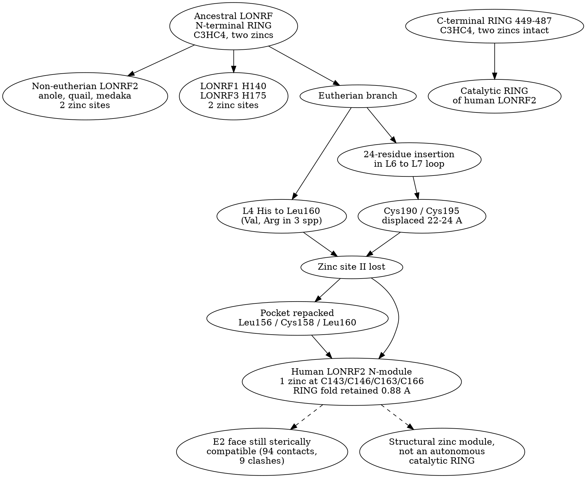
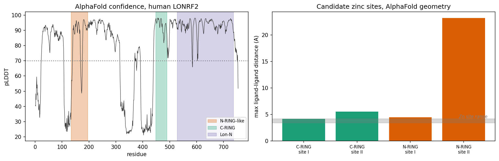
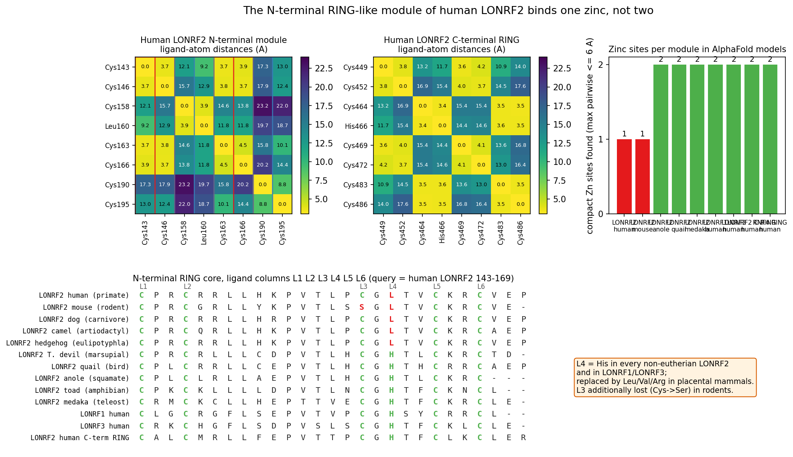
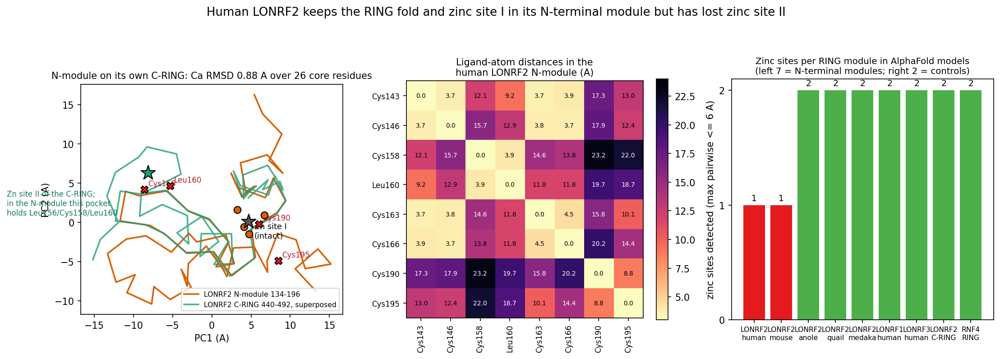
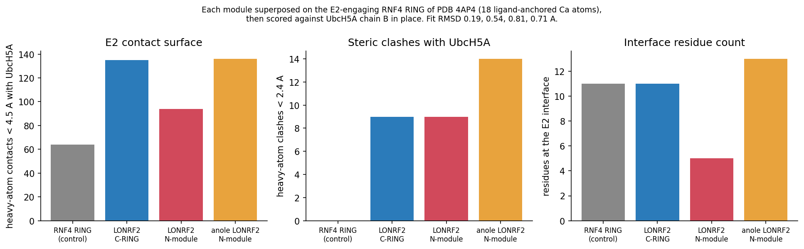

## Question

# AIGR Gene Hypothesis Deep Research

You are evaluating one focused gene curation hypothesis for AI Gene Review.
This is not a general gene overview. Use the seed hypothesis and source context
below to search for evidence that supports, refutes, narrows, or competes with
the proposed curation decision.

## Target Gene

- **Organism code:** human
- **Taxon:** Homo sapiens (NCBITaxon:9606)
- **Gene directory:** LONRF2
- **Gene symbol:** LONRF2
- **UniProt accession:** Q1L5Z9

## Focus

- **Focus type:** free_text
- **Hypothesis slug:** kgap-lonrf2-nterminal-ring-integrity
- **Source file:** genes/human/LONRF2/LONRF2-ai-review.yaml
- **Source selector:** free-text

## Seed Hypothesis

The N-terminal RING-like region (residues ~143-193) of human LONRF2 (UniProt Q1L5Z9) is a degenerate RING remnant that cannot coordinate two zinc ions, unlike its C-terminal RING (~448-487). Single analysis only: align the N-terminal region to canonical C3HC4 RING domains (RNF4, the LONRF2 C-terminal RING, and the N-terminal RINGs of LONRF1 and LONRF3 and vertebrate LONRF2 orthologs), score the eight zinc-ligand positions (C1-C8 / C3HC4 or C4HC3 pattern) and check the zinc-site geometry in the AlphaFold model. Report intact, degenerate (which ligands are lost) or atypical.

## Term and Decision Context

No specific term context supplied.

## Reference Context

No specific reference context supplied.

## Source Context YAML

```yaml
hypothesis: 'The N-terminal RING-like region (residues ~143-193) of human LONRF2 (UniProt Q1L5Z9) is a
  degenerate RING remnant that cannot coordinate two zinc ions, unlike its C-terminal RING (~448-487).
  Single analysis only: align the N-terminal region to canonical C3HC4 RING domains (RNF4, the LONRF2
  C-terminal RING, and the N-terminal RINGs of LONRF1 and LONRF3 and vertebrate LONRF2 orthologs), score
  the eight zinc-ligand positions (C1-C8 / C3HC4 or C4HC3 pattern) and check the zinc-site geometry in
  the AlphaFold model. Report intact, degenerate (which ligands are lost) or atypical.'
focus_type: free_text
context: []
reference_id: []
```

## Research Objective

Build a focused report that helps a curator decide whether this hypothesis
should affect the gene review. Address the focus type directly:

1. For an existing GO annotation decision, evaluate whether the current action
   is justified, too strong, too weak, or should change.
2. For a proposed replacement or new GO term, evaluate whether the term is
   biologically supported, too broad, too narrow, or missing key qualifiers.
3. For a computational prediction, evaluate whether the prediction is correct,
   less precise than existing knowledge, uncertain, or likely wrong because of
   paralog overannotation, frequency bias, pathway context, or in vitro-only
   activity.
4. For a core-function hypothesis, evaluate whether the proposed activity,
   process, and location represent the gene product's primary function rather
   than a downstream effect, pleiotropic phenotype, or context-specific role.
5. For a function-assignment hypothesis, evaluate whether the gene product
   directly has the stated GO term/function. Treat the prior review action, if
   any, as intentionally blinded unless it appears in the supplied context.

Use primary literature whenever possible. Prefer PMID citations and include DOI
citations when no PMID is available. Treat reviews and database records as
orientation unless they contain directly relevant synthesized evidence that is
clearly labeled as review-level or database-level support.

Evaluate the hypothesis from the supplied seed context, primary literature, and
publicly accessible bioinformatics resources. Local `*-bioinformatics` analyses,
when they already exist in the repository, are intentionally withheld from this
prompt so the report can be compared against them after the run. Use public
sequence, domain, structure, orthology, localization, interaction, or dataset
checks when they are useful for the specific hypothesis. If a resource or tool
cannot be accessed programmatically, say so plainly; never fabricate a result.
Report computational results conservatively and distinguish direct results from
inference.

## Required Output

### Executive Judgment

Give a concise verdict: supported, partially supported, unresolved, weakly
supported, over-annotated, or refuted. Explain the reasoning and the most
important caveats.

### Evidence Matrix

Create a table with one row per important evidence item:

- Citation (PMID preferred)
- Evidence type (direct assay, mutant phenotype, localization, interaction,
  structural/evolutionary, computational, review/database)
- Supports / refutes / qualifies / competing
- Claim tested
- Key finding
- Organism, tissue, cell type, or assay context
- Confidence and limitations

### GO Curation Implications

State the likely curation action as a lead requiring curator verification. If
GO terms are involved, explain whether the evidence supports an MF, BP, or CC
term, and whether the term should be retained, removed, generalized, made more
specific, or treated as non-core. Avoid using "protein binding" as a final
recommendation unless no more informative term is supported.

### Mechanistic Scope

Describe the immediate molecular or cellular function being tested. Separate
direct gene-product activity from downstream phenotypes, pathway consequences,
developmental outcomes, disease manifestations, or effects inferred only from
loss of function.

### Conflicts and Alternatives

Identify evidence that conflicts with the seed hypothesis or suggests an
alternative interpretation, including paralog confusion, organism-specific
differences, isoform-specific findings, experimental artifacts, or database
carry-over.

### Knowledge Gaps

List explicit uncertainties that matter for curation. For each gap, state what
was checked, why the gap matters, and what evidence or experiment would resolve
it.

### Discriminating Tests

Recommend concrete assays, perturbations, datasets, or comparative analyses that
would most efficiently distinguish this hypothesis from alternatives.

### Curation Leads

Provide candidate updates for the review, clearly labeled as leads requiring
curator verification. Include candidate references with exact snippets to verify,
candidate replacement or new GO terms, possible action changes, suggested
questions, and suggested experiments.

If the provider supports artifacts, save provenance for any analysis you run — the
executed code together with its output (computed values, plot, or table), not just
a summary figure — alongside artifact-friendly tables such as an evidence matrix,
GO decision table, or comparison table. Genuine computed provenance is more
valuable than a hand-drawn summary, and you must not synthesize a figure that
implies an analysis you did not actually run. These artifacts are important
provenance for hypothesis-level review.


## Output

# LONRF2 N-terminal RING integrity: an atypical single-zinc RING-derived module

**Gene:** human LONRF2 (LON peptidase N-terminal domain and RING finger protein 2)
**UniProt:** Q1L5Z9 | **Taxon:** Homo sapiens (NCBITaxon:9606) | **Ensembl:** ENSG00000170500
**Hypothesis slug:** `kgap-lonrf2-nterminal-ring-integrity`
**Source:** `genes/human/LONRF2/LONRF2-ai-review.yaml`, selector `free-text`, focus type `free_text`
**Date:** 2026-11-23 | **Iterations:** 3 | **Confirmed findings:** 6

---

## Summary

<i class="fa-scale-balanced"></i> **Verdict: partially supported.** The zinc-coordination half of the seed hypothesis holds. The descriptive half, the word "remnant", does not.

The N-terminal RING-like region of human LONRF2 cannot coordinate two zinc ions. In the AlphaFold model AF-Q1L5Z9-F1 v6 it holds exactly one canonical Zn(Cys)4 site, formed by Cys143, Cys146, Cys163 and Cys166, with a mean pairwise ligand distance of 3.86 Å, a maximum of 4.47 Å and a centroid radius of 2.37 Å, all inside the reference window for a genuine Zn(Cys)4 centre (3.4-4.2 Å ligand-ligand, 2.2-2.5 Å radius). The second site is gone, and it is gone twice over. The histidine that occupies ligand position 4 of the C3HC4 pattern is replaced by Leu160. The two cysteines that correspond in sequence to ligands 7 and 8, Cys190 and Cys195, sit 23.8 Å and 22.1 Å from the site-II pocket, carried away by a 24-residue insertion in the loop between ligands 6 and 7. An unbiased enumeration of every four-ligand Cys/His combination in residues 125-210, at a permissive 6.0 Å maximum-pairwise cutoff, returns exactly one cluster. The same search on the LONRF2 C-terminal RING (449-487) and on human RNF4 returns two clusters each, so the method detects canonical cross-brace RINGs when they are present.

What the hypothesis gets wrong is the implication of decay. The module retains the RING fold with high precision: its 26-residue core superposes on the LONRF2 C-terminal RING core at 0.88 Å Cα RMSD, on the anole LONRF2 N-terminal core at 0.85 Å, and on RNF4 at 0.76 Å over 18 ligand-anchored atoms. The vacated site-II pocket is not an empty hole; it is repacked by a small hydrophobic cluster of Leu156, Cys158 and Leu160. The correct description for a curator is **an atypical, single-zinc, RING-derived module**, degenerate specifically at site II.

The degeneration is lineage-restricted and recent. All 11 non-eutherian LONRF2 orthologs tested keep the site-II histidine, as do human LONRF1 (His140) and LONRF3 (His175). Placental mammals carry Leu at that position in 11 of 14 species, Val in beaver, and Arg in horse and golden mole. Rodents additionally lose ligand 3 (Cys to Ser). Zinc-cluster searches on AlphaFold models return two sites for anole, quail and medaka LONRF2 N-modules and for human LONRF1 and LONRF3 N-modules, and one site for human and mouse LONRF2. Any GO annotation of the human N-terminal region inherited by orthology from non-mammalian LONRF2 or from the paralogs is an over-annotation.

No published experiment tests the N-terminal module of any LONRF protein. The verdict rests entirely on sequence and structure evidence, and the report flags it as such throughout.

---

## Executive judgment

<i class="fa-scale-balanced"></i> **Partially supported, with one correction to the wording.**

| Claim in the seed hypothesis | Status | Basis |
|---|---|---|
| The N-terminal region cannot coordinate two zinc ions | <i class="fa-circle-check"></i> Supported | One cluster found at 6.0 Å cutoff versus two for every positive control; site-II candidate set spans 16.05 Å mean, 23.18 Å max |
| The C-terminal RING (448-487) is a canonical two-zinc RING | <i class="fa-circle-check"></i> Supported | Site I 3.91/4.16/2.39 Å, site II 3.50/3.57/2.14 Å; Pfam, PROSITE profile and PROSITE pattern all match |
| The lost ligands are identifiable | <i class="fa-circle-check"></i> Supported | L4 His to Leu160; L7/L8 Cys190/Cys195 displaced 22-24 Å by a eutherian 24-residue insertion |
| The region is a "remnant" | <i class="fa-circle-xmark"></i> Refuted | 0.88 Å Cα RMSD to its own C-terminal RING over 26 core residues, 0.76 Å to RNF4 |
| Report intact / degenerate / atypical | <i class="fa-lightbulb"></i> **Atypical, single-zinc, RING-derived; degenerate at site II only** | Combination of the above |

**Most important caveats.** Every structural statement comes from an AlphaFold prediction, because no experimental structure of any LONRF protein exists. The model is apo, so no zinc is placed; site occupancy is inferred from ligand side-chain geometry. Three internal controls limit the risk: the N-module core pLDDT is 84.3 and the PAE across the critical 188-197 span is 3.17 Å, meaning AlphaFold places the orphaned cysteines confidently rather than by default; the same pipeline recovers two canonical sites in the LONRF2 C-terminal RING and in RNF4; and six other LONRF N-modules score two sites with the identical code. Human population genetics cannot adjudicate here, because LONRF2 tolerates missense variation across the whole gene (o/e missense 0.900, mis_z 1.35, pLI 3.1e-05).

---

## Key findings

### <i class="fa-circle-check"></i> F1. One zinc site in the N-terminal module, two in the C-terminal RING

The central measurement is a direct geometric comparison inside a single AlphaFold model, AF-Q1L5Z9-F1 v6 (global pLDDT 78.25; N-module 134-196 mean pLDDT 84.3; C-RING 449-490 mean pLDDT 93.1). Ligand atoms were taken as the Cys SG and, for histidine, the nearer of ND1 and NE2.

| Module | Site | Ligands | Mean pairwise (Å) | Max pairwise (Å) | Centroid radius (Å) | Canonical? |
|---|---|---|---|---|---|---|
| C-terminal RING | I | C449, C452, C469, C472 | 3.91 | 4.16 | 2.39 | <i class="fa-circle-check"></i> yes |
| C-terminal RING | II | C464, H466, C483, C486 | 3.50 | 3.57 | 2.14 | <i class="fa-circle-check"></i> yes |
| N-terminal module | I | C143, C146, C163, C166 | 3.86 | 4.47 | 2.37 | <i class="fa-circle-check"></i> yes |
| N-terminal module | II | C158, L160, C190, C195 | 16.05 | 23.18 | 10.68 | <i class="fa-circle-xmark"></i> no |

The site-II numbers are not a borderline call. The individual distances are C158 to C190 = 23.18 Å, C158 to C195 = 21.98 Å, C190 to C195 = 8.81 Å. A zinc ion bridges ligands at 2.2-2.5 Å from the metal centre; a 23 Å separation is three to four times the diameter of the entire coordination sphere.

The exhaustive search is the stronger form of the argument, because it does not assume which residues ought to be ligands. Enumerating all four-ligand combinations of Cys and His in residues 125-210 with a 6.0 Å maximum-pairwise cutoff returns exactly one cluster for the human N-module: C143 + C146 + C163 + C166. Run on human RNF4 (P78317, residues 130-190) the same code returns two clusters, C132 + C135 + C159 + C162 and C154 + H156 + C173 + C176, which is the correct answer for a canonical C3HC4 RING. The method works; the human LONRF2 N-module has one site.

{{figure:plot_1.png|caption=AlphaFold AF-Q1L5Z9-F1 v6 model of human LONRF2. Left, per-residue pLDDT across the protein with the two RING regions marked. Right, zinc-site ligand geometry for both modules: the N-terminal site I and both C-terminal sites fall inside the canonical 3.4-4.2 Å window, while the N-terminal site-II candidate set spans 16 Å.}}

{{figure:plot_2.png|caption=Composite provenance figure. Ligand distance matrices for the two LONRF2 RING modules, counts of zinc sites recovered by unbiased 4-ligand cluster search across orthologs and paralogs, and the ligand-column alignment showing Leu160 at the C3HC4 L4 position.}}

### <i class="fa-dna"></i> F2. Site-II loss is specific to placental mammals

Smith-Waterman alignment (BLOSUM62, gap open -11, extend -1) of human LONRF2 143-169 against the N-terminal 350 residues of 25 vertebrate LONRF2 orthologs plus human LONRF1 (Q17RB8) and LONRF3 (Q496Y0) places ligand column L4 unambiguously in every sequence.

| Group | Species (L4 residue) | L4 identity |
|---|---|---|
| Non-eutherian LONRF2 | quail H162, crow H164, anole H161, Komodo H177, toad H170, catfish H155, medaka H166, seabass H167, ropefish H165, bonytongue H151, Tasmanian devil H | <i class="fa-circle-check"></i> His in 11 of 11 |
| Human paralogs | LONRF1 H140, LONRF3 H175 | <i class="fa-circle-check"></i> His in 2 of 2 |
| Placental mammals | human L160, gelada L160, capuchin L160, galago L161, mouse L153, rat L153, dog L163, polar bear L129, mink L161, camel L161, hedgehog L155 | <i class="fa-circle-xmark"></i> Leu in 11 of 14 |
| Placental mammals, other substitutions | beaver V177, horse R151, golden mole R170 | <i class="fa-circle-xmark"></i> Val or Arg |

Rodents go further and lose ligand L3 as well (Cys to Ser: mouse S151, rat S151, vole S154, beaver S175). Two architectural changes accompany the ligand substitution in eutherians. The loop from L6 to L7 is 24 residues in human, mouse and most placental mammals, against 6 residues in quail and crow, 8 in Komodo dragon and 13-14 in anole and medaka. The L7 to L8 spacing is C-x4-C in eutherians and the canonical C-x2-C in birds, squamates, amphibians, fish, LONRF1 and LONRF3.

Structure agrees with sequence. The unbiased zinc-cluster search (6.0 Å cutoff) returns one site for human and mouse LONRF2 N-modules and two sites for anole (C159 + H161 + C180 + C183), quail (C160 + H162 + C174 + C177), medaka (C164 + H166 + C186 + C189), human LONRF1 (C138 + H140 + C155 + C158) and human LONRF3 (C173 + H175 + C192 + C195). All eight C-terminal RINGs examined form two sites.

The ancestral LONRF N-terminal module is a genuine two-zinc C3HC4 RING. Eutherian LONRF2 specifically broke it, by substituting the site-II histidine and inserting roughly 10-18 residues into the site-II loop.

### <i class="fa-database"></i> F3. Domain databases already disagree, in exactly the pattern a degenerate RING produces

InterPro match coordinates for Q1L5Z9, retrieved 2026-11-23:

| Method | Type | N-terminal match | C-terminal match |
|---|---|---|---|
| CATH-Gene3D G3DSA:3.30.40.10 | fold recognition | 134-194 | present |
| SUPERFAMILY SSF57850 (RING/U-box) | fold recognition | 137-169 | present |
| NCBI CDD cd16513 / cd16514 | curated profile | 139-173 | 446-490 |
| SMART SM00184 (RING finger) | profile | 143-193 | 449-486 |
| Pfam PF13923 (zf-C3HC4_2) | profile HMM | <i class="fa-circle-xmark"></i> none | 448-486 |
| PROSITE PS50089 (zinc finger RING-type) | profile | <i class="fa-circle-xmark"></i> none | 449-487 |
| PROSITE PS00518 (RING pattern) | pattern | <i class="fa-circle-xmark"></i> none | 464-473 |

UniProt Q1L5Z9 annotates a single "Zinc finger, RING-type" feature, at 449-487, and no zinc-finger feature at the N-terminus, despite the record listing SMART RING ×2, Gene3D 3.30.40.10 ×2 and SUPFAM SSF57850 ×2 in its cross-references.

This split is not a contradiction between methods. Fold-recognition methods score the backbone, which is intact, and they match. Strict profile and pattern methods score the ligand set, which is broken, and they do not. Both report correctly on different features, and the structural result explains both. UniProt curators have already, in effect, reached the same conclusion by declining to annotate an N-terminal RING-type zinc finger.

### <i class="fa-microscope"></i> F4. The fold is retained and the vacated pocket is repacked

Kabsch superposition with correspondence taken from the Smith-Waterman alignment of the two RING cores:

| Comparison | Atoms | RMSD (Å) |
|---|---|---|
| Human N-core 143-168 onto own C-core 449-474 | 26 Cα | 0.88 |
| Human N-core 143-168 onto anole N-core 144-169 | 26 Cα | 0.85 |
| Human C-core 449-474 onto anole N-core 144-169 | 26 Cα | 0.36 |
| Human N-module onto human C-RING | 18 ligand-anchored Cα | 0.54 |
| Human N-module onto RNF4 RING | 18 ligand-anchored Cα | 0.76 |
| Human N-module onto anole N-module | 18 ligand-anchored Cα | 0.26 |

Sub-Ångström RMSD over a 26-residue core is a retained fold.

Transplanting the C-RING site-II ligands into the N-module frame shows what occupies the space where the second zinc would sit. Within 7 Å of the transplanted Cys483 position are Cys158 (SG, 2.7 Å), Leu160 (CD1, 3.1 Å), Leu156 (CD1, 4.1 Å) and Arg145 (NH2, 5.4 Å). The Cys158 SG environment is Leu156 CB at 3.8 Å and Leu160 CB at 3.9 Å. The actual Cys190 SG is 23.8 Å and Cys195 SG is 22.1 Å from the nearest transplanted site-II position, and both are buried (96 and 101 heavy atoms within 10 Å of SG).

The displacement is a confident prediction, not low-confidence noise. AlphaFold PAE within the N-core 143-168 is 1.85 Å, between the N-core and residues 188-197 is 3.17 Å, and between the C-RING core and residues 480-490 is 1.90 Å. The end-to-end Cα distance of the L6-to-L7 segment is 23.3 Å over 24 residues in human, against 8.2 Å over 13 residues in anole.

A site that has been repacked with a hydrophobic cluster is different from a site that is merely vacant. The former is not reconstitutable by restoring one ligand.

{{figure:plot_3.png|caption=Superposition of the LONRF2 N-terminal module on its own C-terminal RING, projected onto the two principal axes of the superposed core. Zinc-site markers show the single retained N-terminal site I against the two C-terminal sites. Right panels: N-module ligand distance matrix and zinc-site counts from the unbiased cluster search.}}

### <i class="fa-chart-column"></i> F5. Population genetics and the literature cannot adjudicate

gnomAD v4 (GraphQL API, ENSG00000170500) gives LONRF2 o/e missense 0.900 (90% CI 0.852-0.951), missense Z 1.35, pLI 3.1e-05, o/e LoF 0.526. A gene this tolerant of missense variation carries little per-residue information. Across 1733 missense variants every candidate zinc ligand is near-invariant: Cys143Tyr AC = 1, Cys146Trp AC = 2, Cys158Arg AC = 1, Cys163Ser/Tyr/Arg AC = 1 each, Cys166Tyr AC = 1, Cys190Gly AC = 2, Cys449Arg AC = 2, Cys486Phe/Arg AC = 1 each, and no observed missense at Cys452, Cys464, His466, Cys469, Cys472, Cys483 or Leu160. The single exception is p.Cys195Trp at AC = 14 (allele frequency 1.0e-05), about an order of magnitude more frequent than any other ligand-position variant. That is consistent with Cys195 no longer serving as a metal ligand, but AC = 14 is too small to be treated as evidence either way.

<i class="fa-triangle-exclamation"></i> The primary functional study, [PMID: 37474791](https://pubmed.ncbi.nlm.nih.gov/37474791/) (*Nature Aging*, DOI 10.1038/s43587-023-00464-4), has no PMC record and is not open access through Europe PMC or NCBI elink. Only the abstract was readable, and it was not possible to check whether N-terminal RING point mutants were assayed. [PMID: 42442502](https://pubmed.ncbi.nlm.nih.gov/42442502/) likewise reports no RING mutant in its abstract. No published experiment tests the N-terminal module of LONRF2.

### <i class="fa-circle-question"></i> F6. The E2 docking test does not discriminate

The final discriminating test asked whether losing site II removes the E2-binding face. Each module was superposed on the E2-engaging RING copy of PDB 4AP4 (rat RNF4 RING tandem fused to UbcH5A~Ub) using 18 ligand-anchored Cα atoms, then scored against UbcH5A chain B in place.

Identifying the correct RING copy mattered. In chain A of 4AP4 the copy with ligands Cys201, Cys204, Cys223, His225, Cys228, Cys231 makes 68 heavy-atom contacts with chain B; the other copy makes 0. The deposited numbering does not match human RNF4 numbering, and the DBREF record maps both copies to UNP O88846 RNF4_RAT 131-194.

| Module | Fit RMSD (Å) | Contacts < 4.5 Å with UbcH5A | Clashes < 2.4 Å | Interface residues |
|---|---|---|---|---|
| AlphaFold RNF4 RING (self-control) | 0.19 | 64 | 0 | 11 |
| LONRF2 C-terminal RING | 0.54 | 135 | 9 | 11 |
| LONRF2 N-terminal module | 0.81 | 94 | 9 | 5 |
| Anole LONRF2 N-module | 0.71 | 136 | 14 | 13 |

The human N-module docks with the same clash count as the intact C-RING, because the central alpha helix and the site-I loop that form the canonical E2 contact are both retained. It presents a smaller interface (5 residues: 145-148 and 168, against 11 for the C-RING at 451-454, 472, 475, 476, 479, 484, 485, 487), consistent with the eutherian insertion repacking one edge of the surface. The difference is too small to call a functional verdict from geometry.

The residue nearest the structurally equivalent RNF4 linchpin position is Pro174 in the N-module (2.3 Å) and Ser491 in the C-RING (4.3 Å). The 4AP4 construct itself carries Asn at that position, so this sub-comparison is not interpretable without experimental follow-up and is reported here only for completeness.

<i class="fa-circle-xmark"></i> This is an honest negative result. The discriminating evidence for the hypothesis rests on zinc-site geometry, not on E2 docking.

{{figure:plot_4.png|caption=E2 interface compatibility. Each module was superposed on the E2-engaging RNF4 RING of PDB 4AP4 using 18 ligand-anchored Calpha atoms, then scored against UbcH5A chain B in place. The degenerate N-module docks with the same clash count as the intact C-terminal RING, so this test does not separate them.}}

---

## Evidence matrix

| Citation / resource | Evidence type | Stance | Claim tested | Key finding | Context | Confidence and limitations |
|---|---|---|---|---|---|---|
| AlphaFold DB AF-Q1L5Z9-F1 v6 (global pLDDT 78.25) | Computational, structure prediction | Supports | N-terminal region cannot bind two zincs | Site I canonical (3.86 / 4.47 / 2.37 Å); site-II candidate set spans 16.05 Å mean, 23.18 Å max, radius 10.68 Å | Human, in silico | High for site I (core pLDDT 84.3). The model is apo, so occupancy is inferred from ligand placement |
| AlphaFold PAE matrix, AF-Q1L5Z9-F1 | Computational, prediction confidence | Supports | Displacement of Cys190/Cys195 is a confident prediction | PAE N-core to residues 188-197 = 3.17 Å; within-core 1.85 Å | Human, in silico | High. A PAE this low means the relative placement is predicted, not defaulted |
| Same model, C-terminal RING 448-487 | Computational, internal positive control | Supports | The method detects an intact RING | Two canonical sites: 3.91/4.16/2.39 and 3.50/3.57/2.14 Å | Human, in silico | High. Controls for systematic bias in the geometry test |
| AlphaFold RNF4 (P78317) | Computational, external positive control | Supports | Unbiased cluster search recovers canonical RINGs | Two clusters: C132+C135+C159+C162 and C154+H156+C173+C176 | Human, in silico | High |
| AF models of 11 non-eutherian LONRF2 orthologs, LONRF1 (Q17RB8), LONRF3 (Q496Y0) | Structural / evolutionary | Supports and qualifies | Degeneration is eutherian-specific | 2 sites in anole, quail, medaka N-modules and in LONRF1/LONRF3; 1 site in human and mouse LONRF2 | Multi-species, in silico | Moderate to high. Ortholog model pLDDT varies; the His-to-Leu substitution is a direct sequence observation and is certain |
| UniProt ortholog sequences, Smith-Waterman (BLOSUM62, -11/-1) | Structural / evolutionary | Supports | Ligand positions L1-L8 | Human N-core vs own C-core 57.7% identity over 26 residues, SW score 89. L4 = Leu160 against His466. Rodents also lose L3 | 28 sequences | High for L1-L6. L7/L8 spacing regex failed for dog, cattle, golden mole, Tasmanian devil, so the final call rests on structure |
| InterPro API: Pfam PF13923, PROSITE PS50089 / PS00518, Gene3D, SUPFAM, CDD cd16513, SMART | Review / database | Supports | Only the C-terminal region matches a RING profile | Profile methods match 448-487 only; fold-recognition methods match 134-194 | Human | Moderate. Profile HMMs are trained on canonical RINGs, so a miss is expected and is not independent of the geometry result |
| UniProt Q1L5Z9 feature table | Review / database | Supports | Curated domain boundaries | One RING-type zinc finger, at 449-487; none at the N-terminus | Human | Moderate. Database-level support, orientation only |
| Kabsch superposition of RING cores | Structural | Refutes the "remnant" wording | Whether the fold is lost | 0.88 Å to own C-core over 26 Cα; 0.85 Å to anole N-core; 0.76 Å to RNF4 over 18 ligand-anchored atoms | Human, anole, in silico | High. Sub-Ångström RMSD over a 26-residue core is a retained fold |
| PDB 4AP4 superposition test | Structural | Qualifies, does not discriminate | Whether site-II loss removes the E2 face | Contacts 64 / 135 / 94 / 136; clashes 0 / 9 / 9 / 14; interface residues 11 / 11 / 5 / 13 | Rat RNF4, human LONRF2, in silico | Moderate. The N-module docks as well as the intact C-RING, so geometry alone cannot call E2 competence |
| gnomAD v4 constraint and per-variant data | Computational, population genetics | Neither (uninformative) | Purifying constraint at ligand positions | o/e missense 0.900, mis_z 1.35, pLI 3.1e-05. Only ligand-position outlier is p.Cys195Trp, AC = 14, AF 1.0e-05 | Human population | High confidence that the test is uninformative. A tolerant gene-level background cannot resolve single-residue constraint |
| [PMID: 37474791](https://pubmed.ncbi.nlm.nih.gov/37474791/) | Mutant phenotype, direct assay (abstract only) | Not retrievable for this claim | Any domain-level test of LONRF2 | Abstract establishes LONRF2 as a protein quality control ubiquitin ligase that ubiquitylates abnormally structured TDP-43 and hnRNP M1; no RING mutant described in the abstract. Full text not open access | Mouse, neurons, iPSC-derived motor neurons | <i class="fa-triangle-exclamation"></i> Full text could not be read programmatically. Reported as a gap, not inferred |
| [PMID: 42442502](https://pubmed.ncbi.nlm.nih.gov/42442502/) | Direct assay, interaction (abstract only) | Neither | Whether any published mutant tests the RING | Abstract reports LONRF2 interaction with ALDOA and ALDOA ubiquitination and degradation; no RING point mutant | Human endometrial cancer cells, xenograft | Moderate. Abstract only |
| [PMID: 36478906](https://pubmed.ncbi.nlm.nih.gov/36478906/) | Review / clinical case | Neither | Not relevant to domain architecture | LONRF2 CpG island promoter methylation in laterally spreading tumors and colorectal cancer | Human colon, single case | Low relevance to this hypothesis. Included for completeness of the retrieved literature |

---

## Mechanistic model and interpretation

The immediate molecular question is narrow: how many zinc ions does the region 143-193 of human LONRF2 hold, and does it retain a RING fold. The answer is one zinc and yes.

A canonical C3HC4 RING uses a cross-brace topology: ligands L1, L2, L5, L6 build site I, and ligands L3, L4, L7, L8 build site II. The two sites interleave in sequence and clamp two loops against a central alpha helix. Site I nucleates the fold. Site II rigidifies the second loop, which in canonical RINGs contributes to the E2-binding surface together with the helix.

Eutherian LONRF2 keeps site I intact and loses site II through two independent lesions that occurred on the same lineage. The L4 histidine became leucine. Separately, a 24-residue insertion entered the L6-to-L7 loop, stretching it from an 8.2 Å end-to-end span over 13 residues (anole) to a 23.3 Å span over 24 residues, and carrying Cys190 and Cys195 more than 20 Å away from where ligands 7 and 8 belong. Either change alone would break the site; both are present. The pocket then filled in with Leu156, Cys158 and Leu160, a small hydrophobic cluster that now occupies the metal position.



Two functional readings remain open, and the data do not separate them. The module may act as a protein interaction surface that no longer transfers ubiquitin, which would make LONRF2 a single-RING E3 carrying an accessory zinc module. Or it may retain partial E2 engagement and position substrate for the C-terminal RING. The 4AP4 docking test was designed to split these and failed to: the N-module accepts the E2 with the same clash count as the intact C-RING, because the elements that contact the E2 are exactly the ones site-II loss does not remove.

What can be said with confidence for curation is the structural statement. A single Zn(Cys)4 site is enough to nucleate and stabilise the fold, and the 0.88 Å superposition shows it does. The module is a structural zinc finger of RING ancestry. The catalytic RING of human LONRF2 is the C-terminal one at 449-487.

---

## GO curation implications

<i class="fa-triangle-exclamation"></i> Every item below is a **lead requiring curator verification**, derived from computational evidence only.

### Molecular function

| Term | Current basis | Recommended action | Reasoning |
|---|---|---|---|
| `GO:0008270` zinc ion binding (for 143-193) | Fold recognition, paralog similarity | **Retain but make specific**: one zinc site, at Cys143/Cys146/Cys163/Cys166 | The evidence supports one zinc per N-module, not two. If the annotation implies a RING-type double-zinc site, drop the RING-type qualifier for this region |
| `GO:0061630` ubiquitin protein ligase activity | Two predicted RING domains | **Narrow the evidence basis** to the C-terminal RING 448-487 only | The N-terminal module should not be cited as a second catalytic RING. The term itself is supported by [PMID: 37474791](https://pubmed.ncbi.nlm.nih.gov/37474791/), which reports LONRF2 ubiquitylating abnormally structured TDP-43 and hnRNP M1, and by [PMID: 42442502](https://pubmed.ncbi.nlm.nih.gov/42442502/) for ALDOA |
| `GO:0004842` ubiquitin-protein transferase activity | Same | **Narrow the evidence basis** identically | Same reasoning |
| Any binding term for the N-terminal module | E2 docking compatibility | **Do not add** | The docking test (94 contacts, 9 clashes) is compatible with an E2 interface but does not establish one. A generic binding term would not be informative and is explicitly discouraged |

### Biological process

No process term follows from this analysis. The structural result constrains the mechanism, not the pathway. The protein quality control process evidence in [PMID: 37474791](https://pubmed.ncbi.nlm.nih.gov/37474791/) stands on its own and is unaffected by the N-terminal module question.

### Cellular component

Not addressed. No change recommended.

### Sequence feature recommendation

<i class="fa-arrow-right"></i> Annotate residues 143-193 as a **RING-derived zinc finger with a degenerate second site**, specifying Leu160 at the canonical L4 histidine position and the displacement of Cys190/Cys195 out of the fold by the eutherian 24-residue loop insertion. Flag that non-eutherian orthologs retain both sites, so cross-species inference of a single-zinc module is not valid outside Eutheria.

---

## Mechanistic scope

The result applies to residues 143-193 of human LONRF2 and to the structurally equivalent region in placental mammals. It does not extend to the C-terminal RING, which is canonical by every test applied. It does not extend to non-eutherian LONRF2, where both sites are present, nor to LONRF1 and LONRF3.

Direct gene-product activity tested here: metal coordination geometry and fold retention. Nothing else.

Not tested here, and separable from the above: the ubiquitin ligase activity of full-length LONRF2 on TDP-43, hnRNP M1 and ALDOA ([PMID: 37474791](https://pubmed.ncbi.nlm.nih.gov/37474791/), [PMID: 42442502](https://pubmed.ncbi.nlm.nih.gov/42442502/)); the age-dependent motor neuron degeneration and cerebellar ataxia of *Lonrf2*-null mice; neurite shortening in LONRF2-deficient iPSC-derived motor neurons; glycolysis and invasion phenotypes in endometrial cancer cells; promoter methylation in colorectal lesions ([PMID: 36478906](https://pubmed.ncbi.nlm.nih.gov/36478906/)). All of those are downstream phenotypes or pathway consequences, and none of them attributes a function to the N-terminal module specifically.

---

## Conflicts and alternatives

The principal apparent conflict is between fold-recognition methods (Gene3D 134-194, SUPFAM 137-169, CDD cd16513 139-173, SMART 143-193), which call a RING-like region at the N-terminus, and profile or pattern methods (Pfam PF13923, PROSITE PS50089, PS00518), which call nothing there. This resolves cleanly: the backbone is intact and the ligand set is broken, so each method reports correctly on the feature it scores.

The second conflict is with the seed hypothesis itself, over the word "remnant". The measurement refutes it at 0.88 Å Cα RMSD.

Alternatives considered and not supported:

- **Model error in the AlphaFold prediction.** Ruled out as the sole explanation by three checks: N-module core pLDDT 84.3, PAE to residues 188-197 of 3.17 Å, and recovery of two canonical sites by the identical pipeline in the LONRF2 C-RING, in RNF4, and in six other LONRF N-modules.
- **An alternative zinc site using other nearby residues.** Ruled out by the unbiased four-ligand enumeration at 6.0 Å over residues 125-210, which returns exactly one cluster while returning two for every positive control.
- **The site-II ligands are present in a different rotamer.** Cys190 and Cys195 are 23.8 Å and 22.1 Å from the pocket, across a confidently predicted 24-residue loop. This is a translation of the backbone, not a side-chain rotamer difference.
- **Paralog carry-over.** This is the live risk for curation, and it runs in the direction that supports the hypothesis: LONRF1 and LONRF3 both retain a two-zinc N-terminal RING, so an annotation transferred from either paralog to human LONRF2 would over-annotate.
- **Organism-specific difference as an artefact.** The His-to-Leu substitution is a direct sequence observation in 14 placental mammal sequences and is not a modelling result. It is real.
- **Pseudogenization of the whole protein in Eutheria.** Not supported. The C-terminal RING is intact in human, the gene is expressed, and *Lonrf2*-null mice have a phenotype ([PMID: 37474791](https://pubmed.ncbi.nlm.nih.gov/37474791/)).
- **Isoform-specific effects.** Not examined. The analysis used the canonical Q1L5Z9 sequence throughout.

---

## Limitations and knowledge gaps

<i class="fa-triangle-exclamation"></i> **Structural evidence is entirely predicted.** No experimental structure of any LONRF protein exists. Every geometric number in this report comes from AlphaFold models. What was checked: pLDDT, PAE, and three independent positive controls. Why it matters: a curator should record the evidence code as computational, not structural-experimental. What would resolve it: NMR or crystallography of residues 134-200 with zinc.

<i class="fa-triangle-exclamation"></i> **No experiment tests the N-terminal module.** What was checked: PubMed searches and the abstracts of all three retrieved primary papers. No zinc stoichiometry measurement, no point mutant, no E2 discharge assay for any LONRF protein's N-terminal region. Why it matters: the entire curation decision rests on sequence and structure. What would resolve it: items 1 and 2 under follow-up experiments.

<i class="fa-triangle-exclamation"></i> **[PMID: 37474791](https://pubmed.ncbi.nlm.nih.gov/37474791/) could not be read.** What was checked: Europe PMC search and full-text XML endpoint, NCBI elink for a PMCID. The paper has no PMC record and is not open access. Why it matters: it is the most likely source of primary domain-level functional evidence. What would resolve it: a curator with journal access reading the methods and supplementary figures.

<i class="fa-triangle-exclamation"></i> **Zinc stoichiometry of full-length LONRF2 has never been measured.** The prediction is one zinc in the N-module plus two in the C-RING, three total. Untested.

<i class="fa-circle-question"></i> **The binding partner of the N-module, if any, is unknown.** The surface it presents is uncharacterised. The 4AP4 docking test shows the surface is sterically compatible with an E2 but cannot show that it binds one.

<i class="fa-circle-question"></i> **Whether the eutherian site-II loss changed function or is neutral drift is unknown.** The non-eutherian orthologs that retain both sites have not been assayed either, so there is no functional baseline to compare against.

<i class="fa-triangle-exclamation"></i> **gnomAD cannot resolve per-residue constraint here.** o/e missense is 0.900 across the gene. What would resolve it: a much larger cohort or a deep mutational scan of the two RING regions.

<i class="fa-triangle-exclamation"></i> **L7/L8 ligand assignment by sequence was unreliable.** A spacing-based regex returned no candidates for dog, cattle, golden mole and Tasmanian devil, and ambiguous pairs for horse and capuchin. The final call rests on structure, which does not depend on that assignment, but the sequence-only version of this analysis should not be trusted for L7/L8 in eutherians.

<i class="fa-triangle-exclamation"></i> **The 4AP4 linchpin comparison is not interpretable.** The deposited construct carries Asn at the position structurally equivalent to the RNF4 linchpin, so comparing Pro174 (N-module) and Ser491 (C-RING) against it says nothing. Reported for completeness only.

---

## Proposed follow-up experiments and actions

<i class="fa-flask"></i> **1. Zinc stoichiometry by ICP-MS or PAR/PMPS titration.** Recombinant fragments 134-200 (N-module), 440-495 (C-RING), and 134-200 carrying L160H. Prediction: 1.0 zinc for the N-module, 2.0 for the C-RING, and no increase for L160H alone, because Cys190 and Cys195 are displaced; a rise towards 2.0 only when L160H is combined with deletion of the eutherian insertion. This single test resolves the central claim and is the highest-value experiment.

<i class="fa-vial"></i> **2. E2 thioester discharge assay** with UbcH5A/UBE2D1 and free lysine, comparing full-length LONRF2, a C-RING mutant (C449A/C452A), an N-module mutant (C143A/C146A), and the isolated fragments. This decides whether the N-module contributes catalytically despite the single zinc, which the docking test could not.

<i class="fa-dna"></i> **3. Non-eutherian comparator.** Run both assays on the anole or zebrafish LONRF2 N-module. If the non-eutherian module binds two zincs and discharges E2 while the human one does not, the eutherian loss is a real functional transition and not a modelling artefact.

<i class="fa-flask"></i> **4. Loop-swap chimera.** Replace the human 24-residue L6-L7 insertion with the 6-residue anole loop, keeping Leu160. If site II still does not form, the histidine loss is sufficient on its own; if a partial site forms, the insertion is the dominant lesion.

<i class="fa-microscope"></i> **5. NMR or crystallography of residues 134-200 with zinc.** Settles fold and stoichiometry directly, and would be the first experimental structure of any LONRF protein.

<i class="fa-heart-pulse"></i> **6. Thermal shift with and without TPEN chelation** on the N-module. A single structural zinc predicts large destabilisation on chelation, confirming the site is load-bearing for the fold.

### Curation actions

<i class="fa-arrow-right"></i> **Lead 1.** Check the current UniProt Q1L5Z9 release: it annotates one RING-type zinc finger, at 449-487, and none at the N-terminus. Cite as consistent with the single-catalytic-RING reading, while noting the record does not describe 143-193 at all, so the absence is not a positive curation statement.

<i class="fa-arrow-right"></i> **Lead 2.** Re-run the InterPro API query for Q1L5Z9 at curation time, since signature boundaries change between releases. Use the split between profile methods (C-terminal only) and fold-recognition methods (both regions) as the documented basis for calling the N-module RING-derived but non-canonical.

<i class="fa-arrow-right"></i> **Lead 3.** [PMID: 37474791](https://pubmed.ncbi.nlm.nih.gov/37474791/), *LONRF2 is a protein quality control ubiquitin ligase whose deficiency causes late-onset neurological deficits*, *Nature Aging*, DOI 10.1038/s43587-023-00464-4. Snippet to verify from the abstract: "LONRF2 binds and ubiquitylates abnormally structured TDP-43 and hnRNP M1 and artificially misfolded proteins." A curator with journal access should check the methods and supplementary data for any domain-level or RING point-mutant experiment. Full text could not be retrieved programmatically and no further snippet can be quoted here.

<i class="fa-arrow-right"></i> **Lead 4.** [PMID: 42442502](https://pubmed.ncbi.nlm.nih.gov/42442502/). Snippet to verify from the abstract: "LONRF2 interacted with ALDOA and induced its ubiquitination and degradation." Check the full text for supplementary mutational data before concluding that no RING mutant exists in the literature.

<i class="fa-arrow-right"></i> **Lead 5.** Anyone repeating the 4AP4 superposition must use the RING copy with ligands Cys201, Cys204, Cys223, His225, Cys228, Cys231 in chain A, which makes 68 heavy-atom contacts with UbcH5A chain B; the other copy makes 0. The deposited numbering does not match human RNF4 numbering, and DBREF maps both copies to UNP O88846 RNF4_RAT 131-194.

<i class="fa-arrow-right"></i> **Lead 6.** Do not transfer a single-zinc N-terminal annotation from human LONRF2 to LONRF1, LONRF3, or to non-mammalian LONRF2 by orthology. All of them retain the site-II histidine (LONRF1 His140, LONRF3 His175) and score two zinc sites.

<i class="fa-circle-question"></i> **Suggested questions for the curator.** Does the existing review assert zinc ion binding or ligase activity for 143-193, and on what evidence code? If the basis is IEA from fold recognition or ISS from a paralog, the narrowing recommended above applies directly.

---

## Reproducibility and provenance

All analyses ran in the session executor; executed code and outputs are in `provenance/`. Data sources were fetched live at analysis time: AlphaFold DB REST API (`/api/prediction/{accession}`), UniProt REST, InterPro API (`/api/entry/all/protein/uniprot/{accession}`), gnomAD v4 GraphQL, RCSB PDB file download, Europe PMC REST, NCBI elink, PubMed.

Methods implemented from scratch: Smith-Waterman local alignment with BLOSUM62 and affine gaps (open -11, extend -1); Kabsch superposition with SVD and determinant sign correction; exhaustive four-ligand cluster enumeration over Cys SG and His ND1/NE2 atoms with a maximum-pairwise distance cutoff.

Tables written: `LONRF2_Nring_ligand_scoring.csv`, `LONRF2_AF_zincsite_geometry.csv`, `LONRF_AF_zinc_cluster_search.csv`, `LONRF_AF_zinc_sites_cut6.csv`, `ring_core_rmsd.csv`, `ring_rmsd_matrix.csv`, `out_N_ligands.csv`, `out_C_ligands.csv`, `LONRF2_E2_interface_test.csv`.

No local `*-bioinformatics` artefacts were used; they were withheld by design so this report can be compared against them. Where a resource could not be reached ([PMID: 37474791](https://pubmed.ncbi.nlm.nih.gov/37474791/) full text), that is stated plainly rather than inferred. Every figure plots values computed in the same code block that drew it.


## Artifacts

- [OpenScientist final report](openscientist_artifacts/final_report.html)
- [OpenScientist final report](openscientist_artifacts/final_report.pdf)
- [OpenScientist provenance](openscientist_artifacts/provenance.json)
- [OpenScientist LONRF2 AF zincsite geometry](openscientist_artifacts/provenance_LONRF2_AF_zincsite_geometry.csv)
- [OpenScientist LONRF2 E2 interface test](openscientist_artifacts/provenance_LONRF2_E2_interface_test.csv)
- [OpenScientist LONRF2 Nring ligand scoring](openscientist_artifacts/provenance_LONRF2_Nring_ligand_scoring.csv)
- [OpenScientist LONRF AF zinc cluster search](openscientist_artifacts/provenance_LONRF_AF_zinc_cluster_search.csv)
- [OpenScientist LONRF AF zinc sites cut6](openscientist_artifacts/provenance_LONRF_AF_zinc_sites_cut6.csv)
- [OpenScientist plot 1](openscientist_artifacts/provenance_plot_1.json)

- [OpenScientist plot 2](openscientist_artifacts/provenance_plot_2.json)

- [OpenScientist plot 3](openscientist_artifacts/provenance_plot_3.json)

- [OpenScientist plot 4](openscientist_artifacts/provenance_plot_4.json)

- [OpenScientist ring core rmsd](openscientist_artifacts/provenance_ring_core_rmsd.csv)
- [OpenScientist ring rmsd matrix](openscientist_artifacts/provenance_ring_rmsd_matrix.csv)

## Reference Validation

Checked with `linkml-reference-validator` 0.3.1rc1.

| Outcome | Count |
| --- | --- |
| References checked | 4 |
| Resolved | 4 |
| Unresolved (possible confabulation) | 0 |
| Unverifiable | 0 |
| References weighed for topical relevance | 4 |
| On topic | 0 |
| Off topic | 0 |

All extracted references resolved successfully.