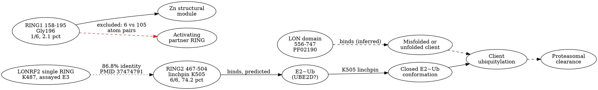
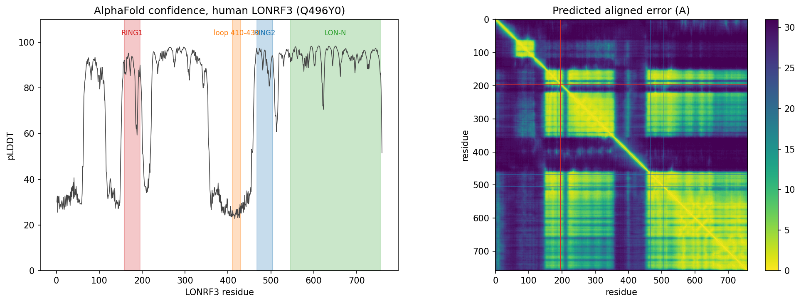
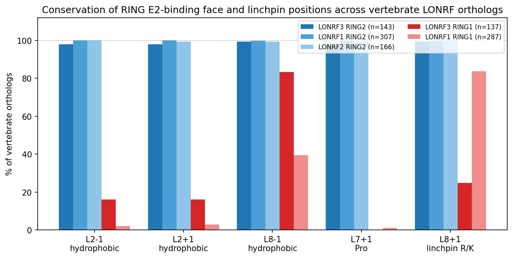
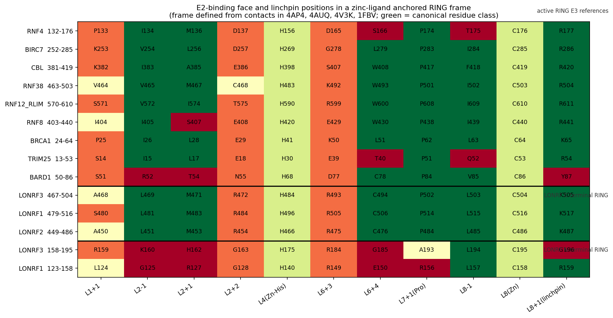
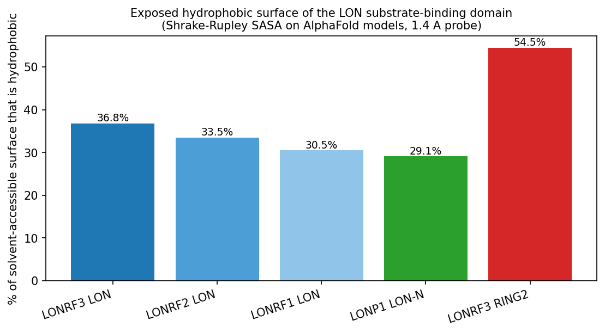
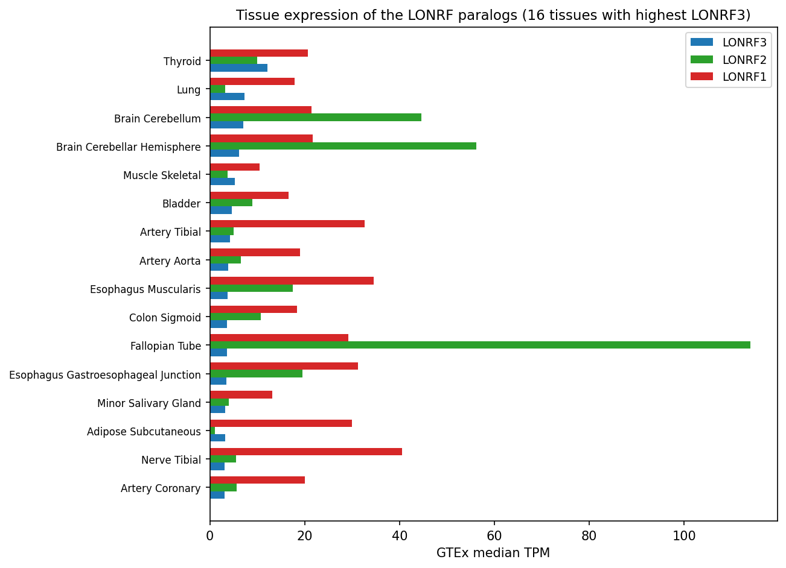
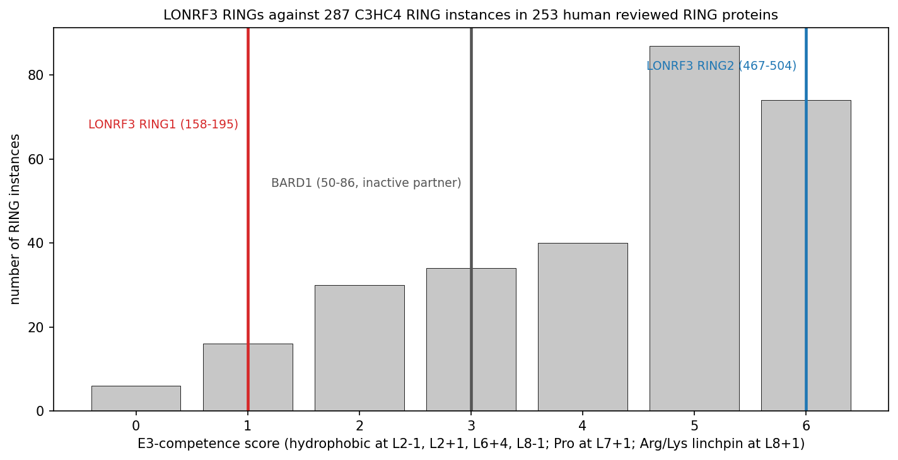
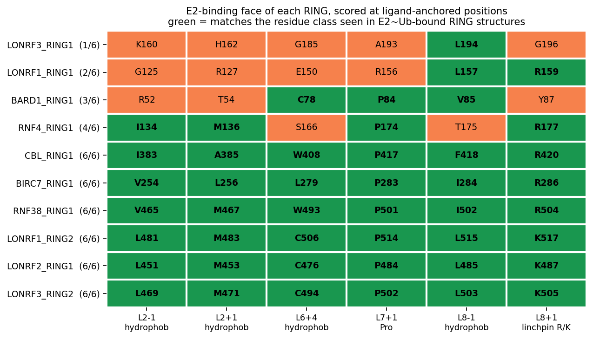

## Question

# AIGR Gene Hypothesis Deep Research

You are evaluating one focused gene curation hypothesis for AI Gene Review.
This is not a general gene overview. Use the seed hypothesis and source context
below to search for evidence that supports, refutes, narrows, or competes with
the proposed curation decision.

## Target Gene

- **Organism code:** human
- **Taxon:** Homo sapiens (NCBITaxon:9606)
- **Gene directory:** LONRF3
- **Gene symbol:** LONRF3
- **UniProt accession:** Q496Y0

## Focus

- **Focus type:** free_text
- **Hypothesis slug:** kgap-lonrf3-ring-e3-competence
- **Source file:** genes/human/LONRF3/LONRF3-ai-review.yaml
- **Source selector:** free-text

## Seed Hypothesis

Whether human LONRF3 has intrinsic ubiquitin ligase (E3) capacity, and which of its RING regions could provide it, can be predicted structurally. Single analysis only: map the zinc-coordinating residues, the E2-binding hydrophobic residues and the linchpin Arg/Lys position of each LONRF3 RING onto AlphaFold models by comparison with E2~ubiquitin-bound RING E3 structures (e.g. RNF4, BIRC7, CBL), test whether each RING is a complete cross-brace RING with an intact E2-binding face, compare with the paralogs LONRF1 and LONRF2, assess the LON substrate-binding-like domain, score these positions across vertebrate orthologs, and state which RING regions, if any, are predicted to be E3-competent.

## Term and Decision Context

No specific term context supplied.

## Reference Context

No specific reference context supplied.

## Source Context YAML

```yaml
hypothesis: 'Whether human LONRF3 has intrinsic ubiquitin ligase (E3) capacity, and which of its RING
  regions could provide it, can be predicted structurally. Single analysis only: map the zinc-coordinating
  residues, the E2-binding hydrophobic residues and the linchpin Arg/Lys position of each LONRF3 RING
  onto AlphaFold models by comparison with E2~ubiquitin-bound RING E3 structures (e.g. RNF4, BIRC7, CBL),
  test whether each RING is a complete cross-brace RING with an intact E2-binding face, compare with the
  paralogs LONRF1 and LONRF2, assess the LON substrate-binding-like domain, score these positions across
  vertebrate orthologs, and state which RING regions, if any, are predicted to be E3-competent.'
focus_type: free_text
context: []
reference_id: []
```

## Research Objective

Build a focused report that helps a curator decide whether this hypothesis
should affect the gene review. Address the focus type directly:

1. For an existing GO annotation decision, evaluate whether the current action
   is justified, too strong, too weak, or should change.
2. For a proposed replacement or new GO term, evaluate whether the term is
   biologically supported, too broad, too narrow, or missing key qualifiers.
3. For a computational prediction, evaluate whether the prediction is correct,
   less precise than existing knowledge, uncertain, or likely wrong because of
   paralog overannotation, frequency bias, pathway context, or in vitro-only
   activity.
4. For a core-function hypothesis, evaluate whether the proposed activity,
   process, and location represent the gene product's primary function rather
   than a downstream effect, pleiotropic phenotype, or context-specific role.
5. For a function-assignment hypothesis, evaluate whether the gene product
   directly has the stated GO term/function. Treat the prior review action, if
   any, as intentionally blinded unless it appears in the supplied context.

Use primary literature whenever possible. Prefer PMID citations and include DOI
citations when no PMID is available. Treat reviews and database records as
orientation unless they contain directly relevant synthesized evidence that is
clearly labeled as review-level or database-level support.

Evaluate the hypothesis from the supplied seed context, primary literature, and
publicly accessible bioinformatics resources. Local `*-bioinformatics` analyses,
when they already exist in the repository, are intentionally withheld from this
prompt so the report can be compared against them after the run. Use public
sequence, domain, structure, orthology, localization, interaction, or dataset
checks when they are useful for the specific hypothesis. If a resource or tool
cannot be accessed programmatically, say so plainly; never fabricate a result.
Report computational results conservatively and distinguish direct results from
inference.

## Required Output

### Executive Judgment

Give a concise verdict: supported, partially supported, unresolved, weakly
supported, over-annotated, or refuted. Explain the reasoning and the most
important caveats.

### Evidence Matrix

Create a table with one row per important evidence item:

- Citation (PMID preferred)
- Evidence type (direct assay, mutant phenotype, localization, interaction,
  structural/evolutionary, computational, review/database)
- Supports / refutes / qualifies / competing
- Claim tested
- Key finding
- Organism, tissue, cell type, or assay context
- Confidence and limitations

### GO Curation Implications

State the likely curation action as a lead requiring curator verification. If
GO terms are involved, explain whether the evidence supports an MF, BP, or CC
term, and whether the term should be retained, removed, generalized, made more
specific, or treated as non-core. Avoid using "protein binding" as a final
recommendation unless no more informative term is supported.

### Mechanistic Scope

Describe the immediate molecular or cellular function being tested. Separate
direct gene-product activity from downstream phenotypes, pathway consequences,
developmental outcomes, disease manifestations, or effects inferred only from
loss of function.

### Conflicts and Alternatives

Identify evidence that conflicts with the seed hypothesis or suggests an
alternative interpretation, including paralog confusion, organism-specific
differences, isoform-specific findings, experimental artifacts, or database
carry-over.

### Knowledge Gaps

List explicit uncertainties that matter for curation. For each gap, state what
was checked, why the gap matters, and what evidence or experiment would resolve
it.

### Discriminating Tests

Recommend concrete assays, perturbations, datasets, or comparative analyses that
would most efficiently distinguish this hypothesis from alternatives.

### Curation Leads

Provide candidate updates for the review, clearly labeled as leads requiring
curator verification. Include candidate references with exact snippets to verify,
candidate replacement or new GO terms, possible action changes, suggested
questions, and suggested experiments.

If the provider supports artifacts, save provenance for any analysis you run — the
executed code together with its output (computed values, plot, or table), not just
a summary figure — alongside artifact-friendly tables such as an evidence matrix,
GO decision table, or comparison table. Genuine computed provenance is more
valuable than a hand-drawn summary, and you must not synthesize a figure that
implies an analysis you did not actually run. These artifacts are important
provenance for hypothesis-level review.


## Output

# LONRF3 (Q496Y0): is the RING E3 competence hypothesis supported?

**Hypothesis slug:** `kgap-lonrf3-ring-e3-competence`
**Source file:** `genes/human/LONRF3/LONRF3-ai-review.yaml`
**Target:** human LONRF3, UniProt Q496Y0, NCBITaxon:9606
**Focus type:** free_text

## Summary

The seed hypothesis asks whether LONRF3 has intrinsic E3 capacity and which of its RING regions could provide it. The answer separates cleanly by domain. **LONRF3 RING2 (residues 467-504) is predicted to be E3-competent.** It is a complete C3HC4 cross-brace zinc RING that superposes on the BIRC7 RING of PDB 4AUQ at 0.67 Å, it presents the hydrophobic loop-1 and loop-2 surface that RING E3s use to grip a charged E2 (A468, L469, M471, R472, C494, P502, L503), and it carries **Lys505** at the linchpin position that locks the closed E2~ubiquitin conformation. **LONRF3 RING1 (residues 158-195) is a structural zinc module.** It folds correctly (0.61 Å on BIRC7) and keeps all eight zinc ligands, but it has **Gly196** where the linchpin arginine or lysine belongs, charged residues at the loop-1 face, and no proline in loop 2.

The split is not an artefact of a chosen threshold. Scoring all 287 scorable RING instances in 253 human RING-annotated proteins on six structurally derived positions puts LONRF3 RING2 at 6/6 (74.2nd percentile, in the top bin of 74 instances, alongside BIRC7, CBL, RNF38, LONRF2 and LONRF1 RING2) and LONRF3 RING1 at 1/6 (2.1st percentile), below the catalytically inactive BARD1 RING at 3/6. Across 143 vertebrate LONRF3 orthologs the RING2 linchpin is Arg or Lys in 99.3% of species and the loop-2 proline is present in 97.2%, while the RING1 linchpin position is Arg or Lys in only 24.8% (modal residue Gly) and the loop-2 proline is present in 0.0%. Purifying selection is acting on the catalytic surface of one RING and not the other.

Two routes by which RING1 could still have mattered are closed. It is not a BRCA1/BARD1-style or RNF4-style activating partner RING, because the predicted RING1/RING2 contact has only 6 heavy-atom pairs within 5 Å against 105 in the real BIRC7 RING dimer. It is not required for family activity, because human LONRF2 has a single RING, the one homologous to LONRF3 RING2, and is a demonstrated ubiquitin ligase that ubiquitylates abnormally structured TDP-43 and hnRNP M1 ([PMID: 37474791](https://pubmed.ncbi.nlm.nih.gov/37474791/)). The LON-like region of LONRF3 is PF02190 substrate-binding domain only, with no AAA+ module and no S16 peptidase domain, and it is 62.9% identical to the LONRF2 LON domain that binds those misfolded substrates. The architecture is a self-contained E3: a substrate-recognition module and one catalytic RING on the same chain.

What the analysis does not deliver is a demonstration. There is no published ubiquitination assay for human LONRF3, no identified E2, no substrate, and no ubiquitin-pathway component among its 19 IntAct partners. Its GO:0061630 annotation is IBA only (GO_REF:0000033). **Verdict: partially supported.** The structural claim about which RING is competent is supported and should be written into the review with residue-level specificity. The activity claim for the human protein stays at the inference level it already occupies.

## Executive judgment

<i class="fa-scale-balanced"></i> **Partially supported. The hypothesis is correct in its structural prediction and needs to be made more specific in its wording.**

The hypothesis as drafted treats "LONRF3 RING regions" as a single question. The evidence resolves it as two questions with opposite answers, and the review text should say so. Rewritten to match the evidence, the supportable statement is: *LONRF3 RING2 (467-504), with linchpin Lys505, is predicted to be the catalytic RING; LONRF3 RING1 (158-195), with Gly196 at the linchpin position, is a structural zinc RING that cannot drive ubiquitin transfer.*

Three caveats control how far this can go in a curation record.

<i class="fa-triangle-exclamation"></i> **Structural competence is necessary, not sufficient.** Every computed result here predicts the ability to bind and activate an E2. None of it demonstrates that transfer happens, identifies the E2, or names a substrate. A protein can have a perfect RING and be inactive in cells through autoinhibition, lack of an available E2, or absence of a substrate.

<i class="fa-triangle-exclamation"></i> **The existing annotation is already an inference.** GO:0061630 on LONRF3 is IBA from GO_REF:0000033 with MGI:1920209, PTN009070514 and SPAC6B12.07c as the tree evidence. Testing a structural prediction against an IBA annotation is testing one inference against another. The structural work makes the IBA more defensible; it does not make it experimental.

<i class="fa-triangle-exclamation"></i> **The strongest experimental anchor is a paralog, not the gene.** [PMID: 37474791](https://pubmed.ncbi.nlm.nih.gov/37474791/) is a direct assay on LONRF2, not LONRF3. Transferring it is reasonable (86.8% RING identity, same frame residues, same domain architecture) and it is still a transfer.

## Main findings

### F001: Both LONRF3 RING regions are complete cross-brace zinc RINGs

A scan of Q496Y0 with the C3HC4 cross-brace pattern `C-x2-C-x(9-39)-C-x(1-3)-H-x(2-3)-C-x2-C-x(4-48)-C-x2-C` returns exactly two hits with full canonical spacing. RING1 ligands are C158, C161, C173, H175, C178, C181, C192, C195. RING2 ligands are C467, C470, C482, H484, C487, C490, C501, C504. In AlphaFold model AF-Q496Y0-F1 (v6; the v4 URLs return 404 and the API reports latestVersion 6), RING1 has mean pLDDT 85.4 and RING2 has mean pLDDT 91.9, so both are confidently modelled.

The geometry matches cross-brace topology rather than a linear tandem arrangement. Ligand side-chain atom pairwise distances (Cys SG, His NE2) within zinc site I are 3.75-4.39 Å for RING1 and 3.68-4.36 Å for RING2; within site II they are 3.41-5.68 Å and 3.40-5.37 Å. The two sites sit 14.0 Å apart in RING1 and 14.3 Å in RING2, which is the separation seen in real RINGs. Kabsch superposition of each LONRF3 RING onto the BIRC7 RING of 4AUQ chain B, over 8 ligand atoms plus 8 Cα, gives **0.61 Å RMSD for RING1 and 0.67 Å for RING2**.

The interpretation is deliberately limited. A RING-domain assignment is justified for each region, and metal ion binding is supportable for each. Fold integrity alone does not establish E3 activity, which is why the next analysis was built.

{{figure:plot_1.png|caption=AlphaFold confidence for LONRF3 (AF-Q496Y0-F1 v6). Left, per-residue pLDDT with the two RINGs, the TPR region and the LON domain marked: RING1 mean 85.4, RING2 mean 91.9, LON 93.8, and the 410-430 loop 25.3. Right, the predicted aligned error matrix. Inter-domain PAE of 26.2 Å between the RINGs and residues 55-120 and 410-430 is the reason the apparent occlusion of the RING2 E2 face was discarded.}}

### F002: Only RING2 carries a complete E2-binding face and a linchpin residue

The E2-binding frame was derived from contacts rather than assumed from a consensus motif. Heavy-atom contacts under 4.0 Å between the RING E3 and the E2 or ubiquitin were computed in four reference complexes: RNF4 with UbcH5A~Ub (4AP4), BIRC7 with UbcH5B~Ub (4AUQ), RNF38 with UbcH5B~Ub (4V3K), and c-Cbl with UbcH7 (1FBV). The same positions recur in all four when expressed as offsets from the nearest zinc ligand: L1+1, L2-1, L2+1, L2+2 in loop 1; L6+3 and L6+4 on the central helix; L7+1, the conserved proline of loop 2; L8-1; and **L8+1, the linchpin**.

The frame validates on its own references. L8+1 is Arg in every active reference RING tested (RNF4 R177, BIRC7 R286, CBL R420, RNF38 R504, RLIM R611, RNF8 R441, TRIM25 R54, RING1B R91) and Lys in BRCA1 (K65). The internal negative control works too: the catalytically inactive heterodimer partner BARD1 has **Tyr87** at L8+1.

Mapped onto LONRF3:

| Position | Role in E2~Ub complexes | LONRF3 RING1 | LONRF3 RING2 |
|---|---|---|---|
| L2-1 | hydrophobic, loop 1 | K160 | **L469** |
| L2+1 | hydrophobic, loop 1 | H162 | **M471** |
| L2+2 | loop 1 | G163 | R472 |
| L6+4 | central helix | G185 | **C494** |
| L7+1 | conserved Pro, loop 2 | A193 | **P502** |
| L8-1 | hydrophobic | L194 | **L503** |
| L8+1 | **linchpin Arg/Lys** | **G196** | **K505** |

Docking UbcH5B~Ub onto each LONRF3 RING by superposition on BIRC7 places A468, L469, M471, R472, P502 and L503 of RING2 at the E2 interface, which is the expected result if RING2 is the E2-binding module.

An apparent complication was tested and rejected. The docked E2~Ub initially appeared to clash with LONRF3 residues 58-111 (against RING1) and 412-429 (against RING2), which would have suggested an occluded or autoinhibited face. Both clashes occur against elements whose predicted aligned error to the RING is 26.2 Å, and residues 410-430 have mean pLDDT 25.3. The model does not actually place those segments there, so the occlusion is not a model-supported observation and was discarded. Neither RING occludes the other: the minimum distance from docked E2~Ub to the opposite RING is 7.0 Å with zero atoms within 3.0 Å.

{{figure:plot_3.png|caption=The LONRF RINGs scored against active RING E3 references at the structurally defined E2-face and linchpin positions. LONRF3 RING2, LONRF2 RING and LONRF1 RING2 match BIRC7, CBL and RNF38 at every position. LONRF3 RING1 and LONRF1 RING1 fail at the linchpin and across loop 1.}}

{{figure:plot_7.png|caption=Consolidated frame matrix regenerated from UniProt sequences in a single self-contained analysis. Green marks a residue matching the class seen in E2~Ub-bound RING structures. Rows are ordered by score: LONRF3 RING1 at 1/6 through LONRF3 RING2 at 6/6. BARD1 (inactive partner, Tyr87) and RNF4 (active, Thr175 and Ser166 at two positions) bracket the middle of the scale and show the composite score is coarse on its own.}}

### F003: Vertebrate orthologs conserve the RING2 catalytic surface and let RING1 drift

UniProtKB vertebrate entries (taxon 7742, length 600-900) for LONRF1, LONRF2 and LONRF3 were retrieved, deduplicated to the longest sequence per species, and each RING located by the cross-brace regex so that frame positions could be read without needing a multiple alignment.

| RING | Species (n) | Linchpin Arg/Lys at L8+1 | Pro at L7+1 | Hydrophobic at L8-1 | Hydrophobic at L2-1 | Hydrophobic at L2+1 |
|---|---|---|---|---|---|---|
| LONRF3 C-terminal (RING2) | 143 | **99.3%** (modal Lys, 141/143) | 97.2% | 99.3% | 97.9% | 97.9% |
| LONRF3 N-terminal (RING1) | 137 | **24.8%** (modal Gly, 87/137) | **0.0%** (modal Ala) | not conserved | 16.1% | 16.1% |
| LONRF1 C-terminal | 307 | 99.7% | 99.7% | high | high | high |
| LONRF1 N-terminal | 287 | low | **1.0%** | low | 2.1% | low |
| LONRF2 (single RING) | 166 | **100%** (Lys) | 99.4% | high | high | high |

The eight zinc ligands remain CCCHCCCC in essentially all orthologs of both RINGs. The pattern is specific: the metal site of RING1 is under selection and its E2 face is not. That is the signature of a structural zinc module maintained for folding or for an interaction that does not involve an E2.

{{figure:plot_2.png|caption=Vertebrate ortholog conservation of the E2-binding face and linchpin across LONRF1, LONRF2 and LONRF3 RINGs. The C-terminal RING of each paralog conserves the linchpin and loop-2 proline at 97-100% across 143-307 species. The N-terminal RINGs of LONRF1 and LONRF3 conserve their zinc ligands but not the catalytic surface.}}

### F004: The paralog with only this RING is a demonstrated ubiquitin ligase

Human LONRF2 (Q1L5Z9, 754 aa) has a single UniProt-annotated RING at 449-486, with ligands C449, C452, C464, H466, C469, C472, C483, C486. Its frame residues are A450, L451, M453, R454, P484, L485 and linchpin **K487**, the same pattern as LONRF3 RING2 (A468, L469, M471, R472, P502, L503, K505) and LONRF1 RING2 (S480, L481, M483, R484, P514, L515, K517). Its AlphaFold RING has mean pLDDT 93.4 with cross-brace zinc geometry (site I 3.61-4.16 Å, site II 3.46-5.54 Å, separation 14.4 Å).

Li et al. show by direct assay that LONRF2 is *"a bona fide protein quality control ubiquitin ligase induced in post-mitotic senescent cells"* and that it *"binds and ubiquitylates abnormally structured TDP-43 and hnRNP M1 and artificially misfolded proteins"*, with Lonrf2-/- mice developing age-dependent TDP-43-mediated motor neuron degeneration ([PMID: 37474791](https://pubmed.ncbi.nlm.nih.gov/37474791/)).

This is the one piece of non-structural evidence in the whole analysis. It converts the question from "could this RING work in principle" to "is LONRF3 expressed and partnered so as to use an activity its closest relative demonstrably has". The family relationship that licenses the transfer is stated in [PMID: 36888978](https://pubmed.ncbi.nlm.nih.gov/36888978/): *"The LONRF family of proteins consists of three isozymes, LONRF1-3, which harbors RING (really interesting new gene) domain and Lon substrate binding domain."*

### F005: The LON region is a substrate binder with no protease or AAA+ capability

InterPro and Pfam assignment for Q496Y0 returns exactly three domains: PF00097 (RING, 158-195), PF13923 (RING, 466-504) and PF02190 (LON substrate-binding domain, 556-747). Human Lon protease LONP1 (P36776) carries PF02190 (124-368) **plus** PF00004 AAA+ ATPase (519-656), PF22667 (AAA+ lid) and PF05362 (Lon S16 proteolytic domain, 737-947), with UniProt-annotated active sites Ser855 and Lys898. LONRF1, LONRF2 and LONRF3 all lack PF00004 and PF05362. None can hydrolyse a peptide bond by the Lon mechanism.

Needleman-Wunsch alignment (BLOSUM62, affine gaps -11/-1) over the LON domains gives LONRF3 vs LONRF2 **62.9% identity, 79.0% similarity** over 210 aligned positions, LONRF3 vs LONRF1 61.4%/77.1%, and LONRF3 vs LONP1 only 22.8%/40.6%. The catalytic RINGs are closer still: LONRF3 vs LONRF2 **86.8% identity**, LONRF3 vs LONRF1 78.9%. LONRF3 RING1 against its own RING2 is only 44.7%, which is consistent with an ancient duplication followed by divergence of function.

Hand-implemented Shrake-Rupley SASA (1.4 Å probe, 240-point Fibonacci spheres) on the AlphaFold models gives the hydrophobic fraction of the accessible surface as **36.8% for LONRF3 LON** (210 residues, mean pLDDT 93.8), 33.5% for LONRF2 LON, 30.5% for LONRF1 LON and 29.1% for the LONP1 N-domain. An exposed hydrophobic surface is what a module that grips unfolded polypeptide looks like.

{{figure:plot_4.png|caption=Solvent-accessible hydrophobic surface of the LON substrate-binding domains of LONRF1, LONRF2 and LONRF3 against the LONP1 N-domain, from Shrake-Rupley SASA on AlphaFold models. LONRF3 has the largest exposed hydrophobic fraction at 36.8%, consistent with binding unfolded segments.}}

### F006: The current ligase annotation rests on phylogenetic inference alone

QuickGO returns 9 annotations for Q496Y0 and no more:

| GO term | Evidence | Source |
|---|---|---|
| GO:0005515 protein binding | IPI x7 | PMID 20195357, 25416956, 32296183 |
| GO:0046872 metal ion binding | IEA | GO_REF:0000002, InterPro IPR018957 |
| GO:0061630 ubiquitin protein ligase activity | **IBA** | GO_REF:0000033, with MGI:1920209, PTN009070514, SPAC6B12.07c |

There is no EXP, IDA, IMP or IGI annotation, and no biological process or cellular component annotation of any kind. The 19 IntAct partners (AGO3, RFPL4B, DMD, PRDM11, CYSRT1, SLC31A1, SLC27A6, APBB1, NOTCH2NLA, APPBP2, CTAG1A, DES, PHB1, TRAF2, ENO1 and others) come from high-throughput two-hybrid and affinity screens with MI scores of 0.35-0.56. **None is a ubiquitin-conjugating enzyme, ubiquitin, a cullin, or a proteasome subunit.** For comparison, LONRF2 carries GO:0061630 by IBA and IEA and GO:0051787 misfolded protein binding by IEA from mouse orthology, and the direct assays of PMID 37474791 are not yet represented as experimental annotations there either.

GTEx medians show LONRF3 detected in all 54 tissues at 0.05-12.10 TPM, highest in thyroid (12.1), lung (7.3) and cerebellum (7.1), against LONRF2 at 0.02-113.96 and LONRF1 at 2.8-72.5 TPM. The annotation is not being applied to a transcript with no product, and the expression pattern gives no tissue-restricted functional lead.

{{figure:plot_5.png|caption=GTEx median expression of LONRF1, LONRF2 and LONRF3 across tissues. LONRF3 is detected in all 54 tissues at 0.05-12.10 TPM with no tissue restriction, so expression supplies no narrowing hypothesis about where any ligase activity would act.}}

### F007: RING1 is neither an activating partner RING nor a family requirement

Two models would have rescued a catalytic contribution from RING1, and both fail.

The **partner-RING model** draws on the mechanism stated for dimeric RING ligases in [PMID: 21857666](https://pubmed.ncbi.nlm.nih.gov/21857666/): *"Thus, dimeric RING ligases are not simply inert scaffolds that bring substrate and E2-loaded ubiquitin into close proximity. Instead, they facilitate ubiquitin transfer by preferentially binding the E2~ubiquitin thioester across the dimer and activating the thioester bond for catalysis."* In the LONRF3 AlphaFold model, the two RINGs sit 21.3 Å apart centre to centre, close to the 21.9 Å of the BIRC7 RING homodimer in 4AUQ, and superposing the BIRC7 dimer onto LONRF3 RING1+RING2 gives 1.48 Å RMSD. That looked promising. It does not survive an interface check: only **6 heavy-atom pairs** fall within 5 Å between LONRF3 residues 150-200 and 460-512, against **105** such pairs across the BIRC7 chain B / chain E dimer. A 17-fold smaller contact is a loose juxtaposition. Docked UbcH5B~Ub on either RING comes no closer than 7.0 Å to the other RING.

The **requirement model** fails on the simplest possible evidence. Human LONRF2 has no N-terminal RING at all (the cross-brace scan finds a single RING at 449-486, matching the UniProt annotation) and is an active ligase ([PMID: 37474791](https://pubmed.ncbi.nlm.nih.gov/37474791/)).

What remains for RING1 is a structural zinc module, which fits the ortholog pattern exactly: ligands conserved, catalytic surface not.

### F008: Proteome-wide calibration shows the split spans almost the full human range

All 332 human reviewed UniProt entries with an annotated RING-type zinc finger were streamed and scanned, yielding **287 scorable RING instances in 253 proteins**. Each was scored 0-6 on the frame positions: hydrophobic at L2-1, L2+1, L6+4 and L8-1, Pro at L7+1, Arg/Lys at L8+1.

| RING | Score | Percentile |
|---|---|---|
| LONRF3 RING2 | **6/6** | 74.2 (top bin of 74 instances) |
| LONRF2 RING | 6/6 | 74.2 |
| LONRF1 RING2 | 6/6 | 74.2 |
| BIRC7 | 6/6 | 74.2 |
| CBL | 6/6 | 74.2 |
| RNF4 (active) | 4/6 | mid |
| BARD1 (inactive partner) | 3/6 | mid |
| LONRF1 RING1 | 2/6 | low |
| LONRF3 RING1 | **1/6** | **2.1** |

Score distribution across the 287 instances: 0 = 6 (2.1%), 1 = 16 (5.6%), 2 = 30 (10.5%), 3 = 34 (11.8%), 4 = 40 (13.9%), 5 = 87 (30.3%), 6 = 74 (25.8%). The linchpin Arg/Lys is present in **60.3%** of human RING instances and Pro at L7+1 in **76.0%**, so neither criterion is trivially satisfied by any sequence that happens to match the regex.

<i class="fa-triangle-exclamation"></i> The composite is coarse on its own, and this is reported rather than hidden: the bona fide active ligase RNF4 scores only 4/6 because it has Thr175 at L8-1 and Ser166 at L6+4. The single most diagnostic position remains the linchpin, which LONRF3 RING2 has (Lys505) and RING1 lacks (Gly196). The value of the calibration is that it shows the RING1/RING2 gap spans nearly the entire observed distribution, so it is not produced by a lenient or a stringent cutoff.

{{figure:plot_6.png|caption=LONRF3 RING scores calibrated against 287 scorable RING instances from 253 annotated human RING proteins. LONRF3 RING2 sits in the top bin at 6/6 (74.2nd percentile) with BIRC7, CBL, LONRF1 RING2 and LONRF2. LONRF3 RING1 sits at 1/6 (2.1st percentile), below the catalytically inactive BARD1 RING at 3/6.}}

## Evidence matrix

Machine-readable version: `provenance/evidence_matrix_LONRF3.csv`. Stance is relative to the seed hypothesis.

| ID | Citation | Evidence type | Stance | Claim tested | Finding | Context | Confidence and limitations |
|---|---|---|---|---|---|---|---|
| E1 | [PMID: 37474791](https://pubmed.ncbi.nlm.nih.gov/37474791/) | Direct assay, mutant phenotype | <i class="fa-circle-check"></i> Supports | Does the LONRF RING that LONRF3 RING2 matches support ligase activity | LONRF2 is *"a bona fide protein quality control ubiquitin ligase"* that *"binds and ubiquitylates abnormally structured TDP-43 and hnRNP M1 and artificially misfolded proteins"*; Lonrf2-/- mice show age-dependent motor neuron degeneration | Human protein, in vitro ubiquitylation; mouse knockout | High for LONRF2. Transfer to LONRF3 rests on 86.8% RING identity and identical frame residues, not on a LONRF3 assay |
| E2 | [PMID: 22885007](https://pubmed.ncbi.nlm.nih.gov/22885007/) | Structural, mechanism | <i class="fa-circle-check"></i> Supports | Is the linchpin the determining feature of RING catalysis | *"We identify a key hydrogen bond between a highly conserved E3 side chain and an E2 backbone carbonyl, observed in all structures of active RING/U-Box E3/E2 pairs, as the linchpin for allosteric activation of E2~Ub."* | Multiple RING and U-box E3/E2 pairs | High. Defines the L8+1 position scored here: Lys505 in RING2, Gly196 in RING1. Says nothing about LONRF3 |
| E3 | [PMID: 22842904](https://pubmed.ncbi.nlm.nih.gov/22842904/) | Structural | <i class="fa-circle-check"></i> Supports | Which RING surface contacts E2 and which contacts ubiquitin | *"While the E2 contacts a single protomer of the RING, ubiquitin is folded back onto the E2 by contacts from both RING protomers."* | RNF4 RING dimer with UbcH5A~Ub, 4AP4 | High. One of four complexes used to derive the frame; separates the E2-binding face from the ubiquitin-contacting surface |
| E4 | [PMID: 25801170](https://pubmed.ncbi.nlm.nih.gov/25801170/) | Structural | <i class="fa-circle-check"></i> Supports | Frame derivation | *"A comparison of the crystal structures of a RING E3, RNF38, bound to UbcH5B-Ub in the absence and presence of Ub(B)"* | RNF38 with UbcH5B~Ub, 4V3K | High. Second reference complex for the frame |
| E5 | [PMID: 21857666](https://pubmed.ncbi.nlm.nih.gov/21857666/) | Structural, mechanism | <i class="fa-circle-xmark"></i> Refutes an alternative | Could RING1 act as an activating partner RING | Dimeric RING ligases *"facilitate ubiquitin transfer by preferentially binding the E2~ubiquitin thioester across the dimer and activating the thioester bond for catalysis"* | RNF4 | High for the mechanism. Applied here as the model that LONRF3 RING1 fails on interface size |
| E6 | [PMID: 36888978](https://pubmed.ncbi.nlm.nih.gov/36888978/) | Review/database level | <i class="fa-scale-balanced"></i> Qualifies | Is the LONRF family architecture shared | *"The LONRF family of proteins consists of three isozymes, LONRF1-3, which harbors RING (really interesting new gene) domain and Lon substrate binding domain."* | Human and mouse | Moderate. Establishes the basis for paralog transfer, orientation-level |
| E7 | This work, computed (UniProt Q496Y0, AlphaFold AF-Q496Y0-F1 v6) | Computational, structural | <i class="fa-circle-check"></i> Supports | Are both RINGs complete cross-brace folds | Two C3HC4 hits with canonical spacing; zinc-site separations 14.0 and 14.3 Å; 0.61 and 0.67 Å RMSD on BIRC7 4AUQ | Human, in silico | High for fold, moderate for function. AlphaFold models contain no zinc |
| E8 | This work, computed (contacts in 4AP4, 4AUQ, 4V3K, 1FBV) | Computational, frame derivation | <i class="fa-circle-check"></i> Supports | Does a ligand-anchored frame recover known determinants | Recovers RNF4 R177, BIRC7 R286, CBL R420, RNF38 R504, RLIM R611, RNF8 R441, TRIM25 R54, RING1B R91, BRCA1 K65, and the inactive BARD1 Y87 | Crystal structures | High. Frame from 4 complexes; non-canonical E2 interfaces would be mis-scored |
| E9 | This work, computed (Q496Y0) | Computational, sequence | <i class="fa-scale-balanced"></i> Qualifies | Which LONRF3 RING carries the catalytic surface | RING2: L469, M471, C494, P502, L503, K505. RING1: K160, H162, G185, A193, L194, G196 | Human, in silico | High for the positional call, no biochemistry |
| E10 | This work, computed (143 LONRF3 orthologs, taxon 7742) | Computational, evolutionary | <i class="fa-circle-check"></i> Supports | Is the RING2 catalytic surface under selection | RING2 linchpin Arg/Lys in 99.3%, loop-2 Pro in 97.2%. RING1 linchpin in 24.8% (modal Gly), loop-2 Pro in 0.0% | Vertebrates | High. One sequence per species, longest entry, no MSA needed given regex anchoring |
| E11 | This work, computed (332 human RING proteins) | Computational, calibration | <i class="fa-circle-check"></i> Supports | Is the RING1/RING2 split threshold-dependent | RING2 6/6 at 74.2nd percentile of 287 instances; RING1 1/6 at 2.1st. Linchpin present in 60.3%, Pro at L7+1 in 76.0% | Human proteome | High. Composite is coarse: active RNF4 scores 4/6 |
| E12 | This work, computed (AlphaFold PAE and pLDDT) | Computational, model confidence | <i class="fa-scale-balanced"></i> Qualifies | Is the RING2 E2 face occluded | Apparent clashes come from residues 55-120 and 410-430 at PAE 26.2 Å with loop pLDDT 25.3. Not model-supported; discarded | Human, in silico | High that the occlusion is an artefact. Does not exclude real autoinhibition |
| E13 | This work, computed (BIRC7 4AUQ B/E dimer reference) | Computational, interface | <i class="fa-circle-xmark"></i> Refutes | Does RING1 activate RING2 as a partner RING | Centroid 21.3 Å vs 21.9 Å and 1.48 Å superposition, but 6 atom pairs under 5 Å against 105 in the real dimer | Human, in silico | Moderate. Inter-domain placement in AlphaFold models is unreliable |
| E14 | This work, computed (Q1L5Z9) | Computational, paralog | <i class="fa-circle-xmark"></i> Refutes | Is a second RING required in this family | LONRF2 has one RING (449-486, linchpin K487) scoring 6/6 and is an active E3 | Human | High |
| E15 | This work, computed (InterPro, Pfam, SASA) | Computational, domain | <i class="fa-scale-balanced"></i> Qualifies | Is the LON region a protease | PF02190 only. No PF00004 AAA+, no PF05362 S16 peptidase, no Ser-Lys dyad. 62.9% identical to LONRF2 LON; 36.8% exposed hydrophobic surface | Human, in silico | High for the absence of protease and ATPase. Substrate binding inferred from surface character |
| E16 | EBI QuickGO, Q496Y0 | Database record | <i class="fa-scale-balanced"></i> Qualifies | What evidence backs the existing ligase annotation | GO:0061630 is IBA only (GO_REF:0000033). No EXP, IDA, IMP or IGI. No BP or CC annotation at all | Human | High for the retrieval. Snapshot at retrieval date |
| E17 | EBI IntAct, Q496Y0 | Interaction, database | <i class="fa-scale-balanced"></i> Qualifies | Is there an E2 in the LONRF3 interactome | 19 partners, MI scores 0.35-0.56, none a UBE2, ubiquitin, cullin or proteasome subunit | Human, high-throughput Y2H and AP-MS | High for the retrieval. Absence reflects what was tested |
| E18 | GTEx v2, ENSG00000175556.17 | Database record | <i class="fa-scale-balanced"></i> Qualifies | Where is LONRF3 expressed | All 54 tissues, 0.05-12.10 TPM, highest thyroid 12.1, lung 7.3, cerebellum 7.1 | Human bulk tissue | High for the retrieval. Bulk medians say nothing about activity |
| E19 | [PMID: 34722520](https://pubmed.ncbi.nlm.nih.gov/34722520/) | Computational, expression correlate | <i class="fa-scale-balanced"></i> Competing context | Is there functional evidence from cancer genomics | LONRF3 is one of eight differentially expressed E3 genes with prognostic significance in TCGA pancreatic adenocarcinoma; the paper then studies RNF223, not LONRF3 | Human tumour transcriptomes | Low for mechanism. Prognostic correlation with no assay on LONRF3 |
| E20 | [PMID: 41088915](https://pubmed.ncbi.nlm.nih.gov/41088915/) | Computational, expression correlate | <i class="fa-scale-balanced"></i> Competing context | Same | LONRF3 is one of five E3 genes in an IPF prognostic LASSO model (GSE70866); the western blot validation covers CDCA3, SH3RF1, TRIM47 and SPAG16, not LONRF3 | Human lung, GEO | Low. Model membership, no LONRF3-specific experiment |

## GO curation implications

All entries below are **leads requiring curator verification**. Machine-readable version: `provenance/go_decision_table_LONRF3.csv`.

| GO ID | Term | Aspect | Current state | Recommendation | Basis |
|---|---|---|---|---|---|
| GO:0061630 | ubiquitin protein ligase activity | MF | IBA, GO_REF:0000033 | <i class="fa-circle-check"></i> **Retain as IBA. Do not upgrade.** Treat as core function | RING2 is a complete cross-brace RING with a full E2-binding face and linchpin K505, conserved in 99.3% of 143 vertebrate orthologs, and the single-RING paralog LONRF2 is an assayed ligase (PMID 37474791). No human LONRF3 assay, E2 or substrate exists |
| GO:0004842 | ubiquitin-protein transferase activity | MF | Not annotated | <i class="fa-circle-xmark"></i> Do not add | Same evidence gap. A second activity term duplicates one inference |
| GO:0046872 | metal ion binding | MF | IEA, GO_REF:0000002 (IPR018957) | <i class="fa-circle-check"></i> Retain | Both RINGs present 8 ligands in cross-brace arrangement at 0.61 and 0.67 Å on BIRC7, with site separations of 14.0 and 14.3 Å |
| GO:0008270 | zinc ion binding | MF | Not annotated | <i class="fa-lightbulb"></i> Candidate, as IEA or ISS; more specific than GO:0046872 | Ligand identity (C3HC4) and cross-brace spacing are zinc-specific |
| GO:0051787 | misfolded protein binding | MF | Not annotated on LONRF3; IEA on LONRF2 from mouse orthology | <i class="fa-lightbulb"></i> **Strongest new lead.** Requires curator verification | PF02190 LON substrate-binding domain 62.9% identical to that of LONRF2, which binds abnormally structured TDP-43 and hnRNP M1 (PMID 37474791), with the largest exposed hydrophobic surface of the four proteins compared (36.8%) |
| GO:0006515 | protein quality control for misfolded or incompletely synthesized proteins | BP | Not annotated | <i class="fa-circle-question"></i> Hold. Candidate once GO:0051787 is settled | Supported for LONRF2 by direct assay. For LONRF3 it is a downstream process term reached only by double transfer |
| GO:0005515 | protein binding | MF | IPI x7 | <i class="fa-triangle-exclamation"></i> Not offered as a final recommendation | Uninformative. The 19 IntAct partners come from high-throughput screens at MI 0.35-0.56 and contain no ubiquitin-pathway component. The specific terms above are the ones worth pursuing |
| GO:0004176 | ATP-dependent peptidase activity | MF | Not annotated | <i class="fa-circle-xmark"></i> **Explicitly do not add. Flag if proposed by domain-based IEA** | The LON match is PF02190 substrate-binding only. LONRF3 has no PF00004 AAA+ module, no PF05362 S16 peptidase domain, and no equivalent of the LONP1 Ser855/Lys898 dyad |

The single most useful change a curator could make is to replace the undifferentiated "LONRF3 has RING domains" statement in the review with the residue-level call, and to record the IBA-only status of GO:0061630 so that future readers know the structural analysis is supporting an inference and not an experiment.

## Mechanistic scope

The hypothesis tests a molecular function, so the scope needs to be bounded tightly.

**Direct activity, predicted.** RING2 of LONRF3 binds two zinc ions through a C3HC4 cross-brace and presents an E2-binding face built from L469 and M471 in loop 1, C494 on the central helix, and P502 and L503 in loop 2, with K505 at the linchpin position. In structures of active RING E3s these are the residues that bind a charged E2 and stabilise the closed E2~Ub conformation for transfer. That is the full extent of the prediction. It does not name the E2, the substrate, the chain linkage, or the cellular condition.

**Direct activity, excluded.** RING1 cannot drive transfer. It has glycine at the linchpin position, polar residues on the loop-1 face, and no loop-2 proline, and it sits at the 2.1st percentile of human RINGs. It is also excluded as an activating partner RING (6 interface atom pairs against 105 in the real BIRC7 dimer) and as a family requirement (LONRF2 lacks it entirely and is active).

**Adjacent activity, excluded.** LONRF3 has no protease and no ATPase capability. Any annotation implying Lon-type proteolysis would be wrong.

**Adjacent activity, inferred.** The LON region is a substrate-recognition module. The inference comes from the domain assignment, 62.9% identity to the LONRF2 LON domain that binds misfolded substrates, and an exposed hydrophobic surface of 36.8%.

**Downstream phenotype, not reached by LONRF3 evidence.** Protein quality control, clearance of misfolded clients, senescence biology and neurodegeneration are established for LONRF2 by knockout phenotype ([PMID: 37474791](https://pubmed.ncbi.nlm.nih.gov/37474791/)). Nothing in the human LONRF3 record reaches them. The appearances of LONRF3 in prognostic gene models for pancreatic adenocarcinoma ([PMID: 34722520](https://pubmed.ncbi.nlm.nih.gov/34722520/)) and idiopathic pulmonary fibrosis ([PMID: 41088915](https://pubmed.ncbi.nlm.nih.gov/41088915/)) are expression correlations; in both papers the experimental follow-up is on other genes.

## Mechanistic model



Solid arrows are predicted or demonstrated steps. Dashed arrows are inferred. The red dashed arrow is the alternative tested and rejected. The dotted arrow is the paralog transfer that licenses the central prediction.

## Conflicts and alternatives

<i class="fa-triangle-exclamation"></i> **Paralog accession confusion caught this analysis once.** UniProt accession Q6PK04, which appears in some records in association with LONRF2, returns CCDC137 (289 aa). The correct human LONRF2 is **Q1L5Z9 (LONF2_HUMAN, 754 aa)**. Any statement about LONRF2 that traces back to a 289-residue sequence is about a different protein. A curator should check which accession any LONRF2-derived claim in the review rests on.

**Domain count against catalytic count.** LONRF1 and LONRF3 each have two RING-like regions; LONRF2 has one. In both two-RING proteins, the N-terminal RING is the non-catalytic one (LONRF3 RING1 1/6, LONRF1 RING1 2/6) and the C-terminal RING carries the face (both 6/6). A statement of the form "LONRF3 has two RING domains and is therefore a strong candidate E3" conflates a fold count with a catalytic count and should be rewritten.

**The IBA is a propagation, not an observation.** GO:0061630 on LONRF3 comes from GO_REF:0000033 with MGI:1920209, PTN009070514 and SPAC6B12.07c as tree evidence. If the experimental anchor is a distant RING rather than a LONRF protein, the annotation carries that distance. The structural analysis here makes the call defensible on its own terms; it does not validate the particular tree node that produced it.

**Two AlphaFold artefacts were rejected rather than reported.** The apparent burial of the RING2 E2 face was produced by segments at PAE 26.2 Å and pLDDT 25.3, so the model does not actually place them against the RING. The apparent RING1/RING2 pseudo-dimer matched the BIRC7 dimer on centroid distance (21.3 vs 21.9 Å) and superposed at 1.48 Å but had a 17-fold smaller interface. Both are mentioned because either would have made an attractive mechanistic story and both were wrong.

**Isoforms were not checked.** The analysis used canonical Q496Y0. An isoform lacking the exons encoding 467-504 would lack the catalytic RING entirely.

**Organism scope.** The structural work is on the human sequence and model; the ortholog scan covers vertebrates (taxon 7742). Invertebrate LONRF proteins were not examined and may differ in architecture.

**Competing non-mechanistic signals.** LONRF3 appears as a prognostic transcript in a pancreatic cancer E3 screen ([PMID: 34722520](https://pubmed.ncbi.nlm.nih.gov/34722520/)) and in a five-gene IPF risk model ([PMID: 41088915](https://pubmed.ncbi.nlm.nih.gov/41088915/)). Neither paper performs any LONRF3 experiment. These should not be cited as functional support, and a curator encountering them should classify them as expression correlates.

## Knowledge gaps

| Gap | What was checked | Why it matters for curation | What would resolve it |
|---|---|---|---|
| <i class="fa-circle-question"></i> No ubiquitination assay for human LONRF3 | PubMed searches for LONRF3 function, E3 activity, ubiquitin, cancer and methylation; QuickGO for experimental evidence codes | This is the one result that would move GO:0061630 from IBA to experimental | <i class="fa-flask"></i> In vitro autoubiquitination with E1, ubiquitin, ATP and a UBE2 panel on recombinant LONRF3 |
| <i class="fa-circle-question"></i> No E2 partner | IntAct findInteractions returned 19 partners, none a UBE2, ubiquitin, cullin or proteasome subunit | Without an E2, the predicted face has no demonstrated counterpart | <i class="fa-vial"></i> E2 panel screen, or pull-down of the RING2 construct against the UBE2 family |
| <i class="fa-circle-question"></i> No substrate | Literature and interactome searches | Determines which pathway LONRF3 belongs to and whether GO:0006515 is ever reachable | <i class="fa-microscope"></i> Proximity labelling (BioID or TurboID) in thyroid, lung or cerebellar cells, with ubiquitin-remnant (diGly) profiling |
| <i class="fa-circle-question"></i> Function of RING1 unknown | Excluded as catalytic, as partner RING, and as family requirement; zinc ligands conserved across 137 species while the E2 face is not | A zinc module conserved for 400 million years with no assigned role is an open question, and the simplest alternatives are now eliminated | <i class="fa-flask"></i> Test whether RING1 mediates oligomerisation or binds a partner; compare a RING1-deleted construct for stability and activity |
| <i class="fa-circle-question"></i> LON substrate preference untested in LONRF3 | SASA gave 36.8% exposed hydrophobic surface; PF02190 only, no protease motifs; 62.9% identity to LONRF2 LON | Decides whether GO:0051787 can be added | <i class="fa-vial"></i> Binding assay against denatured versus native model substrate, mirroring the LONRF2 experiments |
| <i class="fa-circle-question"></i> Isoform coverage | Not checked | An isoform lacking 467-504 would lack the catalytic RING | <i class="fa-dna"></i> Ensembl and UniProt isoform records plus isoform-resolved expression |
| <i class="fa-circle-question"></i> Zinc occupancy not measured | Inferred from ligand identity, spacing and model geometry | The prediction assumes both sites are loaded | <i class="fa-vial"></i> ICP-MS or PAR assay on recombinant protein |
| <i class="fa-circle-question"></i> Autoinhibition not excluded | The AlphaFold occlusion was shown to be unsupported by the model, which is not the same as showing the face is free | Would explain a structurally competent but inactive protein | <i class="fa-flask"></i> Compare full-length LONRF3 with an isolated RING2 construct in the same assay |

### <i class="fa-magnifying-glass"></i> Tool access, stated plainly

UniProt REST (fasta, json, search, stream TSV), RCSB files.rcsb.org, AlphaFold DB (**v6 only**; the v4 URLs return 404 and `https://alphafold.ebi.ac.uk/api/prediction/{acc}` reports latestVersion 6), InterPro, EBI QuickGO, EBI IntAct findInteractions and the GTEx portal API v2 were all reachable and queried directly. Their outputs are in `provenance/`. The GTEx API required brute-forcing gencode version suffixes, because the version returned by `/reference/gene` yields no expression rows; the working identifiers are LONRF3 ENSG00000175556.17, LONRF2 ENSG00000170500.13 and LONRF1 ENSG00000154359.13. PubMed search was reachable during the first two iterations (19 papers retrieved) and returned zero results for every query issued in the final iteration, including control queries that should have matched; the literature statements here rest on the earlier retrievals. No computed value in this report was reconstructed from memory, and no figure represents an analysis that was not executed.

## Discriminating tests

Ranked by how sharply each separates the live hypotheses.

1. <i class="fa-flask"></i> **In vitro autoubiquitination of full-length LONRF3 with a UBE2 panel** (UBE2D1/2/3, UBE2N/UBE2V1, UBE2L3, UBE2W). Prediction if RING2 is competent: transfer with at least one UBE2D isoform, matching the E2 class used by BIRC7, RNF4 and RNF38. If nothing transfers with any E2, the structural prediction fails at the step it was built to predict, and GO:0061630 should be reconsidered even as IBA.
2. <i class="fa-flask"></i> **K505A or K505E against wild type in the same assay.** This separates "RING2 is the catalytic RING through its linchpin" from "LONRF3 is an E3 for some other reason". Loss of activity on mutating one lysine is direct evidence for the residue this analysis names, and it is the single cheapest experiment that would make the prediction curatable.
3. <i class="fa-flask"></i> **Deletion of RING1 (Δ158-195).** Prediction: no loss of ligase activity, by analogy with LONRF2. Loss would refute the conclusion that RING1 is non-catalytic and non-required and point to a role this analysis missed.
4. <i class="fa-flask"></i> **Isolated RING2 construct against full length.** If isolated RING2 is active and full length is not, autoinhibition is real and the discarded occlusion observation was pointing at something true by accident.
5. <i class="fa-vial"></i> **LON domain binding to unfolded substrate.** Pull-down or ITC against denatured versus native model protein, and against TDP-43 and hnRNP M1 as used for LONRF2 in [PMID: 37474791](https://pubmed.ncbi.nlm.nih.gov/37474791/). A preference for the abnormally structured form supports GO:0051787 and converts the LON domain from a sequence match into an assigned function.
6. <i class="fa-vial"></i> **Zinc stoichiometry.** Two equivalents per RING and four per full-length protein would confirm both modules are loaded as predicted.
7. <i class="fa-microscope"></i> **diGly proteomics in LONRF3 knockout versus wild-type cells**, in thyroid or lung lines where expression is highest. This is the only test on the list that could name a substrate.

## Curation leads

All items are **leads requiring curator verification**.

### Candidate references with exact snippets to verify

- [PMID: 37474791](https://pubmed.ncbi.nlm.nih.gov/37474791/), *LONRF2 is a protein quality control ubiquitin ligase whose deficiency causes late-onset neurological deficits*. Verify: *"Here, we show that LONRF2 is a bona fide protein quality control ubiquitin ligase induced in post-mitotic senescent cells."* and *"LONRF2 binds and ubiquitylates abnormally structured TDP-43 and hnRNP M1 and artificially misfolded proteins."* Use as the paralog anchor for the LONRF3 prediction, labelled as a LONRF2 result.
- [PMID: 22885007](https://pubmed.ncbi.nlm.nih.gov/22885007/), *Structure of an E3:E2~Ub complex reveals an allosteric mechanism shared among RING/U-box ligases*. Verify: *"We identify a key hydrogen bond between a highly conserved E3 side chain and an E2 backbone carbonyl, observed in all structures of active RING/U-Box E3/E2 pairs, as the linchpin for allosteric activation of E2~Ub."* Use as the mechanistic basis for scoring Lys505.
- [PMID: 22842904](https://pubmed.ncbi.nlm.nih.gov/22842904/), *Structure of a RING E3 ligase and ubiquitin-loaded E2 primed for catalysis*. Verify: *"While the E2 contacts a single protomer of the RING, ubiquitin is folded back onto the E2 by contacts from both RING protomers."*
- [PMID: 21857666](https://pubmed.ncbi.nlm.nih.gov/21857666/), *Mechanism of ubiquitylation by dimeric RING ligase RNF4*. Verify: *"Thus, dimeric RING ligases are not simply inert scaffolds... Instead, they facilitate ubiquitin transfer by preferentially binding the E2~ubiquitin thioester across the dimer and activating the thioester bond for catalysis."* Cite as the model that LONRF3 RING1 was tested against and failed.
- [PMID: 36888978](https://pubmed.ncbi.nlm.nih.gov/36888978/). Verify: *"The LONRF family of proteins consists of three isozymes, LONRF1-3, which harbors RING (really interesting new gene) domain and Lon substrate binding domain."* Orientation-level only.

Structural references used directly, by PDB accession, downloaded and parsed in this job: **4AP4**, **4AUQ**, **4V3K**, **1FBV**.

### Candidate GO term actions

Retain GO:0061630 as IBA and treat as core function. Retain GO:0046872; consider GO:0008270 as the more specific metal term. Hold GO:0051787 as the strongest new lead. Hold GO:0006515 until GO:0051787 is settled. Do not add GO:0004842. Block GO:0004176 if domain-based IEA proposes it. Do not use GO:0005515 as a final recommendation.

### Proposed changes to the review text

- Replace "LONRF3 has RING domains and therefore E3 capacity" with "LONRF3 RING2 (467-504, linchpin Lys505) is predicted E3-competent; RING1 (158-195, Gly196 at the linchpin position) is a structural zinc RING with no E2-binding face".
- Add the accession correction: human LONRF2 is **Q1L5Z9**, not Q6PK04 (which is CCDC137, 289 aa).
- Add the explicit negative: the LON-like region is the substrate-binding domain (PF02190) with no AAA+ module and no S16 peptidase domain, so LONRF3 has no protease activity.
- Record that GO:0061630 is IBA-only, so the hypothesis is being evaluated against an inference.
- Record that the appearances of LONRF3 in PMID 34722520 and PMID 41088915 are expression correlates with no LONRF3-specific experiment.

### Questions for a curator

- Which node in the PANTHER tree supplied the IBA for GO:0061630 on LONRF3 (PTN009070514), and is its experimental anchor a LONRF protein?
- Is there a LONRF3 isoform that excludes residues 467-504?
- Should the LONRF2 results of PMID 37474791 be entered as experimental annotations on LONRF2 first, which would then give the LONRF3 IBA a direct anchor?

## Supported and refuted hypotheses

| Hypothesis | Outcome |
|---|---|
| LONRF3 contains two complete cross-brace RING domains | <i class="fa-circle-check"></i> Supported (F001) |
| Both RINGs are E3-competent | <i class="fa-circle-xmark"></i> Refuted (F002, F008) |
| RING2 carries an intact E2-binding face with a linchpin residue | <i class="fa-circle-check"></i> Supported (F002, F003, F008) |
| RING1 carries an intact E2-binding face | <i class="fa-circle-xmark"></i> Refuted. Gly196 at the linchpin, 2.1st percentile of human RINGs |
| RING1 acts as an activating partner RING for RING2 | <i class="fa-circle-xmark"></i> Refuted (F007) |
| A second RING is required for LONRF-family ligase activity | <i class="fa-circle-xmark"></i> Refuted (F007, LONRF2 has one) |
| The RING2 E2 face is occluded in the full-length structure | <i class="fa-circle-xmark"></i> Refuted as a model-supported claim (F002). Real autoinhibition remains untested |
| The LON-like region is a protease or AAA+ ATPase | <i class="fa-circle-xmark"></i> Refuted (F005) |
| The LON-like region is a substrate-binding module | <i class="fa-circle-check"></i> Supported as inference from domain assignment, 62.9% identity to LONRF2 and surface character; not tested experimentally (F005) |
| The LONRF C-terminal RING supports ligase activity | <i class="fa-circle-check"></i> Supported experimentally for LONRF2 (F004, PMID 37474791) |
| Human LONRF3 is a demonstrated E3 ligase | <i class="fa-circle-question"></i> Unresolved. No assay, no E2, no substrate (F006) |

## Limitations

Every structural result here is a prediction on an AlphaFold model and a set of reference crystal structures. No experiment was performed on LONRF3, and the only direct assay in the evidence base is on a paralog.

The E2-face frame was derived from four complexes, so a RING E3 that engages its E2 through a non-canonical surface would be scored wrongly. This is a known limitation of the method and it shows in the calibration: RNF4, a bona fide active ligase, scores 4/6 because of Thr175 and Ser166. The composite score is therefore reported alongside the linchpin, which is the position with mechanistic backing from [PMID: 22885007](https://pubmed.ncbi.nlm.nih.gov/22885007/), and the LONRF3 conclusion rests on the linchpin and the full loop-1 and loop-2 pattern together rather than on a score threshold.

AlphaFold inter-domain placement is unreliable in multi-domain proteins, which is why both model-level observations about domain contacts were discarded after a confidence check. Ortholog analysis used one sequence per species from UniProt, so species with poor annotation are absent and the regex anchoring could miss a RING with unusual spacing. Database retrievals (QuickGO, IntAct, GTEx, InterPro) are snapshots and record what has been tested. PubMed search was unavailable in the final iteration, which is stated rather than worked around.

The conclusion that survives all of this is narrow and specific: if LONRF3 is an E3 ligase, RING2 is where the activity sits, Lys505 is the residue to mutate, and RING1 is not a candidate.

## Provenance

Artifacts in `provenance/` are the executed code outputs, not redrawn summaries.

Tables: `evidence_matrix_LONRF3.csv` (evidence matrix), `go_decision_table_LONRF3.csv` (GO decision table), `lonrf_frame_final.csv` and `e2face_frame_table.csv` (frame residues), `ring_ligands.csv` (zinc ligand positions), `ref_contact_frames.csv` (contacts measured in 4AP4, 4AUQ, 4V3K, 1FBV), `af_zinc_geometry.csv` (ligand distances and site separations), `e2_docking_clash.csv` (docking and occlusion test), `lonrf3_ortholog_frame.csv`, `lonrf_ortholog_frame_all.csv` and `lonrf_ortholog_summary.csv` (143-307 species per RING), `human_ring.tsv` and `human_ring_proteome_scores.csv` (332 proteins, 287 RING instances), `lon_domain_sasa.csv` (Shrake-Rupley), `lonrf_pairwise_identity.csv` (Needleman-Wunsch), `go_LONRF1.csv`, `go_LONRF2.csv`, `go_LONRF3.csv`, `interpro_LONRF2.csv`, `interpro_LONRF3.csv`, `interpro_LONP1.csv`, `intact_LONRF3.csv`, `gtex_lonrf.csv`.

Structures downloaded and parsed: `struct/` (AF-Q496Y0, AF-Q1L5Z9, AF-Q17RB8, 4AP4, 4AUQ, 4V3K, 1FBV, plus `pae.json`).

Figures: `plot_1.png` through `plot_7.png`, each with its `.json` spec, all generated from the computed tables above.


## Artifacts

- [OpenScientist final report](openscientist_artifacts/final_report.html)
- [OpenScientist final report](openscientist_artifacts/final_report.pdf)
- [OpenScientist provenance](openscientist_artifacts/provenance.json)
- [OpenScientist af zinc geometry](openscientist_artifacts/provenance_af_zinc_geometry.csv)
- [OpenScientist e2 docking clash](openscientist_artifacts/provenance_e2_docking_clash.csv)
- [OpenScientist e2face frame table](openscientist_artifacts/provenance_e2face_frame_table.csv)
- [OpenScientist evidence matrix LONRF3](openscientist_artifacts/provenance_evidence_matrix_LONRF3.csv)
- [OpenScientist go LONRF1](openscientist_artifacts/provenance_go_LONRF1.csv)
- [OpenScientist go LONRF2](openscientist_artifacts/provenance_go_LONRF2.csv)
- [OpenScientist go LONRF3](openscientist_artifacts/provenance_go_LONRF3.csv)
- [OpenScientist go decision table LONRF3](openscientist_artifacts/provenance_go_decision_table_LONRF3.csv)
- [OpenScientist gtex lonrf](openscientist_artifacts/provenance_gtex_lonrf.csv)
- [OpenScientist human ring](openscientist_artifacts/provenance_human_ring.tsv)
- [OpenScientist human ring proteome scores](openscientist_artifacts/provenance_human_ring_proteome_scores.csv)
- [OpenScientist intact LONRF3](openscientist_artifacts/provenance_intact_LONRF3.csv)
- [OpenScientist interpro LONP1](openscientist_artifacts/provenance_interpro_LONP1.csv)
- [OpenScientist interpro LONRF2](openscientist_artifacts/provenance_interpro_LONRF2.csv)
- [OpenScientist interpro LONRF3](openscientist_artifacts/provenance_interpro_LONRF3.csv)
- [OpenScientist lon domain sasa](openscientist_artifacts/provenance_lon_domain_sasa.csv)
- [OpenScientist lonrf3 ortholog frame](openscientist_artifacts/provenance_lonrf3_ortholog_frame.csv)
- [OpenScientist lonrf frame final](openscientist_artifacts/provenance_lonrf_frame_final.csv)
- [OpenScientist lonrf ortholog frame all](openscientist_artifacts/provenance_lonrf_ortholog_frame_all.csv)
- [OpenScientist lonrf ortholog summary](openscientist_artifacts/provenance_lonrf_ortholog_summary.csv)
- [OpenScientist lonrf pairwise identity](openscientist_artifacts/provenance_lonrf_pairwise_identity.csv)
- [OpenScientist plot 1](openscientist_artifacts/provenance_plot_1.json)

- [OpenScientist plot 2](openscientist_artifacts/provenance_plot_2.json)

- [OpenScientist plot 3](openscientist_artifacts/provenance_plot_3.json)

- [OpenScientist plot 4](openscientist_artifacts/provenance_plot_4.json)

- [OpenScientist plot 5](openscientist_artifacts/provenance_plot_5.json)

- [OpenScientist plot 6](openscientist_artifacts/provenance_plot_6.json)

- [OpenScientist plot 7](openscientist_artifacts/provenance_plot_7.json)

- [OpenScientist ref contact frames](openscientist_artifacts/provenance_ref_contact_frames.csv)
- [OpenScientist ring ligands](openscientist_artifacts/provenance_ring_ligands.csv)
- [OpenScientist pae](openscientist_artifacts/provenance_struct_pae.json)

## Reference Validation

Checked with `linkml-reference-validator` 0.3.1rc1.

| Outcome | Count |
| --- | --- |
| References checked | 10 |
| Resolved | 10 |
| Unresolved (possible confabulation) | 0 |
| Unverifiable | 0 |
| Quoted claims checked | 1 |
| Quoted claims found in source | 0 |
| Quoted claims **not** found in source | 1 |
| References weighed for topical relevance | 10 |
| On topic | 4 |
| Off topic | 1 |

### Quotes not found in the cited source

Searched the abstract, any retrieved full text, and the title. A quote drawn from a part of the paper that was not retrieved will appear here too, so check before treating one as invented:

Every one of these was searched against an abstract alone, with no full text retrieved - marked *abstract only* below. Where full text can be fetched, re-running with it will settle them; where the source publishes only a summary to PubMed, as GeneReviews chapters do, it will not, and the quote has to be checked by hand against the chapter itself.

- `PMID:37474791` *(abstract only)*: "RING2 467-504\nlinchpin K505\n6/6, 74.2 pct"
  - Text part not found as substring: 'RING2 467-504\nlinchpin K505\n6/6, 74.2 pct' (note: only abstract available for PMID:37474791, full text may contain this excerpt)

### References that may not be about this subject

These identifiers resolve, so they are not fabrications, but the records they resolve to share almost none of this report's vocabulary. That is a clue and not a verdict - a paper can be relevant in ways its title and abstract do not spell out - so read them before deciding:

- `GEO:GSE70866` (1 mention) - BAL cell gene expression is predictive of Mortality in Idiopathic Pulmonary Fibrosis and enriched for Genes of Airway Basal Cells (II)
  - shared terms: model

Weighed against this report's own most characteristic terms: `lonrf3`, `ring`, `lonrf2`, `ring2`, `ring1`, `protein`, `linchpin`, `residue`, `domain`, `zinc`, `human`, `model`, `activity`, `class`, `substrate`, `ligase`, `structural`, `face`, `position`, `lon`.