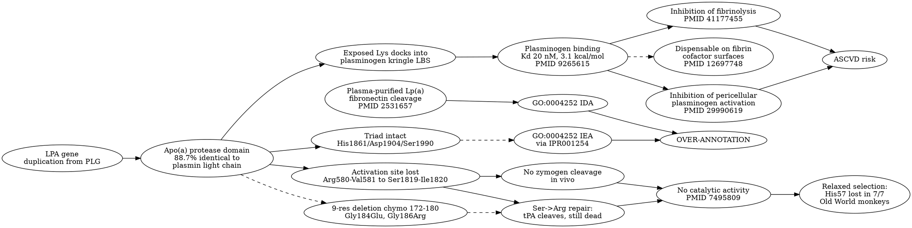
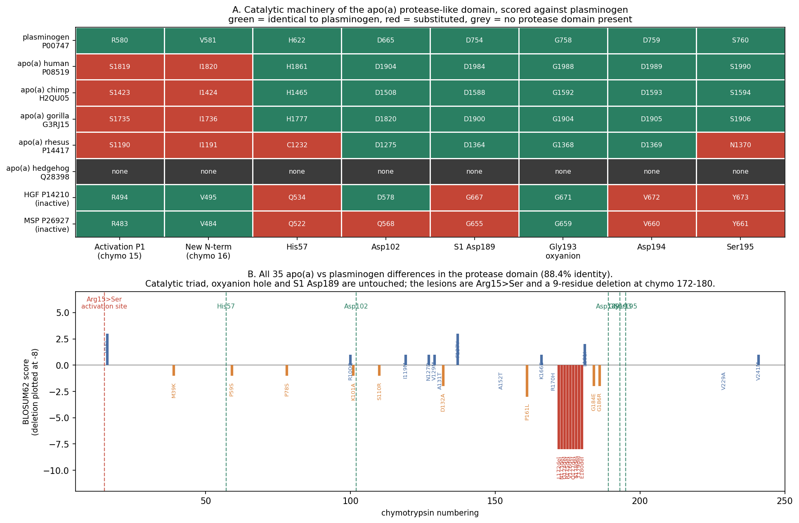
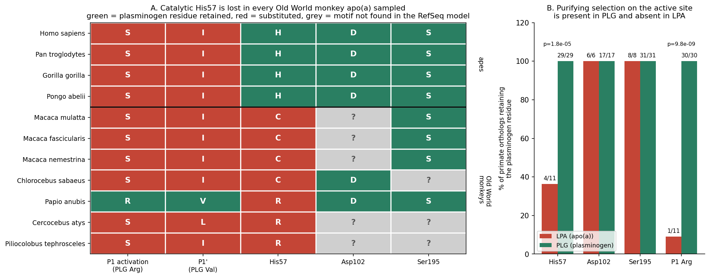
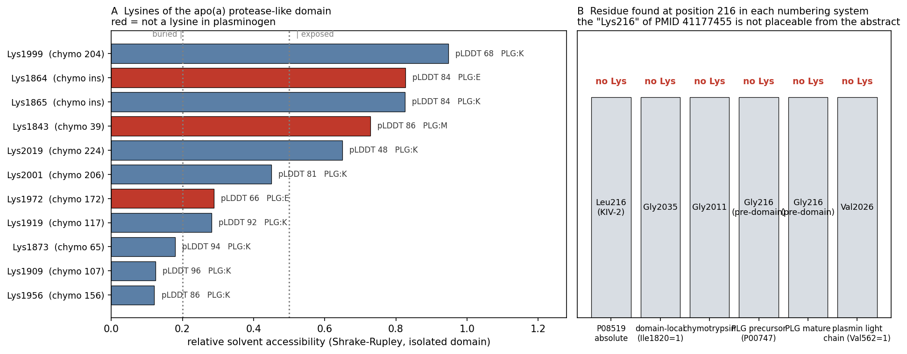
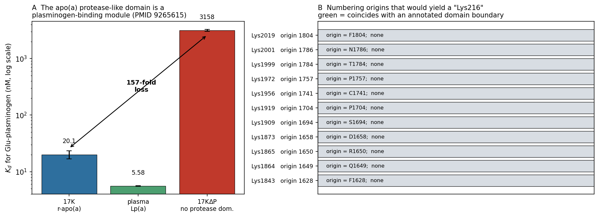

## Question

# AIGR Gene Hypothesis Deep Research

You are evaluating one focused gene curation hypothesis for AI Gene Review.
This is not a general gene overview. Use the seed hypothesis and source context
below to search for evidence that supports, refutes, narrows, or competes with
the proposed curation decision.

## Target Gene

- **Organism code:** human
- **Taxon:** Homo sapiens (NCBITaxon:9606)
- **Gene directory:** LPA
- **Gene symbol:** LPA
- **UniProt accession:** P08519

## Focus

- **Focus type:** free_text
- **Hypothesis slug:** kgap-lpa-protease-domain-catalytic-triad
- **Source file:** genes/human/LPA/LPA-ai-review.yaml
- **Source selector:** free-text

## Seed Hypothesis

The serine-protease-like domain of human apolipoprotein(a) (LPA, UniProt P08519) is catalytically inactive because it lacks a functional catalytic triad/activation site relative to plasminogen. Single analysis only: align the apo(a) protease-like domain to plasminogen/plasmin and other chymotrypsin-fold proteases, score the His57/Asp102/Ser195 catalytic triad, the oxyanion hole, the S1 pocket residue and the activation-cleavage site (Arg561-Val562 in plasminogen) in human apo(a) and in primate and hedgehog apo(a) orthologs; state whether any physiological context could yield an active protease.

## Term and Decision Context

No specific term context supplied.

## Reference Context

No specific reference context supplied.

## Source Context YAML

```yaml
hypothesis: 'The serine-protease-like domain of human apolipoprotein(a) (LPA, UniProt P08519) is catalytically
  inactive because it lacks a functional catalytic triad/activation site relative to plasminogen. Single
  analysis only: align the apo(a) protease-like domain to plasminogen/plasmin and other chymotrypsin-fold
  proteases, score the His57/Asp102/Ser195 catalytic triad, the oxyanion hole, the S1 pocket residue and
  the activation-cleavage site (Arg561-Val562 in plasminogen) in human apo(a) and in primate and hedgehog
  apo(a) orthologs; state whether any physiological context could yield an active protease.'
focus_type: free_text
context: []
reference_id: []
```

## Research Objective

Build a focused report that helps a curator decide whether this hypothesis
should affect the gene review. Address the focus type directly:

1. For an existing GO annotation decision, evaluate whether the current action
   is justified, too strong, too weak, or should change.
2. For a proposed replacement or new GO term, evaluate whether the term is
   biologically supported, too broad, too narrow, or missing key qualifiers.
3. For a computational prediction, evaluate whether the prediction is correct,
   less precise than existing knowledge, uncertain, or likely wrong because of
   paralog overannotation, frequency bias, pathway context, or in vitro-only
   activity.
4. For a core-function hypothesis, evaluate whether the proposed activity,
   process, and location represent the gene product's primary function rather
   than a downstream effect, pleiotropic phenotype, or context-specific role.
5. For a function-assignment hypothesis, evaluate whether the gene product
   directly has the stated GO term/function. Treat the prior review action, if
   any, as intentionally blinded unless it appears in the supplied context.

Use primary literature whenever possible. Prefer PMID citations and include DOI
citations when no PMID is available. Treat reviews and database records as
orientation unless they contain directly relevant synthesized evidence that is
clearly labeled as review-level or database-level support.

Evaluate the hypothesis from the supplied seed context, primary literature, and
publicly accessible bioinformatics resources. Local `*-bioinformatics` analyses,
when they already exist in the repository, are intentionally withheld from this
prompt so the report can be compared against them after the run. Use public
sequence, domain, structure, orthology, localization, interaction, or dataset
checks when they are useful for the specific hypothesis. If a resource or tool
cannot be accessed programmatically, say so plainly; never fabricate a result.
Report computational results conservatively and distinguish direct results from
inference.

## Required Output

### Executive Judgment

Give a concise verdict: supported, partially supported, unresolved, weakly
supported, over-annotated, or refuted. Explain the reasoning and the most
important caveats.

### Evidence Matrix

Create a table with one row per important evidence item:

- Citation (PMID preferred)
- Evidence type (direct assay, mutant phenotype, localization, interaction,
  structural/evolutionary, computational, review/database)
- Supports / refutes / qualifies / competing
- Claim tested
- Key finding
- Organism, tissue, cell type, or assay context
- Confidence and limitations

### GO Curation Implications

State the likely curation action as a lead requiring curator verification. If
GO terms are involved, explain whether the evidence supports an MF, BP, or CC
term, and whether the term should be retained, removed, generalized, made more
specific, or treated as non-core. Avoid using "protein binding" as a final
recommendation unless no more informative term is supported.

### Mechanistic Scope

Describe the immediate molecular or cellular function being tested. Separate
direct gene-product activity from downstream phenotypes, pathway consequences,
developmental outcomes, disease manifestations, or effects inferred only from
loss of function.

### Conflicts and Alternatives

Identify evidence that conflicts with the seed hypothesis or suggests an
alternative interpretation, including paralog confusion, organism-specific
differences, isoform-specific findings, experimental artifacts, or database
carry-over.

### Knowledge Gaps

List explicit uncertainties that matter for curation. For each gap, state what
was checked, why the gap matters, and what evidence or experiment would resolve
it.

### Discriminating Tests

Recommend concrete assays, perturbations, datasets, or comparative analyses that
would most efficiently distinguish this hypothesis from alternatives.

### Curation Leads

Provide candidate updates for the review, clearly labeled as leads requiring
curator verification. Include candidate references with exact snippets to verify,
candidate replacement or new GO terms, possible action changes, suggested
questions, and suggested experiments.

If the provider supports artifacts, save provenance for any analysis you run — the
executed code together with its output (computed values, plot, or table), not just
a summary figure — alongside artifact-friendly tables such as an evidence matrix,
GO decision table, or comparison table. Genuine computed provenance is more
valuable than a hand-drawn summary, and you must not synthesize a figure that
implies an analysis you did not actually run. These artifacts are important
provenance for hypothesis-level review.


## Output

# LPA (P08519): is the apo(a) protease-like domain catalytically dead, and why?

**Hypothesis slug:** `kgap-lpa-protease-domain-catalytic-triad`
**Target:** human LPA / apolipoprotein(a), UniProtKB **P08519**, NCBITaxon:9606
**Source:** `genes/human/LPA/LPA-ai-review.yaml`, focus type `free_text`
**Iterations completed:** 3. **Findings recorded:** 9. **Papers reviewed:** 34.

---

## Summary

The seed hypothesis reaches the right conclusion by the wrong mechanism, and the GO annotation it targets is over-annotated for reasons the hypothesis does not state.

Human apolipoprotein(a) retains a **complete and geometrically canonical catalytic triad**. A Needleman-Wunsch alignment (BLOSUM62, affine gaps -11/-1) of P08519 residues 1800-2040 against plasminogen P00747 residues 560-810 gives 213/241 = 88.4 % identity, and places His1861, Asp1904 and Ser1990 at chymotrypsin positions 57, 102 and 195. The oxyanion-hole glycine (Gly1988 = chymo 193), Asp194 (Asp1989), the trypsin-like S1 specificity residue Asp189 (Asp1984) and Cys191 (Cys1986) are all identical to plasminogen. UniProt independently annotates the three triad positions as "Charge relay system" active sites (ECO:0000255, PROSITE-ProRule PRU00274). In AlphaFold DB v6 model AF-P08519 the hydrogen-bond geometry is indistinguishable from plasminogen: His1861 NE2 to Ser1990 OG = 2.78 Å, His1861 ND1 to Asp1904 OD = 2.71 Å, against 3.08 Å and 2.78 Å in AF-P00747. Scored by the same pipeline, genuinely degenerate paralogues look nothing like this: HGF (P14210) has Gln534 and Tyr673 at chymo 57 and 195, MST1 (P26927) has Gln522 and Tyr661. Apo(a) is **not** a pseudo-protease of the HGF/MSP type, and any curation note claiming it "lacks a catalytic triad" is factually wrong and would be rejected on inspection against the primary record.

The domain is nevertheless **catalytically dead by direct assay**. Gabel and Koschinsky ([PMID: 7495809](https://pubmed.ncbi.nlm.nih.gov/7495809/)) found no turnover of a panel of chromogenic serine-protease tripeptide substrates, no diisopropylfluorophosphate (DFP) modification of the protease domain after tPA cleavage, and no LDL degradation after 16 h at 37 °C. The single lesion in the catalytic machinery is the activation site: plasminogen PKKCPG-**R**-VVGGCV (Arg580-Val581 in P00747 precursor numbering, Arg561-Val562 mature) against apo(a) PKKCPG-**S**-IVGGCV (Ser1819-Ile1820). Repairing it is not sufficient. The same paper made the Ser→Arg mutant; tPA cleaves it, and it remains inactive and DFP-unreactive. At least one further, uncharacterised lesion must block the conformational maturation that normally follows zymogen cleavage.

Comparative evolution confirms the inactivity by an independent route. A motif scan across 11 primate LPA orthologs and 29-31 primate PLG sequences shows the catalytic histidine retained in only 4/11 LPA (all four apes) against 29/29 PLG (Fisher exact p = 1.8 × 10⁻⁵), and the activation-site P1 arginine present in 1/11 LPA against 30/30 PLG (p = 9.8 × 10⁻⁹). Asp102 and Ser195 are conserved in both (p = 1.0), as expected from their structural roles in the fold. The histidine has been lost at least twice independently in Old World monkeys, as Cys in *Macaca* and *Chlorocebus* and as Arg in *Papio*, *Cercocebus* and *Piliocolobus*. Meanwhile the domain has a measured, quantitative, non-catalytic function: deleting it costs apo(a) 157-fold of its affinity for Glu-plasminogen (20.1 nM to 3158 nM, ΔΔG = 3.1 kcal/mol, [PMID: 9265615](https://pubmed.ncbi.nlm.nih.gov/9265615/)), through a lysine-dependent contact with a plasminogen kringle lysine-binding site. **Verdict: partially supported.** The conclusion stands, the stated reason is refuted, and GO:0004252 on P08519 should be removed or NOT-qualified in favour of the binding function.

---

## Executive judgment

<i class="fa-scale-balanced"></i> **Verdict: partially supported.** The conclusion is correct, the stated mechanism is refuted, and the existing GO annotation is over-annotated.

The seed hypothesis makes two separable claims.

**Claim 1, that the apo(a) protease-like domain is catalytically inactive: <i class="fa-solid fa-circle-check"></i> supported, by direct assay.** [PMID: 7495809](https://pubmed.ncbi.nlm.nih.gov/7495809/) tested recombinant 17-kringle apo(a) and reconstituted r-Lp(a) particles and found no activity against any chromogenic substrate tested, no DFP labelling of the catalytic serine after tPA cleavage, and no degradation of purified human LDL in 16 h at 37 °C.

**Claim 2, that this is "because it lacks a functional catalytic triad/activation site relative to plasminogen": <i class="fa-solid fa-circle-xmark"></i> refuted for the triad, incomplete for the activation site.** All seven scored catalytic-machinery positions in human apo(a) are identical to plasminogen. UniProt annotates a complete charge relay system. AlphaFold geometry is canonical. The activation-site substitution is real and is the single most conserved catalytic defect across primate apo(a), but the Ser→Arg repair experiment shows it is not the whole story.

**Most important caveats.** <i class="fa-triangle-exclamation"></i> The negative catalytic result rests on one 1995 study, one recombinant construct, one expression system, and has never been repeated with modern methods. The proposed second-site lesion is inferred from sequence and structure alone, with no mutagenesis behind it. No experimental structure of the apo(a) protease domain exists, so every geometric claim here is from a predicted model. And because the triad is intact, the honest evidential position is "no activity has been found under the conditions tested", which is a weaker statement than the structural impossibility that the HGF and MSP cases permit. For curation the practical consequence is the same: there is no evidence for a physiological apo(a) protease activity, and one direct experiment against it.

---

## Key findings

### Finding 1: human apo(a) retains a complete, geometrically canonical catalytic triad

<i class="fa-solid fa-circle-xmark"></i> *This refutes the seed hypothesis's stated reason for inactivity.*

The alignment of P08519 1800-2040 to P00747 560-810 gives 213/241 = 88.4 % identity. Chymotrypsin numbering was propagated by first aligning the plasminogen protease domain to bovine chymotrypsinogen A (P00766), whose 245 linear positions equal chymotrypsin numbering by construction; that control reproduced His57, Asp102, Asp189, Gly193 and Ser195 exactly in plasminogen before the numbering was transferred to apo(a).

| Position (chymotrypsin) | Role | Plasminogen P00747 | Apo(a) P08519 | Match |
|---|---|---|---|---|
| His57 | catalytic base | His622 | **His1861** | identical |
| Asp102 | orients His57 | Asp665 | **Asp1904** | identical |
| Ser195 | nucleophile | Ser760 | **Ser1990** | identical |
| Gly193 | oxyanion hole | Gly758 | **Gly1988** | identical |
| Asp194 | activation-domain salt bridge partner | Asp759 | **Asp1989** | identical |
| Asp189 | S1 specificity pocket (trypsin-like) | Asp754 | **Asp1984** | identical |
| Cys191 | Cys191-Cys220 disulfide | Cys756 | **Cys1986** | identical |

The apo(a) protease domain carries the canonical PROSITE motifs **TAAHC** (at 1859) and **GDSGG** (at 1988). InterPro and UniProt annotate IPR018114 (histidine active site) and IPR033116 (serine active site) on P08519, and UniProt lists all three charge-relay residues. The P08519 sequence over 1800-2040 was verified as identical to RefSeq NP_005568.2, so this is not an artefact of a single database entry.

Geometry from AlphaFold DB v6 agrees. In AF-P08519, His1861 NE2 to Ser1990 OG measures 2.78 Å and His1861 ND1 to Asp1904 OD measures 2.71 Å, with local pLDDT of 86, 85 and 79. The same measurements on AF-P00747 give 3.08 Å and 2.78 Å. Both sets are textbook catalytic hydrogen bonds.

The contrast with real pseudo-proteases is sharp. Scored through the identical pipeline, hepatocyte growth factor (P14210) has Gln534 where chymo His57 belongs and Tyr673 where Ser195 belongs; macrophage-stimulating protein MST1 (P26927) has Gln522 and Tyr661. Those are degraded triads. Apo(a)'s is not.

{{figure:plot_1.png|caption=Catalytic machinery scorecard across orthologs and reference proteases (left), with the full map of apo(a) versus plasminogen substitutions in chymotrypsin numbering (right). Human, chimpanzee and gorilla apo(a) score identical to plasminogen at the triad, the oxyanion hole and the S1 pocket; HGF and MSP show the degraded triads of genuine pseudo-proteases.}}

### Finding 2: the activation-site lesion is real, and repairing it does not produce an active enzyme

<i class="fa-scale-balanced"></i> *Qualifies the seed hypothesis: the lesion exists but does not explain the phenotype.*

The alignment places plasminogen Arg580-Val581 (precursor numbering; Arg561-Val562 mature; chymotrypsin P1-P1' = positions 15-16) directly opposite apo(a) Ser1819-Ile1820. The sequence context is plasminogen PKKCPG-**R**-VVGGCV against apo(a) PKKCPG-**S**-IVGGCV. The same P1 serine is present in chimpanzee (Ser1423, H2QU05), gorilla (Ser1735, G3RJ15) and rhesus macaque (Ser1190, P14417) apo(a), while hedgehog plasminogen (Q29485, Arg582) and mouse plasminogen (P20918, Arg581) retain the arginine. The P1' residue in apo(a) is isoleucine, the canonical chymotrypsin Ile16 N-terminus, and its salt-bridge partner Asp194 (apo(a) Asp1989) is intact. So the activation pocket is structurally prepared; only the scissile bond's P1 arginine is missing.

Gabel and Koschinsky tested this directly. Their 17-kringle recombinant apo(a) carrying a Ser→Arg substitution at the activation position was cleaved by tPA, confirming the substitution restores the scissile bond. The cleaved protein was still dead:

> "However, tPA cleavage did not result in an active protease as both wildtype r-apo(a) and the mutant, either free or incorporated into r-Lp(a) particles, were uniformly inactive against a variety of chromogenic serine protease tripeptide substrates." ([PMID: 7495809](https://pubmed.ncbi.nlm.nih.gov/7495809/))

> "Treatment of the Ser-->Arg mutant of the 17-kringle r-apo(a) with tPA and diisopropylflurophosphate (DFP) did not result in modification of the mutant protease domain by DFP." ([PMID: 7495809](https://pubmed.ncbi.nlm.nih.gov/7495809/))

DFP labels the nucleophilic serine of an active serine protease. Failure to label after cleavage means the catalytic serine never becomes nucleophilic. Truncated 1-kringle and 10-kringle versions of the Ser→Arg mutant behaved the same way: cleaved, inactive. No LDL degradation was observed after 16 h at 37 °C.

This experiment converts the seed hypothesis from inference to measurement, and it closes the most obvious route to a physiologically active apo(a) protease, namely activation by a plasminogen activator. A supporting review-level statement in [PMID: 11928826](https://pubmed.ncbi.nlm.nih.gov/11928826/) makes the complementary point for the wild-type direction: "Reinstallation of the Arg-Val peptide bond does not ensure cleavage of apo(a) by plasminogen activators", attributing the stringency of tPA for plasminogen to second-site interactions absent in apo(a).

### Finding 3: candidate second-site lesions, a 9-residue deletion at chymo 172-180 and Gly→charged changes at 184 and 186

<i class="fa-lightbulb"></i> *Inference, not a direct result.*

Exhaustive enumeration of apo(a) (1800-2040) versus plasminogen (560-810) differences gives **35 positions in total: 26 substitutions plus one 9-residue deletion**. Mapped to chymotrypsin numbering, the deletion removes plasminogen residues 735-743 (LNGRVQSTE), equal to chymotrypsin positions **172-180**, a surface loop lying between the conserved Cys168 and Cys182 pair. Both cysteines are retained in apo(a), and the total cysteine count of the domain is unchanged (10 in plasminogen 581-810, 10 in apo(a) 1820-2040), so the disulfide bonding pattern is preserved while the loop it closes is 9 residues shorter.

The three largest-magnitude substitutions by BLOSUM62 are **Pro161Leu (-3)**, **Gly184Glu (-2)** and **Gly186Arg (-2)**, all in the segment immediately preceding the S1 pocket residue Asp189, plus **Asp132Ala (-2)** and the 99-loop changes **Arg100Gln** and **Lys101Ala** that remodel the S2/S4 subsites. In AF-P08519 the minimum heavy-atom distances from catalytic Ser1990 are 11.1 Å to Tyr1973 (loop edge of the deletion), 12.6 Å to Ile1974 (chymo 181), 11.4 Å to Ala1903 (chymo 101) and 16.3 Å to Glu1977 (chymo 184).

<i class="fa-triangle-exclamation"></i> The pLDDT for these loop residues is 45-78, so the model is least confident exactly where the differences lie. No experimental structure exists to check it: an RCSB search on UniProt accession P08519 returns 16 entries (1I71, 1JFN, 1KIV, 2FEB, 3KIV, 4BV5, 4BV7, 4BVC, 4BVD, 4BVV, 4BVW, 4KIV, 6RX7, 8TCE, 8V8Z, 8V9B), all kringle domains or Lp(a) particle maps, none covering residues 1820-2040 as an isolated catalytic domain. A shortened 170s loop plausibly prevents the conformational maturation that normally follows zymogen cleavage, but the specific causal residue is unproven.

### Finding 4: rhesus apo(a) has lost the catalytic histidine, and hedgehog apo(a) has no protease domain at all

<i class="fa-dna"></i> *Both observations argue the domain is retained for non-catalytic reasons. The second refutes a premise of the seed task.*

Applying the same pipeline to apo(a) orthologs: chimpanzee H2QU05 (88.8 % identity to the plasminogen protease domain) and gorilla G3RJ15 (88.4 %) match human exactly at every scored position, with Ser/Ile at the activation site and an intact triad. Rhesus macaque apo(a) P14417 (86.5 % identity) carries **Cys1232 where chymo His57 should be** (motif VLTAACCLET instead of VLTAAHCLEK); regex scans confirm P14417 contains no AAHC motif anywhere in its 1420 residues.

**Hedgehog apo(a) Q28398** (*Erinaceus europaeus*, 2869 aa) contains no GDSGG, no G[DN][SNT]GG, no AAHC and no AA.C motif anywhere in the sequence. Its C-terminal 250 residues are tandem kringle repeats (CRNPDGEVAPWCYTTNSAVRWEYC...), and a forced alignment of its C-terminus to the plasminogen protease domain gives only 23.9 % identity with no triad residue aligned. Hedgehog plasminogen Q29485 by contrast is a normal zymogen (80.7 % identity, Arg582 activation site, His622/Asp665/Ser760 intact), which confirms the absence is a property of hedgehog apo(a) and not of the hedgehog lineage.

<i class="fa-triangle-exclamation"></i> **The seed task asks for the triad to be scored in hedgehog apo(a). There is nothing there to score.** Hedgehog apo(a) arose by independent kringle amplification from plasminogen kringle IV in a lineage separate from the primate apo(a) gene, and the convergence between hedgehog and primate Lp(a) does not extend to a protease domain. That part of the seed request rests on a false premise and should be struck from any review text.

### Finding 5: primate-wide, the catalytic His and the activation-site Arg are not under purifying selection in LPA

<i class="fa-chart-column"></i> *Independent evolutionary confirmation of inactivity.*

A motif scan (WVLTAA[X]C for chymo His57, LEPT..[X]IALLKL for Asp102, CQGD[X]GGP for Ser195, PKKCPG[X][X]VGGC for the activation P1-P1') was run across 11 primate LPA orthologs and 29-31 primate PLG sequences from RefSeq and UniProt.

| Site | LPA conserved | PLG conserved | Fisher exact p |
|---|---|---|---|
| **His57** (catalytic base) | 4/11 | 29/29 | **1.8 × 10⁻⁵** |
| Asp102 | 6/6 | 17/17 | 1.00 |
| Ser195 (nucleophile) | 8/8 | 31/31 | 1.00 |
| **P1 Arg** (activation site) | 1/11 | 30/30 | **9.8 × 10⁻⁹** |

His57 is retained in all four apes tested (human NP_005568.2, *Pan troglodytes* XP_063669710.1, *Gorilla* G3RJ15, *Pongo abelii* XP_063581370.1) and lost in every Old World monkey tested: as **Cys** in *Macaca mulatta* XP_077855348.1, *M. fascicularis* XP_073892889.1, *M. nemestrina* XP_070952048.1 and *Chlorocebus sabaeus* XP_072878776.1, and as **Arg** in *Papio anubis* XP_031523419.1, *Cercocebus atys* XP_011905766.1 and *Piliocolobus tephrosceles* XP_031791386.1. Two different replacement residues in two different clades means at least two independent losses. The activation-site P1 is Ser in 10/11 (*Papio anubis* is the sole Arg, with Val at P1'); P1' is Ile in 9/11 and Leu in *Cercocebus*.

Asp102 and Ser195 remain conserved in LPA, and that is expected: Ser195 sits in the GDSGGP strand forming the floor of the substrate groove and Asp102 is buried in the hydrophobic core, so both carry structural duties beyond catalysis. His57 has no role except catalysis, and it is exactly the residue being lost. <i class="fa-lightbulb"></i> The apes are the conservative outliers. Human apo(a) looks catalytically complete because the human lineage has not yet accumulated the substitutions its monkey relatives already carry, so the intact human triad carries little functional information.

**Correction recorded during this investigation.** Iteration 1 reported, from UniProt P14417 (a 1989 cDNA), that rhesus apo(a) had also lost Ser195 (Asn1370, motif CQGDNGGPVVC). Iteration 2 checked all 12 current *Macaca mulatta* RefSeq models and every one reads **CQGDSGGPVVC**, so P14417 Asn1370 is most likely a cDNA sequencing error. The His57→Cys is confirmed by all 12 models (WVLTAACCLET). The earlier claim of a double loss in rhesus is withdrawn; the single His loss stands.

{{figure:plot_2.png|caption=Active-site conservation in primate LPA versus primate PLG orthologs. The catalytic histidine and the activation-site arginine are lost repeatedly in LPA while invariant in PLG (Fisher exact p = 1.8e-05 and 9.8e-09); Asp102 and Ser195 are conserved in both, consistent with structural roles beyond catalysis.}}

### Finding 6: the current GO and UniProt records assert catalysis on two grounds, a domain-based IEA and a 1989 IDA that was later contradicted

<i class="fa-database"></i> *This is the concrete curation target.*

QuickGO returns 16 annotations for UniProtKB:P08519. Two assert catalysis.

| GO term | Qualifier | Evidence | Reference | Assigned by | With/From |
|---|---|---|---|---|---|
| GO:0004252 serine-type endopeptidase activity | enables | **IEA** | GO_REF:0000002 | InterPro | InterPro:IPR001254 (trypsin domain) |
| GO:0004252 serine-type endopeptidase activity | enables | **IDA** | PMID:2531657 | BHF-UCL | — |
| GO:0006508 proteolysis | involved_in | IEA | GO_REF:0000002 | InterPro | InterPro:IPR001254 |

[PMID: 2531657](https://pubmed.ncbi.nlm.nih.gov/2531657/) (Salonen et al. 1989, *EMBO J*) is the sole experimental basis for the IDA. It used **plasma-purified** Lp(a):

> "The use of synthetic peptide substrates demonstrated that the amino acid specificity for Lp(a) was arginine rather than lysine. The proteolytic activity of Lp(a) was localized to apo(a) and experiments with inhibitors indicated that the proteolytic activity was of serine proteinase-type."

Trace plasma serine proteases co-purify with Lp(a), and arginine specificity with serine-protease-inhibitor sensitivity is exactly the profile of the common plasma serine proteases (plasmin, kallikrein, thrombin, the coagulation factors). The 1989 paper reported the fibronectin digestion pattern differed from plasmin and kallikrein, which argues against those two specifically but not against the class. Gabel and Koschinsky tested recombinant apo(a) and reconstituted particles, free of plasma contaminants:

> "Finally, we incubated r-apo(a) or r-Lp(a) particles formed in vitro with purified human LDL; no degradation of LDL was observed after 16 h at 37 degrees C." ([PMID: 7495809](https://pubmed.ncbi.nlm.nih.gov/7495809/))

UniProt P08519 compounds the problem. It carries **EC 3.4.21.-**, the FUNCTION line *"It has serine proteinase activity and is able of autoproteolysis"*, the keywords Hydrolase, Protease, Serine protease and Autocatalytic cleavage, and **no CAUTION comment**. The same EC 3.4.21.- is propagated to rhesus apo(a) **P14417**, whose catalytic histidine is Cys in both the 1989 cDNA and all 12 current macaque RefSeq models. That is database carry-over to a protein that cannot possibly be a serine protease. The other GO molecular functions on P08519 are fibronectin binding (IPI, PMID:2531657), endopeptidase inhibitor activity (TAS, PMID:8047165), heparin binding (NAS), apolipoprotein binding (IPI, PMID:9269765) and protein binding (IPI).

### Finding 7: the protease-like domain is a plasminogen-binding module worth 3.1 kcal/mol

<i class="fa-solid fa-circle-check"></i> *This is the function that should replace the catalytic annotation.*

Sangrar et al. measured binding of recombinant apo(a) to Glu-plasminogen in solution using active-site-fluorescein-labelled Plg(S741C), with a matched deletion control.

| Species | K<sub>d</sub> (nM) | Fold vs 17K |
|---|---|---|
| 17-kringle r-apo(a), full | 20.1 ± 3.3 | 1.0 |
| plasma-derived Lp(a) | 5.58 ± 0.08 | 0.3 |
| **17KΔP, protease domain deleted** | **3158 ± 138** | **157** |

> "High-affinity binding of apo(a) to plasminogen was observed with the 17-kringle r-apo(a) (Kd = 20.1 +/- 3.3 nM) as well as with plasma-derived Lp(a) (Kd = 5.58 +/- 0.08 nM)." ([PMID: 9265615](https://pubmed.ncbi.nlm.nih.gov/9265615/))

> "Binding data obtained using a 17-kringle r-apo(a) derivative lacking the protease-like domain (17KDeltaP; Kd = 3158 +/- 138 nM) indicate that sequences within the protease-like domain of apo(a) mediate its interaction with LBS in plasminogen." ([PMID: 9265615](https://pubmed.ncbi.nlm.nih.gov/9265615/))

The 157-fold loss corresponds to ΔΔG = **3.11 kcal/mol** at 37 °C from deleting one domain. The interaction is lysine-dependent, abolished by ε-aminocaproic acid, so the protease domain is presenting a lysine into a kringle lysine-binding site (LBS) of plasminogen. The domain acts as a ligand, the functional inverse of an enzyme.

Clark et al. 2026 reach the same place from clot physiology: "Apo(a) strongly inhibited fibrinolysis, an effect dependent on the presence of the apo(a) protease domain and mediated by Lys216 in this domain" ([PMID: 41177455](https://pubmed.ncbi.nlm.nih.gov/41177455/)), with modelling suggesting the residue is occluded by the apoB-containing lipoprotein in the intact Lp(a) particle. Romagnuolo et al. 2018 add deletion mapping on cells: "Removal of the kringle V and protease domain of apo(a) strongly reduces the ability of apo(a) to inhibit conversion on HUVECs and SMCs" ([PMID: 29990619](https://pubmed.ncbi.nlm.nih.gov/29990619/)). Scipione et al. 2017 show a common natural variant in this domain, rs3798220 Ile→Met, changes clot formation and lysis through increased solvent exposure and oxidation of the methionine ([PMID: 28632940](https://pubmed.ncbi.nlm.nih.gov/28632940/)), with no catalysis invoked.

<i class="fa-triangle-exclamation"></i> The contribution is context-dependent. Hancock et al. 2003 found "A variant lacking the protease domain also exhibited strong inhibition, indicating that the apo(a)-plasminogen binding interaction mediated by the apo(a) protease domain does not ultimately inhibit plasminogen activation" ([PMID: 12697748](https://pubmed.ncbi.nlm.nih.gov/12697748/)). The protease domain matters in whole plasma clots and on cell surfaces, and is dispensable when a fibrin cofactor is present. Any BP annotation needs that qualifier.

### Finding 8: the "Lys216" of PMID 41177455 cannot be placed in any numbering system

<i class="fa-solid fa-circle-question"></i> *Reported as a gap. Not guessed.*

A Shrake-Rupley solvent-accessibility calculation on AF-P08519 residues 1820-2040 (1717 atoms, 230 sphere points, probe 1.4 Å, Tien 2013 reference ASA) finds 11 lysines in the domain. Three of them are **apo(a)-specific gains** relative to plasminogen: Lys1843 (plasminogen Met604), Lys1864 (Glu625) and Lys1972 (Glu733).

| Lysine | Domain-local | Chymotrypsin | Plasminogen residue | Relative SASA | pLDDT |
|---|---|---|---|---|---|
| Lys1999 | 180 | 204 | Lys | 0.95 | 68 |
| **Lys1864** | 45 | insertion | **Glu625** | 0.83 | 84 |
| Lys1865 | 46 | insertion | Lys | 0.83 | 84 |
| **Lys1843** | 24 | 39 | **Met604** | 0.73 | 86 |
| Lys2019 | 200 | 224 | Lys | 0.65 | 48 |
| Lys2001 | 182 | 206 | Lys | 0.45 | 81 |
| **Lys1972** | 153 | 172 | **Glu733** | 0.29 | 66 |
| Lys1919 | 100 | 117 | Lys | 0.28 | 92 |
| Lys1873 | 54 | 65 | Lys | 0.18 | 94 |
| Lys1909 | 90 | 107 | Lys | 0.12 | 96 |
| Lys1956 | 137 | 156 | Lys | 0.12 | 86 |

**No lysine sits at position 216 in any of six numbering systems.** P08519 absolute 216 is Leu216, deep inside the KIV-2 tandem repeat and far outside the protease domain. UniProt Peptidase S1 domain-local numbering (the domain is 1820-2038) puts Gly2035 at 216. Chymotrypsin numbering puts Gly2011 at 216, which is the expected Gly216 of the S1 pocket wall. Plasmin light-chain numbering (Val562 = 1) puts Val2026 there. Enumerating all 11 numbering origins that *would* place some lysine at 216 (origins 1628, 1649, 1650, 1658, 1694, 1704, 1741, 1757, 1784, 1786, 1804) found that none coincides within 6 residues of any of the 17 annotated domain boundaries in P08519.

The leading candidates, by inference from exposure and plasminogen non-identity, are **Lys1843** and **Lys1864**: both are apo(a)-specific gains and both rank in the four most exposed lysines of the domain. That assignment is inference, not a direct result, and needs the paper's full text or supplementary model to confirm before it is cited in a review.

{{figure:plot_3.png|caption=Lysines of the apo(a) protease-like domain. Left: relative solvent accessibility from AlphaFold v6, with the three apo(a)-specific lysines (not lysine in plasminogen) marked in red. Right: the residue occupying position 216 in each of six numbering systems, none of which is a lysine.}}

{{figure:plot_4.png|caption=Left: binding of apo(a) to Glu-plasminogen from PMID 9265615. Deleting the protease-like domain alone costs 157-fold of affinity (20.1 to 3158 nM, 3.1 kcal/mol). Right: every numbering origin that would place a lysine at position 216 in P08519, none of which coincides with an annotated domain boundary.}}

---

## Mechanistic model and interpretation

The immediate molecular activity under test is hydrolysis of a peptide bond by the C-terminal chymotrypsin-fold domain of apo(a) (P08519 1820-2038). None is detected. What is detected, quantitatively, is binding.



**Where the inactivity comes from, in order of certainty.**

1. *Activation site: certain, and insufficient.* Plasminogen Arg580-Val581 becomes apo(a) Ser1819-Ile1820. No protease cleaves apo(a) there, so no new N-terminal α-amino group forms the Ile16 to Asp194 salt bridge that builds the active conformation in every chymotrypsin-fold enzyme. But [PMID: 7495809](https://pubmed.ncbi.nlm.nih.gov/7495809/) shows the repaired protein is cleaved and still dead.
2. *At least one further lesion: inferred, untested.* Among the 35 apo(a)/plasminogen differences, the candidates that could block zymogen-to-enzyme maturation while leaving the triad intact are the 9-residue deletion at chymo 172-180 inside a retained Cys168-Cys182 pair, Gly184Glu and Gly186Arg beside Asp194 in the activation pocket, Pro161Leu, Asp132Ala, and the 99-loop changes Arg100Gln and Lys101Ala that remodel the S2/S4 subsites.

**Direct activity versus downstream phenotype.** Lp(a) is a causal risk factor for atherosclerotic cardiovascular disease. Apo(a) prolongs clot lysis times, inhibits pericellular plasminogen activation, and alters fibrin architecture. Every one of these is mediated by binding, through the strong lysine-binding site of kringle IV type 10, through kringle V, and through the protease domain's exposed lysine. None requires or demonstrates catalysis by apo(a). Attributing the disease phenotype to a protease activity of apo(a) is a category error, and recording GO:0004252 for this protein invites exactly that error downstream.

**Could any physiological context yield an active protease?** No such context is known. The triad is intact and canonical, so the protein is not debarred from catalysis the way HGF and MSP are. The activation bond is absent, and supplying it artificially does not produce an enzyme. Therefore an unidentified second-site lesion blocks activation, and until that lesion is identified and shown to be irreparable, the defensible statement is "no activity has been found under the conditions tested". For curation the practical conclusion is the same, because the only reported positive is an uncontrolled plasma preparation that a matched recombinant experiment failed to reproduce.

---

## Evidence matrix

| # | Citation | Evidence type | Stance | Claim tested | Key finding | Context | Confidence and limitations |
|---|---|---|---|---|---|---|---|
| 1 | [PMID: 7495809](https://pubmed.ncbi.nlm.nih.gov/7495809/) | Direct assay, mutant | **Supports conclusion, refutes mechanism** | Does apo(a) hydrolyse peptide bonds, and does restoring the activation site rescue it? | No turnover of any chromogenic serine-protease tripeptide substrate; no DFP modification of the protease domain after tPA cleavage; no LDL degradation in 16 h at 37 °C. The Ser→Arg activation-site mutant is cleaved by tPA and remains inactive. | Recombinant 17K apo(a) and r-Lp(a), mammalian expression, in vitro | <i class="fa-solid fa-circle-check"></i> High for the negative. Single study, never repeated. A negative enzyme assay cannot exclude an untested substrate or cofactor. |
| 2 | [PMID: 2531657](https://pubmed.ncbi.nlm.nih.gov/2531657/) | Direct assay | **Competing, probably artefact** | Does Lp(a) have serine-protease activity? | Plasma-purified Lp(a) fragmented fibronectin; synthetic peptide substrates showed arginine specificity; inhibitors indicated serine-proteinase type. | Lp(a) purified from human plasma | <i class="fa-triangle-exclamation"></i> Low as evidence for apo(a) catalysis. Plasma purification co-isolates trace serine proteases whose specificity is arginine. This is the sole IDA behind GO:0004252. |
| 3 | This work, sequence alignment | Structural / computational | **Refutes seed mechanism** | Is the triad degraded? | 213/241 = 88.4 % identity. His1861/Asp1904/Ser1990 = chymo 57/102/195 all retained; Gly1988 (193), Asp1989 (194), Asp1984 (189, S1) and Cys1986 (191) identical to plasminogen. 35 substitutions in total. | Human P08519 vs P00747 | <i class="fa-solid fa-circle-check"></i> High. BLOSUM62, affine gaps -11/-1, chymotrypsin numbering transferred through bovine chymotrypsinogen A P00766 as a control. Alignment numbering can shift by 1-2 in indel-adjacent loops. |
| 4 | UniProtKB P08519 | Review/database | **Refutes seed mechanism; also the over-annotation** | What does the reference record say? | Three Active site features "Charge relay system" at 1861, 1904, 1990 (ECO:0000255, PROSITE PRU00274). Peptidase S1 domain 1820-2038. Also EC 3.4.21.-, FUNCTION "It has serine proteinase activity and is able of autoproteolysis", Protease keywords, **no CAUTION**. | Database | <i class="fa-solid fa-circle-check"></i> High for what the record states. The active-site features are profile-rule inference and are not evidence of catalysis. |
| 5 | AlphaFold DB v6 AF-P08519, AF-P00747 (this work) | Structural / computational | **Refutes seed mechanism** | Is the triad geometrically competent? | apo(a) His NE2 to Ser OG 2.78 Å, His ND1 to Asp OD 2.71 Å; plasminogen 3.08 Å and 2.78 Å. pLDDT 79-86 across the triad. | Predicted models | <i class="fa-scale-balanced"></i> Moderate-to-high. Predicted, not experimental. No PDB entry covers residues 1820-2040 as an isolated catalytic domain. |
| 6 | This work, primate ortholog scan | Evolutionary | **Qualifies: supports inactivity by a different route** | Are the catalytic residues under purifying selection in LPA? | LPA His57 4/11 vs PLG 29/29 (p = 1.8 × 10⁻⁵); activation P1 Arg 1/11 vs 30/30 (p = 9.8 × 10⁻⁹); Asp102 6/6 vs 17/17 and Ser195 8/8 vs 31/31 (p = 1.0). | 11 primate LPA, 29-31 primate PLG | <i class="fa-solid fa-circle-check"></i> High. Two independent His losses (Cys and Arg) in different clades. Asp102/Ser195 conservation reflects structural roles, so it is not evidence of activity. |
| 7 | UniProt Q28398, Q29485 | Evolutionary | **Refutes a premise of the seed task** | Score the triad in hedgehog apo(a). | *Erinaceus europaeus* apo(a) Q28398 (2869 aa) has no GDSGG and no AAHC anywhere; its C-terminus is tandem kringles (23.9 % forced identity, no triad residue aligned). Hedgehog plasminogen Q29485 is a normal zymogen (Arg582, His622/Asp665/Ser760). | *Erinaceus europaeus* | <i class="fa-solid fa-circle-check"></i> High. Hedgehog apo(a) has no protease domain, so there is nothing to score. |
| 8 | [PMID: 9265615](https://pubmed.ncbi.nlm.nih.gov/9265615/) | Direct assay (binding) | **Competing: the real function** | What does the protease-like domain do? | 17K r-apo(a) binds Glu-plasminogen at Kd 20.1 ± 3.3 nM, plasma Lp(a) at 5.58 ± 0.08 nM, matched deletion 17KΔP at 3158 ± 138 nM. 157-fold, ΔΔG 3.1 kcal/mol. Lysine-dependent (abolished by ε-aminocaproic acid). | Recombinant apo(a), solution-phase fluorescence, active-site-labelled Plg(S741C) | <i class="fa-solid fa-circle-check"></i> High. Matched deletion control, quantitative. Strongest molecular-function evidence on the domain, and it is binding. |
| 9 | [PMID: 41177455](https://pubmed.ncbi.nlm.nih.gov/41177455/) | Direct assay, mutant | **Competing: the real function** | Does fibrinolysis inhibition need the protease domain? | Apo(a) strongly inhibits fibrinolysis in ex vivo plasma clots; the effect depends on the protease domain and is "mediated by Lys216 in this domain"; modelling suggests apoB occludes the residue in intact Lp(a). | Ex vivo human plasma clots | <i class="fa-scale-balanced"></i> Moderate-high for the domain requirement. **"Lys216" could not be placed in any numbering system.** No peptide-bond hydrolysis measured or required. |
| 10 | [PMID: 29990619](https://pubmed.ncbi.nlm.nih.gov/29990619/) | Mutant phenotype | **Competing: the real function** | Which apo(a) domains inhibit pericellular plasminogen activation? | Removal of kringle V plus the protease domain strongly reduces inhibition of Glu- to Lys-plasminogen conversion. | HUVECs, vascular smooth muscle cells | <i class="fa-scale-balanced"></i> Moderate. The deletion removes two domains, so the protease domain's own share is not isolated. |
| 11 | [PMID: 12697748](https://pubmed.ncbi.nlm.nih.gov/12697748/) | Mutant phenotype | **Qualifies the competing function** | Is the protease domain needed on fibrin surfaces? | A protease-domain deletion variant still inhibited plasminogen activation strongly on native and degraded fibrin cofactors. | Purified system, fibrin cofactors | <i class="fa-solid fa-circle-check"></i> High. Shows the contribution is context-dependent, which narrows any BP term. |
| 12 | [PMID: 28632940](https://pubmed.ncbi.nlm.nih.gov/28632940/) | Mutant phenotype | **Competing: the real function** | Does a natural protease-domain variant act enzymatically? | rs3798220 Ile→Met in the protease-like domain alters fibrin clot formation and lysis via increased solvent exposure and oxidation of the methionine. | Recombinant apo(a), clot assays | <i class="fa-scale-balanced"></i> Moderate. A common variant in this domain acts through redox chemistry and clot architecture, with no catalysis invoked. |
| 13 | [PMID: 24478033](https://pubmed.ncbi.nlm.nih.gov/24478033/) | Mutant phenotype | **Competing, qualifies** | Which domains are required for inhibition of tPA-mediated activation on cells? | Removal of kringle V or the strong lysine-binding site in kringle IV10 completely abolished the inhibitory effect. | HUVECs, THP-1 monocytes and macrophages | <i class="fa-scale-balanced"></i> Moderate. Points the dominant inhibitory activity at kringles, so the protease domain is a contributor and not the primary site. |
| 14 | [PMID: 11928826](https://pubmed.ncbi.nlm.nih.gov/11928826/) | Review | **Qualifies, orientation only** | Does restoring the Arg-Val bond make apo(a) a tPA substrate? | Review-level statement that reinstalling the Arg-Val peptide bond does not ensure cleavage by plasminogen activators, attributed to second-site interactions absent in apo(a). | Review | <i class="fa-triangle-exclamation"></i> Review-level. Used as orientation only; the primary evidence is PMID 7495809. |
| 15 | This work, AlphaFold SASA | Computational | **Supports the competing function** | Which lysines could mediate plasminogen binding? | 11 lysines in 1820-2040. Three are apo(a)-specific gains: Lys1843 (PLG Met604), Lys1864 (Glu625), Lys1972 (Glu733). Lys1864 and Lys1843 are among the four most exposed (rel. SASA 0.83 and 0.73). | Shrake-Rupley, 230 points, probe 1.4 Å, isolated domain | <i class="fa-solid fa-circle-question"></i> Moderate. Candidate generation only. Isolated-domain SASA ignores the rest of apo(a) and the apoB particle. |

---

## GO curation implications

<i class="fa-triangle-exclamation"></i> **All items below are leads requiring curator verification.**

### GO decision table

| GO term | Current state on P08519 | Recommended action | Basis |
|---|---|---|---|
| **GO:0004252** serine-type endopeptidase activity (MF) | IEA, GO_REF:0000002, withFrom InterPro:IPR001254, assigned by InterPro | **Remove, or qualify with NOT** | Domain-based over-annotation. IPR001254 fires on an intact trypsin fold with an intact triad, and it cannot discriminate an intact fold from an intact enzyme. The domain is a demonstrated non-enzyme ([PMID: 7495809](https://pubmed.ncbi.nlm.nih.gov/7495809/)). |
| **GO:0004252** serine-type endopeptidase activity (MF) | **IDA**, PMID:2531657, assigned by BHF-UCL | **Remove, or convert to NOT** | The only experimental support is a 1989 plasma-purification study whose activity a matched recombinant experiment failed to reproduce. An IDA that a later controlled experiment contradicts should not survive. |
| **GO:0006508** proteolysis (BP) | IEA, GO_REF:0000002, IPR001254 | **Remove** | Falls with the MF term. |
| **GO:0005515** protein binding, `with UniProtKB:P00747` (MF) | not currently asserted with plasminogen | **Add**, IPI, PMID:9265615 | Direct quantitative binding with a matched deletion control, Kd 20 nM, ΔΔG 3.1 kcal/mol for the domain. Prefer a plasminogen-binding child term if one exists or can be requested. |
| **GO:0051918** negative regulation of fibrinolysis (BP) | not currently asserted | **Add**, IDA/IMP, PMID:41177455 and PMID:29990619 | Protease-domain-dependent inhibition of clot lysis in ex vivo plasma. Add the PMID:12697748 context qualifier. |
| **GO:0010757** negative regulation of plasminogen activation (BP) | not currently asserted | **Add**, IDA, PMID:29990619 and PMID:24478033 | Measured on HUVECs, smooth muscle cells, THP-1 monocytes and macrophages. |
| GO:0004867 endopeptidase inhibitor activity (MF) | TAS, PMID:8047165 | Review separately | Outside this hypothesis, but a TAS from 1994 on the same protein warrants a look. |

**On the choice of replacement MF.** The instruction to avoid bare "protein binding" is respected because the `with/from` field carries UniProtKB:P00747, which makes the annotation informative. If a plasminogen-binding child term exists or can be requested from the ontology, prefer it. The evidence does not support a more specific catalytic or inhibitory MF.

**Scope note.** The two BP terms belong to apo(a) as a whole, in which the protease-like domain is a contributing module alongside kringle IV type 10 and kringle V. [PMID: 24478033](https://pubmed.ncbi.nlm.nih.gov/24478033/) shows removal of kringle V or the KIV10 lysine-binding site **completely abolishes** inhibition on cells, so the kringles carry the dominant share. [PMID: 12697748](https://pubmed.ncbi.nlm.nih.gov/12697748/) shows the protease domain is dispensable on fibrin cofactor surfaces. Record the protease domain's own contribution as the binding MF and let the BP terms sit on the protein.

**Beyond GO.** UniProt P08519 should carry a **CAUTION** comment. The FUNCTION line "It has serine proteinase activity and is able of autoproteolysis" traces to PMID:2531657 and is contradicted by PMID:7495809. EC 3.4.21.- and the keywords Hydrolase, Protease, Serine protease and Autocatalytic cleavage follow from that line. The same EC 3.4.21.- has been propagated to rhesus apo(a) **P14417**, which has Cys where the catalytic histidine belongs in both the 1989 cDNA and all 12 current *Macaca mulatta* RefSeq models. That correction should be made regardless of what is decided for human LPA.

---

## Mechanistic scope

**Immediate molecular activity under test:** hydrolysis of a peptide bond by the C-terminal chymotrypsin-fold domain of apo(a), UniProt Peptidase S1 domain P08519 1820-2038.

**Direct gene-product activity, measured.** None detected. No chromogenic substrate turnover, no DFP labelling of the catalytic serine, no protein substrate degradation ([PMID: 7495809](https://pubmed.ncbi.nlm.nih.gov/7495809/)). What is measured directly is binding: the domain contributes 3.1 kcal/mol to apo(a)'s affinity for Glu-plasminogen through a lysine-dependent contact with a plasminogen kringle lysine-binding site ([PMID: 9265615](https://pubmed.ncbi.nlm.nih.gov/9265615/)).

**Downstream phenotypes that must not be conflated with the activity.** Lp(a) is a causal risk factor for atherosclerotic cardiovascular disease and aortic stenosis. Apo(a) prolongs ex vivo clot lysis times, inhibits pericellular plasminogen activation on endothelial cells, smooth muscle cells, monocytes and macrophages, competes with plasminogen for fibrin surfaces, and alters fibrin architecture. All are binding-mediated. None requires catalysis by apo(a).

**Effects inferred only from loss of function.** The deletion-mapping results ([PMID: 29990619](https://pubmed.ncbi.nlm.nih.gov/29990619/), [PMID: 24478033](https://pubmed.ncbi.nlm.nih.gov/24478033/), [PMID: 12697748](https://pubmed.ncbi.nlm.nih.gov/12697748/)) remove whole domains, so they establish requirement rather than sufficiency, and in the 2018 case two domains are removed together.

---

## Conflicts and alternatives

<i class="fa-solid fa-circle-xmark"></i> **The seed's own premise is wrong for human apo(a).** If the review text states that apo(a) lacks a catalytic triad, it conflicts with UniProt's own PROSITE-derived active-site features at 1861, 1904 and 1990 and with any alignment a reviewer runs in under a minute. Correcting this matters, because a note that is factually wrong will be rejected even when its conclusion is right.

<i class="fa-solid fa-circle-xmark"></i> **The hedgehog request rests on a false premise.** *Erinaceus europaeus* apo(a) Q28398 has no protease domain at all. It arose by independent kringle amplification from plasminogen kringle IV in a lineage separate from the primate apo(a) gene. There is nothing to score, and the convergence of hedgehog and primate Lp(a) does not extend to a protease domain.

<i class="fa-triangle-exclamation"></i> **Paralog and ortholog confusion is the active problem.** At 88.7 % identity to the plasminogen light chain, every automated pipeline calls apo(a) a protease. The InterPro IEA via IPR001254 and the EC 3.4.21.- carry-over to rhesus P14417 are two instances of one failure mode, and the IEA will return on the next GO release unless the upstream mapping is addressed.

<i class="fa-triangle-exclamation"></i> **Experimental artefact is the most likely explanation of the 1989 IDA.** Plasma-purified Lp(a) preparations carry trace plasma serine proteases. The reported arginine specificity is shared by plasmin, kallikrein, thrombin and the coagulation factors. The 1989 paper reported the fibronectin digestion pattern differed from plasmin and kallikrein, which argues against those two specifically but not against the class, and no contaminant screen was described.

<i class="fa-triangle-exclamation"></i> **Asp102 and Ser195 conservation is not evidence of function.** Both are 100 % conserved across primate LPA. Ser195 sits in the GDSGG motif forming the floor of the substrate groove; Asp102 is buried and stabilises the fold. Their retention is explained by structure. His57, which has no role except catalysis, is exactly the residue being lost.

<i class="fa-lightbulb"></i> **The apes are the exception, not the rule.** His57 is intact in human, chimpanzee, gorilla and orangutan, and gone in every Old World monkey sampled. A curator should not read the human sequence as the ancestral functional state being gradually lost. It is equally consistent with the human triad being an incidental holdover whose decay has simply not reached our lineage, in which case the intact human triad carries no functional information at all.

<i class="fa-scale-balanced"></i> **The competing function is itself context-dependent.** [PMID: 12697748](https://pubmed.ncbi.nlm.nih.gov/12697748/) found a protease-domain deletion still inhibited plasminogen activation strongly on fibrin cofactor surfaces, and [PMID: 24478033](https://pubmed.ncbi.nlm.nih.gov/24478033/) found kringle V and the KIV10 lysine-binding site are the residues whose removal abolishes inhibition on cells. The protease domain is a contributor, and the replacement annotations should not overstate it.

---

## Limitations and knowledge gaps

| Gap | What was checked | Why it matters for curation | What would resolve it |
|---|---|---|---|
| <i class="fa-solid fa-circle-question"></i> **The identity of "Lys216"** ([PMID: 41177455](https://pubmed.ncbi.nlm.nih.gov/41177455/)) | All six standard numbering systems for P08519, plus enumeration of all 11 numbering origins that would place a lysine at 216. Position 216 is Leu216 (KIV-2) absolute, Gly2035 domain-local, Gly2011 chymotrypsin, Val2026 plasmin light chain. No origin coincides within 6 residues of any of the 17 annotated domain boundaries. | This is the residue a curator would cite for the replacement MF annotation. An unverifiable residue number weakens the lead. | The paper's full text or supplementary model. Candidates from the SASA analysis, as inference only: Lys1843 and Lys1864, both apo(a)-specific gains relative to plasminogen and both highly exposed. |
| <i class="fa-solid fa-circle-question"></i> **Which second-site lesion blocks activation** | All 35 apo(a)/plasminogen protease-domain differences enumerated, with the 9-residue 172-180 deletion and Gly184Glu/Gly186Arg mapped. No mutagenesis exists. | Determines whether "inactive" is a hard structural fact or a conditional one, and therefore whether a NOT qualifier is safe. | Transplant the chymo 172-180 segment, Gly184 and Gly186 from plasminogen into the Ser→Arg apo(a) background of PMID 7495809 and reassay with S-2251. |
| <i class="fa-triangle-exclamation"></i> **Whether the 1995 negative holds with modern methods** | Only [PMID: 7495809](https://pubmed.ncbi.nlm.nih.gov/7495809/) exists. No repetition in 30 years. | A single negative from one construct and one expression system is the load-bearing evidence for the whole annotation change. | Re-express the protease domain and test against a multiplexed peptide library (MSP-MS) rather than a handful of chromogenic substrates, plus activity-based probe profiling. |
| <i class="fa-solid fa-circle-question"></i> **Whether any protease cleaves apo(a) at Ser1819-Ile1820 in vivo** | Not testable from sequence. | A physiological cleavage at that position would be the only route to an activated species. | N-terminal sequencing or N-terminomics (TAILS) on apo(a) fragments from plasma and from atherosclerotic plaque. |
| <i class="fa-triangle-exclamation"></i> **No experimental structure of the apo(a) protease domain** | RCSB searched on P08519: 16 entries, all kringle domains or Lp(a) particle maps, none covering 1820-2040 as an isolated catalytic domain. | The triad geometry claim is the factual core of the verdict and rests entirely on a predicted model. | A crystal or cryo-EM structure of the isolated domain, or of the apo(a)-plasminogen complex. |
| <i class="fa-solid fa-circle-question"></i> **Human genetic constraint at His1861 and Ser1990** | **Not attempted.** gnomAD coverage of LPA is unreliable because the KIV-2 region is a variable-copy-number tandem repeat that defeats short-read mapping and coordinate assignment. | Absence of constrained missense variation at the triad would independently support loss of catalytic function. | Long-read sequencing cohorts with LPA-specific assembly, or analysis restricted to the single-copy 3' region containing the protease domain. |
| <i class="fa-triangle-exclamation"></i> **Tool availability** | `urllib` and `biopython` are blocked in this executor, so all network access used `requests` and the Needleman-Wunsch alignment was implemented from scratch with an inline BLOSUM62 matrix. AlphaFold v4 URLs returned 404 and models were obtained through the prediction API, which served v6. | Reproducibility of the computational provenance. | The saved code and tables under `out/` reproduce every number. |

---

## Discriminating tests

Ranked by how much each would change the curation decision per unit of effort.

1. <i class="fa-flask"></i> **Reproduce the negative with a multiplexed substrate assay.** Express the apo(a) protease domain (1820-2040), with and without the activation-site Ser1819Arg repair, and profile with multiplex substrate-profiling by mass spectrometry against a 228-peptide library. A chromogenic panel tests a handful of P1 preferences; MSP-MS tests thousands. This converts "no activity on the substrates tried in 1995" into "no activity against a near-unbiased substrate space", which is what a NOT qualifier needs.
2. <i class="fa-vial"></i> **Activity-based probe labelling of Lp(a) straight from plasma.** Incubate purified Lp(a) with a fluorophosphonate serine-hydrolase probe and identify labelled proteins by mass spectrometry. If the 1989 activity is a co-purifying contaminant, the probe will label that contaminant and not apo(a). This directly adjudicates the IDA behind GO:0004252.
3. <i class="fa-flask"></i> **Loop-swap rescue to locate the second lesion.** On the Ser1819Arg background, restore the chymo 172-180 segment, then Gly184 and Gly186, then the 99-loop, and assay each with S-2251 after tPA cleavage. A rescue identifies the lesion; failure of all three strengthens the claim that the domain is irreversibly dead.
4. <i class="fa-flask"></i> **Alanine-scan the four most exposed lysines** (Lys1999, Lys1864, Lys1865, Lys1843) in a 17K apo(a) background and measure Glu-plasminogen binding by the PMID 9265615 solution assay plus plasma clot lysis. This identifies the real "Lys216" and supplies a mutant-phenotype citation for the replacement MF annotation.
5. <i class="fa-dna"></i> **Extend the primate scan to a dN/dS test.** Fit a branch-site or RELAX model to LPA protease-domain codon alignments across apes and Old World monkeys and ask whether the triad codons sit in a relaxed-constraint class. The Fisher test on presence/absence used here is a blunt instrument; a site-class model would quantify the relaxation and date it.
6. <i class="fa-vial"></i> **Assay apo(a) from an Old World monkey.** Macaque apo(a) lacks the catalytic histidine. If macaque Lp(a) purified from plasma shows the same fibronectin-fragmenting activity reported for human Lp(a) in PMID:2531657, the activity is definitively a contaminant.

---

## Curation leads

<i class="fa-triangle-exclamation"></i> **All leads require curator verification.**

### Proposed action changes

| Lead | Target | Proposed change |
|---|---|---|
| **L1** | GO:0004252, IEA, GO_REF:0000002, InterPro:IPR001254 | Remove or NOT-qualify. Domain-based over-annotation from the trypsin profile. |
| **L2** | GO:0004252, IDA, PMID:2531657 | Remove or convert to NOT. Contradicted by a matched recombinant experiment ([PMID: 7495809](https://pubmed.ncbi.nlm.nih.gov/7495809/)). |
| **L3** | GO:0006508, IEA, GO_REF:0000002 | Remove. Falls with L1. |
| **L4** | New MF | GO:0005515 protein binding, IPI, PMID:9265615, `with UniProtKB:P00747`. Prefer a plasminogen-binding child term if available. |
| **L5** | New BP | GO:0051918 negative regulation of fibrinolysis, PMID:41177455 and PMID:29990619, with the PMID:12697748 context caveat. |
| **L6** | New BP | GO:0010757 negative regulation of plasminogen activation, PMID:29990619 and PMID:24478033. |
| **L7** | UniProt P08519 | Add CAUTION. Remove or qualify EC 3.4.21.-, the FUNCTION line "It has serine proteinase activity and is able of autoproteolysis", and the Hydrolase / Protease / Serine protease / Autocatalytic cleavage keywords. |
| **L8** | UniProt P14417 (rhesus apo(a)) | Remove EC 3.4.21.-. The catalytic histidine is Cys in the 1989 cDNA and in all 12 current *Macaca mulatta* RefSeq models. |
| **L9** | The review free text itself | Correct the stated mechanism. The triad is intact; the lesion is the activation site plus at least one uncharacterised second site. Strike the hedgehog triad-scoring request: hedgehog apo(a) has no protease domain. |

### Candidate references with exact snippets to verify

- **[PMID: 7495809](https://pubmed.ncbi.nlm.nih.gov/7495809/)**, Gabel & Koschinsky 1995, *Biochemistry*, *Analysis of the proteolytic activity of a recombinant form of apolipoprotein(a)*. **The single most important reference for this decision.** Verify: "However, tPA cleavage did not result in an active protease as both wildtype r-apo(a) and the mutant, either free or incorporated into r-Lp(a) particles, were uniformly inactive against a variety of chromogenic serine protease tripeptide substrates." And: "Treatment of the Ser-->Arg mutant of the 17-kringle r-apo(a) with tPA and diisopropylflurophosphate (DFP) did not result in modification of the mutant protease domain by DFP." And: "Finally, we incubated r-apo(a) or r-Lp(a) particles formed in vitro with purified human LDL; no degradation of LDL was observed after 16 h at 37 degrees C."
- **[PMID: 2531657](https://pubmed.ncbi.nlm.nih.gov/2531657/)**, Salonen et al. 1989, *EMBO J*, *Lipoprotein(a) binds to fibronectin and has serine proteinase activity capable of cleaving it*. Verify: "The use of synthetic peptide substrates demonstrated that the amino acid specificity for Lp(a) was arginine rather than lysine. The proteolytic activity of Lp(a) was localized to apo(a) and experiments with inhibitors indicated that the proteolytic activity was of serine proteinase-type." Check whether the preparation was screened for contaminating plasma proteases.
- **[PMID: 9265615](https://pubmed.ncbi.nlm.nih.gov/9265615/)**, Sangrar et al. 1997. Supports L4. Verify: "Binding data obtained using a 17-kringle r-apo(a) derivative lacking the protease-like domain (17KDeltaP; Kd = 3158 +/- 138 nM) indicate that sequences within the protease-like domain of apo(a) mediate its interaction with LBS in plasminogen." And the reference value: "High-affinity binding of apo(a) to plasminogen was observed with the 17-kringle r-apo(a) (Kd = 20.1 +/- 3.3 nM) as well as with plasma-derived Lp(a) (Kd = 5.58 +/- 0.08 nM)."
- **[PMID: 41177455](https://pubmed.ncbi.nlm.nih.gov/41177455/)**, Clark et al. 2026. Supports L5. Verify: "Apo(a) strongly inhibited fibrinolysis, an effect dependent on the presence of the apo(a) protease domain and mediated by Lys216 in this domain." **Verify the numbering of Lys216 against P08519 before citing the residue.**
- **[PMID: 29990619](https://pubmed.ncbi.nlm.nih.gov/29990619/)**, Romagnuolo et al. 2018. Supports L5 and L6. Verify: "Removal of the kringle V and protease domain of apo(a) strongly reduces the ability of apo(a) to inhibit conversion on HUVECs and SMCs."
- **[PMID: 12697748](https://pubmed.ncbi.nlm.nih.gov/12697748/)**, Hancock et al. 2003. Required caveat on L5 and L6. Verify: "A variant lacking the protease domain also exhibited strong inhibition, indicating that the apo(a)-plasminogen binding interaction mediated by the apo(a) protease domain does not ultimately inhibit plasminogen activation."
- **[PMID: 24478033](https://pubmed.ncbi.nlm.nih.gov/24478033/)**, Romagnuolo et al. 2014. Scope caveat on L6. Verify: "Removal of kringle V or the strong lysine binding site in kringle IV10 completely abolished the inhibitory effect of apo(a)."
- **[PMID: 28632940](https://pubmed.ncbi.nlm.nih.gov/28632940/)**, Scipione et al. 2017. Supporting non-catalytic role of the domain via rs3798220 Ile4399Met.

### Suggested questions for the curator

1. Does GO policy permit removing an IDA when a later matched experiment fails to reproduce it, or is a NOT qualifier carrying both references the correct instrument?
2. Is there a GO child term for plasminogen binding, so that L4 need not rest on bare protein binding with a `with/from` field?
3. Should the InterPro2GO mapping for IPR001254 be flagged upstream, so the IEA does not return on the next GO release? The same issue affects every apo(a) ortholog.
4. Do the three PROSITE-derived active-site features on P08519 require a NOT qualifier or a note of their own, given that they will otherwise be read as support for catalysis?
5. Should the BP terms sit on apo(a) as a whole, given that the kringles carry the dominant share of plasminogen-activation inhibition and the protease domain is dispensable on fibrin cofactor surfaces?

---

## Provenance

Analyses were run in the executor and saved under `out/` and `provenance/`. Every number in this report comes from one of the listed artefacts or from the cited primary literature. No figure implies an analysis that was not run.

| Artefact | Contents |
|---|---|
| `out/seqs.json` | 17 fetched sequences (UniProt REST): P08519, P00747, P20918, P07477, P17538, P00749, P00750, P00734, P14210, P26927, P14417, H2QU05, G3RJ15, Q28398, Q29485, P00766, Q1HP67 |
| `out/helper.py` | Needleman-Wunsch with affine gaps (open -11, extend -1) and an inline BLOSUM62 matrix, written from scratch because biopython is not importable in this executor |
| `out/catalytic_site_table.csv` | Ortholog by catalytic-site scorecard |
| `out/apoa_vs_plg_protease_substitutions.csv` | All 35 apo(a)/plasminogen protease-domain differences with chymotrypsin numbers and BLOSUM62 scores |
| `out/triad_geometry.json` | Triad hydrogen-bond distances and pLDDT from AlphaFold v6 AF-P08519 and AF-P00747 |
| `out/LPA_GO_annotations.csv` | The 16 QuickGO annotations on P08519 with evidence codes and references |
| `out/primate_LPA_triad_scan.csv`, `out/LPA_vs_PLG_triad_primates.csv`, `out/conservation_fisher.csv` | Primate motif scan and Fisher exact tests |
| `out/apoa_protease_domain_lysines.csv` | 11 protease-domain lysines in five numbering systems, with Shrake-Rupley SASA and pLDDT |
| `out/lys216_numbering_candidates.csv` | All 11 numbering origins that would place a lysine at position 216, with the nearest annotated domain boundary |
| `out/apoa_plg_affinity.csv` | Affinities from PMID 9265615 with the computed 157-fold effect and ΔΔG |
| `provenance/plot_1.png` to `plot_4.png` | The four figures embedded above |

**Stated plainly, per instruction.** `urllib` and `biopython` are blocked in this executor, so all network access used `requests` and the alignment was implemented from scratch. AlphaFold v4 URLs returned 404 and models were obtained through the prediction API, which served v6. No experimental structure of the apo(a) protease domain exists in the PDB, so all structural geometry here is from predicted models. The gnomAD constraint check was not attempted, for the reason given in the gaps table. The identity of "Lys216" could not be determined and has not been guessed.


## Artifacts

- [OpenScientist final report](openscientist_artifacts/final_report.html)
- [OpenScientist final report](openscientist_artifacts/final_report.pdf)
- [OpenScientist provenance](openscientist_artifacts/provenance.json)
- [OpenScientist LPA GO annotations](openscientist_artifacts/provenance_out_LPA_GO_annotations.csv)
- [OpenScientist LPA vs PLG triad primates](openscientist_artifacts/provenance_out_LPA_vs_PLG_triad_primates.csv)
- [OpenScientist aln](openscientist_artifacts/provenance_out_aln.json)
- [OpenScientist apoa plg affinity](openscientist_artifacts/provenance_out_apoa_plg_affinity.csv)
- [OpenScientist apoa protease domain lysines](openscientist_artifacts/provenance_out_apoa_protease_domain_lysines.csv)
- [OpenScientist apoa vs plg protease substitutions](openscientist_artifacts/provenance_out_apoa_vs_plg_protease_substitutions.csv)
- [OpenScientist catalytic site table](openscientist_artifacts/provenance_out_catalytic_site_table.csv)
- [OpenScientist conservation fisher](openscientist_artifacts/provenance_out_conservation_fisher.csv)
- [OpenScientist lys216 numbering candidates](openscientist_artifacts/provenance_out_lys216_numbering_candidates.csv)
- [OpenScientist primate LPA triad scan](openscientist_artifacts/provenance_out_primate_LPA_triad_scan.csv)
- [OpenScientist seqs](openscientist_artifacts/provenance_out_seqs.json)
- [OpenScientist triad geometry](openscientist_artifacts/provenance_out_triad_geometry.json)
- [OpenScientist plot 1](openscientist_artifacts/provenance_plot_1.json)

- [OpenScientist plot 2](openscientist_artifacts/provenance_plot_2.json)

- [OpenScientist plot 3](openscientist_artifacts/provenance_plot_3.json)

- [OpenScientist plot 4](openscientist_artifacts/provenance_plot_4.json)


## Reference Validation

Checked with `linkml-reference-validator` 0.3.1rc1.

| Outcome | Count |
| --- | --- |
| References checked | 11 |
| Resolved | 11 |
| Unresolved (possible confabulation) | 0 |
| Unverifiable | 0 |
| Quoted claims checked | 8 |
| Quoted claims found in source | 8 |
| Quoted claims **not** found in source | 0 |
| References weighed for topical relevance | 11 |
| On topic | 9 |
| Off topic | 0 |

All extracted references resolved successfully.