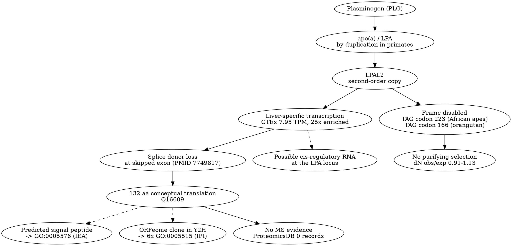
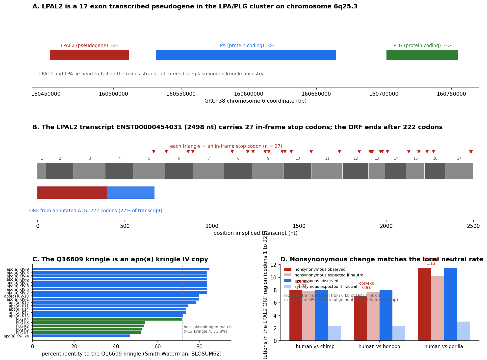
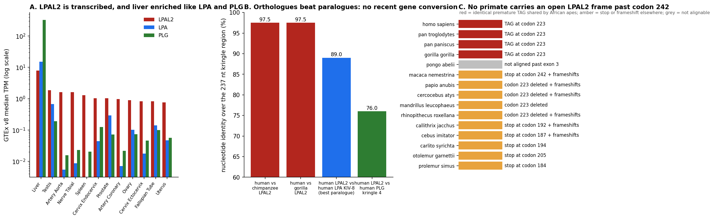
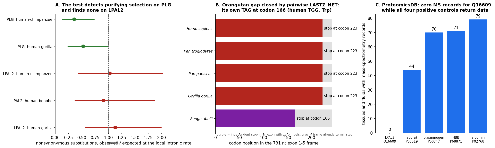

## Question

# AIGR Gene Hypothesis Deep Research

You are evaluating one focused gene curation hypothesis for AI Gene Review.
This is not a general gene overview. Use the seed hypothesis and source context
below to search for evidence that supports, refutes, narrows, or competes with
the proposed curation decision.

## Target Gene

- **Organism code:** human
- **Taxon:** Homo sapiens (NCBITaxon:9606)
- **Gene directory:** LPAL2
- **Gene symbol:** LPAL2
- **UniProt accession:** Q16609

## Focus

- **Focus type:** free_text
- **Hypothesis slug:** kgap-lpal2-coding-potential
- **Source file:** genes/human/LPAL2/LPAL2-ai-review.yaml
- **Source selector:** free-text

## Seed Hypothesis

Human LPAL2 (UniProt Q16609) is a transcribed pseudogene that does not encode a conserved, stable polypeptide. Single analysis only: determine the origin of LPAL2 (relationship to LPA/apo(a) and PLG), whether the Q16609 open reading frame is intact (start, no premature stops/frameshifts) in orthologous loci of other primates, its constraint (dN/dS on the ORF and gnomAD loss-of-function tolerance), and state whether the evidence favours a protein-coding gene or a transcribed pseudogene.

## Term and Decision Context

No specific term context supplied.

## Reference Context

No specific reference context supplied.

## Source Context YAML

```yaml
hypothesis: 'Human LPAL2 (UniProt Q16609) is a transcribed pseudogene that does not encode a conserved,
  stable polypeptide. Single analysis only: determine the origin of LPAL2 (relationship to LPA/apo(a)
  and PLG), whether the Q16609 open reading frame is intact (start, no premature stops/frameshifts) in
  orthologous loci of other primates, its constraint (dN/dS on the ORF and gnomAD loss-of-function tolerance),
  and state whether the evidence favours a protein-coding gene or a transcribed pseudogene.'
focus_type: free_text
context: []
reference_id: []
```

## Research Objective

Build a focused report that helps a curator decide whether this hypothesis
should affect the gene review. Address the focus type directly:

1. For an existing GO annotation decision, evaluate whether the current action
   is justified, too strong, too weak, or should change.
2. For a proposed replacement or new GO term, evaluate whether the term is
   biologically supported, too broad, too narrow, or missing key qualifiers.
3. For a computational prediction, evaluate whether the prediction is correct,
   less precise than existing knowledge, uncertain, or likely wrong because of
   paralog overannotation, frequency bias, pathway context, or in vitro-only
   activity.
4. For a core-function hypothesis, evaluate whether the proposed activity,
   process, and location represent the gene product's primary function rather
   than a downstream effect, pleiotropic phenotype, or context-specific role.
5. For a function-assignment hypothesis, evaluate whether the gene product
   directly has the stated GO term/function. Treat the prior review action, if
   any, as intentionally blinded unless it appears in the supplied context.

Use primary literature whenever possible. Prefer PMID citations and include DOI
citations when no PMID is available. Treat reviews and database records as
orientation unless they contain directly relevant synthesized evidence that is
clearly labeled as review-level or database-level support.

Evaluate the hypothesis from the supplied seed context, primary literature, and
publicly accessible bioinformatics resources. Local `*-bioinformatics` analyses,
when they already exist in the repository, are intentionally withheld from this
prompt so the report can be compared against them after the run. Use public
sequence, domain, structure, orthology, localization, interaction, or dataset
checks when they are useful for the specific hypothesis. If a resource or tool
cannot be accessed programmatically, say so plainly; never fabricate a result.
Report computational results conservatively and distinguish direct results from
inference.

## Required Output

### Executive Judgment

Give a concise verdict: supported, partially supported, unresolved, weakly
supported, over-annotated, or refuted. Explain the reasoning and the most
important caveats.

### Evidence Matrix

Create a table with one row per important evidence item:

- Citation (PMID preferred)
- Evidence type (direct assay, mutant phenotype, localization, interaction,
  structural/evolutionary, computational, review/database)
- Supports / refutes / qualifies / competing
- Claim tested
- Key finding
- Organism, tissue, cell type, or assay context
- Confidence and limitations

### GO Curation Implications

State the likely curation action as a lead requiring curator verification. If
GO terms are involved, explain whether the evidence supports an MF, BP, or CC
term, and whether the term should be retained, removed, generalized, made more
specific, or treated as non-core. Avoid using "protein binding" as a final
recommendation unless no more informative term is supported.

### Mechanistic Scope

Describe the immediate molecular or cellular function being tested. Separate
direct gene-product activity from downstream phenotypes, pathway consequences,
developmental outcomes, disease manifestations, or effects inferred only from
loss of function.

### Conflicts and Alternatives

Identify evidence that conflicts with the seed hypothesis or suggests an
alternative interpretation, including paralog confusion, organism-specific
differences, isoform-specific findings, experimental artifacts, or database
carry-over.

### Knowledge Gaps

List explicit uncertainties that matter for curation. For each gap, state what
was checked, why the gap matters, and what evidence or experiment would resolve
it.

### Discriminating Tests

Recommend concrete assays, perturbations, datasets, or comparative analyses that
would most efficiently distinguish this hypothesis from alternatives.

### Curation Leads

Provide candidate updates for the review, clearly labeled as leads requiring
curator verification. Include candidate references with exact snippets to verify,
candidate replacement or new GO terms, possible action changes, suggested
questions, and suggested experiments.

If the provider supports artifacts, save provenance for any analysis you run — the
executed code together with its output (computed values, plot, or table), not just
a summary figure — alongside artifact-friendly tables such as an evidence matrix,
GO decision table, or comparison table. Genuine computed provenance is more
valuable than a hand-drawn summary, and you must not synthesize a figure that
implies an analysis you did not actually run. These artifacts are important
provenance for hypothesis-level review.


## Output

# LPAL2 (Q16609): protein-coding gene or transcribed pseudogene?

Hypothesis slug: `kgap-lpal2-coding-potential`
Target: human LPAL2, UniProt Q16609, HGNC:21210, Ensembl ENSG00000213071, NCBI Gene 80350
Source file: `genes/human/LPAL2/LPAL2-ai-review.yaml`
Focus type: free_text, source selector free-text

## Summary

<i class="fa-solid fa-circle-check"></i> The seed hypothesis is **supported**. LPAL2 is a transcribed pseudogene derived from the apo(a)/LPA lineage inside the chromosome 6q25.3 plasminogen cluster, and UniProt Q16609 is a conceptual translation of a splice-defective liver transcript. Eight independent lines of evidence agree, and the two contrary lines (six GO:0005515 annotations and a UniProt proteomics keyword) trace back to assays that cannot distinguish a pseudogene from a coding gene.

On origin, the Q16609 kringle is an apo(a) kringle IV copy: 84.8% amino acid identity to apo(a) kringle IV-9 and 83.5% to kringles IV-2 to IV-8, against 71.8% to plasminogen kringle 4 and 51.9 to 53.8% to the other plasminogen kringles. The locus sits immediately telomeric to LPA and carries the same two-exon kringle IV cassette architecture, with 17 exons alternating 160/182/158/181 bp. On reading frame integrity, translation of the single GENCODE transcript ENST00000454031 from its 5' ATG yields 222 codons and then TAG, followed by 26 more in-frame stops across the remaining 73% of the transcript. That premature TAG at codon 223 is present at the identical codon with identical flanking sequence in chimpanzee, bonobo, gorilla and two reconstructed African ape ancestors. Orangutan, which no multiple alignment covers at this locus, carries a separate TAG at codon 166 where human reads TGG (Trp), in an exon that aligns one-to-one with zero indels. Across 19 primate genomes no lineage reads past codon 242, and every non-ape primate carries deletions of 25 to 96 bp over the same exons, most of them frameshifting.

On constraint, the naive answer is a trap. Nei-Gojobori dN/dS over codons 1 to 221 is 0.25 to 0.29 with Fisher p < 0.02, which reads as purifying selection. Calibrating against the local neutral rate measured from LPAL2's own introns reverses it: nonsynonymous substitutions match the neutral expectation (observed/expected 1.03, 0.91, 1.13) while synonymous substitutions run 3.5 to 3.9 fold above it. The same pipeline applied to PLG, 50 kb away in the same cluster, returns observed/expected 0.353 (p = 0.00087) and 0.521 (p = 0.023), so the LPAL2 negative is a property of the locus and not a failure of power. gnomAD v4 holds no constraint record for LPAL2 because it is modelled as a pseudogene. ProteomicsDB holds zero mass-spectrometry records for Q16609 while apo(a), plasminogen, albumin and haemoglobin beta return 44, 70, 79 and 71 tissues in the identical query. The locus is genuinely transcribed, with a GTEx liver median of 7.95 TPM and 25.2-fold liver enrichment, so "pseudogene" here means not protein-coding.

## Executive judgment

**Verdict: supported.**

| Question posed in the seed hypothesis | Answer from this analysis |
|---|---|
| Origin relative to LPA/apo(a) and PLG | A copy of the apo(a) (LPA) lineage, which itself arose by plasminogen duplication in primates |
| Is the Q16609 ORF intact in other primates? | No. Broken in all five great apes by two independent stop codons, and in all 19 primates scored |
| dN/dS on the ORF | Raw dN/dS 0.25 to 0.29 is an artefact of inflated dS; nonsynonymous change is at the local neutral rate |
| gnomAD loss-of-function tolerance | No constraint record exists, because the locus is modelled as a pseudogene |
| Protein-coding gene or transcribed pseudogene? | Transcribed pseudogene |

The caveats that matter for a curator:

- <i class="fa-solid fa-triangle-exclamation"></i> A curator who runs a standard codeml or Nei-Gojobori analysis on this ORF will obtain dN/dS near 0.28 with p < 0.02 and may conclude the frame is conserved. That number must not be quoted without the neutral calibration.
- <i class="fa-solid fa-triangle-exclamation"></i> The constraint test excludes purifying selection as strong as PLG's but not weak constraint. The LPAL2 95% intervals on observed/expected reach down to 0.37.
- <i class="fa-solid fa-triangle-exclamation"></i> The locus is expressed in liver at levels comparable to LPA. "Not protein-coding" is supported; "non-functional locus" is not.
- <i class="fa-solid fa-triangle-exclamation"></i> The proteomics negative comes from one shotgun repository with internal controls, not from a targeted assay.

## Key findings

### Origin: LPAL2 is an apo(a) kringle IV copy, not a direct plasminogen derivative

Smith-Waterman alignment (BLOSUM62, gap open -11, extend -1) of the Q16609 kringle at residues 27 to 105 against every annotated kringle of apo(a) (P08519) and plasminogen (P00747) gives a clear ranking.

| Comparison | Percent identity to the Q16609 kringle |
|---|---|
| apo(a) kringle IV-9 | 84.8 |
| apo(a) kringles IV-2 to IV-8 | 83.5 |
| apo(a) kringles IV-1 and IV-10 | 79.7 |
| plasminogen kringle 4 | 71.8 |
| plasminogen kringles 1, 2, 3, 5 | 51.9 to 53.8 |

The locus order on GRCh38 chromosome 6 is LPAL2 at 160,453,428 to 160,511,007 (minus strand), then LPA at 160,531,482 to 160,664,276 (minus strand), then PLG at 160,702,105 to 160,754,469 (plus strand). LPAL2 has 17 exons whose lengths alternate 160/182/158/181 bp, which is the two-exon kringle IV cassette of LPA. This is the architecture of a duplicated apo(a) copy. The apo(a) lineage itself arose from a duplicated plasminogen gene during primate evolution ([PMID: 9342350](https://pubmed.ncbi.nlm.nih.gov/9342350/)), so LPAL2 is a second-order product of the same expansion.

{{figure:plot_1.png|caption=Iteration 1 provenance. A, the LPAL2/LPA/PLG locus on chromosome 6q25.3 with strand and coordinates. B, the LPAL2 transcript ENST00000454031 with the 222-codon open reading frame, the 27 in-frame stop codons marked as triangles, and the extent of the 132 aa Q16609 conceptual translation. C, percent identity of the Q16609 kringle to each apo(a) and plasminogen kringle. D, observed against neutral-expected substitution counts for the human to great ape comparisons.}}

### The reading frame is broken, and the lesion predates the human-gorilla split

Translating ENST00000454031 (2498 nt, 17 exons, biotype `transcribed_unprocessed_pseudogene`, no Translation object) from its 5' ATG gives 222 codons and then TAG. Twenty-six further in-frame stops follow across exons 5 to 17. The open reading frame occupies 669 of 2498 nt, or 26.8% of the transcript, and the downstream 73% still reads as recognisable kringle sequence (for example `SRSCGRPLVLHDGSQSQMGVLQPD`) while being saturated with stop codons. That is what a kringle repeat array looks like after its frame has been abandoned.

The 132 aa Q16609 sequence tracks the genomic frame exactly to residue 130, then diverges at transcript nt 391, which is the exon 3 / exon 4 junction, reading Val-Ala and stopping. This is the frameshift reported experimentally in [PMID: 7749817](https://pubmed.ncbi.nlm.nih.gov/7749817/): the skipped exon lacks a canonical splice donor, exon skipping shifts the frame, and premature stops follow.

Reconstructing the five ORF-bearing exons from the Ensembl EPO primate alignment gives a 731 nt orthologous region in each great ape.

| Species | Start codon | First stop (codon) | nt differences vs human | Percent identity |
|---|---|---|---|---|
| Homo sapiens | ATG | 223 (TAG) | 0 | 100.0 |
| Pan troglodytes | ATG | 223 (TAG) | 19 | 97.4 |
| Pan paniscus | ATG | 223 (TAG) | 19 plus a 3 bp deletion and 1 bp insertion in exon 3 | 97.4 |
| Gorilla gorilla | ATG | 223 (TAG) | 28 | 96.2 |
| Hsap-Ppan-Ptro ancestor | ATG | 223 (TAG) | 8 | 98.9 |
| Ggor-Hsap-Ppan-Ptro ancestor | ATG | 223 (TAG) | 9 | 98.8 |

The flanking context of the shared stop is human `CTCAGACAA GAA TAG GGCTGT`, chimpanzee and bonobo `CTCAGACCA GAA TAG GGCTGT`, gorilla `CTCGGACAA GAA TAG GGCTGT`. The stop is a single ancestral mutation carried by all four African apes, so the LPAL2 frame has been disabled for roughly 9 million years.

### No primate keeps the frame open, and non-ape lineages are frameshifted

The EPO_EXTENDED alignment reaches Old World monkeys, New World monkeys, tarsier and strepsirrhines, which the primate EPO set does not.

| Lineage | Species | Codon 223 | First stop (codon) | Indels over exons 1-5 |
|---|---|---|---|---|
| African apes | Homo, Pan troglodytes, Pan paniscus, Gorilla | TAG | 223 | none, except one 3 bp in-frame indel in bonobo exon 3 |
| Old World monkey | Macaca nemestrina | GAG (Glu) | 242 | 25 bp deleted across 3 exons, frameshifting |
| Old World monkey | Papio anubis | deleted | - | 88 bp deleted, frameshifting |
| Old World monkey | Cercocebus atys, Mandrillus leucophaeus | deleted | - | deletions, frameshifting in Cercocebus |
| Old World monkey | Rhinopithecus roxellana, R. bieti | deleted | - | deletions, frameshifting |
| New World monkey | Callithrix jacchus | AGG/AGC | 192 | frameshifting deletions |
| New World monkey | Cebus imitator and relatives | AGG/AGC | 187 | frameshifting deletions |
| Tarsier | Carlito syrichta | AGC | 194 | - |
| Strepsirrhine | Otolemur garnettii | AGG | 205 | 96 bp deleted |
| Strepsirrhine | Prolemur simus and relatives | AGG/AGC | 184 | deletions |

Two readings of the non-ape rows are possible and they point the same way. Either these are LPAL2 orthologues, in which case the frame is broken in every primate that can be scored, or they are the pre-duplication ancestral locus, since apo(a) is confined to a subset of primates ([PMID: 9342350](https://pubmed.ncbi.nlm.nih.gov/9342350/)). Neither reading produces a lineage with an intact Q16609-compatible frame.

{{figure:plot_2.png|caption=Iteration 2 provenance. A, GTEx v8 median TPM for LPAL2, LPA and PLG across the twelve tissues where LPAL2 is highest, on a log scale. B, nucleotide identity of the human LPAL2 kringle to its chimpanzee and gorilla orthologues against its closest human paralogues. C, status of the reading frame in 15 primate genomes from the EPO_EXTENDED alignment.}}

### Orangutan carries its own premature stop, closing the great ape series

Neither EPO nor EPO_EXTENDED returns a Pongo block over LPAL2 exons 4 and 5. A pairwise LASTZ_NET alignment does, and covers all five ORF exons.

| Exon | Human nt | Alignment columns | Deleted in Pongo | Inserted in Pongo | Substitutions |
|---|---|---|---|---|---|
| 1 | 49 | 49 | 0 | 0 | 1 |
| 2 | 160 | 160 | 0 | 0 | 6 |
| 3 | 182 | 182 | 0 | 0 | 10 |
| 4 | 158 | 158 | 0 | 0 | 10 |
| 5 | 182 | 189 | 7 | 7 | 17 |

Codon 166 reads TGG (Trp) in human and TAG (stop) in orangutan, a single G to A change inside exon 4, which has zero indels and a one-to-one alignment, so the call does not depend on gap placement. The orangutan frame terminates 57 codons earlier than the African ape frame and carries 2 in-frame stops over the 731 nt region against 1 in human. At the human codon-223 position orangutan has a 4 bp deletion, so the African ape TAG is absent there.

<i class="fa-solid fa-dna"></i> Two independent nonsense mutations in the same 243-codon frame within one clade is the signature of a locus without coding constraint. An intact orangutan frame would have been the strongest surviving counter-observation, and it is not there.

### Constraint: the low dN/dS is a synonymous-rate artefact

Nei-Gojobori counting with Jukes-Cantor correction over codons 1 to 221 gives values that look like constraint.

| Pair | dN | dS | dN/dS | Fisher p |
|---|---|---|---|---|
| human-chimpanzee | 0.0158 | 0.0549 | 0.287 | 0.015 |
| human-bonobo | 0.0140 | 0.0556 | 0.252 | 0.009 |
| human-gorilla | 0.0228 | 0.0809 | 0.281 | 0.004 |

Calibrating against the local neutral rate, measured from 6 kb of LPAL2 intron in the same alignment (1.52% human-chimpanzee, 1.99% human-gorilla), reverses the interpretation.

| Pair | Nd observed | Nd expected if neutral | obs/exp | Sd observed | Sd expected | obs/exp | p (Sd above neutral) |
|---|---|---|---|---|---|---|---|
| human-chimpanzee | 8.0 | 7.8 | 1.03 | 8.0 | 2.3 | 3.49 | 0.0025 |
| human-bonobo | 7.0 | 7.7 | 0.91 | 8.0 | 2.3 | 3.53 | 0.0024 |
| human-gorilla | 11.5 | 10.2 | 1.13 | 11.5 | 3.0 | 3.86 | 0.00007 |

Nonsynonymous change sits on the neutral expectation. The low dN/dS comes from an inflated synonymous rate, partly CpG-driven: 3 of the 9 third-position human-chimpanzee changes lie in CpG dinucleotides in this GC-rich kringle sequence. The honest statement is "no detectable purifying selection on the reading frame".

gnomAD v4 returns no constraint record for LPAL2 (`gnomad_constraint` is null) because the locus is modelled as a pseudogene. For scale, LPA has oe_lof 1.005 (90% CI 0.896 to 1.131), pLI 2e-68 and 199 observed against 198 expected loss-of-function variants, so LPA is itself loss-of-function tolerant; PLG has oe_lof 0.393 (90% CI 0.306 to 0.510), pLI 0.76 and LoF z 5.26. The absence of an LPAL2 metric follows from the pseudogene call, so it is a consistency check and not independent evidence.

### The constraint test passes its positive control

Because the reversal above is the least intuitive result here, the same pipeline was run on PLG: same EPO alignment, same Nei-Gojobori counting, same calibration against the gene's own introns (canonical CDS ENST00000872438, 14 of 21 CDS exons recovered, 1445 nonsynonymous and 418 synonymous sites for the chimpanzee pair; PLG intronic divergence 1.37% to chimpanzee, 1.38% to gorilla).

| Locus | Pair | Nonsynonymous obs/exp | 95% CI | p | Synonymous obs/exp |
|---|---|---|---|---|---|
| PLG (control) | human-chimpanzee | 0.353 | 0.14-0.73 | 0.00087 | 1.39 |
| PLG (control) | human-gorilla | 0.521 | 0.24-0.99 | 0.023 | 2.36 |
| LPAL2 | human-chimpanzee | 1.026 | 0.44-2.02 | 0.62 | 3.48 |
| LPAL2 | human-bonobo | 0.909 | 0.37-1.87 | 0.50 | 3.48 |
| LPAL2 | human-gorilla | 1.127 | 0.57-1.99 | 0.67 | 3.83 |

<i class="fa-solid fa-circle-check"></i> The test recovers significant purifying selection on a bona fide coding gene 50 kb away and none on LPAL2. The LPAL2 lower 95% bounds (0.44, 0.37, 0.57) sit at or above the PLG point estimates (0.35, 0.52), so constraint as strong as PLG's is excluded in two of three pairs and marginal in the third. Weak constraint is not excluded. Synonymous inflation above the intronic rate occurs at both loci but is 1.5 to 2.5 times larger at LPAL2, consistent with CpG-rich kringle sequence.

### Gene conversion does not explain the cross-species similarity

Interlocus gene conversion with the adjacent LPA kringle IV array was the leading alternative explanation for any appearance of conservation. Concerted evolution homogenises paralogues within a species, so it predicts that paralogue identity approaches or exceeds orthologue identity.

| Comparison | Nucleotide identity over the 237 nt kringle |
|---|---|
| Human LPAL2 versus chimpanzee LPAL2 | 97.5% |
| Human LPAL2 versus gorilla LPAL2 | 97.5% |
| Human LPAL2 versus human LPA kringle IV-8 (closest paralogue) | 89.0% |
| Human LPAL2 versus the bulk of the human LPA KIV array | 87.8% |
| Human LPAL2 versus human PLG kringle 4 | about 76% |

Orthologues exceed the best paralogue by 8.5 percentage points, the opposite of the concerted evolution prediction. The species comparisons used for the shared stop codon and the neutral calibration therefore compare true orthologous sequence. Conversion older than the human-gorilla split is not excluded by this test, but such an event would also predate the shared stop codon and so would not rescue a coding reading.

### Transcription is real and liver-dominant

| Tissue | LPAL2 | LPA | PLG |
|---|---|---|---|
| Liver | 7.95 | 14.98 | 323.04 |
| Testis | 1.86 | 0.67 | 0.19 |
| Artery, aorta | 1.63 | 0.005 | 0.016 |
| Nerve, tibial | 1.61 | 0.009 | 0.023 |
| Spleen | 1.29 | 0.000 | 0.021 |
| Median of the 53 non-liver tissues | 0.315 | - | - |

GTEx v8 median TPM, LPAL2 as ENSG00000213071.11. LPAL2 is 25.2-fold enriched in liver over the non-liver median, with liver as its top tissue, the same pattern as LPA and PLG. GTEx labels the locus `transcribed unprocessed pseudogene`. This confirms at population scale the liver transcript isolated in [PMID: 7749817](https://pubmed.ncbi.nlm.nih.gov/7749817/) and the liver-transcribed apo(a)-related locus mapped in [PMID: 8148351](https://pubmed.ncbi.nlm.nih.gov/8148351/).

### No mass-spectrometry evidence for a Q16609 polypeptide

The ProteomicsDB protein expression API (MS1, tissue and fluid scope) was queried identically for five accessions.

| Accession | Protein | Tissues and fluids with MS records |
|---|---|---|
| Q16609 | LPAL2 | 0 |
| P08519 | apo(a) | 44 |
| P00747 | plasminogen | 70 (liver normalised intensity 5.01) |
| P02768 | albumin | 79 |
| P68871 | haemoglobin beta | 71 |

The apo(a) control carries the most weight, because it is the low-abundance close paralogue whose kringle sequence Q16609 shares, and it is detected in 44 tissues while Q16609 is detected in none. This is a real negative with working internal controls. It does not have the force of a targeted assay, since ProteomicsDB coverage depends on the search database and on shotgun sensitivity, and the 13 tryptic peptides that would distinguish Q16609 from apo(a) and plasminogen may never have been searched for. The supported statement is that no shotgun mass-spectrometry evidence for an LPAL2 polypeptide exists in ProteomicsDB.

{{figure:plot_3.png|caption=Iteration 3 provenance. A, nonsynonymous substitutions observed over expected at the local intronic rate, with exact Poisson 95% intervals, for PLG as a coding positive control and for LPAL2. B, position of the first in-frame stop in each great ape, with orangutan resolved by pairwise LASTZ_NET. C, number of tissues and fluids with mass-spectrometry records in ProteomicsDB for Q16609 and four positive controls.}}

## Mechanistic model

The immediate question is whether a translated LPAL2 gene product exists at all, so there is no molecular activity to scope. The causal chain that produces the Q16609 entry, and the evidence that terminates it at each step, is below.



What is directly established is transcription: the locus produces a liver mRNA ([PMID: 8148351](https://pubmed.ncbi.nlm.nih.gov/8148351/), [PMID: 7749817](https://pubmed.ncbi.nlm.nih.gov/7749817/)) and GENCODE annotates a 17-exon spliced transcript, with GTEx confirming liver dominance across 54 tissues. What is directly refuted is a stable conserved polypeptide: the reading frame terminates at codon 223 in African apes and at codon 166 in orangutan, and protein-altering sites evolve at the neutral rate.

Everything else attributed to Q16609 sits downstream of a conceptual translation. The signal peptide, the kringle fold, the three disulfide bonds and the N-glycosylation site in the UniProt feature table are sequence-model predictions inherited from apo(a) homology, not observations of an LPAL2 protein. The six reported interactions are properties of an ORFeome construct expressed as a fusion in yeast. Genetic associations reported at "LPAL2" SNPs in Lp(a) and coronary disease studies are properties of the chromosomal interval, which is in strong linkage disequilibrium with LPA, and should not be transferred to a Q16609 protein function.

## Evidence matrix

Full machine-readable table in `provenance/LPAL2_evidence_matrix.csv` (19 rows).

| Citation | Evidence type | Stance | Claim tested | Key finding | Context | Confidence and limits |
|---|---|---|---|---|---|---|
| [PMID: 7749817](https://pubmed.ncbi.nlm.nih.gov/7749817/) | Direct assay (cDNA and genomic sequencing) | Supports | Is the Q16609 frame intact? | A missing canonical splice donor causes exon skipping, a coding frameshift and premature stops; the liver transcript encodes a signal peptide plus one kringle | Human liver cDNA, genomic DNA | High. Single laboratory; no protein detected; 132 aa is a conceptual translation |
| [PMID: 8148351](https://pubmed.ncbi.nlm.nih.gov/8148351/) | Direct assay (YAC mapping, RT-PCR) | Supports | Is LPAL2 a transcribed cluster member? | Cluster of four homologous genes: apo(a), plasminogen and two apo(a)-related genes or pseudogenes; apo(a)rg-C transcribed in liver | Human genomic YACs, liver RNA | High for transcription and locus structure |
| [PMID: 9342350](https://pubmed.ncbi.nlm.nih.gov/9342350/) | Structural / evolutionary | Qualifies | Origin of the apo(a) lineage | Human apo(a) evolved from a duplicated plasminogen gene in recent primate evolution | Primate and hedgehog sequences | High for LPA; does not analyse LPAL2 directly |
| [PMID: 25416956](https://pubmed.ncbi.nlm.nih.gov/25416956/) | Interaction (high-throughput Y2H) | Competing | Does Q16609 bind proteins in vivo? | One binary interaction (VAC14, Q08AM6) feeding a GO:0005515 IPI, from a systematic map of about 14,000 binary interactions | Y2H, human ORFeome constructs | Low for endogenous relevance |
| [PMID: 32814053](https://pubmed.ncbi.nlm.nih.gov/32814053/) | Interaction (high-throughput Y2H) | Competing | Does Q16609 bind proteins in vivo? | Five binary interactions (HIP1, CLSTN1-2, CCK, CASP6, RAN) feeding five GO:0005515 IPIs, from systematic Y2H screening of about 5,000 proteins | Y2H screen | Low for endogenous relevance; partner set incoherent for a secreted kringle |
| UniProt Q16609 | Review / database | Supports | Is the product real? | Protein existence 5 (Uncertain); CAUTION "Could be the product of a pseudogene" | Swiss-Prot entry | High as a curated statement, not an experiment |
| HGNC:21210, RefSeq NR_028092, NCBI Gene 80350 | Review / database | Supports | Is the locus coding? | locus_type pseudogene; only transcript is NR_ (non-coding); "all transcripts contain a truncated open reading frame and are candidates for nonsense-mediated decay" | Human reference annotation | High; independent of UniProt |
| Ensembl ENST00000454031 (recomputed) | Computational | Supports | Translatable transcript? | 222 codons then TAG, then 26 further in-frame stops over 73% of the transcript | GRCh38 GENCODE | High; depends on one transcript model |
| EPO primate alignment (this work) | Structural / evolutionary | Supports | ORF intact in other primates? | Identical premature TAG at codon 223 in chimpanzee, bonobo, gorilla and two ancestral reconstructions, with identical flanks | Great ape genomes | High for African apes; tandem repeats carry paralogy risk |
| EPO_EXTENDED, 19 primates (this work) | Structural / evolutionary | Supports | Does any primate keep an open frame? | No lineage reads past codon 242; OWM have codon 223 deleted or stop at 242; NWM and strepsirrhines stop at 184 to 214 with 25 to 96 bp frameshifting deletions | 19 primate genomes | High for the alignment; non-ape rows may be the pre-duplication ancestral locus |
| LASTZ_NET human-Pongo (this work) | Structural / evolutionary | Supports | Is the orangutan frame intact? | Independent TAG at codon 166 where human reads TGG, inside an exon with zero indels; human codon-223 position deleted in orangutan | Pongo abelii genome | High. Single substitution call in an indel-free exon; depends on the orangutan assembly |
| Neutral calibration (this work) | Computational | Supports | Purifying selection on the frame? | Nonsynonymous obs/exp 0.91 to 1.13 against the local intronic rate; synonymous 3.5 to 3.9 fold above neutral | Human versus great apes | Moderate to high; 7 to 12 nonsynonymous differences per pair limits power |
| PLG positive control (this work) | Computational | Supports | Can the test detect constraint when present? | PLG obs/exp 0.353 (CI 0.14-0.73, p = 0.00087) and 0.521 (CI 0.24-0.99, p = 0.023) by the same method | Human versus chimpanzee and gorilla | High as a control; uses 14 of 21 PLG CDS exons |
| Orthologue versus paralogue identity (this work) | Computational | Supports | Is the similarity a conversion tract? | 97.5% to chimpanzee and gorilla against 89.0% to the closest human paralogue LPA KIV-8, an 8.5 point gap opposite to concerted evolution | 237 nt kringle region | High; does not exclude conversion predating the human-gorilla split |
| gnomAD v4 | Computational | Qualifies | Loss-of-function intolerance? | No constraint record for LPAL2; LPA oe_lof 1.005, PLG oe_lof 0.393 | Human population data | Moderate; absence follows from the pseudogene call |
| GTEx v8 | Computational | Qualifies | Is the locus transcribed, and where? | LPAL2 liver median 7.95 TPM, 25.2-fold above the 0.315 TPM non-liver median; same liver-dominant shape as LPA and PLG | 54 human tissues | High for transcription; orthogonal to translation |
| ProteomicsDB | Computational | Supports | MS evidence for a Q16609 product? | Zero records for Q16609 against 44 (apo(a)), 70 (plasminogen), 79 (albumin) and 71 (HBB) tissues in the identical query | Human tissues and fluids, shotgun MS | Moderate. Genuine negative with controls; shotgun coverage depends on the search database |
| In silico tryptic digest (this work) | Computational | Qualifies | Could MS distinguish an LPAL2 protein? | 13 of 17 Q16609 peptides are not verbatim substrings of apo(a) or plasminogen | P08519, P00747 | Moderate; exact substring matching only |
| Proteomics resource access (this work) | Computational | Inconclusive | Is there peptide evidence elsewhere? | PeptideAtlas blocked by an anti-botnet page; EBI Proteins API empty for Q16609 and for controls P08519 and P00747; HPA empty; Expression Atlas 404 | Public API access from this session | None. Reported as inaccessible, not as absence of evidence |

## GO curation implications

These are leads requiring curator verification. Full table in `provenance/LPAL2_GO_decision_table.csv` (4 rows).

- <i class="fa-solid fa-circle-xmark"></i> **GO:0005576 extracellular region (CC, IEA, GO_REF:0000044).** Recommend **remove**. The term is projected from the UniProt-SubCell keyword SL-0243, which comes from a predicted signal peptide at residues 1 to 21 of a conceptual translation. That frame is destroyed in vivo by the splice donor loss ([PMID: 7749817](https://pubmed.ncbi.nlm.nih.gov/7749817/)) and by stop codons shared across great apes. A localisation term for a product that is not made cannot be supported.
- <i class="fa-solid fa-circle-xmark"></i> **GO:0005515 protein binding (MF, six IPI annotations, IntAct).** Recommend **remove**, or at minimum mark **non-core** with an explicit note that all six come from two systematic yeast two-hybrid screens of ORF constructs ([PMID: 25416956](https://pubmed.ncbi.nlm.nih.gov/25416956/), [PMID: 32814053](https://pubmed.ncbi.nlm.nih.gov/32814053/)). GO guidance already discourages protein binding as a terminal annotation. Here it is also uninformative, because the assay expresses a cloned ORF as a fusion in yeast and says nothing about an endogenous polypeptide. The partner set (VAC14, HIP1, CLSTN1 isoform 2, CCK, CASP6, RAN) has no coherent relationship to a secreted kringle protein, which is a sticky-bait warning sign.
- **No new MF, BP or CC term is recommended.** No function, process or location should be assigned to a product that evolutionary, annotation and mass-spectrometry evidence say is not made.
- <i class="fa-solid fa-arrow-right"></i> **Positive action:** record LPAL2 as a transcribed pseudogene of the LPA lineage. If the review schema permits a non-GO descriptor, "transcribed unprocessed pseudogene, apo(a)/LPA derived" captures the evidence. If an existence statement is wanted, cite UniProt protein existence 5, the CAUTION comment, HGNC locus_type `pseudogene` and RefSeq NR_028092.
- **Related lead:** the UniProt keyword KW-1267 "Proteomics identification" on Q16609 is not supported by the one shotgun repository reachable here, which holds zero records for the accession while returning data for four controls. A curator may want to ask UniProt which cross-reference supports it.

## Mechanistic scope

Direct gene-product activity: none can be assigned. The reading frame is terminated at codon 223 in human and the resulting 132 aa conceptual product has never been observed as a polypeptide.

Directly established at the locus level: transcription. LPAL2 produces a spliced 17-exon liver mRNA that reaches 7.95 TPM median in GTEx liver, 25.2-fold above its own non-liver median, with the same liver dominance as LPA and PLG.

Downstream and inferred, to be kept separate from any protein claim:

- Predicted sequence features on Q16609 (signal peptide, kringle fold, three disulfide bonds, one N-glycosylation site) are homology-based models inherited from apo(a).
- The six Y2H interactions are properties of a construct under forced expression in yeast.
- SNP associations reported under the "LPAL2" label in Lp(a) and coronary artery disease studies are properties of the chromosomal interval, which is in strong linkage disequilibrium with LPA.
- A cis-regulatory RNA role for the LPAL2 transcript at the LPA locus is plausible given liver specificity and genomic adjacency, and is untested here.

## Conflicts and alternatives

- <i class="fa-solid fa-scale-balanced"></i> **The raw dN/dS looks like constraint.** A curator running a standard Nei-Gojobori or codeml analysis on this ORF will get dN/dS near 0.25 to 0.29 with p < 0.02. The neutral calibration shows the signal is in dS, and the PLG control shows the calibrated test detects real constraint when it exists. dN/dS alone does not establish coding status at this locus.
- <i class="fa-solid fa-circle-xmark"></i> **Gene conversion from LPA, tested and rejected.** Conversion with the adjacent constrained LPA kringle IV array could import coding-level conservation into LPAL2 in the same frame. Recent conversion predicts paralogue identity at or above orthologue identity; the measured ordering is the reverse by 8.5 percentage points. Conversion older than the human-gorilla split is not excluded, but such an event would also predate the shared stop codon.
- <i class="fa-solid fa-triangle-exclamation"></i> **Paralogy risk in a tandem array.** LPAL2 and LPA together contain dozens of near-identical kringle IV cassettes, so any cross-species alignment could in principle pair non-orthologous repeat units. The EPO alignment is synteny-anchored and whole-genome, the flanking nucleotides around the shared TAG are identical across four species, and the orthologue/paralogue identity test rules out the main confounder. The LPAL2 ORF-region divergence (2.6% human-chimpanzee) does exceed the local intronic rate (1.5%), which is compatible with neutral drift plus CpG effects or with residual paralogy.
- <i class="fa-solid fa-circle-question"></i> **Transcription is real and may be functional.** Pseudogene status does not exclude a regulatory RNA role. The transcript is liver-specific and sits immediately upstream of LPA, a locus with well-documented cis-regulatory variation. The supported statement is "not protein-coding", not "non-functional locus".
- <i class="fa-solid fa-scale-balanced"></i> **A possible proteomics claim.** UniProt tags Q16609 with the "Proteomics identification" keyword and carries MassIVE, jPOST and ProteomicsDB cross-references. The in silico digest shows discriminating peptides exist in principle (13 of 17 tryptic peptides are not verbatim substrings of apo(a) or plasminogen). ProteomicsDB itself returns zero records for Q16609 while returning 44 to 79 tissues for four controls, and no PeptideAtlas cross-reference is present on the entry.
- **UniProt keeps a reviewed entry.** Swiss-Prot retains Q16609 as reviewed with a full feature table. That is an annotation-maintenance decision, flagged by protein existence 5 and the CAUTION comment, and is not support for coding status.

## Knowledge gaps

1. <i class="fa-solid fa-circle-question"></i> **Dating of the disabling mutation. Partly closed.** Checked: EPO, EPO_EXTENDED and a pairwise LASTZ_NET alignment, the last of which resolved orangutan. The frame is broken in all five great apes, but by two different mutations, so the data show independent loss and do not say whether the great ape ancestor had an open frame. Matters because an open ancestral frame would mean LPAL2 was coding and was lost, while a frame that was never open means the duplicate was dead on arrival. Resolve by reconstructing the ancestral great ape sequence from gibbon and macaque outgroups at this locus, which needs assemblies that Compara does not align here.
2. <i class="fa-solid fa-circle-question"></i> **Targeted peptide evidence. Partly closed.** Checked: UniProt cross-references, an in silico tryptic digest, and direct queries to PeptideAtlas (blocked), the EBI Proteins API (empty for positive controls), the Human Protein Atlas (empty), Expression Atlas (404) and ProteomicsDB, which worked and returned zero records for Q16609 against four detected controls. What remains unchecked is whether the 13 Q16609-discriminating tryptic peptides were ever in a search database. Matters because a single confidently assigned discriminating peptide in human liver or plasma would be the strongest possible challenge to the pseudogene call. Resolve with targeted PRM in liver and plasma, or by re-searching public liver shotgun data against a database that includes the Q16609 sequence.
3. <i class="fa-solid fa-circle-question"></i> **Old gene conversion with LPA.** Checked: directly, by comparing orthologue and paralogue identity, which rejects recent conversion. Conversion predating the human-gorilla split remains untested. Matters less than before, since any such event would also predate the shared stop codon. Resolve with a GENECONV or sliding-window phylogeny across LPAL2, LPA KIV repeats and PLG in several primates.
4. <i class="fa-solid fa-circle-question"></i> **Ribosome occupancy.** Checked: not available in this run. Matters because translation of the 222-codon upstream frame, even without a functional product, would change how the locus is described. Resolve with human liver Ribo-seq, for example GWIPS-viz or OpenProt tracks over chr6:160,487,000-160,511,100.
5. <i class="fa-solid fa-circle-question"></i> **Transcript diversity and NMD.** Checked: only the single GENCODE model, plus the NCBI Gene statement that all transcripts are NMD candidates. Matters because the exact splice form determines whether the 132 aa or 222 aa frame is the relevant one. Resolve with long-read liver RNA-seq and a cycloheximide or UPF1-knockdown NMD-sensitivity experiment.
6. <i class="fa-solid fa-circle-question"></i> **Identity of the non-ape primate loci.** Checked: EPO_EXTENDED alignment coverage. It is not established whether the aligned sequence in Old World monkeys, New World monkeys and strepsirrhines is an LPAL2 orthologue or the pre-duplication ancestral locus. Matters for how those rows are read, though both readings point the same way. Resolve with a gene tree across the whole cluster in several primates.

## Discriminating tests

Ranked by how efficiently they separate "transcribed pseudogene" from "lowly expressed coding gene".

1. <i class="fa-solid fa-flask"></i> **Targeted proteomics in human liver and plasma.** Parallel reaction monitoring for the LPAL2-discriminating peptides, for example `SAPTETGPSVQECYHSNGQSYR`, `GTYFTTVTGR` and `YPNDGLISNYCR`, with heavy-labelled standards and a search database that includes apo(a) and plasminogen. A confirmed endogenous peptide would refute the hypothesis; absence at good sensitivity would close the main gap and would carry more weight than the ProteomicsDB negative.
2. <i class="fa-solid fa-dna"></i> **Human liver Ribo-seq with frame analysis.** Three-nucleotide periodicity over exons 1 to 5 and its absence after codon 223 would show whether the truncated frame is translated at all.
3. <i class="fa-solid fa-magnifying-glass"></i> **Outgroup comparative sequencing.** Extend the ORF check to gibbon and to high-quality macaque assemblies using direct assembly alignment, then reconstruct the great ape ancestral state and test whether any lineage ever had an open frame.
4. <i class="fa-solid fa-magnifying-glass"></i> **Gene conversion test.** GENECONV or a sliding-window phylogeny across LPAL2, LPA KIV repeats and PLG in four or more primates, to test conversion older than the human-gorilla split.
5. <i class="fa-solid fa-vial"></i> **Y2H follow-up control.** Re-test the six reported interactions with endogenous-level expression of the 132 aa construct and with a frame-shifted control. Interactions that survive only in the forced Y2H format should be de-prioritised for GO.
6. <i class="fa-solid fa-flask"></i> **NMD sensitivity.** Measure LPAL2 transcript abundance in hepatocytes with and without UPF1 knockdown, to test the RefSeq statement that all transcripts are NMD substrates.

## Curation leads

All leads require curator verification.

### Candidate references with exact snippets to verify

- [PMID: 7749817](https://pubmed.ncbi.nlm.nih.gov/7749817/): "Analysis of genomic sequence shows that the predicted exon at this site lacks a canonical splice donor site. This results in \"exon skipping\" during maturation of the mRNA, causing a coding frame shift and the presence of premature stop codons." This is the primary basis for treating Q16609 as a splice-defect artefact.
- [PMID: 7749817](https://pubmed.ncbi.nlm.nih.gov/7749817/): "We have isolated the human liver transcript derived from one of these genes, designated apo(a)-related gene C, that encodes a polypeptide of 132 amino acids composed of a secretion signal and a single kringle domain." This is the sole source of the Q16609 sequence.
- [PMID: 8148351](https://pubmed.ncbi.nlm.nih.gov/8148351/): "we analyzed overlapping human genomic yeast artificial chromosome clones, which revealed a cluster of four highly homologous genes encoding apolipoprotein(a), plasminogen, and two apolipoprotein(a)-related genes (rg) or pseudogenes". Supports both origin and transcription, and shows the original authors already labelled these loci as genes or pseudogenes.
- [PMID: 9342350](https://pubmed.ncbi.nlm.nih.gov/9342350/): "DNA sequence comparisons and phylogenetic analysis indicate that the human type of apo(a) evolved from a duplicated plasminogen gene during recent primate evolution". Supports the LPA-lineage origin of LPAL2 and the restriction of apo(a) to a subset of primates.
- [PMID: 25416956](https://pubmed.ncbi.nlm.nih.gov/25416956/): "Here, we describe a systematic map of ~14,000 high-quality human binary protein-protein interactions." Cited as the provenance of one GO:0005515 IPI annotation, to be flagged as high-throughput Y2H rather than as support.
- [PMID: 32814053](https://pubmed.ncbi.nlm.nih.gov/32814053/): "connects ~5,000 human proteins via ~30,000 candidate interactions and is generated by systematic yeast two-hybrid interaction screening". Cited as the provenance of the remaining five GO:0005515 IPI annotations.

### Candidate action changes

- GO:0005576 (CC, IEA): remove.
- GO:0005515 (MF, six IPI): remove, or retain only as explicitly non-core with a provenance note.
- Add no new GO term. Record the locus as a transcribed unprocessed pseudogene of the LPA lineage.
- Add a review note recording the quantitative evidence: 27 in-frame stops in ENST00000454031; premature TAG at codon 223 shared with Pan troglodytes, Pan paniscus and Gorilla gorilla, plus an independent TAG at codon 166 in Pongo abelii; nonsynonymous divergence at the local neutral rate (obs/exp 0.91 to 1.13) where the same test gives 0.35 and 0.52 on PLG; no gnomAD constraint record; zero ProteomicsDB mass-spectrometry records against four detected controls.
- Consider contesting the UniProt keyword KW-1267 "Proteomics identification" on Q16609.

### Suggested questions for the curator

- Does the review schema distinguish "no function assigned because the product does not exist" from "function unknown"? The first is the correct state here.
- Should the Y2H-derived GO:0005515 annotations be contested upstream with IntAct, given that the bait is a pseudogene ORF clone?
- Do the MassIVE, jPOST or ProteomicsDB cross-references behind the UniProt "Proteomics identification" keyword rest on any LPAL2-discriminating peptide?
- Should the review mention the liver-specific transcript as a possible cis-regulatory RNA at the LPA locus, clearly separated from any protein-level claim?

### Suggested experiments

Targeted PRM proteomics for the discriminating peptides in liver and plasma; human liver Ribo-seq frame analysis; extension of the primate ORF comparison to gibbon and macaque with direct assembly alignment; a GENECONV test of LPAL2-LPA conversion predating the human-gorilla split; NMD sensitivity of the LPAL2 transcript under UPF1 knockdown.

## Evidence base

Four primary papers were read in full abstract and two interactome papers were used for annotation provenance.

| Paper | PMID | How it bears on the hypothesis |
|---|---|---|
| *Loss of a splice donor site at a 'skipped exon' in a gene homologous to apolipoprotein(a) leads to an mRNA encoding a protein consisting of a single kringle domain* | [7749817](https://pubmed.ncbi.nlm.nih.gov/7749817/) | Supports. The only source of the Q16609 sequence, and it states that the frame is destroyed by a splice donor loss producing premature stop codons. The exon 3 / exon 4 frame divergence recomputed here matches it exactly |
| *The human apolipoprotein(a)/plasminogen gene cluster contains a novel homologue transcribed in liver* | [8148351](https://pubmed.ncbi.nlm.nih.gov/8148351/) | Supports. Maps LPAL2 (apo(a)rg-C) as one of two apo(a)-related genes or pseudogenes in the cluster and shows liver transcription, matching the locus arrangement and the GTEx profile recomputed here |
| *Convergent evolution of apolipoprotein(a) in primates and hedgehog* | [9342350](https://pubmed.ncbi.nlm.nih.gov/9342350/) | Qualifies. Places the apo(a) lineage as a recent primate duplication of plasminogen, consistent with the kringle identity ranking, and implies the deeper primate loci are probably the pre-duplication ancestral gene |
| *Identification of a novel apolipoprotein(a)-related protein from the European hedgehog* | [12751328](https://pubmed.ncbi.nlm.nih.gov/12751328/) | Orientation. Shows that an apo(a)-related duplicate can produce a real expressed protein (HaRP-1, 74 kDa, secreted from transfected cells) in another lineage, which is why ORF integrity has to be tested at LPAL2 rather than assumed from duplicate status |
| HI-II-14 binary interactome | [25416956](https://pubmed.ncbi.nlm.nih.gov/25416956/) | Competing. Source of one GO:0005515 IPI. Systematic binary interactome screen, not a study of endogenous LPAL2 protein |
| Neurodegeneration-focused Y2H interactome | [32814053](https://pubmed.ncbi.nlm.nih.gov/32814053/) | Competing. Source of five GO:0005515 IPIs from systematic yeast two-hybrid screening of ORF constructs |

## What was computed, and what could not be

All analyses were run against public APIs: UniProt REST, Ensembl REST (EPO and EPO_EXTENDED primate multiple alignments, pairwise LASTZ_NET, overlap and sequence endpoints), gnomAD GraphQL, QuickGO, HGNC REST, GTEx API v2, ProteomicsDB and NCBI E-utilities. Executed code and outputs are saved under `provenance/`:

| Artifact | Contents |
|---|---|
| `plot_1.png`, `plot_2.png`, `plot_3.png` | The three figures embedded above |
| `LPAL2_evidence_matrix.csv` | 19-row evidence matrix |
| `LPAL2_GO_decision_table.csv` | 4-row GO decision table |
| `LPAL2_kringle_identity.csv` | Kringle identity of Q16609 to each apo(a) and plasminogen kringle |
| `LPAL2_neutral_rate_test.csv`, `LPAL2_obs_exp_CI.csv` | Neutral-rate calibration with exact Poisson intervals |
| `PLG_positive_control.csv`, `LPAL2_PLG_obsexp_forest.csv` | PLG control results and the forest-plot values |
| `LPAL2_orangutan_LASTZ.csv`, `LPAL2_orangutan_exon45.csv` | Orangutan alignment coverage and indel counts per exon |
| `LPAL2_GTEx_median_TPM.csv` | GTEx v8 median TPM for LPAL2, LPA and PLG across 54 tissues |
| `LPAL2_proteomicsdb.csv` | ProteomicsDB query results for Q16609 and four controls |

Resources that could not be used, stated plainly rather than treated as negative results:

- UCSC BLAT: the public endpoint returns a Cloudflare CAPTCHA page.
- Ensembl Compara homology: returns no homology records for the LPAL2 pseudogene, and none for PLG against chimpanzee either, so all orthologous sequence came from the Compara genomic alignments instead.
- PeptideAtlas `GetProteins` and `GetProtein`: return an anti-botnet interstitial page.
- EBI Proteins API `/proteomics/`: returns empty records for Q16609 and for the positive controls P08519 and P00747. The endpoint is uninformative here, not evidence of absence.
- Human Protein Atlas search API: returns an empty list for LPAL2.
- EBI Expression Atlas baseline endpoint: HTTP 404 for both LPAL2 and LPA.
- neXtProt: returned byte-identical responses for Q16609, P08519 and P00747, so it was discarded.
- PRIDE: keyword search returns projects but no accession-level peptide evidence, so it was not used.

One peptide-level resource did work. The ProteomicsDB protein expression API returned HTTP 200 with real data for four positive controls and an empty result for Q16609, which makes that query informative, and it is reported as a result rather than an access failure.

## Limitations

The comparative work relies on Ensembl Compara genomic alignments (EPO, EPO_EXTENDED and pairwise LASTZ_NET), which were the only orthology resources reachable for a pseudogene locus, since Compara returns no homology records for LPAL2 and UCSC BLAT is behind a CAPTCHA. The constraint test has only 7 to 12 nonsynonymous differences per species pair, so it excludes purifying selection as strong as PLG's but not weak constraint; the LPAL2 95% intervals reach down to 0.37 of the neutral rate. The PLG control itself uses 14 of 21 CDS exons, because EPO did not return usable blocks for the rest. The gene conversion test rejects recent conversion but not conversion older than the human-gorilla split. For the non-ape primates it is not established whether the aligned sequence is an LPAL2 orthologue or the pre-duplication ancestral locus, so those rows constrain the ancestral state only weakly. The proteomics negative comes from one shotgun repository with internal controls, not from a targeted assay. The transcript analysis depends on a single GENCODE model, and long-read data could reveal splice forms with different frames. No wet-laboratory data were generated.


## Artifacts

- [OpenScientist final report](openscientist_artifacts/final_report.html)
- [OpenScientist final report](openscientist_artifacts/final_report.pdf)
- [OpenScientist provenance](openscientist_artifacts/provenance.json)
- [OpenScientist LPAL2 GO decision table](openscientist_artifacts/provenance_LPAL2_GO_decision_table.csv)
- [OpenScientist LPAL2 GTEx median TPM](openscientist_artifacts/provenance_LPAL2_GTEx_median_TPM.csv)
- [OpenScientist LPAL2 PLG obsexp forest](openscientist_artifacts/provenance_LPAL2_PLG_obsexp_forest.csv)
- [OpenScientist LPAL2 evidence matrix](openscientist_artifacts/provenance_LPAL2_evidence_matrix.csv)
- [OpenScientist LPAL2 kringle identity](openscientist_artifacts/provenance_LPAL2_kringle_identity.csv)
- [OpenScientist LPAL2 neutral rate test](openscientist_artifacts/provenance_LPAL2_neutral_rate_test.csv)
- [OpenScientist LPAL2 obs exp CI](openscientist_artifacts/provenance_LPAL2_obs_exp_CI.csv)
- [OpenScientist LPAL2 orangutan LASTZ](openscientist_artifacts/provenance_LPAL2_orangutan_LASTZ.csv)
- [OpenScientist LPAL2 orangutan exon45](openscientist_artifacts/provenance_LPAL2_orangutan_exon45.csv)
- [OpenScientist LPAL2 proteomicsdb](openscientist_artifacts/provenance_LPAL2_proteomicsdb.csv)
- [OpenScientist PLG positive control](openscientist_artifacts/provenance_PLG_positive_control.csv)
- [OpenScientist plg cds](openscientist_artifacts/provenance_plg_cds.json)
- [OpenScientist plg exons](openscientist_artifacts/provenance_plg_exons.json)
- [OpenScientist plg exons phase](openscientist_artifacts/provenance_plg_exons_phase.json)
- [OpenScientist plot 1](openscientist_artifacts/provenance_plot_1.json)

- [OpenScientist plot 2](openscientist_artifacts/provenance_plot_2.json)

- [OpenScientist plot 3](openscientist_artifacts/provenance_plot_3.json)


## Reference Validation

Checked with `linkml-reference-validator` 0.3.1rc1.

| Outcome | Count |
| --- | --- |
| References checked | 6 |
| Resolved | 6 |
| Unresolved (possible confabulation) | 0 |
| Unverifiable | 0 |
| References weighed for topical relevance | 6 |
| On topic | 2 |
| Off topic | 0 |

All extracted references resolved successfully.