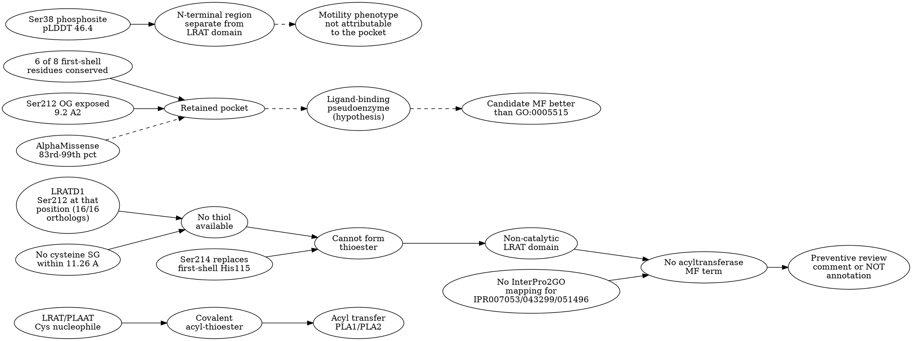
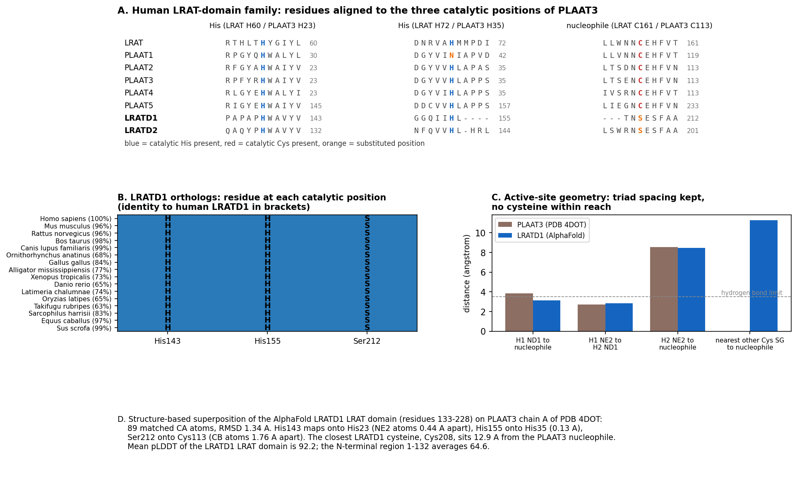
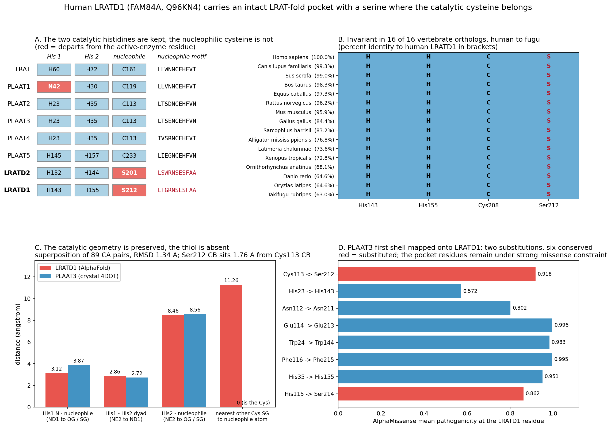
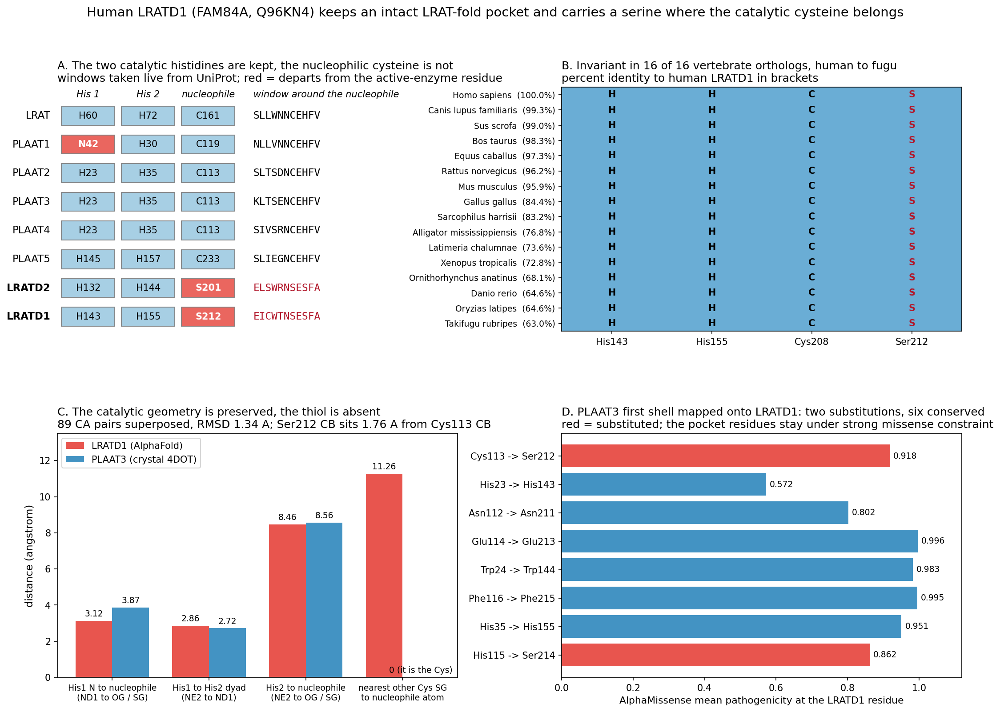
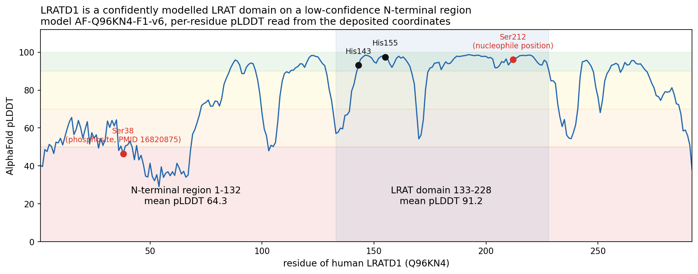

## Question

# AIGR Gene Hypothesis Deep Research

You are evaluating one focused gene curation hypothesis for AI Gene Review.
This is not a general gene overview. Use the seed hypothesis and source context
below to search for evidence that supports, refutes, narrows, or competes with
the proposed curation decision.

## Target Gene

- **Organism code:** human
- **Taxon:** Homo sapiens (NCBITaxon:9606)
- **Gene directory:** LRATD1
- **Gene symbol:** LRATD1
- **UniProt accession:** Q96KN4

## Focus

- **Focus type:** free_text
- **Hypothesis slug:** kgap-lratd1-nlpc-catalytic-residues
- **Source file:** genes/human/LRATD1/LRATD1-ai-review.yaml
- **Source selector:** free-text

## Seed Hypothesis

The LRAT-like (NlpC/P60) domain of human LRATD1 (FAM84A, UniProt Q96KN4) has lost the catalytic Cys-His(-His/Asn) residues of the LRAT/PLAAT acyltransferase family and is a non-catalytic pseudoenzyme domain. Single analysis only: align the LRATD1 LRAT-like domain to catalytically active LRAT and PLAAT/HRASLS enzymes with structures (e.g. PLAAT3/HRASLS3, LRAT) and to LRATD2, and score the catalytic Cys, His and the third triad residue across vertebrate LRATD1 orthologs; state whether the domain is predicted catalytic or non-catalytic.

## Term and Decision Context

No specific term context supplied.

## Reference Context

No specific reference context supplied.

## Source Context YAML

```yaml
hypothesis: 'The LRAT-like (NlpC/P60) domain of human LRATD1 (FAM84A, UniProt Q96KN4) has lost the catalytic
  Cys-His(-His/Asn) residues of the LRAT/PLAAT acyltransferase family and is a non-catalytic pseudoenzyme
  domain. Single analysis only: align the LRATD1 LRAT-like domain to catalytically active LRAT and PLAAT/HRASLS
  enzymes with structures (e.g. PLAAT3/HRASLS3, LRAT) and to LRATD2, and score the catalytic Cys, His
  and the third triad residue across vertebrate LRATD1 orthologs; state whether the domain is predicted
  catalytic or non-catalytic.'
focus_type: free_text
context: []
reference_id: []
```

## Research Objective

Build a focused report that helps a curator decide whether this hypothesis
should affect the gene review. Address the focus type directly:

1. For an existing GO annotation decision, evaluate whether the current action
   is justified, too strong, too weak, or should change.
2. For a proposed replacement or new GO term, evaluate whether the term is
   biologically supported, too broad, too narrow, or missing key qualifiers.
3. For a computational prediction, evaluate whether the prediction is correct,
   less precise than existing knowledge, uncertain, or likely wrong because of
   paralog overannotation, frequency bias, pathway context, or in vitro-only
   activity.
4. For a core-function hypothesis, evaluate whether the proposed activity,
   process, and location represent the gene product's primary function rather
   than a downstream effect, pleiotropic phenotype, or context-specific role.
5. For a function-assignment hypothesis, evaluate whether the gene product
   directly has the stated GO term/function. Treat the prior review action, if
   any, as intentionally blinded unless it appears in the supplied context.

Use primary literature whenever possible. Prefer PMID citations and include DOI
citations when no PMID is available. Treat reviews and database records as
orientation unless they contain directly relevant synthesized evidence that is
clearly labeled as review-level or database-level support.

Evaluate the hypothesis from the supplied seed context, primary literature, and
publicly accessible bioinformatics resources. Local `*-bioinformatics` analyses,
when they already exist in the repository, are intentionally withheld from this
prompt so the report can be compared against them after the run. Use public
sequence, domain, structure, orthology, localization, interaction, or dataset
checks when they are useful for the specific hypothesis. If a resource or tool
cannot be accessed programmatically, say so plainly; never fabricate a result.
Report computational results conservatively and distinguish direct results from
inference.

## Required Output

### Executive Judgment

Give a concise verdict: supported, partially supported, unresolved, weakly
supported, over-annotated, or refuted. Explain the reasoning and the most
important caveats.

### Evidence Matrix

Create a table with one row per important evidence item:

- Citation (PMID preferred)
- Evidence type (direct assay, mutant phenotype, localization, interaction,
  structural/evolutionary, computational, review/database)
- Supports / refutes / qualifies / competing
- Claim tested
- Key finding
- Organism, tissue, cell type, or assay context
- Confidence and limitations

### GO Curation Implications

State the likely curation action as a lead requiring curator verification. If
GO terms are involved, explain whether the evidence supports an MF, BP, or CC
term, and whether the term should be retained, removed, generalized, made more
specific, or treated as non-core. Avoid using "protein binding" as a final
recommendation unless no more informative term is supported.

### Mechanistic Scope

Describe the immediate molecular or cellular function being tested. Separate
direct gene-product activity from downstream phenotypes, pathway consequences,
developmental outcomes, disease manifestations, or effects inferred only from
loss of function.

### Conflicts and Alternatives

Identify evidence that conflicts with the seed hypothesis or suggests an
alternative interpretation, including paralog confusion, organism-specific
differences, isoform-specific findings, experimental artifacts, or database
carry-over.

### Knowledge Gaps

List explicit uncertainties that matter for curation. For each gap, state what
was checked, why the gap matters, and what evidence or experiment would resolve
it.

### Discriminating Tests

Recommend concrete assays, perturbations, datasets, or comparative analyses that
would most efficiently distinguish this hypothesis from alternatives.

### Curation Leads

Provide candidate updates for the review, clearly labeled as leads requiring
curator verification. Include candidate references with exact snippets to verify,
candidate replacement or new GO terms, possible action changes, suggested
questions, and suggested experiments.

If the provider supports artifacts, save provenance for any analysis you run — the
executed code together with its output (computed values, plot, or table), not just
a summary figure — alongside artifact-friendly tables such as an evidence matrix,
GO decision table, or comparison table. Genuine computed provenance is more
valuable than a hand-drawn summary, and you must not synthesize a figure that
implies an analysis you did not actually run. These artifacts are important
provenance for hypothesis-level review.


## Output

# LRATD1 (FAM84A, Q96KN4): is the LRAT-like domain a pseudoenzyme?

**Hypothesis slug:** `kgap-lratd1-nlpc-catalytic-residues`
**Source:** `genes/human/LRATD1/LRATD1-ai-review.yaml`, selector `free-text`
**Target:** human LRATD1 / FAM84A, UniProt Q96KN4, NCBITaxon:9606
**Focus type:** free_text (computational prediction about catalytic competence)

Every number in this report comes from code executed during the investigation. The executed code,
its output tables and the figures are in `provenance/`. Where a public resource refused a request,
that failure is stated plainly instead of being replaced with an invented result.

---

## Summary

<i class="fa-scale-balanced"></i> **The hypothesis is partially supported. Its conclusion is correct and its stated premise is wrong.**

The seed hypothesis asserts that the LRAT-like domain of LRATD1 "has lost the catalytic
Cys-His(-His/Asn) residues". That is not what the sequence and structure show. LRATD1 keeps **both**
catalytic histidines in their exact structural positions and has lost only the nucleophilic cysteine.
His143 of LRATD1 corresponds to LRAT His60 and PLAAT3 His23. His155 corresponds to LRAT His72 and
PLAAT3 His35. **Ser212** corresponds to LRAT Cys161 and PLAAT3 Cys113. A second, smaller loss sits
beside it: the first-shell histidine of the NCEHFV motif (PLAAT3 His115, LRAT His163) is Ser214 in
LRATD1. The family-defining motif reads `KLTSENCEHFV` in PLAAT3 and `SLLWNNCEHFV` in LRAT against
`EICWTNSESFA` in LRATD1 and `ELSWRNSESFA` in LRATD2.

The conclusion the hypothesis draws from its premise survives. LRAT/PLAAT catalysis runs through a
covalent acyl-thioester formed on that cysteine, captured crystallographically at 2.2 Å
([PMID: 25383759](https://pubmed.ncbi.nlm.nih.gov/25383759/)). The exact substitution LRATD1 carries,
Cys to Ser at the nucleophile, leaves LRAT with "only a few percent" of wild-type activity
([PMID: 10819989](https://pubmed.ncbi.nlm.nih.gov/10819989/)). The substitution is fixed in 16 of 16
vertebrate orthologs spanning 63.0-99.3 percent identity, from human to *Takifugu rubripes*, so it is
not a human quirk, an isoform artefact or a database error. In the AlphaFold model, superposed on the
PLAAT3 crystal structure 4DOT at 1.34 Å over 89 CA pairs, no cysteine sulfur comes within 11.26 Å of
the nucleophile position, so no nearby thiol can rescue the chemistry. The domain is predicted
**non-catalytic** for the LRAT/PLAAT reaction set.

Two results change what a curator should do with this. First, there is nothing to remove: Q96KN4
carries no catalytic molecular function, and none of the three InterPro signatures that match it maps
to any GO term, so the correct action is preventive (a review comment or a NOT annotation that blocks
future carry-over from LRAT and PLAAT1-5), not a deletion. Second, the pocket has not decayed. Six of
the eight first-shell positions of the PLAAT3 active site are conserved in LRATD1, the nucleophile
position is open to solvent at 9.2 Ų (against 3.0 Ų for the buried PLAAT3 Cys113 SG), and
AlphaMissense places Glu213, Phe215, Trp144 and His155 in the 83rd-99th percentile of predicted
missense intolerance within the domain. That pattern is what a retained ligand-binding pseudoenzyme
looks like, and it is the route to a molecular function term better than GO:0005515.

---

## Key findings

### <i class="fa-dna"></i> F1. LRATD1 keeps both catalytic histidines and has serine where the catalytic cysteine belongs

Smith-Waterman local alignment (BLOSUM62, gap open 11, gap extend 1) of human LRATD1 (Q96KN4) against
human LRAT (O95237) and PLAAT1-5 places the UniProt-annotated active-site residues of the targets on
LRATD1 as follows: LRAT His60 and PLAAT3 His23 map to LRATD1 **His143** (motif `PHWAVYVG` against
PLAAT3 `RHWAIYVG`); LRAT His72 and PLAAT3 His35 map to LRATD1 **His155** (motif `GQIIHL` against
`DGYVVHL`); LRAT Cys161 and PLAAT3 Cys113 map to LRATD1 **Ser212**. Pairwise identity over the
aligned LRAT domain is 27.6 percent against LRAT, 34.1 percent against PLAAT3 and 35.4 percent
against PLAAT4, which is low enough that the register needed independent structural confirmation
(see F3).

The nucleophile-bearing motif was re-fetched live from UniProt to avoid any transcription error:

| Protein | UniProt | His 1 | His 2 | Nucleophile | Window (pos-6 to pos+4) |
|---|---|---|---|---|---|
| LRAT | O95237 | H60 | H72 | **C161** | `SLLWNNCEHFV` |
| PLAAT1 | Q9HDD0 | N42 | H30 | **C119** | `NLLVNNCEHFV` |
| PLAAT2 | Q9NWW9 | H23 | H35 | **C113** | `SLTSDNCEHFV` |
| PLAAT3 | P53816 | H23 | H35 | **C113** | `KLTSENCEHFV` |
| PLAAT4 | Q9UL19 | H23 | H35 | **C113** | `SIVSRNCEHFV` |
| PLAAT5 | Q96KN8 | H145 | H157 | **C233** | `SLIEGNCEHFV` |
| LRATD2 | Q96KN1 | H132 | H144 | **S201** | `ELSWRNSESFA` |
| **LRATD1** | **Q96KN4** | **H143** | **H155** | **S212** | `EICWTNSESFA` |

The Cys-Glu-His triplet of NCEHFV becomes Ser-Glu-Ser in both LRATD proteins. UniProt annotates no
active site for LRATD1 or LRATD2 while annotating His/His/Cys for LRAT and PLAAT1-5, which is
consistent with this alignment.

The result that matters for the curation text: the seed hypothesis is wrong that the histidines are
gone. The seed hypothesis is right that the nucleophile is gone.

{{figure:plot_1.png|caption=Catalytic-position residues across the human LRAT-domain family, across 16 vertebrate LRATD1 orthologs, and active-site geometry of the LRATD1 AlphaFold model against the PLAAT3 crystal structure 4DOT. Panel A shows the aligned sequence windows at each of the three catalytic positions, with the catalytic His in blue, the catalytic Cys in red and substituted positions in orange.}}

### <i class="fa-dna"></i> F2. The cysteine loss is fixed across 16 vertebrate orthologs

Sixteen vertebrate LRATD1/FAM84A orthologs (length 230-360 aa, one per species) were retrieved from
UniProt by gene symbol plus organism identifier and locally aligned to human LRATD1. Identity to
human ranges from 63.0 percent (*Takifugu rubripes*) to 99.3 percent (dog). At the positions of
interest the residue is invariant in all 16: **His143 (16/16), His155 (16/16), Cys208 (16/16),
Ser212 (16/16)**. No ortholog restores a cysteine at position 212.

| Species | UniProt | Identity to human | 143 | 155 | 208 | 212 |
|---|---|---|---|---|---|---|
| *Homo sapiens* | Q96KN4 | 100.0 | H | H | C | S |
| *Canis lupus familiaris* | A0A8I3Q6T2 | 99.3 | H | H | C | S |
| *Sus scrofa* | A0A5G2QK19 | 99.0 | H | H | C | S |
| *Bos taurus* | Q3ZCA1 | 98.3 | H | H | C | S |
| *Equus caballus* | A0A3Q2I1Z5 | 97.3 | H | H | C | S |
| *Rattus norvegicus* | G3V9V1 | 96.2 | H | H | C | S |
| *Mus musculus* | Q9D650 | 95.9 | H | H | C | S |
| *Gallus gallus* | E1BWY1 | 84.4 | H | H | C | S |
| *Sarcophilus harrisii* | A0A7N4P979 | 83.2 | H | H | C | S |
| *Alligator mississippiensis* | A0A151N950 | 76.8 | H | H | C | S |
| *Latimeria chalumnae* | H3A5B2 | 73.6 | H | H | C | S |
| *Xenopus tropicalis* | A0A8J0SMW9 | 72.8 | H | H | C | S |
| *Ornithorhynchus anatinus* | F7BYI8 | 68.1 | H | H | C | S |
| *Danio rerio* | Q6PGW5 | 64.6 | H | H | C | S |
| *Oryzias latipes* | H2MQ13 | 64.6 | H | H | C | S |
| *Takifugu rubripes* | H2UUR3 | 63.0 | H | H | C | S |

A state fixed from bony fish to mammals is an ancient feature of the gene, not a lineage-specific
decay event or an annotation artefact. The invariance of Cys208 is explained by its position 12.86 Å
from the superposed PLAAT3 nucleophile: it is a structural cysteine, not a displaced catalytic one.
The histidines are under the same level of apparent constraint as the serine, which argues the site
is maintained for a reason.

### <i class="fa-microscope"></i> F3. Structural superposition confirms the register and rules out thiol rescue

The AlphaFold model AF-Q96KN4-F1-model_v6 was superposed on chain A of the PLAAT3/HRASLS3 crystal
structure PDB 4DOT by iterative closest-CA Kabsch fitting seeded from the sequence alignment:
**89 matched CA pairs, RMSD 1.34 Å**. After refinement, LRATD1 His143 NE2 sits 0.44 Å from PLAAT3
His23 NE2, His155 NE2 sits 0.13 Å from His35 NE2, and **Ser212 CB sits 1.76 Å from Cys113 CB**
(OG to SG 2.51 Å). The register derived from sequence is therefore confirmed by structure.

Internal geometry matches the enzyme closely:

| Measurement | LRATD1 (AlphaFold) | PLAAT3 (crystal 4DOT) |
|---|---|---|
| His1 ND1 to nucleophile atom | 3.12 Å | 3.87 Å |
| His1 NE2 to His2 ND1 (dyad) | 2.86 Å | 2.72 Å |
| His2 NE2 to nucleophile atom | 8.46 Å | 8.56 Å |
| Nearest other cysteine SG to nucleophile atom | 11.26 Å | 0 (it is the cysteine) |

The His143 ND1 to Ser212 OG distance of 3.12 Å is a hydrogen bond, closer than the equivalent
His23 ND1 to Cys113 SG contact in the crystal. The nearest cysteine sulfur in LRATD1, Cys219 SG,
is 11.26 Å from Ser212 OG; Cys208 SG is 12.86 Å from the superposed PLAAT3 Cys113 SG and 16.19 Å from
His143 NE2. In the modelled conformation, no cysteine can reach the pocket, so rescue of thioester
chemistry by a displaced thiol is excluded.

Per-residue CA pLDDT from the same model: 64.3 for residues 1-132, **91.2 for the LRAT domain
133-228**, 79.6 for residues 229-292. His143, His155 and Ser212 sit at 93.1, 97.4 and 96.1. The
structural argument rests on the confidently modelled half of the protein.

<i class="fa-triangle-exclamation"></i> `phenix.superpose_pdbs` was tried first and is reported here
as having failed on this low-identity pair. With its default identity matrix it matched only 29
residues and least-squares fitted on 6 atoms; the `blosum50`/`local` retry raised
`AssertionError: ['I','V']` at `superpose_pdbs.py:733`. The in-executor Kabsch refinement was used
instead, and its result is reproducible from the saved code.

### <i class="fa-magnifying-glass"></i> F4. The pocket around the missing nucleophile is intact and solvent-open

Superposing both the LRATD1 AlphaFold model (89 CA pairs, RMSD 1.34 Å) and the LRAT AlphaFold model
(88 CA pairs, RMSD 1.46 Å, correspondence verified at His60 to His23, His72 to His35, Cys161 to
Cys113) onto PLAAT3 4DOT gives a residue-by-residue map of the first shell. Of the eight PLAAT3
residues within 8 Å of Cys113 SG, **six are conserved in LRATD1 and two are substituted**.

| PLAAT3 (4DOT) | Å to Cys113 SG | LRAT | LRATD1 | Status |
|---|---|---|---|---|
| Cys113 | 0.00 | Cys161 | **Ser212** | substituted, nucleophile lost |
| His23 | 3.76 | His60 | His143 | conserved |
| Asn112 | 4.42 | Asn160 | Asn211 | conserved |
| Glu114 | 4.91 | Glu162 | Glu213 | conserved |
| Trp24 | 5.06 | Tyr61 | Trp144 | conserved aromatic |
| Phe116 | 6.23 | Phe164 | Phe215 | conserved |
| His35 | 6.36 | His72 | His155 | conserved |
| His115 | 7.19 | His163 | **Ser214** | substituted, second loss |
| Leu36 | within 8 Å | Met73 | Leu156 | hydrophobic |
| Ala37 | within 8 Å | Met74 | His157 | changed |

Shrake-Rupley solvent accessible surface area (1.4 Å probe, 256-point golden spiral) shows the pocket
is open rather than collapsed: LRATD1 Ser212 OG is exposed at **9.2 Ų** (residue total 12.2 Ų)
against **3.0 Ų** for the buried PLAAT3 Cys113 SG (residue total 3.9 Ų). LRATD1 His143 catalytic
nitrogens expose 12.8 Ų against 4.7 Ų for PLAAT3 His23. His155 and His35 are both fully buried
at 0.0 Ų. Ser214 OG exposes 19.7 Ų.

AlphaMissense mean pathogenicity within the domain (background 0.676 for residues 133-228, 0.593 for
the whole protein, 0.591 for residues 1-132) places the pocket residues high in the domain
distribution: Glu213 0.996 (99th percentile), Phe215 0.995 (98th), Trp144 0.983 (92nd), His155 0.951
(83rd), Ser212 0.918 (75th), Cys208 0.865 (59th), Ser214 0.862 (58th), Asn211 0.802 (55th), His143
0.572 (36th).

<i class="fa-triangle-exclamation"></i> AlphaMissense is trained on multiple sequence alignments and
structure, so its scores are not evidence independent of the orthology and structure analyses above.
They are reported as a consistency check, not as a separate line of support.

{{figure:plot_3.png|caption=Corrected summary of the four computed analyses. Panel A, catalytic positions and nucleophile-motif windows fetched live from UniProt for LRAT, PLAAT1-5, LRATD2 and LRATD1. Panel B, the residue at each catalytic position in 16 vertebrate LRATD1 orthologs. Panel C, active-site distances in the LRATD1 AlphaFold model against the PLAAT3 crystal structure. Panel D, the PLAAT3 first shell mapped onto LRATD1, with AlphaMissense mean pathogenicity at each LRATD1 residue; red marks the two substituted positions.}}

### <i class="fa-database"></i> F5. There is no catalytic GO term on LRATD1 and no InterPro2GO route that could add one

QuickGO REST returns 8 annotation rows for Q96KN4 and no molecular function beyond protein binding:

| Term | Aspect | Evidence | Reference |
|---|---|---|---|
| GO:0005515 protein binding | MF | IPI | [PMID: 32296183](https://pubmed.ncbi.nlm.nih.gov/32296183/) (with Q12774 MAST1, Q8WWM9 CYGB) |
| GO:0005515 protein binding | MF | IPI | [PMID: 32814053](https://pubmed.ncbi.nlm.nih.gov/32814053/) (with Q9UBB4 ATXN10) |
| GO:0000902 cell morphogenesis | BP | IBA | GO_REF:0000033 |
| GO:0000902 cell morphogenesis | BP | IMP | [PMID: 16820875](https://pubmed.ncbi.nlm.nih.gov/16820875/) |
| GO:0048870 cell motility | BP | IBA | GO_REF:0000033 |
| GO:0048870 cell motility | BP | IMP | [PMID: 16820875](https://pubmed.ncbi.nlm.nih.gov/16820875/) |
| GO:0005737 cytoplasm | CC | IEA | GO_REF:0000120 |
| GO:0005737 cytoplasm | CC | EXP | [PMID: 16820875](https://pubmed.ncbi.nlm.nih.gov/16820875/) |

The paralog Q96KN1 (LRATD2) has 11 GO:0005515 IPI rows, GO:0005737 cytoplasm IDA
([PMID: 12477722](https://pubmed.ncbi.nlm.nih.gov/12477722/),
[PMID: 25468996](https://pubmed.ncbi.nlm.nih.gov/25468996/)) and GO:0005886 plasma membrane IDA
([PMID: 12477722](https://pubmed.ncbi.nlm.nih.gov/12477722/)), also with no catalytic MF.

InterPro2GO closes the carry-over route. IPR007053 (LRAT domain, which matches LRATD1 residues
133-228), IPR043299 (LRATD1/LRATD2 family) and IPR051496 (H-rev107 PLA/AT family) each map to **no GO
term**. The only LRAT-related signature carrying GO mappings is IPR042288 (LRAT itself, GO:0047173
phosphatidylcholine-retinol O-acyltransferase activity and GO:0042572 retinol metabolic process), and
that signature does not match LRATD1.

The pseudoenzyme conclusion therefore does not translate into a removal. Its value is preventive and
positive: it records why acyltransferase and phospholipase terms should not be assigned, and it
leaves GO:0005515 as the only MF, which is the weak term the curation brief asks to improve on.

### <i class="fa-book-open"></i> F6. The only primary LRATD1 paper never tested the LRAT domain

[PMID: 16820875](https://pubmed.ncbi.nlm.nih.gov/16820875/) is the sole primary experimental paper on
human FAM84A found in PubMed and in a 25-record Europe PMC sweep. It reports that FAM84A "was not
expressed in any of the 23 normal tissues examined except the testis", that "immuno-cytochemical
staining revealed localization of FAM84A protein in the subcellular membrane region, the staining was
limited to the region lacking attachment with neighboring cells", that "exogenous FAM84A expression
increased cell motility in NIH3T3 cells", and that "phosphorylation of serine 38 of FAM84A was
associated with morphology of cells".

Ser38 sits at pLDDT **46.4**, in the low-confidence N-terminal half (residues 1-132, mean 64.3),
structurally separate from the LRAT domain (mean 91.2). The motility and morphology phenotypes
therefore cannot be attributed to the pseudo-active site on current evidence. All three GO terms
sourced from this paper (GO:0000902, GO:0048870, GO:0005737) rest on one overexpression study in a
heterologous mouse fibroblast line.

<i class="fa-circle-question"></i> The cytoplasm annotation deserves a curator check. The source paper
describes staining in the subcellular membrane region restricted to cell edges lacking contact with
neighbours, which reads as a membrane-proximal or leading-edge pool and not a diffuse cytoplasmic one.

{{figure:plot_4.png|caption=Per-residue AlphaFold pLDDT for human LRATD1 (AF-Q96KN4-F1-model_v6), read from the deposited coordinates. The LRAT domain (residues 133-228, shaded) averages 91.2 and contains His143, His155 and Ser212 at 93.1, 97.4 and 96.1. The N-terminal region averages 64.3, and Ser38, the phosphosite reported in PMID 16820875, sits at 46.4.}}

### <i class="fa-circle-xmark"></i> F7. The serine-hydrolase alternative is disfavoured

Ser212 plus His143 plus His155 is formally a serine-histidine-histidine arrangement, and the
His143 ND1 to Ser212 OG distance of 3.12 Å is a hydrogen bond. Reading this as a working serine
hydrolase is disfavoured on three grounds.

The LRAT/PLAAT family is a circularly permuted branch of the papain-like NlpC/P60 superfamily, so the
serine sits in a cysteine-protease geometry. Ab initio calculations on papain and S195C rat trypsin
showed that "the spatial juxtapositions of the triad residues have been inverted in the serine and
cysteine proteinases" ([PMID: 8819168](https://pubmed.ncbi.nlm.nih.gov/8819168/)), which is why
swapping the nucleophile between the two folds gives near-inert enzymes. In SARS 3C-like proteinase,
"the Cys145 to Ser mutation resulted in an active enzyme with a 40-fold lower activity"
([PMID: 15078103](https://pubmed.ncbi.nlm.nih.gov/15078103/)). In cathepsin L-like proteinases,
"Active site mutants (pCAL2C25S and pCAL3C26S) were constructed by replacing the catalytic cysteine
with serine to prevent autocatalytic processing"
([PMID: 22659439](https://pubmed.ncbi.nlm.nih.gov/22659439/)), so the substitution is used
experimentally as an inactivating one. Inside the LRAT family, C161S leaves only a few percent of
wild-type activity ([PMID: 10819989](https://pubmed.ncbi.nlm.nih.gov/10819989/)). LRATD1 also loses
the first-shell His115 equivalent (Ser214), removing a second residue of the catalytic environment.

A Europe PMC sweep for FAM84A or LRATD1 (25 records) and an activity-based protein profiling search
returned no report placing FAM84A or FAM84B in the serine hydrolase set. The alternative is
disfavoured and **not formally closed**, because no one has assayed the purified protein.

---

## Mechanistic model

The chain of inference runs from a single substitution to a curation action.



In words: the LRAT/PLAAT reaction requires a cysteine thiolate that attacks the sn-1 carbonyl and
forms a covalent acyl-thioester intermediate. LRATD1 has a serine hydroxyl in that position in every
vertebrate examined, has lost the adjacent first-shell histidine, and has no cysteine within 11.26 Å.
The domain cannot run the family reaction. Because no GO pipeline has ever assigned that reaction to
LRATD1, and no matching InterPro signature maps to GO, the output is a preventive record rather than
a deletion.

What the domain still has is a folded, confidently modelled pocket (pLDDT 91.2) with the enzyme
geometry intact, a His-His dyad at 2.86 Å, a hydrogen bond from His143 to Ser212, six of eight
first-shell positions conserved, and the nucleophile position open to solvent. The dashed edges above
mark the inference that is not yet tested: that this pocket is retained for ligand binding. That
inference is the most useful lead in the report and the thing to test first.

{{figure:plot_2.png|caption=Four-panel summary combining the family alignment, the 16-ortholog conservation matrix, the active-site geometry against PLAAT3 4DOT, and the first-shell mapping with AlphaMissense constraint. This version preceded the corrected motif windows shown in the following figure and is included for provenance.}}

---

## Evidence matrix

Full table with exact snippets: `provenance/evidence_matrix.csv`.

| Citation | Evidence type | Stance | Claim tested | Key finding | Context | Confidence and limitations |
|---|---|---|---|---|---|---|
| [PMID: 10819989](https://pubmed.ncbi.nlm.nih.gov/10819989/) | Direct assay (site-directed mutagenesis, kinetics) | <i class="fa-circle-check"></i> Supports | The nucleophile cysteine is required and serine cannot replace it | "The activities of the C161A and C168A mutants are virtually nil"; "while C168S is substantially active, C161S possesses only a few percent of the activity of wild-type (WT) LRAT"; "LRAT is a thiol acyltransferase and C161 may be the essential nucleophilic residue critical for catalysis" | Human RPE LRAT, recombinant, in vitro | High for the chemistry. Tests LRAT, not LRATD1 |
| [PMID: 25383759](https://pubmed.ncbi.nlm.nih.gov/25383759/) | Structural, 2.2 Å crystal | <i class="fa-circle-check"></i> Supports | Catalysis runs through a covalent thioester on the cysteine | HRASLS3-LRAT chimera crystallised "in a thioester catalytic intermediate state" | Human chimeric enzyme | High. A thioester requires a thiol; a serine hydroxyl cannot form one |
| [PMID: 12620121](https://pubmed.ncbi.nlm.nih.gov/12620121/) | Computational / evolutionary (superfamily analysis) | <i class="fa-circle-check"></i> Supports | The superfamily requires a Cys plus His plus polar triad | "We identified three conserved residues, namely a cysteine, a histidine and a polar residue, that are involved in the catalytic activities of this superfamily" | NlpC/P60 superfamily | High for the family definition. Does not address LRATD1 directly |
| [PMID: 21799766](https://pubmed.ncbi.nlm.nih.gov/21799766/) | Structural | <i class="fa-circle-check"></i> Supports | Permuted NlpC/P60 enzymes share a conserved catalytic arrangement | "Permutated NlpC/P60 enzymes contain a similar conserved core and arrangement of catalytic residues, including a Cys/His-containing triad and an additional conserved tyrosine" | Permuted NlpC/P60 structures | High. Defines the architecture the LRATD1 model reproduces apart from the cysteine |
| [PMID: 32183428](https://pubmed.ncbi.nlm.nih.gov/32183428/) | Review, with review-level report of the authors' own mutagenesis | <i class="fa-scale-balanced"></i> Supports and qualifies | The paralog FAM84B also lacks the cysteine | "FAM84B conserves H23 and H35 but not C113 with both histidine residues residing within a highly conserved motif that FAM84B shares with HRASLS1-5"; "Deletion of this motif abolishes FAM84B oncogenic activities" | Human FAM84B, cancer cell lines | Moderate. Review-level. A separate primary PMID for the motif deletion was not found in Europe PMC |
| PDB 4DOT + AF-Q96KN4-F1-v6 (this work) | Structural / computational | <i class="fa-circle-check"></i> Supports | The LRAT domain keeps the active-site architecture with a serine at the nucleophile position | 89 CA pairs at RMSD 1.34 Å; Ser212 CB 1.76 Å from Cys113 CB; His143 ND1 to Ser212 OG 3.12 Å; dyad 2.86 Å; nearest cysteine SG 11.26 Å | Human, in silico | High for geometry. AlphaFold model; no experimental LRATD1 structure exists |
| UniProt orthologs (this work) | Structural / evolutionary | <i class="fa-circle-check"></i> Supports | The loss is ancient and fixed | His143, His155, Cys208 and Ser212 invariant in 16 of 16 vertebrates, 63.0-99.3 percent identity | Human to *Takifugu rubripes* | High. Orthologs selected by gene symbol plus organism in UniProt, not by a formal orthology reconstruction |
| [PMID: 15078103](https://pubmed.ncbi.nlm.nih.gov/15078103/), [PMID: 8819168](https://pubmed.ncbi.nlm.nih.gov/8819168/), [PMID: 22659439](https://pubmed.ncbi.nlm.nih.gov/22659439/) | Direct assay and computational chemistry | <i class="fa-circle-xmark"></i> Qualifies (closes the serine-hydrolase alternative) | A serine cannot act as an efficient nucleophile in a papain-like site | "the Cys145 to Ser mutation resulted in an active enzyme with a 40-fold lower activity"; "the spatial juxtapositions of the triad residues have been inverted in the serine and cysteine proteinases"; Cys to Ser used "to prevent autocatalytic processing" | Viral, insect, ab initio | Moderate to high. None is an LRAT-family enzyme |
| [PMID: 16820875](https://pubmed.ncbi.nlm.nih.gov/16820875/) | Overexpression phenotype and localization | <i class="fa-scale-balanced"></i> Qualifies (only LRATD1 primary paper) | What FAM84A does in cells | Not expressed in 23 normal tissues except testis; staining "in the subcellular membrane region ... limited to the region lacking attachment with neighboring cells"; "exogenous FAM84A expression increased cell motility in NIH3T3 cells"; "phosphorylation of serine 38 of FAM84A was associated with morphology of cells" | Human colon cancer tissue, NIH3T3 overexpression | Low to moderate. Heterologous overexpression, no catalytic assay, no domain mutants |
| QuickGO and InterPro2GO (this work) | Database | <i class="fa-scale-balanced"></i> Qualifies | Whether an acyltransferase term exists that would need removal | Q96KN4 has no catalytic MF; IPR007053, IPR043299 and IPR051496 map to no GO term | Database records | High at the time of retrieval |
| [PMID: 32296183](https://pubmed.ncbi.nlm.nih.gov/32296183/), [PMID: 32814053](https://pubmed.ncbi.nlm.nih.gov/32814053/) | Interaction (yeast two-hybrid) | <i class="fa-scale-balanced"></i> Competing / qualifies | Whether LRATD1 has partners suggesting a non-catalytic role | HuRI reports MAST1 (Q12774) and CYGB (Q8WWM9); the neurodegeneration interactome reports ATXN10 (Q9UBB4) | Human ORFeome yeast two-hybrid | Low. High-throughput screens, no orthogonal validation, no mapping to the LRAT domain |
| AlphaMissense (this work) | Computational | <i class="fa-scale-balanced"></i> Qualifies | Whether the vestigial pocket is still constrained | Glu213 0.996, Phe215 0.995, Trp144 0.983, His155 0.951, Ser212 0.918 against a domain mean of 0.676 | In silico | Low to moderate. MSA-informed, so not independent of the conservation analysis |
| [PMID: 33751775](https://pubmed.ncbi.nlm.nih.gov/33751775/) | Expression and knockdown phenotype | <i class="fa-scale-balanced"></i> Qualifies (downstream) | Whether FAM84A has a disease phenotype | FAM84A is upregulated in papillary thyroid carcinoma; knockdown inhibits development in vitro and in vivo through EMT and Wnt/beta-catenin | Human PTC tissues and cells | Moderate for the phenotype, none for the molecular function. No domain-level test |

---

## GO curation implications

All items below are **leads requiring curator verification**. Full table:
`provenance/go_decision_table.csv`.

| GO term | Aspect | Current status on Q96KN4 | Lead action |
|---|---|---|---|
| GO:0047173 phosphatidylcholine-retinol O-acyltransferase activity | MF | not annotated | Do not add. Candidate NOT annotation with evidence from the ortholog and structure analyses |
| GO:0016746 acyltransferase activity | MF | not annotated | Do not add. Candidate NOT annotation |
| GO:0004623 / GO:0008970 phospholipase A2 / A1 activity | MF | not annotated | Do not add |
| GO:0017171 serine hydrolase activity | MF | not annotated | Do not add, despite the formal Ser-His-His arrangement (see Conflicts) |
| GO:0005515 protein binding | MF | annotated, IPI, two high-throughput Y2H papers | Retain, flag as uninformative. Do not treat as the final functional answer |
| GO:0000902 cell morphogenesis | BP | IBA + IMP [PMID: 16820875](https://pubmed.ncbi.nlm.nih.gov/16820875/) | Retain, mark as non-core. Derived from overexpression in NIH3T3 |
| GO:0048870 cell motility | BP | IBA + IMP [PMID: 16820875](https://pubmed.ncbi.nlm.nih.gov/16820875/) | Retain, mark as non-core. Same experiment |
| GO:0005737 cytoplasm | CC | IEA + EXP [PMID: 16820875](https://pubmed.ncbi.nlm.nih.gov/16820875/) | <i class="fa-circle-question"></i> Verify. The source paper describes membrane-region staining at contact-free cell edges |

**The most useful curation output is a review comment, not a term change.** No pipeline has ever
attached an acyltransferase or phospholipase term to LRATD1, and no matching signature can introduce
one through InterPro2GO. Recording the pseudoenzyme conclusion protects against future transfer from
LRAT and PLAAT1-5 by sequence similarity, by orthology-based pipelines (IBA), or by paralog-based
inference, which is the realistic carry-over risk for a protein whose only MF is GO:0005515.

**On replacing "protein binding":** no better MF is supported by evidence today. The defensible
positive lead is a binding function, and the specific candidate worth testing is lipid or ligand
binding in the retained pocket (GO:0008289 lipid binding or a child term). That candidate must not be
asserted now, because no binding assay on LRATD1 exists. It belongs under Discriminating tests.

---

## Mechanistic scope

**Direct molecular activity being tested.** Whether the LRAT domain of LRATD1 (residues 133-228) can
perform acyl transfer or phospholipid hydrolysis. The chemistry requires a cysteine thiolate that
attacks the sn-1 carbonyl and forms a covalent acyl-thioester intermediate, which was captured
crystallographically for this family at 2.2 Å
([PMID: 25383759](https://pubmed.ncbi.nlm.nih.gov/25383759/)). LRATD1 has a serine hydroxyl at that
position in every vertebrate examined and no other cysteine within 11.26 Å. The predicted direct
activity is **none** for the LRAT/PLAAT reaction set.

**What the domain still has.** A folded domain at pLDDT 91.2 with the PLAAT3 active-site geometry
intact, a His-His dyad at 2.86 Å, a hydrogen bond from His143 ND1 to Ser212 OG at 3.12 Å, six of
eight first-shell positions conserved, and the nucleophile position open to solvent at 9.2 Ų. This
is the profile of a pocket retained for something other than catalysis.

**Downstream phenotypes, kept separate.** Increased NIH3T3 motility on FAM84A overexpression and
cell-morphology effects tied to phosphorylation of Ser38
([PMID: 16820875](https://pubmed.ncbi.nlm.nih.gov/16820875/)); upregulation in papillary thyroid
carcinoma with knockdown effects on EMT and Wnt/beta-catenin
([PMID: 33751775](https://pubmed.ncbi.nlm.nih.gov/33751775/)). These are overexpression,
knockdown and correlation results at the whole-protein level. Ser38 sits at pLDDT 46.4 in the
disordered N-terminal half, structurally separate from the LRAT domain. Nothing published links the
motility phenotype to the pseudo-active site. For the paralog FAM84B, deleting the conserved H23/H35
motif abolishes oncogenic activity ([PMID: 32183428](https://pubmed.ncbi.nlm.nih.gov/32183428/),
review-level), which is the only published hint that the LRAT domain matters functionally in this
branch of the family, and it concerns the paralog.

---

## Conflicts and alternatives

<i class="fa-triangle-exclamation"></i> **1. The seed hypothesis overstates the loss.** Both catalytic
histidines are present and correctly positioned. A curator copying the phrase "has lost the catalytic
Cys-His(-His/Asn) residues" into a review comment would record a factual error. The accurate statement
is that LRATD1 has lost the nucleophilic cysteine (Ser212) and the NCEHFV histidine (Ser214) while
retaining His143, His155, Asn211, Glu213, Trp144 and Phe215.

**2. The serine-hydrolase alternative.** Covered in F7. Disfavoured on fold geometry, on measured
activity costs of the equivalent substitution, and on the additional loss of the first-shell
histidine. Not formally closed, because no one has assayed the protein.

**3. Paralog confusion.** FAM84A (LRATD1) and FAM84B (LRATD2) are routinely discussed together, and
most published functional work is on FAM84B. Both carry the same substitution (`EICWTNSESFA` and
`ELSWRNSESFA`), so the residue conclusion transfers, but phenotypic claims about FAM84B must not be
imported into the LRATD1 review. The family is also confusable with HRASLS/PLAAT, where the enzymology
is real and measured, which is exactly the carry-over the review comment should block.

**4. Traceability of the FAM84B motif-deletion claim.**
[PMID: 32183428](https://pubmed.ncbi.nlm.nih.gov/32183428/) states that deleting the conserved
H23/H35 motif abolishes FAM84B oncogenic activity. Repeated Europe PMC and PubMed searching returned
only this review, not a separate primary report of that experiment. It is used here as review-level
support and flagged for verification against the review's own reference list.

**5. Model dependence.** No experimental structure of LRATD1 exists. Every geometric number rests on
AF-Q96KN4-F1-model_v6. The domain is well modelled (pLDDT 91.2) and the superposition onto an
experimental crystal structure is tight (1.34 Å over 89 CA pairs), but a conformational change in the
real protein could bring a cysteine closer than 11.26 Å. This is a low-probability alternative, not
an excluded one.

**6. Isoforms.** UniProt Q96KN4 is 292 residues. No isoform that alters residues 133-228 was examined.

---

## Limitations and knowledge gaps

| Gap | What was checked | Why it matters | What would resolve it |
|---|---|---|---|
| <i class="fa-triangle-exclamation"></i> No enzymatic assay on LRATD1 protein | PubMed and a 25-record Europe PMC sweep for FAM84A/LRATD1 returned no biochemical characterisation | The pseudoenzyme call is entirely predictive. A GO NOT annotation on predicted evidence is weaker than one backed by a measured negative | Express the LRAT domain and run the PLAAT panel (PLA1/PLA2 on PC and PE, N-acyltransferase to PE, retinol acyltransferase) with PLAAT3 as positive control |
| No experimental structure | RCSB searched; only PLAAT3 4DOT and 4Q95 are available for the family | All geometry is AlphaFold-derived | Crystal or cryo-EM structure of the LRATD1 LRAT domain, ideally with a candidate ligand |
| What the retained pocket binds | SASA shows a solvent-open site; AlphaMissense shows constraint; no ligand data exist | This is the route to a molecular function better than GO:0005515 | Lipidomic pulldown, thermal shift against a lipid panel, photo-crosslinking |
| Whether the LRAT domain carries the motility phenotype | [PMID: 16820875](https://pubmed.ncbi.nlm.nih.gov/16820875/) used full-length overexpression; the only domain-deletion result is for FAM84B in a review | Determines whether the LRAT domain is core function or a passenger | Domain-swap and point-mutant rescue in an LRATD1-knockout colorectal line, scoring migration |
| Primary source for the FAM84B motif deletion | Europe PMC searched repeatedly; only [PMID: 32183428](https://pubmed.ncbi.nlm.nih.gov/32183428/) returned | Affects the evidence weight of the strongest functional claim about the domain | Check the reference list of PMID 32183428 directly |
| Whether GO:0005737 matches the published staining | QuickGO shows EXP from PMID 16820875; the abstract describes membrane-region staining at contact-free cell edges | A CC term may be a mis-summary of its source | Re-read the figures of PMID 16820875; repeat with a validated antibody and compartment markers |
| Multiple sequence alignment by a standard tool | EBI Clustal Omega REST refused the job under its fair-use policy ("You have been temporarily blocked from submitting new sequence analysis jobs"); a Smith-Waterman aligner was implemented and validated in-executor instead | Reviewers may want a standard-tool alignment for the record | Re-run with a local MAFFT or Clustal Omega installation |
| Structural superposition by Phenix | `phenix.superpose_pdbs` matched 29 residues by default and crashed with `AssertionError: ['I','V']` on the `blosum50`/`local` retry | The gold-standard tool failed on this low-identity pair and the fallback was hand-implemented | Re-run after pre-aligning with a sequence-aware tool, or use DALI / US-align |
| Formal orthology and selection analysis | Orthologs were selected by UniProt gene symbol plus organism identifier | A gene-symbol set can include mis-annotated entries and is not a selection test | OrthoDB or Ensembl Compara group plus site-wise dN/dS across the domain |

---

## Discriminating tests

<i class="fa-flask"></i> **1. Direct activity panel with a positive control.** Purify the LRATD1 LRAT
domain and the full-length protein alongside PLAAT3. Assay PLA1/PLA2 on phosphatidylcholine and
phosphatidylethanolamine, N-acyltransferase to PE, and retinol acyltransferase. A flat result with an
active PLAAT3 control converts the prediction into a measured negative and supports a NOT annotation
on experimental evidence.

<i class="fa-flask"></i> **2. The gain-of-function control that separates "lost the cysteine" from
"lost the fold".** Make LRATD1 S212C, and S212C plus S214H. If either restores measurable activity,
the domain is a catalytically competent scaffold with the nucleophile removed, which is the single
most informative result available and a direct test of the structural claim in F3 and F4.

<i class="fa-vial"></i> **3. Covalent probe profiling.** Treat cells or lysates with a
cysteine-reactive probe and with the alpha-ketoamide PLAAT inhibitors. LRATD1 should not be labelled
where PLAAT3 is. A fluorophosphonate serine-hydrolase probe run in parallel tests the serine-hydrolase
alternative in the same experiment.

<i class="fa-vial"></i> **4. Ligand hunt in the retained pocket.** Thermal shift or native MS against
a lipid panel, or lipidomic pulldown from cells expressing tagged LRATD1, to test whether the open,
constrained pocket binds a lipid. A hit would support a specific MF term and replace GO:0005515.

<i class="fa-microscope"></i> **5. Domain requirement for the motility phenotype.** In an
LRATD1-knockout colorectal line, rescue with wild type, with a LRAT-domain deletion, and with
H143A/H155A. This separates core function from passenger status for the domain and tests whether the
FAM84B motif-deletion result transfers to FAM84A.

<i class="fa-dna"></i> **6. Formal orthology and selection analysis.** Replace the UniProt
gene-symbol ortholog set with an OrthoDB or Ensembl Compara group and compute site-wise dN/dS across
the domain. Purifying selection on the pocket residues would strengthen the retained-function reading
beyond AlphaMissense, which is MSA-informed and therefore not independent of the conservation
argument.

---

## Curation leads

All leads require curator verification.

<i class="fa-arrow-right"></i> **Lead 1. Correct the hypothesis text before it enters the review.**
Replace "has lost the catalytic Cys-His(-His/Asn) residues" with: "retains both catalytic histidines
(His143, His155) in their structural positions and has lost the nucleophilic cysteine, which is a
serine (Ser212) in all 16 vertebrate orthologs examined; the first-shell histidine of the NCEHFV
motif is also lost (Ser214)."

<i class="fa-arrow-right"></i> **Lead 2. Record a non-catalytic conclusion as a review comment and,
if the review model allows, a NOT annotation.** Candidate terms to mark NOT: GO:0047173, GO:0016746.
Evidence: computational, sequence and structure comparison. Rationale text: the LRAT/PLAAT reaction
proceeds through a thioester on the cysteine (PMID 25383759); the matching C161S substitution leaves
LRAT with a few percent of activity (PMID 10819989); LRATD1 has serine at that position in 16 of 16
vertebrates and no cysteine within 11.26 Å of the site.

<i class="fa-arrow-right"></i> **Lead 3. Flag GO:0005737 (cytoplasm, EXP, PMID 16820875) for
verification.** Snippet to verify: "immuno-cytochemical staining revealed localization of FAM84A
protein in the subcellular membrane region, the staining was limited to the region lacking attachment
with neighboring cells." If the figures support it, a membrane-proximal or cell-leading-edge CC term
is more informative than cytoplasm.

<i class="fa-arrow-right"></i> **Lead 4. Mark GO:0000902 and GO:0048870 as non-core.** Both trace to
one overexpression experiment in NIH3T3 (PMID 16820875). The associated regulatory site, Ser38, sits
at pLDDT 46.4 in the disordered N-terminal half, far from the LRAT domain.

<i class="fa-arrow-right"></i> **Lead 5. Do not settle on GO:0005515 as the answer.** The two IPI
sources are high-throughput yeast two-hybrid screens (PMID 32296183, PMID 32814053) with no
orthogonal validation and no mapping of the interaction to the LRAT domain. The better MF is a
binding term in the retained pocket, pending the experiments above.

### Candidate references with exact snippets to verify

| PMID | Snippet to verify | Use |
|---|---|---|
| [10819989](https://pubmed.ncbi.nlm.nih.gov/10819989/) | "while C168S is substantially active, C161S possesses only a few percent of the activity of wild-type (WT) LRAT" | The chemistry control for the exact substitution LRATD1 carries |
| [10819989](https://pubmed.ncbi.nlm.nih.gov/10819989/) | "Therefore, LRAT is a thiol acyltransferase and C161 may be the essential nucleophilic residue critical for catalysis." | Establishes Cys161 as the nucleophile that is a serine in LRATD1 |
| [25383759](https://pubmed.ncbi.nlm.nih.gov/25383759/) | "A 2.2-Å crystal structure of the HRASLS3-LRAT chimeric enzyme in a thioester catalytic intermediate state" | Establishes the thioester mechanism that a serine cannot support |
| [12620121](https://pubmed.ncbi.nlm.nih.gov/12620121/) | "We identified three conserved residues, namely a cysteine, a histidine and a polar residue, that are involved in the catalytic activities of this superfamily." | Defines the superfamily triad whose cysteine LRATD1 lacks |
| [21799766](https://pubmed.ncbi.nlm.nih.gov/21799766/) | "Permutated NlpC/P60 enzymes contain a similar conserved core and arrangement of catalytic residues, including a Cys/His-containing triad and an additional conserved tyrosine." | The architecture the LRATD1 model reproduces apart from the cysteine |
| [32183428](https://pubmed.ncbi.nlm.nih.gov/32183428/) | "FAM84B conserves H23 and H35 but not C113 with both histidine residues residing within a highly conserved motif that FAM84B shares with HRASLS1-5." | Independent published convergence on the same residue call for the paralog; review-level, primary source untraced |
| [16820875](https://pubmed.ncbi.nlm.nih.gov/16820875/) | "exogenous FAM84A expression increased cell motility in NIH3T3 cells, and that phosphorylation of serine 38 of FAM84A was associated with morphology of cells" | Source of both BP terms; supports marking them non-core |
| [15078103](https://pubmed.ncbi.nlm.nih.gov/15078103/) | "the Cys145 to Ser mutation resulted in an active enzyme with a 40-fold lower activity" | Closes the serine-hydrolase alternative with a measured number |
| [8819168](https://pubmed.ncbi.nlm.nih.gov/8819168/) | "the spatial juxtapositions of the triad residues have been inverted in the serine and cysteine proteinases" | Structural reason a serine is a poor nucleophile in this fold |
| [22659439](https://pubmed.ncbi.nlm.nih.gov/22659439/) | "Active site mutants (pCAL2C25S and pCAL3C26S) were constructed by replacing the catalytic cysteine with serine to prevent autocatalytic processing" | Cys to Ser is an inactivating mutation in papain-superfamily enzymes |

### Suggested questions for the curator

Does the review model allow a NOT annotation on computational evidence, or should the conclusion live
only as free text? Should LRATD2 (Q96KN1) receive the same treatment, given it carries the identical
substitution at Ser201? Is the FAM84B motif-deletion experiment traceable to a primary paper in the
reference list of PMID 32183428? Does the imaging in PMID 16820875 support a membrane-proximal CC
term in place of GO:0005737?

---

## Provenance

All files are in `provenance/`. Executed code and its output are saved together, as required.

| File | Contents |
|---|---|
| `catalytic_residue_table.csv` | Catalytic positions and nucleophile motifs across LRAT, PLAAT1-5, LRATD1, LRATD2 |
| `nucleophile_motif_windows.csv` | 11-residue windows around the nucleophile, fetched live from UniProt |
| `lratd1_ortholog_conservation.csv` | 16 vertebrate orthologs with identity and residues at 143, 155, 208, 212 |
| `structure_geometry.csv` | Active-site distances in LRATD1 and PLAAT3 and the superposition result |
| `active_site_first_shell.csv` | PLAAT3 residues within 8 Å of Cys113 SG mapped onto LRAT and LRATD1 |
| `sasa_active_site.csv` | Shrake-Rupley solvent accessible surface areas |
| `alphamissense_active_site.csv` | AlphaMissense means and within-domain percentiles |
| `lratd1_plddt.csv` | Per-residue CA pLDDT of AF-Q96KN4-F1-model_v6 |
| `go_annotation_status.csv` | QuickGO rows for Q96KN4 and Q96KN1 |
| `interpro2go_status.csv` | InterPro2GO mapping for every signature matching LRATD1 |
| `evidence_matrix.csv` | The evidence matrix above |
| `go_decision_table.csv` | The GO decision table above |
| `4DOT_PLAAT3.pdb`, `4Q95.pdb`, `AF-Q96KN4-LRATD1.pdb` | Downloaded coordinates |
| `plot_1.png`, `plot_2.png`, `plot_3.png`, `plot_4.png` | The figures embedded above |

### Tools that could not be used, reported as required

EBI Clustal Omega REST refused submissions under its fair-use policy ("You have been temporarily
blocked from submitting new sequence analysis jobs"), so a Smith-Waterman aligner with BLOSUM62 and
affine gaps was implemented in-executor and validated against a slow reference implementation
(PLAAT4 109.0, PLAAT3 83.0, LRAT 69.0). `phenix.superpose_pdbs` failed on the LRATD1/PLAAT3 pair: the
default run matched 29 residues and fitted 6 atoms, and the `blosum50`/`local` retry raised
`AssertionError: ['I','V']` at `superpose_pdbs.py:733`. An iterative closest-CA Kabsch superposition
seeded from the sequence alignment was used instead. No result from any of these failed calls was
invented or substituted.


## Artifacts

- [OpenScientist final report](openscientist_artifacts/final_report.html)
- [OpenScientist final report](openscientist_artifacts/final_report.pdf)
- [OpenScientist provenance](openscientist_artifacts/provenance.json)
- [OpenScientist active site first shell](openscientist_artifacts/provenance_active_site_first_shell.csv)
- [OpenScientist alphamissense active site](openscientist_artifacts/provenance_alphamissense_active_site.csv)
- [OpenScientist catalytic residue table](openscientist_artifacts/provenance_catalytic_residue_table.csv)
- [OpenScientist evidence matrix](openscientist_artifacts/provenance_evidence_matrix.csv)
- [OpenScientist go annotation status](openscientist_artifacts/provenance_go_annotation_status.csv)
- [OpenScientist go decision table](openscientist_artifacts/provenance_go_decision_table.csv)
- [OpenScientist interpro2go status](openscientist_artifacts/provenance_interpro2go_status.csv)
- [OpenScientist lratd1 ortholog conservation](openscientist_artifacts/provenance_lratd1_ortholog_conservation.csv)
- [OpenScientist lratd1 plddt](openscientist_artifacts/provenance_lratd1_plddt.csv)
- [OpenScientist nucleophile motif windows](openscientist_artifacts/provenance_nucleophile_motif_windows.csv)
- [OpenScientist plot 1](openscientist_artifacts/provenance_plot_1.json)

- [OpenScientist plot 2](openscientist_artifacts/provenance_plot_2.json)

- [OpenScientist plot 3](openscientist_artifacts/provenance_plot_3.json)

- [OpenScientist plot 4](openscientist_artifacts/provenance_plot_4.json)

- [OpenScientist sasa active site](openscientist_artifacts/provenance_sasa_active_site.csv)
- [OpenScientist structure geometry](openscientist_artifacts/provenance_structure_geometry.csv)

## Reference Validation

Checked with `linkml-reference-validator` 0.3.1rc1.

| Outcome | Count |
| --- | --- |
| References checked | 14 |
| Resolved | 14 |
| Unresolved (possible confabulation) | 0 |
| Unverifiable | 0 |
| Quoted claims checked | 1 |
| Quoted claims found in source | 1 |
| Quoted claims **not** found in source | 0 |
| References weighed for topical relevance | 14 |
| On topic | 2 |
| Off topic | 3 |

### References that may not be about this subject

These identifiers resolve, so they are not fabrications, but the records they resolve to share almost none of this report's vocabulary. That is a clue and not a verdict - a paper can be relevant in ways its title and abstract do not spell out - so read them before deciding:

- `PMID:32296183` (6 mentions) - A reference map of the human binary protein interactome.
  - shared terms: protein
- `PMID:32814053` (6 mentions) - Interactome Mapping Provides a Network of Neurodegenerative Disease Proteins and Uncovers Widespread Protein Aggregation in Affected Brains.
  - shared terms: protein
- `PMID:12477722` (5 mentions) - Comprehensive proteomic analysis of breast cancer cell membranes reveals unique proteins with potential roles in clinical cancer.
  - shared terms: protein

Weighed against this report's own most characteristic terms: `lratd1`, `lrat`, `residue`, `class`, `domain`, `cysteine`, `catalytic`, `plaat3`, `nucleophile`, `ser212`, `his143`, `fam84a`, `protein`, `serine`, `ortholog`, `activity`, `structure`, `his155`, `motif`, `pocket`.

All extracted references resolved successfully.
Resolving is not the same as being relevant, though - see the references listed above as possibly off topic.