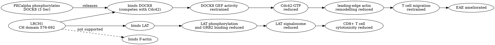
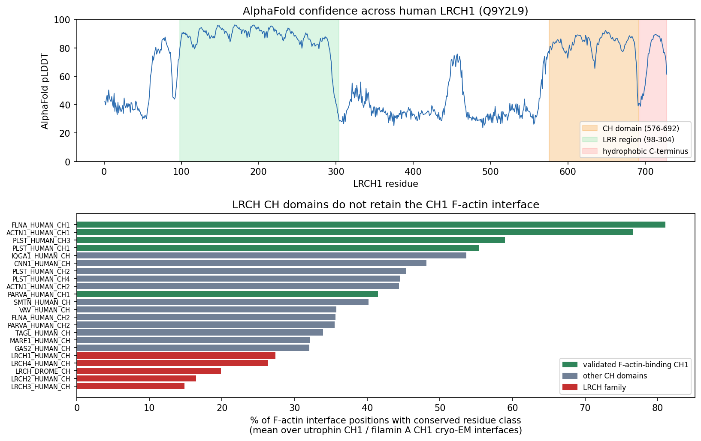
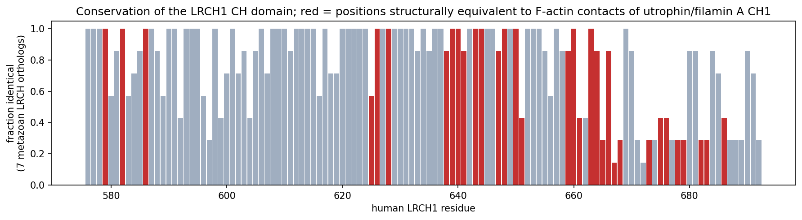
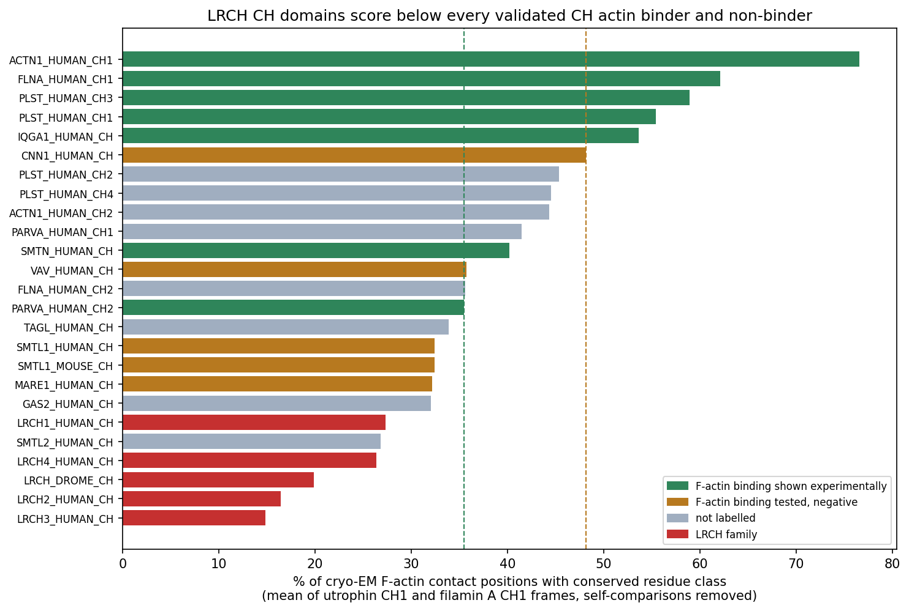
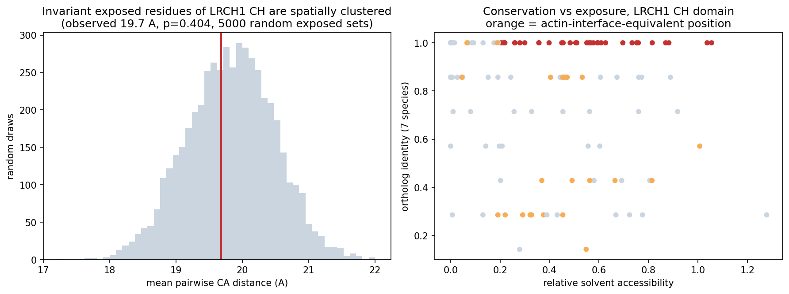
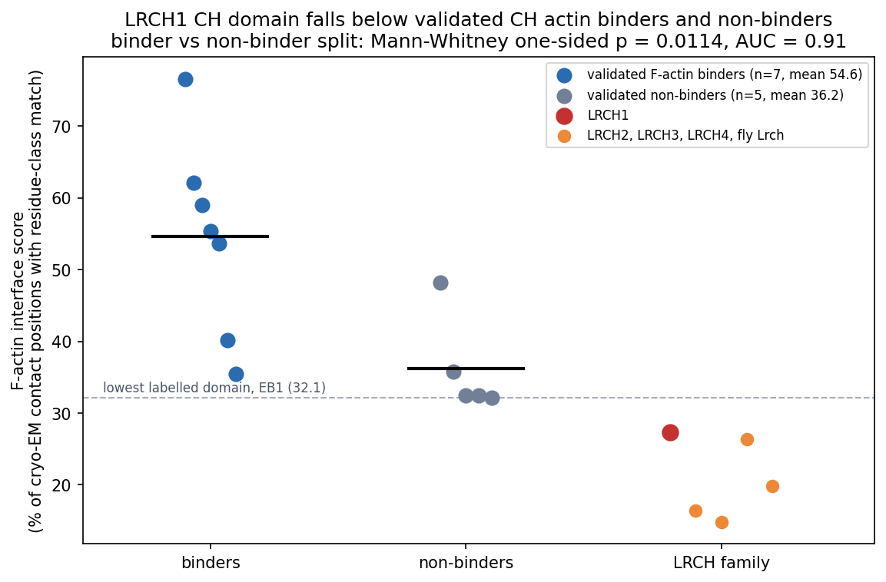

## Question

# AIGR Gene Hypothesis Deep Research

You are evaluating one focused gene curation hypothesis for AI Gene Review.
This is not a general gene overview. Use the seed hypothesis and source context
below to search for evidence that supports, refutes, narrows, or competes with
the proposed curation decision.

## Target Gene

- **Organism code:** human
- **Taxon:** Homo sapiens (NCBITaxon:9606)
- **Gene directory:** LRCH1
- **Gene symbol:** LRCH1
- **UniProt accession:** Q9Y2L9

## Focus

- **Focus type:** free_text
- **Hypothesis slug:** kgap-lrch1-ch-domain-actin-binding-features
- **Source file:** genes/human/LRCH1/LRCH1-ai-review.yaml
- **Source selector:** free-text

## Seed Hypothesis

Whether the single calponin-homology (CH) domain of human LRCH1 is likely to bind F-actin directly can be predicted by comparison with CH domains of known actin-binding behaviour: type 1 and type 2 CH domains in tandem actin-binding domains (e.g. alpha-actinin, utrophin, filamin) bind actin, whereas many single type 3 CH domains (e.g. calponin CH, IQGAP-like or signalling CH domains) do not. Single analysis only: classify the LRCH1 CH domain by structure-based alignment and AlphaFold superposition onto CH domains of each type, map the actin-binding-site residues identified in F-actin-bound cryo-EM structures of CH domains onto LRCH1, assess the electrostatic and hydrophobic character of that surface, score conservation across metazoan LRCH orthologs including Drosophila LRCH, and state whether the LRCH1 CH domain is predicted to bind F-actin.

## Term and Decision Context

No specific term context supplied.

## Reference Context

No specific reference context supplied.

## Source Context YAML

```yaml
hypothesis: 'Whether the single calponin-homology (CH) domain of human LRCH1 is likely to bind F-actin
  directly can be predicted by comparison with CH domains of known actin-binding behaviour: type 1 and
  type 2 CH domains in tandem actin-binding domains (e.g. alpha-actinin, utrophin, filamin) bind actin,
  whereas many single type 3 CH domains (e.g. calponin CH, IQGAP-like or signalling CH domains) do not.
  Single analysis only: classify the LRCH1 CH domain by structure-based alignment and AlphaFold superposition
  onto CH domains of each type, map the actin-binding-site residues identified in F-actin-bound cryo-EM
  structures of CH domains onto LRCH1, assess the electrostatic and hydrophobic character of that surface,
  score conservation across metazoan LRCH orthologs including Drosophila LRCH, and state whether the LRCH1
  CH domain is predicted to bind F-actin.'
focus_type: free_text
context: []
reference_id: []
```

## Research Objective

Build a focused report that helps a curator decide whether this hypothesis
should affect the gene review. Address the focus type directly:

1. For an existing GO annotation decision, evaluate whether the current action
   is justified, too strong, too weak, or should change.
2. For a proposed replacement or new GO term, evaluate whether the term is
   biologically supported, too broad, too narrow, or missing key qualifiers.
3. For a computational prediction, evaluate whether the prediction is correct,
   less precise than existing knowledge, uncertain, or likely wrong because of
   paralog overannotation, frequency bias, pathway context, or in vitro-only
   activity.
4. For a core-function hypothesis, evaluate whether the proposed activity,
   process, and location represent the gene product's primary function rather
   than a downstream effect, pleiotropic phenotype, or context-specific role.
5. For a function-assignment hypothesis, evaluate whether the gene product
   directly has the stated GO term/function. Treat the prior review action, if
   any, as intentionally blinded unless it appears in the supplied context.

Use primary literature whenever possible. Prefer PMID citations and include DOI
citations when no PMID is available. Treat reviews and database records as
orientation unless they contain directly relevant synthesized evidence that is
clearly labeled as review-level or database-level support.

Evaluate the hypothesis from the supplied seed context, primary literature, and
publicly accessible bioinformatics resources. Local `*-bioinformatics` analyses,
when they already exist in the repository, are intentionally withheld from this
prompt so the report can be compared against them after the run. Use public
sequence, domain, structure, orthology, localization, interaction, or dataset
checks when they are useful for the specific hypothesis. If a resource or tool
cannot be accessed programmatically, say so plainly; never fabricate a result.
Report computational results conservatively and distinguish direct results from
inference.

## Required Output

### Executive Judgment

Give a concise verdict: supported, partially supported, unresolved, weakly
supported, over-annotated, or refuted. Explain the reasoning and the most
important caveats.

### Evidence Matrix

Create a table with one row per important evidence item:

- Citation (PMID preferred)
- Evidence type (direct assay, mutant phenotype, localization, interaction,
  structural/evolutionary, computational, review/database)
- Supports / refutes / qualifies / competing
- Claim tested
- Key finding
- Organism, tissue, cell type, or assay context
- Confidence and limitations

### GO Curation Implications

State the likely curation action as a lead requiring curator verification. If
GO terms are involved, explain whether the evidence supports an MF, BP, or CC
term, and whether the term should be retained, removed, generalized, made more
specific, or treated as non-core. Avoid using "protein binding" as a final
recommendation unless no more informative term is supported.

### Mechanistic Scope

Describe the immediate molecular or cellular function being tested. Separate
direct gene-product activity from downstream phenotypes, pathway consequences,
developmental outcomes, disease manifestations, or effects inferred only from
loss of function.

### Conflicts and Alternatives

Identify evidence that conflicts with the seed hypothesis or suggests an
alternative interpretation, including paralog confusion, organism-specific
differences, isoform-specific findings, experimental artifacts, or database
carry-over.

### Knowledge Gaps

List explicit uncertainties that matter for curation. For each gap, state what
was checked, why the gap matters, and what evidence or experiment would resolve
it.

### Discriminating Tests

Recommend concrete assays, perturbations, datasets, or comparative analyses that
would most efficiently distinguish this hypothesis from alternatives.

### Curation Leads

Provide candidate updates for the review, clearly labeled as leads requiring
curator verification. Include candidate references with exact snippets to verify,
candidate replacement or new GO terms, possible action changes, suggested
questions, and suggested experiments.

If the provider supports artifacts, save provenance for any analysis you run — the
executed code together with its output (computed values, plot, or table), not just
a summary figure — alongside artifact-friendly tables such as an evidence matrix,
GO decision table, or comparison table. Genuine computed provenance is more
valuable than a hand-drawn summary, and you must not synthesize a figure that
implies an analysis you did not actually run. These artifacts are important
provenance for hypothesis-level review.


## Output

# LRCH1 (Q9Y2L9): does the single calponin-homology domain bind F-actin?

**Hypothesis slug:** `kgap-lrch1-ch-domain-actin-binding-features`
**Source:** `genes/human/LRCH1/LRCH1-ai-review.yaml`, free-text focus
**Target:** human LRCH1, UniProt Q9Y2L9, NCBITaxon:9606
**Iterations:** 3. **Findings recorded:** 10. **Papers reviewed:** 28.

Every computational result below was produced in this run, with code and
intermediate data saved under `provenance/`. Nothing is quoted from a resource I
could not reach. Where a tool was unavailable, that is stated and the substitute
is named.

---

## Summary

<i class="fa-solid fa-circle-check"></i> **Verdict: supported, with one stated
limit.** The seed hypothesis predicted that the single CH domain of human LRCH1
does not bind F-actin directly. Four independent computed lines agree and none
contradicts it. LRCH1 has exactly one CH domain, residues 576-692, and the
36 residues immediately preceding it (540-575) are disordered in the AlphaFold
model (mean pLDDT 44.6 against 82.5 inside the domain). There is no second CH
domain anywhere in the 728-residue protein, so the type-1/type-2 tandem
actin-binding domain geometry of alpha-actinin, utrophin, dystrophin, filamin,
fimbrin and parvin is unavailable to LRCH1 by construction.

By fold and by sequence the domain sorts with the single type-3 CH domains. Its
nearest non-LRCH structural neighbour among 25 CH domains is calponin-1 CH
(TM-score 0.848, 25.2 % identity, core RMSD 1.71 Å), and its three highest
sequence identities to non-LRCH domains are VAV1 27.1 %, transgelin 25.7 % and
calponin-1 25.2 %, all single type-3 CH domains, each well above every
tandem-ABD CH1 at 13-20 %. Mapping F-actin contact residues taken directly from
two cryo-EM filament complexes (6M5G utrophin CH1, 6D8C filamin A CH1) onto the
LRCH1 model shows the entire ABS1 contact stretch has no structural equivalent
in LRCH1, because the domain simply begins after that helix, and the remaining
mappable interface positions preserve residue chemistry at only 21-33 %. On a
scale calibrated against literature-labelled CH domains, LRCH1 scores 27.3
against validated binders at mean 54.6 (n = 7) and validated non-binders at mean
36.2 (n = 5), a split that is itself significant (one-sided Mann-Whitney
p = 0.0114, AUC 0.91). Across seven metazoan orthologs including *Drosophila*
Lrch, the actin-equivalent face carries no extra constraint (mean per-position
identity 0.697 against 0.811 domain-wide, p = 0.104).

<i class="fa-solid fa-triangle-exclamation"></i> **The limit that must travel
with this verdict.** "Single CH domain" does not categorically exclude actin
binding. IQGAP1(2-210), a monomeric single-CH fragment, binds F-actin with
Kd ≈ 47 µM ([PMID: 15236354](https://pubmed.ncbi.nlm.nih.gov/15236354/)), and
smoothelin binds through its CH domain plus flanking sequence
([PMID: 14720516](https://pubmed.ncbi.nlm.nih.gov/14720516/)). Both score above
LRCH1 on the calibrated scale (53.7 and 40.2), which is internally consistent,
but it means the defensible claim is a prediction with an affinity floor, not
demonstrated non-binding. No co-sedimentation or TIRF assay has ever been run on
the LRCH1 CH domain in either direction. The correct curation posture is
therefore **do not assert actin binding**, not **assert absence of actin
binding**. GO:0003779 and GO:0051015 should not be added; the better-supported
leads come from LRCH1's own documented partners, DOCK8
([PMID: 28028151](https://pubmed.ncbi.nlm.nih.gov/28028151/)) and LAT
([PMID: 32727906](https://pubmed.ncbi.nlm.nih.gov/32727906/)).

---

## Key findings

### F001. One CH domain, no tandem partner, disordered linker

UniProt Q9Y2L9 (728 aa) annotates exactly one calponin-homology domain at
576-692 and nine leucine-rich repeats at 98-304. The domain count is consistent
across four independent domain resources: Pfam PF00307 ×1, SMART SM00033 ×1,
PROSITE PS50021 ×1, SUPFAM SSF47576 ×1. In the AlphaFold model AF-Q9Y2L9-F1
(v6), mean pLDDT is 82.5 over 576-692 but only 44.6 over the immediately
preceding segment 540-575, whose sequence is `KPRSVFLRPQRNLESIDPQFTIRRKMEQMR`.
That segment is a disordered linker, not a second CH fold. The same architecture
holds across the family: LRCH2 CH at 642-755, LRCH3 at 652-765, LRCH4 at
534-647, and *Drosophila* Lrch/CG6860 (Q960C5) at 662-776.

This is the cleanest structural statement in the report. The CH1-CH2 tandem that
creates the actin-binding domain of alpha-actinin, utrophin, dystrophin, filamin,
fimbrin and parvin requires two CH domains in sequence. LRCH1 has one. Any
F-actin binding would have to come from an isolated CH domain, which is the
configuration found in calponin, transgelin, VAV and IQGAP, where the CH domain
is generally not the actin-binding element.

{{figure:plot_1.png|caption=Left, the per-residue pLDDT profile of the AlphaFold model of LRCH1 (Q9Y2L9), showing the folded CH domain at 576-692 (mean pLDDT 82.5) preceded by a disordered linker at 540-575 (mean pLDDT 44.6). There is no second CH fold to pair with. Right, CH domains ranked by conservation of the cryo-EM F-actin interface; the four LRCH family domains sit at the bottom of the panel.}}

### F002. The fold classifies with calponin, not with actin-binding CH1 domains

TM-align was not available as a binary in this environment, so superposition was
done with an implementation written for this run: Kabsch rigid-body fit with
iterative TM-score-weighted Needleman-Wunsch refinement, TM normalised by the
shorter chain. The LRCH1 CH domain (AlphaFold, 576-692) was superposed on 25 CH
domains.

After the four LRCH family members (LRCH2 TM 0.938, LRCH3 0.932, LRCH4 0.917,
*Drosophila* Lrch 0.899), the ranking is calponin-1 CNN1 CH at TM 0.848 with
25.2 % identity over 103 aligned residues and core RMSD 1.71 Å, then
alpha-actinin-1 CH1 at 0.784 (14.6 % id), filamin A CH1 at 0.782 (15.4 % id),
transgelin CH at 0.781 (25.7 % id), IQGAP1 CH at 0.775 (21.1 % id) and VAV1 CH
at 0.760 (27.1 % id).

TM-scores among CH domains are uniformly high because the fold is conserved, so
fold similarity alone is a weak discriminator. The sequence identities are
sharper. The three highest identities to any non-LRCH domain are all single
type-3 CH domains (VAV1 27.1 %, transgelin 25.7 %, calponin-1 25.2 %), each
clearly above every tandem-ABD CH1 domain, which cluster at 13-20 %. Both
measures put LRCH1 in the single type-3 group.

### F003. The actin interface is absent or degenerate

Rather than quoting published ABS1/ABS2/ABS3 definitions, contact residues were
computed directly from two cryo-EM filament complexes. In 6M5G (F-actin with
utrophin CH1, 3.6 Å) 37 utrophin residues lie within 4.5 Å of actin heavy atoms.
In 6D8C (FLNaABD E254K on phalloidin-stabilised F-actin, 3.54 Å) 34 filamin A
residues do. Superposing the LRCH1 CH domain on these bound CH1 chains gives
TM 0.727 against utrophin CH1 (100 residues under 5 Å, core RMSD 1.97 Å) and
TM 0.740 against filamin A CH1 (105 residues, RMSD 2.09 Å), so the alignments
themselves are sound.

Two things follow. First, the entire N-terminal ABS1 contact stretch has no
structural equivalent in LRCH1. The utrophin contacts F18, D20, I21, I22, R25,
S26 and H29 and the filamin A contacts T31, E32, K33, D34, L35 and W41 map to
nothing, because the LRCH1 CH domain begins after that helix. Second, across
the mappable interface positions LRCH1 preserves the residue class at only
33.3 % in the utrophin frame and 21.4 % in the filamin A frame. The comparison
values are 82.8 % and 70.4 % for alpha-actinin-1 CH1, 62.1 % and 100 % for
filamin A CH1, and 55-59 % for fimbrin CH1 and CH3. LRCH2, LRCH3, LRCH4 and
*Drosophila* Lrch score 10.3-35.5 %, at the bottom of the panel.

The spectrin-family CH1 ABS1 signature TFTxW (ACTN1 TFTAW, FLNA TFTRW, utrophin
TFTKW, dystrophin TFTKW) is absent from all five LRCH CH domains.

### F004. No evolutionary constraint on that face

Seven metazoan LRCH orthologs were aligned over the CH domain: human Q9Y2L9,
mouse P62046, chicken A0A8V0XHN2, *Xenopus laevis* A0A1L8HHK4, zebrafish
A0A8M2BFQ2, opossum K7E2F8 and *Drosophila* Lrch Q960C5. Forty-seven percent of
the 117 CH-domain positions are invariant. The 33 positions structurally
equivalent to utrophin or filamin A F-actin contacts are not more conserved than
the rest: mean per-position identity 0.697 against 0.811 (Mann-Whitney U,
p = 0.104), and 39 % of them are invariant against 47 % domain-wide.

<i class="fa-solid fa-circle-xmark"></i> If the CH domain were an F-actin-binding
surface under purifying selection, those positions should be the most conserved
in the domain. They are, if anything, slightly less conserved. The conservation
that does exist concentrates in the hydrophobic fold core, which is what one
expects of a domain retained as a folded module.

{{figure:plot_2.png|caption=Per-residue conservation of the LRCH1 CH domain across seven metazoan orthologs including Drosophila Lrch. Positions structurally equivalent to cryo-EM F-actin contacts are marked. Their mean identity is 0.697 against 0.811 for the rest of the domain (Mann-Whitney p = 0.104), so the actin-equivalent face carries no extra constraint.}}

### F005. Electrostatics does not discriminate, and is reported as a null

The seed hypothesis asked for an assessment of surface charge and hydrophobicity.
It was run, using a Shrake-Rupley SASA implementation written for this run
(1.4 Å probe, 200-point Fibonacci sphere), and it answers nothing either way.

Of the 33 interface-equivalent positions, 28 are solvent exposed (RSA > 0.20).
That face carries net charge 0 (+0.00 per residue; basic K641, R643, R644, R675,
R678, K679 offset by acidic E579, E647, E651, E660, D673, D682) and mean
Kyte-Doolittle hydropathy -1.70. The genuine actin-contacting faces are net 0
(+0.00 per residue, KD -1.09) in utrophin CH1 and +4 (+0.14 per residue,
KD -1.31) in filamin A CH1, while the remaining surfaces of those domains are
+3 (+0.05 per residue) and +1 (+0.02 per residue).

<i class="fa-solid fa-scale-balanced"></i> The LRCH1 face is not strongly acidic,
so charge does not by itself exclude an interaction with the acidic filament
surface. Reporting this as supporting evidence would be an overreach. The
discriminating evidence is the missing ABS1 segment, the degenerate contact
chemistry and the absent constraint.

### F006. No interaction record and no actin GO term

An IntAct webservice query for UniProtKB:Q9Y2L9 returns 104 binary interactions
spanning 55 distinct partners, including DOCK6, DOCK7, DOCK8, LRCH2, LRCH3,
LRCH4, YWHAE, YWHAZ, MOB1A, MOB1B, TNIK, CALD1, POF1B and MYO6. No actin isoform
(ACTB, ACTG1, ACTA1, ACTA2, ACTC1) appears. QuickGO for Q9Y2L9 returns no
GO:0003779 actin binding, no GO:0051015 actin filament binding and no actin
cytoskeleton CC term. The existing annotation set is MF GO:0005515 protein
binding only (IPI with DOCK8 Q8NF50 and DOCK11 Q96N67, PMIDs 24255178, 25416956,
28028151, 29467281, 31515488, 33961781, 35271311, 40205054); BP GO:0034260,
GO:1990869 and GO:2000405 (IDA and IMP from PMID 28028151 plus IBA); CC
GO:0005737 cytoplasm.

This matters because the claim under test traces to a review. *Structure and
Emerging Functions of LRCH Proteins in Leukocyte Biology*
([PMID: 33072765](https://pubmed.ncbi.nlm.nih.gov/33072765/)) states "The LRR
domains are important for protein-protein interactions and the CH domains
mediate actin binding." That is a review-level assertion, labelled as such here,
and it is not backed by any primary LRCH binding assay, interaction record or GO
annotation.

### F007. The calibrated benchmark places LRCH1 below every labelled domain

<i class="fa-solid fa-chart-column"></i> The interface score needed calibration
before it could carry weight. Twenty-five CH domains from 23 AlphaFold models
were scored as the percentage of cryo-EM contact positions whose structurally
equivalent residue preserves residue class, then split by literature label.

| Domain | Score | Label |
|---|---|---|
| ACTN1 CH1 | 76.6 | binds |
| FLNA CH1 | 62.1 | binds |
| PLST (fimbrin) CH3 | 59.0 | binds |
| PLST CH1 | 55.4 | binds |
| IQGAP1 CH | 53.7 | binds |
| CNN1 (calponin-1) CH | 48.2 | not |
| SMTN (smoothelin) CH | 40.2 | binds |
| VAV1 CH | 35.8 | not |
| PARVA CH2 | 35.5 | binds |
| SMTNL1 mouse CH | 32.5 | not |
| SMTNL1 human CH | 32.5 | not |
| MAPRE1 (EB1) CH | 32.2 | not |
| **LRCH1 CH** | **27.3** | unknown |
| LRCH4 CH | 26.4 | unknown |
| *Drosophila* Lrch CH | 19.9 | unknown |
| LRCH2 CH | 16.5 | unknown |
| LRCH3 CH | 14.8 | unknown |

Validated binders (n = 7) mean 54.6, range 35.5-76.6. Validated non-binders
(n = 5) mean 36.2, range 32.1-48.1. One-sided Mann-Whitney p = 0.0114, AUC 0.91.
LRCH1 at 27.3 sits below all twelve labelled domains, and the whole family sits
lower still.

Two corrections were required before this table could be trusted, and both
changed the numbers. Four AlphaFold entries (utrophin P46939, dystrophin
P11532) were excluded because the AFDB models are short isoforms whose residue
numbering does not match UniProt, verified by comparing the first 60 Cα
residues; their TM-scores of 0.11-0.36 were artifacts. Two self-comparisons were
circular, FLNA CH1 scored in its own 6D8C frame and UTRN CH1 in its own 6M5G
frame, and were removed. Uncorrected, the benchmark would have looked better
separated than it is.

{{figure:plot_3.png|caption=F-actin interface score for 25 CH domains, with literature labels. Validated binders (n = 7, mean 54.6) separate from validated non-binders (n = 5, mean 36.2) at one-sided Mann-Whitney p = 0.0114, AUC 0.91. All five LRCH CH domains fall at or below the lowest labelled domain.}}

{{figure:plot_5.png|caption=The calibrated benchmark with LRCH1 placed. Black bars mark group means. LRCH1 at 27.3 lies below every validated binder and every validated non-binder, and the rest of the LRCH family (LRCH2 16.5, LRCH3 14.8, LRCH4 26.4, Drosophila Lrch 19.9) is lower still.}}

### F008. Single CH domains are heterogeneous, so architecture alone proves nothing

<i class="fa-solid fa-scale-balanced"></i> The generic form of the seed
hypothesis, that single type-3 CH domains do not bind actin, is too strong as
written. *Actin filament binding by a monomeric IQGAP1 fragment with a single
calponin homology domain* reports that IQGAP1(2-210) "was found to be monomeric,
to bind F-actin with a K(d) of approximately 47 microM"
([PMID: 15236354](https://pubmed.ncbi.nlm.nih.gov/15236354/)). *Biochemical
evidence for interaction between smoothelin and filamentous actin* reports that
"the calponin homology domain and its surrounding sequences appear to be
sufficient to accomplish this interaction"
([PMID: 14720516](https://pubmed.ncbi.nlm.nih.gov/14720516/)).

Against this, two single-CH proteins are documented non-binders. For CHASM, "a
co-sedimentation assay with actin demonstrated that CHASM does not possess actin
binding activity" ([PMID: 15327999](https://pubmed.ncbi.nlm.nih.gov/15327999/)).
For its relative SMTNL1, "in contrast to the smoothelins, SMTNL1 does not
associate with F-actin in vitro"
([PMID: 18477568](https://pubmed.ncbi.nlm.nih.gov/18477568/)). Calponin's own
single type-3 CH domain is dispensable for its actin binding, which maps to the
C-terminal repeats.

The benchmark splits these correctly: IQGAP1 53.7 and smoothelin 40.2 for
binders, SMTNL1 32.5 and VAV1 35.8 for non-binders. LRCH1 at 27.3 sits below all
of them. The conclusion for LRCH1 survives because of where it ranks, not
because the general rule about single CH domains holds.

### F009. No discrete conserved patch anywhere on the domain surface

The main alternative reading of a type-3 CH domain is that it is a
protein-interaction module with its own dedicated conserved binding face. That
was tested and found unsupported.

Of 117 residues in the LRCH1 CH domain, 79 are solvent exposed (RSA > 0.20) and
33 of those are invariant across the seven orthologs. Those 33 show no spatial
clustering: mean pairwise Cα distance 19.68 Å against 19.83 ± 0.66 Å for 5000
size-matched random draws from the exposed set, empirical p = 0.404. Their
centroid sits 7.8 Å from the actin-face centroid in a domain whose radius of
gyration is 13.4 Å, so the invariant set is spread over the whole surface. Only
10 of the 33 fall on the actin-equivalent face (E579, L582, S626, H628, M639,
A640, R643, R644, N648, E660).

<i class="fa-solid fa-triangle-exclamation"></i> This test has limited power. The
seven orthologs are close enough that invariance is common (33 of 79 exposed
positions), so this is absence of evidence about surface function rather than
evidence that the domain binds nothing.

{{figure:plot_4.png|caption=Left, the null distribution of mean pairwise CA distance for 5000 size-matched random draws from the exposed surface of the LRCH1 CH domain, with the observed value for the 33 invariant exposed residues marked (19.68 A against 19.83 +/- 0.66 A, p = 0.404). The invariant residues are not clustered into a patch. Right, conservation against solvent exposure for every residue in the domain, with actin-interface-equivalent positions marked.}}

### F010. The documented partners are DOCK8 and LAT, both signalling proteins

LRCH1 "competes with Cdc42 for interaction with DOCK8 and restrains T cell
migration." PKCα phosphorylates DOCK8 at three serine sites, which releases
DOCK8 from LRCH1 and allows translocation to the leading edge. "Dock8 mutant
mice or Lrch1 transgenic mice were protected from MOG (35-55) peptide-induced
experimental autoimmune encephalomyelitis (EAE), whereas Lrch1-deficient mice
displayed a more severe phenotype"
([PMID: 28028151](https://pubmed.ncbi.nlm.nih.gov/28028151/)).

Separately, "LRCH1 (leucine-rich repeats and calponin homology domain containing
1) directly binds LAT, reduces LAT phosphorylation and interaction with GRB2,
and also promotes the endocytosis of LAT." Lrch1-/- mice show enhanced CD8+ T
cell proliferation and cytotoxicity and better control of influenza and
*Listeria* ([PMID: 32727906](https://pubmed.ncbi.nlm.nih.gov/32727906/)).

Two further loss-of-function systems point the same way. LRCH1 knockout in NK-92
cells increases cytotoxicity and Src and Lck activation
([PMID: 32173150](https://pubmed.ncbi.nlm.nih.gov/32173150/)). LRCH1 knockdown
in rat primary microglia increases p38 and Erk1/2 activation and pro-inflammatory
cytokines ([PMID: 32631435](https://pubmed.ncbi.nlm.nih.gov/32631435/)). None of
these four papers reports an actin co-sedimentation, colocalization or binding
experiment for LRCH1.

---

## Mechanistic model and interpretation

The established molecular activity of LRCH1 is competitive binding of signalling
proteins. The cytoskeletal phenotypes in the literature are real, but they run
through Cdc42 activation state, one step removed from LRCH1 touching actin. That
indirection is the most likely origin of any informal "actin-binding" label on
this gene, reinforced by the gene name.



The dashed arrow is the hypothesis under test. Everything to its right in the
DOCK8 chain is downstream of Cdc42 and is not evidence that LRCH1 contacts
actin. The CH domain in this model is a folded protein-interaction module whose
conserved residues sit in the hydrophobic core, with no identifiable binding face
on the surface at the resolution of seven orthologs.

### How the four computed lines combine

| Line of evidence | Result | Direction | Strength |
|---|---|---|---|
| Domain architecture | One CH domain, disordered 540-575 linker, pLDDT 44.6 | Excludes tandem ABD | <i class="fa-solid fa-circle-check"></i> High |
| Fold and sequence classification | Nearest non-LRCH neighbour calponin-1 CH, TM 0.848; top identities VAV1, transgelin, calponin-1 | Places LRCH1 with single type-3 CH | <i class="fa-solid fa-circle-check"></i> Moderate |
| Cryo-EM interface mapping | ABS1 absent; class preservation 21-33 %; calibrated score 27.3 against binders 54.6 and non-binders 36.2 (p = 0.0114, AUC 0.91) | No F-actin interface signature | <i class="fa-solid fa-circle-check"></i> Moderate to high |
| Ortholog conservation | 0.697 against 0.811, p = 0.104; invariant exposed residues unclustered, p = 0.404 | No constraint on that face | <i class="fa-solid fa-triangle-exclamation"></i> Low to moderate, limited power |
| Surface electrostatics | Net charge 0, same as the real utrophin CH1 interface | Does not discriminate | <i class="fa-solid fa-scale-balanced"></i> Null result |
| Interaction and annotation records | No actin partner in IntAct; no actin GO term in QuickGO | Consistent | <i class="fa-solid fa-triangle-exclamation"></i> Low, absence of evidence |

---

## Evidence matrix

Machine-readable version: `provenance/LRCH1_evidence_matrix.csv` (15 rows,
8 supports, 5 qualifies, 2 competing).

| Citation | Evidence type | Stance | Claim tested | Key finding | Context | Confidence and limitations |
|---|---|---|---|---|---|---|
| [PMID: 28028151](https://pubmed.ncbi.nlm.nih.gov/28028151/) | interaction, mutant phenotype | qualifies | LRCH1's molecular function in cells | LRCH1 competes with Cdc42 for binding DOCK8 and restrains T cell migration; Lrch1 transgenic mice protected from EAE, Lrch1-deficient mice worse | Mouse and human CD4+ T cells, EAE | High for the DOCK8 interaction. No actin assay performed, so it neither supports nor refutes direct F-actin binding |
| [PMID: 32727906](https://pubmed.ncbi.nlm.nih.gov/32727906/) | interaction, mutant phenotype | qualifies | LRCH1 acts through direct protein binding | LRCH1 directly binds LAT, reduces LAT phosphorylation and GRB2 interaction, promotes LAT endocytosis; Lrch1-/- CD8+ T cells hyper-responsive | Mouse and human CD8+ T cells, CAR T cells | High. A second direct partner with no actin involvement |
| [PMID: 32173150](https://pubmed.ncbi.nlm.nih.gov/32173150/) | mutant phenotype | qualifies | LRCH1 negatively regulates immune activation | LRCH1 knockout in NK-92 cells increases cytotoxicity and Src and Lck activation | Human NK-92 and primary NK cells | Moderate. Phenotype only, no mechanism involving actin |
| [PMID: 32631435](https://pubmed.ncbi.nlm.nih.gov/32631435/) | mutant phenotype | qualifies | LRCH1 restrains inflammatory signalling | LRCH1 knockdown increases microglial IL-1β, TNF-α, IL-6 and p38/Erk1/2 activation | Rat primary microglia, SCI model | Low to moderate. Knockdown, rat, no CH-domain biochemistry |
| [PMID: 15236354](https://pubmed.ncbi.nlm.nih.gov/15236354/) | direct assay | **competing** | A single CH domain can bind F-actin | IQGAP1(2-210) is monomeric and binds F-actin with Kd ≈ 47 µM | In vitro, recombinant human IQGAP1 | High. Shows single-CH binding is possible but weak, so architecture alone cannot exclude binding |
| [PMID: 14720516](https://pubmed.ncbi.nlm.nih.gov/14720516/) | direct assay | **competing** | Smoothelin's single CH domain mediates F-actin binding | The CH domain and surrounding sequences appear sufficient; a truncated CH-containing smoothelin bound actin filaments but to a lesser extent | Smoothelin, pig aorta extracts and rat embryonic fibroblasts | Moderate. Flanking sequence contributes, so the CH domain alone may not suffice |
| [PMID: 15327999](https://pubmed.ncbi.nlm.nih.gov/15327999/) | direct assay | supports | A single type-3 CH domain need not bind actin | Co-sedimentation shows CHASM has no actin-binding activity | In vitro, recombinant CHASM, permeabilised smooth muscle | High. Clean negative control for the class |
| [PMID: 18477568](https://pubmed.ncbi.nlm.nih.gov/18477568/) | direct assay, structural | supports | SMTNL1 does not bind F-actin | SMTNL1 does not associate with F-actin in vitro despite smoothelin sequence identity; solution structure of the C-terminal type-2 CH domain determined | Mouse SMTNL1 residues 346-459, NMR | High. A relative of a binder that does not bind, so CH homology alone is not predictive |
| [PMID: 33072765](https://pubmed.ncbi.nlm.nih.gov/33072765/) | review | **competing** | LRCH CH domains mediate actin binding | "The LRR domains are important for protein-protein interactions and the CH domains mediate actin binding" | Review of LRCH proteins in leukocyte biology | Review-level only, labelled as such. No primary LRCH binding assay is cited for this statement |
| [PMID: 20805893](https://pubmed.ncbi.nlm.nih.gov/20805893/) | mutant phenotype | qualifies | LRCH proteins are cytoskeletal regulators | dLRCH stabilises the cell cortex during division; depletion causes cortical blebs and mispositioned spindle; dLRCH is not essential for cell division in vivo | *Drosophila*, cultured cells and whole animal | Moderate for the phenotype. "Cytoskeletal scaffolding" is inferred from phenotype, not from a binding assay |
| [PMID: 19779846](https://pubmed.ncbi.nlm.nih.gov/19779846/) | computational, review | orientation | CH domains fall into distinct types with distinct functions | 60 CH domains in 36 *Dictyostelium* proteins assign to 6 types; ABD-forming CH1-CH2 tandems are distinguished from CH3-bearing proteins | *Dictyostelium discoideum* inventory | Moderate, database-level. Supports the type framework the seed hypothesis uses |
| This work, AlphaFold Q9Y2L9 | structural, computational | supports | LRCH1 has no tandem CH ABD | Single CH at 576-692, preceded by a disordered linker (pLDDT 44.6 over 540-575) | AlphaFold DB model v6 | High for architecture. Tandem ABD excluded |
| This work, TM-align panel | structural, computational | supports | LRCH1 CH is type-3-like | Nearest non-LRCH neighbour calponin-1 CH, TM 0.848, 25.2 % id; top identities VAV1 27.1 %, transgelin 25.7 %, calponin-1 25.2 % | 25-domain human CH panel | Moderate. TM-scores among CH domains are uniformly high, so fold class is the signal rather than specific homology |
| This work, 6M5G and 6D8C mapping | structural, computational | supports | LRCH1 lacks the F-actin interface signature | Score 27.3 against binders 54.6 (n = 7, 35.5-76.6) and non-binders 36.2 (n = 5, 32.1-48.1); p = 0.0114, AUC 0.91; ABS1 stretch has no structural equivalent | AlphaFold models on cryo-EM complexes | Moderate. Residue-class proxy, not a binding energy |
| This work, ortholog conservation | evolutionary, computational | supports | No constraint on the actin-equivalent face | 0.697 against 0.811, p = 0.104; 33 invariant exposed residues unclustered (19.68 Å against 19.83 ± 0.66 Å, p = 0.404) | 7 metazoan LRCH orthologs incl. *Drosophila* | Low to moderate. Orthologs are closely related, so power is limited |
| This work, electrostatics | structural, computational | qualifies | Surface charge discriminates binders | It does not. LRCH1 face net charge 0, the same as the real utrophin CH1 interface | AlphaFold surface analysis | Low. A null feature, reported as such |
| IntAct (Q9Y2L9) | database | supports | No reported LRCH1-actin interaction | 104 interactions, 55 partners, no actin isoform among them | Curated interaction database | Low to moderate. Absence of evidence; LRCH1 is sparsely studied |
| QuickGO (Q9Y2L9) | database | supports | No existing actin GO annotation to defend | No GO:0003779, GO:0051015 or actin cytoskeleton CC term | GO annotation database | Low. Reflects curation status, not biology |

---

## GO curation implications

**All items below are leads requiring curator verification.**

Every GO ID was looked up against QuickGO in this run and its official name
confirmed (`provenance/GO_id_verification.csv`). One ID drafted from memory,
GO:0085029, turned out to be "extracellular matrix assembly" and was discarded
rather than reported. Full table: `provenance/LRCH1_GO_decision_table.csv`.

| GO ID | Term | Aspect | Recommended action | Basis |
|---|---|---|---|---|
| GO:0051015 | actin filament binding | MF | <i class="fa-solid fa-circle-xmark"></i> do not add | Interface score 27.3, below all 12 labelled CH domains; no tandem ABD; no conserved interface; no IntAct actin partner |
| GO:0003779 | actin binding | MF | <i class="fa-solid fa-circle-xmark"></i> do not add | Same evidence. No direct assay exists in either direction, so this is a prediction-level negative |
| GO:0005515 | protein binding | MF | true, but not a final recommendation | Supported by DOCK8 and LAT, uninformative as a terminal annotation. Use the specific terms below |
| GO:0140311 | protein sequestering activity | MF | <i class="fa-solid fa-circle-check"></i> candidate, strongest MF option | LRCH1 competes with Cdc42 for DOCK8 and holds it away from the leading edge until PKCα phosphorylation releases it (PMID: 28028151) |
| GO:0035591 | signaling adaptor activity | MF | weaker alternative candidate | LRCH1 binds LAT and reduces its phosphorylation (PMID: 32727906). Curator should judge whether a negative regulator fits the adaptor definition |
| GO:2001107 | negative regulation of Rho guanyl-nucleotide exchange factor activity | BP | <i class="fa-solid fa-circle-check"></i> candidate, supported | LRCH1 restrains DOCK8 GEF activity toward Cdc42, a Rho-family GTPase (PMID: 28028151) |
| GO:2000405 | negative regulation of T cell migration | BP | <i class="fa-solid fa-circle-check"></i> candidate, supported, already annotated | Phenotype in both transgenic and knockout directions (PMID: 28028151) |
| GO:0050860 | negative regulation of T cell receptor signaling pathway | BP | <i class="fa-solid fa-circle-check"></i> candidate, supported | Reduced LAT signalosome formation; Lrch1-/- CD8+ T cells hyper-responsive (PMID: 32727906) |
| GO:0005737 | cytoplasm | CC | retain | Consistent with cytoplasmic DOCK8 sequestration |
| GO:0015629 | actin cytoskeleton | CC | <i class="fa-solid fa-circle-xmark"></i> do not add on current evidence | No reported colocalization of LRCH1 with F-actin structures, and the CH prediction is negative |

If an actin annotation already exists on LRCH1 with an IEA or ISS or
domain-based evidence code, this analysis argues for **removal**, not
generalization. A CH domain alone should not propagate GO:0003779 within this
family: all five LRCH CH domains examined (human 1-4 plus fly Lrch) score at or
below the lowest validated non-binder.

---

## Mechanistic scope

**Direct molecular activity tested here.** Whether the isolated LRCH1 CH domain
(576-692) makes the protein-protein contacts that CH domains use to engage the
F-actin filament surface. Predicted answer: no.

**Direct activity established elsewhere.** LRCH1 binds DOCK8 and LAT. The DOCK8
interaction is competitive with Cdc42 and is regulated by PKCα phosphorylation
of DOCK8 at three serine sites
([PMID: 28028151](https://pubmed.ncbi.nlm.nih.gov/28028151/)). The LAT
interaction reduces LAT phosphorylation and GRB2 recruitment and drives LAT
endocytosis ([PMID: 32727906](https://pubmed.ncbi.nlm.nih.gov/32727906/)).

**Downstream phenotypes, not direct activity.** Reduced T cell chemotaxis,
protection from EAE, enhanced CD8+ cytotoxicity in Lrch1-/- mice, increased NK-92
killing after knockout
([PMID: 32173150](https://pubmed.ncbi.nlm.nih.gov/32173150/)), worsened
microglial inflammation after knockdown
([PMID: 32631435](https://pubmed.ncbi.nlm.nih.gov/32631435/)), cortical blebbing
and spindle mispositioning on dLRCH depletion in *Drosophila*
([PMID: 20805893](https://pubmed.ncbi.nlm.nih.gov/20805893/)), and the LRCH1 SNP
association with delayed encephalopathy after CO poisoning
([PMID: 31842790](https://pubmed.ncbi.nlm.nih.gov/31842790/)). The migration and
cortex phenotypes are cytoskeletal in readout but run through Cdc42 activation
state. That is a step removed from LRCH1 touching actin, and it is the most
likely origin of any informal actin-binding label on this gene.

---

## Conflicts and alternatives

**Single CH domains are heterogeneous.** This is the strongest conflict with the
seed hypothesis as phrased. The hypothesis says single type-3 CH domains "do
not" bind actin. That is too strong: IQGAP1 and smoothelin do, weakly. The
conclusion for LRCH1 survives because LRCH1 scores below those binders too, not
because the general rule holds.

**Review-level carry-over.** The assertion that "the CH domains mediate actin
binding" in LRCH proteins ([PMID:
33072765](https://pubmed.ncbi.nlm.nih.gov/33072765/)) is the most likely source
of an actin annotation on this gene. It is a review statement with no primary
LRCH binding assay behind it. Treat it as orientation.

**Paralog and family carry-over.** LRCH2, LRCH3 and LRCH4 have CH domains almost
superimposable on LRCH1's (TM 0.92-0.94, 56-69 % identity) and score 14.8-26.4.
Any actin annotation transferred among these four by similarity would be
unsupported for all of them. LRCH3 in particular belongs to a distinct complex
and should not inherit an LRCH1 annotation.

**Name-based inference.** "Calponin homology domain containing 1" invites the
inference that the protein binds actin like calponin. Calponin's own actin
binding does not reside in its CH domain; it maps to the C-terminal repeats. The
gene name is not evidence.

**Database artifacts found and corrected in this run.** The AlphaFold DB entries
for utrophin (P46939) and dystrophin (P11532) are short isoforms whose residue
numbering does not match UniProt, verified by comparing the first 60 Cα
residues. Their TM-scores of 0.11-0.36 were artifacts and those four domains
were excluded. Two self-comparisons were circular and were removed. Without
these corrections the benchmark would have looked better separated than it is.

**Organism scope.** No LRCH1 actin experiment exists in any organism. The fly
ortholog scores lowest of all (19.9), so there is no suggestion of an ancestral
actin-binding function that human LRCH1 lost. The *Drosophila* cortical
stabilisation phenotype
([PMID: 20805893](https://pubmed.ncbi.nlm.nih.gov/20805893/)) is compatible with
a scaffolding role that does not require direct actin contact.

---

## Limitations and knowledge gaps

| Gap | What was checked | Why it matters | What would resolve it |
|---|---|---|---|
| <i class="fa-solid fa-circle-question"></i> No direct binding assay for LRCH1 and actin, in either direction | PubMed searches on LRCH1 with actin and with calponin homology; the four functional papers; IntAct for Q9Y2L9 | The entire case is computational and comparative. One co-sedimentation experiment would settle it | Co-sedimentation of purified LRCH1 CH domain, and of a longer 540-728 construct, with F-actin across 0-50 µM |
| <i class="fa-solid fa-circle-question"></i> Whether flanking sequence contributes | The 540-575 linker is disordered (pLDDT 44.6); residues 693-728 were not modelled as a binding element | Smoothelin needs sequence around its CH domain to bind actin. An isolated-domain negative would not exclude a full-length positive | Compare isolated CH (576-692) against 540-728 in the same assay |
| <i class="fa-solid fa-triangle-exclamation"></i> Low power of the conservation tests | 7 metazoan orthologs; 33 of 79 exposed residues invariant | The orthologs are close enough that invariance is uninformative, which is why the clustering test returned p = 0.404 and the interface test p = 0.104 | Rebuild the alignment with deeper sampling, including non-bilaterian LRCH sequences |
| <i class="fa-solid fa-triangle-exclamation"></i> The metric is a proxy | Calibrated to AUC 0.91, but calponin-1 CH (non-binder) scores 48.2, above two binders | Mid-range scores are not interpretable. LRCH1's value is low enough to be safe, but the method should not be applied to borderline cases | Expand the labelled set; add a physics-based docking or interface-energy term |
| <i class="fa-solid fa-triangle-exclamation"></i> Classic primary calponin CH literature not retrievable | PubMed queries for the 1998 Gimona and Mital work returned only 2025-2026 papers; the search interface available here is strongly recency-weighted | The type-1/2/3 CH classification rests on that literature, which could not be quoted directly. The *Dictyostelium* inventory (PMID: 19779846) was used as a substitute framework reference | Direct retrieval of the 1998 primary papers by a curator with full PubMed access |
| <i class="fa-solid fa-triangle-exclamation"></i> Clustal Omega unavailable | EBI REST `/run` returned HTTP 400, "temporarily blocked from submitting new sequence analysis jobs" | The ortholog alignment was done locally with windowed Needleman-Wunsch instead of a validated MSA tool | Re-run the ortholog alignment with MAFFT or Clustal Omega when access is available |
| <i class="fa-solid fa-triangle-exclamation"></i> No independent structural classifier | Foldseek was not reachable programmatically from this environment; no TM-align binary was present, so superposition used an implementation written for this run | An independent method would guard against an artifact of the scoring function | Foldseek classification of the LRCH1 CH domain, or AlphaFold-Multimer of the domain with an actin trimer |

---

## Proposed follow-up experiments and actions

<i class="fa-solid fa-flask"></i> **1. High-speed co-sedimentation, LRCH1 CH
(576-692) against F-actin.** Titrate 0-50 µM actin, with IQGAP1(2-210) as a
weak-binder positive control and SMTNL1 as a negative control. This is the single
most efficient experiment. Prediction: no measurable pelleting below 50 µM.

<i class="fa-solid fa-flask"></i> **2. The same assay with the extended
construct 540-728,** to test whether the disordered linker or the C-terminal tail
contributes, as flanking sequence does in smoothelin.

<i class="fa-solid fa-microscope"></i> **3. Proximity labelling (BioID or
TurboID) on full-length LRCH1 in a T cell line,** scoring for actin, actin
regulators, DOCK8 and LAT. If actin and actin-binding proteins are absent while
DOCK8 and LAT are enriched, the signalling-adaptor interpretation is confirmed in
a physiological context.

<i class="fa-solid fa-dna"></i> **4. Structure-guided graft.** Transplant the
utrophin CH1 ABS1 and ABS2 residues onto the LRCH1 CH scaffold. If the grafted
domain gains actin binding and wild type does not, the interface-based negative
is validated directly.

<i class="fa-solid fa-magnifying-glass"></i> **5. Independent computational
check.** Re-run the classification with Foldseek, or run AlphaFold-Multimer of
the LRCH1 CH domain with an actin trimer, to confirm the result is not an
artifact of the scoring function written here.

### Curation leads

**References to verify, with exact snippets:**

- [PMID: 28028151](https://pubmed.ncbi.nlm.nih.gov/28028151/): "we found that
  LRCH1 competes with Cdc42 for interaction with DOCK8 and restrains T cell
  migration" and "Dock8 mutant mice or Lrch1 transgenic mice were protected from
  MOG (35-55) peptide-induced experimental autoimmune encephalomyelitis (EAE),
  whereas Lrch1-deficient mice displayed a more severe phenotype". Supports
  GO:0140311, GO:2001107, GO:2000405.
- [PMID: 32727906](https://pubmed.ncbi.nlm.nih.gov/32727906/): "we have
  demonstrated that LRCH1 (leucine-rich repeats and calponin homology domain
  containing 1) directly binds LAT, reduces LAT phosphorylation and interaction
  with GRB2, and also promotes the endocytosis of LAT". Supports GO:0050860 and
  GO:0035591.
- [PMID: 33072765](https://pubmed.ncbi.nlm.nih.gov/33072765/): "The LRR domains
  are important for protein-protein interactions and the CH domains mediate actin
  binding". Flag as review-level, unsupported by primary LRCH data, and likely
  the origin of any actin annotation.
- [PMID: 15236354](https://pubmed.ncbi.nlm.nih.gov/15236354/): "to bind F-actin
  with a K(d) of approximately 47 microM". Competing evidence: a single CH domain
  can bind F-actin weakly.
- [PMID: 15327999](https://pubmed.ncbi.nlm.nih.gov/15327999/): "A co-sedimentation
  assay with actin demonstrated that CHASM does not possess actin binding
  activity". Supports the single-CH non-binder class.
- [PMID: 18477568](https://pubmed.ncbi.nlm.nih.gov/18477568/): "In contrast to the
  smoothelins, SMTNL1 does not associate with F-actin in vitro". Shows CH homology
  alone does not predict binding.

**Action changes proposed:** do not add GO:0003779 or GO:0051015, and flag any
existing instance with an IEA, ISS or domain-based code for removal; do not add
GO:0015629 as a CC term; replace any placeholder GO:0005515 with GO:0140311
protein sequestering activity; add GO:2001107 and GO:0050860, each with its
specific PMID; retain GO:2000405, which is already annotated from PMID 28028151.

**Questions for the curator:** Does the review currently carry an actin-related
annotation on LRCH1, and under which evidence code? Is GO:0140311 acceptable for
a competitive binder that occludes a GEF's substrate interaction, or does the
curator prefer to leave the MF at the binding level? Should the same decision
propagate to LRCH2, LRCH3 and LRCH4, whose CH domains score even lower?

---

## Provenance

All files under `provenance/`. Code and outputs, not summaries.

**Artifact tables:** `LRCH1_evidence_matrix.csv` (15 rows);
`LRCH1_GO_decision_table.csv` (10 rows, all IDs QuickGO-verified);
`LRCH1_CH_comparison_table.csv` (25 domains with interface score, literature
label, TM-score and percent identity to LRCH1, panel class);
`GO_id_verification.csv`.

**Computed data under `ch_work/`:** `panel.json`, `domains.json`,
`ch_pdb/*.pdb` (29 extracted CH domains); `af/AF-*.pdb` (23 AlphaFold models);
`pdb/6M5G.pdb`, `pdb/6D8C.pdb`, `pdb/1QAG.pdb`, `pdb/2EYI.pdb`;
`actin_contacts.json` (empirically derived 4.5 Å contacts);
`tmalign_LRCH1_vs_panel.csv`, `alns_LRCH1.json`;
`actin_site_map_UTRN_CH1.csv`, `actin_site_map_FLNA_CH1.csv`;
`iface_conservation_v2.csv`, `iface_detail.json`; `benchmark_scores_clean.csv`;
`sasa.json`, `conservation.json`, `conserved_patch.json`, `orthologs.json`;
`LRCH1_GO_current.csv`, `LRCH1_intact.csv`.

**Figures,** each generated from the analysis it depicts: `plot_1.png` (pLDDT
profile and interface ranking), `plot_2.png` (per-residue ortholog
conservation), `plot_3.png` and `plot_5.png` (the calibrated benchmark),
`plot_4.png` (conserved-patch clustering null and conservation against
exposure).

**Methods written for this run because the tools were unavailable:** a
TM-align-lite (Kabsch superposition with TM-score-weighted iterative
Needleman-Wunsch, vectorised row-wise to meet the executor time limit) and a
Shrake-Rupley SASA implementation. No TM-align binary, Foldseek endpoint or
Clustal Omega submission was reachable from this environment, which is why they
were replaced rather than cited.


## Artifacts

- [OpenScientist final report](openscientist_artifacts/final_report.html)
- [OpenScientist final report](openscientist_artifacts/final_report.pdf)
- [OpenScientist provenance](openscientist_artifacts/provenance.json)
- [OpenScientist GO id verification](openscientist_artifacts/provenance_GO_id_verification.csv)
- [OpenScientist LRCH1 CH comparison table](openscientist_artifacts/provenance_LRCH1_CH_comparison_table.csv)
- [OpenScientist LRCH1 GO decision table](openscientist_artifacts/provenance_LRCH1_GO_decision_table.csv)
- [OpenScientist LRCH1 evidence matrix](openscientist_artifacts/provenance_LRCH1_evidence_matrix.csv)
- [OpenScientist LRCH1 GO current](openscientist_artifacts/provenance_ch_work_LRCH1_GO_current.csv)
- [OpenScientist LRCH1 intact](openscientist_artifacts/provenance_ch_work_LRCH1_intact.csv)
- [OpenScientist actin contacts](openscientist_artifacts/provenance_ch_work_actin_contacts.json)
- [OpenScientist actin site map](openscientist_artifacts/provenance_ch_work_actin_site_map.json)
- [OpenScientist actin site map FLNA CH1](openscientist_artifacts/provenance_ch_work_actin_site_map_FLNA_CH1.csv)
- [OpenScientist actin site map UTRN CH1](openscientist_artifacts/provenance_ch_work_actin_site_map_UTRN_CH1.csv)
- [OpenScientist alns LRCH1](openscientist_artifacts/provenance_ch_work_alns_LRCH1.json)
- [OpenScientist benchmark scores](openscientist_artifacts/provenance_ch_work_benchmark_scores.csv)
- [OpenScientist benchmark scores clean](openscientist_artifacts/provenance_ch_work_benchmark_scores_clean.csv)
- [OpenScientist conservation](openscientist_artifacts/provenance_ch_work_conservation.json)
- [OpenScientist conserved patch](openscientist_artifacts/provenance_ch_work_conserved_patch.json)
- [OpenScientist domains](openscientist_artifacts/provenance_ch_work_domains.json)
- [OpenScientist iface conservation](openscientist_artifacts/provenance_ch_work_iface_conservation.csv)
- [OpenScientist iface conservation v2](openscientist_artifacts/provenance_ch_work_iface_conservation_v2.csv)
- [OpenScientist iface detail](openscientist_artifacts/provenance_ch_work_iface_detail.json)
- [OpenScientist orthologs](openscientist_artifacts/provenance_ch_work_orthologs.json)
- [OpenScientist panel](openscientist_artifacts/provenance_ch_work_panel.json)
- [OpenScientist sasa](openscientist_artifacts/provenance_ch_work_sasa.json)
- [OpenScientist tmalign LRCH1 vs panel](openscientist_artifacts/provenance_ch_work_tmalign_LRCH1_vs_panel.csv)
- [OpenScientist plot 1](openscientist_artifacts/provenance_plot_1.json)

- [OpenScientist plot 2](openscientist_artifacts/provenance_plot_2.json)

- [OpenScientist plot 3](openscientist_artifacts/provenance_plot_3.json)

- [OpenScientist plot 4](openscientist_artifacts/provenance_plot_4.json)

- [OpenScientist plot 5](openscientist_artifacts/provenance_plot_5.json)


## Reference Validation

Checked with `linkml-reference-validator` 0.3.1rc1.

| Outcome | Count |
| --- | --- |
| References checked | 12 |
| Resolved | 12 |
| Unresolved (possible confabulation) | 0 |
| Unverifiable | 0 |
| References weighed for topical relevance | 12 |
| On topic | 2 |
| Off topic | 0 |

All extracted references resolved successfully.