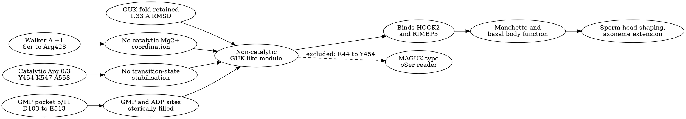
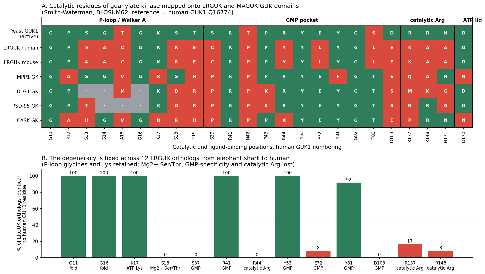
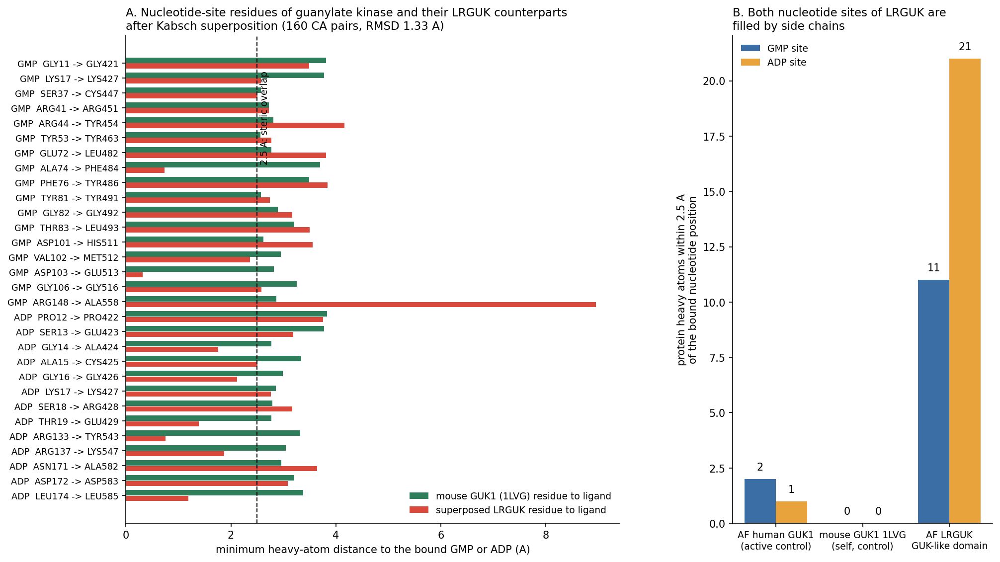
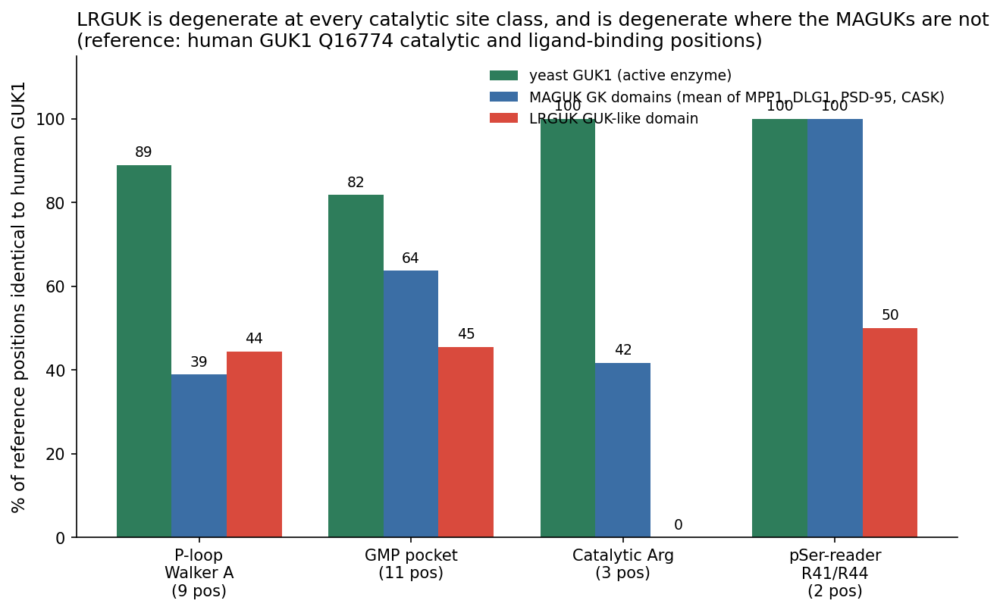

## Question

# AIGR Gene Hypothesis Deep Research

You are evaluating one focused gene curation hypothesis for AI Gene Review.
This is not a general gene overview. Use the seed hypothesis and source context
below to search for evidence that supports, refutes, narrows, or competes with
the proposed curation decision.

## Target Gene

- **Organism code:** human
- **Taxon:** Homo sapiens (NCBITaxon:9606)
- **Gene directory:** LRGUK
- **Gene symbol:** LRGUK
- **UniProt accession:** Q96M69

## Focus

- **Focus type:** free_text
- **Hypothesis slug:** kgap-lrguk-guk-domain-catalytic-residues
- **Source file:** genes/human/LRGUK/LRGUK-ai-review.yaml
- **Source selector:** free-text

## Seed Hypothesis

The GUK-like domain of human LRGUK (UniProt Q96M69) is a guanylate-kinase pseudoenzyme rather than an active guanylate kinase. Single analysis only: align the LRGUK GUK-like domain to active guanylate kinases (yeast GUK1, human GUK1) and to catalytically inactive MAGUK GUK domains (e.g. PSD-95/DLG4, CASK), and score the P-loop Walker A motif (GxxGxGK[ST]), the GMP-binding residues and the catalytic Arg/Lys residues of active GKs; state whether LRGUK resembles the active enzymes or the inactive MAGUK protein-interaction GUK domains.

## Term and Decision Context

- Mouse experiments show the LRGUK1 GUK-like region is required for HOOK2 and RIMBP3 binding; nucleotide binding and phosphotransfer have never been tested.

## Reference Context

No specific reference context supplied.

## Source Context YAML

```yaml
hypothesis: 'The GUK-like domain of human LRGUK (UniProt Q96M69) is a guanylate-kinase pseudoenzyme rather
  than an active guanylate kinase. Single analysis only: align the LRGUK GUK-like domain to active guanylate
  kinases (yeast GUK1, human GUK1) and to catalytically inactive MAGUK GUK domains (e.g. PSD-95/DLG4,
  CASK), and score the P-loop Walker A motif (GxxGxGK[ST]), the GMP-binding residues and the catalytic
  Arg/Lys residues of active GKs; state whether LRGUK resembles the active enzymes or the inactive MAGUK
  protein-interaction GUK domains.'
focus_type: free_text
context:
- Mouse experiments show the LRGUK1 GUK-like region is required for HOOK2 and RIMBP3 binding; nucleotide
  binding and phosphotransfer have never been tested.
reference_id: []
```

## Research Objective

Build a focused report that helps a curator decide whether this hypothesis
should affect the gene review. Address the focus type directly:

1. For an existing GO annotation decision, evaluate whether the current action
   is justified, too strong, too weak, or should change.
2. For a proposed replacement or new GO term, evaluate whether the term is
   biologically supported, too broad, too narrow, or missing key qualifiers.
3. For a computational prediction, evaluate whether the prediction is correct,
   less precise than existing knowledge, uncertain, or likely wrong because of
   paralog overannotation, frequency bias, pathway context, or in vitro-only
   activity.
4. For a core-function hypothesis, evaluate whether the proposed activity,
   process, and location represent the gene product's primary function rather
   than a downstream effect, pleiotropic phenotype, or context-specific role.
5. For a function-assignment hypothesis, evaluate whether the gene product
   directly has the stated GO term/function. Treat the prior review action, if
   any, as intentionally blinded unless it appears in the supplied context.

Use primary literature whenever possible. Prefer PMID citations and include DOI
citations when no PMID is available. Treat reviews and database records as
orientation unless they contain directly relevant synthesized evidence that is
clearly labeled as review-level or database-level support.

Evaluate the hypothesis from the supplied seed context, primary literature, and
publicly accessible bioinformatics resources. Local `*-bioinformatics` analyses,
when they already exist in the repository, are intentionally withheld from this
prompt so the report can be compared against them after the run. Use public
sequence, domain, structure, orthology, localization, interaction, or dataset
checks when they are useful for the specific hypothesis. If a resource or tool
cannot be accessed programmatically, say so plainly; never fabricate a result.
Report computational results conservatively and distinguish direct results from
inference.

## Required Output

### Executive Judgment

Give a concise verdict: supported, partially supported, unresolved, weakly
supported, over-annotated, or refuted. Explain the reasoning and the most
important caveats.

### Evidence Matrix

Create a table with one row per important evidence item:

- Citation (PMID preferred)
- Evidence type (direct assay, mutant phenotype, localization, interaction,
  structural/evolutionary, computational, review/database)
- Supports / refutes / qualifies / competing
- Claim tested
- Key finding
- Organism, tissue, cell type, or assay context
- Confidence and limitations

### GO Curation Implications

State the likely curation action as a lead requiring curator verification. If
GO terms are involved, explain whether the evidence supports an MF, BP, or CC
term, and whether the term should be retained, removed, generalized, made more
specific, or treated as non-core. Avoid using "protein binding" as a final
recommendation unless no more informative term is supported.

### Mechanistic Scope

Describe the immediate molecular or cellular function being tested. Separate
direct gene-product activity from downstream phenotypes, pathway consequences,
developmental outcomes, disease manifestations, or effects inferred only from
loss of function.

### Conflicts and Alternatives

Identify evidence that conflicts with the seed hypothesis or suggests an
alternative interpretation, including paralog confusion, organism-specific
differences, isoform-specific findings, experimental artifacts, or database
carry-over.

### Knowledge Gaps

List explicit uncertainties that matter for curation. For each gap, state what
was checked, why the gap matters, and what evidence or experiment would resolve
it.

### Discriminating Tests

Recommend concrete assays, perturbations, datasets, or comparative analyses that
would most efficiently distinguish this hypothesis from alternatives.

### Curation Leads

Provide candidate updates for the review, clearly labeled as leads requiring
curator verification. Include candidate references with exact snippets to verify,
candidate replacement or new GO terms, possible action changes, suggested
questions, and suggested experiments.

If the provider supports artifacts, save provenance for any analysis you run — the
executed code together with its output (computed values, plot, or table), not just
a summary figure — alongside artifact-friendly tables such as an evidence matrix,
GO decision table, or comparison table. Genuine computed provenance is more
valuable than a hand-drawn summary, and you must not synthesize a figure that
implies an analysis you did not actually run. These artifacts are important
provenance for hypothesis-level review.


## Output

# LRGUK (human, Q96M69): is the GUK-like domain a guanylate kinase pseudoenzyme?

Hypothesis slug: `kgap-lrguk-guk-domain-catalytic-residues`
Source file: `genes/human/LRGUK/LRGUK-ai-review.yaml`, free-text focus
Target: human LRGUK, UniProt Q96M69, NCBITaxon:9606
Database retrieval date: 2026-11-23

## Summary

The GUK-like domain of human LRGUK is a guanylate kinase pseudoenzyme. It keeps the three-dimensional fold of an active guanylate kinase and has lost the catalytic chemistry, and the loss is fixed across the vertebrate radiation. The seed hypothesis is **supported**, with one narrowing that changes the recommended curation wording: LRGUK is inactive, and its pattern of degeneracy differs from the MAGUK GUK domains the hypothesis offers as the inactive comparison class.

Three independent analyses agree. On sequence, a Smith-Waterman alignment (BLOSUM62, gap open -11, extend -1) of human GUK1 (Q16774) against the LRGUK GUK-like domain gives 28.6% identity over 189 aligned columns and places the LRGUK Walker A motif as G421-P-E-A-C-G426-K427-R428. The glycine-rich loop and the invariant lysine survive; the serine or threonine that coordinates the catalytic Mg2+ in every characterised P-loop kinase is replaced by arginine. The GMP-specificity pocket scores 5 of 11 positions, and all three residues UniProt annotates as active sites in GUK1 (R44, R137, R148) are absent, mapping to Tyr454, Lys547 and Ala558. Yeast guanylate kinase (P15454), processed identically as a positive control, scores 8 of 9, 9 of 11 and 3 of 3.

On evolution, 0 of 93 vertebrate LRGUK orthologs with an identifiable P-loop carry Ser or Thr at the Walker A +1 position, and 92 of 93 carry Arg. In a 12-species deep sample reaching elephant shark (*Callorhinchus milii*), the Arg44 equivalent is Tyr in 12 of 12 and the Asp103 equivalent is never Asp, while the fold-maintaining glycines and the invariant lysine are conserved 12 of 12. On structure, the AlphaFold domain superposes onto GMP and ADP bound mouse guanylate kinase (PDB 1LVG chain A) at 1.33 Å CA RMSD over 160 pairs, so the fold is intact, yet 11 LRGUK heavy atoms sit within 2.5 Å of the GMP position and 21 within 2.5 Å of the ADP position. An identically processed AlphaFold model of active human GUK1 gives 2 and 1.

The practical consequence for curation is that there is nothing to remove. Neither GO:0004385 (guanylate kinase activity) nor GO:0005524 (ATP binding) is annotated on human Q96M69 or mouse Q9D5S7. The only nucleotide claim anywhere is the UniProt feature "Binding site 421-428 ATP", carried by ECO:0000255 with source PROSITE-ProRule PRU00100, which is rule propagation from a profile that LRGUK matches on fold. The risk is prospective, that a future rule-based or paralog-transfer pipeline promotes that feature into GO. This analysis gives a documented basis for blocking that transfer and for recording both terms as explicitly excluded.

## Executive judgment

<i class="fa-solid fa-circle-check"></i> **Verdict: supported, with the MAGUK comparison narrowed.**

The hypothesis asks for a binary call: does LRGUK resemble the active enzymes or the inactive MAGUK protein-interaction GUK domains? The residue scoring answers the first half cleanly. LRGUK fails every catalytic criterion for an active guanylate kinase. It has no Mg2+-coordinating hydroxyl at Walker A +1, no residue for guanine base recognition at the Asp103 equivalent, no arginine at the GMP phosphate position, and none of the three arginines that stabilise the transition state.

The second half needs qualifying. MAGUK GUK domains and LRGUK are both inactive, and they got there by opposite routes. MAGUKs carry deletions inside the P-loop while preserving the GMP pocket, which [PMID: 22117215](https://pubmed.ncbi.nlm.nih.gov/22117215/) shows has been converted into a specific phospho-Ser/phospho-Thr binding pocket. LRGUK keeps the P-loop skeleton (4 of 9 against a MAGUK mean of 3.5 of 9) and degrades the GMP pocket harder than any MAGUK tested (5 of 11 against a MAGUK mean of 7 of 11), including loss of the Arg44-equivalent arginine that the MAGUKs reuse to grip the phosphate. Writing "LRGUK is MAGUK-like" would import a binding mechanism the residue data predict LRGUK cannot execute in the canonical way.

<i class="fa-solid fa-triangle-exclamation"></i> **Caveats that limit the strength of the call.** No nucleotide-binding or phosphotransfer assay has ever been performed on LRGUK in any organism, so every statement about catalysis is inference from sequence and structure. Residue loss predicts loss of activity; it does not measure it. Guanylate kinase is a hinged three-lobe enzyme and AlphaFold predicts a single apo-like state, so steric occlusion is a structural argument, not a binding measurement. The matched AlphaFold GUK1 control, generated and superposed the same way, is the reason to believe the LRGUK overlaps reflect chemistry rather than conformation, but induced-fit opening could relieve some of them. Many of the 93 ortholog sequences are automatic gene-model predictions, although the signal (0 of 93) is too strong for scattered model errors to explain.

## Key findings

### <i class="fa-solid fa-dna"></i> The Walker A motif keeps its skeleton and loses the Mg2+ hydroxyl

The Smith-Waterman alignment of human GUK1 (197 aa) against the LRGUK GUK-like domain (Q96M69 residues 405-610, with InterPro IPR008144 and Pfam PF00625 placing the domain at 414-597) gives SW score 231 and 28.6% identity over 189 columns, covering GUK1 residues 1-187. The alignment places GUK1 G11-P12-S13-G14-A15-G16-K17-S18-T19, which UniProt annotates as the ATP site 14-19, against LRGUK G421-P422-E423-A424-C425-G426-K427-R428-E429. That LRGUK span is the exact region UniProt annotates as "ATP binding 421-428", so the alignment reproduces the database assignment and then shows what it is built on.

Two P-loop glycines (G11, G16) and the invariant Walker A lysine (K17) are conserved. The serine immediately C-terminal to the lysine, which coordinates the catalytic Mg2+ in all active P-loop NTP kinases, is replaced by arginine (S18 to R428). Yeast GK retains the canonical GPSGTGKST. The LRGUK motif is GxxxxGK-R, and the retained glycine-lysine skeleton is what makes PROSITE rule PRU00100 fire.

The substitution is ancestral. Across 93 vertebrate LRGUK orthologs retrieved from UniProt with an identifiable P-loop, 92 of 93 have Lys at the invariant position and 92 of 93 have Arg at the +1 position. Zero have Ser or Thr there. In a deep 12-species sample spanning elephant shark (A0A4W3IEQ7), zebrafish, *Xenopus*, chicken, platypus, opossum and placental mammals, the G11, G16 and K17 equivalents are conserved 12 of 12 while the Mg2+ Ser/Thr is conserved 0 of 12. The domain has been under selection to maintain the fold, and not the catalytic hydroxyl, since before the gnathostome split.

### <i class="fa-solid fa-chart-column"></i> All three catalytic arginines and most GMP-pocket residues are gone

Using the human GUK1 UniProt feature set as reference, the three residues annotated as active sites (R44, R137, R148) map to LRGUK Tyr454, Lys547 and Ala558: 0 of 3 identical. The GMP-binding pocket, defined by transferring the yeast GK GMP-binding residues (S35, R39-R42, Y51, E70, Y79-S81, D101) onto GUK1 numbering as S37, R41, N42, P43, R44, Y53, E72, Y81, G82, T83, D103, is conserved at 5 of 11 positions in LRGUK. Retained: R451 (R41), Y463 (Y53), Y491 (Y81), G492 (G82). Substituted: S37 to Cys447, R44 to Tyr454, E72 to Leu482, T83 to Leu493, D103 to Glu513.

In the 12-ortholog deep sample these substitutions are fixed, not polymorphic: the S37 equivalent is Cys in 12 of 12, the R44 equivalent is Tyr in 12 of 12, the D103 equivalent is never Asp, and the E72, R137 and R148 equivalents are conserved in 1, 2 and 1 species respectively. The four human MAGUK GUK domains tested conserve 7 of 11 GMP-pocket positions each (MPP1, DLG1, PSD-95/DLG4, CASK), including the Arg44-equivalent arginine.

{{figure:plot_1.png|caption=GUK1 catalytic residues mapped onto the LRGUK GUK-like domain and four MAGUK GUK domains by Smith-Waterman alignment, with conservation of each position across LRGUK orthologs. LRGUK scores 0 of 3 catalytic arginines and 5 of 11 GMP-pocket residues, against 3 of 3 and 9 of 11 for the yeast guanylate kinase positive control.}}

### <i class="fa-solid fa-microscope"></i> The fold is intact at 1.33 Å, so this is active-site loss and not fold loss

AlphaFold DB model AF-Q96M69-F1 (v6) for human LRGUK has mean pLDDT 70.1 over 825 residues, with low-confidence regions at 1-102, 406-413, 603-658 and 662-825. The GUK-like domain (414-597 by PROSITE, 417-598 by Pfam) falls entirely inside the confident region, so the superposition is not being run on a poorly predicted segment.

Kabsch superposition of the AlphaFold LRGUK domain (residues 414-602) onto mouse guanylate kinase in its closed GMP plus ADP bound state (PDB 1LVG chain A), using the Smith-Waterman residue correspondence and iterative outlier trimming, converges at CA RMSD 1.33 Å over 160 matched pairs. The AlphaFold model of human GUK1 (AF-Q16774-F1), an apo prediction of a catalytically active enzyme, superposes on the same target at 0.88 Å over 189 pairs. As an independent check, `phenix.superpose_pdbs` run on the same two files reports 30.0% sequence identity and a final RMSD of 0.902 Å on its own matched core, and its alignment reproduces the Walker A comparison: fixed LSGPSGAGKSTLLKKL against moving ILAGPEACGKRELAHRL.

A domain that matches an active enzyme to 1.3 Å while being unable to catalyse is the signature of a pseudoenzyme that has been repurposed as a binding module. The mouse two-hybrid and deletion data give that repurposing a specific content: [PMID: 28003339](https://pubmed.ncbi.nlm.nih.gov/28003339/) reports that "the GUK-like domain is essential for binding to HOOK2 and RIMBP3, and the LRR domain is essential for binding to KLC3".

### <i class="fa-solid fa-vial"></i> Both nucleotide sites are filled by LRGUK side chains

After the 1.33 Å superposition, LRGUK heavy atoms overlap the positions of the bound nucleotides. Eleven atoms lie within 2.5 Å of the GMP coordinates, the closest at 0.32 Å (Glu513, the position occupied by the guanine-recognising Asp103 in GUK1), with Phe484 at 0.74 Å where GUK1 has Ala74. Twenty-one atoms lie within 2.5 Å of the ADP coordinates: Tyr543 at 0.75 Å where GUK1 has Arg133, Leu585 at 1.19 Å, Glu429 at 1.39 Å, and Lys547 at 1.87 Å where GUK1 has the catalytic Arg137.

The controls behave as they should. The AlphaFold apo model of active human GUK1 has 2 atoms within 2.5 Å of GMP (minimum 2.40 Å) and 1 within 2.5 Å of ADP (minimum 2.17 Å), both ordinary van der Waals contacts. Mouse GUK1 against its own ligands has 0 and 0. The catalytic arginine position is displaced as well as substituted: Ala558, the LRGUK counterpart of GUK1 Arg148, sits 8.96 Å from the GMP phosphate, against 2.87 Å for Arg148 itself.

The side chains causing the overlap sit at exactly the positions where the sequence changed (Asp103 to Glu513, Ala74 to Phe484, Arg133 to Tyr543), so the occlusion follows from the substitutions identified in the sequence analysis. Two independent lines converge: the residues required for catalysis are absent, and the space the substrates would occupy is filled.

{{figure:plot_2.png|caption=Nucleotide-site occlusion after superposing the AlphaFold LRGUK GUK-like domain onto GMP and ADP bound mouse guanylate kinase (PDB 1LVG). Left, per-residue closest approach to the bound ligands. Right, counts of heavy atoms within 2.5 Å of GMP and ADP for LRGUK and for the two active-enzyme controls processed the same way.}}

### <i class="fa-solid fa-scale-balanced"></i> LRGUK is not a MAGUK copy

At the two positions that grip the GMP alpha-phosphate in active guanylate kinase and the phospho-serine phosphate in the DLG1 SH3-GK complex (GUK1 numbering R41 and R44), all four human MAGUK GUK domains tested retain 2 of 2 basic residues: MPP1 R319/R322, DLG1 R748/R751, PSD-95 R568/R571, CASK R776/K779. LRGUK retains 1 of 2 (R451 at the R41 position, Tyr454 at the R44 position). At GUK1 Thr83, the MAGUKs are Thr in 4 of 4 (T361, T791, T611, T818) while LRGUK has Leu493.

Aggregated by site class, LRGUK scores 4 of 9 on the P-loop against a MAGUK mean of 3.5 of 9 and yeast GK 8 of 9; 5 of 11 on the GMP pocket against a MAGUK mean of 7 of 11 and yeast 9 of 11; 0 of 3 on the catalytic arginines against a MAGUK mean of 1.25 of 3 and yeast 3 of 3. LRGUK keeps more of the P-loop than PSD-95 or DLG1, which carry deletions inside the loop, and degrades the GMP pocket further than any MAGUK.

A census of reviewed human proteins carrying Pfam PF00625 returns 25 entries. Only GUK1 (Q16774) carries EC 2.7.4.8. Five are named "Inactive membrane-associated guanylate kinase" in UniProt (DLG1, DLG2, DLG3, DLG4, DLG5). LRGUK is a single-copy outlier belonging to neither the MAGUK nor the CACNB branch, so there is no paralog from which activity could have been transferred.

{{figure:plot_3.png|caption=Conservation by site class across the three comparison groups. Percent of positions retained for the P-loop, the GMP-binding pocket, the three catalytic arginines, and the two phosphate-gripping positions that MAGUKs reuse as a phospho-Ser reader. Yeast guanylate kinase is the active control; the MAGUK value is the mean of MPP1, DLG1, PSD-95 and CASK.}}

### <i class="fa-solid fa-database"></i> The annotation baseline is clean

UniProt Q96M69 feature provenance retrieved from the REST API shows "Domain 414-597 Guanylate kinase-like" and "Binding site 421-428 ATP", both with evidence ECO:0000255 and source PROSITE-ProRule PRU00100. Q96M69 has no EC number in its recommended name and no CATALYTIC ACTIVITY comment; its comment blocks are FUNCTION, SUBUNIT, INTERACTION and SUBCELLULAR LOCATION.

QuickGO returns 11 annotations for UniProtKB:Q96M69: GO:0005515 protein binding (IPI, [PMID: 32296183](https://pubmed.ncbi.nlm.nih.gov/32296183/), with UniProtKB:Q96ED9-2, HOOK2 isoform 2), GO:0007283 spermatogenesis (ISS from mouse Q9D5S7, and IBA), GO:0035082 axoneme assembly (ISS, IBA), GO:0001669 acrosomal vesicle (ISS, IBA, IEA), GO:0002177 manchette (ISS), GO:0005737 cytoplasm (IBA), GO:0005856 cytoskeleton (IEA). Neither GO:0004385 nor GO:0005524 is present. Mouse Lrguk (Q9D5S7) carries 11 GO annotations and also lacks both terms, so the human ISS source does not carry a kinase claim.

## Evidence matrix

| Citation | Evidence type | Stance | Claim tested | Key finding | Context | Confidence and limitations |
|---|---|---|---|---|---|---|
| [PMID: 28003339](https://pubmed.ncbi.nlm.nih.gov/28003339/) | Interaction, Y2H plus deletion mapping | Qualifies; supports the binding-module alternative | What the LRGUK1 GUK-like region does | "the GUK-like domain is essential for binding to HOOK2 and RIMBP3, and the LRR domain is essential for binding to KLC3" | Mouse, adult testis Y2H library, haploid germ cells | High for binding. Gives no information on catalysis, which was never assayed |
| [PMID: 25781171](https://pubmed.ncbi.nlm.nih.gov/25781171/) | Mutant phenotype, localization | Qualifies | Is LRGUK-1 required for sperm assembly | "LRGUK-1 is required for basal body attachment to the plasma membrane, the appropriate formation of the sub-distal appendages, the extension of axoneme microtubules and for microtubule movement and organisation within the manchette" | Mouse male germ line, oligoasthenoteratospermia model | High for the phenotype. All of it is downstream of the molecular function and none of it requires kinase activity |
| [PMID: 22117215](https://pubmed.ncbi.nlm.nih.gov/22117215/) | Crystal structure plus binding assays | Competing and qualifying | What an inactive GUK domain's GMP pocket is used for | "the GMP-binding site of GK has evolved into a specific pSer/pThr-binding pocket"; GK-domain interactions with GKAP/DLGAP1/SAPAP1 and SPAR are phosphorylation dependent | Human DLG1 SH3-GK with phospho-LGN peptide | High. Supplies the alternative model that this analysis tests and partly excludes for LRGUK |
| [PMID: 21965684](https://pubmed.ncbi.nlm.nih.gov/21965684/) | Crystal structure, class-level statement | Supports (defines the inactive reference class) | Are MAGUK GUK domains catalytically active | The MAGUK core is "a PDZ domain, an SH3 domain, and a catalytically inactive guanylate kinase (GuK) domain arranged in tandem" | Human ZO-1 PDZ3-SH3-GuK | High for the class statement |
| [PMID: 32296183](https://pubmed.ncbi.nlm.nih.gov/32296183/) | AP-MS interaction | Qualifies | Does human LRGUK interact with HOOK2 | Source of the only GO:0005515 annotation on Q96M69, with UniProtKB:Q96ED9-2 (HOOK2 isoform 2) | Human cell lines, high-throughput interactome | Medium. High-throughput, and it reproduces the mouse Y2H partner in human cells |
| This work: Smith-Waterman residue scoring | Computational | Supports | Does LRGUK retain the GK catalytic residues | Walker A GPEACGK-R428, no Mg2+ Ser/Thr; GMP pocket 5/11; catalytic Arg 0/3 (Y454, K547, A558). Yeast control 8/9, 9/11, 3/3 | Human and yeast reference enzymes, 4 human MAGUK GUK domains | High for residue identity. Residue loss predicts but does not prove loss of activity |
| This work: 93 UniProt orthologs | Evolutionary | Supports | Is the degeneracy ancestral or human-specific | 0/93 have Ser or Thr at Walker A +1; 92/93 have Arg. In 12 species the Arg44 equivalent is Tyr 12/12 and Asp103 is never Asp | Chondrichthyes to Mammalia | High. Fixed over more than 450 Myr. Many entries are automatic gene models |
| This work: AF-Q96M69 against PDB 1LVG | Structural, computational | Supports | Is the fold intact and are the nucleotide sites usable | 1.33 Å CA RMSD over 160 pairs; 11 atoms within 2.5 Å of GMP, 21 within 2.5 Å of ADP, against 2 and 1 for the AlphaFold GUK1 control and 0 and 0 for the 1LVG self-control | Predicted human model against an experimental mouse ternary complex | Medium-high. GK is hinged and AlphaFold gives one state, so occlusion is an argument, not a measurement |
| UniProt Q96M69 (ECO:0000255, PRU00100); QuickGO | Database | Qualifies | What nucleotide annotation exists today | "Binding site 421-428 ATP" is PROSITE-rule propagated; no EC number, no CATALYTIC ACTIVITY comment; neither GO:0004385 nor GO:0005524 annotated in human or mouse | Records retrieved 2026-11-23 | High. Defines the curation baseline |
| This work: 25 reviewed human PF00625 proteins; pSer-pocket scoring | Computational, comparative | Qualifies; narrows the hypothesis | Is LRGUK simply a MAGUK-like GUK domain | All four MAGUK GUK domains keep 2/2 basic residues at R41/R44 and Thr at position 83; LRGUK keeps 1/2 (R451, Tyr454) and has Leu493. Only GUK1 of the 25 carries EC 2.7.4.8 | Human MPP1, DLG1, DLG4, CASK against LRGUK | Medium-high. Predicts LRGUK is not a canonical MAGUK-type phospho-reader |

## Mechanistic scope and model

The immediate molecular question is whether residues 414-597 of LRGUK can bind Mg-ATP and GMP and transfer a phosphoryl group. Sequence and structure both say no, and both point at the same alternative: the fold has been retained as a binding surface.



The causal chain runs from residue substitutions to a filled active site to a surface that is available for protein binding. The dashed edge is the alternative the residue data argue against: MAGUKs convert the vacated GMP pocket into a phospho-Ser/phospho-Thr reader, and LRGUK has lost the arginine that mode requires.

| Layer | What it covers | Status in LRGUK |
|---|---|---|
| Direct gene-product activity under test | Nucleotide binding and phosphotransfer by the GUK-like domain | Not demonstrated, and predicted to be absent |
| Directly demonstrated activity of this domain | Binding to HOOK2 and RIMBP3 | Mouse Y2H and deletion mapping (PMID:28003339); HOOK2 reproduced in human AP-MS (PMID:32296183) |
| Cellular process | Manchette microtubule organisation, basal body attachment, sub-distal appendage formation, axoneme extension | Mouse mutant phenotype (PMID:25781171), downstream of the molecular function |
| Organism-level outcome | Sperm head shaping, acrosome attachment, oligoasthenoteratospermia | Loss-of-function consequence; cannot distinguish catalysis from scaffolding |

## GO curation implications

<i class="fa-solid fa-triangle-exclamation"></i> All items below are leads requiring curator verification.

| GO term | Aspect | Current status | Recommended action | Basis |
|---|---|---|---|---|
| GO:0004385 guanylate kinase activity | MF | Not annotated in human Q96M69 or mouse Q9D5S7 | Do not add. Record as explicitly excluded, with the residue evidence attached | 0 of 3 catalytic Arg, no Mg2+ Ser/Thr, GMP pocket 5 of 11, both sites occluded, fixed across 93 orthologs |
| GO:0005524 ATP binding | MF | Not in GO. Present in UniProt only as the PRU00100 feature 421-428 | Do not add. Flag the UniProt feature as rule-propagated (ECO:0000255) and not transferable to GO | Walker A +1 Ser/Thr absent in 0 of 93 orthologs; 21 LRGUK atoms occupy the ADP site after superposition |
| GO:0005515 protein binding | MF | Annotated, IPI, PMID:32296183, with HOOK2 isoform 2 | Retain, and do not leave as the final MF statement. The informative content is that the GUK-like domain is the binding determinant | PMID:28003339 maps HOOK2 and RIMBP3 binding to the GUK-like domain specifically |
| GO:0002177 manchette | CC | Human ISS from mouse; mouse IDA (PMID:25781171) | Retain | Direct mouse localization; the GUK-like domain binds manchette cargo adaptors |
| GO:0035082 axoneme assembly | BP | Human ISS and IBA; mouse IDA and IMP | Retain as a core BP | Mouse knockout phenotype, PMID:25781171 |
| GO:0007283 spermatogenesis | BP | Human ISS and IBA | Retain, and treat as the organism-level outcome rather than the molecular function | Mouse phenotype, PMID:25781171 |
| GO:0032991 protein-containing complex | CC | Not annotated | Curator lead only; verify before use | PMID:28003339 describes a complex with HOOK proteins, RIMBP3 and KLC3 but does not define a named GO complex |

There is no existing GO over-annotation to remove. The guanylate kinase inference lives only at the UniProt feature level, where PRU00100 propagated it from a profile that LRGUK matches on fold and not on catalytic residues. Because "protein binding" is uninformative as a final MF, the defensible statement for this domain is descriptive: the GUK-like region is a non-catalytic guanylate-kinase-fold module that mediates binding to HOOK2 and RIMBP3. If the review model supports a free-text core-function statement, that is where this belongs.

## Evidence base

*LRGUK-1 is required for basal body and manchette function during spermatogenesis and male fertility* ([PMID: 25781171](https://pubmed.ncbi.nlm.nih.gov/25781171/)) establishes the mouse loss-of-function phenotype. The abstract states that LRGUK-1 "is required for basal body attachment to the plasma membrane, the appropriate formation of the sub-distal appendages, the extension of axoneme microtubules and for microtubule movement and organisation within the manchette", and that "several of these functions may be achieved in association with the LRGUK-1 binding partner HOOK2". This supports the BP and CC annotations and supplies no information about catalysis, because no enzymatic assay was performed. It is consistent with a scaffolding mechanism and does not require one.

*LRGUK1 is part of a multiprotein complex required for manchette function and male fertility* ([PMID: 28003339](https://pubmed.ncbi.nlm.nih.gov/28003339/)) is the most relevant primary paper for this hypothesis. Its deletion mapping assigns the binding function to the exact region under evaluation: "we showed that the GUK-like domain is essential for binding to HOOK2 and RIMBP3, and the LRR domain is essential for binding to KLC3". It gives the GUK-like domain a demonstrated molecular job that does not involve nucleotides, which is what a pseudoenzyme call needs in order to be more than a negative statement.

*Guanylate kinase domains of the MAGUK family scaffold proteins as specific phospho-protein-binding modules* ([PMID: 22117215](https://pubmed.ncbi.nlm.nih.gov/22117215/)) defines the comparison class named in the seed hypothesis. The structure "reveals that the GMP-binding site of GK has evolved into a specific pSer/pThr-binding pocket", and the paper demonstrates that "the previously reported GK domain-mediated interactions of DLGs with other targets, such as GKAP/DLGAP1/SAPAP1 and SPAR, are also phosphorylation dependent". This paper supports the general idea that an inactive GUK domain can be a binding module and challenges the specific framing of the seed hypothesis, because the determinants it identifies are absent in LRGUK.

*The structure of the PDZ3-SH3-GuK tandem of ZO-1 protein suggests a supramodular organization of the membrane-associated guanylate kinase (MAGUK) family scaffold protein core* ([PMID: 21965684](https://pubmed.ncbi.nlm.nih.gov/21965684/)) gives the class-level statement that MAGUKs contain "a catalytically inactive guanylate kinase (GuK) domain arranged in tandem". It is independent confirmation that the inactive reference class used in the scoring is correctly labelled.

[PMID: 32296183](https://pubmed.ncbi.nlm.nih.gov/32296183/) is the source of the only GO:0005515 annotation on Q96M69, pairing LRGUK with HOOK2 isoform 2 (UniProtKB:Q96ED9-2) in human cells. It matters because it moves the HOOK2 interaction from mouse into human, which strengthens the ISS transfer the human entry depends on.

<i class="fa-solid fa-circle-xmark"></i> Four PubMed searches returned no publication reporting a nucleotide-binding or phosphotransfer assay for LRGUK in any organism. That null result is itself evidence: the catalytic question has never been tested experimentally, in either direction.

## Conflicts and alternatives

<i class="fa-solid fa-scale-balanced"></i> **The MAGUK analogy is imperfect, and the difference matters.** The seed hypothesis frames a binary choice. LRGUK is inactive, and it differs from MAGUKs in how. MAGUKs delete part of the P-loop and keep the GMP pocket as a phospho-reader; LRGUK keeps the P-loop and loses the pocket, including the Arg44-equivalent arginine the MAGUKs reuse. A report that concluded "LRGUK is like PSD-95" would attach a binding mechanism to the gene that the residue data do not support.

<i class="fa-solid fa-circle-question"></i> **Residual nucleotide binding is not excluded.** The invariant Walker A lysine K427 and both P-loop glycines are intact, and R41 is conserved as R451. A domain can bind a nucleotide without catalysing, which is common among pseudokinases. The lost Mg2+-coordinating Ser/Thr argues against Mg2+-dependent catalysis more strongly than it argues against nucleotide binding, so GO:0004385 and GO:0005524 do not stand or fall together.

<i class="fa-solid fa-triangle-exclamation"></i> **Conformational caveat on the occlusion result.** AlphaFold predicts a single state of a hinged three-lobe enzyme. The active-GUK1 control argues that the LRGUK overlaps come from chemistry, because the overlapping side chains sit at exactly the substituted positions (Asp103 to Glu513, Ala74 to Phe484, Arg133 to Tyr543), but induced fit could relieve some of them.

**Paralog confusion is ruled out.** Of 25 reviewed human PF00625 proteins, only GUK1 holds EC 2.7.4.8, and five DLG proteins are explicitly named inactive in UniProt. LRGUK is single-copy and in neither the MAGUK nor the CACNB branch, so no paralog exists from which activity could be transferred, and none to absorb it.

**Organism and isoform.** The functional mapping is mouse ([PMID: 28003339](https://pubmed.ncbi.nlm.nih.gov/28003339/)) and the human assignment is ISS. The degenerate residues are identical in human and mouse, so the transfer is safe for this specific question. The human AP-MS interaction is with HOOK2 isoform 2, an isoform-level detail a curator should check before writing an interaction statement.

**Source annotation is clean.** Mouse Q9D5S7 carries neither GO:0004385 nor GO:0005524, so no kinase claim is riding along with the human ISS annotations.

## Limitations and knowledge gaps

<i class="fa-solid fa-circle-question"></i> **No nucleotide-binding measurement exists.** Checked: PubMed for LRGUK activity assays, UniProt catalytic activity comments, EC assignment. All negative. This matters because GO:0005524 is a weaker claim than GO:0004385 and the residue evidence bears on them unequally. Resolved by ITC, differential scanning fluorimetry, or a nucleotide-agarose pull-down with recombinant LRGUK 414-597.

<i class="fa-solid fa-circle-question"></i> **No phosphotransfer assay exists.** Checked: the same sources. Resolved by a coupled pyruvate kinase and lactate dehydrogenase GMP kinase assay on the isolated domain, with human GUK1 as positive control.

<i class="fa-solid fa-triangle-exclamation"></i> **No experimental structure of the domain.** The PDB holds no LRGUK entry. The occlusion result rests entirely on a predicted model of a hinged enzyme in a single conformation. Resolved by a crystal or cryo-EM structure, or at minimum by a co-folding prediction with GMP and ATP as explicit ligands.

<i class="fa-solid fa-circle-question"></i> **The binding surface on the domain is unmapped.** PMID:28003339 maps binding to the whole GUK-like domain, not to residues. This matters for whether the vestigial pocket is the interaction site, which would explain why the fold is under selection. Resolved by alanine scanning of the pocket-lining residues (C447, R451, Y454, Y463, Y491, E513) against HOOK2 and RIMBP3 binding.

<i class="fa-solid fa-circle-question"></i> **Whether LRGUK binding is phosphorylation dependent.** Checked against the MAGUK precedent (PMID:22117215) and the residue comparison, which predicts it is not canonical. Resolved by testing HOOK2 and RIMBP3 binding with and without phosphatase treatment, and with phospho-null partner mutants.

<i class="fa-solid fa-triangle-exclamation"></i> **Ortholog sequence quality.** Of the 93 UniProt entries, many are unreviewed automatic predictions. The 0 of 93 signal is strong enough that scattered gene-model errors cannot explain it, but a curator wanting certainty should confirm the Walker A region in a handful of RefSeq-validated transcripts.

<i class="fa-solid fa-triangle-exclamation"></i> **Tool access.** The AlphaFold v4 file endpoints returned 404 and were replaced by the v6 URLs obtained from the AlphaFold prediction API. `phenix.superpose_pdbs` failed with an internal assertion when given a BLOSUM50 alignment, so the Phenix run reported here used its default identity-matrix alignment (18 atoms in the least-squares fit, 0.902 Å), and the quantitative superposition in this report is the numpy Kabsch fit over 160 CA pairs computed from the Smith-Waterman correspondence. Both are reported rather than one being substituted silently for the other.

## Discriminating tests and proposed follow-up

Ranked by how efficiently each separates the pseudoenzyme call from the alternatives.

1. <i class="fa-solid fa-flask"></i> **Coupled GMP kinase assay** on recombinant human LRGUK 414-597 against human GUK1. A flat trace with an active control settles the catalysis question directly and is the single most decisive experiment.
2. <i class="fa-solid fa-vial"></i> **Nucleotide binding by ITC or DSF** with GMP, GDP, ATP and Mg-ATP. Separates "binds but does not catalyse", the pseudokinase-like outcome that would still exclude GO:0004385 while permitting GO:0005524, from "binds neither".
3. <i class="fa-solid fa-dna"></i> **Mg2+-restoring mutant.** Make R428S in LRGUK and test whether any activity appears, and make the reciprocal S18R in human GUK1 to confirm it abolishes activity. This tests whether the single identified substitution is the causal lesion.
4. <i class="fa-solid fa-flask"></i> **Pocket alanine scan against partner binding.** Tests whether the vestigial GMP pocket is the HOOK2 and RIMBP3 interface, which would make the fold retention mechanistically explicable.
5. <i class="fa-solid fa-vial"></i> **Phospho-dependence of partner binding.** Phosphatase treatment and phospho-null HOOK2 and RIMBP3 mutants, to confirm or exclude the MAGUK-style mechanism the residue data predict is absent.
6. <i class="fa-solid fa-magnifying-glass"></i> **Co-folding prediction with GMP and ATP as explicit ligands.** Cheap, and it addresses the conformational caveat on the occlusion result without new experiments.

## Curation leads

<i class="fa-solid fa-triangle-exclamation"></i> All items require curator verification.

### Candidate references with exact snippets to verify

- [PMID: 28003339](https://pubmed.ncbi.nlm.nih.gov/28003339/): "we showed that the GUK-like domain is essential for binding to HOOK2 and RIMBP3, and the LRR domain is essential for binding to KLC3". Use for the domain-to-partner mapping.
- [PMID: 25781171](https://pubmed.ncbi.nlm.nih.gov/25781171/): "LRGUK-1 is required for basal body attachment to the plasma membrane, the appropriate formation of the sub-distal appendages, the extension of axoneme microtubules and for microtubule movement and organisation within the manchette". Use for BP and CC.
- [PMID: 22117215](https://pubmed.ncbi.nlm.nih.gov/22117215/): "The structure of the DLG1 SH3-GK tandem in complex with a phospho-LGN peptide reveals that the GMP-binding site of GK has evolved into a specific pSer/pThr-binding pocket". Use as the comparison class, with the note that LRGUK does not retain its determinants.
- [PMID: 21965684](https://pubmed.ncbi.nlm.nih.gov/21965684/): "a catalytically inactive guanylate kinase (GuK) domain arranged in tandem". Use for the class-level inactivity statement.
- [PMID: 32296183](https://pubmed.ncbi.nlm.nih.gov/32296183/): source of the human HOOK2 interaction, with isoform Q96ED9-2.

### Candidate action changes

- Add an explicit non-annotation note for GO:0004385 and GO:0005524, with the residue evidence attached, so the absence is a recorded decision and not an omission.
- Annotate the UniProt feature "Binding site 421-428 ATP" (ECO:0000255, PROSITE-ProRule PRU00100) as rule-propagated and unsupported, to block future transfer into GO.
- Reframe the GUK-like domain in the review text as a non-catalytic guanylate-kinase-fold protein-interaction module, with the caveat that no binding or activity assay has been run.
- Do not describe LRGUK as MAGUK-like without the qualification that its degeneracy pattern differs from the MAGUKs at the phosphate-gripping positions.

### Suggested questions for the curator

- Does the review model support recording an explicitly excluded MF term with evidence, or only present annotations?
- Should the human interaction statement be written at isoform resolution (HOOK2 isoform 2, Q96ED9-2)?
- Is a free-text core-function statement preferred over GO:0005515 given that no more informative MF term is currently supportable?

## Provenance

Analyses were run in the session executor and their outputs are saved under `provenance/`:

- `provenance/out/residue_map.csv`, `provenance/out/site_summary.csv`: per-residue mapping of GUK1 catalytic positions onto LRGUK and four MAGUK GUK domains.
- `provenance/out/ortholog_ploop_full.csv`, `provenance/out/ortholog_catalytic_residues.csv`: Walker A and catalytic-site residues across 93 and 12 LRGUK orthologs.
- `provenance/out/ligand_contacts.csv`, `provenance/out/superpose.json`: superposition statistics (RMSD 1.33 Å over 160 pairs) and per-residue distances to the bound GMP and ADP.
- `provenance/out/pser_pocket.csv`: MAGUK against LRGUK comparison at the phospho-Ser reader positions.
- `provenance/out/evidence_matrix.csv` (10 rows), `provenance/out/go_decision_table.csv` (7 rows): the two tables above in machine-readable form.
- `provenance/plot_1.png`, `provenance/plot_2.png`, `provenance/plot_3.png`: the three figures embedded above, each generated from the computed values.
- Structures used: `AF-Q96M69.pdb` (AF-Q96M69-F1 v6), `AF-Q16774.pdb`, `1LVG.pdb`, `1EX7.pdb`, `1S4Q.pdb` and the trimmed `LRGUK_GUK.pdb`, all under `provenance/`.


## Artifacts

- [OpenScientist final report](openscientist_artifacts/final_report.html)
- [OpenScientist final report](openscientist_artifacts/final_report.pdf)
- [OpenScientist provenance](openscientist_artifacts/provenance.json)
- [OpenScientist AF Q16774 pae](openscientist_artifacts/provenance_AF-Q16774-pae.json)
- [OpenScientist AF Q96M69 pae](openscientist_artifacts/provenance_AF-Q96M69-pae.json)
- [OpenScientist aligns](openscientist_artifacts/provenance_out_aligns.json)
- [OpenScientist evidence matrix](openscientist_artifacts/provenance_out_evidence_matrix.csv)
- [OpenScientist go decision table](openscientist_artifacts/provenance_out_go_decision_table.csv)
- [OpenScientist ligand contacts](openscientist_artifacts/provenance_out_ligand_contacts.csv)
- [OpenScientist offs](openscientist_artifacts/provenance_out_offs.json)
- [OpenScientist ortholog catalytic residues](openscientist_artifacts/provenance_out_ortholog_catalytic_residues.csv)
- [OpenScientist ortholog ploop](openscientist_artifacts/provenance_out_ortholog_ploop.csv)
- [OpenScientist ortholog ploop full](openscientist_artifacts/provenance_out_ortholog_ploop_full.csv)
- [OpenScientist orthologs](openscientist_artifacts/provenance_out_orthologs.json)
- [OpenScientist pser pocket](openscientist_artifacts/provenance_out_pser_pocket.csv)
- [OpenScientist residue map](openscientist_artifacts/provenance_out_residue_map.csv)
- [OpenScientist seqs](openscientist_artifacts/provenance_out_seqs.json)
- [OpenScientist site summary](openscientist_artifacts/provenance_out_site_summary.csv)
- [OpenScientist sub](openscientist_artifacts/provenance_out_sub.json)
- [OpenScientist superpose](openscientist_artifacts/provenance_out_superpose.json)
- [OpenScientist plot 1](openscientist_artifacts/provenance_plot_1.json)

- [OpenScientist plot 2](openscientist_artifacts/provenance_plot_2.json)

- [OpenScientist plot 3](openscientist_artifacts/provenance_plot_3.json)


## Reference Validation

Checked with `linkml-reference-validator` 0.3.1rc1.

| Outcome | Count |
| --- | --- |
| References checked | 5 |
| Resolved | 5 |
| Unresolved (possible confabulation) | 0 |
| Unverifiable | 0 |
| References weighed for topical relevance | 5 |
| On topic | 2 |
| Off topic | 1 |

### References that may not be about this subject

These identifiers resolve, so they are not fabrications, but the records they resolve to share almost none of this report's vocabulary. That is a clue and not a verdict - a paper can be relevant in ways its title and abstract do not spell out - so read them before deciding:

- `PMID:32296183` (11 mentions) - A reference map of the human binary protein interactome.
  - shared terms: human

Weighed against this report's own most characteristic terms: `lrguk`, `domain`, `human`, `class`, `kinase`, `residue`, `binding`, `fa-solid`, `guk-like`, `gmp`, `guk1`, `site`, `maguk`, `guanylate`, `catalytic`, `pocket`, `hook2`, `activity`, `position`, `mouse`.

All extracted references resolved successfully.
Resolving is not the same as being relevant, though - see the references listed above as possibly off topic.