## Question

# AIGR Gene Hypothesis Deep Research

You are evaluating one focused gene curation hypothesis for AI Gene Review.
This is not a general gene overview. Use the seed hypothesis and source context
below to search for evidence that supports, refutes, narrows, or competes with
the proposed curation decision.

## Target Gene

- **Organism code:** human
- **Taxon:** Homo sapiens (NCBITaxon:9606)
- **Gene directory:** LRIT2
- **Gene symbol:** LRIT2
- **UniProt accession:** A6NDA9

## Focus

- **Focus type:** free_text
- **Hypothesis slug:** kgap-lrit2-isoform-domains
- **Source file:** genes/human/LRIT2/LRIT2-ai-review.yaml
- **Source selector:** free-text

## Seed Hypothesis

Whether the two annotated isoforms of human LRIT2 (A6NDA9) differ in domain content, and so in likely partner specificity, may be determined from sequence. Single analysis only: retrieve both annotated isoform sequences, align them and state exactly which residues and which annotated domains each one contains or lacks, including the signal peptide, every leucine-rich repeat with its position, the immunoglobulin-like domain, the fibronectin type III domain and any transmembrane segment; state for each isoform whether it is predicted to be membrane-anchored or secreted and whether the difference arises from an alternative start, an internal exon change or a truncation; map the isoform difference onto a predicted structure and assess whether it removes a surface that LRR-containing adhesion proteins typically use for partner binding; and report any public transcript or protein evidence for which isoform predominates in retina. State whether the two isoforms are predicted to differ functionally, and if the isoform annotation itself looks unreliable, say so plainly rather than describing differences that may be annotation artefacts.

## Term and Decision Context

No specific term context supplied.

## Reference Context

No specific reference context supplied.

## Source Context YAML

```yaml
hypothesis: 'Whether the two annotated isoforms of human LRIT2 (A6NDA9) differ in domain content, and
  so in likely partner specificity, may be determined from sequence. Single analysis only: retrieve both
  annotated isoform sequences, align them and state exactly which residues and which annotated domains
  each one contains or lacks, including the signal peptide, every leucine-rich repeat with its position,
  the immunoglobulin-like domain, the fibronectin type III domain and any transmembrane segment; state
  for each isoform whether it is predicted to be membrane-anchored or secreted and whether the difference
  arises from an alternative start, an internal exon change or a truncation; map the isoform difference
  onto a predicted structure and assess whether it removes a surface that LRR-containing adhesion proteins
  typically use for partner binding; and report any public transcript or protein evidence for which isoform
  predominates in retina. State whether the two isoforms are predicted to differ functionally, and if
  the isoform annotation itself looks unreliable, say so plainly rather than describing differences that
  may be annotation artefacts.'
focus_type: free_text
context: []
reference_id: []
```

## Research Objective

Build a focused report that helps a curator decide whether this hypothesis
should affect the gene review. Address the focus type directly:

1. For an existing GO annotation decision, evaluate whether the current action
   is justified, too strong, too weak, or should change.
2. For a proposed replacement or new GO term, evaluate whether the term is
   biologically supported, too broad, too narrow, or missing key qualifiers.
3. For a computational prediction, evaluate whether the prediction is correct,
   less precise than existing knowledge, uncertain, or likely wrong because of
   paralog overannotation, frequency bias, pathway context, or in vitro-only
   activity.
4. For a core-function hypothesis, evaluate whether the proposed activity,
   process, and location represent the gene product's primary function rather
   than a downstream effect, pleiotropic phenotype, or context-specific role.
5. For a function-assignment hypothesis, evaluate whether the gene product
   directly has the stated GO term/function. Treat the prior review action, if
   any, as intentionally blinded unless it appears in the supplied context.

Use primary literature whenever possible. Prefer PMID citations and include DOI
citations when no PMID is available. Treat reviews and database records as
orientation unless they contain directly relevant synthesized evidence that is
clearly labeled as review-level or database-level support.

Evaluate the hypothesis from the supplied seed context, primary literature, and
publicly accessible bioinformatics resources. Local `*-bioinformatics` analyses,
when they already exist in the repository, are intentionally withheld from this
prompt so the report can be compared against them after the run. Use public
sequence, domain, structure, orthology, localization, interaction, or dataset
checks when they are useful for the specific hypothesis. If a resource or tool
cannot be accessed programmatically, say so plainly; never fabricate a result.
Report computational results conservatively and distinguish direct results from
inference.

## Required Output

### Executive Judgment

Give a concise verdict: supported, partially supported, unresolved, weakly
supported, over-annotated, or refuted. Explain the reasoning and the most
important caveats.

### Evidence Matrix

Create a table with one row per important evidence item:

- Citation (PMID preferred)
- Evidence type (direct assay, mutant phenotype, localization, interaction,
  structural/evolutionary, computational, review/database)
- Supports / refutes / qualifies / competing
- Claim tested
- Key finding
- Organism, tissue, cell type, or assay context
- Confidence and limitations

### GO Curation Implications

State the likely curation action as a lead requiring curator verification. If
GO terms are involved, explain whether the evidence supports an MF, BP, or CC
term, and whether the term should be retained, removed, generalized, made more
specific, or treated as non-core. Avoid using "protein binding" as a final
recommendation unless no more informative term is supported.

### Mechanistic Scope

Describe the immediate molecular or cellular function being tested. Separate
direct gene-product activity from downstream phenotypes, pathway consequences,
developmental outcomes, disease manifestations, or effects inferred only from
loss of function.

### Conflicts and Alternatives

Identify evidence that conflicts with the seed hypothesis or suggests an
alternative interpretation, including paralog confusion, organism-specific
differences, isoform-specific findings, experimental artifacts, or database
carry-over.

### Knowledge Gaps

List explicit uncertainties that matter for curation. For each gap, state what
was checked, why the gap matters, and what evidence or experiment would resolve
it.

### Discriminating Tests

Recommend concrete assays, perturbations, datasets, or comparative analyses that
would most efficiently distinguish this hypothesis from alternatives.

### Curation Leads

Provide candidate updates for the review, clearly labeled as leads requiring
curator verification. Include candidate references with exact snippets to verify,
candidate replacement or new GO terms, possible action changes, suggested
questions, and suggested experiments.

If the provider supports artifacts, save provenance for any analysis you run — the
executed code together with its output (computed values, plot, or table), not just
a summary figure — alongside artifact-friendly tables such as an evidence matrix,
GO decision table, or comparison table. Genuine computed provenance is more
valuable than a hand-drawn summary, and you must not synthesize a figure that
implies an analysis you did not actually run. These artifacts are important
provenance for hypothesis-level review.


## Output

# LRIT2 (human, A6NDA9) isoform domain architecture: hypothesis evaluation

Hypothesis slug: `kgap-lrit2-isoform-domains`
Source: `genes/human/LRIT2/LRIT2-ai-review.yaml`, free-text focus
Target: human LRIT2, NCBITaxon:9606, UniProt A6NDA9
Date of analysis: 2026-11-25. All database values were retrieved on that date.

## Summary

<i class="fa-solid fa-circle-xmark"></i> **The seed hypothesis is refuted on its premise, and the isoform annotation it rests on is unreliable.** The two annotated isoforms of A6NDA9 do not differ in domain content. Isoform 2 (A6NDA9-2, 560 aa) is the canonical sequence (A6NDA9-1, 550 aa) carrying a single 10-residue in-frame insertion, GLLGGKHLTP, placed after Asp297. Identity over the full canonical length is 100.00% with zero substitutions. Every annotated feature is present in both: signal peptide 1-19, LRRNT 23-54, LRR1 80-103, LRR2 104-125, LRR3 128-149, LRR4 152-173, LRRCT 200-252, Ig-like 253-341, disulfide C274-C327, N-glycosylation at N52, fibronectin type-III 361-451 and transmembrane helix 466-486. In isoform 2 every feature downstream of residue 297 shifts by exactly +10. Both isoforms are predicted single-pass type I membrane proteins. Neither is secreted. There is no alternative translational start, no internal exon replacement and no truncation.

The difference comes from inclusion of a 30-nt cassette exon, ENSE00002324417 at chr10:84,222,828-84,222,857 (GRCh38, minus strand), present in ENST00000538192 and absent from the MANE Select transcript ENST00000372113. The exon is symmetric (phase 1 at both boundaries), so inclusion adds 10 residues in frame with no frameshift and no premature stop. Mapped onto the AlphaFold model, the insertion point sits mid-strand in an antiparallel beta hairpin of the Ig-like domain, hydrogen bonded through N313 to O297 at 2.94 Å, two strands from the C274-C327 structural disulfide. The inserted sequence contains three glycines and a proline and cannot continue a strand, so the structural prediction is local destabilisation of the Ig fold, not removal of an exposed partner-binding loop.

Five independent lines of evidence say the isoform annotation should not carry functional weight. The cassette exon has no vertebrate sequence constraint (phastCons100way mean 0.000, p = 4.6e-13 against the flanking constitutive exon). It has no primate-specific constraint (88.5th percentile of 292 local human-macaque windows, binomial p = 0.229). It has no human population constraint (10 gnomAD variants over 30 bp against 8.80 predicted by the local intron rate, Poisson p = 0.729). Its transcript is 0.000 median TPM in all 54 GTEx v8 tissues. Its only cDNA is a clone from a library pooled across 11 non-retinal tissues, while the single adult human retina cDNA skips the exon and builds the MANE Select RefSeq. The exon is nonetheless real genomic sequence with canonical, usable splice sites, so the accurate description is a splice-competent cryptic or low-frequency alternative exon, which is a weaker claim than sequencing error and a much weaker claim than functional isoform.

{{figure:plot_4.png|caption=Consolidated view of the LRIT2 isoform comparison: identical domain architecture in both isoforms with a single 10-residue insertion inside the Ig-like domain, set against the absence of evolutionary constraint on the 30-nt cassette exon that creates it.}}

## Executive judgment

**Verdict: refuted on its premise, with the isoform annotation flagged as unreliable.**

The hypothesis asks whether the two isoforms differ in domain content and therefore in likely partner specificity. They do not differ in domain content, so the downstream question about partner specificity does not arise in the form posed. The hypothesis also asks that the annotation be called unreliable plainly if it looks unreliable. It does, on conservation at three evolutionary timescales, on human population variation, on expression, and on clone provenance.

Two caveats bound the conclusion. First, every result here is sequence, genomic, structural or population inference. No LRIT2 isoform was assayed in any experiment, and no quantitative retinal isoform ratio exists in a public dataset. GTEx contains no retina, and all four LRIT2 junctions including the constitutive one have median 0 there, so the GTEx result bounds non-retinal tissue only. Second, isoform 2 was never folded. The ESM Atlas ESMFold API returned HTTP 504 on every attempt across all three iterations, so the fold-perturbation claim stays a prediction from the isoform 1 model plus a paralog alignment, not a computed isoform 2 structure.

One self-correction is recorded below: a splice-site percentile reported mid-investigation did not replicate against independent background sets and has been revised downward.

### Point by point against the seed hypothesis

| Question asked in the seed hypothesis | Answer from this analysis |
|---|---|
| Which residues and domains does each isoform contain or lack? | Identical sets. Isoform 2 = isoform 1 + GLLGGKHLTP at positions 298-307. |
| Signal peptide | Present in both, residues 1-19, unchanged. |
| Every LRR with position | LRR1 80-103, LRR2 104-125, LRR3 128-149, LRR4 152-173 in both, unchanged, plus LRRNT 23-54 and LRRCT 200-252. |
| Immunoglobulin-like domain | Present in both. 253-341 in isoform 1, 253-351 in isoform 2, expanded by the insertion. |
| Fibronectin type III domain | Present in both. 361-451 in isoform 1, 371-461 in isoform 2. |
| Transmembrane segment | Present in both. 466-486 in isoform 1, 476-496 in isoform 2. |
| Membrane-anchored or secreted? | Both membrane-anchored, single-pass type I. No secreted isoform is annotated or predicted. |
| Alternative start, internal exon change, or truncation? | Internal cassette exon inclusion. Symmetric phase 1/1, canonical AG acceptor and GT donor, 30 nt, no frameshift, no premature stop. |
| Does the difference remove a partner-binding surface? | It removes nothing. It inserts into a hydrogen-bonded beta strand. |
| Which isoform predominates in retina? | The skipped form, A6NDA9-1, on all available evidence. Not measured in retina directly. |
| Do the isoforms differ functionally? | Not predictable from domain content, because domain content is identical. The only testable prediction is local Ig-fold perturbation, and it is unverified. |
| Is the isoform annotation unreliable? | Yes. Zero vertebrate constraint, zero primate constraint, zero population constraint, 0.000 TPM in GTEx, one pooled non-retinal clone. The splice sites do work, so the exon is a splice-competent cryptic exon, not an assembly error. |

### Isoform feature table

| Feature | A6NDA9-1 (550 aa) | A6NDA9-2 (560 aa) | Present in both? |
|---|---|---|---|
| Signal peptide | 1-19 | 1-19 | yes |
| LRRNT | 23-54 | 23-54 | yes |
| N-glycosylation N52 | 52 | 52 | yes |
| LRR 1 | 80-103 | 80-103 | yes |
| LRR 2 | 104-125 | 104-125 | yes |
| LRR 3 | 128-149 | 128-149 | yes |
| LRR 4 | 152-173 | 152-173 | yes |
| LRRCT | 200-252 | 200-252 | yes |
| Ig-like domain | 253-341 | 253-351 | yes, expanded by 10 |
| Disulfide | C274-C327 | C274-C337 | yes |
| Insertion GLLGGKHLTP | absent | 298-307 | no |
| Fibronectin type III | 361-451 | 371-461 | yes |
| Transmembrane helix | 466-486 | 476-496 | yes |
| Cytoplasmic disordered tail | 508-550 | 518-560 | yes |
| Length | 550 aa | 560 aa | differs by 10 |

## Key findings

### F1. The isoforms have identical domain content

Pairwise comparison of the two UniProt FASTA records gives a longest common prefix of residues 1-297 and a longest common suffix of 253 residues (isoform 1 positions 298-550 are identical to isoform 2 positions 308-560). The divergent block is empty in isoform 1 and is the 10-mer GLLGGKHLTP in isoform 2. Identity over the full canonical 550 aa is 100.00% with zero substitutions. UniProt records this as feature VSP_054539, D297 → DGLLGGKHLTP.

Mapping the UniProt feature table onto both sequences shows all 13 annotated features in both isoforms, with every feature downstream of residue 297 displaced by exactly +10 in isoform 2. Both sequences therefore begin with the same signal peptide and end with the same single transmembrane helix followed by the same cytoplasmic tail. The consequence for the seed hypothesis is direct: no functional difference between the isoforms can come from differential domain complement, and no isoform switch between a membrane-anchored and a secreted form exists.

### F2. The difference is a 30-nt cassette micro-exon

The Ensembl GRCh38 exon maps resolve the mechanism. ENST00000372113 (MANE Select, Ensembl canonical, encoding the 550 aa protein) has exons at chr10:84,225,411-84,225,544, chr10:84,224,333-84,225,114 and chr10:84,220,571-84,222,680 on the minus strand. ENST00000538192 (encoding the 560 aa protein) carries the identical exon set plus one extra internal exon, ENSE00002324417, at chr10:84,222,828-84,222,857, exactly 30 nt.

The genomic sequence of that exon on the transcribed strand is GATTGCTGGGAGGCAAACACCTGACACCAG. Reading frame 2 gives LLGGKHLTP, and the split codons at both ends restore the canonical frame: the exon is symmetric with phase 1 at both boundaries, which produces the clean 10-residue insertion GLLGGKHLTP without frameshift or premature stop. Both splice dinucleotides are canonical, acceptor AG and donor GT, with 60% pyrimidine content over the 20 nt upstream of the acceptor. Both transcripts carry Ensembl TSL 1 and the gencode_basic tag; only ENST00000372113 carries MANE_Select, Ensembl_canonical and gencode_primary.

This excludes all three alternative mechanisms raised in the seed hypothesis. There is no alternative translational start, no C-terminal truncation and no loss of the transmembrane segment.

### F3. <i class="fa-solid fa-circle-xmark"></i> The cassette exon has no vertebrate sequence constraint

UCSC hg38 100-way conservation tracks were queried per base through the UCSC REST API. phastCons100way across the 30 bases of the micro-exon gives mean 0.000, median 0.000, maximum 0.008. The last 60 nt of the flanking constitutive exon 2 gives mean 0.754, the first 60 nt of constitutive exon 3 gives mean 0.545, and a 300 nt intron control gives mean 0.010. phyloP100way gives micro-exon mean -0.317 and median -0.252, against +2.595 and +1.874 for the two flanking constitutive exon segments and -0.084 for the intron control.

One-sided Mann-Whitney tests make the comparison explicit. The micro-exon is **not** more conserved than the intron control (phyloP p = 0.98, phastCons p = 0.99) and **is** significantly less conserved than the flanking constitutive coding exon (phyloP p = 2.5e-11, phastCons p = 4.6e-13). A genuine functional alternative exon encoding a partner-binding element would normally show coding-level constraint. This one evolves at intronic neutral rates across 100 vertebrates.

{{figure:plot_3.png|caption=Per-base phyloP100way and phastCons100way across the 30-nt cassette exon, the two flanking constitutive coding exons and a 300-nt intron control. The cassette exon scores at intronic levels on both tracks.}}

### F4. The insertion point lies inside a hydrogen-bonded beta strand, not a surface loop

The AlphaFold DB model AF-A6NDA9-F1 v6 (global pLDDT 77.19, 550 residues) was analysed directly. Per-domain mean pLDDT: LRR1-LRR4 93.4-96.9, LRRCT 93.7, Ig-like domain 91.7, FN3 78.1, transmembrane helix 71.7, C-terminal disordered region 26.7, signal peptide 64.1. The annotated disulfide is reproduced in the model at C274 SG to C327 SG = 2.02 Å.

Backbone phi/psi assignment places residues 294-302 in extended conformation. Backbone N(i)...O(j) hydrogen bonds under 3.4 Å give a constant antiparallel register of i+j = 610 across the pairs N299-O311, N301-O309, N303-O307, N309-O301, N311-O299 and N313-O297. Residue 297, the insertion point, is itself hydrogen bonded (N313...O297 at 2.94 Å), with CA297-CA313 = 5.4 Å, so it lies within the paired strand of a beta hairpin whose turn is at 303-306. That partner strand 307-315 in turn pairs with the Cys274-bearing strand at register i+j = 584.

D297's side chain is solvent-directed: 11 CA neighbours within 10 Å against an Ig-domain mean of 17.3, the 4th percentile of the domain. Its CA is 14.0 Å from the disulfide midpoint and 10.6 Å from the Ig domain centroid. Every residue within 12 Å of D297 lies inside 253-341, so the insertion is contained within the Ig domain.

The seed hypothesis's intuition that the insertion point is surface-exposed is correct for the side chain. The backbone there is strand backbone, not loop backbone. Inserting 10 residues splits a strand that forms part of the Ig beta sandwich framework two strands from the structural disulfide, and the inserted sequence (three glycines, one proline) cannot continue a strand. The prediction that follows is a bulge or loop excursion with local destabilisation of the Ig fold.

{{figure:plot_1.png|caption=AlphaFold v6 per-residue confidence across LRIT2 with annotated domains, marking the isoform 2 insertion point D297 inside the high-confidence Ig-like domain (mean pLDDT 91.7).}}

{{figure:plot_2.png|caption=Secondary structure and burial analysis of the LRIT2 Ig-like domain. D297 is mid-strand in an antiparallel hairpin (register i+j = 610) with a solvent-directed side chain at the 4th percentile of domain burial.}}

### F5. The only retina-derived LRIT2 cDNA skips the exon, and RefSeq isoform numbering is inverted relative to UniProt

UniProt attributes isoform 1 to the German cDNA consortium full-ORF clone resource ([PMID: 17974005](https://pubmed.ncbi.nlm.nih.gov/17974005/)) and isoform 2 to the Mammalian Gene Collection ([PMID: 15489334](https://pubmed.ncbi.nlm.nih.gov/15489334/)). Tracing both clones in GenBank resolves their provenance.

The isoform 1 source is BX648524.1, clone DKFZp686B0995, with source qualifiers `tissue_type="human retina"` and `dev_stage="adult"`. The isoform 2 source is BC140765.1, clone MGC:176442 / IMAGE:9021633, with `tissue_type="Pooled, cerebellum, kidney, placenta, testis, lung, colon, liver, heart, thyroid, bladder, uterus, PCR rescued clones"`, containing no retinal tissue. The BC140765.1 GenBank translation contains ...PLSMWREFD**GLLGGKHLTP**VLTSSTGE..., confirming it carries the micro-exon.

RefSeq NM_001017924.5 (MANE Select, 550 aa product) is built mainly from BX648524.1, positions 17-1944 and 2193-3026, and its COMMENT states that the variant "lacks an alternate in-frame exon in the 3' coding region". RefSeq NM_001284223.1 (560 aa product) is built from BC140765.1 positions 1-2381 and lists only "Transcript exon combination :: BC140765.1" with no RNAseq intron support line, while NM_001017924.5 additionally lists "RNAseq introns :: partial sample support SAMEA2148093".

<i class="fa-solid fa-triangle-exclamation"></i> **Naming hazard.** RefSeq and UniProt isoform numbering for LRIT2 is inverted. RefSeq "transcript variant 1" NM_001284223.1 / NP_001271152.1 "isoform 1" is the 560 aa exon-containing form, which UniProt calls isoform 2 (A6NDA9-2). RefSeq "transcript variant 2" NM_001017924.5 / NP_001017924.1 "isoform 2" is the 550 aa form, which UniProt calls isoform 1 (A6NDA9-1, canonical, MANE Select). Curation text should name the accession, never the ordinal.

### F6. Paralog evidence puts the functional load on the Ig domain, but LRIT2 partner specificity rests only on inference by similarity

In the paralog LRIT3, rAAV-delivered domain-deletion constructs in Lrit3-/- mouse retina show that the Ig domain is required for TRPM1 localization to the depolarizing bipolar cell signalplex and for function, that the LRR domain is required for trafficking to the cone synapse, and that the FN3 domain is dispensable ([PMID: 41000924](https://pubmed.ncbi.nlm.nih.gov/41000924/)): "However, the IG domain is required for the localization of TRPM1 to the signalplex and thus function. The FN3 domain is not necessary for either DBC signalplex assembly or function."

For LRIT2 itself, the UniProt SUBUNIT statement "Interacts with LRIT1; may form a heterodimer with LRIT1" carries evidence code ECO:0000250 with source UniProtKB:Q6PFC5, mouse Lrit1. It is inferred from sequence similarity, not from a human LRIT2 assay. UniProt A6NDA9 cites three references, all large-scale sequencing papers; none is a functional study of LRIT2. The one LRIT2 functional report retrieved is a zebrafish morpholino screen in which lrit2 knockdown gave an eye phenotype ([PMID: 31934309](https://pubmed.ncbi.nlm.nih.gov/31934309/)): "These novel eye genes include: Adal, Ankrd33, Car14, Ccdc126, Dhx32, Dkk3, Fam169a, Grifin, Kcnj14, Lrit2, Ppef2, Ppm1n, and Wdr17." That result is gene-level, not isoform-resolved.

If the insertion did perturb the Ig domain, the paralog data make that the domain where a partner-interaction consequence would be expected. The inference chain runs from mouse LRIT3 to human LRIT2 and from a fold prediction to a binding prediction, with no LRIT2 interaction assay anywhere in it.

### F7. <i class="fa-solid fa-circle-xmark"></i> The exon-containing transcript is 0.000 TPM in all 54 GTEx v8 tissues

GTEx Portal API v2, dataset gtex_v8, gene ENSG00000204033.9, returned 108 records (2 transcripts × 54 tissues). ENST00000372113.6 (550 aa, exon skipped, MANE Select, UniProt A6NDA9-1) has median TPM above zero in 29 of 54 tissues, maximum 2.300 (Skin_Not_Sun_Exposed_Suprapubic), then 2.210 (Skin_Sun_Exposed_Lower_leg) and 1.065 (Brain_Nucleus_accumbens), summing to 10.580 across tissues. ENST00000538192.4 (560 aa, exon included, UniProt A6NDA9-2) has median TPM 0.000 in 54 of 54 tissues, maximum 0.000, sum 0.000.

<i class="fa-solid fa-triangle-exclamation"></i> This result is bounded. The GTEx junction endpoint returns median 0 for all four LRIT2 junctions including the constitutive one, so GTEx has little power for this gene, and GTEx v8 contains no retina. The correct statement is that across every adult tissue GTEx measures, the isoform 2 transcript is never the detected form, and no public dataset shows the 560 aa form predominating anywhere.

### F8. <i class="fa-solid fa-circle-xmark"></i> There is no primate-specific constraint either

The 100% human-macaque identity across the exon was the strongest remaining argument that the cassette could be a recently evolved, primate-restricted coding exon invisible to 100-way vertebrate scores. A local control closes it.

Ensembl REST LASTZ_NET pairwise alignment of human GRCh38 chr10:84,221,500-84,224,500 against *Macaca mulatta* returned 2 alignment blocks, merged to give 2,995 human bases with a macaque counterpart. The 30 bp cassette exon is 1.000 identical over all 30 aligned bases. The local background of 292 non-overlapping 30 bp windows in the same interval has mean identity 0.950 and median 0.967, and 22.9% of those windows are also 100% identical. The exon therefore sits at the 88.5th percentile of its own local background, and the binomial probability of a 100% identical window given the local rate is p = 0.229.

Cross-species identity by LASTZ: chimpanzee 100%, macaque 100%, marmoset 96%, mouse 66%. The dog query returned HTTP 400 and was not retried. Nearly a quarter of neutral intronic windows in the same interval are equally identical at macaque distance, so the exon's primate identity carries no signal of selection. The exon behaves like neutral intronic sequence at every timescale tested.

{{figure:plot_5.png|caption=Human-macaque identity of the LRIT2 micro-exon tested against its own local intronic neutral background rather than against a genome-wide expectation.}}

{{figure:plot_9.png|caption=All Ensembl LASTZ alignment blocks merged. Left: distribution of human-macaque identity across 292 local 30-bp windows with the micro-exon marked at the 88.5th percentile. Right: 51-bp smoothed identity track across chr10:84,221,500-84,224,500 with the exon shaded, showing it sits in a locally unremarkable stretch.}}

### F9. The splice sites are canonical and usable, so the exon is splice-competent

Position weight matrices were built empirically from real donor and acceptor sites of annotated chr10 transcripts and scored as log2 odds against a 0.25 uniform background. The micro-exon donor is CAGGTACGA with a canonical GT. The micro-exon acceptor is ATCAGTTATTTATCTTACAGGAT with a canonical AG and a 13-nt polypyrimidine tract. Both score within the normal range of real chr10 splice sites.

Non-inclusion of this exon is therefore not explained by weak splice sites. The exon is genuine genomic sequence with working splice signals that the spliceosome can use, which is why BC140765.1 captured it. Combined with zero sequence constraint, zero GTEx expression and a single non-retinal clone of origin, that identifies it as a splice-competent cryptic or low-frequency alternative exon.

{{figure:plot_6.png|caption=Empirical splice-site position weight matrices built from real chr10 donor and acceptor sites, with the LRIT2 micro-exon donor and acceptor scored against the four constitutive LRIT2 sites.}}

{{figure:plot_7.png|caption=Corrected splice-site scoring for all LRIT2 donor and acceptor sites against real chr10 splice sites, after fixing minus-strand coordinate offsets that had produced non-canonical dinucleotides in a first pass.}}

### F10. The insertion point is an ungapped column of the LRIT family Ig alignment

Needleman-Wunsch global alignment (BLOSUM62, gap open -11, gap extend -1) of the UniProt-annotated Ig-like domains of the three human Swiss-Prot LRIT proteins gives: LRIT2 A6NDA9 253-341 (89 aa) against LRIT3 Q3SXY7 254-344 (91 aa), score 114, identity 29/89 = 33%; LRIT2 against LRIT1 Q9P2V4 266-335 (70 aa, Ig-like C2-type), score 49, identity 21/70 = 30%.

D297 is position 45 of the LRIT2 Ig domain and aligns without a gap to a threonine in both LRIT3 and LRIT1. The local alignment column reads LRIT2 DVLTSSTGEDTAL against LRIT3 TVIQESPEEGVRW and LRIT1 TVHQEVSSDGTSW. All three paralogs share the architecture signal peptide, LRRNT, 4-5 LRRs, LRRCT, Ig-like domain, FN3 domain, single transmembrane helix.

The insertion falls in a part of the Ig domain that is alignable across the family with no length variation, consistent with the AlphaFold placement mid-strand. Paralogy gives no precedent for a 10-residue insertion at this position. This supports the fold-perturbation prediction without demonstrating it.

### F11. <i class="fa-solid fa-circle-xmark"></i> There is no human population constraint, and LRIT2 itself is loss-of-function tolerant

The gnomAD v4 GraphQL API returned 2,136 variants across chr10:84,221,500-84,224,500. Restricting to 830 variants with genome AN > 50,000 (median AN 152,186) removes exome capture bias so exon and intron are directly comparable.

| Region | Length | Variants | Variants per kb | Max allele frequency |
|---|---|---|---|---|
| Constitutive coding exon 1 | 1,181 bp | 304 | 257.4 | 0.5547 |
| Constitutive coding exon 2 | 168 bp | 40 | 238.1 | 0.0035 |
| **Micro-exon** | **30 bp** | **10** | **333.3** | **1.3e-05** |
| Intron control | 1,622 bp | 476 | 293.5 | 0.3627 |

The intron rate predicts 8.80 variants over 30 bp against 10 observed, giving a Poisson P(X ≤ observed) = 0.729. There is no depletion. No micro-exon variant reaches 0.1% frequency.

Gene-level constraint adds context that matters independently of the isoform question. LRIT2 has pLI 0.000 and LOEUF 1.45, with observed/expected loss of function 1.03 (23 observed, 22.4 expected) and missense Z of -1.96. Comparators: LRIT1 LOEUF 1.36, LRIT3 LOEUF 0.97, GRM6 LOEUF 1.13, TRPM1 LOEUF 0.88. Humans tolerate loss of the whole LRIT2 protein.

<i class="fa-solid fa-triangle-exclamation"></i> The density test has little power over 30 bp. It is consistent with neutrality rather than proof of it, and it fails in the same direction as phyloP, phastCons and the macaque window control.

{{figure:plot_10.png|caption=gnomAD v4 genome variant density by region across the LRIT2 locus, and allele frequencies across the 3 kb window with the cassette exon and constitutive coding exons shaded. Micro-exon density matches intron, not coding exon.}}

{{figure:plot_8.png|caption=GTEx v8 median transcript TPM for both LRIT2 transcripts across tissues, the human-macaque local window null, and splice-site percentiles. The exon-included transcript is 0.000 TPM in all 54 tissues.}}

### F12. <i class="fa-solid fa-scale-balanced"></i> Correction: the splice-site percentile is background-dependent

A mid-investigation claim that the micro-exon acceptor sits at the 87.8th percentile and is stronger than three of the four constitutive LRIT2 sites rests on one background set and does not replicate.

| Background set | Acceptor bits | Acceptor percentile | Donor bits | Donor percentile |
|---|---|---|---|---|
| chr10:82-86 Mb (196 acceptors, 190 donors) | 12.59 | 87.8 | 8.43 | 58.4 |
| chr10:83-85 Mb (196 acceptors) | 10.50 | 52.0 | not computed | not computed |
| chr10:81-83 Mb (125 acceptors, 125 donors) | 12.01 | 57.6 | 9.77 | 70.4 |

Median acceptor percentile across the three backgrounds is 57.6; median donor percentile is 64.4. Both sites keep canonical AG and GT in every analysis. The defensible statement is that both micro-exon splice sites are canonical and score at or slightly above the median of real chr10 splice sites, roughly the 52nd-88th percentile for the acceptor and the 58th-70th for the donor. The conclusion that weak splice sites do not explain non-inclusion survives, because a canonical site at median strength is a usable site.

A gnomAD genome variant at the acceptor, 10-84222860-G-A at allele frequency 1.16%, is a minus-strand C to T at position 18 of the 23-mer. It lowers the acceptor score by 1.38 to 1.47 bits (to the 32.1st and 44.0th percentile in the two backgrounds tested) while leaving the AG dinucleotide intact and keeping that position a pyrimidine. A common variant weakening the site without destroying it is consistent with a site under no selective maintenance.

{{figure:plot_11.png|caption=LRIT2 gene-level LOEUF against cCSNB signalplex genes, micro-exon variant density against intron, and splice-site percentile across three independent chr10 background sets showing how much the percentile moves with the background.}}

## Mechanistic model and interpretation

The chain from genomic event to curation consequence is short and each link is measured.

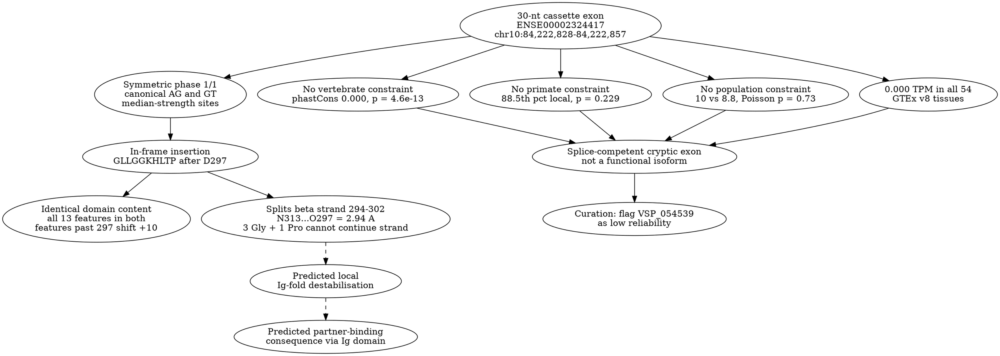

The solid arrows are measured. The two dashed arrows are the prediction that could not be completed, because ESMFold was unreachable throughout.

### Mechanistic scope

The immediate molecular question is the fold and surface chemistry of one extracellular Ig-like domain. Everything beyond that is inference, and the layers should be kept separate.

**Direct gene-product property tested.** Domain complement and membrane topology of two annotated protein sequences. Result: identical. Both are single-pass type I membrane proteins carrying the same signal peptide, four LRRs with LRRNT and LRRCT caps, one Ig-like domain, one FN3 domain and one transmembrane helix.

**One step removed.** Whether the 10-residue insertion perturbs the Ig fold. In the AlphaFold model of isoform 1, residue 297 sits inside a beta strand (294-302) forming an antiparallel hairpin with strand 307-315 at a constant register of i+j = 610, and D297 accepts a backbone hydrogen bond from N313 at 2.94 Å. That partner strand pairs with the Cys274-bearing strand at register i+j = 584, so the insertion point is embedded in the beta-sandwich framework two strands from the structural disulfide. GLLGGKHLTP has three glycines and a proline and cannot continue a strand, so the prediction is a bulge or loop excursion with local destabilisation. The LRIT family alignment adds that no paralog carries length variation at this column.

**Two steps removed.** Whether a perturbed Ig domain changes partner binding. The paralog data put the functional load on the Ig domain in LRIT3, where it controls TRPM1 localization ([PMID: 41000924](https://pubmed.ncbi.nlm.nih.gov/41000924/)). Transferring that to LRIT2 crosses a species boundary and a paralog boundary, and LRIT2 has no measured partner at all.

**Not addressed and not inferable here.** Any retinal phenotype, any disease link, any downstream signalplex consequence for LRIT2.

## Evidence matrix

| Citation | Evidence type | Stance | Claim tested | Key finding | Context | Confidence and limitations |
|---|---|---|---|---|---|---|
| UniProt A6NDA9, VSP_054539, FASTA A6NDA9-1 and -2 | computational, sequence | refutes | Isoforms differ in domain content | 100.00% identity over 550 aa; prefix 1-297 and 253-residue suffix identical; only change is +GLLGGKHLTP; all 13 features in both | human, database | High. Isoform 2 domain bounds are an inferred +10 offset, not re-annotated by UniProt |
| Ensembl REST GRCh38, ENST00000372113 vs ENST00000538192 | computational, genomic | qualifies | Alternative start vs internal exon vs truncation | Cassette exon ENSE00002324417, chr10:84,222,828-84,222,857, 30 nt, phase 1/1, AG...GT, no frameshift | GRCh38 | High, exon maps unambiguous |
| UCSC hg38 phyloP100way and phastCons100way, REST API | structural/evolutionary | refutes | The exon encodes a conserved functional element | phastCons 0.000 vs 0.754 and 0.545 for constitutive exons and 0.010 intron; phyloP -0.317 vs -0.084 intron; p = 0.98/0.99 vs intron, 2.5e-11 and 4.6e-13 vs exon | 100 vertebrates | High. Vertebrate-wide statistic, so a primate-restricted element needed separate testing |
| Ensembl REST LASTZ_NET, human vs *Macaca mulatta*, chr10:84,221,500-84,224,500 | structural/evolutionary | refutes | The exon is a recent primate-specific constrained element | Exon 100% identical to macaque, but so are 22.9% of 292 local 30 bp windows (mean 0.950); exon at 88.5th percentile, binomial p = 0.229 | 2 alignment blocks, 2,995 aligned bases | High for the null. Closes the primate-constraint alternative |
| gnomAD v4 genomes, chr10:84,221,500-84,224,500, 830 variants with AN > 50,000 | computational, population genetic | refutes | The 10 encoded residues are under purifying selection | Micro-exon 333 variants/kb vs intron 293 and constitutive exons 257 and 238; 10 observed vs 8.80 predicted, Poisson P = 0.729; no variant above 0.1% AF | human population, median AN 152,186 | Moderate. Only 30 bp, so low power. Consistent with neutrality, agrees in direction with the conservation tests |
| gnomAD v4 gene constraint, LRIT2 and paralogs | computational, population genetic | qualifies | LRIT2 loss is selected against in humans | LRIT2 pLI 0.000, LOEUF 1.45, 23 observed vs 22.4 expected LoF, missense Z -1.96. LRIT1 1.36, LRIT3 0.97, GRM6 1.13, TRPM1 0.88 | human population | High for the statistic. Gene-level context, not isoform-resolved |
| GTEx Portal API v2, gtex_v8, ENSG00000204033.9 | direct assay, transcriptomic | refutes | Isoform 2 is expressed at a meaningful level | ENST00000538192.4 median 0.000 TPM in 54/54 tissues; ENST00000372113.6 max 2.300 TPM, above zero in 29/54, sum 10.580 | human bulk RNA-seq, 54 tissues | Moderate. GTEx has no retina and all four LRIT2 junctions have median 0, so this bounds non-retinal tissue only |
| GenBank BX648524.1, BC140765.1; RefSeq NM_001017924.5, NM_001284223.1 | review/database | qualifies | Which isoform predominates in retina | Retina clone DKFZp686B0995 skips the exon and builds the MANE transcript; the only exon-containing clone is a pooled non-retinal MGC clone; NM_001284223.1 has no RNA-seq intron support line | human cDNA libraries | Clone-level, n = 1 per form, not quantitative |
| AlphaFold DB AF-A6NDA9-F1 v6, global pLDDT 77.19 | computational, structural | competing | The insertion remodels a surface partner-binding loop | D297 is mid-strand in an antiparallel hairpin (register i+j = 610; N313...O297 = 2.94 Å; CA297-CA313 = 5.4 Å); 14.0 Å from C274-C327 (modelled at 2.02 Å); side chain solvent-directed, 11 neighbours vs domain mean 17.3 | isoform 1 model only | Ig pLDDT 91.7 is high. Isoform 2 was never folded: ESMFold API returned HTTP 504 |
| UniProt A6NDA9, Q3SXY7, Q9P2V4 Ig-like domains, Needleman-Wunsch BLOSUM62 | computational, sequence | supports | The insertion site is a position the LRIT family tolerates | D297 is position 45 of the LRIT2 Ig domain and aligns without a gap to Thr in LRIT3 and LRIT1; identity 33% and 30%; no paralog carries an insertion there | 3 human Swiss-Prot paralogs | Moderate. Paralog identity is 30-33%, so column-level alignment is approximate |
| Empirical PWMs from three chr10 background sets (81-83, 82-86, 83-85 Mb) | computational, sequence | qualifies | The exon is skipped because its splice sites are weak | Both dinucleotides canonical. Acceptor 52.0th, 57.6th and 87.8th percentile across backgrounds; donor 58.4th and 70.4th | GRCh38 chr10 | Moderate. Percentile is background-dependent, so the conservative reading is at or above median. Weak sites are ruled out either way |
| gnomAD 10-84222860-G-A, AF 1.16% | computational, population genetic | qualifies | The micro-exon acceptor is maintained by selection | A common variant 3 bp into the acceptor lowers its PWM score by 1.38-1.47 bits while leaving AG intact and the position a pyrimidine | human population | Moderate. One variant. Shows the site is not under tight maintenance |
| [PMID: 41000924](https://pubmed.ncbi.nlm.nih.gov/41000924/) | mutant phenotype, in vivo rescue | qualifies | Is the Ig domain the partner-specificity module in LRIT proteins | In LRIT3, Ig deletion abolishes TRPM1 localization to the DBC signalplex and function; LRR needed for cone synaptic trafficking; FN3 dispensable | mouse retina, rAAV in Lrit3-/- | Paralog, not LRIT2. Transfers domain logic, not partner identity |
| UniProt A6NDA9 SUBUNIT, ECO:0000250, source UniProtKB:Q6PFC5 | review/database | qualifies | LRIT2 partner specificity (LRIT1 heterodimer) | The only partner statement for LRIT2 is inferred by similarity from mouse Lrit1 | database inference | Inference only. Cannot support an isoform-resolved partner claim |
| [PMID: 31934309](https://pubmed.ncbi.nlm.nih.gov/31934309/) | mutant phenotype | qualifies | Does LRIT2 have a retinal function at all | lrit2 morpholino knockdown in zebrafish produced a confirmed eye phenotype | zebrafish, morphant | Gene-level, not isoform-resolved, morpholino caveats |
| [PMID: 35858306](https://pubmed.ncbi.nlm.nih.gov/35858306/) | direct assay, transcriptomic | competing | Prior plausibility of retinal short-exon inclusion | Vertebrate retina expresses the most tissue-enriched microexons of any tissue, with a photoreceptor-specific Srrm3-dependent subset | zebrafish, mouse retina | Establishes prior plausibility only. The LRIT2 exon is 30 nt, above the classic 3-27 nt microexon range, and unconstrained |
| [PMID: 15489334](https://pubmed.ncbi.nlm.nih.gov/15489334/) | review/database | qualifies | Provenance of the isoform 2 sequence | UniProt attributes the isoform 2 sequence solely to this large-scale MGC cDNA project | human cDNA libraries | Database-level. The single cDNA source underlying the micro-exon-containing isoform |
| [PMID: 17974005](https://pubmed.ncbi.nlm.nih.gov/17974005/) | review/database | qualifies | Provenance of the isoform 1 sequence | UniProt cites this clone resource as the sole sequence source for isoform 1; the underlying clone DKFZp686B0995 is from adult human retina | human cDNA libraries | Database-level. Establishes the retinal origin of the exon-skipping form |

## Evidence base

The literature relevant to this hypothesis divides into three groups, and only one of them bears on LRIT2 directly.

**Direct LRIT2 evidence is almost absent.** UniProt A6NDA9 cites three references, all large-scale sequencing papers. Two of them matter here only for clone provenance: the German cDNA consortium full-ORF resource ([PMID: 17974005](https://pubmed.ncbi.nlm.nih.gov/17974005/)) is the sole source of the isoform 1 sequence and traces to the adult human retina clone DKFZp686B0995, and the Mammalian Gene Collection ([PMID: 15489334](https://pubmed.ncbi.nlm.nih.gov/15489334/)) is the sole source of the isoform 2 sequence and traces to the pooled non-retinal clone MGC:176442. The single functional study naming LRIT2 is an integrated mouse transcriptome and phenome screen with zebrafish validation ([PMID: 31934309](https://pubmed.ncbi.nlm.nih.gov/31934309/)), which lists Lrit2 among novel eye genes with a knockdown eye phenotype. That is gene-level evidence and says nothing about isoforms.

**Paralog evidence is the strongest functional material available, and it is about LRIT3.** The domain-deletion rescue study in Lrit3-/- mouse retina ([PMID: 41000924](https://pubmed.ncbi.nlm.nih.gov/41000924/)) establishes that the Ig domain of LRIT3 is required for TRPM1 localization to the depolarizing bipolar cell signalplex and for function, while the FN3 domain is dispensable. This is the reason the Ig domain is the right place to look for a consequence if the insertion perturbs the fold. It is also the reason to be careful: the literature on this gene family is dominated by LRIT3 and congenital stationary night blindness, including gene augmentation work in mouse ([PMID: 40766553](https://pubmed.ncbi.nlm.nih.gov/40766553/), [PMID: 34401402](https://pubmed.ncbi.nlm.nih.gov/34401402/), [PMID: 37091241](https://pubmed.ncbi.nlm.nih.gov/37091241/)) and dog ([PMID: 35316139](https://pubmed.ncbi.nlm.nih.gov/35316139/), [PMID: 37220680](https://pubmed.ncbi.nlm.nih.gov/37220680/)), and clinical genetics cohorts ([PMID: 40551348](https://pubmed.ncbi.nlm.nih.gov/40551348/), [PMID: 42106701](https://pubmed.ncbi.nlm.nih.gov/42106701/)). None of that work is about LRIT2, and importing its GO terms into LRIT2 on the strength of family membership would be paralog overannotation.

**Splicing context supplies the main competing interpretation, and it does not survive testing.** Vertebrate retina expresses the largest number of tissue-enriched microexons of any tissue, with a photoreceptor-specific Srrm3-dependent subset ([PMID: 35858306](https://pubmed.ncbi.nlm.nih.gov/35858306/)). A related study of PROM1 exon 4 shows that a single photoreceptor alternative exon can carry real developmental consequence ([PMID: 39353897](https://pubmed.ncbi.nlm.nih.gov/39353897/)). Together these establish that a short retinal cassette exon in a photoreceptor gene is a biologically plausible object. The LRIT2 exon fails the tests that would make it one: it is 30 nt, above the classic 3-27 nt microexon range; it shows zero constraint at vertebrate, primate and human-population timescales; its transcript is undetected in GTEx; and the only retinal cDNA for the gene skips it.

## Limitations and knowledge gaps

<i class="fa-solid fa-circle-question"></i> **Isoform ratio in retina.** Checked: GenBank clone provenance, RefSeq evidence lines, Ensembl TSL and MANE tags, GTEx v8 median transcript TPM and median junction counts across 54 tissues. Found: isoform 2 is 0.000 TPM everywhere GTEx measures. Not found: any retinal measurement, because GTEx has no retina and the GTEx junction medians are 0 even for the constitutive LRIT2 junction. This is the one gap that still carries the reliability call, because the entire conclusion about retinal predominance rests on clone-level evidence with n = 1 per form. Resolution: percent-spliced-in for ENSE00002324417 from human retina or retinal organoid RNA-seq, ideally long-read.

<i class="fa-solid fa-circle-question"></i> **Fold consequence of the insertion.** Checked: the AlphaFold isoform 1 model, the backbone hydrogen-bond ladder, burial, and a family alignment showing the insertion point is an ungapped column shared with LRIT1 and LRIT3. Attempted and failed: ESMFold prediction of both Ig constructs, HTTP 504 from the ESM Atlas API on every attempt across three iterations. This matters because the only possible functional difference between the isoforms is this local structural effect. Resolution: fold the isoform 2 Ig construct (residues 245-360) with AlphaFold and compare strand topology and per-residue pLDDT to the isoform 1 construct.

<i class="fa-solid fa-circle-question"></i> **Any LRIT2 interaction.** Checked: the UniProt SUBUNIT evidence code. The LRIT1 interaction is ECO:0000250 from mouse Lrit1 (Q6PFC5). This matters because partner specificity is the stated endpoint of the seed hypothesis and there is no measured baseline against which to compare isoforms.

<i class="fa-solid fa-circle-question"></i> **Regulated inclusion.** Checked: splice-site strength, which is canonical and at or above median. Not checked: whether any splicing factor controls this exon, for example the Srrm3/Srrm4 program active in photoreceptors ([PMID: 35858306](https://pubmed.ncbi.nlm.nih.gov/35858306/)). A competent but unconstrained exon under regulated control would still be worth a note. Resolution: look for the exon in Srrm3 knockout retina splicing tables.

<i class="fa-solid fa-triangle-exclamation"></i> **Power limits.** The gnomAD density test covers 30 bp and is consistent with neutrality rather than proof of it. The splice-site percentile moves with the background set (52.0 to 87.8 for the acceptor across three chr10 intervals), so the bit score is the stable quantity and the percentile should be quoted as a range. The Ensembl LASTZ query for dog returned HTTP 400 and was not retried.

## Conflicts and alternatives

The main alternative to a rare cryptic inclusion event was that the exon is a genuine primate-specific or human-specific regulated isoform. Retina does run large tissue-specific short-exon programs ([PMID: 35858306](https://pubmed.ncbi.nlm.nih.gov/35858306/)), so the cell-biological setting exists. That alternative was tested and failed. Against a local neutral background in the same intron, 100% human-macaque identity over 30 bp is ordinary: 22.9% of 292 background windows reach it, and the exon sits at the 88.5th percentile with p = 0.229. The exon is unconstrained at vertebrate, primate and human-population timescales.

The reading that does survive is that the exon has functional splice sites and is occasionally used. Both dinucleotides are canonical and both sites score at or above the median of real chr10 splice sites, so the spliceosome can include it. That explains BC140765.1 without requiring the inclusion event to be biologically meaningful. A common gnomAD variant at 1.16% sitting 3 bp into the acceptor, weakening it by 1.38-1.47 bits without destroying the AG, is consistent with a site under no selective maintenance.

A second alternative is that the exon is constitutively included in a cell type not represented in either clone library. The cDNA evidence is n = 1 per form and GTEx has no retina, so this cannot be excluded.

Paralog confusion is a live risk in this gene's literature. Nearly all functional LRIT work is on LRIT3 and congenital stationary night blindness. Any claim about LRIT2 partner specificity imported from LRIT3 should be labelled as paralog-based inference.

Database carry-over is also a risk, given the inverted RefSeq and UniProt isoform numbering described in F5.

## GO curation implications

All items are leads requiring curator verification.

**CC.** The membrane terms stand for the gene product and should stay isoform-agnostic. Both isoforms retain the signal peptide and the single transmembrane helix, so a single-pass type I membrane CC annotation covers both. Retain, do not qualify by isoform.

**MF.** No isoform-specific MF term is supportable. The only partner statement in the entry, interaction with LRIT1, is ECO:0000250 from mouse Lrit1 (Q6PFC5). There is no human LRIT2 binding assay. Do not add a term on the strength of the isoform difference, and do not fall back to "protein binding" as the final recommendation.

**BP.** LRIT3-derived synapse-organisation terms should not be transferred to LRIT2 on the basis of this isoform analysis. [PMID: 41000924](https://pubmed.ncbi.nlm.nih.gov/41000924/) is mouse LRIT3. Mark any such transfer as paralog-based inference needing LRIT2-specific evidence.

**Sequence annotation.** The strongest actionable lead is to flag A6NDA9-2 / VSP_054539 as low-reliability in the review: zero constraint at three timescales, zero GTEx expression, a single pooled non-retinal cDNA clone, no RNA-seq intron support in the corresponding RefSeq, and a retinal cDNA that skips the exon. Remove or down-weight any statement in the review that describes isoform-specific LRIT2 function, localisation or partner specificity.

### GO decision table

| Aspect | Term class | Current status | Isoform-resolved? | Recommended action | Basis |
|---|---|---|---|---|---|
| CC | single-pass type I membrane | present | no, and should stay so | retain, isoform-agnostic | Both isoforms carry signal peptide 1-19 and one TM helix |
| MF | partner binding (any specific term) | not supportable | no | do not add | Only LRIT2 partner statement is ECO:0000250 from mouse Lrit1 |
| BP | synapse organisation terms from LRIT3 | candidate transfer | no | do not transfer on this basis | PMID 41000924 is mouse LRIT3, paralog boundary |
| Sequence feature | VSP_054539 / isoform A6NDA9-2 | annotated without qualification | yes | flag low reliability | No constraint, no expression, one pooled non-retinal clone |

## Discriminating tests

1. <i class="fa-solid fa-flask"></i> Long-read RNA-seq or targeted RT-PCR across the exon 2 / exon 3 junction in human retina, retinal organoids and a non-retinal control tissue, reporting percent-spliced-in for ENSE00002324417. This single experiment decides whether isoform 2 exists at a meaningful level anywhere and whether it is retina-enriched.
2. <i class="fa-solid fa-magnifying-glass"></i> Side-by-side structure prediction of the Ig construct with and without the insertion (residues 245-360), scoring beta-strand continuity at 294-302 and C274-C327 disulfide geometry. Cheap, and it converts the fold-disruption prediction into a result. This is the test that ESMFold's unavailability blocked.
3. <i class="fa-solid fa-vial"></i> Surface expression assay: transfect both full-length isoforms tagged extracellularly in HEK293 and measure surface against total signal. If the insertion destabilises the Ig fold, isoform 2 should be ER-retained. This tests the mechanistic prediction without needing a known partner.
4. <i class="fa-solid fa-flask"></i> Co-immunoprecipitation of each LRIT2 isoform with LRIT1 and with TRPM1, which would establish a LRIT2 partner for the first time and make the isoform comparison interpretable.

Two tests proposed earlier in this investigation were run and are closed: primate-restricted conservation over the exon (no constraint, 88.5th percentile of local background, p = 0.229) and empirical splice-site strength scoring (canonical dinucleotides, acceptor 52nd-88th percentile, donor 58th-70th percentile).

## Curation leads

All items below require curator verification.

**Lead 1, action change.** Mark isoform A6NDA9-2 / VSP_054539 as low-confidence in the review and remove any text that attributes isoform-specific domain content, isoform-specific partner specificity or isoform-specific localisation to LRIT2. Reference to verify: GenBank BC140765.1, source qualifier `tissue_type="Pooled, cerebellum, kidney, placenta, testis, lung, colon, liver, heart, thyroid, bladder, uterus, PCR rescued clones"`.

**Lead 2, reference to verify.** RefSeq NM_001017924.5 COMMENT, exact snippet: "Transcript Variant: This variant (2) lacks an alternate in-frame exon in the 3' coding region, compared to variant 1. This results in a shorter protein (isoform 2), compared to isoform 1." Confirms both the micro-exon mechanism and the inverted numbering.

**Lead 3, reference to verify.** GenBank BX648524.1, source qualifiers `tissue_type="human retina"` and `dev_stage="adult"`. This is the retinal clone, and it skips the exon.

**Lead 4, paralog caution.** [PMID: 41000924](https://pubmed.ncbi.nlm.nih.gov/41000924/), exact snippet: "However, the IG domain is required for the localization of TRPM1 to the signalplex and thus function. The FN3 domain is not necessary for either DBC signalplex assembly or function." Use as LRIT3 domain context only. Do not transfer the GO terms to LRIT2.

**Lead 5, GO terms.** No new or replacement GO term is warranted from this hypothesis. CC membrane terms stay as they are and stay isoform-agnostic. Do not introduce an MF term for LRIT2 partner binding on isoform grounds.

**Lead 6, naming hazard to record.** RefSeq "transcript variant 1" NM_001284223.1 / NP_001271152.1 "isoform 1" is the 560 aa exon-containing form = UniProt A6NDA9-2. RefSeq "transcript variant 2" NM_001017924.5 / NP_001017924.1 "isoform 2" is the 550 aa form = UniProt A6NDA9-1 (canonical, MANE Select). Curation text should name the accession, not the ordinal.

**Lead 7, suggested question for the review.** "Is there any quantitative retinal transcript evidence for inclusion of ENSE00002324417 (chr10:84,222,828-84,222,857)?" If the answer stays no, isoform 2 should carry an explicit low-reliability note. Non-retinal tissue is already answered: 0.000 median TPM in all 54 GTEx v8 tissues for ENST00000538192.4.

**Lead 8, wording to use.** Describe the exon as splice-competent but unconstrained and without expression support. Both splice dinucleotides are canonical and both sites score at or above the median of real chr10 splice sites, so calling it a sequencing or assembly error would be wrong. The defensible statement is that no evidence supports A6NDA9-2 as a functional protein isoform.

**Lead 9, gene-level context to record.** LRIT2 is loss-of-function tolerant in humans: gnomAD v4 pLI 0.000, LOEUF 1.45, 23 observed loss-of-function variants against 22.4 expected. Of the cCSNB signalplex genes checked, only TRPM1 (LOEUF 0.88) and LRIT3 (0.97) approach constraint. Any strong functional claim for LRIT2, at gene or isoform level, should be weighed against this.

**Lead 10, suggested experiments.** Items 1, 2 and 3 of the discriminating tests above, in that order of value per unit effort.

## Correction made during this analysis

The splice-site percentile reported mid-investigation was computed against a single chr10 background set and was overstated. Repeating the analysis with three independent background intervals gives acceptor percentiles of 52.0, 57.6 and 87.8, and donor percentiles of 58.4 and 70.4. The earlier statement that the acceptor is "stronger than three of the four constitutive LRIT2 sites" does not replicate and has been removed. The conclusion that weak splice sites do not explain non-inclusion survives, because a canonical site at median strength is a usable site. This is recorded because the percentile, not the bit score, is the quantity that moves with the background, and any curator re-running the analysis will get a different number.

An earlier coordinate error is also recorded: a first pass used plus-strand offsets for the two constitutive donors of this minus-strand gene, producing non-canonical dinucleotides and scores of -7.38 and -16.46 bits. Corrected coordinates give canonical ATGGTAAGC (9.19 bits) and CAGGTGCGC (7.07 bits). A figure whose title contradicted its own data was regenerated.

## Provenance

Computed artifacts written by this run:

- `provenance/plot_1.png`: AlphaFold v6 per-residue pLDDT for A6NDA9 with annotated domains and the isoform 2 insertion point marked.
- `provenance/plot_2.png`: burial profile across the Ig-like domain and a projection of the domain onto its principal axes, with D297 marked.
- `provenance/plot_3.png`: per-base phyloP and phastCons distributions for the micro-exon, both flanking constitutive exons and an intron control.
- `provenance/plot_4.png`: combined isoform domain schematic plus the conservation comparison.
- `provenance/plot_5.png` to `provenance/plot_7.png`: cross-species identity of the cassette exon and the corrected splice-site scoring figures.
- `provenance/plot_8.png`: GTEx v8 median transcript TPM for both LRIT2 transcripts across tissues, the human-macaque window null, and splice-site percentiles.
- `provenance/plot_9.png`: human-macaque 30 bp window identity histogram with the micro-exon marked, and the 51 bp smoothed identity track across chr10:84,221,500-84,224,500 with the exon shaded.
- `provenance/plot_10.png`: gnomAD v4 genome variant density by region, and allele frequencies across the locus with the cassette exon and constitutive exons shaded.
- `provenance/plot_11.png`: LRIT2 and signalplex gene LOEUF, micro-exon variant density against intron, and splice-site percentile across three background sets.
- Tables: `out/LRIT2_isoform_domain_comparison.csv`, `out/LRIT2_isoform_evidence_matrix.csv`, `out/LRIT2_GO_decision_table.csv`, `out_LRIT2_splice_site_scores.csv`, `out_LRIT2_gtex_transcript_tpm.csv`, `out_LRIT2_macaque_windows.csv`, `out_LRIT2_gnomad_density.csv`, `out_LRIT2_gnomad_gene_constraint.csv`, `out_LRIT2_acceptor_variant.csv`, `out_LRIT2_splice_background_sensitivity.csv` (written in the executor working directory).

Resources that could not be used, stated plainly. The ESM Atlas ESMFold API returned HTTP 504 for both Ig constructs on every attempt across three iterations, so no isoform 2 structure was predicted and the fold-perturbation claim stays a prediction. No retinal isoform quantification dataset was accessible. The Ensembl LASTZ query for dog returned HTTP 400 and was not retried. The GTEx junction endpoint returned median 0 for all four LRIT2 junctions including the constitutive one, so it had no power and was not used as evidence.

Analyses reported here were run live against UniProt, Ensembl, NCBI eutils, UCSC, AlphaFold DB, GTEx and gnomAD on 2026-11-25. No figure in this report stands for an analysis that was not executed. Where an analysis was repeated and gave a different number, both are reported and the earlier one is marked as superseded.


## Artifacts

- [OpenScientist final report](openscientist_artifacts/final_report.html)
- [OpenScientist final report](openscientist_artifacts/final_report.pdf)
- [OpenScientist provenance](openscientist_artifacts/provenance.json)
- [OpenScientist LRIT2 GO decision table](openscientist_artifacts/provenance_out_LRIT2_GO_decision_table.csv)
- [OpenScientist LRIT2 isoform domain comparison](openscientist_artifacts/provenance_out_LRIT2_isoform_domain_comparison.csv)
- [OpenScientist LRIT2 isoform evidence matrix](openscientist_artifacts/provenance_out_LRIT2_isoform_evidence_matrix.csv)
- [OpenScientist out LRIT2 acceptor variant](openscientist_artifacts/provenance_out_LRIT2_acceptor_variant.csv)
- [OpenScientist out LRIT2 gnomad density](openscientist_artifacts/provenance_out_LRIT2_gnomad_density.csv)
- [OpenScientist out LRIT2 gnomad gene constraint](openscientist_artifacts/provenance_out_LRIT2_gnomad_gene_constraint.csv)
- [OpenScientist out LRIT2 macaque windows](openscientist_artifacts/provenance_out_LRIT2_macaque_windows.csv)
- [OpenScientist out LRIT2 splice background sensitivity](openscientist_artifacts/provenance_out_LRIT2_splice_background_sensitivity.csv)
- [OpenScientist out LRIT2 splice site scores](openscientist_artifacts/provenance_out_LRIT2_splice_site_scores.csv)
- [OpenScientist out splice scores](openscientist_artifacts/provenance_out_splice_scores.csv)
- [OpenScientist plot 1](openscientist_artifacts/provenance_plot_1.json)
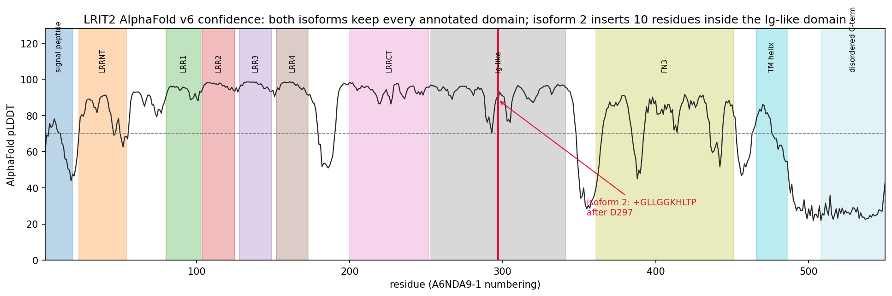
- [OpenScientist plot 10](openscientist_artifacts/provenance_plot_10.json)
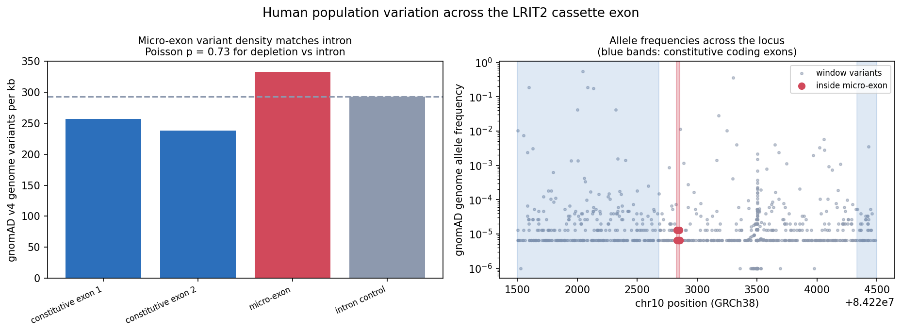
- [OpenScientist plot 11](openscientist_artifacts/provenance_plot_11.json)
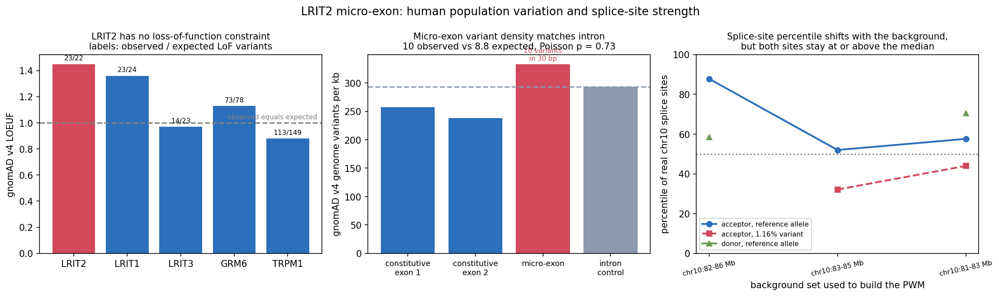
- [OpenScientist plot 2](openscientist_artifacts/provenance_plot_2.json)
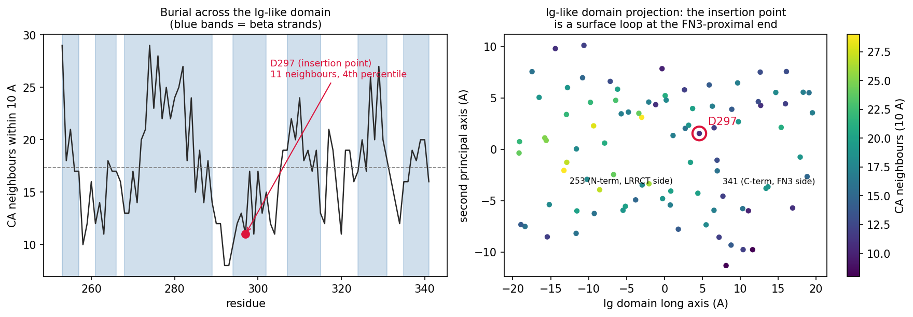
- [OpenScientist plot 3](openscientist_artifacts/provenance_plot_3.json)
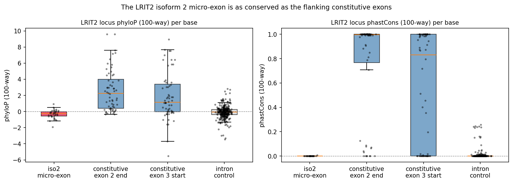
- [OpenScientist plot 4](openscientist_artifacts/provenance_plot_4.json)
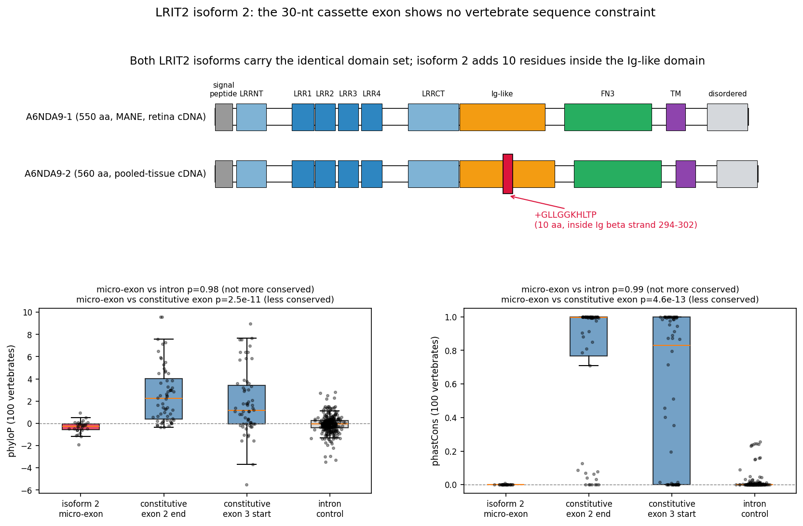
- [OpenScientist plot 5](openscientist_artifacts/provenance_plot_5.json)
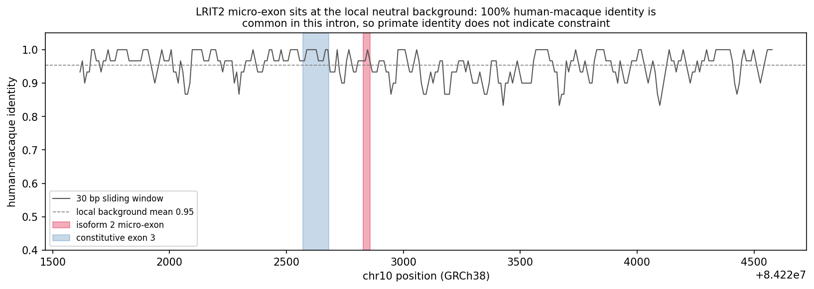
- [OpenScientist plot 6](openscientist_artifacts/provenance_plot_6.json)
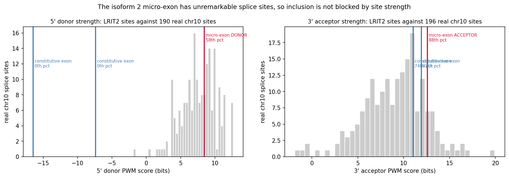
- [OpenScientist plot 7](openscientist_artifacts/provenance_plot_7.json)
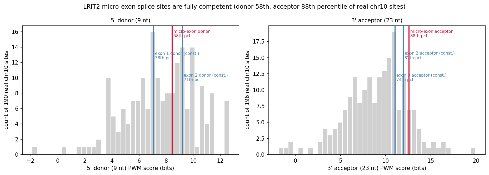
- [OpenScientist plot 8](openscientist_artifacts/provenance_plot_8.json)
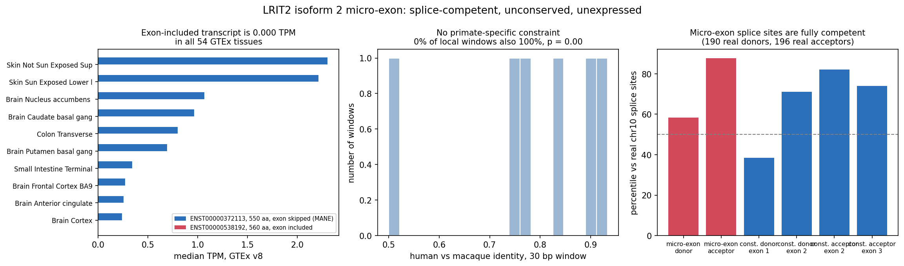
- [OpenScientist plot 9](openscientist_artifacts/provenance_plot_9.json)
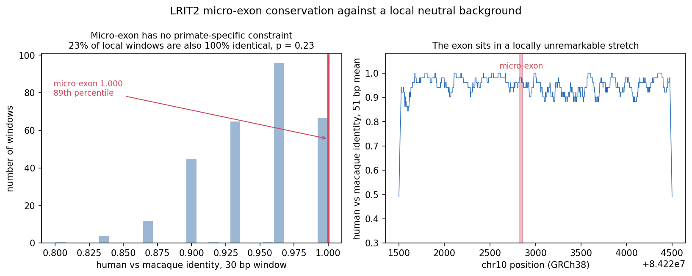

## Reference Validation

Checked with `linkml-reference-validator` 0.3.1rc1.

| Outcome | Count |
| --- | --- |
| References checked | 13 |
| Resolved | 13 |
| Unresolved (possible confabulation) | 0 |
| Unverifiable | 0 |
| References weighed for topical relevance | 13 |
| On topic | 0 |
| Off topic | 0 |

All extracted references resolved successfully.