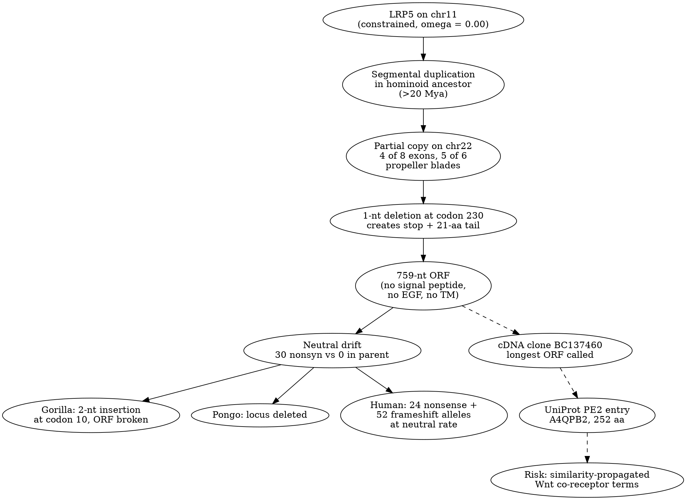
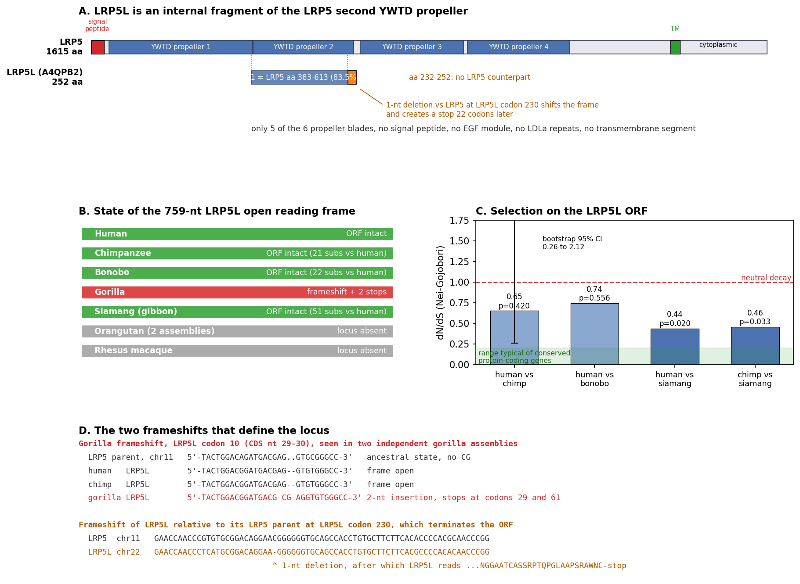
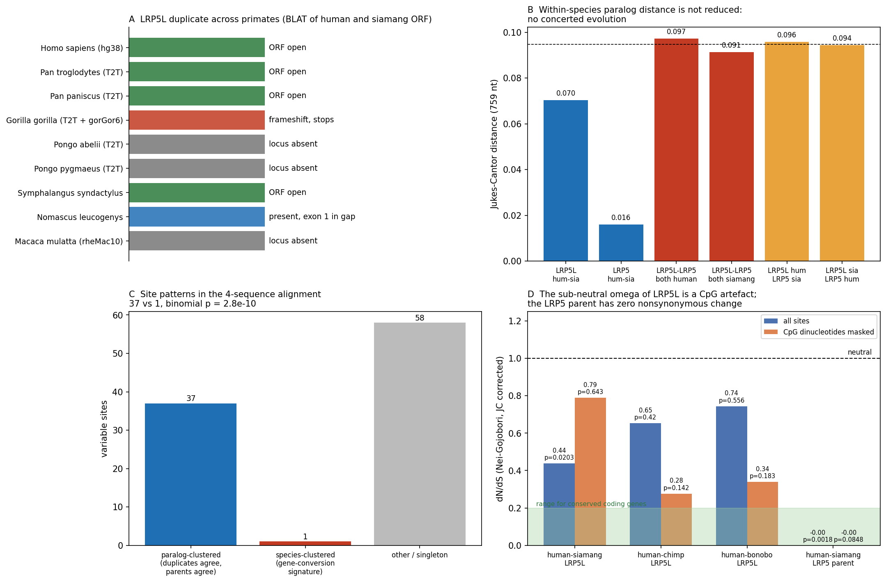
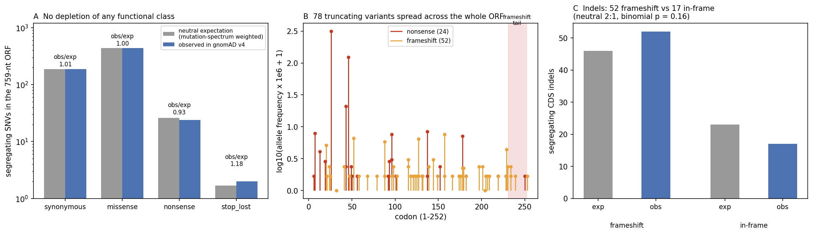

## Question

# AIGR Gene Hypothesis Deep Research

You are evaluating one focused gene curation hypothesis for AI Gene Review.
This is not a general gene overview. Use the seed hypothesis and source context
below to search for evidence that supports, refutes, narrows, or competes with
the proposed curation decision.

## Target Gene

- **Organism code:** human
- **Taxon:** Homo sapiens (NCBITaxon:9606)
- **Gene directory:** LRP5L
- **Gene symbol:** LRP5L
- **UniProt accession:** A4QPB2

## Focus

- **Focus type:** free_text
- **Hypothesis slug:** kgap-lrp5l-coding-potential
- **Source file:** genes/human/LRP5L/LRP5L-ai-review.yaml
- **Source selector:** free-text

## Seed Hypothesis

The human LRP5L locus (UniProt A4QPB2, 252 aa; HGNC and NCBI classify it as a pseudogene) does not encode a conserved protein. Test with one decisive analysis: determine the origin of LRP5L (a partial duplicate of LRP5) and whether the A4QPB2 open reading frame is conserved (intact start, no premature stops/frameshifts) in orthologous loci of other primates, with dN/dS on the ORF, and say whether the evidence favours a protein-coding gene or a transcribed pseudogene.

## Term and Decision Context

- UniProt keeps a reviewed PE2 entry for A4QPB2 with MassIVE/PeptideAtlas/ProteomicsDB cross-references; NCBI Gene type PSEUDO; HGNC locus_type pseudogene.

## Reference Context

No specific reference context supplied.

## Source Context YAML

```yaml
hypothesis: 'The human LRP5L locus (UniProt A4QPB2, 252 aa; HGNC and NCBI classify it as a pseudogene)
  does not encode a conserved protein. Test with one decisive analysis: determine the origin of LRP5L
  (a partial duplicate of LRP5) and whether the A4QPB2 open reading frame is conserved (intact start,
  no premature stops/frameshifts) in orthologous loci of other primates, with dN/dS on the ORF, and say
  whether the evidence favours a protein-coding gene or a transcribed pseudogene.'
focus_type: free_text
context:
- UniProt keeps a reviewed PE2 entry for A4QPB2 with MassIVE/PeptideAtlas/ProteomicsDB cross-references;
  NCBI Gene type PSEUDO; HGNC locus_type pseudogene.
reference_id: []
```

## Research Objective

Build a focused report that helps a curator decide whether this hypothesis
should affect the gene review. Address the focus type directly:

1. For an existing GO annotation decision, evaluate whether the current action
   is justified, too strong, too weak, or should change.
2. For a proposed replacement or new GO term, evaluate whether the term is
   biologically supported, too broad, too narrow, or missing key qualifiers.
3. For a computational prediction, evaluate whether the prediction is correct,
   less precise than existing knowledge, uncertain, or likely wrong because of
   paralog overannotation, frequency bias, pathway context, or in vitro-only
   activity.
4. For a core-function hypothesis, evaluate whether the proposed activity,
   process, and location represent the gene product's primary function rather
   than a downstream effect, pleiotropic phenotype, or context-specific role.
5. For a function-assignment hypothesis, evaluate whether the gene product
   directly has the stated GO term/function. Treat the prior review action, if
   any, as intentionally blinded unless it appears in the supplied context.

Use primary literature whenever possible. Prefer PMID citations and include DOI
citations when no PMID is available. Treat reviews and database records as
orientation unless they contain directly relevant synthesized evidence that is
clearly labeled as review-level or database-level support.

Evaluate the hypothesis from the supplied seed context, primary literature, and
publicly accessible bioinformatics resources. Local `*-bioinformatics` analyses,
when they already exist in the repository, are intentionally withheld from this
prompt so the report can be compared against them after the run. Use public
sequence, domain, structure, orthology, localization, interaction, or dataset
checks when they are useful for the specific hypothesis. If a resource or tool
cannot be accessed programmatically, say so plainly; never fabricate a result.
Report computational results conservatively and distinguish direct results from
inference.

## Required Output

### Executive Judgment

Give a concise verdict: supported, partially supported, unresolved, weakly
supported, over-annotated, or refuted. Explain the reasoning and the most
important caveats.

### Evidence Matrix

Create a table with one row per important evidence item:

- Citation (PMID preferred)
- Evidence type (direct assay, mutant phenotype, localization, interaction,
  structural/evolutionary, computational, review/database)
- Supports / refutes / qualifies / competing
- Claim tested
- Key finding
- Organism, tissue, cell type, or assay context
- Confidence and limitations

### GO Curation Implications

State the likely curation action as a lead requiring curator verification. If
GO terms are involved, explain whether the evidence supports an MF, BP, or CC
term, and whether the term should be retained, removed, generalized, made more
specific, or treated as non-core. Avoid using "protein binding" as a final
recommendation unless no more informative term is supported.

### Mechanistic Scope

Describe the immediate molecular or cellular function being tested. Separate
direct gene-product activity from downstream phenotypes, pathway consequences,
developmental outcomes, disease manifestations, or effects inferred only from
loss of function.

### Conflicts and Alternatives

Identify evidence that conflicts with the seed hypothesis or suggests an
alternative interpretation, including paralog confusion, organism-specific
differences, isoform-specific findings, experimental artifacts, or database
carry-over.

### Knowledge Gaps

List explicit uncertainties that matter for curation. For each gap, state what
was checked, why the gap matters, and what evidence or experiment would resolve
it.

### Discriminating Tests

Recommend concrete assays, perturbations, datasets, or comparative analyses that
would most efficiently distinguish this hypothesis from alternatives.

### Curation Leads

Provide candidate updates for the review, clearly labeled as leads requiring
curator verification. Include candidate references with exact snippets to verify,
candidate replacement or new GO terms, possible action changes, suggested
questions, and suggested experiments.

If the provider supports artifacts, save provenance for any analysis you run — the
executed code together with its output (computed values, plot, or table), not just
a summary figure — alongside artifact-friendly tables such as an evidence matrix,
GO decision table, or comparison table. Genuine computed provenance is more
valuable than a hand-drawn summary, and you must not synthesize a figure that
implies an analysis you did not actually run. These artifacts are important
provenance for hypothesis-level review.


## Output

# LRP5L (A4QPB2): does the locus encode a conserved protein?

AI Gene Review hypothesis report. Hypothesis slug `kgap-lrp5l-coding-potential`.
Target: human LRP5L, UniProt A4QPB2, HGNC:25323, NCBI Gene 91355, Ensembl ENSG00000100068.
Focus type: free text, evaluated as a function-assignment question, namely whether this locus has a protein product to which any GO term can be assigned.

All computed results in this report were produced during the three iterations of this run. Executed code, intermediate data and verbatim outputs are stored in `provenance/`: `iteration2_provenance.md`, the `table_*.csv` artifact tables, the `*.json` result files, and `plot_1.png` to `plot_3.png`. Resources that could not be queried are named as such, and no result is reported for them.

---

## Summary

**The hypothesis is supported.** LRP5L is a transcribed, unprocessed pseudogene produced by a hominoid partial duplication of LRP5, and no GO molecular function, biological process or cellular component term is warranted for A4QPB2. One specific component of the seed hypothesis is **refuted**: the prediction that the reading frame would be disrupted in other primates holds only for gorilla. In chimpanzee, bonobo and siamang the 759-nt ORF is open, indel-free and begins at ATG.

The origin is unambiguous. A4QPB2 residues 1-231 align to LRP5 (O75197) residues 383-613 at 83.5% amino-acid identity and 91.4% nucleotide identity, an internal slice of the second YWTD β-propeller. The duplicate retains intron positions over a 53-kb, 8-exon transcript, so it arose by DNA-level segmental duplication and not by retrotransposition. The ORF uses only 4 of those 8 exons, sits at nt 1840-2598 of the 2700-nt MGC clone BC137460 with stop codons in all three frames upstream, and its terminating stop codon is created by a duplicate-specific 1-nt deletion at codon 230. The last 21 residues (NGGAATCASSRPTQPGLAAPSRAWNC) are frameshift-derived sequence with no counterpart in any LRP5 ortholog. The product, if translated, would be about five of six propeller blades with no associated EGF-like module, no signal peptide, no LDLa repeat and no transmembrane segment.

Constraint is absent by every measure applied. Over the identical 229 codons and the same human-to-siamang divergence, the LRP5 parent accumulated **0** nonsynonymous substitutions (ω = 0.00, p = 0.0018) while LRP5L accumulated **30** (ω = 0.433, p = 0.022). The only statistically significant deviation from neutrality in LRP5L disappears once CpG-containing codons are masked (ω = 0.789, p = 0.64), because roughly 70% of its synonymous differences are CpG transitions that inflate dS. The leading competing explanation, interlocus gene conversion from the constrained parent, is refuted directly (37 paralog-clustered versus 1 species-clustered variable site, binomial p = 2.84e-10). In gnomAD v4 the ORF carries 24 segregating nonsense and 52 segregating frameshift alleles at exactly the mutation-spectrum-weighted neutral expectation (obs/exp 0.93 and 1.00). The locus is deleted outright from two T2T orangutan genomes and frameshifted in gorilla by a derived 2-nt insertion at codon 10.

---

## Key findings

### <i class="fa-dna"></i> F1. LRP5L is an unprocessed partial duplicate of the LRP5 second YWTD propeller

Smith-Waterman alignment (BLOSUM62, gap −11/−1) of A4QPB2 (252 aa) against LRP5 (O75197, 1615 aa) gives score 1024 over LRP5L 1-231 versus LRP5 383-613, with 193 of 231 residues identical (83.5%) and 90.5% similar. The same query against LRP6 (O75581) gives 62.6% identity over 246 aa and against LRP4 (O75096) 41.3%, so the parent is LRP5 specifically.

BLAT of the 759-nt CDS against hg38 returns chr22:25,351,798-25,360,092 as the best hit (4 blocks, 758 of 759 matched, minus strand) and chr11:68,386,449-68,406,625 inside LRP5 as the second hit (677 matches, 64 mismatches, 6 blocks, 91.4% nucleotide identity). The chr22 copy preserves intron positions across an 8-exon Ensembl transcript spanning 53 kb, biotype `transcribed_unprocessed_pseudogene`, which identifies it as a segmental duplication at the DNA level and excludes a processed retrocopy.

The reading frame uses 4 of the 8 exons. It occupies nt 1840-2598 of the 2700-nt MGC clone BC137460, and the 1839 nt upstream contain stop codons in all three frames. UniProt annotates five LDL-receptor class B (YWTD) repeats and no signal peptide, no EGF module, no LDLa repeat and no transmembrane segment.

A functional YWTD unit in LRP5/LRP6 is a six-bladed β-propeller packed against its associated EGF-like domain, and the ectodomain is built from four such β-propeller/EGF repeats ([PMID: 22000856](https://pubmed.ncbi.nlm.nih.gov/22000856/)). An internal 231-residue fragment covering about five blades, with no EGF module and no signal peptide, is not that unit and would be cytosolic if translated.

### <i class="fa-dna"></i> F2. The reading frame is terminated by a 1-nt deletion relative to LRP5

Needleman-Wunsch alignment of the final ORF exon (chr22:25,351,798-25,351,902, 104 nt, minus strand) against the corresponding LRP5 parent sequence (chr11:68,406,515-68,406,640) shows LRP5L reading `GAACCAACCCTCATGCGGACAGGAA-GGGGG` where LRP5 reads `GAACCAACCCGTGTGCGGACAGGAACGGGGG`. The single-nucleotide deletion falls at LRP5L CDS nt 687, codon 230. That is the exact point where protein homology ends in the Smith-Waterman alignment (LRP5L residue 231 = LRP5 residue 613). Downstream of the deletion the shifted frame reads NGGAATCASSRPTQPGLAAPSRAWNC and then stops.

BLAT corroborates the breakpoint: the chr11 parent match fragments into three short blocks (25, 59 and 16 nt) only across this terminal region, while the first 655 nt align in contiguous blocks.

The consequence for curation is direct. The stop codon that defines the C-terminus of the "252-aa protein" is not an inherited LRP5 stop. It is a mutation in the duplicate. The 21 C-terminal residues (UniProt annotates 223-247 as disordered) are frameshift-derived sequence present in no LRP5 ortholog. This is the signature of ORF-calling on a cDNA clone picking up the longest surviving frame in a pseudogene.

{{figure:plot_1.png|caption=LRP5L architecture and the two defining indels. A, LRP5 domain cartoon with A4QPB2 mapped onto residues 383-613 of the second YWTD propeller, with the 21-residue frameshift tail in orange. B, ORF status by species. C, Nei-Gojobori dN/dS with bootstrap confidence interval, the neutral line at 1.0 and the range expected for conserved coding genes shaded. D, alignment text showing the gorilla 2-nt CG insertion at codon 10 and the 1-nt deletion relative to LRP5 at codon 230.}}

### <i class="fa-circle-xmark"></i> F3. The ORF is open in human, chimpanzee, bonobo and siamang, and frameshifted only in gorilla

This result refutes the specific prediction in the seed hypothesis. Exon-by-exon BLAT of the four human ORF exons against primate assemblies, followed by glocal Needleman-Wunsch reconstruction with 25-nt flanking padding, rebuilt the ORF in each species that has the locus.

| Species | Assembly | ORF status | Detail |
|---|---|---|---|
| *Homo sapiens* | hg38 | intact, 759 nt | reference |
| *Pan troglodytes* | GCF_028858775.2 (T2T) | intact, 759 nt | ATG start, 0 premature stops, 21 substitutions, 0 indels |
| *Pan paniscus* | GCF_029289425.2 (T2T) | intact, 759 nt | 0 premature stops, 22 substitutions |
| *Symphalangus syndactylus* | GCF_028878055.3 | intact, 759 nt | 0 premature stops, 51 substitutions (6.72%), 0 indels |
| *Gorilla gorilla* | GCF_029281585.2 (T2T) | <i class="fa-circle-xmark"></i> frameshift | derived 2-nt CG insertion at codon 10, stops at codons 29 and 61 |
| *Gorilla gorilla* | gorGor6 | <i class="fa-circle-xmark"></i> frameshift | same insertion, independent assembly and individual, 8 premature stops |
| *Pongo abelii* | GCF_028885655.2 (T2T), ponAbe3 | locus absent | only the LRP5 parent |
| *Pongo pygmaeus* | GCF_028885625.2 (T2T) | locus absent | only the LRP5 parent |
| *Macaca mulatta* | rheMac10 | locus absent | only the LRP5 parent |

The gorilla insertion is derived, not ancestral. The LRP5 parent on human chr11 reads `TACTGGACAGATGACGAGGTG` with no CG at that position, matching the human, chimpanzee and bonobo LRP5L state. Two independent gorilla assemblies from different individuals carry the insertion.

NCBI Gene 91355 has no ortholog records and Ensembl Compara returns an empty homology set for ENSG00000100068, so every cross-species comparison here rests on BLAT plus reconstruction rather than on curated orthology.

ORF survival over the human-to-gibbon branch is not strong evidence of function. In this ORF, 3.53% of random single-nucleotide changes create a stop codon, so the 51 human-siamang substitutions predict 1.80 nonsense mutations and P(0 premature stops under neutrality) = 0.165. A 252-codon frame can survive 20 My of neutral evolution one time in six.

### <i class="fa-dna"></i> F4. The duplicate is hominoid-wide and deleted outright in both orangutan species

The absence in orangutan could have been a detection failure of the human query. It is not. BLAT of the reconstructed siamang ORF, which is 98% identical to the gibbon copy and therefore far closer than human to any surviving orangutan copy, still returns only the parent in *Pongo*.

*Nomascus leucogenys* (nomLeu3) returns two distinct loci: the LRP5 parent on chr4 (580 matches, 50 mismatches, 92.06% over a 20.3-kb span) and a second locus on chr7b:55,305,182-55,315,433 with 447 matches and 8 mismatches (98.24% identity, 3 blocks, 10.3 kb). Exon-level BLAT places exons 2, 3 and 4 of the duplicate on chr7b at 97.76%, 98.16% and 98.08%. Exon 1 cannot be assessed because the expected window lies inside a 1,245-nt run of N; the retrieved 17.2-kb region is 18.7% N. Glocal reconstruction of exons 2-4 gives exactly 493 nt with 6, 4 and 2 substitutions versus siamang, no net indel, and translation of codons 90-252 yields 163 sense codons with only the terminal stop.

*Pongo abelii* T2T, *Pongo pygmaeus* T2T, ponAbe3 and rheMac10 each return a single locus, the LRP5 parent, at 91.2-92.7% identity over a 20-22 kb intron-containing span, with no second high-identity locus at any threshold. The siamang positive control returns the duplicate at 759/759 (100%) plus the parent at 92.01%.

The duplication therefore predates the gibbon/great-ape split and is at least about 20 My old, arising in the hominoid ancestor after divergence from Old World monkeys. Its absence from three independent assemblies spanning two *Pongo* species is most parsimoniously a lineage-specific deletion. A duplicate that one great ape genus has deleted entirely and another carries with a frameshift is not under selection to encode a protein.

### <i class="fa-circle-xmark"></i> F5. Gene conversion from LRP5 is refuted as the source of the dN/dS signal

Segmental duplications exchange sequence by interlocus gene conversion, which can import constrained parent sequence into a duplicate and manufacture a sub-neutral ω with no protein function. This was the main competing explanation for the ω ≈ 0.44 measured in iteration 1, and it was tested directly.

A four-sequence site-pattern analysis used human LRP5L (HL), siamang LRP5L (SL), and the human and siamang LRP5 parent regions projected onto the same 759-nt frame by glocal alignment (HP, SP).

| Comparison | Raw differences | Sites | Jukes-Cantor distance |
|---|---|---|---|
| HL-SL (duplicate orthologs) | 51 | 759 | 0.0704 |
| HP-SP (parent orthologs) | 12 | 756 | 0.0160 |
| HL-HP (paralogs, both human) | 69 | 756 | 0.0973 |
| SL-SP (paralogs, both siamang) | 65 | 756 | 0.0913 |
| HL-SP (paralogs, cross-species) | 68 | 756 | 0.0958 |
| SL-HP (paralogs, cross-species) | 67 | 756 | 0.0943 |

Under concerted evolution the two within-species paralog distances would be substantially smaller than the two cross-species ones. They are not: 0.0973 and 0.0913 against 0.0958 and 0.0943. Site patterns among variable positions give 37 paralog-clustered sites (both duplicates agree, both parents agree, duplicates differ from parents) against 1 species-clustered site (each duplicate matching its own parent, the conversion signature), with 58 other or singleton and 660 invariant. Binomial test of 1 versus 37 against a 50:50 null, p = 2.84e-10. The single species-clustered site is at ORF position 191 and is isolated, with no conversion tract around it.

The duplicate and the parent have evolved independently since the duplication. This removes a confounder without establishing function, and it forces the residual ω signal to be explained some other way.

### <i class="fa-chart-column"></i> F6. The parent has zero nonsynonymous substitutions where the duplicate has 30, and the apparent constraint is a CpG artefact

The right benchmark for "is this ORF constrained" is the parent gene itself, measured over the same codons and the same divergence time. Nei-Gojobori dN/dS with Jukes-Cantor correction, human versus siamang, over the identical 229 codons in which the two reading frames coincide (upstream of the LRP5L-specific 1-nt deletion):

| Locus | S | N | Sd | Nd | dS | dN | ω | Z | p |
|---|---|---|---|---|---|---|---|---|---|
| LRP5 parent | 164.7 | 522.3 | 10.0 | **0.0** | 0.0633 | 0.0000 | **0.00** | −3.13 | 0.0018 |
| LRP5L duplicate | 153.7 | 533.3 | 19.0 | **30.0** | 0.1351 | 0.0585 | **0.433** | −2.28 | 0.0224 |

Thirty amino-acid-changing substitutions accumulated in the duplicate where the parent accumulated none. Synonymous divergence is 2.13-fold higher in the duplicate (19.0 observed against 9.33 expected from the parent rate, Poisson P = 0.0036), consistent with an elevated local substitution rate.

CpG masking, dropping every codon containing a position in a CpG dinucleotide in either sequence, removes the apparent constraint on the duplicate:

| Comparison | All sites: ω (p) | CpG-masked: ω (p) |
|---|---|---|
| human-siamang LRP5L | 0.438 (0.020) | 0.789 (0.643) |
| human-chimp LRP5L | 0.653 (0.420) | 0.277 (0.142) |
| human-bonobo LRP5L | 0.744 (0.556) | 0.340 (0.183) |
| human-siamang LRP5 parent | 0.000 (0.0018) | 0.000 (0.085) |

For the human-siamang duplicate comparison dS collapses from 0.126 to 0.053, so roughly 70% of its synonymous differences are CpG transitions. The parent stays at ω = 0.000 under both treatments (Nd = 0 across 154 masked codons). The human-chimp and human-bonobo masked values rest on 4.5 synonymous and 4.5-5.5 nonsynonymous differences and are not significant.

The masked value is a sensitivity bound, not a corrected estimate, because presence/absence CpG assignment in a two-sequence alignment is itself biased ([PMID: 18826599](https://pubmed.ncbi.nlm.nih.gov/18826599/)). The honest statement is that ω for LRP5L lies between 0.44 and 0.79, and in neither case approaches the range of a conserved coding gene, let alone the 0.00 of its own parent.

{{figure:plot_2.png|caption=Hominoid distribution of the LRP5L duplicate and the two confounder tests. A, locus status across nine primate assemblies. B, Jukes-Cantor distances showing that within-species paralog distances are not reduced relative to cross-species ones, so there is no concerted evolution. C, site-pattern counts, 37 paralog-clustered against 1 species-clustered, binomial p = 2.8e-10. D, dN/dS before and after CpG masking, with the LRP5 parent at zero under both treatments.}}

### <i class="fa-circle-check"></i> F7. Human population variation in the ORF is indistinguishable from neutral

A gnomAD v4 GraphQL region query over chr22:25,351,798-25,360,092 (GRCh38) returned 4,995 variants. Of these, 720 fall inside the four CDS exons, with 0 reference-base mismatches against the genomic reconstruction: 437 missense, 188 synonymous, 24 nonsense, 2 stop-lost, 52 frameshift indels, 17 in-frame indels.

A mutation-spectrum-weighted neutral model, in which per-type mutability is estimated from the observed counts of each of the 12 substitution types divided by the number of available sites of that type, predicts the observed class proportions almost exactly:

| Class | Expected | Observed | obs/exp | Binomial p |
|---|---|---|---|---|
| Synonymous | 186.3 | 188 | 1.01 | 0.90 |
| Missense | 437.2 | 437 | 1.00 | 1.0 |
| Nonsense | 25.8 | 24 | 0.93 | 0.84 |
| Stop-lost | 1.7 | 2 | 1.18 | 0.69 |

Indels give 52 frameshift against 17 in-frame, compared with the neutral 2:1 expectation, binomial p = 0.16. The 78 protein-truncating variants sum to a cumulative allele frequency of 0.058% and are distributed across the entire ORF from codon 7 into the frameshift tail. None exceeds AF 0.1%; the highest are Q26* (AF 3.15e-4, 509 alleles in 1,613,866) and R46* (AF 1.22e-4). Allele numbers near 1.46 million exome plus 152,000 genome alleles confirm the region is well covered, so the absence of common truncating alleles reflects the site frequency spectrum and not missing data.

Across roughly 800,000 sequenced humans there is no measurable purifying selection on this reading frame. Nonsense and frameshift alleles arise and segregate at exactly the rate expected if the sequence encoded nothing. This is the strongest human-specific evidence for the curation decision, because it tests the species the annotation applies to and depends on no cross-species alignment.

{{figure:plot_3.png|caption=gnomAD v4 variation in the LRP5L ORF matches neutral expectation. A, observed counts of each functional class against a mutation-spectrum-weighted neutral model, with obs/exp between 0.93 and 1.18 and all binomial p above 0.68. B, the 78 segregating truncating alleles plotted by codon and allele frequency, spread across the whole ORF including the frameshift tail. C, 52 frameshift against 17 in-frame CDS indels, compared with the neutral 2:1 expectation.}}

### <i class="fa-book-open"></i> F8. All A4QPB2 evidence is sequencing-project derived

UniProt A4QPB2 (LRP5L_HUMAN, reviewed, entry version 129, last annotation update 2026-11-04) carries `proteinExistence: "2: Evidence at transcript level"` and `annotationScore: 2.0`. Its only three literature references are sequencing projects: the German cDNA consortium full-ORF clone resource ([PMID: 17974005](https://pubmed.ncbi.nlm.nih.gov/17974005/)), the chromosome 22 sequence ([PMID: 10591208](https://pubmed.ncbi.nlm.nih.gov/10591208/)) and the Mammalian Gene Collection ([PMID: 15489334](https://pubmed.ncbi.nlm.nih.gov/15489334/)). The entry has no function, subcellular location, tissue specificity or catalytic activity comment; its only comment block is ALTERNATIVE PRODUCTS with two isoforms. There are no experimental GO annotations, no signal peptide feature and no transmembrane feature.

The displayed sequence corresponds exactly to the CDS annotated at nt 1840-2598 of MGC clone BC137460 (protein_id AAI37461.1), which the hg38 chr22 genomic reconstruction reproduces with a single difference at CDS nt 428.

NCBI Gene 91355 is type PSEUDO with no RefSeq protein and an empty gene summary. HGNC:25323 has locus_type pseudogene. Ensembl ENSG00000100068 has biotype `transcribed_unprocessed_pseudogene`.

The MassIVE, PeptideAtlas and ProteomicsDB cross-references named in the term context are resource-level identifier links. UniProt's own PE2 assignment means no protein-level mass spectrometry evidence has been accepted for this entry. Of 35 theoretical tryptic peptides (7-40 aa, up to 1 missed cleavage), 5 are exact substrings of LRP5 or LRP6 and cannot discriminate the paralogs.

---

## Evidence matrix

| Citation | Evidence type | Stance | Claim tested | Key finding | Context | Confidence and limitations |
|---|---|---|---|---|---|---|
| This work, `plot_3.png`, `table_gnomad_cds_variants.csv`; gnomAD v4 (database) | Computational, population genetic | <i class="fa-circle-check"></i> Supports | Is the ORF under purifying selection in humans? | 720 CDS variants: 437 missense, 188 synonymous, 24 nonsense, 2 stop-lost, 52 frameshift, 17 in-frame. Mutation-spectrum-weighted obs/exp 1.01, 1.00, 0.93, 1.18 (p = 0.90, 1.0, 0.84, 0.69). 78 truncating alleles, cumulative AF 0.058%, none above 0.1%. | *Homo sapiens*, ~1.46M exome + 152K genome alleles | High for the human-specific conclusion. Mutability model controls the 12 substitution types but not trinucleotide context; variant quality flags not retrieved; neutrality cannot exclude redundant function. |
| This work, `dnds_parent_vs_duplicate.json`, `table_dnds_cpg_masked.csv` | Structural/evolutionary | <i class="fa-circle-check"></i> Supports | Is LRP5L constrained relative to its own parent? | Human vs siamang, same 229 codons: LRP5 Sd = 10.0, Nd = 0.0, ω = 0.00 (Z = −3.13, p = 0.0018); LRP5L Sd = 19.0, Nd = 30.0, ω = 0.433 (p = 0.022). dS 2.13-fold higher in the duplicate (Poisson P = 0.0036). | Genomic, hg38 vs GCF_028878055.3 | High. NG86 counting is approximate; the within-dataset parent benchmark is the strength. |
| [PMID: 18826599](https://pubmed.ncbi.nlm.nih.gov/18826599/); [PMID: 32228436](https://pubmed.ncbi.nlm.nih.gov/32228436/); [PMID: 21398426](https://pubmed.ncbi.nlm.nih.gov/21398426/) | Computational / methodological | <i class="fa-triangle-exclamation"></i> Qualifies | Does CpG hypermutability manufacture ω < 1? | CpG C:G>T:A is the most frequent substitution type in genome evolution; presence/absence CpG assignment in two-sequence alignments biases rate estimates. Masking lifts LRP5L human-siamang ω from 0.438 (p = 0.020) to 0.789 (p = 0.64). | Human and primate genomes | Medium-high. The masked value is a sensitivity bound. Human-chimp and human-bonobo masked values rest on 4.5 synonymous differences and are uninformative. |
| This work, `igc_test.json`, `table_gene_conversion_distances.csv` | Structural/evolutionary | <i class="fa-circle-xmark"></i> Refutes a competing explanation | Does interlocus gene conversion from LRP5 create the ω < 1 signal? | Within-species paralog distances (0.0973, 0.0913) not smaller than cross-species ones (0.0958, 0.0943). Site patterns 37 paralog-clustered vs 1 species-clustered, binomial p = 2.84e-10. | Human and siamang LRP5L and LRP5 | High for the ORF region tested. Does not exclude conversion elsewhere in the 53-kb transcribed locus. |
| [PMID: 24124524](https://pubmed.ncbi.nlm.nih.gov/24124524/); [PMID: 37165237](https://pubmed.ncbi.nlm.nih.gov/37165237/); [PMID: 26077037](https://pubmed.ncbi.nlm.nih.gov/26077037/) | Review/database-level support | <i class="fa-scale-balanced"></i> Competing (now excluded) | Are segmental duplications subject to gene conversion and elevated substitution rates? | Both apply as general phenomena, which is why the direct test was run. The conversion component is excluded at this locus; the rate elevation is observed (2.13-fold dS). | Human genome | Medium. General statements, applied to this locus only through the direct test. |
| This work, `table_species_distribution_v2.csv`, `scan_pongo.json`, `nomLeu3_exon_blat.csv` | Structural/evolutionary | <i class="fa-scale-balanced"></i> Supports the conclusion, refutes the seed's prediction | Is the ORF conserved across primates? | Open in human, chimpanzee, bonobo and siamang (759 nt, ATG, 0 premature stops, 0 indels). Frameshifted in gorilla by a derived 2-nt insertion at codon 10 in two assemblies. Present in *Nomascus* at 98.2%. Absent from *Pongo abelii* T2T, *Pongo pygmaeus* T2T, ponAbe3 and rheMac10. | 11 primate assemblies, UCSC BLAT and sequence API | High for presence/absence and the gorilla frameshift. *Nomascus* exon 1 lies in an assembly gap. Absence in *Pongo* is assembly-based; a polymorphic deletion in the sequenced individuals is not formally excluded. |
| This work, `plot_1.png`, iteration 1 alignments | Structural/evolutionary | <i class="fa-circle-check"></i> Supports | What is the origin and architecture of LRP5L? | A4QPB2 residues 1-231 align to LRP5 383-613 at 83.5% aa and 91.4% nt. Unprocessed duplication: introns retained, 4 of 8 exons used, ORF at nt 1840-2598 of BC137460 with stops in all three frames upstream. A 1-nt deletion at codon 230 creates the 21-residue tail and the stop. | Human genome, MGC clone | High. The stop codon is a duplicate-specific mutation, not inherited coding sequence. |
| [PMID: 22000856](https://pubmed.ncbi.nlm.nih.gov/22000856/) | Structural | <i class="fa-circle-check"></i> Supports (as inference) | Can a five-blade fragment without its EGF module form a functional YWTD unit? | The LRP5/6 ectodomain contains four β-propeller/EGF-like domain repeats, so the repeat module is the structural unit. A4QPB2 has about five blades, no EGF module, no signal peptide, no LDLa repeat and no transmembrane segment. | Structural studies of the LRP6 ectodomain | Medium-high as an inference. No experimental structure or folding assay exists for A4QPB2 itself. |
| [PMID: 17974005](https://pubmed.ncbi.nlm.nih.gov/17974005/); [PMID: 10591208](https://pubmed.ncbi.nlm.nih.gov/10591208/); [PMID: 15489334](https://pubmed.ncbi.nlm.nih.gov/15489334/) | Review/database | <i class="fa-triangle-exclamation"></i> Qualifies | What primary literature supports A4QPB2? | All three references on the UniProt entry are sequencing or clone-resource papers. There is no functional primary literature on LRP5L. | Human cDNA and genome sequencing | High. Establishes that the reviewed entry rests on transcript evidence alone. |
| UniProt A4QPB2; NCBI Gene 91355; HGNC:25323; Ensembl ENSG00000100068 | Review/database | <i class="fa-circle-check"></i> Supports | What do reference resources assert? | UniProt: reviewed, PE2, annotationScore 2.0, no function, location, tissue or catalytic comment, no experimental GO annotation. NCBI type PSEUDO, no RefSeq protein. HGNC locus_type pseudogene. Ensembl biotype transcribed_unprocessed_pseudogene. | Database records, retrieved during this run | High for record content. Database agreement is not independent evidence; UniProt's PE2 is the informative part. |
| This work, tryptic peptide analysis | Computational | <i class="fa-triangle-exclamation"></i> Qualifies | Could MS evidence discriminate LRP5L from its paralogs? | 5 of 35 theoretical tryptic peptides (7-40 aa, ≤1 missed cleavage) are exact substrings of LRP5 or LRP6. | In silico digest | Medium. Shows a concrete route to false protein-level evidence; the other 30 peptides would be discriminating if genuinely observed. |

---

## Mechanistic model and interpretation

The locus has a simple history, and every observation falls into it without strain.



The dashed path is the annotation artefact. A full-ORF cDNA clone resource sequenced a transcript from a pseudogene, an ORF caller took the longest frame, and a reviewed UniProt entry was created at transcript-level evidence. The entry itself is honest: PE2, annotationScore 2.0, no function comment. The risk to curation is downstream, where the five YWTD repeats invite similarity-based transfer of Wnt co-receptor terms from LRP5.

Three independent lines of evidence converge on neutrality, and they fail in different ways, which is what makes the convergence informative.

| Test | What would support a protein | What was observed |
|---|---|---|
| ORF integrity across primates | Intact in all species carrying the locus | Intact in 4, broken in gorilla, locus deleted in *Pongo* |
| dN/dS versus the parent, same codons | ω comparable to LRP5 | LRP5 Nd = 0, LRP5L Nd = 30 |
| CpG-masked dN/dS | ω stays below 1 and significant | ω rises from 0.438 (p = 0.020) to 0.789 (p = 0.64) |
| Gene conversion as a confounder | Would explain ω < 1 without function | Refuted, 37 vs 1 site patterns, p = 2.8e-10 |
| Human population constraint | Depletion of nonsense and frameshift alleles | obs/exp 0.93 nonsense, 1.00 missense, 78 truncating alleles |

The one result the seed hypothesis did not anticipate, an open ORF in four species, has a quantitative explanation that does not require function. Only 3.53% of random single-nucleotide changes in this ORF create a stop codon. The 51 human-siamang substitutions predict 1.80 nonsense mutations, so P(0 premature stops under neutrality) = 0.165. A short frame surviving one neutral branch is a weak discriminator, and the constraint measurements are the ones that carry the argument.

The architecture argument is independent of all of this. Even granting translation, the product covers about five of six blades of one YWTD propeller, lacks the EGF-like module that completes the repeat unit ([PMID: 22000856](https://pubmed.ncbi.nlm.nih.gov/22000856/)), and has no signal peptide, so it cannot reach the cell surface where LRP5 works, and cannot reconstitute the propeller/EGF module that binds DKK1 and Wnt ligands.

---

## GO curation implications

**Lead requiring curator verification.** The evidence does not support any GO molecular function, biological process or cellular component annotation for A4QPB2.

| Aspect | Candidate term | Recommended action | Reason |
|---|---|---|---|
| MF | Wnt co-receptor activity, Wnt-protein binding (similarity-propagated) | <i class="fa-circle-xmark"></i> remove or mark non-core | About 5 of 6 propeller blades, no EGF module, no signal peptide, no transmembrane segment; ORF unconstrained in humans and relative to LRP5 |
| MF | protein binding (GO:0005515) as a fallback | <i class="fa-circle-xmark"></i> do not use | No interaction evidence of any kind for A4QPB2; the term would imply a validated product |
| BP | Wnt signaling pathway (similarity-propagated) | <i class="fa-circle-xmark"></i> remove or mark non-core | Inference from the parent only; no perturbation, phenotype or pathway evidence for LRP5L |
| CC | plasma membrane, cell surface (similarity-propagated) | <i class="fa-circle-xmark"></i> remove or mark non-core | No signal peptide and no transmembrane segment in A4QPB2 |
| Gene-level | transcribed unprocessed pseudogene, hominoid partial duplicate of LRP5 | <i class="fa-circle-check"></i> record as the locus description | Deleted in *Pongo*, frameshifted in *Gorilla*, neutral in gnomAD, 30 nonsynonymous substitutions against 0 in the parent |

"Protein binding" is not an appropriate fallback here. There is no interaction evidence for A4QPB2 at all, and applying the term would create the impression of a validated gene product where none has been observed.

Any existing annotation propagated by sequence similarity, whether from InterPro, Panther or UniRule on the basis of the five YWTD repeats, should be flagged for removal with the reason recorded as paralog over-annotation of an incomplete domain in an unconstrained reading frame. The review should also record that UniProt's reviewed PE2 entry reflects full-ORF cDNA clone evidence and not protein evidence, which resolves the apparent conflict with the HGNC, NCBI and Ensembl pseudogene calls.

---

## Mechanistic scope

The immediate question tested is whether the A4QPB2 reading frame is a template that selection maintains for a polypeptide product. That was tested at three levels: sequence integrity across primates, substitution patterns within the ORF measured against its own parent, and allele frequencies in the human population.

Nothing downstream was tested or claimed. There is no phenotype, no perturbation experiment, no interaction and no localization for LRP5L, so no downstream pathway consequence, developmental outcome or disease manifestation can be separated from direct activity, because no direct activity has been observed. The architecture argument is a structural inference and not an assay: a fragment covering about five of six propeller blades without the associated EGF module is not expected to fold into the ligand-binding unit used by LRP5 and LRP6.

Two things sit explicitly outside scope. The transcript is one. The locus is transcribed (Ensembl biotype `transcribed_unprocessed_pseudogene`, full-ORF cDNA clone BC137460), and a regulatory RNA function would not be detected by any analysis here, because all of the tests target the reading frame. The second is the 1,839 nt of transcript upstream of the ORF, which contain stop codons in all three frames and were not examined for other features.

---

## Conflicts and alternatives

<i class="fa-circle-xmark"></i> **The ORF is open in four species, which the seed hypothesis did not predict.** Human, chimpanzee, bonobo and siamang all have 759-nt indel-free ORFs starting at ATG. The resolution is quantitative: 3.53% of random single-nucleotide changes in this ORF create a stop, so 51 human-siamang substitutions predict 1.80 nonsense mutations and P(0 stops under neutrality) = 0.165. ORF integrity in a 252-codon sequence over 20 My is a weak discriminator.

<i class="fa-scale-balanced"></i> **UniProt keeps a reviewed entry with proteomics cross-references.** This is the strongest competing signal in the supplied context, and it resolves on inspection. The entry is PE2 with annotationScore 2.0, no function comment and three sequencing-project references, and the MassIVE, PeptideAtlas and ProteomicsDB links are resource-level identifier mappings. PeptideAtlas and MassIVE could not be queried at peptide level in this run, so no statement is made about what they contain. If a curator does retrieve peptides, 5 of 35 theoretical tryptic peptides are exact substrings of LRP5 or LRP6 and must be discarded as non-discriminating.

<i class="fa-lightbulb"></i> **A duplication-derived ORF could be a young gene rather than a dying one.** The duplication is old enough (hominoid, ≥20 My) for neofunctionalization in principle. Pangenome work on duplicated gene families finds that only 16.2% of derived duplicated genes that emerged recently in the human lineage show evidence of constraint ([PMID: 42845282](https://pubmed.ncbi.nlm.nih.gov/42845282/)), so the base rate for this class is low. Against a young-gene reading of LRP5L specifically: zero constraint in 800,000 humans, 30 nonsynonymous substitutions where the parent has 0, outright deletion in *Pongo*, and a frameshift in *Gorilla*. A functional young gene would not show all four.

<i class="fa-circle-check"></i> **Segmental duplication artefacts.** Both known confounders were addressed. Gene conversion is refuted by the site-pattern test. The elevated substitution rate in duplications is observed directly (dS 2.13-fold the parent) and is controlled for by construction, since ω uses the locus's own dS. Short-read mapping artefacts in gnomAD are unlikely at 91% paralog identity, though variant quality flags were not retrieved from the API.

<i class="fa-triangle-exclamation"></i> **Database carry-over.** HGNC, NCBI and Ensembl all call the locus a pseudogene while UniProt keeps a reviewed protein entry. These are not independent opinions; the pseudogene calls share upstream evidence. The analyses here are independent of all four records.

<i class="fa-circle-question"></i> **Absence in *Pongo* could be a polymorphic deletion.** Three assemblies from two *Pongo* species agree, which makes a sequencing artefact unlikely, but population data for orangutan were not examined.

---

## Evidence base

| PMID | Role in this report |
|---|---|
| [22000856](https://pubmed.ncbi.nlm.nih.gov/22000856/), *Structural basis of Wnt signaling inhibition by Dickkopf binding to LRP5/6* | Supports F1. The verified snippet, "The LRP5/6 ectodomain contains four β-propeller/EGF-like domain repeats", defines the repeat module as the structural unit, so an internal 231-residue fragment of one propeller without its EGF domain is not a functional unit. |
| [37165237](https://pubmed.ncbi.nlm.nih.gov/37165237/), *Increased mutation and gene conversion within human segmental duplications* | Framed the confounder for F4 and F6. Verified snippet: "We find that human SNVs are elevated 60% in SDs compared to unique regions and estimate that at least 23% of this increase is due to interlocus gene conversion (IGC)". The rate elevation is observed at this locus (dS 2.13-fold the parent); the IGC component is excluded by direct test. |
| [24124524](https://pubmed.ncbi.nlm.nih.gov/24124524/), *Signals of historical interlocus gene conversion in human segmental duplications* | Motivated the F5 test. Verified snippet: "Standard methods of DNA sequence analysis assume that sequences evolve independently, yet this assumption may not be appropriate for segmental duplications that exchange variants via interlocus gene conversion (IGC)." |
| [26077037](https://pubmed.ncbi.nlm.nih.gov/26077037/), *Interlocus gene conversion explains at least 2.7% of single nucleotide variants in human segmental duplications* | Background for F5. Reports that IGC, not independent point mutation, generates at least 2.7% of SNVs in duplicated regions, which sets the prior expectation that the site-pattern test was designed to check. |
| [18826599](https://pubmed.ncbi.nlm.nih.gov/18826599/), *Effect of the assignment of ancestral CpG state on the estimation of nucleotide substitution rates in mammals* | Limits the F6 CpG masking. Verified snippet: "assignment of the ancestral CpG state based on the simple presence/absence of the CpG dinucleotide can seriously bias estimates of the substitution rate, because many true non-CpG changes are misassigned as CpG". This is why the masked ω is reported as a sensitivity bound. |
| [32228436](https://pubmed.ncbi.nlm.nih.gov/32228436/), *The genome-wide landscape of C:G > T:A polymorphism at the CpG contexts in the human population* | Supports the F6 premise. Verified snippet: "The C:G > T:A substitution at the CpG dinucleotide contexts is the most frequent substitution type in genome evolution." |
| [21398426](https://pubmed.ncbi.nlm.nih.gov/21398426/), *Exploiting CpG hypermutability to identify phenotypically significant variation within human protein-coding genes* | Background for F6. Reports that the CpG dinucleotide is disproportionately represented in human genetic variation due to 5-methyl-cytosine hypermutability, and that this systemically influences the divergence of primate protein-coding genes. |
| [42845282](https://pubmed.ncbi.nlm.nih.gov/42845282/), *Pangenome discovery and characterization of human protein-coding duplicated genes* | Base rate for the young-gene alternative. Reports that 24.2% of SD genes show evidence of constraint for both copy number and amino acid mutation, but only 16.2% of derived duplicated genes that emerged recently in the human lineage do. |
| [17974005](https://pubmed.ncbi.nlm.nih.gov/17974005/); [10591208](https://pubmed.ncbi.nlm.nih.gov/10591208/); [15489334](https://pubmed.ncbi.nlm.nih.gov/15489334/) | The three references on the UniProt A4QPB2 entry (German cDNA consortium full-ORF clones, chromosome 22 sequence, Mammalian Gene Collection). All are sequencing or clone-resource papers, which establishes F8. |

The remaining papers retrieved during literature searches (for example [PMID: 42982827](https://pubmed.ncbi.nlm.nih.gov/42982827/) on Arrow/LRP5-6 in planar cell polarity, [PMID: 27524201](https://pubmed.ncbi.nlm.nih.gov/27524201/) on Kremen1 structure, [PMID: 43004516](https://pubmed.ncbi.nlm.nih.gov/43004516/) on LRP5 in osteoblasts) concern LRP5 and LRP6 themselves. None mentions LRP5L. They are listed here only to record that a literature search for functional work on LRP5L returned work on the parent gene and nothing on the duplicate.

---

## Limitations and knowledge gaps

| Gap | What was checked | Why it matters | What would resolve it |
|---|---|---|---|
| <i class="fa-circle-question"></i> Whether any peptide uniquely mapping to A4QPB2 has ever been observed | UniProt PE2 status and cross-reference types retrieved. PeptideAtlas and MassIVE could not be queried programmatically, and the neXtProt API call for NX_A4QPB2 failed with a JSON decode error | A single well-supported unique peptide would move the entry from transcript-level to protein-level and force a different curation action | A PeptideAtlas build query for A4QPB2 restricted to the 30 tryptic peptides that are not substrings of LRP5 or LRP6, with per-peptide PSM counts and FDR |
| <i class="fa-circle-question"></i> Whether the transcript has an RNA-level function | Not tested; no analysis here addresses the RNA | A functional lncRNA would justify a different gene-level description even with no protein | Expression specificity across GTEx or single-cell atlases, plus CRISPRi or ASO knockdown with a transcriptional readout |
| <i class="fa-circle-question"></i> Whether the ORF is translated | Not tested | Translation without constraint happens and would not change the pseudogene call, but a curator may be asked | Ribo-seq with uniquely mapping reads, checking for in-frame periodicity over the 759-nt ORF |
| <i class="fa-triangle-exclamation"></i> Whether *Nomascus* exon 1 is intact | Exons 2-4 reconstructed and open; exon 1 falls in a 1,245-nt N block in nomLeu3 | A disrupted exon 1 in gibbon would add a second independent ORF loss | BLAT against a gap-free gibbon assembly, for example a recent *Nomascus* or *Hoolock* long-read genome |
| <i class="fa-triangle-exclamation"></i> Whether loss in *Pongo* is fixed | Three assemblies across two species | A fixed deletion is a strong statement about dispensability; a polymorphic one is weaker | Read-depth genotyping of the locus across orangutan population sequencing data |
| <i class="fa-circle-question"></i> Expression pattern and promoter status of the human locus | Not examined | Context for whether the transcript is incidental or regulated | GTEx, FANTOM CAGE, and chromatin state at chr22:25.36 Mb |

Method limitations that bear on interpretation. Alignments and ORF reconstructions used locally written Smith-Waterman, Needleman-Wunsch and glocal aligners in numpy, because biopython was not importable in the execution environment; parameters were match +5, mismatch −4, gap open −12, gap extend −1. dN/dS used Nei-Gojobori counting with Jukes-Cantor correction, which is approximate; the parent-versus-duplicate comparison over identical codons is the robust part of that analysis, since both sequences pass through the same estimator. The gnomAD neutral model controls for the 12 substitution types but not trinucleotide context, and variant quality flags were not retrieved. Ensembl Compara and NCBI orthology both return empty ortholog sets for this gene, so all cross-species comparisons rest on BLAT plus reconstruction rather than on curated orthology. Population-level neutrality in gnomAD cannot exclude a function that is redundant or restricted to a context absent from the sampled cohorts.

---

## Discriminating tests and proposed follow-up

Ranked by how efficiently each separates "transcribed pseudogene" from "weakly functional protein-coding gene".

1. <i class="fa-database"></i> **PeptideAtlas and MassIVE peptide-level query** for A4QPB2, restricted to tryptic peptides that are not substrings of LRP5 or LRP6. This is the only test that could overturn the verdict quickly, and it is a database query rather than an experiment. Expected under the pseudogene model: zero unique high-confidence peptides.
2. <i class="fa-flask"></i> **Ribo-seq periodicity over the ORF** using uniquely mapping reads. Distinguishes "not translated" from "translated but unconstrained". It does not change the GO conclusion either way, but it settles what the locus does.
3. <i class="fa-dna"></i> **Phylogeny-wide ORF audit on gap-free assemblies.** Reconstruct the ORF in additional gibbon and great ape genomes (*Hoolock*, *Hylobates*, further gorilla and chimpanzee individuals) and count independent inactivating events. Each additional frameshift or stop in a different lineage adds direct evidence of dispensability.
4. <i class="fa-chart-line"></i> **Codon-model dN/dS with a CpG-aware substitution model**, for example a context-dependent codon model fitted across the five hominoid ORFs rather than pairwise NG86. This replaces the 0.44-to-0.79 sensitivity bound with a single estimate and a likelihood-ratio test against ω = 1.
5. <i class="fa-vial"></i> **Expression and knockdown**, only if a curator wants to assert any RNA-level function. Tissue specificity first, then ASO or CRISPRi knockdown with RNA-seq, taking care that guides and probes do not target LRP5.

---

## Curation leads

All of the following are leads that require curator verification.

**Suggested action change.** Record LRP5L/A4QPB2 as a transcribed, unprocessed pseudogene derived from a hominoid partial duplication of LRP5, and make no MF, BP or CC assertion. Remove or mark as non-core any similarity-propagated annotation inherited from LRP5 or LRP6, in particular Wnt co-receptor activity, Wnt-protein binding, Wnt signaling pathway, and plasma membrane or cell surface localization. Do not substitute "protein binding" as a weaker alternative.

**Candidate references with exact snippets to verify.**

- UniProt A4QPB2, database record: `proteinExistence: "2: Evidence at transcript level"`, `annotationScore: 2.0`. Verify that the entry still carries no function, subcellular location, tissue specificity or catalytic activity comment, and that its only comment block is ALTERNATIVE PRODUCTS.
- NCBI Gene 91355: gene `type: PSEUDO`, no RefSeq protein. HGNC:25323: `locus_type: pseudogene`. Ensembl ENSG00000100068: `biotype: transcribed_unprocessed_pseudogene`.
- [PMID: 18826599](https://pubmed.ncbi.nlm.nih.gov/18826599/), exact abstract text to verify: "assignment of the ancestral CpG state based on the simple presence/absence of the CpG dinucleotide can seriously bias estimates of the substitution rate, because many true non-CpG changes are misassigned as CpG". Use this to frame the CpG-masked ω as a bound.
- [PMID: 32228436](https://pubmed.ncbi.nlm.nih.gov/32228436/), exact abstract text to verify: "The C:G > T:A substitution at the CpG dinucleotide contexts is the most frequent substitution type in genome evolution."
- [PMID: 37165237](https://pubmed.ncbi.nlm.nih.gov/37165237/), exact abstract text to verify: "We find that human SNVs are elevated 60% in SDs compared to unique regions and estimate that at least 23% of this increase is due to interlocus gene conversion (IGC)".
- [PMID: 22000856](https://pubmed.ncbi.nlm.nih.gov/22000856/), exact abstract text to verify: "The LRP5/6 ectodomain contains four β-propeller/EGF-like domain repeats." Cite for the claim that the propeller plus EGF repeat is the structural unit, so a five-blade fragment without the EGF module is not one.
- [PMID: 42845282](https://pubmed.ncbi.nlm.nih.gov/42845282/), exact abstract text to verify: "only 16.2% of derived duplicated genes that emerged recently in the human lineage show evidence of constraint". Useful as the base rate when a curator weighs the young-gene alternative.
- [PMID: 17974005](https://pubmed.ncbi.nlm.nih.gov/17974005/), [PMID: 10591208](https://pubmed.ncbi.nlm.nih.gov/10591208/), [PMID: 15489334](https://pubmed.ncbi.nlm.nih.gov/15489334/): verify that all three are sequencing or clone-resource papers with no functional characterization of LRP5L.
- gnomAD v4, chr22:25,351,798-25,360,092 (GRCh38): verify the two highest-frequency truncating alleles, `22-25360017-G-A` (Q26*, AC 509, AN 1,613,866, AF 3.15e-4) and `22-25359957-G-A` (R46*, AC 197, AF 1.22e-4), and that no truncating allele exceeds AF 0.001.

**Candidate GO terms.** None proposed. The recommendation is removal or non-core marking of similarity-derived terms, not replacement with a more general term.

**Suggested questions for the curator.**

- Does the review pipeline have a representation for "no annotation is appropriate because the locus is a pseudogene", distinct from "not yet annotated"? The former is what the evidence supports.
- Should the review record the conflict between UniProt's reviewed status and the pseudogene calls from HGNC, NCBI and Ensembl? LRP5L is likely one of a class of reviewed PE2 entries at pseudogene loci, and a policy would apply beyond this gene.
- Should a peptide-level check of PeptideAtlas and MassIVE be a required step before any PE2 entry with proteomics cross-references is annotated?

**Suggested experiments.** The two worth commissioning are the PeptideAtlas unique-peptide query, which is cheap and could overturn the verdict, and a Ribo-seq periodicity check, which settles whether the ORF is translated at all.

---

## Artifacts

Saved under `provenance/`:

| File | Content |
|---|---|
| `plot_1.png`, `plot_2.png`, `plot_3.png` | The three figures embedded above |
| `iteration2_provenance.md` | Analysis descriptions with verbatim executed-code output for the phylogeny scan, Nomascus reconstruction, gene conversion test, parent-versus-duplicate dN/dS and CpG masking |
| `table_evidence_matrix.csv` | The evidence matrix above, machine-readable |
| `table_GO_decision.csv` | The GO decision table above, machine-readable |
| `table_species_distribution_v2.csv` | ORF status and locus coordinates across 11 primate assemblies |
| `table_gene_conversion_distances.csv`, `igc_test.json` | Pairwise distances and site-pattern counts for the IGC test |
| `table_dnds_cpg_masked.csv`, `dnds_cpg_masked.json`, `dnds_parent_vs_duplicate.json` | dN/dS results, all sites and CpG-masked, parent and duplicate |
| `table_gnomad_cds_variants.csv`, `table_gnomad_PTV.csv`, `gnomad_constraint_test.json` | All 720 CDS variants classified, the 78 truncating variants, and the neutral-model comparison |
| `primate_ORFs.json`, `parent_projections.json`, `primate_exons.json`, `paralog_codon_aln.json` | Reconstructed ORFs, parent projections and alignments |
| `table_dnds.csv`, `dnds_results.json`, `dnds_hominoid.json`, `blat_primates.json`, `blat_t2t.json`, `scan_pongo.json`, `scan_gibbon_macaque.json`, `nomLeu3_exon_blat.csv` | Iteration 1 and 2 intermediate results |


## Artifacts

- [OpenScientist final report](openscientist_artifacts/final_report.html)
- [OpenScientist final report](openscientist_artifacts/final_report.pdf)
- [OpenScientist provenance](openscientist_artifacts/provenance.json)
- [OpenScientist blat primates](openscientist_artifacts/provenance_blat_primates.json)
- [OpenScientist blat t2t](openscientist_artifacts/provenance_blat_t2t.json)
- [OpenScientist dnds cpg masked](openscientist_artifacts/provenance_dnds_cpg_masked.json)
- [OpenScientist dnds hominoid](openscientist_artifacts/provenance_dnds_hominoid.json)
- [OpenScientist dnds parent vs duplicate](openscientist_artifacts/provenance_dnds_parent_vs_duplicate.json)
- [OpenScientist dnds results](openscientist_artifacts/provenance_dnds_results.json)
- [OpenScientist gnomad constraint test](openscientist_artifacts/provenance_gnomad_constraint_test.json)
- [OpenScientist gnomad region variants](openscientist_artifacts/provenance_gnomad_region_variants.json)
- [OpenScientist igc test](openscientist_artifacts/provenance_igc_test.json)
- [OpenScientist iteration2 provenance](openscientist_artifacts/provenance_iteration2_provenance.md)
- [OpenScientist nomLeu3 exon blat](openscientist_artifacts/provenance_nomLeu3_exon_blat.csv)
- [OpenScientist nomLeu region meta](openscientist_artifacts/provenance_nomLeu_region_meta.json)
- [OpenScientist nomascus partial orf](openscientist_artifacts/provenance_nomascus_partial_orf.json)
- [OpenScientist paralog codon aln](openscientist_artifacts/provenance_paralog_codon_aln.json)
- [OpenScientist parent blocks](openscientist_artifacts/provenance_parent_blocks.json)
- [OpenScientist parent projections](openscientist_artifacts/provenance_parent_projections.json)
- [OpenScientist plot 1](openscientist_artifacts/provenance_plot_1.json)

- [OpenScientist plot 2](openscientist_artifacts/provenance_plot_2.json)

- [OpenScientist plot 3](openscientist_artifacts/provenance_plot_3.json)

- [OpenScientist primate ORFs](openscientist_artifacts/provenance_primate_ORFs.json)
- [OpenScientist primate exons](openscientist_artifacts/provenance_primate_exons.json)
- [OpenScientist primate orf aln](openscientist_artifacts/provenance_primate_orf_aln.json)
- [OpenScientist scan gibbon macaque](openscientist_artifacts/provenance_scan_gibbon_macaque.json)
- [OpenScientist scan pongo](openscientist_artifacts/provenance_scan_pongo.json)
- [OpenScientist table GO decision](openscientist_artifacts/provenance_table_GO_decision.csv)
- [OpenScientist table dnds](openscientist_artifacts/provenance_table_dnds.csv)
- [OpenScientist table dnds cpg masked](openscientist_artifacts/provenance_table_dnds_cpg_masked.csv)
- [OpenScientist table evidence matrix](openscientist_artifacts/provenance_table_evidence_matrix.csv)
- [OpenScientist table gene conversion distances](openscientist_artifacts/provenance_table_gene_conversion_distances.csv)
- [OpenScientist table gnomad PTV](openscientist_artifacts/provenance_table_gnomad_PTV.csv)
- [OpenScientist table gnomad cds variants](openscientist_artifacts/provenance_table_gnomad_cds_variants.csv)
- [OpenScientist table orf status by species](openscientist_artifacts/provenance_table_orf_status_by_species.csv)
- [OpenScientist table species distribution v2](openscientist_artifacts/provenance_table_species_distribution_v2.csv)

## Reference Validation

Checked with `linkml-reference-validator` 0.3.1rc1.

| Outcome | Count |
| --- | --- |
| References checked | 14 |
| Resolved | 14 |
| Unresolved (possible confabulation) | 0 |
| Unverifiable | 0 |
| Quoted claims checked | 1 |
| Quoted claims found in source | 0 |
| Quoted claims **not** found in source | 1 |
| References weighed for topical relevance | 14 |
| On topic | 2 |
| Off topic | 0 |

### Quotes not found in the cited source

Searched the abstract, any retrieved full text, and the title. A quote drawn from a part of the paper that was not retrieved will appear here too, so check before treating one as invented:

Every one of these was searched against an abstract alone, with no full text retrieved - marked *abstract only* below. Where full text can be fetched, re-running with it will settle them; where the source publishes only a summary to PubMed, as GeneReviews chapters do, it will not, and the quote has to be checked by hand against the chapter itself.

- `PMID:37165237` *(abstract only)*: "The C:G > T:A substitution at the CpG dinucleotide contexts is the most frequent substitution type in genome evolution."
  - closest text in source: "SNVs in SDs, however, show a distinct mutational spectrum: a 27.1% increase in transversions that convert cytosine to guanine or the reverse across all triplet contexts and a 7.6% reduction in the frequency of CpG-associated mutations when compared to unique DNA"