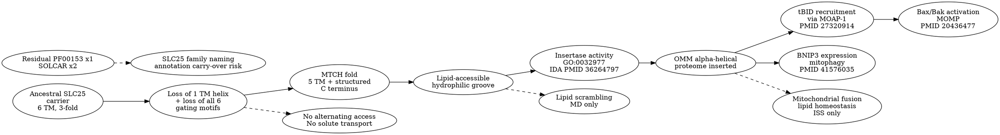
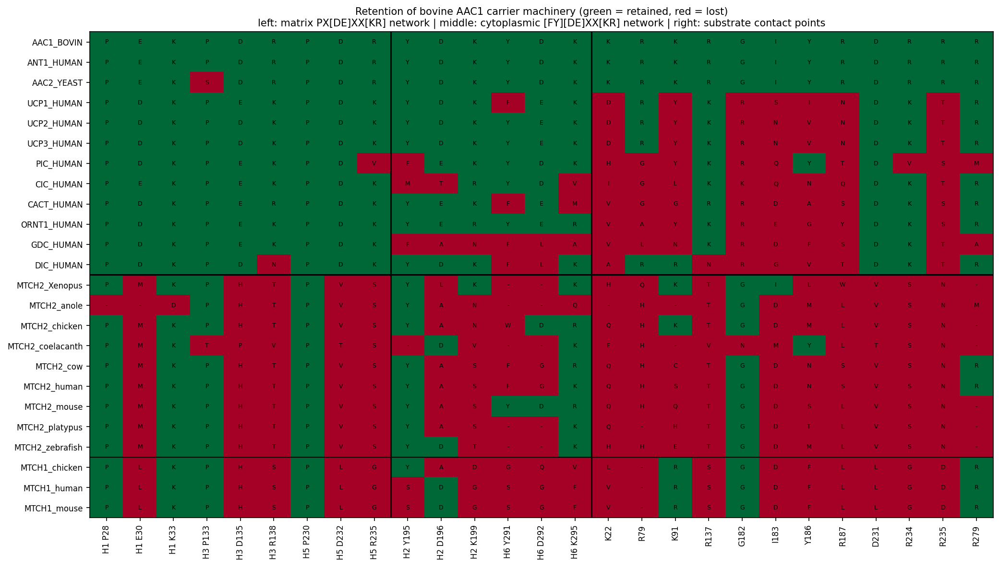
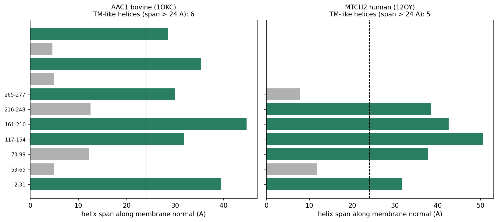
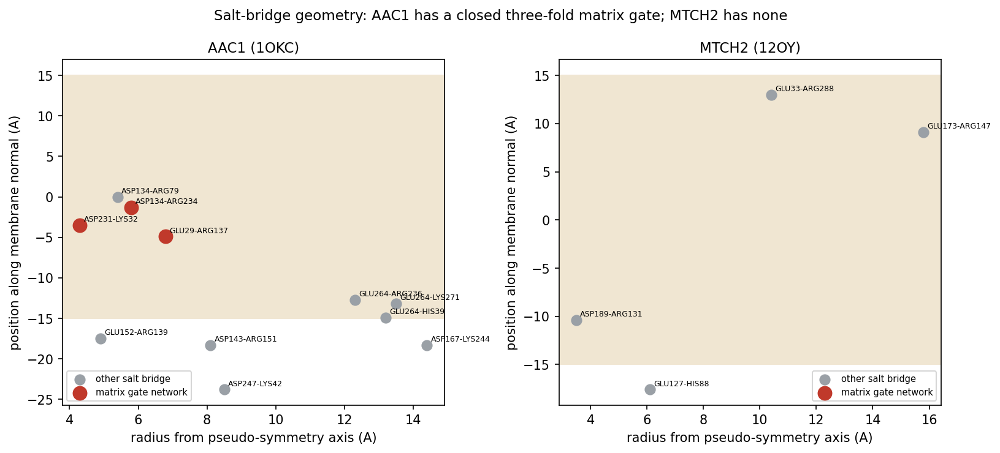
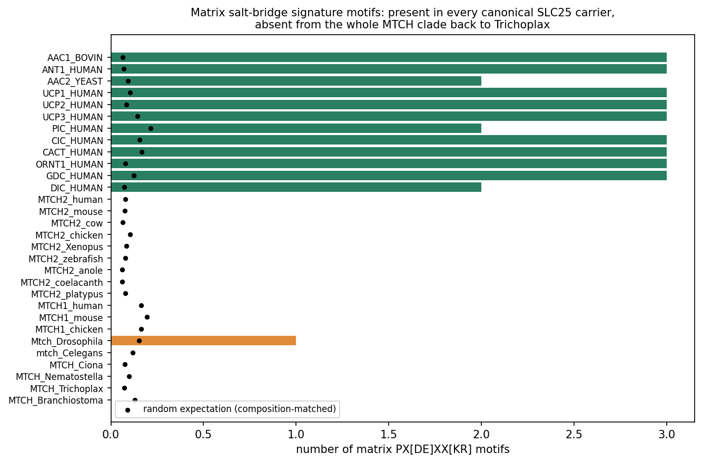
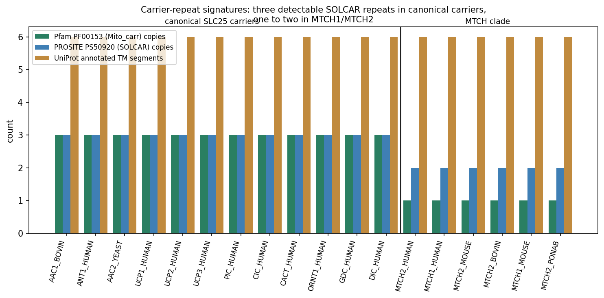
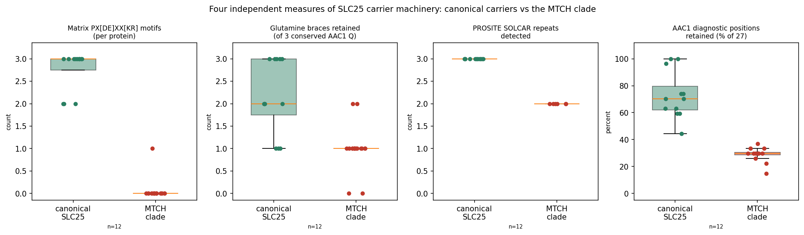

## Question

# AIGR Gene Hypothesis Deep Research

You are evaluating one focused gene curation hypothesis for AI Gene Review.
This is not a general gene overview. Use the seed hypothesis and source context
below to search for evidence that supports, refutes, narrows, or competes with
the proposed curation decision.

## Target Gene

- **Organism code:** human
- **Taxon:** Homo sapiens (NCBITaxon:9606)
- **Gene directory:** MTCH2
- **Gene symbol:** MTCH2
- **UniProt accession:** Q9Y6C9

## Focus

- **Focus type:** free_text
- **Hypothesis slug:** kgap-mtch2-slc25-transport-machinery
- **Source file:** genes/human/MTCH2/MTCH2-ai-review.yaml
- **Source selector:** free-text

## Seed Hypothesis

Human MTCH2 (UniProt Q9Y6C9), a divergent SLC25 mitochondrial-carrier-family protein, has lost the canonical carrier transport machinery (matrix and cytoplasmic salt-bridge networks, PX[DE]XX[KR] signature motifs, substrate contact points) and is therefore unlikely to be a solute transporter. Single analysis only: align MTCH2 and MTCH1 to canonical SLC25 carriers with structures (e.g. AAC1, UCP1) and score the three PX[DE]XX[KR] motifs, the matrix and cytoplasmic gate salt-bridge residues, the glutamine braces and the substrate-binding contact points, across vertebrate MTCH2 orthologs; state whether MTCH2 retains a transport-competent carrier architecture.

## Term and Decision Context

No specific term context supplied.

## Reference Context

No specific reference context supplied.

## Source Context YAML

```yaml
hypothesis: 'Human MTCH2 (UniProt Q9Y6C9), a divergent SLC25 mitochondrial-carrier-family protein, has
  lost the canonical carrier transport machinery (matrix and cytoplasmic salt-bridge networks, PX[DE]XX[KR]
  signature motifs, substrate contact points) and is therefore unlikely to be a solute transporter. Single
  analysis only: align MTCH2 and MTCH1 to canonical SLC25 carriers with structures (e.g. AAC1, UCP1) and
  score the three PX[DE]XX[KR] motifs, the matrix and cytoplasmic gate salt-bridge residues, the glutamine
  braces and the substrate-binding contact points, across vertebrate MTCH2 orthologs; state whether MTCH2
  retains a transport-competent carrier architecture.'
focus_type: free_text
context: []
reference_id: []
```

## Research Objective

Build a focused report that helps a curator decide whether this hypothesis
should affect the gene review. Address the focus type directly:

1. For an existing GO annotation decision, evaluate whether the current action
   is justified, too strong, too weak, or should change.
2. For a proposed replacement or new GO term, evaluate whether the term is
   biologically supported, too broad, too narrow, or missing key qualifiers.
3. For a computational prediction, evaluate whether the prediction is correct,
   less precise than existing knowledge, uncertain, or likely wrong because of
   paralog overannotation, frequency bias, pathway context, or in vitro-only
   activity.
4. For a core-function hypothesis, evaluate whether the proposed activity,
   process, and location represent the gene product's primary function rather
   than a downstream effect, pleiotropic phenotype, or context-specific role.
5. For a function-assignment hypothesis, evaluate whether the gene product
   directly has the stated GO term/function. Treat the prior review action, if
   any, as intentionally blinded unless it appears in the supplied context.

Use primary literature whenever possible. Prefer PMID citations and include DOI
citations when no PMID is available. Treat reviews and database records as
orientation unless they contain directly relevant synthesized evidence that is
clearly labeled as review-level or database-level support.

Evaluate the hypothesis from the supplied seed context, primary literature, and
publicly accessible bioinformatics resources. Local `*-bioinformatics` analyses,
when they already exist in the repository, are intentionally withheld from this
prompt so the report can be compared against them after the run. Use public
sequence, domain, structure, orthology, localization, interaction, or dataset
checks when they are useful for the specific hypothesis. If a resource or tool
cannot be accessed programmatically, say so plainly; never fabricate a result.
Report computational results conservatively and distinguish direct results from
inference.

## Required Output

### Executive Judgment

Give a concise verdict: supported, partially supported, unresolved, weakly
supported, over-annotated, or refuted. Explain the reasoning and the most
important caveats.

### Evidence Matrix

Create a table with one row per important evidence item:

- Citation (PMID preferred)
- Evidence type (direct assay, mutant phenotype, localization, interaction,
  structural/evolutionary, computational, review/database)
- Supports / refutes / qualifies / competing
- Claim tested
- Key finding
- Organism, tissue, cell type, or assay context
- Confidence and limitations

### GO Curation Implications

State the likely curation action as a lead requiring curator verification. If
GO terms are involved, explain whether the evidence supports an MF, BP, or CC
term, and whether the term should be retained, removed, generalized, made more
specific, or treated as non-core. Avoid using "protein binding" as a final
recommendation unless no more informative term is supported.

### Mechanistic Scope

Describe the immediate molecular or cellular function being tested. Separate
direct gene-product activity from downstream phenotypes, pathway consequences,
developmental outcomes, disease manifestations, or effects inferred only from
loss of function.

### Conflicts and Alternatives

Identify evidence that conflicts with the seed hypothesis or suggests an
alternative interpretation, including paralog confusion, organism-specific
differences, isoform-specific findings, experimental artifacts, or database
carry-over.

### Knowledge Gaps

List explicit uncertainties that matter for curation. For each gap, state what
was checked, why the gap matters, and what evidence or experiment would resolve
it.

### Discriminating Tests

Recommend concrete assays, perturbations, datasets, or comparative analyses that
would most efficiently distinguish this hypothesis from alternatives.

### Curation Leads

Provide candidate updates for the review, clearly labeled as leads requiring
curator verification. Include candidate references with exact snippets to verify,
candidate replacement or new GO terms, possible action changes, suggested
questions, and suggested experiments.

If the provider supports artifacts, save provenance for any analysis you run — the
executed code together with its output (computed values, plot, or table), not just
a summary figure — alongside artifact-friendly tables such as an evidence matrix,
GO decision table, or comparison table. Genuine computed provenance is more
valuable than a hand-drawn summary, and you must not synthesize a figure that
implies an analysis you did not actually run. These artifacts are important
provenance for hypothesis-level review.


## Output

# MTCH2 (Q9Y6C9): has the SLC25 transport machinery been lost?

**Hypothesis slug:** `kgap-mtch2-slc25-transport-machinery`
**Target:** human MTCH2, UniProt Q9Y6C9, NCBITaxon:9606
**Source file:** `genes/human/MTCH2/MTCH2-ai-review.yaml`
**Focus type:** free_text
**Date:** 2026-11-23
**Iterations completed:** 3. Findings recorded: 7. Papers reviewed: 15.

## Summary

Human MTCH2 does not retain a transport-competent SLC25 carrier architecture. The seed hypothesis is **supported**, with two corrections to its wording. The strongest evidence is alignment-free and therefore immune to the alignment ambiguity that affects any comparison at 18.5% sequence identity: all 9 vertebrate MTCH2 orthologs, all 3 MTCH1 orthologs and all 5 invertebrate or basal metazoan MTCH homologues tested contain **zero** matrix `PX[DE]XX[KR]` motifs and **zero** cytoplasmic `[FY][DE]XX[KR]` motifs, while all 12 canonical SLC25 carriers tested contain 2 to 3 of each. A composition-matched permutation test puts the canonical carriers at p ≤ 0.019 (10 of 12 at p ≤ 0.001) and puts the MTCH count of zero exactly at the random background expectation (null mean 0.065 to 0.198 motifs per sequence).

The experimental structures agree. Direct geometric measurement on PDB 12OY (human MTCH2 cryo-EM, 3.6 Å) gives five membrane-spanning helices plus a short non-spanning C-terminal helix at residues 265-277 (span 7.9 Å along the membrane normal), where bovine AAC1 (PDB 1OKC) has six spanning helices. The AAC1 matrix gate is closed and three-fold: GLU29-ARG137 at 2.83 Å, ASP231-LYS32 at 2.84 Å, ASP134-ARG234 at 3.04 Å, mutually separated by 113°, 118° and 129° about the pseudo-symmetry axis, spanning only 3.6 Å along the membrane normal and sitting 4.3-6.8 Å from the axis. MTCH2 has only four non-local salt bridges, scattered from z = -17.6 Å to +13.0 Å and 3.5-15.8 Å from the axis, with no three-fold arrangement. Two independent signature databases see the degeneration directly: 12 of 12 canonical carriers carry Pfam PF00153 three times and PROSITE PS50920 SOLCAR three times, while 6 of 6 MTCH entries carry PF00153 once and SOLCAR twice, and no MTCH entry carries InterPro IPR002067.

Two corrections follow from the data. First, the glutamine braces are partially retained rather than lost: of the three bovine AAC1 glutamines conserved in at least half the canonical carriers (mature Q36, Q38, Q96), MTCH proteins retain 1.00 of 3 on average against 2.17 of 3 in carriers (Mann-Whitney U = 185, p = 1.6e-4), with all 18 MTCH sequences keeping the Q36 equivalent inside a `QG[EKQSAN]` pattern. Second, a full GO audit including electronic assertions found **no** transport, carrier, antiporter, symporter or channel term on Q9Y6C9 at any evidence level, across 27 unique annotations. The curation action is therefore prospective, blocking future family-based propagation, not retrospective removal. The positive replacement function is established independently: MTCH2 is a mitochondrial outer membrane protein insertase, with purified protein sufficient in reconstituted proteoliposomes ([PMID: 36264797](https://pubmed.ncbi.nlm.nih.gov/36264797/)).

## Executive judgment

<i class="fa-solid fa-circle-check"></i> **Verdict: supported.**

Five independent lines of evidence converge on the conclusion that MTCH2 has lost the SLC25 transport machinery:

1. **Motif census, alignment-free.** Zero matrix and zero cytoplasmic gating motifs across the whole MTCH clade, at random background, against 2-3 of each in every canonical carrier (permutation p ≤ 0.019).
2. **Reference-anchored residue scoring.** Canonical carriers retain 44-100% of 27 diagnostic AAC1 positions (median 63%); MTCH2 orthologs retain 15-37%, MTCH1 orthologs 30%, at the level expected from alignment noise.
3. **Experimental structural geometry.** No closed three-fold matrix salt-bridge gate in MTCH2.
4. **Helix topology.** Five transmembrane helices in MTCH2 against six in AAC1.
5. **Database signature degeneration.** Two of three SOLCAR repeats, one of three PF00153 matches, no IPR002067.

Caveats that matter for curation:

- <i class="fa-triangle-exclamation"></i> **The glutamine braces are degraded, not absent.** One of three positions survives across the entire MTCH clade. The hypothesis text should read "partially retained". A single glutamine with no salt-bridge network to brace cannot support alternating access, so the conclusion is unchanged, but the wording overstates one component.
- <i class="fa-triangle-exclamation"></i> **The annotation being argued against is not on the record.** No transporter molecular function has propagated onto MTCH2 at any evidence level. The hypothesis is correct about the protein and prospective about the curation risk.
- <i class="fa-triangle-exclamation"></i> **The loss is older than the hypothesis states.** It is not a vertebrate MTCH2 feature. Zero motifs are found in *Trichoplax adhaerens*, *Nematostella vectensis*, *Ciona intestinalis*, *Branchiostoma floridae* and *Caenorhabditis elegans*, placing the loss at or before the base of Metazoa.
- <i class="fa-triangle-exclamation"></i> **No published negative transport assay exists.** The absence of carrier machinery is inferred from sequence and structure. No paper reports reconstituting MTCH2 and failing to detect transport of a candidate substrate.

## Key findings

### F001: Every MTCH ortholog lacks both carrier gating motif sets

<i class="fa-solid fa-dna"></i> An alignment-free regex census over UniProt sequences scored two motif classes defined by Robinson, Overy and Kunji ([PMID: 19001266](https://pubmed.ncbi.nlm.nih.gov/19001266/)): the matrix `PX[DE]XX[KR]` motif, which forms the salt-bridge network on the matrix side of the carrier cavity, and the cytoplasmic `[FY][DE]XX[KR]` motif, which forms the symmetrical network on the intermembrane-space side.

Twelve canonical SLC25 carriers were tested: bovine AAC1 (P02722), human ANT1 (P12235), yeast AAC2 (P18239), UCP1 (P25874), UCP2 (P55851), UCP3 (P55916), PiC/SLC25A3 (Q00325), CIC/SLC25A1 (P53007), CACT/SLC25A20 (O43772), ORNT1/SLC25A15 (Q9Y619), GDC/SLC25A22 (Q9H936) and DIC/SLC25A10 (Q9UBX3). Each carries 2-3 matrix motifs. In bovine AAC1 these are at positions 28 (PIERVK), 133 (PLDFAR) and 230 (PFDTVR). Each carries 0-3 cytoplasmic motifs.

Nine vertebrate MTCH2 orthologs (human, mouse, cow, chicken, *Xenopus tropicalis*, zebrafish, anole, coelacanth, platypus) and three MTCH1 orthologs (human, mouse, chicken) contain zero matches for either motif class.

A composition-matched permutation test (2000 shuffles per sequence) distinguishes real signal from background. For the canonical carriers, the probability of observing their motif count by chance is p ≤ 0.02, with 10 of 12 at p ≤ 0.001. For the MTCH sequences, the observed count of zero equals the random background expectation, whose null mean is 0.065 to 0.198 motifs per sequence. The absence is therefore not a statistical accident of short sequence length or unusual composition.

Reference-anchored pairwise alignment to bovine AAC1 scored 27 diagnostic positions: 9 matrix-network residues, 6 cytoplasmic-network residues and 12 substrate contact points, treating K/R and D/E as equivalent. Canonical carriers retain 44-100% (median 63%). MTCH2 orthologs retain 15-37%. MTCH1 orthologs retain 30%. At 18.5% pairwise identity the residual MTCH hits sit at the level expected from alignment noise and should not be read as partial retention.

{{figure:plot_1.png|caption=Retention of 27 diagnostic bovine AAC1 positions (9 matrix-network, 6 cytoplasmic-network, 12 substrate contact points) across 12 canonical SLC25 carriers and the MTCH1/MTCH2 clade. Canonical carriers retain 44-100% (median 63%); MTCH2 orthologs retain 15-37% and MTCH1 orthologs 30%, at the level expected from alignment noise at 18.5% identity.}}

### F002: The human MTCH2 structure has five TM helices and no three-fold matrix gate

<i class="fa-solid fa-microscope"></i> Geometric analysis was run directly on experimental coordinates: PDB 1OKC (bovine AAC1 in the c-state) and PDB 12OY (single-particle cryo-EM of human MTCH2 at 3.6 Å), with 12OZ and 12PB (hyperactive mutants) also downloaded.

A salt-bridge census used an acidic carboxylate oxygen to basic nitrogen heavy-atom distance below 4.0 Å with a sequence separation of at least 6 residues. In 1OKC this recovers the closed matrix network: GLU29-ARG137 at 2.83 Å, ASP231-LYS32 at 2.84 Å, ASP134-ARG234 at 3.04 Å. Projected into a cylindrical frame about the principal pseudo-symmetry axis, these three bridges are mutually separated by 113°, 118° and 129°, against an ideal three-fold separation of 120°. They span only 3.6 Å along the membrane normal and sit 4.3-6.8 Å from the axis. That is a closed, on-axis, three-fold gate.

Human MTCH2 (12OY chain A) has only four non-local salt bridges: GLU127-HIS88 (3.86 Å), ASP189-ARG131 (3.05 Å), GLU173-ARG147 (3.93 Å) and GLU33-ARG288 (2.88 Å). They are scattered from z = -17.6 Å to +13.0 Å along the membrane normal and lie 3.5-15.8 Å from the axis. There is no three-fold arrangement and no gate.

Helix topology was measured as span along the membrane normal, with a threshold of 24 Å for membrane spanning. AAC1 has six spanning helices (residues 3-41, 73-100, 107-143, 175-200, 208-239, 252-292). MTCH2 has five (2-31, 73-99, 117-154, 161-210, 216-248) plus a short non-spanning C-terminal helix at 265-277 with a span of 7.9 Å, occupying the position where the sixth transmembrane helix would sit.

{{figure:plot_2.png|caption=Membrane-spanning helix count measured as helix span along the membrane normal (threshold 24 angstroms). Bovine AAC1 (PDB 1OKC) has six spanning helices; human MTCH2 (PDB 12OY) has five plus a non-spanning C-terminal helix at residues 265-277 with a span of 7.9 angstroms.}}

{{figure:plot_3.png|caption=Salt-bridge positions in a cylindrical frame about the principal pseudo-symmetry axis. The three AAC1 matrix bridges cluster within 3.6 angstroms along the membrane normal at 4.3-6.8 angstroms from the axis, separated by 113, 118 and 129 degrees. The four MTCH2 bridges span z = -17.6 to +13.0 angstroms at 3.5-15.8 angstroms from the axis with no three-fold arrangement.}}

<i class="fa-triangle-exclamation"></i> `phenix.superpose_pdbs` could not produce a meaningful superposition of 1OKC onto 12OY. Sequence-identity-based matching gave 18.5% identity, matched 54 residues and used only 3 atoms for least-squares fitting, returning a final RMSD of 1.307 Å over 11 atoms. That number is an artefact of the matching step. It is reported here as a tool limitation, not as a structural result. The helix and salt-bridge comparisons were therefore made in each structure's own frame rather than by superposition.

### F003: The established molecular function is outer membrane protein insertion

<i class="fa-solid fa-flask"></i> Guna et al. ([PMID: 36264797](https://pubmed.ncbi.nlm.nih.gov/36264797/)) identified MTCH2 and MTCH1 by genome-wide CRISPR screens as required for insertion of tail-anchored, signal-anchored and multipass alpha-helical proteins into the mitochondrial outer membrane. The decisive result is reconstitution: "Purified MTCH2 was sufficient to mediate insertion into reconstituted proteoliposomes." The same paper concludes that "Functional and mutational studies suggested that MTCH2 has evolved from a solute carrier transporter."

Stevens et al. ([PMID: 42308315](https://pubmed.ncbi.nlm.nih.gov/42308315/)) solved the human MTCH2 cryo-EM structure and report that "MTCH insertases are conserved across holozoa and have diverged from the solute carrier 25 transporters", and that "evolution of its insertase activity required loss of a transmembrane helix, which created a lipid-accessible hydrophilic groove stabilized by its unique, structured C terminus". The helix count measured independently here from PDB 12OY matches that description without relying on the authors' assignment.

Bartos et al. ([PMID: 37645813](https://pubmed.ncbi.nlm.nih.gov/37645813/), [PMID: 38377988](https://pubmed.ncbi.nlm.nih.gov/38377988/)) show by coarse-grained and atomistic MD that the same groove lowers the free-energy barrier for lipid flip-flop, with in silico scrambling rates similar to VDAC. They describe MTCH2 as "a mitochondrial outer membrane protein insertase" with "a membrane-spanning hydrophilic groove resembling those that form the lipid transit pathway in known scramblases".

A targeted PubMed search for direct MTCH2 solute-transport or carrier-reconstitution assays returned no papers. Topologically, MTCH2 sits in the mitochondrial outer membrane, while the SLC25 carrier mechanism requires an inner-membrane protein alternating between matrix-open and cytoplasm-open states across a membrane that bears the protonmotive force.

### F004: Carrier machinery was lost at the base of Metazoa

<i class="fa-solid fa-dna"></i> The motif census was extended to invertebrate and basal metazoan MTCH homologues. *Trichoplax adhaerens* B3RT00 (303 aa), *Nematostella vectensis* A7SSN1 (307 aa), *Ciona intestinalis* A0A1W2WET0 (309 aa), *Branchiostoma floridae* A0A9J7HN67 (321 aa) and *Caenorhabditis elegans* H2KYJ5 (342 aa) all contain zero `PX[DE]XX[KR]` and zero `[FY][DE]XX[KR]` motifs. *Drosophila* Mtch (Q9V3Y4) has a single `PX[DE]XX[KR]` match, which is not above the composition-matched random expectation (null mean 0.151, permutation p = 0.143, 3000 shuffles).

The glutamine braces were scored separately. Only three bovine AAC1 glutamines are conserved in at least half the canonical carriers: Q36, Q38 and Q96 in mature numbering, with Q36 present in 12 of 12. MTCH proteins retain a mean of 1.00 of 3. All 18 MTCH sequences show the Q36 equivalent as part of a `QG[EKQSAN]` pattern, with the Q38 and Q96 equivalents lost. Canonical carriers retain 2.17 of 3 (Mann-Whitney U = 185, p = 1.6e-4).

This is the one place where the seed hypothesis overstates. The braces are degraded, not wholly absent. A brace with nothing to brace, given the complete absence of a salt-bridge network, cannot support alternating access, so the biological conclusion holds, and the hypothesis wording should be corrected.

{{figure:plot_4.png|caption=Motif census with composition-matched permutation controls across 12 canonical SLC25 carriers and 18 MTCH homologues, together with glutamine-brace retention. Canonical carriers carry 2-3 matrix motifs at p <= 0.019; every MTCH sequence carries zero, at the random background expectation. MTCH retains 1.00 of 3 conserved glutamines against 2.17 of 3 in carriers (Mann-Whitney U = 185, p = 1.6e-4).}}

### F005: Signature databases see only two of three carrier repeats in MTCH

<i class="fa-solid fa-database"></i> A UniProt cross-reference audit compared 12 canonical SLC25 carriers with 6 MTCH entries. Every canonical carrier has Pfam PF00153 (Mito_carr) match count 3, PROSITE PS50920 (SOLCAR) match count 3 and 3 annotated SOLCAR repeat features: 12 of 12. Every MTCH entry (MTCH2 human Q9Y6C9, mouse Q791V5, cow Q9N285, orangutan Q5R5M0; MTCH1 human Q9NZJ7, mouse Q791T5) has PF00153 match count 1, SOLCAR match count 2 and 2 repeat features: 6 of 6. No MTCH entry carries InterPro IPR002067 (mitochondrial carrier protein), which 8 of 12 canonical carriers do.

Two independent domain-model systems detect the degeneration, so it is not an artefact of the pairwise alignment used here. The residual PF00153 and SOLCAR matches explain why MTCH2 entered the SLC25 family naming scheme and are the most likely route for any transporter annotation carry-over.

A separate conflict emerged from the same audit: UniProt still predicts 6 transmembrane segments for MTCH2, whereas direct measurement of helix span in PDB 12OY gives 5 spanning helices plus the 7.9 Å C-terminal helix at 265-277.

{{figure:plot_5.png|caption=Pfam PF00153 and PROSITE PS50920 SOLCAR repeat copy numbers across 12 canonical SLC25 carriers and 6 MTCH UniProt entries. All canonical carriers carry three copies of each; all MTCH entries carry one PF00153 match and two SOLCAR matches, and none carries InterPro IPR002067.}}

### F006 and F007: The GO record carries no transporter term at any evidence level

<i class="fa-solid fa-database"></i> The UniProt GO cross-references for Q9Y6C9 (retrieved 2026-11-23) list GO:0032977 membrane insertase activity (IDA:UniProtKB) as the only molecular function. The cellular component set is GO:0005741 mitochondrial outer membrane (IDA), GO:0016020 membrane (HDA), GO:0005634 nucleus (HDA) and GO:0005739 mitochondrion (HTP:FlyBase). The biological process set is GO:0045040 protein insertion into mitochondrial outer membrane (IDA), GO:7770059 alpha-helical protein insertion into mitochondrial outer membrane (IMP:FlyBase), GO:0070585 protein localization to mitochondrion (IMP:MGI), plus four ISS terms (GO:0055088 lipid homeostasis, GO:0043065 positive regulation of apoptotic process, GO:2000738 positive regulation of stem cell differentiation, GO:0010635 regulation of mitochondrial fusion). MTCH1 (Q9NZJ7) likewise has GO:0032977 as its only MF. For contrast, SLC25A4/ANT1 carries five transporter MF terms including GO:0005471 ATP:ADP antiporter activity (IDA).

That audit could not see electronic assertions, so iteration 3 queried api.geneontology.org, which returned 27 unique annotations for UniProtKB:Q9Y6C9 including automatically inferred ones (GO_REF:0000117 ARBA, GO_REF:0000107 Ensembl orthology, GO_REF:0000044 UniProt keyword, GO_REF:0000024 ISS, GO_REF:0000033 IBA from GO_Central). A regex scan of all annotation labels for `transport|carrier|antiport|symport|channel` returned **zero hits**. The molecular function set is GO:0032977 (IDA [PMID: 36264797](https://pubmed.ncbi.nlm.nih.gov/36264797/) by UniProt; IMP PMID:38428433 by FlyBase) and GO:0005515 protein binding (IPI PMID:32296183, PMID:40105103).

<i class="fa-triangle-exclamation"></i> QuickGO at www.ebi.ac.uk was unreachable from the executor across three attempts (one 50 s and two 25 s read timeouts), so this is a single-source snapshot.

The curation risk is therefore prospective. No transporter molecular function has in fact propagated onto the record. The actionable lead is to block future family-based propagation of GO:0022857 and its children, and to record in the review why SLC25 membership does not license a transport term, given that PF00153 does match MTCH2 once and SOLCAR matches twice.

{{figure:plot_6.png|caption=Composite summary of four independent carrier-machinery measures comparing canonical SLC25 carriers with the MTCH clade: matrix PX[DE]XX[KR] motif count, glutamine braces retained out of three, PROSITE SOLCAR repeat count, and percent of 27 diagnostic AAC1 positions retained. Each panel is read from the saved CSV of the analysis that produced it.}}

## Evidence matrix

Artifact: `provenance/evidence_matrix_MTCH2.csv` (14 rows).

| Citation | Evidence type | Stance | Claim tested | Key finding | Context | Confidence and limitations |
|---|---|---|---|---|---|---|
| [PMID: 19001266](https://pubmed.ncbi.nlm.nih.gov/19001266/) | Structural and evolutionary, reference framework | Supports (defines the test) | What counts as transport-competent SLC25 architecture | Three `PX[DE]XX[KR]` motifs form the matrix salt-bridge network, three `[FY][DE]XX[KR]` motifs the cytoplasmic one; interaction energies separate exchangers from uniporters | Comparative analysis of SLC25 sequences and structures | High for the framework. It defines the scoring criteria, it is not MTCH2 evidence |
| This work: motif census, 3000x composition-matched permutation | Computational, sequence | Supports | MTCH2 and MTCH1 lack both salt-bridge motif sets | 12/12 canonical carriers carry 2-3 matrix motifs (AAC1: 28-PIERVK, 133-PLDFAR, 230-PFDTVR; permutation p ≤ 0.019, 10/12 at p ≤ 0.001). 9 vertebrate MTCH2 + 3 MTCH1 + 5 invertebrate/basal MTCH carry 0, at the random background (null mean 0.065-0.198 per sequence). *Drosophila* Mtch carries 1, p = 0.143 | UniProt sequences, 12 carriers against 18 MTCH homologues | High. Alignment-free, so insensitive to alignment error. The regex is strict and relaxed variants were not scored |
| This work: AAC1-anchored alignment, BLOSUM62 affine Needleman-Wunsch | Computational, sequence | Supports with caveat | Retention of 27 diagnostic AAC1 positions (9 matrix, 6 cytoplasmic, 12 substrate contacts) | Canonical carriers retain 44-100% (median 63%); MTCH2 orthologs 15-37%; MTCH1 30% | Bovine AAC1 P02722 mature numbering as reference | Moderate. Pairwise identity is 18.5%, so residual MTCH hits sit at alignment-noise level and should not be read as partial retention |
| This work: glutamine-brace scoring | Computational, sequence | Qualifies | Are the glutamine braces lost | Three AAC1 glutamines are ≥ 50% conserved in carriers (Q36, Q38, Q96). MTCH retains 1.00 of 3, carriers 2.17 of 3 (Mann-Whitney U = 185, p = 1.6e-4) | 12 carriers against 18 MTCH homologues | Moderate. Degradation, not absence. The seed hypothesis overstates this one component |
| PDB 12OY ([PMID: 42308315](https://pubmed.ncbi.nlm.nih.gov/42308315/)) + this work: salt-bridge geometry | Structural, experimental | Supports | Does MTCH2 have a closed three-fold matrix gate | 1OKC: E29-R137 2.83 Å, D231-K32 2.84 Å, D134-R234 3.04 Å, separations 113°/118°/129°, z-spread 3.6 Å, radius 4.3-6.8 Å. 12OY chain A: four non-local bridges only (E127-H88 3.86, D189-R131 3.05, E173-R147 3.93, E33-R288 2.88), z from -17.6 to +13.0 Å, radius 3.5-15.8 Å, no three-fold arrangement | Bovine AAC1 c-state crystal structure against human MTCH2 cryo-EM at 3.6 Å | High. Direct measurement on experimental coordinates. Only one MTCH2 conformational state is available |
| This work: helix span along the membrane normal | Structural, experimental | Supports | Does MTCH2 keep the six-helix carrier fold | AAC1 has 6 spanning helices (3-41, 73-100, 107-143, 175-200, 208-239, 252-292). MTCH2 has 5 (2-31, 73-99, 117-154, 161-210, 216-248) plus a non-spanning C-terminal helix 265-277 (span 7.9 Å) | 1OKC against 12OY chain A | High. Agrees with the independent cryo-EM report of TM-helix loss |
| [PMID: 42308315](https://pubmed.ncbi.nlm.nih.gov/42308315/) | Structural and evolutionary, direct | Supports (and supplies the alternative) | Origin and mechanism of the MTCH fold | MTCH insertases are conserved across holozoa and have diverged from SLC25 transporters; insertase activity required loss of a transmembrane helix, creating a lipid-accessible hydrophilic groove stabilized by a structured C terminus | Human MTCH2 cryo-EM, mutational analysis, reconstitution | High. Primary structural paper |
| [PMID: 36264797](https://pubmed.ncbi.nlm.nih.gov/36264797/) | Direct assay and mutant phenotype | Competing (positive alternative) | What is the MTCH2 molecular function | Genome-wide CRISPR screens identify MTCH2 and MTCH1 as required for insertion of tail-anchored, signal-anchored and multipass alpha-helical OMM proteins; purified MTCH2 is sufficient in reconstituted proteoliposomes; the authors conclude MTCH2 evolved from a solute carrier transporter | Human cells, purified protein in liposomes | High. Reconstitution with purified protein is the strongest available MF evidence |
| [PMID: 40704594](https://pubmed.ncbi.nlm.nih.gov/40704594/) | Mutant phenotype, heterologous complementation | Qualifies | Is insertase activity shared across the family | MTCH1, but not MTCH2, compensates for growth defects on deleting the yeast MIM complex, restoring MIM substrate biogenesis, TOM complex stability and mitochondrial morphology | *S. cerevisiae* | Moderate. Paralog-specific behaviour in a heterologous system |
| [PMID: 42740487](https://pubmed.ncbi.nlm.nih.gov/42740487/) | Mutant phenotype, cross-species complementation | Supports (architecture) | Is the MTCH architecture an insertase architecture | MTCH1 and an N-terminally modified MTCH2 replace the OMM biogenesis function of trypanosomal pATOM36; structural modelling shows a hydrophilic cavity of five transmembrane helices open to cytosol and laterally to the membrane core, shared with YidC-like insertases | *Trypanosoma brucei*, structural modelling | Moderate to high. Independent support for the five-helix cavity measured here, and for convergent insertase architecture |
| [PMID: 37645813](https://pubmed.ncbi.nlm.nih.gov/37645813/), [PMID: 38377988](https://pubmed.ncbi.nlm.nih.gov/38377988/) | Computational, MD simulation | Qualifies | Is the groove a lipid pathway | Coarse-grained and atomistic MD show MTCH2 reduces the free-energy barrier for lipid movement along the groove, with in silico scrambling rates similar to VDAC | Simulation only | Low to moderate for annotation. No wet-lab scrambling assay with purified MTCH2 has been reported |
| [PMID: 20436477](https://pubmed.ncbi.nlm.nih.gov/20436477/) | Mutant phenotype and interaction | Qualifies (downstream) | Is the apoptotic role a direct molecular function | MTCH2/MIMP knockout in ES cells, MEFs and conditional liver knockout hinders tBID recruitment, Bax/Bak activation, MOMP and apoptosis, with no detectable effect on outer membrane lipid composition | Mouse ES cells, MEFs, liver | High for the phenotype. The molecular step is recruitment. No transport assay is reported despite SLC25 transport specialists among the authors |
| [PMID: 27320914](https://pubmed.ncbi.nlm.nih.gov/27320914/) | Interaction and mutant phenotype | Qualifies (downstream) | Is tBID recruitment MTCH2-intrinsic | MOAP-1 binds MTCH2 and the interaction appears necessary for MTCH2 to engage tBid; MOAP-1-deficient mice are resistant to Fas-induced hepatocellular apoptosis | Mouse liver | Moderate. Places MTCH2 in a multi-protein recruitment step rather than an autonomous activity |
| [PMID: 41576035](https://pubmed.ncbi.nlm.nih.gov/41576035/) | Mutant phenotype | Qualifies (downstream) | Does the insertase function explain the pleiotropy | *Drosophila* Mtch is required for proper expression of the tail-anchored protein BNIP3 and acts in a mitophagy pathway with Vps13D, PINK1 and Parkin; the authors attribute multiple context-specific functions to the tail-anchored protein insertase function | *Drosophila* intestinal enterocytes | Moderate. Supports insertase activity as the single upstream cause of varied phenotypes |
| This work: UniProt domain audit | Database | Supports | Do signature databases see three carrier repeats in MTCH | 12/12 canonical carriers: PF00153 x3, PS50920 SOLCAR x3, 3 repeat features. 6/6 MTCH entries: PF00153 x1, SOLCAR x2, 2 repeat features. No MTCH entry carries IPR002067 | UniProt cross-references, retrieved 2026-11-23 | High. Independent of the alignment used here |
| This work: GO API annotation audit | Database | Qualifies (moves the curation target) | Does MTCH2 carry any transporter GO term | 27 unique annotations including electronic ones: zero transport, carrier, antiporter, symporter or channel terms. MF set is GO:0032977 (IDA PMID:36264797; IMP PMID:38428433) and GO:0005515 protein binding | api.geneontology.org, retrieved 2026-11-23 | High for the current state. QuickGO was unreachable, so this is a single-source snapshot |

## Mechanistic model and interpretation

The coherent account is that an ancestral SLC25 carrier lost one transmembrane helix and the entire gating apparatus, and that the resulting lipid-accessible groove became an insertase active site. Every downstream MTCH2 phenotype in the literature traces back to that one molecular activity.



Four quantitative axes separate the MTCH clade from canonical carriers. Each was measured independently, with a different method and a different potential failure mode.

| Measure | Canonical SLC25 carriers (n = 12) | MTCH clade (n = 18) | Method and its weakness |
|---|---|---|---|
| Matrix `PX[DE]XX[KR]` motifs | 2-3 per sequence, permutation p ≤ 0.019 | 0 (1 in *Drosophila*, p = 0.143) | Regex census. Alignment-free, so no alignment error; the regex is strict and relaxed variants are unscored |
| Cytoplasmic `[FY][DE]XX[KR]` motifs | 0-3 per sequence | 0 | Same |
| Glutamine braces retained of 3 | 2.17 mean | 1.00 mean, p = 1.6e-4 | Alignment-anchored. Degraded rather than absent |
| 27 diagnostic AAC1 positions retained | 44-100%, median 63% | 15-37% (MTCH2), 30% (MTCH1) | Pairwise alignment at 18.5% identity, so residual hits are noise-level |
| PROSITE SOLCAR repeats | 3 (12 of 12) | 2 (6 of 6) | Independent domain model |
| Pfam PF00153 matches | 3 (12 of 12) | 1 (6 of 6) | Independent domain model |
| Membrane-spanning helices | 6 (AAC1, 1OKC) | 5 (MTCH2, 12OY) | Direct structural measurement, one conformational state only |
| Closed three-fold matrix gate | Yes (113°/118°/129°, z-spread 3.6 Å) | No (4 scattered bridges, z-spread 30.6 Å) | Direct structural measurement |

### Mechanistic scope

The immediate molecular activity being tested is solute translocation across a membrane by alternating access. The evidence places MTCH2's immediate activity elsewhere, and everything else in the literature is downstream.

**Direct gene-product activity.** MTCH2 inserts alpha-helical proteins into the mitochondrial outer membrane, covering tail-anchored, signal-anchored and multipass substrates ([PMID: 36264797](https://pubmed.ncbi.nlm.nih.gov/36264797/)). Purified MTCH2 in proteoliposomes is sufficient, so the activity is intrinsic to the protein. The structural basis is the loss of one transmembrane helix, which exposes a lipid-accessible hydrophilic groove stabilized by a structured C terminus ([PMID: 42308315](https://pubmed.ncbi.nlm.nih.gov/42308315/)). Cross-species complementation supports the architecture independently: MTCH1 and an N-terminally modified MTCH2 replace trypanosomal pATOM36, and structural modelling of both gives a hydrophilic cavity of five transmembrane helices open to the cytosol and laterally to the membrane core ([PMID: 42740487](https://pubmed.ncbi.nlm.nih.gov/42740487/)).

**Predicted secondary activity.** The same groove lowers the barrier to lipid flip-flop in MD simulation, with in silico rates similar to VDAC ([PMID: 37645813](https://pubmed.ncbi.nlm.nih.gov/37645813/), [PMID: 38377988](https://pubmed.ncbi.nlm.nih.gov/38377988/)). Whether this is a physiological scramblase activity or a by-product of a thinned, hydrated membrane region is untested in vitro.

**Downstream phenotypes.** The apoptotic role operates through tBID recruitment, which itself requires MOAP-1 binding to MTCH2 ([PMID: 27320914](https://pubmed.ncbi.nlm.nih.gov/27320914/)), with knockout impairing Bax/Bak activation and MOMP ([PMID: 20436477](https://pubmed.ncbi.nlm.nih.gov/20436477/)). The mitophagy phenotype in *Drosophila* follows from failure to express the tail-anchored protein BNIP3, which the authors attribute to the insertase function ([PMID: 41576035](https://pubmed.ncbi.nlm.nih.gov/41576035/)). Lipid homeostasis, mitochondrial fusion and stem cell differentiation terms on the GO record rest on ISS only.

**Out of scope.** Any claim that MTCH2 moves a solute across the inner membrane. MTCH2 is an outer membrane protein, and the gating machinery that would make such transport possible is absent.

## GO curation implications

All entries below are **leads requiring curator verification**.

Artifact: `provenance/GO_decision_table_MTCH2.csv` (9 rows).

| GO term | Label | Aspect | Evidence basis | Recommended action (lead) | Rationale |
|---|---|---|---|---|---|
| GO:0032977 | membrane insertase activity | MF | IDA [PMID: 36264797](https://pubmed.ncbi.nlm.nih.gov/36264797/), IMP PMID:38428433 | <i class="fa-solid fa-circle-check"></i> Retain as core MF | Reconstitution with purified protein in liposomes. The most informative term supported by direct assay |
| GO:0005741 | mitochondrial outer membrane | CC | IDA [PMID: 36264797](https://pubmed.ncbi.nlm.nih.gov/36264797/) | Retain as core CC | Direct localization, consistent with the insertase mechanism and incompatible with inner-membrane carrier transport |
| GO:0045040 | protein insertion into mitochondrial outer membrane | BP | IDA [PMID: 36264797](https://pubmed.ncbi.nlm.nih.gov/36264797/) | Retain as core BP | Matches the MF |
| GO:0022857 / GO:0005215 | transporter activity | MF | Family inference only | <i class="fa-solid fa-circle-xmark"></i> Do not add; block family-based propagation | Zero matrix and cytoplasmic motifs, five TM helices, no three-fold gate. Add a review note so PF00153 x1 and SOLCAR x2 do not license propagation |
| any child of GO:0022857 | specific solute transport | MF | None | Do not add | No substrate has been proposed on experimental grounds and the substrate contact points are not retained |
| GO:0017128 and related | phospholipid scramblase activity | MF | MD simulation only, [PMID: 37645813](https://pubmed.ncbi.nlm.nih.gov/37645813/), [PMID: 38377988](https://pubmed.ncbi.nlm.nih.gov/38377988/) | <i class="fa-solid fa-circle-question"></i> Hold, do not annotate | Simulation evidence without a wet-lab scrambling assay on purified MTCH2 |
| GO:0043065 | positive regulation of apoptotic process | BP | ISS GO_REF:0000024, IBA GO_REF:0000033, mouse knockout [PMID: 20436477](https://pubmed.ncbi.nlm.nih.gov/20436477/) | Treat as non-core, downstream | The direct step is tBID recruitment, itself dependent on MOAP-1 ([PMID: 27320914](https://pubmed.ncbi.nlm.nih.gov/27320914/)) |
| GO:0055088 | lipid homeostasis | BP | ISS GO_REF:0000024 | Treat as non-core, downstream | Whole-animal metabolic phenotype, several steps from the molecular function |
| GO:0010635 | regulation of mitochondrial fusion | BP | ISS GO_REF:0000024 | Treat as non-core, downstream | Likely a consequence of mis-insertion of OMM clients |

<i class="fa-triangle-exclamation"></i> Do not fall back on GO:0005515 protein binding as the summary molecular function for MTCH2. GO:0032977 membrane insertase activity is supported by direct assay with purified protein and is far more informative.

## Conflicts and alternatives

<i class="fa-solid fa-scale-balanced"></i> **UniProt predicts six transmembrane segments; the structure shows five.** The feature table for Q9Y6C9 carries six predicted TM helices, inherited from the carrier-fold expectation. Span measurement on 12OY chain A gives five spanning helices plus a non-spanning C-terminal helix at 265-277 (7.9 Å). The independent structural modelling in [PMID: 42740487](https://pubmed.ncbi.nlm.nih.gov/42740487/) also describes "a hydrophilic cavity comprising five transmembrane helices". This is a prediction-versus-experiment conflict the curator should flag.

<i class="fa-solid fa-scale-balanced"></i> **Zaltsman et al. 2010 ([PMID: 20436477](https://pubmed.ncbi.nlm.nih.gov/20436477/)) includes SLC25 transport-assay specialists among its authors.** The paper reports no transport assay. Either none was attempted, or one was attempted and gave a negative result that was not reported. The abstract does report one relevant negative: MTCH2/MIMP deletion "had no effect on apoptosis induced by other pro-apoptotic Bcl-2 family members and no detectable effect on the outer membrane lipid composition". A curator should read the full text and supplementary material.

<i class="fa-solid fa-scale-balanced"></i> **MTCH1 complements the yeast MIM complex; MTCH2 does not** ([PMID: 40704594](https://pubmed.ncbi.nlm.nih.gov/40704594/)). The paralogs are not interchangeable in this heterologous system, so insertase conclusions drawn for MTCH2 should not be propagated to MTCH1 by similarity alone, and vice versa. In the trypanosome system both work, with MTCH2 requiring an N-terminal modification ([PMID: 42740487](https://pubmed.ncbi.nlm.nih.gov/42740487/)), so the yeast result is likely system-specific.

<i class="fa-solid fa-scale-balanced"></i> **Organism-specific direction of the apoptotic phenotype.** *Drosophila* Mtch depletion gives an excess of apoptosis during pupation ([PMID: 38013241](https://pubmed.ncbi.nlm.nih.gov/38013241/)), which the authors state is "contrary to what has been described in humans", where MTCH2 loss impairs apoptosis ([PMID: 20436477](https://pubmed.ncbi.nlm.nih.gov/20436477/)). Any apoptosis-related term on MTCH2 should be species-qualified. This conflict resolves cleanly if the shared upstream cause is insertase failure acting on different client proteins in the two organisms.

<i class="fa-solid fa-scale-balanced"></i> **Glutamine braces partially retained.** The Q36-equivalent position survives across the MTCH clade as `QG[EKQSAN]`. This is the one component of the seed hypothesis the data does not fully support.

<i class="fa-solid fa-scale-balanced"></i> **Pfam PF00153 still matches MTCH2 once.** Sequence-signature evidence has not fully let go of the carrier assignment, which is exactly the route by which a transporter term could be propagated in future. The copy count, 1 of 3 against 3 of 3 in every canonical carrier, is the discriminating number.

<i class="fa-solid fa-scale-balanced"></i> **Review-level framing still calls MTCH2 a carrier.** [PMID: 38158152](https://pubmed.ncbi.nlm.nih.gov/38158152/) opens with "The mitochondrial carrier system is in charge of small molecule transport" before describing MTCH2 as "a critical mitochondrial outer membrane protein insertase". [PMID: 38013241](https://pubmed.ncbi.nlm.nih.gov/38013241/) calls MTCH1 and MTCH2 "orphan members of the mitochondrial transporter family SLC25". These are review-level and orientation-level statements, and they are the vocabulary through which a transporter term could re-enter the record.

## Limitations and knowledge gaps

<i class="fa-triangle-exclamation"></i> **No published negative transport assay for MTCH2.** What was checked: a targeted PubMed search for MTCH2 solute-transport or carrier-reconstitution assays, which returned no papers. Why it matters: the absence of carrier machinery is inferred from sequence and structure, so the conclusion is strong but indirect. Resolution: a radiolabelled uptake panel on purified MTCH2 proteoliposomes with a positive AAC1 control.

<i class="fa-triangle-exclamation"></i> **Only one MTCH2 conformational state is available.** What was checked: PDB entries 12OY, 12OZ and 12PB, all from the same study. Why it matters: a carrier cycles between c-state and m-state, so formally one state cannot exclude an alternating-access mechanism. Resolution: a second conformational state, or crosslinking showing no cycle. The missing helix and absent gate already make a cycle implausible.

<i class="fa-triangle-exclamation"></i> **Scramblase activity is untested in vitro.** What was checked: two MD papers ([PMID: 37645813](https://pubmed.ncbi.nlm.nih.gov/37645813/), [PMID: 38377988](https://pubmed.ncbi.nlm.nih.gov/38377988/)). Why it matters: a scramblase MF term would be a second non-transport molecular function competing for core status. Resolution: a dithionite-quench NBD-lipid assay on MTCH2 proteoliposomes.

<i class="fa-triangle-exclamation"></i> **The GO audit rests on a single source.** What was checked: api.geneontology.org returned 27 annotations; QuickGO at www.ebi.ac.uk timed out three times (one 50 s, two 25 s read timeouts). Why it matters: another annotation source could in principle carry a transporter term this audit did not see. Resolution: repeat the QuickGO query from a host with EBI access.

<i class="fa-triangle-exclamation"></i> **MTCH1 and MTCH2 substrate ranges are not separately defined.** What was checked: [PMID: 36264797](https://pubmed.ncbi.nlm.nih.gov/36264797/) treats them largely together; [PMID: 40704594](https://pubmed.ncbi.nlm.nih.gov/40704594/) shows they behave differently in yeast. Why it matters: it determines whether MTCH1 annotations can be propagated from MTCH2 by ISS. Resolution: side-by-side reconstitution with a matched substrate panel.

<i class="fa-triangle-exclamation"></i> **The invertebrate and basal MTCH sequences were scored for motifs only.** No structures exist for them, so the fold loss is established in human and inferred elsewhere from sequence.

<i class="fa-triangle-exclamation"></i> **The motif regex is strict.** Relaxed variants of `PX[DE]XX[KR]` were not scored, so the analysis establishes absence of the canonical motif and not absence of every conceivable degenerate descendant of it. The permutation test addresses the complementary risk, that zero hits might arise by chance, and shows it does not.

<i class="fa-triangle-exclamation"></i> **`phenix.superpose_pdbs` failed on this pair.** Sequence-identity-based matching at 18.5% identity used 3 atoms for the fit and returned RMSD 1.307 Å over 11 atoms. That number is an artefact of the matching step and is reported as a tool limitation. The structural comparisons were made in each structure's own frame instead.

## Discriminating tests

<i class="fa-solid fa-flask"></i> **Transport assay with purified MTCH2 in proteoliposomes.** Use the preparation that gives insertase activity ([PMID: 36264797](https://pubmed.ncbi.nlm.nih.gov/36264797/)) and screen the canonical SLC25 substrate panel by radiolabelled uptake: ADP/ATP, phosphate, citrate, carnitine and acylcarnitine, ornithine, glutamate, dicarboxylates. A clean negative across the panel with a positive AAC1 control converts the present inference into direct evidence. This is the single highest-value experiment for the curation decision.

<i class="fa-solid fa-microscope"></i> **Second conformational state or crosslinking.** Trap MTCH2 in an alternative conformation, or show by crosslinking that no alternating-access cycle occurs. If no m-state exists, transport is excluded mechanistically rather than statistically.

<i class="fa-solid fa-dna"></i> **Gain-of-function graft.** Restore the three `PX[DE]XX[KR]` motifs and the missing transmembrane helix in MTCH2 and test whether any transport appears and whether insertase activity is lost. This directly tests the trade-off proposed by [PMID: 42308315](https://pubmed.ncbi.nlm.nih.gov/42308315/), that insertase activity required the helix loss.

<i class="fa-solid fa-vial"></i> **In vitro scramblase assay.** Dithionite-quench NBD-lipid assay on MTCH2 proteoliposomes, with VDAC and protein-free liposomes as controls, to decide whether the MD prediction is physiological and whether a scramblase MF term is warranted.

<i class="fa-solid fa-flask"></i> **Separation of insertase activity from apoptosis.** Use the hyperactive insertase mutants (12OZ: F285N F286N; 12PB: K25E Y235A V238D) alongside insertase-dead mutants to test whether tBID recruitment tracks insertase activity. This decides whether GO:0043065 is a downstream consequence of client mis-insertion, which is the current working model.

<i class="fa-solid fa-magnifying-glass"></i> **Comparative profile-HMM scan.** Build an HMM from the three-repeat canonical carriers and score the MTCH clade, to confirm with a probabilistic model what the strict regex and the two signature databases already show by exact match.

## Curation leads

All items are **leads requiring curator verification**.

1. <i class="fa-solid fa-arrow-right"></i> Set **GO:0032977 membrane insertase activity** (IDA, [PMID: 36264797](https://pubmed.ncbi.nlm.nih.gov/36264797/)) as the core molecular function in `MTCH2-ai-review.yaml`. Snippet to verify: "Purified MTCH2 was sufficient to mediate insertion into reconstituted proteoliposomes." Do not summarise the MF as protein binding.

2. <i class="fa-solid fa-arrow-right"></i> Add a review note stating that SLC25 family membership for MTCH2 is residual: Pfam PF00153 matches once rather than three times, PROSITE PS50920 SOLCAR twice rather than three times, InterPro IPR002067 does not match at all, and zero of the six gating motifs are present. This note is what should block future propagation of GO:0022857 and its children.

3. <i class="fa-solid fa-arrow-right"></i> Flag the UniProt six-TM prediction for Q9Y6C9 against the five helices measured in PDB 12OY, corroborated by the five-helix cavity described in [PMID: 42740487](https://pubmed.ncbi.nlm.nih.gov/42740487/). Snippet to verify: "They form a hydrophilic cavity comprising five transmembrane helices that is open to both the cytosol and laterally to the membrane core."

4. <i class="fa-solid fa-arrow-right"></i> Read the full text of [PMID: 20436477](https://pubmed.ncbi.nlm.nih.gov/20436477/) for any unreported or negative transport assay, given the authorship. Snippet already verified from the abstract: "MTCH2/MIMP deletion had no effect on apoptosis induced by other pro-apoptotic Bcl-2 family members and no detectable effect on the outer membrane lipid composition."

5. <i class="fa-solid fa-arrow-right"></i> Keep GO:0043065, GO:0055088, GO:0010635 and GO:2000738 as non-core downstream terms. Record the MOAP-1 dependency as the reason the apoptotic term is indirect. Snippet to verify from [PMID: 27320914](https://pubmed.ncbi.nlm.nih.gov/27320914/): "MOAP-1 binds to MTCH2, and this interaction appears necessary for MTCH2 to engage tBid."

6. <i class="fa-solid fa-arrow-right"></i> Hold phospholipid scramblase activity out of the record until a wet-lab assay exists. Cite [PMID: 37645813](https://pubmed.ncbi.nlm.nih.gov/37645813/) and [PMID: 38377988](https://pubmed.ncbi.nlm.nih.gov/38377988/) in the review notes as simulation-only. Snippet to verify: "Employing both coarse-grained and atomistic molecular dynamics simulations, we show that MTCH2 significantly reduces the free energy barrier for lipid movement along the groove and therefore can indeed function as a scramblase."

7. <i class="fa-solid fa-arrow-right"></i> Correct the hypothesis wording on two points: the glutamine braces are partially retained (1.00 of 3 in MTCH against 2.17 of 3 in carriers, p = 1.6e-4), and the loss of the salt-bridge motifs predates vertebrates, reaching *Trichoplax adhaerens* and *Nematostella vectensis*. Snippet to verify from [PMID: 42308315](https://pubmed.ncbi.nlm.nih.gov/42308315/): "MTCH insertases are conserved across holozoa and have diverged from the solute carrier 25 transporters."

8. <i class="fa-solid fa-arrow-right"></i> Species-qualify any apoptosis term. *Drosophila* Mtch depletion increases apoptosis, the opposite direction to the mammalian knockout. Snippet to verify from [PMID: 38013241](https://pubmed.ncbi.nlm.nih.gov/38013241/): "mutant flies are unable to complete development, showing an excess of apoptosis during pupation... These findings are contrary to what has been described in humans."

9. <i class="fa-solid fa-circle-question"></i> Suggested question for the curator: should MTCH1 (Q9NZJ7) receive a matching review note? It shows the same signature degeneration (PF00153 x1, SOLCAR x2, no IPR002067, zero motifs) and the same sole MF term GO:0032977, but behaves differently from MTCH2 in the yeast complementation assay ([PMID: 40704594](https://pubmed.ncbi.nlm.nih.gov/40704594/)).

## Evidence base

Fifteen papers were reviewed. Their roles:

**Defines the test.** [PMID: 19001266](https://pubmed.ncbi.nlm.nih.gov/19001266/), *The mechanism of transport by mitochondrial carriers based on analysis of symmetry*, supplies the criteria scored throughout this report: "they include the three PX[DE]XX[RK] motifs, which form a salt bridge network on the matrix side of the cavity when the substrate-binding site is open to the mitochondrial intermembrane space", and "Symmetrical residues in three [FY][DE]XX[RK] motifs are on the cytoplasmic side of the cavity and could form a salt bridge network when the substrate-binding site is accessible from the mitochondrial matrix." It is the framework, not MTCH2 evidence.

**Supplies the positive alternative.** [PMID: 36264797](https://pubmed.ncbi.nlm.nih.gov/36264797/), *MTCH2 is a mitochondrial outer membrane protein insertase*, gives the reconstitution result that anchors GO:0032977 and states that "Functional and mutational studies suggested that MTCH2 has evolved from a solute carrier transporter."

**Supplies the structure.** [PMID: 42308315](https://pubmed.ncbi.nlm.nih.gov/42308315/), *Structural evolution of the MTCH family of mitochondrial insertases*, reports that "evolution of its insertase activity required loss of a transmembrane helix, which created a lipid-accessible hydrophilic groove stabilized by its unique, structured C terminus", and that "MTCH insertases are conserved across holozoa and have diverged from the solute carrier 25 transporters". PDB 12OY from this work was measured independently here.

**Corroborates the architecture across phyla.** [PMID: 42740487](https://pubmed.ncbi.nlm.nih.gov/42740487/) shows MTCH1 and modified MTCH2 replace trypanosomal pATOM36 and describes the shared five-helix hydrophilic cavity, concluding that "membrane protein insertion is constrained to a small number of viable mechanistic solutions".

**Qualifies the paralog relationship.** [PMID: 40704594](https://pubmed.ncbi.nlm.nih.gov/40704594/) shows "MTCH1, but not MTCH2, could compensate for the growth defects upon deleting the MIM complex" in yeast. [PMID: 40782022](https://pubmed.ncbi.nlm.nih.gov/40782022/) is a review placing MTCH2 as "the principal OMM insertase, with MTCH1 playing a secondary, partially redundant role" in mammals, used here as orientation only.

**Predicts the secondary activity.** [PMID: 37645813](https://pubmed.ncbi.nlm.nih.gov/37645813/) and [PMID: 38377988](https://pubmed.ncbi.nlm.nih.gov/38377988/) report MD simulations showing "the scrambling rate of MTCH2 in silico is similar to that of voltage-dependent anion channel (VDAC)". Simulation only.

**Places the apoptotic role downstream.** [PMID: 20436477](https://pubmed.ncbi.nlm.nih.gov/20436477/) reports that MTCH2/MIMP knockout "hinders the recruitment of tBID to mitochondria, the activation of Bax/Bak, MOMP, and apoptosis" with "no detectable effect on the outer membrane lipid composition". [PMID: 27320914](https://pubmed.ncbi.nlm.nih.gov/27320914/) shows that recruitment itself requires MOAP-1. [PMID: 25714678](https://pubmed.ncbi.nlm.nih.gov/25714678/) reports that cardiolipin can activate tBid "in a similar manner to Mtch2", which adds a lipid-dependent route to the same step.

**Connects the insertase function to varied phenotypes.** [PMID: 41576035](https://pubmed.ncbi.nlm.nih.gov/41576035/) finds *Drosophila* Mtch "is required for proper expression of the tail-anchored protein BNIP3" and concludes that "the tail-anchored protein insertase function of Mtch/MTCH2 likely explains how these proteins possess multiple cell context-specific functions". [PMID: 38013241](https://pubmed.ncbi.nlm.nih.gov/38013241/) reports the opposite apoptotic direction in flies and is the source of the species-qualification lead.

**Method resource.** [PMID: 39488394](https://pubmed.ncbi.nlm.nih.gov/39488394/) describes how to reconstitute "functional proteoliposomes containing purified MTCH2", which is the assay platform for the discriminating transport test proposed above.

**Orientation only.** [PMID: 38158152](https://pubmed.ncbi.nlm.nih.gov/38158152/) is a review of MTCH2 biology that describes it as "a critical mitochondrial outer membrane protein insertase" while retaining carrier-family framing in its opening sentence.

## Provenance

All code and outputs are under `provenance/`. The executor has no Biopython, so the Needleman-Wunsch aligner with affine (Gotoh) gaps and the BLOSUM62 matrix were written by hand (`aln.py`) and reloaded in each cell, because the execution namespace does not persist between calls.

**Data tables:** `evidence_matrix_MTCH2.csv`, `GO_decision_table_MTCH2.csv`, `GOapi_annotations_Q9Y6C9.csv`, `mtch2_carrier_motif_scores.csv`, `mtch2_carrier_residue_grid.csv`, `motif_permutation_test.csv`, `motif_census_full.csv`, `saltbridges_1OKC.csv`, `saltbridges_12OY_MTCH2.csv`, `saltbridge_geometry.csv`, `helix_topology_1OKC_vs_12OY.csv`, `glutamine_brace_retention.csv`, `domain_repeat_counts.csv`, `GO_and_domains_MTCH2_MTCH1_ANT1.csv`, `seqs.json` (30 sequences), `aac1_anchored_maps.json`.

**Structures downloaded from RCSB:** `12OY.pdb` (human MTCH2, 3.6 Å cryo-EM), `12OZ.pdb` (hyperactive mutant F285N F286N), `12PB.pdb` (hyperactive mutant K25E Y235A V238D), `1OKC.pdb` (bovine AAC1 c-state), `6GCI.pdb`.

**Figures:** `plot_1.png` 27-position retention heatmap; `plot_2.png` helix spans; `plot_3.png` salt-bridge geometry in the cylindrical frame; `plot_4.png` motif census against the composition-matched random expectation with glutamine-brace retention; `plot_5.png` domain repeat counts; `plot_6.png` four-panel composite across all quantitative axes.

**Resources that could not be accessed:** QuickGO at www.ebi.ac.uk (three read timeouts), AlphaFold v4 model downloads for Q9Y6C9 (returned None, not needed because experimental structures were available), `urllib.request` (blocked import, replaced with `requests`). `phenix.superpose_pdbs` ran but produced a meaningless result at 18.5% identity, reported above as a tool limitation and excluded from the evidence.


## Artifacts

- [OpenScientist final report](openscientist_artifacts/final_report.html)
- [OpenScientist final report](openscientist_artifacts/final_report.pdf)
- [OpenScientist provenance](openscientist_artifacts/provenance.json)
- [OpenScientist GO and domains MTCH2 MTCH1 ANT1](openscientist_artifacts/provenance_GO_and_domains_MTCH2_MTCH1_ANT1.csv)
- [OpenScientist GO decision table MTCH2](openscientist_artifacts/provenance_GO_decision_table_MTCH2.csv)
- [OpenScientist GOapi annotations Q9Y6C9](openscientist_artifacts/provenance_GOapi_annotations_Q9Y6C9.csv)
- [OpenScientist domain repeat counts](openscientist_artifacts/provenance_domain_repeat_counts.csv)
- [OpenScientist evidence matrix MTCH2](openscientist_artifacts/provenance_evidence_matrix_MTCH2.csv)
- [OpenScientist glutamine brace retention](openscientist_artifacts/provenance_glutamine_brace_retention.csv)
- [OpenScientist helix topology 1OKC vs 12OY](openscientist_artifacts/provenance_helix_topology_1OKC_vs_12OY.csv)
- [OpenScientist maps batch1](openscientist_artifacts/provenance_maps_batch1.json)
- [OpenScientist maps batch2](openscientist_artifacts/provenance_maps_batch2.json)
- [OpenScientist motif census full](openscientist_artifacts/provenance_motif_census_full.csv)
- [OpenScientist motif permutation test](openscientist_artifacts/provenance_motif_permutation_test.csv)
- [OpenScientist mtch2 carrier motif scores](openscientist_artifacts/provenance_mtch2_carrier_motif_scores.csv)
- [OpenScientist mtch2 carrier residue grid](openscientist_artifacts/provenance_mtch2_carrier_residue_grid.csv)
- [OpenScientist plot 1](openscientist_artifacts/provenance_plot_1.json)

- [OpenScientist plot 2](openscientist_artifacts/provenance_plot_2.json)

- [OpenScientist plot 3](openscientist_artifacts/provenance_plot_3.json)

- [OpenScientist plot 4](openscientist_artifacts/provenance_plot_4.json)

- [OpenScientist plot 5](openscientist_artifacts/provenance_plot_5.json)

- [OpenScientist plot 6](openscientist_artifacts/provenance_plot_6.json)

- [OpenScientist saltbridge geometry](openscientist_artifacts/provenance_saltbridge_geometry.csv)
- [OpenScientist saltbridges 12OY MTCH2](openscientist_artifacts/provenance_saltbridges_12OY_MTCH2.csv)
- [OpenScientist saltbridges 1OKC](openscientist_artifacts/provenance_saltbridges_1OKC.csv)
- [OpenScientist seqs](openscientist_artifacts/provenance_seqs.json)

## Reference Validation

Checked with `linkml-reference-validator` 0.3.1rc1.

| Outcome | Count |
| --- | --- |
| References checked | 18 |
| Resolved | 18 |
| Unresolved (possible confabulation) | 0 |
| Unverifiable | 0 |
| References weighed for topical relevance | 18 |
| On topic | 8 |
| Off topic | 0 |

All extracted references resolved successfully.