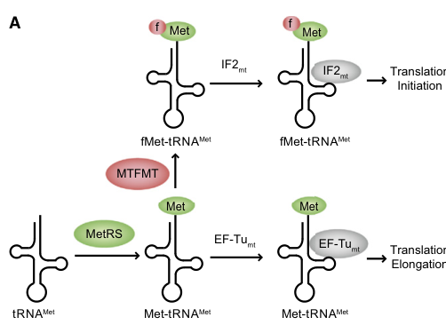

## Question

# Gene Research for Functional Annotation

## ⚠️ CRITICAL: Gene/Protein Identification Context

**BEFORE YOU BEGIN RESEARCH:** You MUST verify you are researching the CORRECT gene/protein. Gene symbols can be ambiguous, especially for less well-characterized genes from non-model organisms.

### Target Gene/Protein Identity (from UniProt):
- **UniProt Accession:** Q96DP5
- **Protein Description:** RecName: Full=Methionyl-tRNA formyltransferase, mitochondrial; Short=MtFMT; EC=2.1.2.9 {ECO:0000269|PubMed:21907147, ECO:0000269|PubMed:25288793}; Flags: Precursor;
- **Gene Information:** Name=MTFMT; Synonyms=FMT, FMT1;
- **Organism (full):** Homo sapiens (Human).
- **Protein Family:** Belongs to the Fmt family. .
- **Key Domains:** Fmt. (IPR005794); Formyl_trans_C. (IPR005793); Formyl_transf_N. (IPR002376); Formyl_transf_N_sf. (IPR036477); Formyl_transferase-like_C_sf. (IPR011034)

### MANDATORY VERIFICATION STEPS:

1. **Check if the gene symbol "MTFMT" matches the protein description above**
2. **Verify the organism is correct:** Homo sapiens (Human).
3. **Check if protein family/domains align with what you find in literature**
4. **If you find literature for a DIFFERENT gene with the same or similar symbol, STOP**

### If Gene Symbol is Ambiguous or You Cannot Find Relevant Literature:

**DO NOT PROCEED WITH RESEARCH ON A DIFFERENT GENE.** Instead:
- State clearly: "The gene symbol 'MTFMT' is ambiguous or literature is limited for this specific protein"
- Explain what you found (e.g., "Found extensive literature on a different gene with the same symbol in a different organism")
- Describe the protein based ONLY on the UniProt information provided above
- Suggest that the protein function can be inferred from domain/family information

### Research Target:

Please provide a comprehensive research report on the gene **MTFMT** (gene ID: MTFMT, UniProt: Q96DP5) in human.

The research report should be a detailed narrative explaining the function, biological processes, and localization of the gene product. Citations should be given for all claims.

You should prioritize authoritative reviews and primary scientific literature when conducting research. You can supplement
this with annotations you find in gene/protein databases, but these can be outdated or inaccurate.

We are specifically interested in the primary function of the gene - for enzymes, what reaction is catalyzed, and what is the substrate specificity? For transporters, what is the substrate? For structural proteins or adapters, what is the broader structural role? For signaling molecules, what is the role in the pathway.

We are interested in where in or outside the cell the gene product carries out its function.

We are also interested in the signaling or biochemical pathways in which the gene functions. We are less interested in broad pleiotropic effects, except where these elucidate the precise role.

Include evidence where possible. We are interested in both experimental evidence as well as inference from structure, evolution, or bioinformatic analysis. Precise studies should be prioritized over high-throughput, where available.

## Output

Question: You are an expert researcher providing comprehensive, well-cited information.

Provide detailed information focusing on:
1. Key concepts and definitions with current understanding
2. Recent developments and latest research (prioritize 2023-2024 sources)
3. Current applications and real-world implementations
4. Expert opinions and analysis from authoritative sources
5. Relevant statistics and data from recent studies

Format as a comprehensive research report with proper citations. Include URLs and publication dates where available.
Always prioritize recent, authoritative sources and provide specific citations for all major claims.

# Gene Research for Functional Annotation

## ⚠️ CRITICAL: Gene/Protein Identification Context

**BEFORE YOU BEGIN RESEARCH:** You MUST verify you are researching the CORRECT gene/protein. Gene symbols can be ambiguous, especially for less well-characterized genes from non-model organisms.

### Target Gene/Protein Identity (from UniProt):
- **UniProt Accession:** Q96DP5
- **Protein Description:** RecName: Full=Methionyl-tRNA formyltransferase, mitochondrial; Short=MtFMT; EC=2.1.2.9 {ECO:0000269|PubMed:21907147, ECO:0000269|PubMed:25288793}; Flags: Precursor;
- **Gene Information:** Name=MTFMT; Synonyms=FMT, FMT1;
- **Organism (full):** Homo sapiens (Human).
- **Protein Family:** Belongs to the Fmt family. .
- **Key Domains:** Fmt. (IPR005794); Formyl_trans_C. (IPR005793); Formyl_transf_N. (IPR002376); Formyl_transf_N_sf. (IPR036477); Formyl_transferase-like_C_sf. (IPR011034)

### MANDATORY VERIFICATION STEPS:

1. **Check if the gene symbol "MTFMT" matches the protein description above**
2. **Verify the organism is correct:** Homo sapiens (Human).
3. **Check if protein family/domains align with what you find in literature**
4. **If you find literature for a DIFFERENT gene with the same or similar symbol, STOP**

### If Gene Symbol is Ambiguous or You Cannot Find Relevant Literature:

**DO NOT PROCEED WITH RESEARCH ON A DIFFERENT GENE.** Instead:
- State clearly: "The gene symbol 'MTFMT' is ambiguous or literature is limited for this specific protein"
- Explain what you found (e.g., "Found extensive literature on a different gene with the same symbol in a different organism")
- Describe the protein based ONLY on the UniProt information provided above
- Suggest that the protein function can be inferred from domain/family information

### Research Target:

Please provide a comprehensive research report on the gene **MTFMT** (gene ID: MTFMT, UniProt: Q96DP5) in human.

The research report should be a detailed narrative explaining the function, biological processes, and localization of the gene product. Citations should be given for all claims.

You should prioritize authoritative reviews and primary scientific literature when conducting research. You can supplement
this with annotations you find in gene/protein databases, but these can be outdated or inaccurate.

We are specifically interested in the primary function of the gene - for enzymes, what reaction is catalyzed, and what is the substrate specificity? For transporters, what is the substrate? For structural proteins or adapters, what is the broader structural role? For signaling molecules, what is the role in the pathway.

We are interested in where in or outside the cell the gene product carries out its function.

We are also interested in the signaling or biochemical pathways in which the gene functions. We are less interested in broad pleiotropic effects, except where these elucidate the precise role.

Include evidence where possible. We are interested in both experimental evidence as well as inference from structure, evolution, or bioinformatic analysis. Precise studies should be prioritized over high-throughput, where available.

# Human MTFMT (UniProt Q96DP5): functional annotation research report

## Identity and principal function

**Identity verified.** Human **MTFMT** (also called *FMT* or *FMT1*) encodes mitochondrial methionyl-tRNA formyltransferase (MtFMT; EC 2.1.2.9), a nuclear-encoded enzyme of the Fmt/formyltransferase family. The human enzyme has been purified and assayed; its conserved formyltransferase regions and approximately 30% sequence identity to *Escherichia coli* MTF support the family assignment. Bacterial *fmt* and yeast *FMT1* are related genes, **not** the human research target. The Fmt and N- and C-terminal formyltransferase domains supplied in the Q96DP5 annotation are consistent with these biochemical and comparative findings. (sinha2014biochemicalcharacterizationof pages 1-2, sinha2014biochemicalcharacterizationof pages 5-6, sinha2014biochemicalcharacterizationof pages 10-12)

**Reaction:** mitochondrial Met-tRNA^Met + 10-formyltetrahydrofolate (10-formyl-THF) → N-formylmethionyl-tRNA^Met (fMet-tRNA^Met) + tetrahydrofolate. MTFMT transfers the formyl group to the **α-amino group of methionine already attached to tRNA**; it does not directly formylate a completed protein, free methionine, or a cytosolic translation substrate. Sinha and colleagues assayed purified recombinant human enzyme by first charging tRNA with methionine and then supplying 10-formyl-THF for the formylation reaction. [Sinha *et al.*, *Journal of Biological Chemistry*, November 2014](https://doi.org/10.1074/jbc.M114.610626). (sinha2014biochemicalcharacterizationof pages 5-6)

### Substrate specificity and biological pathway

Human mitochondria have **one mitochondrial tRNA^Met species**, used for both initiation and elongation. Mitochondrial methionyl-tRNA synthetase first charges it with methionine. MTFMT converts a portion of that pool to fMet-tRNA^Met, favoring its recruitment by mitochondrial initiation factor mtIF2 to the ribosomal P site; nonformylated Met-tRNA^Met remains available to mitochondrial elongation factor mtEF-Tu. MTFMT therefore helps allocate the shared charged tRNA pool between the two stages of mitochondrial protein synthesis. [Tucker *et al.*, *Cell Metabolism*, September 2011](https://doi.org/10.1016/j.cmet.2011.07.010); [Antolínez-Fernández *et al.*, *Frontiers in Cell and Developmental Biology*, May 2024](https://doi.org/10.3389/fcell.2024.1410245). (tucker2011mutationsinmtfmt pages 1-2, tucker2011mutationsinmtfmt pages 4-5, antolinezfernandez2024molecularpathwaysin pages 3-5)

Substrate recognition is more specific than the name “formyltransferase” alone implies: human mitochondrial MTF particularly recognizes **methionine attached to tRNA and a purine-11:pyrimidine-24 base pair in the tRNA D stem**. It does not simply follow all the acceptor-stem recognition rules established for bacterial MTF. Comparison with the experimentally determined bacterial MTF–tRNA structure identifies a conserved methionine-binding pocket and folate-associated catalytic regions in the human homolog; the detailed pocket interpretation is **comparative structural inference**, not a human enzyme–substrate crystal structure presented in that study. [Sinha *et al.*, November 2014](https://doi.org/10.1074/jbc.M114.610626). (sinha2014biochemicalcharacterizationof pages 12-13, sinha2014biochemicalcharacterizationof pages 13-13)

MTFMT also forms a precise biochemical connection between **mitochondrial folate-mediated one-carbon metabolism and mitochondrial translation**: mitochondrial 10-formyl-THF supplies its transferable formyl group. A 2024 *Nature Cancer* review identifies initiator-tRNA formylation by MTFMT as one use of the mitochondrial folate pool. This is distinct from the upstream enzymes that generate folate one-carbon intermediates and from other folate-dependent tRNA modifications; MTFMT’s established direct reaction is methionyl-tRNA formylation. [Lee, Vousden and Hennequart, *Nature Cancer*, May 2024](https://doi.org/10.1038/s43018-024-00739-8). (lee2024cyclingbackto pages 2-4, xiu2020therolesof pages 12-13, xiu2020therolesof pages 13-14)

## Where the protein functions

MTFMT is a **mitochondrially targeted precursor** whose established functional setting is the mitochondrial translation apparatus: its mitochondrial tRNA substrate, folate donor and mitoribosome-associated downstream pathway place its physiological formylation reaction **inside mitochondria**, consistent with a matrix-side reaction. The retrieved human patient-cell experiments establish a mitochondrial biochemical effect but do not themselves supply a dedicated MTFMT microscopy or import assay resolving an exact submitochondrial address. It should therefore not be described as a proven integral inner-membrane enzyme, extracellular enzyme, or general cytosolic formyltransferase. [Tucker *et al.*, September 2011](https://doi.org/10.1016/j.cmet.2011.07.010); [Sinha *et al.*, November 2014](https://doi.org/10.1074/jbc.M114.610626). (tucker2011mutationsinmtfmt pages 1-2, tucker2011mutationsinmtfmt pages 4-5, sinha2014biochemicalcharacterizationof pages 12-13)

Its immediate outcome is efficient initiation of synthesis of the **13 mtDNA-encoded respiratory-chain proteins**. Reduced synthesis can secondarily compromise assembly and activity of oxidative-phosphorylation complexes containing those proteins. MTFMT is thus best annotated as a **mitochondrial translation-initiation/tRNA-modification enzyme**, rather than a primary respiratory-complex subunit or a signaling receptor. [Tucker *et al.*, September 2011](https://doi.org/10.1016/j.cmet.2011.07.010); [Antolínez-Fernández *et al.*, May 2024](https://doi.org/10.3389/fcell.2024.1410245). (tucker2011mutationsinmtfmt pages 1-2, tucker2011mutationsinmtfmt pages 2-3, antolinezfernandez2024molecularpathwaysin pages 9-10)

The following evidence table distinguishes directly demonstrated human enzyme and patient-cell findings from newer, species-limited observations. (sinha2014biochemicalcharacterizationof pages 5-6, tucker2011mutationsinmtfmt pages 4-5, waki2024tumor‐derivedmitochondrialformyl pages 5-6)

| Feature | Experimental finding | Evidence/interpretive limit |
|---|---|---|
| Enzyme identity and reaction | Human MTFMT (Q96DP5) is the mitochondrial methionyl-tRNA formyltransferase. Purified recombinant enzyme catalysed **Met-tRNA^Met + 10-formyl-THF → fMet-tRNA^Met + THF**, transferring the formyl group to the aminoacylated tRNA—not to an existing protein. [Sinha et al., 2014](https://doi.org/10.1074/jbc.M114.610626) (sinha2014biochemicalcharacterizationof pages 5-6) | **Direct human-enzyme biochemistry.** Fmt-family assignment is also supported by conserved catalytic/FTHF-binding regions and homology to structurally characterized bacterial MTF; the detailed structural model is homology-based rather than a solved human MTFMT structure. (sinha2014biochemicalcharacterizationof pages 12-13, sinha2014biochemicalcharacterizationof pages 13-13) |
| Substrate specificity | Metazoan mitochondria use a **single mt-tRNA^Met** for initiation and elongation. MTFMT preferentially recognizes methionine attached to that tRNA plus the **purine-11:pyrimidine-24 base pair in its D stem**; formylated fMet-tRNA^Met is directed toward initiation, whereas unformylated Met-tRNA^Met can enter elongation. [Sinha et al., 2014](https://doi.org/10.1074/jbc.M114.610626) (sinha2014biochemicalcharacterizationof pages 2-3, sinha2014biochemicalcharacterizationof pages 13-13) | **Biochemistry plus comparative structure/function evidence.** The human enzyme relies on fewer tRNA identity elements than bacterial MTF, so bacterial substrate-recognition rules should not be transferred wholesale to human MTFMT. (sinha2014biochemicalcharacterizationof pages 13-13) |
| Cellular phenotype and causality | In fibroblasts from two index cases (P1/P2), northern analysis found **no detectable steady-state fMet-tRNA^Met** and predominantly unformylated Met-tRNA^Met, yet mass spectrometry showed formylated COX1 remained the dominant product, indicating low residual MTFMT activity. Wild-type MTFMT cDNA restored COX2 and NDUFB8 abundance, supporting causality. [Tucker et al., 2011](https://doi.org/10.1016/j.cmet.2011.07.010) (tucker2011mutationsinmtfmt pages 3-4, tucker2011mutationsinmtfmt pages 4-5, tucker2011mutationsinmtfmt pages 2-3, tucker2011mutationsinmtfmt media e532b47c) | **Direct patient-cell evidence with genetic complementation.** “Undetectable” means below the northern-blot detection limit, not complete absence; dominant formyl-COX1 demonstrates that residual formylation persisted. The original mechanistic cohort comprised two unrelated index patients, so it does not define population prevalence. |
| Newer exploratory extension | In 2024, CRISPR MTFMT knockout in murine tumor cells reduced in-vivo growth in immunocompetent mice without a significant intrinsic in-vitro growth or respiration defect. PMN-MDSCs comprised **10.3 ± 0.81%** of WT versus **1.7 ± 0.33%** of knockout tumors (**p = 0.003**), suggesting mitochondrial formyl peptides can modify antitumor immunity. [Waki et al., 2024](https://doi.org/10.1111/cas.16266) (waki2024tumor‐derivedmitochondrialformyl pages 5-6, waki2024tumor‐derivedmitochondrialformyl pages 6-9) | **Exploratory murine cancer evidence only.** Experiments used edited mouse cell lines, small groups (typically n = 6), and pooled tissues in some immune assays; clone effects and tumor-size normalization complicate interpretation. No established human cancer relevance, clinical application, or validated MTFMT-targeted therapy follows from this study. |

*Table: A compact hierarchy of evidence defining human MTFMT enzymology, substrate recognition, patient-cell causality, and the limits of a 2024 murine tumor-immunity extension.*

## Experimental evidence and quantitative findings

**Human disease-cell causality.** Tucker and colleagues identified compound-heterozygous MTFMT variants in **two unrelated children** with Leigh syndrome and combined oxidative-phosphorylation deficiency. Their fibroblasts synthesized less of most tested mtDNA-encoded proteins. Acid-urea northern blotting showed predominantly nonformylated Met-tRNA^Met and **no detectable steady-state fMet-tRNA^Met** in patient cells, in contrast to controls; total mitochondrial tRNA^Met signal was approximately **2.7-fold higher**. Reintroducing wild-type MTFMT increased the mitochondrial COX2 protein and the complex-I-associated NDUFB8 protein, whereas a control cDNA did not. These convergent genetic, biochemical and complementation results directly tie the enzyme defect to impaired mitochondrial translation. [Tucker *et al.*, September 2011](https://doi.org/10.1016/j.cmet.2011.07.010). The study’s reaction scheme and patient-versus-control tRNA blot are shown in its **Figure 3**. (tucker2011mutationsinmtfmt pages 1-2, tucker2011mutationsinmtfmt pages 2-3, tucker2011mutationsinmtfmt pages 3-4, tucker2011mutationsinmtfmt pages 4-5, tucker2011mutationsinmtfmt media e532b47c)

“Undetectable” on that blot **does not mean absolutely absent**. Mass spectrometry found that N-terminally formylated mitochondrial COX1 remained the **dominant** COX1 species in patient fibroblasts, consistent with low residual formylation activity and consumption of scarce fMet-tRNA^Met during initiation. This also limits any claim that MTFMT-associated disease proves initiation without formylated tRNA: efficient translation requires MTFMT, but whether all human mitochondrial initiation absolutely requires formylation was not established by those hypomorphic patient cells. [Tucker *et al.*, September 2011](https://doi.org/10.1016/j.cmet.2011.07.010). (tucker2011mutationsinmtfmt pages 4-5, tucker2011mutationsinmtfmt pages 5-5)

**Variant mechanism and enzyme activity.** Both original index patients carried **c.626C>T**, which causes extensive exon-4 skipping and can also yield full-length **p.S209L** enzyme; their other alleles were p.R128X and p.S125L, respectively. Full-length MTFMT transcript was **9% of control in P1** and **56% in P2**—*transcript abundances, not percentages of formylated tRNA*. Biochemical study of recombinant human variants found approximately **653-fold lower activity for S125L** and **36-fold lower activity for S209L** in the reported activity comparison. The latter variant’s cellular impact may reflect both impaired enzyme function and disrupted splicing, rather than catalytic impairment alone. [Tucker *et al.*, September 2011](https://doi.org/10.1016/j.cmet.2011.07.010); [Sinha *et al.*, November 2014](https://doi.org/10.1074/jbc.M114.610626). (tucker2011mutationsinmtfmt pages 2-3, sinha2014biochemicalcharacterizationof pages 2-3, sinha2014biochemicalcharacterizationof pages 3-4, sinha2014biochemicalcharacterizationof pages 10-12)

Sinha and colleagues also noted c.626C>T in **10 of 12 additional patients** identified by the time of their 2014 analysis. That describes a particular reported patient set, **not** the variant’s frequency among all affected people or in the general population. [Sinha *et al.*, November 2014](https://doi.org/10.1074/jbc.M114.610626). (sinha2014biochemicalcharacterizationof pages 10-12)

## 2023–2024 developments and practical relevance

The 2024 mitochondrial-disease review continues to classify MTFMT deficiency among disorders of **mitochondrial tRNA modification and translation**, linking variants to Leigh syndrome and combined OXPHOS deficiency. The 2024 folate-metabolism synthesis emphasizes MTFMT’s role as the translation-facing consumer of mitochondrial 10-formyl-THF. These reviews refine pathway interpretation but do not replace the earlier purified-enzyme assays and patient-cell rescue as the decisive evidence for *human* MTFMT’s primary function. [Antolínez-Fernández *et al.*, May 2024](https://doi.org/10.3389/fcell.2024.1410245); [Lee *et al.*, May 2024](https://doi.org/10.1038/s43018-024-00739-8). (antolinezfernandez2024molecularpathwaysin pages 9-10, lee2024cyclingbackto pages 2-4, sinha2014biochemicalcharacterizationof pages 5-6, tucker2011mutationsinmtfmt pages 2-3)

A newer **2024 mouse cancer-model study** tested a possible downstream consequence of mitochondrial formyl-peptide production. CRISPR disruption of *Mtfmt* in murine tumor cells suppressed tumor growth in immunocompetent mice, without a significant difference in measured in-vitro proliferation or respiration. In examined tumors, polymorphonuclear myeloid-derived suppressor cells represented **10.3 ± 0.81%** in wild type versus **1.7 ± 0.33%** after knockout (**p = 0.003**); representative tumor-growth groups had **six mice each**. Loss of growth suppression in T-cell-deficient settings and some response to administered mitochondrial formyl peptides support an immune-context interpretation. This is **exploratory mouse evidence**, not demonstration of the same effect in human tumors or a rationale for clinically inhibiting human MTFMT: patient studies establish the risk of compromising mitochondrial translation, and some mouse immune assays depended on pooled tissues or tumor-size normalization. [Waki *et al.*, *Cancer Science*, July 2024](https://doi.org/10.1111/cas.16266). (waki2024tumor‐derivedmitochondrialformyl pages 5-6, waki2024tumor‐derivedmitochondrialformyl pages 6-9)

**Current implementation:** the clearest established use of this functional annotation is interpreting *MTFMT* variants during investigation of suspected mitochondrial translation defects—for example, combining sequence and splice analysis with mitochondrial protein-synthesis, tRNA-formylation or respiratory-chain measurements where feasible. The published rescue experiment demonstrates experimental validation, **not an available gene-replacement treatment**. The sources reviewed here do not establish an MTFMT-specific approved therapy, a validated clinical inhibitor, or a quantitative human-population prevalence estimate. [Tucker *et al.*, September 2011](https://doi.org/10.1016/j.cmet.2011.07.010); [Sinha *et al.*, November 2014](https://doi.org/10.1074/jbc.M114.610626); [Antolínez-Fernández *et al.*, May 2024](https://doi.org/10.3389/fcell.2024.1410245). (tucker2011mutationsinmtfmt pages 2-3, tucker2011mutationsinmtfmt pages 4-5, sinha2014biochemicalcharacterizationof pages 10-12, antolinezfernandez2024molecularpathwaysin pages 9-10)

References

1. (sinha2014biochemicalcharacterizationof pages 1-2): Akesh Sinha, Caroline Köhrer, Michael H.W. Weber, Isao Masuda, Vamsi K. Mootha, Ya-Ming Hou, and Uttam L. RajBhandary. Biochemical characterization of pathogenic mutations in human mitochondrial methionyl-trna formyltransferase. Journal of Biological Chemistry, 289:32729-32741, Nov 2014. URL: https://doi.org/10.1074/jbc.m114.610626, doi:10.1074/jbc.m114.610626. This article has 19 citations and is from a domain leading peer-reviewed journal.

2. (sinha2014biochemicalcharacterizationof pages 5-6): Akesh Sinha, Caroline Köhrer, Michael H.W. Weber, Isao Masuda, Vamsi K. Mootha, Ya-Ming Hou, and Uttam L. RajBhandary. Biochemical characterization of pathogenic mutations in human mitochondrial methionyl-trna formyltransferase. Journal of Biological Chemistry, 289:32729-32741, Nov 2014. URL: https://doi.org/10.1074/jbc.m114.610626, doi:10.1074/jbc.m114.610626. This article has 19 citations and is from a domain leading peer-reviewed journal.

3. (sinha2014biochemicalcharacterizationof pages 10-12): Akesh Sinha, Caroline Köhrer, Michael H.W. Weber, Isao Masuda, Vamsi K. Mootha, Ya-Ming Hou, and Uttam L. RajBhandary. Biochemical characterization of pathogenic mutations in human mitochondrial methionyl-trna formyltransferase. Journal of Biological Chemistry, 289:32729-32741, Nov 2014. URL: https://doi.org/10.1074/jbc.m114.610626, doi:10.1074/jbc.m114.610626. This article has 19 citations and is from a domain leading peer-reviewed journal.

4. (tucker2011mutationsinmtfmt pages 1-2): Elena J. Tucker, Steven G. Hershman, Caroline Köhrer, Casey A. Belcher-Timme, Jinal Patel, Olga A. Goldberger, John Christodoulou, Jonathon M. Silberstein, Matthew McKenzie, Michael T. Ryan, Alison G. Compton, Jacob D. Jaffe, Steven A. Carr, Sarah E. Calvo, Uttam L. RajBhandary, David R. Thorburn, and Vamsi K. Mootha. Mutations in mtfmt underlie a human disorder of formylation causing impaired mitochondrial translation. Cell metabolism, 14 3:428-34, Sep 2011. URL: https://doi.org/10.1016/j.cmet.2011.07.010, doi:10.1016/j.cmet.2011.07.010. This article has 237 citations and is from a highest quality peer-reviewed journal.

5. (tucker2011mutationsinmtfmt pages 4-5): Elena J. Tucker, Steven G. Hershman, Caroline Köhrer, Casey A. Belcher-Timme, Jinal Patel, Olga A. Goldberger, John Christodoulou, Jonathon M. Silberstein, Matthew McKenzie, Michael T. Ryan, Alison G. Compton, Jacob D. Jaffe, Steven A. Carr, Sarah E. Calvo, Uttam L. RajBhandary, David R. Thorburn, and Vamsi K. Mootha. Mutations in mtfmt underlie a human disorder of formylation causing impaired mitochondrial translation. Cell metabolism, 14 3:428-34, Sep 2011. URL: https://doi.org/10.1016/j.cmet.2011.07.010, doi:10.1016/j.cmet.2011.07.010. This article has 237 citations and is from a highest quality peer-reviewed journal.

6. (antolinezfernandez2024molecularpathwaysin pages 3-5): Álvaro Antolínez-Fernández, Paula Esteban-Ramos, Miguel Ángel Fernández-Moreno, and Paula Clemente. Molecular pathways in mitochondrial disorders due to a defective mitochondrial protein synthesis. Frontiers in Cell and Developmental Biology, May 2024. URL: https://doi.org/10.3389/fcell.2024.1410245, doi:10.3389/fcell.2024.1410245. This article has 19 citations.

7. (sinha2014biochemicalcharacterizationof pages 12-13): Akesh Sinha, Caroline Köhrer, Michael H.W. Weber, Isao Masuda, Vamsi K. Mootha, Ya-Ming Hou, and Uttam L. RajBhandary. Biochemical characterization of pathogenic mutations in human mitochondrial methionyl-trna formyltransferase. Journal of Biological Chemistry, 289:32729-32741, Nov 2014. URL: https://doi.org/10.1074/jbc.m114.610626, doi:10.1074/jbc.m114.610626. This article has 19 citations and is from a domain leading peer-reviewed journal.

8. (sinha2014biochemicalcharacterizationof pages 13-13): Akesh Sinha, Caroline Köhrer, Michael H.W. Weber, Isao Masuda, Vamsi K. Mootha, Ya-Ming Hou, and Uttam L. RajBhandary. Biochemical characterization of pathogenic mutations in human mitochondrial methionyl-trna formyltransferase. Journal of Biological Chemistry, 289:32729-32741, Nov 2014. URL: https://doi.org/10.1074/jbc.m114.610626, doi:10.1074/jbc.m114.610626. This article has 19 citations and is from a domain leading peer-reviewed journal.

9. (lee2024cyclingbackto pages 2-4): Younghwan Lee, Karen H. Vousden, and Marc Hennequart. Cycling back to folate metabolism in cancer. Nature cancer, 5:701-715, May 2024. URL: https://doi.org/10.1038/s43018-024-00739-8, doi:10.1038/s43018-024-00739-8. This article has 68 citations and is from a highest quality peer-reviewed journal.

10. (xiu2020therolesof pages 12-13): Yuwen Xiu and Martha S Field. The roles of mitochondrial folate metabolism in supporting mitochondrial dna synthesis, oxidative phosphorylation, and cellular function. Current Developments in Nutrition, 4:nzaa153, Oct 2020. URL: https://doi.org/10.1093/cdn/nzaa153, doi:10.1093/cdn/nzaa153. This article has 79 citations and is from a peer-reviewed journal.

11. (xiu2020therolesof pages 13-14): Yuwen Xiu and Martha S Field. The roles of mitochondrial folate metabolism in supporting mitochondrial dna synthesis, oxidative phosphorylation, and cellular function. Current Developments in Nutrition, 4:nzaa153, Oct 2020. URL: https://doi.org/10.1093/cdn/nzaa153, doi:10.1093/cdn/nzaa153. This article has 79 citations and is from a peer-reviewed journal.

12. (tucker2011mutationsinmtfmt pages 2-3): Elena J. Tucker, Steven G. Hershman, Caroline Köhrer, Casey A. Belcher-Timme, Jinal Patel, Olga A. Goldberger, John Christodoulou, Jonathon M. Silberstein, Matthew McKenzie, Michael T. Ryan, Alison G. Compton, Jacob D. Jaffe, Steven A. Carr, Sarah E. Calvo, Uttam L. RajBhandary, David R. Thorburn, and Vamsi K. Mootha. Mutations in mtfmt underlie a human disorder of formylation causing impaired mitochondrial translation. Cell metabolism, 14 3:428-34, Sep 2011. URL: https://doi.org/10.1016/j.cmet.2011.07.010, doi:10.1016/j.cmet.2011.07.010. This article has 237 citations and is from a highest quality peer-reviewed journal.

13. (antolinezfernandez2024molecularpathwaysin pages 9-10): Álvaro Antolínez-Fernández, Paula Esteban-Ramos, Miguel Ángel Fernández-Moreno, and Paula Clemente. Molecular pathways in mitochondrial disorders due to a defective mitochondrial protein synthesis. Frontiers in Cell and Developmental Biology, May 2024. URL: https://doi.org/10.3389/fcell.2024.1410245, doi:10.3389/fcell.2024.1410245. This article has 19 citations.

14. (waki2024tumor‐derivedmitochondrialformyl pages 5-6): Kayoko Waki, Miyako Ozawa, Keisuke Ohta, Nobukazu Komatsu, and Akira Yamada. Tumor‐derived mitochondrial formyl peptides suppress tumor immunity through modification of the tumor microenvironment. Cancer Science, 115:3218-3230, Jul 2024. URL: https://doi.org/10.1111/cas.16266, doi:10.1111/cas.16266. This article has 2 citations and is from a peer-reviewed journal.

15. (sinha2014biochemicalcharacterizationof pages 2-3): Akesh Sinha, Caroline Köhrer, Michael H.W. Weber, Isao Masuda, Vamsi K. Mootha, Ya-Ming Hou, and Uttam L. RajBhandary. Biochemical characterization of pathogenic mutations in human mitochondrial methionyl-trna formyltransferase. Journal of Biological Chemistry, 289:32729-32741, Nov 2014. URL: https://doi.org/10.1074/jbc.m114.610626, doi:10.1074/jbc.m114.610626. This article has 19 citations and is from a domain leading peer-reviewed journal.

16. (tucker2011mutationsinmtfmt pages 3-4): Elena J. Tucker, Steven G. Hershman, Caroline Köhrer, Casey A. Belcher-Timme, Jinal Patel, Olga A. Goldberger, John Christodoulou, Jonathon M. Silberstein, Matthew McKenzie, Michael T. Ryan, Alison G. Compton, Jacob D. Jaffe, Steven A. Carr, Sarah E. Calvo, Uttam L. RajBhandary, David R. Thorburn, and Vamsi K. Mootha. Mutations in mtfmt underlie a human disorder of formylation causing impaired mitochondrial translation. Cell metabolism, 14 3:428-34, Sep 2011. URL: https://doi.org/10.1016/j.cmet.2011.07.010, doi:10.1016/j.cmet.2011.07.010. This article has 237 citations and is from a highest quality peer-reviewed journal.

17. (tucker2011mutationsinmtfmt media e532b47c): Elena J. Tucker, Steven G. Hershman, Caroline Köhrer, Casey A. Belcher-Timme, Jinal Patel, Olga A. Goldberger, John Christodoulou, Jonathon M. Silberstein, Matthew McKenzie, Michael T. Ryan, Alison G. Compton, Jacob D. Jaffe, Steven A. Carr, Sarah E. Calvo, Uttam L. RajBhandary, David R. Thorburn, and Vamsi K. Mootha. Mutations in mtfmt underlie a human disorder of formylation causing impaired mitochondrial translation. Cell metabolism, 14 3:428-34, Sep 2011. URL: https://doi.org/10.1016/j.cmet.2011.07.010, doi:10.1016/j.cmet.2011.07.010. This article has 237 citations and is from a highest quality peer-reviewed journal.

18. (waki2024tumor‐derivedmitochondrialformyl pages 6-9): Kayoko Waki, Miyako Ozawa, Keisuke Ohta, Nobukazu Komatsu, and Akira Yamada. Tumor‐derived mitochondrial formyl peptides suppress tumor immunity through modification of the tumor microenvironment. Cancer Science, 115:3218-3230, Jul 2024. URL: https://doi.org/10.1111/cas.16266, doi:10.1111/cas.16266. This article has 2 citations and is from a peer-reviewed journal.

19. (tucker2011mutationsinmtfmt pages 5-5): Elena J. Tucker, Steven G. Hershman, Caroline Köhrer, Casey A. Belcher-Timme, Jinal Patel, Olga A. Goldberger, John Christodoulou, Jonathon M. Silberstein, Matthew McKenzie, Michael T. Ryan, Alison G. Compton, Jacob D. Jaffe, Steven A. Carr, Sarah E. Calvo, Uttam L. RajBhandary, David R. Thorburn, and Vamsi K. Mootha. Mutations in mtfmt underlie a human disorder of formylation causing impaired mitochondrial translation. Cell metabolism, 14 3:428-34, Sep 2011. URL: https://doi.org/10.1016/j.cmet.2011.07.010, doi:10.1016/j.cmet.2011.07.010. This article has 237 citations and is from a highest quality peer-reviewed journal.

20. (sinha2014biochemicalcharacterizationof pages 3-4): Akesh Sinha, Caroline Köhrer, Michael H.W. Weber, Isao Masuda, Vamsi K. Mootha, Ya-Ming Hou, and Uttam L. RajBhandary. Biochemical characterization of pathogenic mutations in human mitochondrial methionyl-trna formyltransferase. Journal of Biological Chemistry, 289:32729-32741, Nov 2014. URL: https://doi.org/10.1074/jbc.m114.610626, doi:10.1074/jbc.m114.610626. This article has 19 citations and is from a domain leading peer-reviewed journal.

## Artifacts

- [Edison artifact artifact-00](MTFMT-deep-research-falcon_artifacts/artifact-00.md)

## Citations

1. sinha2014biochemicalcharacterizationof pages 5-6
2. sinha2014biochemicalcharacterizationof pages 13-13
3. sinha2014biochemicalcharacterizationof pages 10-12
4. sinha2014biochemicalcharacterizationof pages 1-2
5. tucker2011mutationsinmtfmt pages 1-2
6. tucker2011mutationsinmtfmt pages 4-5
7. antolinezfernandez2024molecularpathwaysin pages 3-5
8. sinha2014biochemicalcharacterizationof pages 12-13
9. lee2024cyclingbackto pages 2-4
10. xiu2020therolesof pages 12-13
11. xiu2020therolesof pages 13-14
12. tucker2011mutationsinmtfmt pages 2-3
13. antolinezfernandez2024molecularpathwaysin pages 9-10
14. sinha2014biochemicalcharacterizationof pages 2-3
15. tucker2011mutationsinmtfmt pages 3-4
16. tucker2011mutationsinmtfmt pages 5-5
17. sinha2014biochemicalcharacterizationof pages 3-4
18. Sinha *et al.*, *Journal of Biological Chemistry*, November 2014
19. Tucker *et al.*, *Cell Metabolism*, September 2011
20. Antolínez-Fernández *et al.*, *Frontiers in Cell and Developmental Biology*, May 2024
21. Sinha *et al.*, November 2014
22. Lee, Vousden and Hennequart, *Nature Cancer*, May 2024
23. Tucker *et al.*, September 2011
24. Antolínez-Fernández *et al.*, May 2024
25. Sinha et al., 2014
26. Tucker et al., 2011
27. Waki et al., 2024
28. Lee *et al.*, May 2024
29. Waki *et al.*, *Cancer Science*, July 2024
30. https://doi.org/10.1074/jbc.M114.610626
31. https://doi.org/10.1016/j.cmet.2011.07.010
32. https://doi.org/10.3389/fcell.2024.1410245
33. https://doi.org/10.1038/s43018-024-00739-8
34. https://doi.org/10.1111/cas.16266
35. https://doi.org/10.1074/jbc.m114.610626,
36. https://doi.org/10.1016/j.cmet.2011.07.010,
37. https://doi.org/10.3389/fcell.2024.1410245,
38. https://doi.org/10.1038/s43018-024-00739-8,
39. https://doi.org/10.1093/cdn/nzaa153,
40. https://doi.org/10.1111/cas.16266,