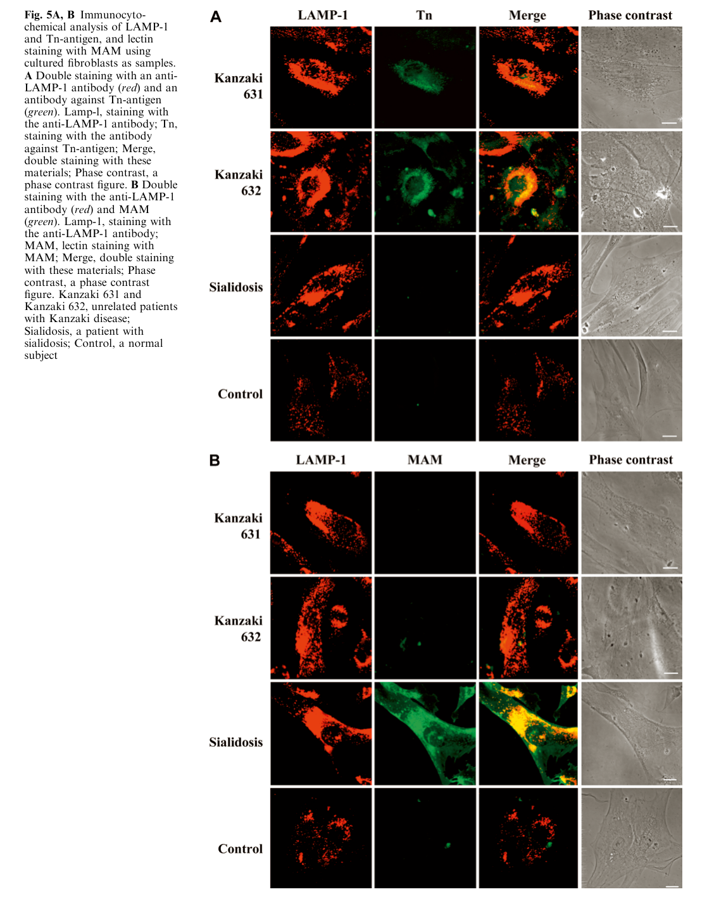

## Question

# Gene Research for Functional Annotation

## ⚠️ CRITICAL: Gene/Protein Identification Context

**BEFORE YOU BEGIN RESEARCH:** You MUST verify you are researching the CORRECT gene/protein. Gene symbols can be ambiguous, especially for less well-characterized genes from non-model organisms.

### Target Gene/Protein Identity (from UniProt):
- **UniProt Accession:** P17050
- **Protein Description:** RecName: Full=Alpha-N-acetylgalactosaminidase {ECO:0000305}; EC=3.2.1.49 {ECO:0000269|PubMed:19683538}; AltName: Full=Alpha-galactosidase B; Flags: Precursor;
- **Gene Information:** Name=NAGA {ECO:0000312|HGNC:HGNC:7631};
- **Organism (full):** Homo sapiens (Human).
- **Protein Family:** Belongs to the glycosyl hydrolase 27 family. .
- **Key Domains:** Aldolase_TIM. (IPR013785); GH_hydrolase_sf. (IPR017853); Glyco_hydro_27. (IPR002241); Glyco_hydro_27/36_CS. (IPR000111); Glyco_hydro_b. (IPR013780)

### MANDATORY VERIFICATION STEPS:

1. **Check if the gene symbol "NAGA" matches the protein description above**
2. **Verify the organism is correct:** Homo sapiens (Human).
3. **Check if protein family/domains align with what you find in literature**
4. **If you find literature for a DIFFERENT gene with the same or similar symbol, STOP**

### If Gene Symbol is Ambiguous or You Cannot Find Relevant Literature:

**DO NOT PROCEED WITH RESEARCH ON A DIFFERENT GENE.** Instead:
- State clearly: "The gene symbol 'NAGA' is ambiguous or literature is limited for this specific protein"
- Explain what you found (e.g., "Found extensive literature on a different gene with the same symbol in a different organism")
- Describe the protein based ONLY on the UniProt information provided above
- Suggest that the protein function can be inferred from domain/family information

### Research Target:

Please provide a comprehensive research report on the gene **NAGA** (gene ID: NAGA, UniProt: P17050) in human.

The research report should be a detailed narrative explaining the function, biological processes, and localization of the gene product. Citations should be given for all claims.

You should prioritize authoritative reviews and primary scientific literature when conducting research. You can supplement
this with annotations you find in gene/protein databases, but these can be outdated or inaccurate.

We are specifically interested in the primary function of the gene - for enzymes, what reaction is catalyzed, and what is the substrate specificity? For transporters, what is the substrate? For structural proteins or adapters, what is the broader structural role? For signaling molecules, what is the role in the pathway.

We are interested in where in or outside the cell the gene product carries out its function.

We are also interested in the signaling or biochemical pathways in which the gene functions. We are less interested in broad pleiotropic effects, except where these elucidate the precise role.

Include evidence where possible. We are interested in both experimental evidence as well as inference from structure, evolution, or bioinformatic analysis. Precise studies should be prioritized over high-throughput, where available.

## Output

Question: You are an expert researcher providing comprehensive, well-cited information.

Provide detailed information focusing on:
1. Key concepts and definitions with current understanding
2. Recent developments and latest research (prioritize 2023-2024 sources)
3. Current applications and real-world implementations
4. Expert opinions and analysis from authoritative sources
5. Relevant statistics and data from recent studies

Format as a comprehensive research report with proper citations. Include URLs and publication dates where available.
Always prioritize recent, authoritative sources and provide specific citations for all major claims.

# Gene Research for Functional Annotation

## ⚠️ CRITICAL: Gene/Protein Identification Context

**BEFORE YOU BEGIN RESEARCH:** You MUST verify you are researching the CORRECT gene/protein. Gene symbols can be ambiguous, especially for less well-characterized genes from non-model organisms.

### Target Gene/Protein Identity (from UniProt):
- **UniProt Accession:** P17050
- **Protein Description:** RecName: Full=Alpha-N-acetylgalactosaminidase {ECO:0000305}; EC=3.2.1.49 {ECO:0000269|PubMed:19683538}; AltName: Full=Alpha-galactosidase B; Flags: Precursor;
- **Gene Information:** Name=NAGA {ECO:0000312|HGNC:HGNC:7631};
- **Organism (full):** Homo sapiens (Human).
- **Protein Family:** Belongs to the glycosyl hydrolase 27 family. .
- **Key Domains:** Aldolase_TIM. (IPR013785); GH_hydrolase_sf. (IPR017853); Glyco_hydro_27. (IPR002241); Glyco_hydro_27/36_CS. (IPR000111); Glyco_hydro_b. (IPR013780)

### MANDATORY VERIFICATION STEPS:

1. **Check if the gene symbol "NAGA" matches the protein description above**
2. **Verify the organism is correct:** Homo sapiens (Human).
3. **Check if protein family/domains align with what you find in literature**
4. **If you find literature for a DIFFERENT gene with the same or similar symbol, STOP**

### If Gene Symbol is Ambiguous or You Cannot Find Relevant Literature:

**DO NOT PROCEED WITH RESEARCH ON A DIFFERENT GENE.** Instead:
- State clearly: "The gene symbol 'NAGA' is ambiguous or literature is limited for this specific protein"
- Explain what you found (e.g., "Found extensive literature on a different gene with the same symbol in a different organism")
- Describe the protein based ONLY on the UniProt information provided above
- Suggest that the protein function can be inferred from domain/family information

### Research Target:

Please provide a comprehensive research report on the gene **NAGA** (gene ID: NAGA, UniProt: P17050) in human.

The research report should be a detailed narrative explaining the function, biological processes, and localization of the gene product. Citations should be given for all claims.

You should prioritize authoritative reviews and primary scientific literature when conducting research. You can supplement
this with annotations you find in gene/protein databases, but these can be outdated or inaccurate.

We are specifically interested in the primary function of the gene - for enzymes, what reaction is catalyzed, and what is the substrate specificity? For transporters, what is the substrate? For structural proteins or adapters, what is the broader structural role? For signaling molecules, what is the role in the pathway.

We are interested in where in or outside the cell the gene product carries out its function.

We are also interested in the signaling or biochemical pathways in which the gene functions. We are less interested in broad pleiotropic effects, except where these elucidate the precise role.

Include evidence where possible. We are interested in both experimental evidence as well as inference from structure, evolution, or bioinformatic analysis. Precise studies should be prioritized over high-throughput, where available.

# Human NAGA (UniProt P17050): functional annotation and evidence report

## Identity and principal function

**Identity verified.** Human **NAGA** encodes α-*N*-acetylgalactosaminidase (α-NAGAL; EC 3.2.1.49), historically called **α-galactosidase B**. The human enzyme studied experimentally matches the supplied UniProt identity, glycoside-hydrolase family **GH27**, and catalytic TIM-barrel domain. It is **not** the human *GLA* gene product, α-galactosidase A, nor a similarly named parasite or bacterial enzyme. The historical “B” name reflects NAGA’s weaker activity against α-galactose, not identity with GLA. (clark2009the1.9a pages 1-2, clark2009the1.9a pages 2-4, clark2009the1.9a pages 4-5)

**Primary reaction:** NAGA is a lysosomal *exoglycosidase* that hydrolyzes a terminal, α-linked *N*-acetyl-D-galactosamine (**α-GalNAc**) residue from a glycoconjugate, yielding free GalNAc and the remaining glycopeptide, glycoprotein, glycolipid, or oligosaccharide. A particularly relevant substrate class is **O-linked glycans on serine or threonine**, including the Tn-antigen structure GalNAcα-O-Ser/Thr. Its established biological pathway is **lysosomal glycoconjugate catabolism**, rather than a dedicated signaling cascade. (clark2009the1.9a pages 1-2, sakuraba2004structuralandimmunocytochemical pages 1-2, sakuraba2004structuralandimmunocytochemical pages 3-5)

The strongest quantitative substrate comparison comes from purified recombinant **human** enzyme assayed with synthetic p-nitrophenyl glycosides: the Michaelis constant (*K*ₘ) was **0.70 mM** for pNP-α-GalNAc versus **15.2 mM** for pNP-α-galactose, and catalytic efficiency (*k*cat/*K*ₘ) was **30–40-fold higher** for the GalNAc substrate; *k*cat for pNP-α-GalNAc was **16.3 s⁻¹**. NAGA can therefore cleave some terminal α-galactose, but α-GalNAc is strongly preferred. These numbers characterize **artificial assay substrates**, not the relative in-vivo turnover rates of every glycoconjugate. *GLA*, conversely, primarily cleaves α-galactose and does not accommodate α-GalNAc; endogenous NAGA does not adequately compensate for GLA loss in Fabry disease. (clark2009the1.9a pages 2-4, clark2009the1.9a pages 1-2, clark2009the1.9a pages 4-5)

## Structural basis and cellular site of action

The **1.9 Å human NAGA crystal structure** shows a homodimer. Each mature subunit comprises **394 residues after exclusion of a 17-residue N-terminal signal sequence**, with an N-terminal catalytic (β/α)₈ **TIM barrel** and a second β-sheet domain. The catalytic pocket lies at the barrel’s strand termini. **Asp156** acts as the nucleophile and **Asp217** as the acid/base in a *retaining double-displacement* hydrolysis. Ser188, Ala191 and Arg213 help accommodate the GalNAc *N*-acetyl group; the corresponding bulkier pocket in GLA helps explain its different specificity. NAGA’s activity is reported to be maximal around **pH 4.6**, consistent with action in the acidic **lysosomal lumen**. The mature enzyme is glycosylated, with five N-linked glycosylation sites identified in the structural study. (clark2009the1.9a pages 2-4, clark2009the1.9a pages 4-5)

Patient-cell observations independently reinforce the lysosomal assignment, with an important distinction: **they localize accumulated substrate, not the NAGA protein itself**. In fibroblasts from people with Kanzaki disease, anti-Tn-antigen staining closely overlapped the lysosomal marker **LAMP-1**; the investigators reproduced the staining findings in three independent experiments. Thus, the strongest direct cellular evidence places a relevant **NAGA-dependent catabolic step and its accumulated substrate in lysosomes**. A signal sequence and glycosylated precursor are consistent with secretory-pathway delivery of this soluble lysosomal hydrolase, but a specific NAGA trafficking route should not be treated as directly established by these imaging experiments. (sakuraba2004structuralandimmunocytochemical pages 3-5, sakuraba2004structuralandimmunocytochemical media 478cc1dc, clark2009the1.9a pages 2-4)

## Physiological substrates and the urinary-metabolite distinction

A useful functional inference is that NAGA removes α-GalNAc **after upstream turnover has exposed that terminal residue** on O-linked glycans and other glycoconjugates. The Tn signal in deficient human fibroblasts is direct evidence for the relevance of this substrate class; it does **not** establish that every molecule displaying Tn, including Tn at the cell surface, is normally processed by NAGA there. Similarly, blood-group A antigen has a terminal α-GalNAc removable by NAGA *in vitro*, but this does not establish routine extracellular blood-group editing as its primary physiological role. (sakuraba2004structuralandimmunocytochemical pages 3-5, clark2009the1.9a pages 1-2, clark2009the1.9a pages 4-5)

Patients also excrete abnormal **O-linked sialylglycopeptides** in urine. This is not a reason to relabel NAGA a sialidase: enzymatic investigations found that these urinary molecules were **not the primary lysosomal storage products**, and patient-fibroblast staining instead favored accumulation of Tn-related material over sialylated glycoconjugates. Their precise relationship to the primary storage lesion remains a qualification in pathway annotation. (keulemans1996humanalphanacetylgalactosaminidase(alphanaga) pages 1-2, keulemans1996humanalphanacetylgalactosaminidase(alphanaga) pages 4-5, sakuraba2004structuralandimmunocytochemical pages 3-5)

The following table separates direct observations from their interpretive limits.

| Assertion | Direct human evidence and quantitative outcome | Interpretation / limitations | Citation IDs |
|---|---|---|---|
| α-GalNAc is the preferred substrate | Purified recombinant human α-NAGAL hydrolyzed pNP-α-GalNAc with *K*M 0.70 mM and *k*cat 16.3 s−1, versus *K*M 15.2 mM for pNP-α-Gal; *k*cat/*K*M was 30–40-fold greater for the α-GalNAc substrate. | Strong direct enzymology establishing preference for terminal α-GalNAc. Values derive from synthetic substrates and do not by themselves quantify turnover of native lysosomal glycoconjugates. | (clark2009the1.9a pages 2-4) |
| GH27 structure and catalytic mechanism | The 1.9 Å human enzyme structure showed a homodimer with a catalytic (β/α)8 TIM-barrel domain. Asp156 is the catalytic nucleophile and Asp217 the acid/base in a retaining double-displacement mechanism. | High-resolution structural evidence aligns P17050 with glycoside-hydrolase family 27. It explains catalysis and specificity but was obtained using recombinant, glycosylation-site-modified protein. | (clark2009the1.9a pages 4-5) |
| Lysosomal Tn-antigen storage in patient cells | Kanzaki-disease fibroblasts showed marked Tn-antigen staining—GalNAcα-O-Ser/Thr-related material—nearly colocalizing with the lysosomal marker LAMP-1; this pattern was reproduced in three independent experiments. | Direct human-cell evidence that Tn antigen is a major lysosomal storage material. The experiment stained accumulated substrate, not endogenous NAGA protein, so it is not direct enzyme-localization imaging. | (sakuraba2004structuralandimmunocytochemical pages 3-5, sakuraba2004structuralandimmunocytochemical media 478cc1dc) |
| Urinary products differ from intracellular storage substrate | Patients excreted predominantly O-linked sialylglycopeptides, but enzymatic and immunocytochemical analyses indicated that these were not the primary lysosomal storage products; lysosomal Tn antigen was favored instead. | Urinary sialylated glycans may be secondary metabolic products and should not be equated automatically with NAGA’s direct physiological substrate. | (keulemans1996humanalphanacetylgalactosaminidase(alphanaga) pages 1-2, sakuraba2004structuralandimmunocytochemical pages 3-5) |
| NAGA–enzyme-deficiency association is definitive, but clinical penetrance is uncertain | The 2024 ClinGen evaluation included nine probands: eight with biallelic missense variants and one homozygous nonsense variant. Genetic evidence scored 8.85 points; biochemical-function and animal-model evidence raised the total to 11.85, rounded to 12 and approved as “definitive.” | Definitive for the biochemical phenotype of α-N-acetylgalactosaminidase deficiency, not for a predictable clinical syndrome. Identical genotype and enzyme deficiency can occur in clinically unaffected relatives; manifestations range from asymptomatic to neurological disease. | (groopman2024assessmentofgenes pages 8-11) |
| Engineered NAGA scaffold has experimental Fabry applications | In biochemical and ex vivo experiments, engineered human α-NAGALEL showed approximately twofold greater Lyso-Gb3 and fivefold greater Gb3 degradation than wild-type α-NAGAL and reduced Lyso-Gb3 in Fabry serum. | Proof of concept for an engineered enzyme with altered α-galactosidase specificity—not evidence that native NAGA normally clears Fabry substrates adequately. No clinical efficacy, safety, pharmacokinetic, or approved-treatment status was established. | (kytidou2017humanalphagalactosidases pages 10-11) |

*Table: Direct biochemical, structural, patient-cell, genetic-validity, and translational evidence for human NAGA/P17050. The table separates established function from disease uncertainty and experimental applications.*

## Human disease and the most important recent assessment

Biallelic NAGA dysfunction causes **α-N-acetylgalactosaminidase deficiency**, historically classified across severe infantile **Schindler type I**, adult-onset **Kanzaki/Schindler type II**, and intermediate **type III** presentations. The association between genotype, deficient enzyme activity and biochemical storage is strong, but **clinical severity cannot be inferred simply from residual activity or a named variant**. Earlier human studies described severe infantile cases with homozygous **E325K** and milder cases with a homozygous **E193X truncating variant**, despite nearly absent enzyme protein in the latter; an apparently unaffected individual with enzyme deficiency was also reported. The structural study supplies mechanisms for some pathogenic variants, including direct disruption of the catalytic Asp217 by D217N and predicted destabilization by several buried-residue substitutions. (keulemans1996humanalphanacetylgalactosaminidase(alphanaga) pages 1-2, clark2009the1.9a pages 5-7, bakker2001humanαnacetylgalactosaminidase(αnaga) pages 4-5)

The most pertinent **2024 expert update** is the ClinGen lysosomal-disease gene–disease assessment. It classified **NAGA–α-N-acetylgalactosaminidase deficiency as “definitive”**, using **nine reported probands** at curation—eight with biallelic missense variants and one homozygous for a nonsense variant. Genetic evidence scored **8.85 points**; biochemical-function and animal-model evidence brought the score to **11.85**, rounded to 12 and approved as definitive. Crucially, the authors distinguish a **definitive gene–biochemical-deficiency relationship** from an **uncertain individual clinical outcome**: clinically unaffected relatives can share genotype and enzyme deficiency, and proposed modifiers remain incompletely resolved. This is a stronger and more precise interpretation than claiming that NAGA loss invariably causes a particular neurological syndrome. (groopman2024assessmentofgenes pages 8-11)

## Applications, translational work and limits

**Diagnosis and variant interpretation** are the clearest real-world applications of the annotation: identifying biallelic *NAGA* variants, demonstrating deficient α-NAGAL activity in patient material, and interpreting abnormal glycopeptide excretion alongside clinical and cellular findings. Because urinary sialylglycopeptides are not necessarily the directly stored molecules, neither a urinary glycan profile nor a variant name alone establishes clinical severity. The 2024 ClinGen appraisal provides a current expert framework for this interpretation. (keulemans1996humanalphanacetylgalactosaminidase(alphanaga) pages 1-2, sakuraba2004structuralandimmunocytochemical pages 3-5, groopman2024assessmentofgenes pages 8-11)

**Biotechnology remains investigational.** Removal of terminal A-antigen GalNAc provides a biochemical rationale for enzymatic **A-to-O blood-group antigen conversion**; it should not be mistaken for NAGA’s normal extracellular function or an established routine transfusion use of human NAGA. Separately, recombinant human NAGA has been tested as a scaffold for **Fabry-related enzyme engineering**, which targets a defect in *GLA*, **not** *NAGA*. In a 2017 biochemical/ex-vivo study, wild-type recombinant NAGA cleaved some Gb3 and lyso-Gb3, while engineered **S188E/A191L NAGALEL** increased degradation by approximately **fivefold for Gb3** and **twofold for lyso-Gb3** relative to wild-type NAGA. Engineered enzyme reduced lyso-Gb3 in Fabry-patient serum and was not significantly neutralized by the antibody-positive serum tested. These are substrate-assay and serum-incubation findings, **not demonstrated patient benefit or an approved therapy**. (clark2009the1.9a pages 1-2, kytidou2017humanalphagalactosidases pages 10-11, kytidou2017humanalphagalactosidases pages 7-8)

A later **2025 proteomics** study illustrates why gene-identity and inheritance checks matter: a patient carried **one heterozygous NAGA E325K allele**, but NAGA protein abundance was unchanged and the authors favored a separate, **NDUFAF6-related mitochondrial diagnosis**. That case is **not** evidence for a newly confirmed NAGA-deficiency phenotype. Likewise, performance statistics reported for broad 2024 urinary tests for *other* lysosomal disorders cannot be assigned to NAGA deficiency without disease-specific validation. No NAGA-specific 2023–2024 primary biochemical result retrieved here supersedes the direct human structural, kinetic and patient-cell experiments; the major 2024 advance for this question is the expert appraisal of disease validity and clinical uncertainty. (hock2025untargetedproteomicsenables pages 17-19, groopman2024assessmentofgenes pages 8-11, wongkittichote2024ultraperformanceliquidchromatography–tandem pages 1-2, wongkittichote2024ultraperformanceliquidchromatography–tandem pages 18-19)

**Bottom line:** annotate human NAGA/P17050 primarily as an **acidic lysosomal GH27 exoglycosidase that preferentially removes terminal α-GalNAc during O-glycan and other glycoconjugate breakdown**. Human recombinant kinetics, atomic structure and Tn-positive lysosomal storage in deficient cells converge on this assignment. α-Gal hydrolysis, blood-antigen conversion and engineered Fabry applications are secondary or experimental contexts, not grounds to replace its principal catabolic annotation with a signaling or GLA-like function. (clark2009the1.9a pages 2-4, clark2009the1.9a pages 4-5, sakuraba2004structuralandimmunocytochemical pages 3-5, groopman2024assessmentofgenes pages 8-11)

### Principal sources and links

- Clark NE, Garman SC. *The 1.9 Å structure of human α-N-acetylgalactosaminidase: The molecular basis of Schindler and Kanzaki diseases.* **Journal of Molecular Biology**, **23 October 2009**. https://doi.org/10.1016/j.jmb.2009.08.021. Direct human structure and enzyme kinetics. (clark2009the1.9a pages 1-2, clark2009the1.9a pages 2-4, clark2009the1.9a pages 4-5)
- Sakuraba H, et al. *Structural and immunocytochemical studies on α-N-acetylgalactosaminidase deficiency.* **Journal of Human Genetics**, **2004**; published online **19 December 2003**. https://doi.org/10.1007/s10038-003-0098-z. Human patient-cell Tn/LAMP-1 evidence, including Figure 5. (sakuraba2004structuralandimmunocytochemical pages 1-2, sakuraba2004structuralandimmunocytochemical media 478cc1dc)
- Keulemans JLM, et al. *Human α-N-acetylgalactosaminidase deficiency: new mutations and the paradox between genotype and phenotype.* **Journal of Medical Genetics**, **June 1996**. https://doi.org/10.1136/jmg.33.6.458. Human genotypes, activity and urinary metabolites. (keulemans1996humanalphanacetylgalactosaminidase(alphanaga) pages 1-2)
- Groopman E, et al. *Assessment of genes involved in lysosomal diseases using the ClinGen clinical validity framework.* **Molecular Genetics and Metabolism**, **November 2024**. https://doi.org/10.1016/j.ymgme.2024.108593. Recent expert NAGA clinical-validity appraisal. (groopman2024assessmentofgenes pages 8-11)
- Kytidou K, et al. *Human Alpha Galactosidases Transiently Produced in Nicotiana benthamiana Leaves.* **Frontiers in Plant Science**, **June 2017**. https://doi.org/10.3389/fpls.2017.01026. Experimental recombinant NAGA and engineered-enzyme applications. (kytidou2017humanalphagalactosidases pages 10-11, kytidou2017humanalphagalactosidases pages 7-8)

References

1. (clark2009the1.9a pages 1-2): Nathaniel E. Clark and Scott C. Garman. The 1.9 a structure of human alpha-n-acetylgalactosaminidase: the molecular basis of schindler and kanzaki diseases. Journal of molecular biology, 393 2:435-47, Oct 2009. URL: https://doi.org/10.1016/j.jmb.2009.08.021, doi:10.1016/j.jmb.2009.08.021. This article has 86 citations and is from a domain leading peer-reviewed journal.

2. (clark2009the1.9a pages 2-4): Nathaniel E. Clark and Scott C. Garman. The 1.9 a structure of human alpha-n-acetylgalactosaminidase: the molecular basis of schindler and kanzaki diseases. Journal of molecular biology, 393 2:435-47, Oct 2009. URL: https://doi.org/10.1016/j.jmb.2009.08.021, doi:10.1016/j.jmb.2009.08.021. This article has 86 citations and is from a domain leading peer-reviewed journal.

3. (clark2009the1.9a pages 4-5): Nathaniel E. Clark and Scott C. Garman. The 1.9 a structure of human alpha-n-acetylgalactosaminidase: the molecular basis of schindler and kanzaki diseases. Journal of molecular biology, 393 2:435-47, Oct 2009. URL: https://doi.org/10.1016/j.jmb.2009.08.021, doi:10.1016/j.jmb.2009.08.021. This article has 86 citations and is from a domain leading peer-reviewed journal.

4. (sakuraba2004structuralandimmunocytochemical pages 1-2): Hitoshi Sakuraba, Fumiko Matsuzawa, Sei-ichi Aikawa, Hirofumi Doi, Masaharu Kotani, Hiroshi Nakada, Tomoko Fukushige, and Tamotsu Kanzaki. Structural and immunocytochemical studies on α-n-acetylgalactosaminidase deficiency (schindler/kanzaki disease). Journal of Human Genetics, 49:1-8, Jan 2004. URL: https://doi.org/10.1007/s10038-003-0098-z, doi:10.1007/s10038-003-0098-z. This article has 61 citations and is from a peer-reviewed journal.

5. (sakuraba2004structuralandimmunocytochemical pages 3-5): Hitoshi Sakuraba, Fumiko Matsuzawa, Sei-ichi Aikawa, Hirofumi Doi, Masaharu Kotani, Hiroshi Nakada, Tomoko Fukushige, and Tamotsu Kanzaki. Structural and immunocytochemical studies on α-n-acetylgalactosaminidase deficiency (schindler/kanzaki disease). Journal of Human Genetics, 49:1-8, Jan 2004. URL: https://doi.org/10.1007/s10038-003-0098-z, doi:10.1007/s10038-003-0098-z. This article has 61 citations and is from a peer-reviewed journal.

6. (sakuraba2004structuralandimmunocytochemical media 478cc1dc): Hitoshi Sakuraba, Fumiko Matsuzawa, Sei-ichi Aikawa, Hirofumi Doi, Masaharu Kotani, Hiroshi Nakada, Tomoko Fukushige, and Tamotsu Kanzaki. Structural and immunocytochemical studies on α-n-acetylgalactosaminidase deficiency (schindler/kanzaki disease). Journal of Human Genetics, 49:1-8, Jan 2004. URL: https://doi.org/10.1007/s10038-003-0098-z, doi:10.1007/s10038-003-0098-z. This article has 61 citations and is from a peer-reviewed journal.

7. (keulemans1996humanalphanacetylgalactosaminidase(alphanaga) pages 1-2): J. Keulemans, A. Reuser, M. Kroos, R. Willemsen, M. Hermans, A. V. D. van den Ouweland, J. D. de Jong, R. Wevers, W. Renier, D. Schindler, M. Coll, A. Chabás, H. Sakuraba, Y. Suzuki, and O. V. van Diggelen. Human alpha-n-acetylgalactosaminidase (alpha-naga) deficiency: new mutations and the paradox between genotype and phenotype. Journal of Medical Genetics, 33:458-464, Jun 1996. URL: https://doi.org/10.1136/jmg.33.6.458, doi:10.1136/jmg.33.6.458. This article has 52 citations and is from a domain leading peer-reviewed journal.

8. (keulemans1996humanalphanacetylgalactosaminidase(alphanaga) pages 4-5): J. Keulemans, A. Reuser, M. Kroos, R. Willemsen, M. Hermans, A. V. D. van den Ouweland, J. D. de Jong, R. Wevers, W. Renier, D. Schindler, M. Coll, A. Chabás, H. Sakuraba, Y. Suzuki, and O. V. van Diggelen. Human alpha-n-acetylgalactosaminidase (alpha-naga) deficiency: new mutations and the paradox between genotype and phenotype. Journal of Medical Genetics, 33:458-464, Jun 1996. URL: https://doi.org/10.1136/jmg.33.6.458, doi:10.1136/jmg.33.6.458. This article has 52 citations and is from a domain leading peer-reviewed journal.

9. (groopman2024assessmentofgenes pages 8-11): Emily Groopman, Shruthi Mohan, Amber Waddell, Matheus Wilke, Raquel Fernandez, Meredith Weaver, Hongjie Chen, Hongbin Liu, Deeksha Bali, Heather Baudet, Lorne Clarke, Christina Hung, Rong Mao, Filippo Pinto e Vairo, Lemuel Racacho, Tatiana Yuzyuk, William J. Craigen, and Jennifer Goldstein. Assessment of genes involved in lysosomal diseases using the clingen clinical validity framework. Molecular Genetics and Metabolism, 143:108593, Nov 2024. URL: https://doi.org/10.1016/j.ymgme.2024.108593, doi:10.1016/j.ymgme.2024.108593. This article has 1 citations and is from a peer-reviewed journal.

10. (kytidou2017humanalphagalactosidases pages 10-11): Kassiani Kytidou, Thomas J. M. Beenakker, Lotte B. Westerhof, Cornelis H. Hokke, Geri F. Moolenaar, Nora Goosen, Mina Mirzaian, Maria J. Ferraz, Mark de Geus, Wouter W. Kallemeijn, Herman S. Overkleeft, Rolf G. Boot, Arjen Schots, Dirk Bosch, and Johannes M. F. G. Aerts. Human alpha galactosidases transiently produced in nicotiana benthamiana leaves: new insights in substrate specificities with relevance for fabry disease. Frontiers in Plant Science, Jun 2017. URL: https://doi.org/10.3389/fpls.2017.01026, doi:10.3389/fpls.2017.01026. This article has 24 citations.

11. (clark2009the1.9a pages 5-7): Nathaniel E. Clark and Scott C. Garman. The 1.9 a structure of human alpha-n-acetylgalactosaminidase: the molecular basis of schindler and kanzaki diseases. Journal of molecular biology, 393 2:435-47, Oct 2009. URL: https://doi.org/10.1016/j.jmb.2009.08.021, doi:10.1016/j.jmb.2009.08.021. This article has 86 citations and is from a domain leading peer-reviewed journal.

12. (bakker2001humanαnacetylgalactosaminidase(αnaga) pages 4-5): Henk D Bakker, Marie-Louise CS de Sonnaville, Peter Vreken, Nico GGM Abeling, Johanna EM Groener, Joke LM Keulemans, and Otto P van Diggelen. Human α-n-acetylgalactosaminidase (α-naga) deficiency: no association with neuroaxonal dystrophy? European Journal of Human Genetics, 9:91-96, Feb 2001. URL: https://doi.org/10.1038/sj.ejhg.5200598, doi:10.1038/sj.ejhg.5200598. This article has 30 citations and is from a domain leading peer-reviewed journal.

13. (kytidou2017humanalphagalactosidases pages 7-8): Kassiani Kytidou, Thomas J. M. Beenakker, Lotte B. Westerhof, Cornelis H. Hokke, Geri F. Moolenaar, Nora Goosen, Mina Mirzaian, Maria J. Ferraz, Mark de Geus, Wouter W. Kallemeijn, Herman S. Overkleeft, Rolf G. Boot, Arjen Schots, Dirk Bosch, and Johannes M. F. G. Aerts. Human alpha galactosidases transiently produced in nicotiana benthamiana leaves: new insights in substrate specificities with relevance for fabry disease. Frontiers in Plant Science, Jun 2017. URL: https://doi.org/10.3389/fpls.2017.01026, doi:10.3389/fpls.2017.01026. This article has 24 citations.

14. (hock2025untargetedproteomicsenables pages 17-19): Daniella H. Hock, N. J. Caruana, Liana N. Semcesen, N. Lake, L. E. Formosa, Sumudu Amarasekera, Tegan L. Stait, Simone Tregoning, Leah E. Frajman, A. Bournazos, David R. L. Robinson, Megan Ball, B. Reljić, Bryony Ryder, Mathew J Wallis, Anand Vasudevan, Cara Beck, Heidi Peters, Joy Lee, Natalie B. Tan, M. Freckmann, Nicole J. Tegan Simone Leah E. Aleksandra Diana David Sea Lake Stait Tregoning Frajman Filipovska Stojanovsk, A. Filipovska, Diana Stojanovski, David Coman, Sean Murray, Ryan L. Davis, R. Ghaoui, Suzanne Sallevelt, Cas Simons, Stefan J. Siira, S. Balasubramaniam, Daniel G. MacArthur, Yoni Elbaum, Catherine Atthow, Pauline McGrath, Ellenore M. Martin, Madeleine Harris, R. McFarland, Michael T. Ryan, John Christodoulou, A. Compton, David R. Thorburn, David A Stroud, V. Karlaftis, C. Attard, Paul Monagle, Amanda Samarasinghe, Rosie Brown, Weimin Bi, M. Lek, Robert W. Taylor, Sandra T Cooper, and Zornitza Stark. Untargeted proteomics enables ultra-rapid variant prioritisation in mitochondrial and other rare diseases. Genome Medicine, May 2025. URL: https://doi.org/10.1186/s13073-025-01467-z, doi:10.1186/s13073-025-01467-z. This article has 37 citations and is from a highest quality peer-reviewed journal.

15. (wongkittichote2024ultraperformanceliquidchromatography–tandem pages 1-2): Parith Wongkittichote, Se Hyun Cho, Artis Miller, Kaitlyn King, Zackary M Herbst, Zhimei Ren, Michael H Gelb, and Xinying Hong. Ultra-performance liquid chromatography–tandem mass spectrometry analysis of urinary oligosaccharides and glycoamino acids for the diagnosis of mucopolysaccharidosis and glycoproteinosis. Clinical Chemistry, 70:865-877, Apr 2024. URL: https://doi.org/10.1093/clinchem/hvae043, doi:10.1093/clinchem/hvae043. This article has 7 citations and is from a highest quality peer-reviewed journal.

16. (wongkittichote2024ultraperformanceliquidchromatography–tandem pages 18-19): Parith Wongkittichote, Se Hyun Cho, Artis Miller, Kaitlyn King, Zackary M Herbst, Zhimei Ren, Michael H Gelb, and Xinying Hong. Ultra-performance liquid chromatography–tandem mass spectrometry analysis of urinary oligosaccharides and glycoamino acids for the diagnosis of mucopolysaccharidosis and glycoproteinosis. Clinical Chemistry, 70:865-877, Apr 2024. URL: https://doi.org/10.1093/clinchem/hvae043, doi:10.1093/clinchem/hvae043. This article has 7 citations and is from a highest quality peer-reviewed journal.

## Artifacts

- [Edison artifact artifact-00](NAGA-deep-research-falcon_artifacts/artifact-00.md)

## Citations

1. groopman2024assessmentofgenes pages 8-11
2. kytidou2017humanalphagalactosidases pages 10-11
3. sakuraba2004structuralandimmunocytochemical pages 1-2
4. sakuraba2004structuralandimmunocytochemical pages 3-5
5. kytidou2017humanalphagalactosidases pages 7-8
6. hock2025untargetedproteomicsenables pages 17-19
7. https://doi.org/10.1016/j.jmb.2009.08.021.
8. https://doi.org/10.1007/s10038-003-0098-z.
9. https://doi.org/10.1136/jmg.33.6.458.
10. https://doi.org/10.1016/j.ymgme.2024.108593.
11. https://doi.org/10.3389/fpls.2017.01026.
12. https://doi.org/10.1016/j.jmb.2009.08.021,
13. https://doi.org/10.1007/s10038-003-0098-z,
14. https://doi.org/10.1136/jmg.33.6.458,
15. https://doi.org/10.1016/j.ymgme.2024.108593,
16. https://doi.org/10.3389/fpls.2017.01026,
17. https://doi.org/10.1038/sj.ejhg.5200598,
18. https://doi.org/10.1186/s13073-025-01467-z,
19. https://doi.org/10.1093/clinchem/hvae043,