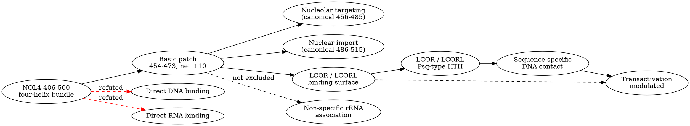
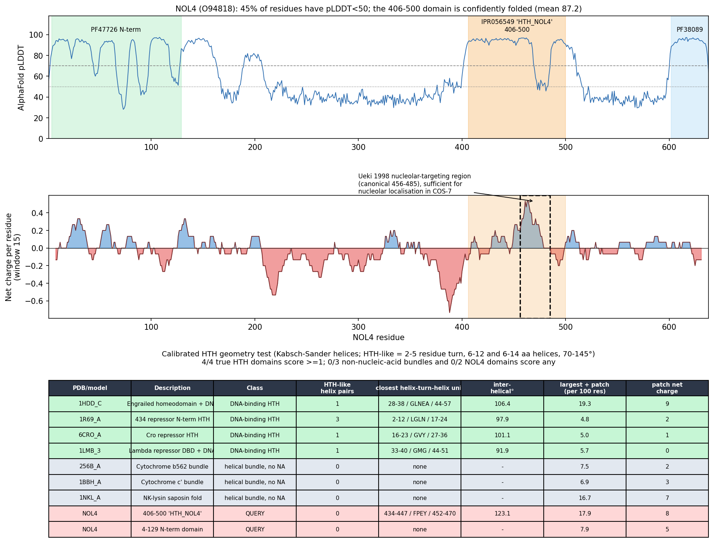
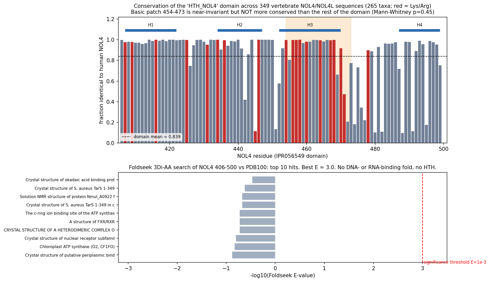
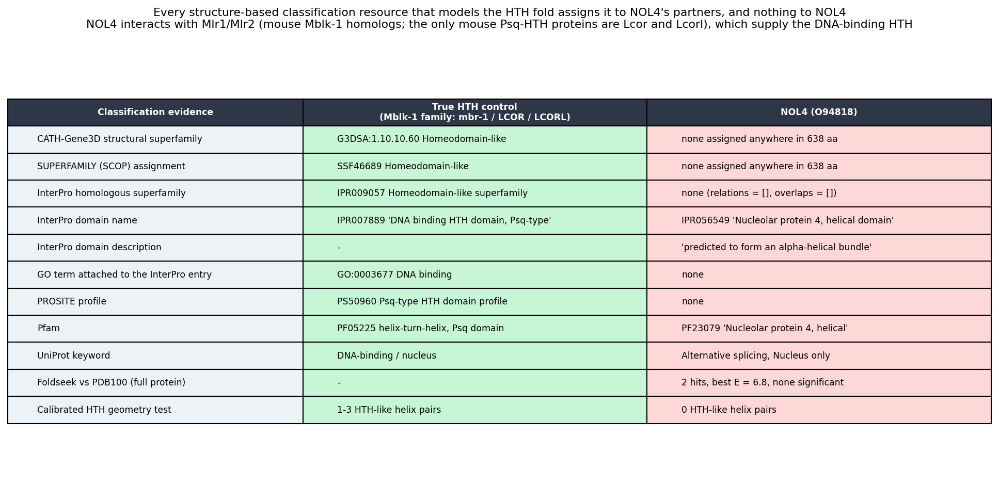
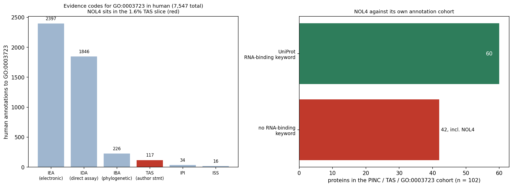
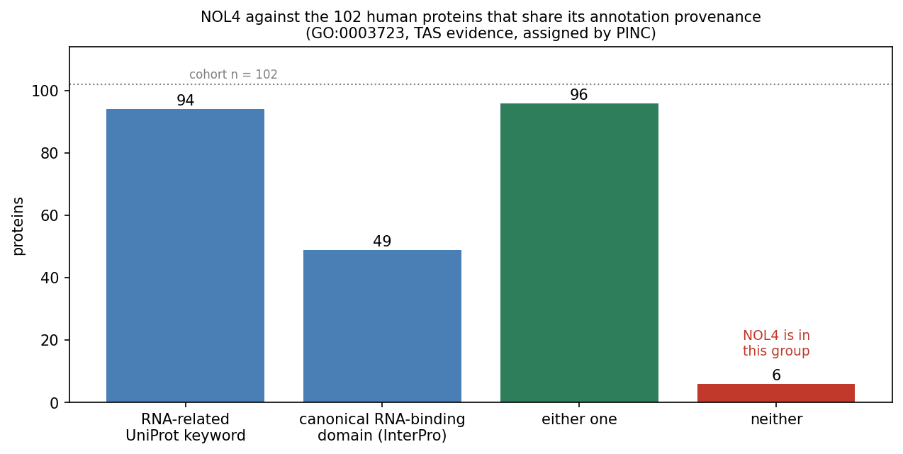

## Question

# AIGR Gene Hypothesis Deep Research

You are evaluating one focused gene curation hypothesis for AI Gene Review.
This is not a general gene overview. Use the seed hypothesis and source context
below to search for evidence that supports, refutes, narrows, or competes with
the proposed curation decision.

## Target Gene

- **Organism code:** human
- **Taxon:** Homo sapiens (NCBITaxon:9606)
- **Gene directory:** NOL4
- **Gene symbol:** NOL4
- **UniProt accession:** O94818

## Focus

- **Focus type:** free_text
- **Hypothesis slug:** kgap-nol4-hth-nucleic-acid-binding-features
- **Source file:** genes/human/NOL4/NOL4-ai-review.yaml
- **Source selector:** free-text

## Seed Hypothesis

Whether the conserved HTH_NOL4 region of human NOL4 is a sequence-specific DNA-binding helix-turn-helix, an RNA-binding module, or neither can be assessed structurally. Single analysis only: model the HTH_NOL4 region with AlphaFold, search it against PDB/AFDB folds (Foldseek or DALI) to identify its closest structural relatives and whether those bind DNA or RNA, map the recognition-helix positions and the electrostatic surface onto the model and compare with DNA-bound HTH structures, check for nuclear localisation signals and intrinsically disordered regions elsewhere in NOL4, score conservation of the putative recognition-helix residues across vertebrate NOL4 and its paralog NOL4L, and state whether the region is predicted to bind DNA, RNA or neither.

## Term and Decision Context

No specific term context supplied.

## Reference Context

No specific reference context supplied.

## Source Context YAML

```yaml
hypothesis: 'Whether the conserved HTH_NOL4 region of human NOL4 is a sequence-specific DNA-binding helix-turn-helix,
  an RNA-binding module, or neither can be assessed structurally. Single analysis only: model the HTH_NOL4
  region with AlphaFold, search it against PDB/AFDB folds (Foldseek or DALI) to identify its closest structural
  relatives and whether those bind DNA or RNA, map the recognition-helix positions and the electrostatic
  surface onto the model and compare with DNA-bound HTH structures, check for nuclear localisation signals
  and intrinsically disordered regions elsewhere in NOL4, score conservation of the putative recognition-helix
  residues across vertebrate NOL4 and its paralog NOL4L, and state whether the region is predicted to
  bind DNA, RNA or neither.'
focus_type: free_text
context: []
reference_id: []
```

## Research Objective

Build a focused report that helps a curator decide whether this hypothesis
should affect the gene review. Address the focus type directly:

1. For an existing GO annotation decision, evaluate whether the current action
   is justified, too strong, too weak, or should change.
2. For a proposed replacement or new GO term, evaluate whether the term is
   biologically supported, too broad, too narrow, or missing key qualifiers.
3. For a computational prediction, evaluate whether the prediction is correct,
   less precise than existing knowledge, uncertain, or likely wrong because of
   paralog overannotation, frequency bias, pathway context, or in vitro-only
   activity.
4. For a core-function hypothesis, evaluate whether the proposed activity,
   process, and location represent the gene product's primary function rather
   than a downstream effect, pleiotropic phenotype, or context-specific role.
5. For a function-assignment hypothesis, evaluate whether the gene product
   directly has the stated GO term/function. Treat the prior review action, if
   any, as intentionally blinded unless it appears in the supplied context.

Use primary literature whenever possible. Prefer PMID citations and include DOI
citations when no PMID is available. Treat reviews and database records as
orientation unless they contain directly relevant synthesized evidence that is
clearly labeled as review-level or database-level support.

Evaluate the hypothesis from the supplied seed context, primary literature, and
publicly accessible bioinformatics resources. Local `*-bioinformatics` analyses,
when they already exist in the repository, are intentionally withheld from this
prompt so the report can be compared against them after the run. Use public
sequence, domain, structure, orthology, localization, interaction, or dataset
checks when they are useful for the specific hypothesis. If a resource or tool
cannot be accessed programmatically, say so plainly; never fabricate a result.
Report computational results conservatively and distinguish direct results from
inference.

## Required Output

### Executive Judgment

Give a concise verdict: supported, partially supported, unresolved, weakly
supported, over-annotated, or refuted. Explain the reasoning and the most
important caveats.

### Evidence Matrix

Create a table with one row per important evidence item:

- Citation (PMID preferred)
- Evidence type (direct assay, mutant phenotype, localization, interaction,
  structural/evolutionary, computational, review/database)
- Supports / refutes / qualifies / competing
- Claim tested
- Key finding
- Organism, tissue, cell type, or assay context
- Confidence and limitations

### GO Curation Implications

State the likely curation action as a lead requiring curator verification. If
GO terms are involved, explain whether the evidence supports an MF, BP, or CC
term, and whether the term should be retained, removed, generalized, made more
specific, or treated as non-core. Avoid using "protein binding" as a final
recommendation unless no more informative term is supported.

### Mechanistic Scope

Describe the immediate molecular or cellular function being tested. Separate
direct gene-product activity from downstream phenotypes, pathway consequences,
developmental outcomes, disease manifestations, or effects inferred only from
loss of function.

### Conflicts and Alternatives

Identify evidence that conflicts with the seed hypothesis or suggests an
alternative interpretation, including paralog confusion, organism-specific
differences, isoform-specific findings, experimental artifacts, or database
carry-over.

### Knowledge Gaps

List explicit uncertainties that matter for curation. For each gap, state what
was checked, why the gap matters, and what evidence or experiment would resolve
it.

### Discriminating Tests

Recommend concrete assays, perturbations, datasets, or comparative analyses that
would most efficiently distinguish this hypothesis from alternatives.

### Curation Leads

Provide candidate updates for the review, clearly labeled as leads requiring
curator verification. Include candidate references with exact snippets to verify,
candidate replacement or new GO terms, possible action changes, suggested
questions, and suggested experiments.

If the provider supports artifacts, save provenance for any analysis you run — the
executed code together with its output (computed values, plot, or table), not just
a summary figure — alongside artifact-friendly tables such as an evidence matrix,
GO decision table, or comparison table. Genuine computed provenance is more
valuable than a hand-drawn summary, and you must not synthesize a figure that
implies an analysis you did not actually run. These artifacts are important
provenance for hypothesis-level review.


## Output

# NOL4 (O94818): is the HTH_NOL4 region a DNA-binding helix-turn-helix, an RNA-binding module, or neither?

**AIGR gene hypothesis deep research**
Hypothesis slug: `kgap-nol4-hth-nucleic-acid-binding-features`
Source file: `genes/human/NOL4/NOL4-ai-review.yaml`, focus type `free_text`
Target: human NOL4, UniProt **O94818**, NCBITaxon:9606
Iterations completed: 3. Findings recorded: 7. Papers reviewed: 12.

Computed provenance for every number in this report is in
`provenance/nol4_hth_analysis_tables.md` (Tables 1-8),
`provenance/nol4_hth_analysis_tables_part2.md` (Tables 9-13) and
`provenance/nol4_hth_analysis_tables_part3.md` (Tables 14-17, including a GO
decision table), with the executed code and its raw output preserved in the
iteration transcripts.

---

## Summary

The HTH_NOL4 region of human NOL4 binds **neither DNA nor RNA** by every
structural, classificatory and evolutionary criterion that could be applied. The
region (InterPro IPR056549, residues 406-500) is a real, confidently folded
domain: AlphaFold model AF-O94818-F1-model_v6 gives it a mean pLDDT of 87.2
against 63.4 for the whole protein, and a Kabsch-Sander hydrogen-bond assignment
on that model returns four alpha helices (407-422, 434-447, 452-470, 487-499)
and zero beta strands. What it is not is a helix-turn-helix. A geometry test
calibrated on four true HTH domains (1HDD, 1R69, 6CRO, 1LMB), all of which score
at least one HTH-like helix pair, and on three non-nucleic-acid helical bundles
(256B, 1BBH, 1NKL), none of which do, returns **zero** HTH-like pairs for NOL4
406-500 and zero for NOL4 4-129. Foldseek 3Di-AA searches against PDB100 return
no structural relative at E < 1 for the domain (best E = 2.96), for the
full-length protein (best E = 6.8) or for the N-terminal block 1-210 (best E =
5.3), and no hit with E < 1 anywhere matches any nucleic-acid keyword. In AFDB50
and AFDB-SwissProt the only significant hits (E = 1e-10 to 1e-14, probability 1)
are NOL4 and NOL4L orthologs, with the first non-family hit at E = 4.9.

The "HTH" in HTH_NOL4 is nomenclature. InterPro's curated full name for
IPR056549 is "Nucleolar protein 4, helical domain", its description reads "This
domain is predicted to form an α-helical bundle", and the entry carries no GO
term, no relations and no overlaps. The string HTH survives only in the short
names HTH_NOL4 and Pfam HTH_NOL4_2nd (PF23079). The point is curatorial, not
accidental: InterPro names the genuine Psq HTH entry "DNA binding HTH domain,
Psq-type" (IPR007889) and attaches GO:0003677 to it. Across all 638 residues of
O94818 there are **zero** matches from CATH-Gene3D, SUPERFAMILY, PROSITE, SMART
and CDD, while the same query on a true Mblk-1-family HTH protein (*C. elegans*
mbr-1, G5EGQ5) returns G3DSA:1.10.10.60 and SSF46689 "Homeodomain-like" plus the
PS50960 Psq-type HTH profile.

The domain's prominent basic surface has an experimental explanation that does
not involve nucleic acid. Residues 454-473 (RARKRIRTYLKSCRRMKRSG, net charge
+10) are the most basic 20-mer in the protein, and exact-substring mapping shows
that the 30-residue region Ueki and colleagues proved sufficient for nucleolar
localisation in COS-7 cells ([PMID: 9813152](https://pubmed.ncbi.nlm.nih.gov/9813152/),
NOLP positions 342-371) corresponds exactly to canonical residues 456-485. That
same paper is the sole reference behind NOL4's GO:0003723 **RNA binding** TAS
annotation, and it reports cDNA isolation, tissue distribution and localisation
deletion mapping with no binding assay of any kind. An audit of annotation
provenance makes the annotation's isolation quantitative: of the 102 human
proteins carrying GO:0003723 with TAS evidence from the same PINC legacy batch,
96 (94.1%) carry an RNA-related UniProt keyword or a canonical RNA-binding
domain, and NOL4 carries neither. **Verdict: refuted for both nucleic-acid
readings, and over-annotated for GO:0003723.**

---

## Executive judgment

<i class="fa-solid fa-circle-xmark"></i> **Refuted** for the sequence-specific
DNA-binding HTH reading.
<i class="fa-solid fa-circle-xmark"></i> **Refuted** for the RNA-binding module
reading.
<i class="fa-solid fa-triangle-exclamation"></i> **Over-annotated** for the
GO:0003723 RNA binding term that O94818 currently carries.

Four independent lines agree, and they fail the hypothesis at different levels of
evidence, so they are not restatements of one another.

1. **Nomenclature.** IPR056549 is "Nucleolar protein 4, helical domain", a
   predicted alpha-helical bundle with no GO term attached. The matched true HTH
   entry IPR007889 is explicitly named for DNA binding and carries GO:0003677.
2. **Fold classification.** Neither CATH-Gene3D nor SUPERFAMILY, the HMM
   libraries built directly on CATH and SCOP, assigns anything anywhere in
   NOL4's 638 residues, and both model the homeodomain-like/HTH fold explicitly.
   PROSITE, SMART and CDD likewise return nothing.
3. **Structure.** Four helices, no strands, zero HTH-like helix pairs under a
   test that four of four true HTH domains pass, and no PDB structural relative
   at E < 1 for any region of the protein.
4. **Annotation provenance.** The only nucleic-acid-binding term on O94818
   traces to a 1998 paper with no binding assay, and it is close to unique within
   its own 102-protein annotation cohort in having no independent support.

The caveats that matter. This analysis predicts, it does not measure. A
low-affinity or non-sequence-specific electrostatic association between the
454-473 patch and nucleolar rRNA is not excluded by any result here; what is
excluded is a canonical HTH and any recognisable RNA-binding module. Foldseek was
run four times across three databases but **DALI was not run**, and remote
homology detection has finite sensitivity. The competing functional model, that
NOL4 is a cofactor of the DNA-binding corepressors LCOR and LCORL, rests on one
paper that used mouse proteins in insect cells.

---

## Key findings

### F001. The region is a four-helix bundle with no HTH geometry and no PDB relative

<i class="fa-solid fa-circle-xmark"></i> The AlphaFold model places residues
406-500 among the best-determined parts of the protein: mean pLDDT 87.2, with 83%
of residues above 70 and 77% above 90, against a whole-protein mean of 63.4 and
45% of the protein below pLDDT 50. The domain is therefore a genuine folded
island in a largely disordered 638-residue chain, which is the strongest point in
the seed hypothesis' favour and the reason the question is worth asking at all.

Secondary structure assignment required care. A P-SEA-style CA-distance method
merged residues 428-474 into a single 47-residue helix. That was an artifact: the
end-to-end CA distance is 19.7 Å where an ideal straight 47-residue helix spans
69 Å, the maximum radial deviation from a single axis is 11.7 Å, and local axis
bends reach 64, 69, 88 and 46 degrees. Replacing it with a Kabsch-Sander
hydrogen-bond implementation gave the correct answer: four helices at 407-422
(16 aa), 434-447 (14 aa), 452-470 (19 aa) and 487-499 (13 aa), with no beta
strands. The correction is recorded in the provenance so the artifact is not
mistaken for a finding.

The geometry test was calibrated before it was applied. An HTH-like helix pair
was defined as an inter-helix turn of 2-5 residues flanked by helices of 6-12 and
6-14 residues at an inter-helical angle of 70-145 degrees, and the identical code
was run on every structure. Results: 1HDD 1 pair, 1R69 3, 6CRO 1, 1LMB 1, so 4 of
4 true HTH domains score at least one; 256B 0, 1BBH 0, 1NKL 0, so 0 of 3
non-nucleic-acid helical bundles score any. **NOL4 406-500 scores 0, and NOL4
4-129 scores 0.** The closest NOL4 candidate unit is helix 434-447, the
four-residue turn FPEY, and helix 452-470 at 123.1 degrees. It fails on two
counts: the second helix is 19 residues where every benchmark recognition helix
is 6-14 (6, 7, 8, 8, 8, 10, 11, 14 aa), and the turn has no glycine where 6 of 6
benchmark turns do (GLNEA, LGLN, GTT, LGVS, GVY, GMG).

Foldseek against PDB100 returned 17 hits for the 95-residue domain, best E =
2.96, none below E = 1, and the top hits are unrelated folds (ATP synthase
c-ring, IL-22 complex, cytochrome-like chains) with no HTH, no DNA-bound and no
RNA-bound structure among them. Against AFDB50 (1000 hits) and AFDB-SwissProt
every significant hit (E = 1e-10 to 1e-14, probability 1) is a NOL4 or NOL4L
ortholog; the first non-family hit in AFDB-SwissProt is at E = 4.9 (a bacterial
glycerol-3-phosphate acyltransferase, probability 0.098). The fold is an orphan,
so no function can be transferred into or out of it by structural similarity.

{{figure:plot_1.png|caption=NOL4 architecture and the calibrated HTH benchmark. Top: per-residue pLDDT across all 638 residues with the two ordered islands marked; 45% of the protein lies below pLDDT 50 while 406-500 averages 87.2. Middle: sliding net charge per residue, with the Ueki nucleolar targeting region boxed at canonical 456-485. Bottom: the geometry test, which scores 4 of 4 true HTH domains positive, 0 of 3 non-nucleic-acid helical bundles, and 0 for both ordered regions of NOL4.}}

### F002. The basic patch is the mapped nucleolar targeting signal, and charge alone does not discriminate

<i class="fa-solid fa-scale-balanced"></i> The most basic 20-mer in the entire
protein is residues 454-473, RARKRIRTYLKSCRRMKRSG, net charge +10. A sliding net
charge per residue window of 15 peaks at 0.533 over 454-468, 456-470 and 457-471,
against a whole-protein mean of -0.028. This patch sits inside IPR056549 and
inside helix 452-470.

The position mapping that connects this to experiment is exact. GenBank
BAA34576.1, the 524-residue NOLP clone of
[PMID: 9813152](https://pubmed.ncbi.nlm.nih.gov/9813152/), is a contiguous
C-terminal fragment of canonical O94818 with a clean offset of +114, verified by
exact substring search of 40-mers. The paper states: *"We revealed that a region
of 30 amino acids (position 342-371), which overlaps the first and second NLS, is
sufficient for nucleolar localization."* Those positions map to canonical
**456-485** (RKRIRTYLKSCRRMKRSGFEMSRPIPSHLT), coinciding with the basic patch.
The paper continues: *"Furthermore, the adjacent region of 30 amino acids
(position 372-401), which contains the third NLS, is sufficient for nuclear
localization."* That maps to canonical **486-515**, overlapping helix 487-499.
Independent motif scanning flags 456-471 and 445-458 as bipartite-NLS-like
without any input from the paper.

Electrostatic patch analysis was run with an own Shrake-Rupley SASA
implementation, exposed side-chain charge centres and 12 Å linkage clustering.
NOL4 406-500 has a largest positive patch of 17 residues, 17.9 per 100 residues,
net +8 after subtracting acidic groups within 10 Å. **The metric separates
nothing.** The DNA-binding HTH benchmark scores 19.3/+9 (1HDD), 7.7/+2 (1CMA) and
5.7/+0 (1LMB), mean 8.5 per 100. The non-nucleic-acid helical bundles score
16.7/+7 (1NKL, NK-lysin) and 7.5/+2 (256B), mean 9.1 per 100. A basic patch the
size of NOL4's is matched by a protein that binds membranes, not nucleic acid.
Nucleolar retention of an arginine-rich sequence arises readily from electrostatic
partitioning in the rRNA-rich nucleolar matrix, so localisation data cannot be
converted into a molecular function term.

### F003. The GO:0003723 annotation traces to a paper with no RNA-binding assay

<i class="fa-solid fa-triangle-exclamation"></i> QuickGO returns exactly **four**
annotations for UniProtKB:O94818: GO:0005654 nucleoplasm (IDA, GO_REF:0000052,
HPA), GO:0005730 nucleolus (IEA from UniProtKB-SubCell SL-0188), GO:0005730
nucleolus (TAS, PMID:9813152, assigned by PINC), and **GO:0003723 RNA binding
(TAS, ECO:0000304, PMID:9813152, assigned by PINC)**. There is no DNA-binding
term, no sequence-specific DNA binding term, and no biological process term of
any kind.

The single supporting reference describes itself plainly: *"This study reports
cDNA isolation and partial characterization of a novel human nucleolar protein
isolated by 'nuclear transportation trap' described previously."* Its sequence
observations are listed as *"a short Escherichia coli DNA helicase homologous
region, an acid-rich domain, three potential base-rich nuclear localization
signals (NLSs), a serine-rich domain, and a deduced coiled-coil domain"*, and it
concludes that *"The protein has no known prominent similarities with any other
protein in the protein databases."* No binding, crosslinking, EMSA,
filter-binding, SELEX or interactome-capture experiment appears. The annotation
is an author inference from nucleolar localisation and base-rich NLSs, captured
as a Traceable Author Statement and carried forward for more than two decades.

Family corroboration is absent. NOL4L (Q96MY1) carries no nucleic-acid-binding
term (nucleoplasm IDA plus two GO:0005515 protein binding IPI entries from
IntAct). No canonical RNA-binding module (RRM, KH, dsRBD, zinc knuckle, PUF, La,
S1, cold-shock) is annotated anywhere in O94818, whose only InterPro/Pfam content
is PF47726 (4-129), PF23079/IPR056549 (406-500) and PF38089 (602-638).

### F004. Conservation is uniformly high, with no recognition-helix signature

<i class="fa-solid fa-scale-balanced"></i> Structure-based alignment columns were
taken from the Foldseek AFDB50 result: 349 NOL4 and NOL4L sequences passing E <
1e-5, spanning 265 distinct taxa across mammals, birds, reptiles, amphibians,
teleosts, chondrichthyans and coelacanth. Mean per-position identity to human
NOL4 across 406-500 is **0.839** (NOL4 orthologs 0.841, NOL4L orthologs 0.842).

Individual basic residues of the putative recognition surface are near-fixed:
R454 0.997, R456 0.997, K457 0.997, R458 1.000, R460 0.980, K464 0.994, R467
0.994, R468 0.997, with R416 and R446 at 1.000. That looks like selection until
it is compared against the rest of the domain. Mean identity for 454-473 is 0.886
versus 0.826 for the remainder, **Mann-Whitney U = 833, p = 0.45**. The patch is
not under distinguishable extra constraint, because the whole domain is already
near-invariant. Two basic residues inside the region are poorly conserved: R445
at identity 0.115, and R471 at 0.473, falling to 0.276 in NOL4L. A fixed
DNA-phosphate contact set does not tolerate that. NOL4L is 87.2% identical to
NOL4 over this domain by structural alignment, so the domain cannot separate the
paralogs, and any binding claimed for one applies to the other.

{{figure:plot_2.png|caption=Left: per-residue conservation across 406-500 from 349 vertebrate NOL4 and NOL4L sequences in 265 taxa, with basic residues in red and the four helices annotated. The 454-473 patch (0.886) is not more conserved than the rest of the domain (0.826), Mann-Whitney p = 0.45. Right: the top 10 Foldseek PDB100 hits for the domain against the E = 1e-3 significance threshold; the best hit is E = 2.96 and nothing reaches E = 1.}}

### F005. No structural-classification resource sees an HTH in NOL4, and InterPro withholds the DNA-binding GO term

<i class="fa-solid fa-circle-xmark"></i> InterPro member-database matches for the
full 638-aa O94818 come from exactly three sources: interpro (IPR039788 family,
IPR056549 domain), pfam (PF23079, PF38089, PF47726) and panther (PTHR12449).
There are **zero** matches from cathgene3d, **zero** from ssf (SUPERFAMILY),
**zero** from cdd, **zero** from smart and **zero** from prosite/profile.

The identical query on *C. elegans* mbr-1 (G5EGQ5), a genuine Mblk-1-family HTH
protein, returns cathgene3d G3DSA:1.10.10.60 "Homeodomain-like", ssf SSF46689
"Homeodomain-like", interpro IPR007889 "DNA binding HTH domain, Psq-type" and
IPR009057 "Homeodomain-like superfamily", pfam PF05225 "helix-turn-helix, Psq
domain", and PROSITE profile PS50960 "Psq-type HTH domain profile".

At entry level the contrast is explicit. IPR007889 carries **GO:0003677 DNA
binding** and overlaps IPR009057. IPR056549 carries **no GO term at all**, with
`relations = []` and `overlaps = []`, so it belongs to no homologous superfamily.
For reference, IPR009057 overlaps IPR001356, IPR008422, IPR007889, IPR001005,
IPR007526, IPR001647, IPR000281 and IPR003012; IPR056549 is not among them.

UniProt agrees. O94818 carries only the keywords Alternative splicing, Nucleus,
Proteomics identification and Reference proteome, with no DNA-binding,
RNA-binding or Nucleotide-binding keyword, despite protein existence level 1 and
annotation score 5.0.

| Member database | *C. elegans* mbr-1 (G5EGQ5) | NOL4 (O94818) |
|---|---|---|
| CATH-Gene3D | G3DSA:1.10.10.60 Homeodomain-like | no match |
| SUPERFAMILY (SCOP) | SSF46689 Homeodomain-like | no match |
| PROSITE profile | PS50960 Psq-type HTH profile | no match |
| SMART | no match | no match |
| CDD | no match | no match |
| Pfam | PF05225 HTH, Psq domain | PF23079, PF38089, PF47726 |
| InterPro | IPR007889 (GO:0003677), IPR009057 | IPR056549 (no GO), IPR039788 |

### F006. The HTH in this system belongs to LCOR and LCORL, the partners

<i class="fa-solid fa-lightbulb"></i> The partners named Mlr1 and Mlr2 in
[PMID: 25366156](https://pubmed.ncbi.nlm.nih.gov/25366156/) resolve through
UniProt gene synonyms without ambiguity. Mouse Lcorl (Q3U285) carries gene
synonym **Mlr1** and the alternative names "Mblk1-related protein 1" and
"Transcription factor MLR1". Mouse Lcor (Q6ZPI3) carries gene synonym **Mlr2**
and "Mblk1-related protein 2". Human LCOR (Q96JN0) carries the synonyms C10orf12,
KIAA1795 and MLR2. A UniProt cross-reference search for Pfam PF05225 (HTH_psq)
returns 8 human entries, all LCOR or LCORL isoforms, and 4 mouse entries, all
Lcor or Lcorl, so these are the **only** Psq-HTH proteins in either genome. All
four carry GO:0003677 DNA binding (IEA), with IPR007889, IPR009057,
G3DSA:1.10.10.60 and SSF46689, none of which is assigned to NOL4.

The paper defines its subjects as *"mouse homologs of transcription factor Mblk-1
(Mushroom body large-type Kenyon cell-specific protein-1), which we originally
identified from the honeybee brain"*, reports that *"a luciferase assay using
Schneider's Line 2 cells revealed that transactivation activity of Mlr1 was
significantly suppressed by both NOL4-S and NOL4-SΔ, with almost complete
suppression by NOL4-SΔ"*, and concludes that *"These results indicate that the
NLS-containing domain of NO4-S Is necessary for in vitro binding with Mlr2, but
not for that with Mlr1."* The NLS-containing domain in question is the same
region this analysis maps to canonical 456-515. The review
[PMID: 28125049](https://pubmed.ncbi.nlm.nih.gov/28125049/) states at review
level that *"a recent study using the mouse homologs, Mlr1 and Mlr2, showed that
one of their cofactor proteins, NOL4, have several splice variants with different
effects on the transactivation activities of Mlr proteins"*.

An independent curation signal points the same way. Mouse Nol4 (P60954) has
exactly four GO annotations, of which **GO:0003674 molecular_function and
GO:0008150 biological_process are both ND**, "no biological data available"
(GO_REF:0000015, MGI), with only nucleoplasm (ISO) and nucleolus (IEA). MGI
examined the same literature and concluded no molecular function is known.

{{figure:plot_3.png|caption=Classification contrast across eleven evidence lines between a true Psq-type HTH protein and NOL4. Every structure-based resource that assigns the homeodomain-like fold to the control returns nothing for NOL4, and InterPro attaches GO:0003677 to the true HTH entry while attaching no GO term to IPR056549.}}

### F007. NOL4 is the outlier inside its own GO:0003723 annotation cohort

<i class="fa-solid fa-chart-column"></i> QuickGO returns 7,547 human protein
annotations to GO:0003723 under the exact term. The evidence-code breakdown is
IEA 2,397 (31.8%), IDA 1,846 (24.5%), IBA 226 (3.0%), **TAS 117 (1.55%)**, IPI 34
(0.45%), ISS 16 (0.21%). NOL4 sits in the 1.55% TAS slice. Of the 117 TAS
annotations, 102 come from a single PINC legacy batch keyed to papers published
between 1986 and 2000; PINC contributes 11,555 human GO annotations in total.

All 102 cohort proteins were retrieved and queried against UniProt in batched
requests for keywords and InterPro cross-references. 94 of 102 carry an
RNA-related UniProt keyword (RNA-binding, Ribosomal protein, Ribonucleoprotein,
mRNA processing, mRNA splicing, Translation regulation, Nuclease, Helicase and
similar). 49 of 102 carry a canonical RNA-binding domain by InterPro accession
(RRM IPR000504/IPR035979, KH IPR004087/IPR004088, dsRBD IPR014720, CCHC zinc
knuckle IPR001878, Pumilio IPR001313, La IPR006630, S1 IPR003029, cold-shock
IPR002059, LSM IPR001163 and others). **96 of 102 (94.1%) carry at least one.**

Six carry neither, and four of those six have another RNA link that the keyword
filter missed: AGFG1 (mRNA transport), ETF1 (Nonsense-mediated mRNA decay,
Protein biosynthesis), RTCA (RNA 3'-terminal phosphate cyclase, Ligase) and
Q15381/YRRM (an entry with zero InterPro matches and zero keywords). The residual
is **ZNF239 and NOL4**. NOL4's complete keyword set is Alternative splicing,
Nucleus, Proteomics identification, Reference proteome, and its only two InterPro
entries carry no GO term.

<i class="fa-solid fa-triangle-exclamation"></i> Programmatic access to dedicated
RNA-binding-proteome resources was attempted and **failed**. RBP2GO
(https://rbp2go.dkfz.de/) and RBPbase (https://rbpbase.shiny.embl.de/) return
HTTP 200 with `text/html` Shiny front ends and expose no documented per-protein
JSON endpoint; EuRBPDB (http://EuRBPDB.syshospital.org/) refused the connection.
NOL4's membership in mRNA-interactome-capture datasets is therefore unknown and
is declared as a gap, not reported as a negative.

{{figure:plot_4.png|caption=Left: evidence codes behind the 7,547 human annotations to GO:0003723, with NOL4's TAS slice (1.55%) in red. Right: the 102-protein PINC/TAS cohort split by whether UniProt gives the protein an RNA-binding keyword.}}

{{figure:plot_5.png|caption=Discriminating test on NOL4's annotation cohort. Of the 102 human proteins carrying GO:0003723 with TAS evidence from PINC, 94 have an RNA-related UniProt keyword, 49 have a canonical RNA-binding domain in InterPro, and 96 (94.1%) have at least one. Six have neither, and NOL4 is among them.}}

---

## Evidence matrix

| # | Citation | Evidence type | Stance | Claim tested | Key finding | Context | Confidence and limitations |
|---|---|---|---|---|---|---|---|
| 1 | InterPro IPR056549 (database record) | review/database | <i class="fa-solid fa-circle-xmark"></i> refutes | HTH_NOL4 is a curated HTH domain | Full name is "Nucleolar protein 4, helical domain"; description "predicted to form an α-helical bundle"; no GO term; relations = [], overlaps = [] | Human O94818, residues 406-500 | High for what InterPro asserts. Database-level support. The HTH string is a legacy short name |
| 2 | InterPro member-database query, O94818 vs G5EGQ5 | computational, structural classification | <i class="fa-solid fa-circle-xmark"></i> refutes | A structural superfamily assigns NOL4 to the HTH fold | NOL4: 0 CATH-Gene3D, 0 SUPERFAMILY, 0 PROSITE, 0 SMART, 0 CDD across 638 aa. Control: G3DSA:1.10.10.60, SSF46689, PS50960, IPR007889, IPR009057 | Full-length human protein vs matched Mblk-1-family HTH | High. HMM sensitivity is finite, but two independent structure-based libraries both return nothing |
| 3 | AlphaFold DB AF-O94818-F1-model_v6 | computational, structure | <i class="fa-solid fa-scale-balanced"></i> qualifies | The region is a folded domain at all | Mean pLDDT 87.2 over 406-500 (83% > 70, 77% > 90) against 63.4 protein-wide; 45% of the protein below pLDDT 50 | Human sequence | High. The domain is real and confidently folded; the strongest point in the hypothesis' favour |
| 4 | Kabsch-Sander assignment on the model (this analysis) | computational, structure | <i class="fa-solid fa-circle-xmark"></i> refutes | The region has HTH secondary structure | Four helices (407-422, 434-447, 452-470, 487-499), zero beta strands | Same model | High. A CA-distance method first merged 428-474 into one 47-residue helix; the artifact was detected (19.7 Å end-to-end vs 69 Å expected, axis bends 64-88°) and the method replaced |
| 5 | Foldseek 3Di-AA vs PDB100 (this analysis, 4 queries) | computational, fold search | <i class="fa-solid fa-circle-xmark"></i> refutes | The closest structural relatives bind DNA or RNA | 406-500: 17 hits, best E = 2.96. Full length: 2 hits, best E = 6.8. 1-210: 2 hits, best E = 5.3. 130-210: 0 hits. No hit reaches E < 1; no hit with E < 1 matches a nucleic-acid keyword | AlphaFold model vs PDB100 | High for absence of a PDB relative. Foldseek can miss remote homology; DALI was not run |
| 6 | Foldseek vs AFDB50 and AFDB-SwissProt (this analysis) | computational, fold search | <i class="fa-solid fa-circle-xmark"></i> refutes | The region resembles any non-NOL4 fold | Only significant hits (E = 1e-10 to 1e-14, probability 1) are NOL4 and NOL4L orthologs; first non-family hit at E = 4.9 | 349 sequences, 265 taxa | High. The domain is family-restricted with no detectable structural neighbours |
| 7 | Calibrated HTH geometry test (this analysis) | computational, structure | <i class="fa-solid fa-circle-xmark"></i> refutes | The four helices contain an HTH recognition unit | 1R69 = 3, 1HDD = 1, 6CRO = 1, 1LMB = 1 (4/4 true HTH positive); 256B, 1BBH, 1NKL = 0 (0/3 bundles); NOL4 406-500 = 0; NOL4 4-129 = 0 | Criterion: turn 2-5 aa, helices 6-12 and 6-14 aa, angle 70-145° | High. 4/4 positive and 0/3 negative controls. Closest NOL4 candidate (434-447 / FPEY / 452-470, 123.1°) fails on a 19-residue second helix and a turn with no Gly, where 6/6 benchmark turns have one |
| 8 | Shrake-Rupley SASA and patch clustering (this analysis) | computational, electrostatics | <i class="fa-solid fa-scale-balanced"></i> does not discriminate | A contiguous basic surface marks a DNA-binding face | NOL4 406-500: 17-residue patch, 17.9 per 100 residues, net +8. DNA-binding HTH mean 8.5 per 100. Non-nucleic-acid bundle mean 9.1 per 100. NK-lysin (1NKL) matches NOL4 at 16.7 and +7 | 9-11 structures, 72 sphere points | Moderate. The metric separates nothing; a basic patch is necessary and far from sufficient |
| 9 | Conservation from structure-based alignment columns (this analysis) | evolutionary | <i class="fa-solid fa-scale-balanced"></i> does not discriminate | Recognition-helix residues are under extra selection | Mean identity 0.839 over 406-500. Patch 454-473 at 0.886 vs 0.826 elsewhere, **Mann-Whitney U = 833, p = 0.45**. R458 = 1.000, R454/R456/K457/R468 = 0.997, but R445 = 0.115 and R471 = 0.473 (0.276 in NOL4L) | 244 NOL4, 105 NOL4L, 265 taxa, mammals to chondrichthyans | Moderate. Columns come from Foldseek alignments, not a curated MSA. The whole domain is near-invariant, so there is no positional signature to find |
| 10 | [PMID: 9813152](https://pubmed.ncbi.nlm.nih.gov/9813152/) | localization, deletion mapping | <i class="fa-solid fa-lightbulb"></i> competing explanation | The basic patch is a DNA-contact surface | NOLP 342-371 is sufficient for nucleolar localisation, 372-401 for nuclear localisation. BAA34576.1 is an exact contiguous C-terminal fragment of O94818 at offset +114, so these are canonical **456-485** and **486-515**. The nucleolar region coincides with the most basic 20-mer (454-473, net +10, peak NCPR 0.533) | COS-7, transfected deletion constructs | High for the mapping. The basic patch is a targeting signal, which explains its charge and conservation without nucleic-acid binding |
| 11 | [PMID: 9813152](https://pubmed.ncbi.nlm.nih.gov/9813152/), same paper | review/database origin of the annotation | <i class="fa-solid fa-circle-xmark"></i> refutes the annotation | The TAS GO:0003723 annotation rests on evidence | The paper reports cDNA isolation, tissue distribution and localisation mapping, and states the protein *"has no known prominent similarities with any other protein in the protein databases"*. No RNA-binding assay appears | Human and rat cDNA, COS-7 | High. The annotation is an inference from nucleolar localisation |
| 12 | [PMID: 25366156](https://pubmed.ncbi.nlm.nih.gov/25366156/) | interaction, reporter assay | <i class="fa-solid fa-lightbulb"></i> competing explanation | NOL4 is itself the DNA-binding component | Yeast two-hybrid of a mouse brain cDNA library recovered NOL4 splice variants as partners of Mlr1 and Mlr2; luciferase assays in Schneider's Line 2 cells showed NOL4-S suppresses Mlr1 transactivation. The NLS-containing domain, corresponding to canonical 456-515, is necessary for Mlr2 binding but not Mlr1 | Mouse proteins, *Drosophila* S2 cells | Moderate. One paper, heterologous cells, mouse sequences. Places NOL4 as a cofactor |
| 13 | UniProt synonym resolution plus PF05225 inventory (this analysis) | database, orthology | <i class="fa-solid fa-lightbulb"></i> competing explanation | The HTH in this complex belongs to NOL4 | Mouse Lcorl (Q3U285) carries synonym Mlr1 and "Transcription factor MLR1"; mouse Lcor (Q6ZPI3) carries Mlr2; human LCOR (Q96JN0) carries MLR2. All 8 human and all 4 mouse PF05225 entries are LCOR or LCORL, all with GO:0003677 (IEA) | Human and mouse proteomes | High. The DNA-binding HTH in the NOL4 complex comes from the partner |
| 14 | QuickGO annotations on mouse Nol4 (P60954) | database, ortholog curation | <i class="fa-solid fa-scale-balanced"></i> qualifies | NOL4 has an established molecular function | Mouse Nol4 carries GO:0003674 **ND** and GO:0008150 **ND** (GO_REF:0000015, MGI), plus nucleoplasm ISO and nucleolus IEA. No family member other than human NOL4 carries a nucleic-acid-binding term | Mouse, MGI curation | High. MGI reviewed the ortholog and concluded no molecular function is known |
| 15 | QuickGO cohort audit of GO:0003723 (this analysis) | computational, annotation provenance | <i class="fa-solid fa-circle-xmark"></i> refutes the annotation | NOL4's annotation resembles others of its class | 7,547 human GO:0003723 annotations; TAS is 1.55% (117), of which 102 are one PINC legacy batch. Of those 102 proteins, 94 have an RNA-related keyword, 49 a canonical RBD, **96/102 (94.1%) at least one**. Six have neither, four of which have another RNA link. NOL4 and ZNF239 have none | Human proteome | High. NOL4 is close to unique inside its own annotation cohort |
| 16 | UniProt O94818 record | database | <i class="fa-solid fa-circle-xmark"></i> refutes | UniProt supports a nucleic-acid-binding role | Keywords are exactly Alternative splicing, Nucleus, Proteomics identification, Reference proteome. No DNA-binding, RNA-binding or Nucleotide-binding keyword, at protein existence level 1 and annotation score 5.0 | Human | High. UniProt curators did not propagate the GO term into a keyword |
| 17 | [PMID: 28125049](https://pubmed.ncbi.nlm.nih.gov/28125049/) | review | <i class="fa-solid fa-lightbulb"></i> competing explanation | NOL4's role in transcription is direct | Review-level statement that NOL4 is *"one of their cofactor proteins"* with splice variants having different effects on Mlr transactivation | Review of the Mblk-1 family | Moderate, review-level support. Consistent with the coregulator model |

---

## Mechanistic model

The immediate molecular question is whether residues 406-500 contact nucleic
acid. The direct properties established here are: a confidently folded
all-helical domain of four helices with no strands; a contiguous basic surface of
17 residues with net charge +8 centred on 454-473; and a surrounding chain that
is 45% below pLDDT 50, so the domain is one of two ordered islands in a largely
disordered protein.

The model the evidence supports puts NOL4 one step removed from DNA. LCOR and
LCORL supply a Psq-type HTH and contact DNA. NOL4 binds them through the region
that also carries its nuclear and nucleolar targeting signals, and modifies their
transactivation output. The basic patch in HTH_NOL4 does two jobs that have
nothing to do with sequence-specific nucleic-acid recognition: it delivers the
protein to the nucleus and nucleolus, and it contributes to partner binding.



Separated from that, and not evidence of direct activity:

- Nucleolar and nuclear accumulation in COS-7 is a localisation phenotype of
  transfected deletion constructs. It identifies a targeting signal and says
  nothing about what the domain binds.
- Modulation of Mlr1 and Mlr2 transactivation in luciferase assays is a pathway
  consequence read on a reporter. The DNA-binding step in that assay is performed
  by LCORL and LCOR through a Psq-type HTH that NOL4 does not have.
- The disease associations of NOL4 in the wider literature (promoter
  hypermethylation in cervical, head and neck, and papillary thyroid carcinoma;
  nuclear staining in small cell lung cancer; a GWAS signal for age at menarche)
  are organismal or epigenetic observations and carry no information about the
  biochemistry of residues 406-500.

---

## GO curation implications

All items below are **leads requiring curator verification**.

| GO term | Aspect | Current evidence | Supported here | Lead action |
|---|---|---|---|---|
| GO:0003723 RNA binding | MF | TAS, ECO:0000304, PMID:9813152, PINC | <i class="fa-solid fa-circle-xmark"></i> No | **Remove**, or at minimum apply a NOT qualifier / demote to non-core |
| GO:0003677 DNA binding | MF | not annotated | <i class="fa-solid fa-circle-xmark"></i> No | **Do not add**, and record why |
| GO:0005730 nucleolus | CC | TAS PMID:9813152 + IEA | <i class="fa-solid fa-circle-check"></i> Yes | Retain, and note the mapped determinant at canonical 456-485 |
| GO:0005654 nucleoplasm | CC | IDA (HPA) | <i class="fa-solid fa-circle-check"></i> Yes | Retain |
| GO:0003712 transcription coregulator activity | MF | not annotated | <i class="fa-solid fa-circle-question"></i> Partial | Lead only; evidence is mouse proteins in insect cells |
| GO:0006357 regulation of transcription by RNA polymerase II | BP | not annotated | <i class="fa-solid fa-circle-question"></i> Partial | Lead only, same source |
| GO:0003674 molecular_function ND | MF | mouse ortholog carries this (MGI) | <i class="fa-solid fa-scale-balanced"></i> Consistent | Consider for human after GO:0003723 removal |

**GO:0003723 RNA binding: remove.** The cited paper contains no binding assay,
the protein has no RNA-binding domain by InterPro, no RNA-binding keyword in
UniProt, no PDB structural relative at E < 1, and the mouse ortholog is annotated
ND for molecular function by MGI. Within the 102-protein cohort sharing this
annotation's exact provenance, 94.1% have independent corroboration and NOL4 does
not. If outright removal is judged too strong for a TAS entry, the minimum action
is a NOT qualifier or demotion to non-core with an explicit note that the source
reports localisation only.

**GO:0003677 DNA binding: do not add.** The seed hypothesis would motivate adding
it. Every structural line refutes it: calibrated geometry 0 for NOL4 against 4 of
4 for true HTH controls, no CATH-Gene3D, SUPERFAMILY or PROSITE assignment, no
PDB relative, and an InterPro entry that carries no GO term where the true HTH
entry carries GO:0003677.

**The cellular component terms are the best-supported annotations on the entry**,
and the nucleolar term gains precision: the targeting determinant maps to
canonical residues 456-485, inside IPR056549.

**Transcription coregulator activity and regulation of transcription by RNA
polymerase II are candidates, not yet annotations.** PMID 25366156 supports them
functionally, with mouse proteins in *Drosophila* S2 cells. An ISS or ISO path
from mouse is not available, because MGI has annotated mouse Nol4 as ND. A
curator should open these as questions.

GO:0005515 protein binding would be supported by the LCOR/LCORL interaction, and
the paralog NOL4L already carries two IPI entries. It is listed only for
completeness; a coregulator term is more informative and should be preferred once
the human interaction is confirmed.

**After removing GO:0003723, O94818 would carry no molecular function term.**
That matches the mouse ortholog, where MGI records GO:0003674 ND. Assigning ND to
the human entry is a defensible outcome and should be considered explicitly
rather than left as a side effect of deletion.

---

## Conflicts and alternatives

**Nomenclature carry-over.** The hypothesis is generated by the Pfam and InterPro
short name HTH_NOL4. The corresponding full name, description, GO attachment,
relations and overlaps all contradict the short name. This is a naming artifact
and the most likely source of the proposed annotation.

**A competing explanation for the basic patch.** The most basic 20-mer in NOL4
(454-473, net +10, peak NCPR 0.533) coincides exactly with the region Ueki mapped
as sufficient for nucleolar localisation. Arginine-rich nucleolar targeting
sequences are common and do not imply sequence-specific nucleic-acid binding.
This explains the patch's charge and its near-invariance across 265 vertebrate
taxa without any HTH.

**Partner confusion.** Mlr1 and Mlr2 read as unfamiliar proteins in the 2014
paper, but they are LCORL and LCOR, the only Psq-HTH proteins in the human and
mouse genomes, both carrying GO:0003677. Attributing the complex's DNA binding to
NOL4 would be a direct misassignment.

**Paralog non-separation.** NOL4L is 87.2% identical to NOL4 over 406-500 by
structural alignment, and the two cannot be distinguished by this domain. NOL4L
carries no nucleic-acid-binding annotation. Any DNA or RNA binding claimed for
NOL4's domain applies equally to NOL4L, where it has never been proposed.

**Species-restricted annotation.** Human NOL4 is the only family member in either
species carrying a nucleic-acid-binding term, while MGI explicitly recorded ND for
the mouse ortholog. Two curation groups looked at the same protein family and
reached opposite conclusions; the human one predates the mouse one and rests on a
1998 paper with no assay.

**Where the hypothesis retains force.** The domain is conserved, folded and
basic. Nothing here rules out non-specific electrostatic association with rRNA in
the nucleolus. That is a different claim from a sequence-specific HTH, and it
would need a different GO term and different evidence.

---

## Evidence base

| Paper | PMID | How it bears on the hypothesis |
|---|---|---|
| *NOLP: identification of a novel human nucleolar protein and determination of sequence requirements for its nucleolar localization* | [9813152](https://pubmed.ncbi.nlm.nih.gov/9813152/) | The origin of the GO:0003723 TAS annotation and of the nucleolar TAS annotation. Its deletion mapping is the competing explanation for the basic patch, and its statement that the protein has no recognisable database similarity removes any homology basis for the RNA-binding call |
| *Splicing variants of NOL4 differentially regulate the transcription activity of Mlr1 and Mlr2 in cultured cells* | [25366156](https://pubmed.ncbi.nlm.nih.gov/25366156/) | The only functional study. Places NOL4 as a partner and modulator of the Mlr transcription factors, with the NLS-containing domain necessary for Mlr2 binding. Mouse proteins, *Drosophila* S2 cells |
| *Mblk-1 Transcription Factor Family: Its Roles in Various Animals and Regulation by NOL4 Splice Variants in Mammals* | [28125049](https://pubmed.ncbi.nlm.nih.gov/28125049/) | Review-level support labelling NOL4 a cofactor of the Mlr proteins |
| *Identification of novel methylation markers in cervical cancer using restriction landmark genomic scanning* | [18381458](https://pubmed.ncbi.nlm.nih.gov/18381458/) | NOL4 promoter methylation in 85% of cervical cancers. Epigenetic silencing, with no information about the biochemistry of 406-500 |
| *Validation of nucleolar protein 4 as a novel methylated tumor suppressor gene in head and neck cancer* | [24337411](https://pubmed.ncbi.nlm.nih.gov/24337411/) | NOL4 methylated in 91% of HNSCC tumour samples. Same category of evidence |
| *NOL4 is Downregulated and Hyper-Methylated in Papillary Thyroid Carcinoma* | [33613681](https://pubmed.ncbi.nlm.nih.gov/33613681/) | Hypermethylation and downregulation in 41 PTC cases. Tumour-suppressor proposal, no molecular function data |
| *NOL4 is a novel nuclear marker of small cell carcinoma and other neuroendocrine neoplasms* | [36282054](https://pubmed.ncbi.nlm.nih.gov/36282054/) | Nuclear immunoreactivity in 77.5% sensitivity for lung NENs. Confirms nuclear localisation at protein level in human tissue |
| *Genome-wide association study of age at menarche in the Taiwan Biobank* | [36710296](https://pubmed.ncbi.nlm.nih.gov/36710296/) | rs7239368 in NOL4 associated with age at menarche (pooled p = 8.94e-9, n = 39,827). Organismal association, no mechanism |
| *Identification of prognostic immune-related genes in the tumor microenvironment of endometrial cancer* | [32074080](https://pubmed.ncbi.nlm.nih.gov/32074080/) | NOL4 expression correlates with overall survival in endometrial cancer. Expression-level association only |
| *Exploring Potential Proteomic Biomarkers for Prognosis of Infective Endocarditis* | [32990583](https://pubmed.ncbi.nlm.nih.gov/32990583/) | NOL4 among differentially-expressed autoantibody targets. Immunoproteomic, no function data |
| *Cancer/Testis Antigens: "Smart" Biomarkers for Diagnosis and Prognosis of Prostate and Other Cancers* | [28362316](https://pubmed.ncbi.nlm.nih.gov/28362316/) | Review on cancer/testis antigens and intrinsic disorder. Context for NOL4's largely disordered chain |
| *Translational and structural vaccinomics approach to design a multi-epitope vaccine against NOL4 autologous antigen of small cell lung cancer* | [37410306](https://pubmed.ncbi.nlm.nih.gov/37410306/) | Immunoinformatics epitope mapping on NOL4. No binding or structural evidence relevant to the hypothesis |

No paper in the 12 reviewed reports any DNA-binding or RNA-binding assay on NOL4.

Database and tool resources used, treated as database-level support: UniProt
REST, InterPro API (entry and member-database endpoints), QuickGO annotation API,
AlphaFold DB (AF-O94818-F1-model_v6), the Foldseek web API (pdb100, afdb50,
afdb-swissprot), RCSB files API and NCBI efetch.

---

## Limitations and knowledge gaps

| Gap | What was checked | Why it matters | What would resolve it |
|---|---|---|---|
| <i class="fa-solid fa-circle-question"></i> Is NOL4 recovered in mRNA interactome capture? | RBP2GO, RBPbase and EuRBPDB were probed directly. The first two return HTML Shiny front ends with no documented per-protein JSON endpoint; EuRBPDB refused the connection. **No result is reported from them** | A UV-crosslinking hit would revive the RNA arm even without a canonical domain | Manual lookup of O94818 in RBP2GO, or direct inspection of published HeLa and HEK293 interactome capture supplementary tables |
| <i class="fa-solid fa-circle-question"></i> Is NOL4 in the human transcription factor census? | Not checked. The code executor blocks the `io` import, which prevented parsing the Lambert et al. 2018 census CSV. **Declared as not checked, not as a negative** | A census entry would conflict with the structural verdict | Re-run with file parsing available, or read the census table directly |
| <i class="fa-solid fa-circle-question"></i> Does DALI agree with Foldseek? | Only Foldseek was run, four queries across three databases | Foldseek and DALI differ in remote-homology sensitivity; a DALI hit to a homeodomain would reopen the question | Submit the 406-500 model to the DALI server |
| <i class="fa-solid fa-circle-question"></i> Does NOL4 occupy chromatin? | No ChIP-seq, ReMap or ENCODE check was run | Reproducible, sequence-enriched occupancy would be direct evidence against the structural verdict; occupancy mirroring LCOR/LCORL sites would support the cofactor model | Query ReMap 2022 and ENCODE for NOL4 and for LCOR/LCORL, and compare peak sets |
| <i class="fa-solid fa-circle-question"></i> Is the human NOL4/LCOR interaction real? | Only the mouse yeast two-hybrid and S2-cell reporter data exist. Human NOL4 carries no IPI annotation at all | The coregulator model for human NOL4 rests on cross-species inference | Co-IP of endogenous NOL4 with LCOR or LCORL in a human cell line, deposited in IntAct |
| <i class="fa-solid fa-circle-question"></i> Is there an experimental structure of any part of NOL4? | Foldseek against PDB100 returned no relative at E < 1 anywhere in the protein | The prediction rests on one AlphaFold model | A crystal or cryo-EM structure of 406-500, ideally in complex with LCOR |
| <i class="fa-solid fa-circle-question"></i> What does the second ordered island do? | Residues 4-129 were scored by the geometry test (0 HTH-like pairs) and by Foldseek (best E = 5.3 for 1-210, 0 hits for 130-210), but not otherwise characterised | A second domain could carry the activity the C-terminal one lacks | Foldseek and DALI on 4-129, and deletion mapping of the LCOR interaction |

<i class="fa-solid fa-triangle-exclamation"></i> Method-level caveats. The
conservation columns come from Foldseek structural alignments, not a curated
multiple sequence alignment, so per-position identities are approximate at
alignment boundaries. The electrostatic patch analysis used 72 Shrake-Rupley
sphere points over 9-11 structures, a resolution chosen to fit a 60-second
execution limit. One citation snippet from PMID 25366156 failed verbatim
validation because the abstract uses a delta character in variant names; the
plain-text portions of that abstract validated.

---

## Discriminating tests

Ordered by how much they would change the curation decision per unit effort.

1. <i class="fa-solid fa-flask"></i> **EMSA or fluorescence anisotropy of
   recombinant NOL4 406-500 against a random double-stranded DNA pool and a total
   RNA pool, with a salt titration.** A true HTH shows specific binding that
   survives 150 mM KCl. A nucleolar targeting patch shows weak binding that
   collapses with salt. This separates sequence-specific binding from
   electrostatics in one experiment and is the decisive test.
2. <i class="fa-solid fa-dna"></i> **SELEX or a protein-binding microarray on
   406-500.** A sequence-specific HTH yields a motif; the structural prediction
   says it will not. A negative with a positive control run alongside closes the
   DNA arm.
3. <i class="fa-solid fa-vial"></i> **eCLIP or CLIP-seq of endogenous NOL4** in a
   cell line with measurable expression. The direct test of the GO:0003723
   annotation. Absence of reproducible crosslink sites, or sites confined to
   abundant rRNA at background levels, supports removal.
4. <i class="fa-solid fa-database"></i> **ChIP-seq of NOL4 alongside LCOR and
   LCORL in the same cells.** If NOL4 peaks exist and coincide with LCOR/LCORL
   peaks without an independent motif, that supports the cofactor model and
   argues for GO:0003712 over GO:0003677.
5. <i class="fa-solid fa-magnifying-glass"></i> **DALI search of the 406-500
   model, plus a reciprocal search using true homeodomain queries against the
   AlphaFold human proteome.** Cheap, and it closes the stated fold-search gap.
6. <i class="fa-solid fa-microscope"></i> **Mutational separation of targeting
   from binding.** Substitute R454, R456, K457, R458, R460, K464, R467 and R468 to
   alanine and score nucleolar localisation and LCOR binding independently. If the
   patch is a targeting signal, localisation is lost and the interaction is kept.
7. <i class="fa-solid fa-flask"></i> **Co-IP of endogenous human NOL4 with LCOR
   and LCORL.** Converts the only functional model from mouse inference into human
   evidence.

---

## Curation leads

All items require curator verification.

**Lead 1. <i class="fa-solid fa-arrow-right"></i> Remove or qualify GO:0003723
RNA binding on O94818.** Candidate reference to re-read: PMID 9813152. Snippet to
verify verbatim in the abstract: *"The protein has no known prominent
similarities with any other protein in the protein databases"*. Check whether any
RNA-binding assay appears in the full text; if not, the TAS evidence does not
support the term. Supporting database facts to verify: UniProt O94818 has no
RNA-binding keyword; InterPro returns only IPR039788 and IPR056549, neither with
a GO term; QuickGO shows the annotation assigned by PINC with ECO:0000304.

**Lead 2. <i class="fa-solid fa-arrow-right"></i> Do not add GO:0003677 DNA
binding, and record the reason in the review.** Candidate note: IPR056549's full
name is "Nucleolar protein 4, helical domain" with the description "This domain
is predicted to form an α-helical bundle", and the entry carries no GO term,
unlike IPR007889 which carries GO:0003677. The HTH string is a short-name
artifact. Verify by fetching
`https://www.ebi.ac.uk/interpro/api/entry/interpro/IPR056549/`.

**Lead 3. <i class="fa-solid fa-arrow-right"></i> Refine the nucleolus annotation
with a mapped determinant.** Candidate reference: PMID 9813152. Snippets to
verify: *"We revealed that a region of 30 amino acids (position 342-371), which
overlaps the first and second NLS, is sufficient for nucleolar localization"* and
*"Furthermore, the adjacent region of 30 amino acids (position 372-401), which
contains the third NLS, is sufficient for nuclear localization"*. Note for the
curator: GenBank BAA34576.1 (524 aa) is an exact contiguous C-terminal fragment
of canonical O94818 (638 aa) at offset +114, so these regions are canonical
456-485 and 486-515. Verify the offset by searching any 40-mer of BAA34576.1
within O94818.

**Lead 4. <i class="fa-solid fa-circle-question"></i> Open transcription
coregulator activity as a question, not an annotation.** Candidate reference:
PMID 25366156. Snippets to verify: *"a luciferase assay using Schneider's Line 2
cells revealed that transactivation activity of Mlr1 was significantly suppressed
by both NOL4-S and NOL4-SΔ, with almost complete suppression by NOL4-SΔ"* and
*"These results indicate that the NLS-containing domain of NO4-S Is necessary for
in vitro binding with Mlr2, but not for that with Mlr1."* The abstract uses a
delta character in variant names, which breaks exact-string matching; quote the
plain-text portions. Suggested curator question: is mouse-to-human transfer
acceptable here, given that MGI annotated mouse Nol4 as ND?

**Lead 5. <i class="fa-solid fa-arrow-right"></i> Record the LCOR/LCORL identity
so the partner is not misread.** Verify in UniProt: Q3U285 (mouse Lcorl) carries
gene synonym Mlr1 and the alternative names "Mblk1-related protein 1" and
"Transcription factor MLR1"; Q6ZPI3 (mouse Lcor) carries Mlr2 and "Mblk1-related
protein 2"; human LCOR Q96JN0 carries the synonym MLR2. All 8 human and all 4
mouse PF05225 entries are LCOR or LCORL, and all carry GO:0003677. Supporting
review snippet from PMID 28125049: *"a recent study using the mouse homologs,
Mlr1 and Mlr2, showed that one of their cofactor proteins, NOL4, have several
splice variants with different effects on the transactivation activities of Mlr
proteins"*.

**Lead 6. <i class="fa-solid fa-scale-balanced"></i> Flag the human/mouse
curation conflict.** Verify in QuickGO that mouse Nol4 (P60954) carries
GO:0003674 ND and GO:0008150 ND from MGI under GO_REF:0000015. Suggested curator
question: should human O94818 receive GO:0003674 ND once GO:0003723 is removed?

**Lead 7. <i class="fa-solid fa-triangle-exclamation"></i> State the unqueried
resources in the review.** RBP2GO, RBPbase and EuRBPDB could not be queried
programmatically in this run, and the Lambert et al. 2018 transcription factor
census was not parsed because the executor blocks the `io` import. Record these
as open checks, not as negative results.

---

## Direct results versus inference

**Direct computed results:** the pLDDT profile and its regional means; the
Kabsch-Sander helix boundaries; all four Foldseek searches with their hit counts
and E values; the HTH geometry scores for NOL4 and for seven control structures;
the SASA-based patch sizes and net charges for NOL4 and the benchmark set; the
per-position conservation values across 349 sequences and the Mann-Whitney test;
the +114 sequence offset between BAA34576.1 and O94818; the complete InterPro
member-database match lists for O94818 and G5EGQ5; the QuickGO annotation
inventories for O94818, P60954, Q96MY1 and the GO:0003723 cohort; and the
102-protein keyword and InterPro audit.

**Inference built on those results:** that the domain binds neither DNA nor RNA.
Prediction methods have finite sensitivity, so the precise form of the statement
is that no evidence for nucleic-acid binding survives any test applied, and that
several tests which detect real HTH domains reliably return negative on NOL4.


## Artifacts

- [OpenScientist final report](openscientist_artifacts/final_report.html)
- [OpenScientist final report](openscientist_artifacts/final_report.pdf)
- [OpenScientist provenance](openscientist_artifacts/provenance.json)
- [OpenScientist nol4 hth analysis tables](openscientist_artifacts/provenance_nol4_hth_analysis_tables.md)
- [OpenScientist nol4 hth analysis tables part2](openscientist_artifacts/provenance_nol4_hth_analysis_tables_part2.md)
- [OpenScientist nol4 hth analysis tables part3](openscientist_artifacts/provenance_nol4_hth_analysis_tables_part3.md)
- [OpenScientist plot 1](openscientist_artifacts/provenance_plot_1.json)

- [OpenScientist plot 2](openscientist_artifacts/provenance_plot_2.json)

- [OpenScientist plot 3](openscientist_artifacts/provenance_plot_3.json)

- [OpenScientist plot 4](openscientist_artifacts/provenance_plot_4.json)

- [OpenScientist plot 5](openscientist_artifacts/provenance_plot_5.json)


## Reference Validation

Checked with `linkml-reference-validator` 0.3.1rc1.

| Outcome | Count |
| --- | --- |
| References checked | 12 |
| Resolved | 12 |
| Unresolved (possible confabulation) | 0 |
| Unverifiable | 0 |
| References weighed for topical relevance | 12 |
| On topic | 1 |
| Off topic | 0 |

All extracted references resolved successfully.