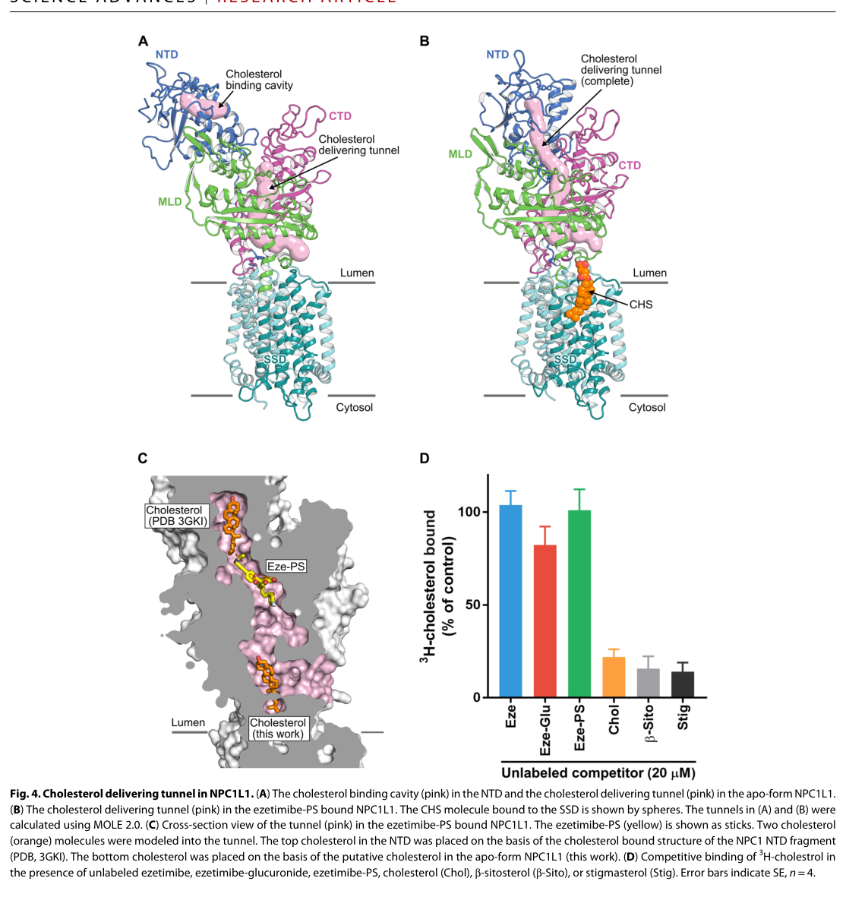

## Question

# Gene Research for Functional Annotation

## ⚠️ CRITICAL: Gene/Protein Identification Context

**BEFORE YOU BEGIN RESEARCH:** You MUST verify you are researching the CORRECT gene/protein. Gene symbols can be ambiguous, especially for less well-characterized genes from non-model organisms.

### Target Gene/Protein Identity (from UniProt):
- **UniProt Accession:** Q9UHC9
- **Protein Description:** RecName: Full=NPC1-like intracellular cholesterol transporter 1 {ECO:0000312|HGNC:HGNC:7898}; Short=NPC1L1 {ECO:0000303|PubMed:15928087}; AltName: Full=Niemann-Pick C1-like protein 1 {ECO:0000303|PubMed:10783261}; Flags: Precursor;
- **Gene Information:** Name=NPC1L1 {ECO:0000312|HGNC:HGNC:7898};
- **Organism (full):** Homo sapiens (Human).
- **Protein Family:** Belongs to the patched family. .
- **Key Domains:** HMGCR/SNAP/NPC1-like_SSD. (IPR053958); NPC1_MLD. (IPR053956); NPC1_N. (IPR032190); SSD. (IPR000731); NPC1_MLD (PF22314)

### MANDATORY VERIFICATION STEPS:

1. **Check if the gene symbol "NPC1L1" matches the protein description above**
2. **Verify the organism is correct:** Homo sapiens (Human).
3. **Check if protein family/domains align with what you find in literature**
4. **If you find literature for a DIFFERENT gene with the same or similar symbol, STOP**

### If Gene Symbol is Ambiguous or You Cannot Find Relevant Literature:

**DO NOT PROCEED WITH RESEARCH ON A DIFFERENT GENE.** Instead:
- State clearly: "The gene symbol 'NPC1L1' is ambiguous or literature is limited for this specific protein"
- Explain what you found (e.g., "Found extensive literature on a different gene with the same symbol in a different organism")
- Describe the protein based ONLY on the UniProt information provided above
- Suggest that the protein function can be inferred from domain/family information

### Research Target:

Please provide a comprehensive research report on the gene **NPC1L1** (gene ID: NPC1L1, UniProt: Q9UHC9) in human.

The research report should be a detailed narrative explaining the function, biological processes, and localization of the gene product. Citations should be given for all claims.

You should prioritize authoritative reviews and primary scientific literature when conducting research. You can supplement
this with annotations you find in gene/protein databases, but these can be outdated or inaccurate.

We are specifically interested in the primary function of the gene - for enzymes, what reaction is catalyzed, and what is the substrate specificity? For transporters, what is the substrate? For structural proteins or adapters, what is the broader structural role? For signaling molecules, what is the role in the pathway.

We are interested in where in or outside the cell the gene product carries out its function.

We are also interested in the signaling or biochemical pathways in which the gene functions. We are less interested in broad pleiotropic effects, except where these elucidate the precise role.

Include evidence where possible. We are interested in both experimental evidence as well as inference from structure, evolution, or bioinformatic analysis. Precise studies should be prioritized over high-throughput, where available.

## Output

Question: You are an expert researcher providing comprehensive, well-cited information.

Provide detailed information focusing on:
1. Key concepts and definitions with current understanding
2. Recent developments and latest research (prioritize 2023-2024 sources)
3. Current applications and real-world implementations
4. Expert opinions and analysis from authoritative sources
5. Relevant statistics and data from recent studies

Format as a comprehensive research report with proper citations. Include URLs and publication dates where available.
Always prioritize recent, authoritative sources and provide specific citations for all major claims.

# Gene Research for Functional Annotation

## ⚠️ CRITICAL: Gene/Protein Identification Context

**BEFORE YOU BEGIN RESEARCH:** You MUST verify you are researching the CORRECT gene/protein. Gene symbols can be ambiguous, especially for less well-characterized genes from non-model organisms.

### Target Gene/Protein Identity (from UniProt):
- **UniProt Accession:** Q9UHC9
- **Protein Description:** RecName: Full=NPC1-like intracellular cholesterol transporter 1 {ECO:0000312|HGNC:HGNC:7898}; Short=NPC1L1 {ECO:0000303|PubMed:15928087}; AltName: Full=Niemann-Pick C1-like protein 1 {ECO:0000303|PubMed:10783261}; Flags: Precursor;
- **Gene Information:** Name=NPC1L1 {ECO:0000312|HGNC:HGNC:7898};
- **Organism (full):** Homo sapiens (Human).
- **Protein Family:** Belongs to the patched family. .
- **Key Domains:** HMGCR/SNAP/NPC1-like_SSD. (IPR053958); NPC1_MLD. (IPR053956); NPC1_N. (IPR032190); SSD. (IPR000731); NPC1_MLD (PF22314)

### MANDATORY VERIFICATION STEPS:

1. **Check if the gene symbol "NPC1L1" matches the protein description above**
2. **Verify the organism is correct:** Homo sapiens (Human).
3. **Check if protein family/domains align with what you find in literature**
4. **If you find literature for a DIFFERENT gene with the same or similar symbol, STOP**

### If Gene Symbol is Ambiguous or You Cannot Find Relevant Literature:

**DO NOT PROCEED WITH RESEARCH ON A DIFFERENT GENE.** Instead:
- State clearly: "The gene symbol 'NPC1L1' is ambiguous or literature is limited for this specific protein"
- Explain what you found (e.g., "Found extensive literature on a different gene with the same symbol in a different organism")
- Describe the protein based ONLY on the UniProt information provided above
- Suggest that the protein function can be inferred from domain/family information

### Research Target:

Please provide a comprehensive research report on the gene **NPC1L1** (gene ID: NPC1L1, UniProt: Q9UHC9) in human.

The research report should be a detailed narrative explaining the function, biological processes, and localization of the gene product. Citations should be given for all claims.

You should prioritize authoritative reviews and primary scientific literature when conducting research. You can supplement
this with annotations you find in gene/protein databases, but these can be outdated or inaccurate.

We are specifically interested in the primary function of the gene - for enzymes, what reaction is catalyzed, and what is the substrate specificity? For transporters, what is the substrate? For structural proteins or adapters, what is the broader structural role? For signaling molecules, what is the role in the pathway.

We are interested in where in or outside the cell the gene product carries out its function.

We are also interested in the signaling or biochemical pathways in which the gene functions. We are less interested in broad pleiotropic effects, except where these elucidate the precise role.

Include evidence where possible. We are interested in both experimental evidence as well as inference from structure, evolution, or bioinformatic analysis. Precise studies should be prioritized over high-throughput, where available.

# Functional annotation of human NPC1L1 (UniProt Q9UHC9)

## Identity and principal function

**Identity check.** The supplied UniProt accession **Q9UHC9** identifies *Homo sapiens* NPC1L1, or Niemann–Pick C1-like intracellular cholesterol transporter 1. The literature examined concerns **NPC1L1, not NPC1**: NPC1L1 is an NPC1-related member of the patched-family group of sterol-associated membrane proteins, whereas NPC1 has a distinct lysosomal role. Experimental work on human NPC1L1 confirms the expected sterol-sensing architecture, although the papers do not independently print the Q9UHC9 accession. NPC1L1 is a sterol-uptake protein—not a cholesterol-synthesizing enzyme and not, by virtue of family membership, an established Hedgehog-signaling receptor. (brown2010proteinmediatorsof pages 2-4, jia2011niemannpickc1like1 pages 2-3, huang2020cryoemstructuresof pages 1-2)

**Primary functional annotation:** NPC1L1 enables uptake of **unesterified cholesterol** across the apical surface of small-intestinal enterocytes, making dietary *and bile-derived* luminal cholesterol available for absorption. In humans it is also present at the hepatocyte canalicular surface, where evidence supports retrieval of cholesterol from bile. Mouse *Npc1l1* deletion reduces net intestinal cholesterol absorption by approximately **70%**; ezetimibe produces no further inhibition in the knockout, strong genetic–pharmacological evidence that NPC1L1 is essential to the drug-sensitive uptake pathway. This is transport-associated sterol handling, not catalysis of a chemical reaction. (huang2020cryoemstructuresof pages 1-2, jia2011niemannpickc1like1 pages 5-6, tang2011ezetimiberestoresbiliary pages 1-2)

The following evidence map distinguishes observations in human protein or tissue from physiological inferences drawn principally from mice.

| Annotation | Direct observations | Interpretation / limitation | Key source, date, DOI |
|---|---|---|---|
| **Identity and topology** | Human NPC1L1 is a **1,332-aa integral membrane protein**. Protease-protection and selective-permeabilization experiments support **13 transmembrane helices**, a luminal N-terminus, cytosolic C-terminus, three large luminal domains, and TM3–TM7 forming the sterol-sensing domain (SSD). | Confirms the supplied Q9UHC9 annotation as human **NPC1L1**, a patched/NPC1-related protein distinct from lysosomal NPC1. The experimental papers do not themselves print accession Q9UHC9. | Wang et al., **2009-08**, *J Lipid Res*, [doi:10.1194/jlr.M800669-JLR200](https://doi.org/10.1194/jlr.M800669-JLR200); Huang et al., **2020-06-19**, *Sci Adv*, [doi:10.1126/sciadv.abb1989](https://doi.org/10.1126/sciadv.abb1989) (wang2009membranetopologyof pages 1-2, huang2020cryoemstructuresof pages 1-2) |
| **Primary substrate: cholesterol** | Npc1l1-null mice exhibit about a **70% reduction in net intestinal cholesterol absorption** and no further response to ezetimibe. Purified-protein structures identify an approximately **21-Å N-terminal sterol cavity** and a roughly **63-Å internal tunnel** toward the SSD; cholesterol binds the N-terminal domain and SSD-associated regions. | Strong genetic, pharmacological, biochemical, and structural evidence supports **unesterified cholesterol** as the principal physiological substrate. Binding plus tunnel architecture supports transport, but a static structure alone does not measure transmembrane flux. | Huang et al., **2020-06-19**, [doi:10.1126/sciadv.abb1989](https://doi.org/10.1126/sciadv.abb1989) (huang2020cryoemstructuresof pages 1-2, huang2020cryoemstructuresof pages 4-5) |
| **Plant sterols** | NPC1L1 deletion reduces phytosterol absorption and prevents plasma/liver phytosterol accumulation in Abcg5/Abcg8-null mice. Cholesterol, β-sitosterol, and stigmasterol compete for purified NPC1L1 sterol binding. | Supports sitosterol and related phytosterols as physiological NPC1L1-associated substrates, generally handled less efficiently than cholesterol. Competitive binding demonstrates recognition, not by itself complete membrane translocation; much physiological evidence is from mice. | Tang et al., **2009-02**, *J Lipid Res*, [doi:10.1194/jlr.M800439-JLR200](https://doi.org/10.1194/jlr.M800439-JLR200); Huang et al., **2020-06-19**, [doi:10.1126/sciadv.abb1989](https://doi.org/10.1126/sciadv.abb1989) (tang2009geneticinactivationof pages 1-2, huang2020cryoemstructuresof pages 4-5) |
| **Intestinal site of action** | NPC1L1 is concentrated at the **apical brush-border membrane of small-intestinal enterocytes**, especially proximal jejunum. In endogenous Npc1l1-EGFP knock-in mice, cholesterol gavage produced subapical NPC1L1-positive vesicles within **5 min**, peaking at **15 min**; vesicles colocalized with EEA1 and filipin-detectable cholesterol and were suppressed by ezetimibe. | Establishes uptake from the intestinal lumen into enterocytes as the dominant physiological role. The real-time trafficking experiment is in mice, although apical human intestinal localization and clinical ezetimibe action are independently supported. | Wu et al., **2023-03-16**, *Life Metab*, [doi:10.1093/lifemeta/load011](https://doi.org/10.1093/lifemeta/load011) (wu2023fluorescentvisualizationand pages 1-2, wu2023fluorescentvisualizationand pages 3-5) |
| **Human hepatic canalicular role** | Human and nonhuman-primate NPC1L1 localizes to the **hepatocyte canalicular membrane**. Liver-specific human-NPC1L1 expression in mice reduced biliary cholesterol excretion by about **90%**, reversible by ezetimibe, consistent with retrieval of cholesterol from bile into hepatocytes. | Supports canalicular cholesterol reabsorption and enterohepatic recycling, but the strongest directional intervention is a transgenic-mouse model because normal mice express little hepatic Npc1l1. Long-term gallstone protection was not reproduced in a 2023 AAV model because hepatic NPC1L1 declined during prolonged lithogenic feeding. | Tang et al., **2011-09**, [doi:10.1016/j.bbalip.2011.05.013](https://doi.org/10.1016/j.bbalip.2011.05.013); Mo et al., **2023-05**, [doi:10.1016/j.heliyon.2023.e15757](https://doi.org/10.1016/j.heliyon.2023.e15757) (tang2011ezetimiberestoresbiliary pages 1-2, mo2023effectofhepatic pages 1-2) |
| **Molecular entry and endocytosis—qualified model** | Cryo-EM shows ezetimibe-induced N-terminal rotation of **57.8°** and displacement of **17.5 Å**, with drug occlusion of the NTD-to-SSD tunnel without competing for cholesterol binding. Clathrin/AP2 perturbation and 2023 mouse imaging support sterol-triggered endocytosis. Conversely, hepatoma-cell assays found ezetimibe-sensitive cholesterol uptake despite blocked NPC1L1 endocytosis; about **45%** of surface NPC1L1 internalized in 20 min, but ezetimibe did not inhibit that internalization. | Best current model: NPC1L1 captures sterol and transfers it toward or into the apical membrane; vesicular trafficking occurs physiologically and may amplify delivery, but whether endocytosis is strictly required for the elementary transport step remains unresolved and may depend on model and assay. | Ge et al., **2008-06**, [doi:10.1016/j.cmet.2008.04.001](https://doi.org/10.1016/j.cmet.2008.04.001); Johnson & Pfeffer, **2016-06**, [doi:10.1091/mbc.E16-03-0154](https://doi.org/10.1091/mbc.E16-03-0154); Huang et al., **2020-06-19**, [doi:10.1126/sciadv.abb1989](https://doi.org/10.1126/sciadv.abb1989) (johnson2016ezetimibesensitivecholesteroluptake pages 1-6, ge2008thecholesterolabsorption pages 1-2, huang2020cryoemstructuresof pages 4-5) |

*Table: Evidence hierarchy for the identity, substrates, localization, and transport mechanism of human NPC1L1. It separates direct human evidence from mouse-model inference and distinguishes sterol binding from completed transport.*

## Structure, substrates, and cellular site of action

Human NPC1L1 topology was tested by protease protection and selective-permeabilization immunofluorescence: the commonly studied protein has **1,332 amino acids and 13 membrane-spanning helices**, with a luminal/extracellular N-terminus and cytosolic C-terminus. It has N-terminal, middle, and C-terminal luminal domains; transmembrane helices **3–7** form a sterol-sensing domain. These observations align with the supplied NPC1_N, NPC1_MLD, and SSD domain annotations, rather than identifying an HMG-CoA-reductase catalytic activity in NPC1L1. See Wang *et al.*, *Journal of Lipid Research* (**August 2009**), https://doi.org/10.1194/jlr.M800669-JLR200, and Huang *et al.*, *Science Advances* (**19 June 2020**), https://doi.org/10.1126/sciadv.abb1989. (wang2009membranetopologyof pages 1-2, huang2020cryoemstructuresof pages 1-2)

The best-established substrate is **free cholesterol**. NPC1L1 also participates in absorption of **plant sterols**, including sitosterol: deleting *Npc1l1* prevents the marked plasma and hepatic phytosterol accumulation otherwise seen in *Abcg5/Abcg8*-deficient mice. Biochemically, β-sitosterol and stigmasterol compete with labeled cholesterol for NPC1L1 binding. Plant-sterol *recognition* should not be equated with cholesterol-like efficiency of completed absorption: binding, cell uptake, and whole-body retention are different measurements, and opposing ABCG5/ABCG8 efflux helps determine net retention. See Tang *et al.*, *Journal of Lipid Research* (**February 2009**), https://doi.org/10.1194/jlr.M800439-JLR200, and Huang *et al.* (**2020**), https://doi.org/10.1126/sciadv.abb1989. (tang2009geneticinactivationof pages 1-2, wang2009membranetopologyof pages 1-2, huang2020cryoemstructuresof pages 4-5)

Additional NPC1L1-associated absorption of vitamins E and K₁ and sphingomyelin has been reported, but it should **not** replace cholesterol as the primary annotation. For sphingomyelin, mouse experiments and uptake assays in NPC1L1-expressing human-derived Caco-2 cells support an NPC1L1-dependent process; the investigators also note that a radiolabeled tracer may report a sphingomyelin-derived component and that changes in cholesterol handling could indirectly affect sphingomyelin absorption. See Yamanashi *et al.*, *Nutrients* (**30 August 2020**), https://doi.org/10.3390/nu12092641. (yamanashi2020npc1l1facilitatessphingomyelin pages 1-2, yamanashi2020npc1l1facilitatessphingomyelin pages 8-10, yamanashi2020npc1l1facilitatessphingomyelin pages 4-6)

The **intestinal brush-border membrane** is the principal functional location: its extracellular-facing domains encounter sterols in the lumen, and NPC1L1 subsequently traffics between the surface and subapical recycling/endosomal compartments. In humans and other primates, expression additionally occurs at the **bile-facing canalicular membrane of hepatocytes**; ordinary mice express little hepatic *Npc1l1*, so liver-specific mouse experiments must be interpreted as models of, rather than direct measurements in, human liver. See Jia *et al.*, *Annual Review of Physiology* (**March 2011**), https://doi.org/10.1146/annurev-physiol-012110-142233. (jia2011niemannpickc1like1 pages 2-3, jia2011niemannpickc1like1 pages 5-6, wu2023fluorescentvisualizationand pages 1-2)

## Molecular mechanism and pathway context

Cryo-electron microscopy of human NPC1L1 resolved an accessible **N-terminal sterol-binding cavity** and a proposed internal route toward the membrane-embedded sterol-sensing domain. Binding of an ezetimibe derivative shifted the N-terminal domain by **57.8° and 17.5 Å**, forming a continuous tunnel that the inhibitor **occludes**. In binding assays, ezetimibe and its tested analogues did *not* displace cholesterol, unlike competing sterols. Thus the structural and binding results favor obstruction of cholesterol passage over simple competition for its initial binding site; the complete sequence of sterol movements in living enterocytes remains a model, not something directly filmed at atomic resolution. The inspected **Figure 4** juxtaposes the proposed tunnel, its drug-occupied cross-section, and the competition assay. Huang *et al.* (**2020**), https://doi.org/10.1126/sciadv.abb1989. (huang2020cryoemstructuresof pages 4-5, huang2020cryoemstructuresof media a8ae2cd3)

How membrane entry relates to **NPC1L1 endocytosis remains contested**. Ge *et al.* reported cholesterol-induced NPC1L1 internalization involving clathrin/AP2 and suppression by ezetimibe (*Cell Metabolism*, **June 2008**, https://doi.org/10.1016/j.cmet.2008.04.001). Conversely, Johnson and Pfeffer observed ezetimibe-sensitive uptake from cholesterol-containing micelles despite pharmacological inhibition of endocytosis in hepatoma cells (*Molecular Biology of the Cell*, **June 2016**, https://doi.org/10.1091/mbc.E16-03-0154). More recently, genetically labeled endogenous NPC1L1 in mouse intestine entered cholesterol-containing, EEA1-positive subapical vesicles **within five minutes** of cholesterol gavage; vesicle abundance peaked around **15 minutes**, and ezetimibe suppressed their formation. This establishes physiologically relevant trafficking, but does not alone prove that every elementary cholesterol-transfer event requires vesicle formation. Wu *et al.*, *Life Metabolism* (**16 March 2023**), https://doi.org/10.1093/lifemeta/load011. (johnson2016ezetimibesensitivecholesteroluptake pages 1-6, ge2008thecholesterolabsorption pages 1-2, wu2023fluorescentvisualizationand pages 3-5)

NPC1L1 sits at an **influx–efflux junction** in sterol homeostasis. At the enterocyte apical surface it favors entry of micellar cholesterol, whereas ABCG5/ABCG8 promotes sterol export back into the intestinal lumen. Cholesterol reaching the endoplasmic reticulum can be esterified by **ACAT2** and incorporated into **MTP-dependent chylomicrons**. In human liver, canalicular NPC1L1 is proposed to oppose ABCG5/ABCG8-mediated secretion by recapturing biliary cholesterol. In mice engineered to express NPC1L1 only in liver, biliary cholesterol excretion was approximately **90% lower** on the tested cholesterol diet and was restored by ezetimibe; this is strong directional model evidence, not a quantitative estimate of human hepatic flux. See Jia *et al.* (**2011**), https://doi.org/10.1146/annurev-physiol-012110-142233, and Tang *et al.*, *Biochimica et Biophysica Acta* (**September 2011**), https://doi.org/10.1016/j.bbalip.2011.05.013. (jia2011niemannpickc1like1 pages 5-6, tang2011ezetimiberestoresbiliary pages 1-2)

Cholesterol availability also affects **NPC1L1 abundance and location**. Low cellular cholesterol favors surface localization; cholesterol loading favors intracellular recycling. Reported human-cell transcriptional responses involve cholesterol-responsive **SREBP2** regulation of the *NPC1L1* promoter. These are regulatory links to cholesterol homeostasis—not evidence that NPC1L1 itself is a transcription factor or catalyzes a pathway step. (jia2011niemannpickc1like1 pages 2-3, wang2009membranetopologyof pages 1-2, wu2023fluorescentvisualizationand pages 1-2)

## 2023–2024 findings and clinical significance

A second **2023** study tested the limits of the hepatic model. Ectopic hepatic *Npc1l1* lowered biliary cholesterol after **two weeks** of a lithogenic diet, but after **eight weeks** it did not significantly change gallstone formation or biliary cholesterol saturation; the authors linked this difference to loss of hepatic NPC1L1 during prolonged feeding. Ezetimibe nevertheless reduced gallstone formation in the tested mice. The finding cautions against assuming that canalicular expression alone provides durable gallstone protection in humans. Mo *et al.*, *Heliyon* (**2023**), https://doi.org/10.1016/j.heliyon.2023.e15757. (mo2023effectofhepatic pages 1-2)

Human genetic evidence independently supports target relevance. Carriers of rare inactivating *NPC1L1* alleles had, on average, **12 mg/dL lower LDL cholesterol** and lower coronary-heart-disease risk than noncarriers in the Myocardial Infarction Genetics Consortium analysis (**odds ratio 0.47; 95% CI 0.25–0.87**). These are associations with *lifelong* partial genetic loss of function, not an expected effect size for beginning drug treatment in adulthood. *New England Journal of Medicine* (**November 2014**), https://doi.org/10.1056/NEJMoa1405386. A separate **2024** analysis of approximately **470,000** exome-sequenced UK Biobank participants also found *NPC1L1* rare-coding-variant burden associated with **lower hyperlipidaemia risk**; it supports the direction of the genetic effect without itself measuring sterol transport. Curtis, *Journal of Human Genetics* (**March 2024**), https://doi.org/10.1038/s10038-024-01235-8. (consortium2014inactivatingmutationsin pages 1-2, curtis2024weightedburdenanalysis pages 1-2)

**Real-world implementation is NPC1L1 inhibition with ezetimibe**, commonly alongside a statin: intestinal uptake inhibition complements statin-mediated inhibition of cholesterol synthesis. In the randomized **IMPROVE-IT** trial of **18,144** patients after acute coronary syndrome, simvastatin plus ezetimibe yielded a **32.7%** seven-year composite cardiovascular event rate versus **34.7%** with simvastatin alone; time-weighted mean LDL cholesterol was **53.7 versus 69.5 mg/dL**. These are clinical outcomes of the *drug regimen*, not a direct measurement of NPC1L1-specific transport in each participant. Cannon *et al.*, *New England Journal of Medicine* (**June 2015**), https://doi.org/10.1056/NEJMoa1410489. A **2024** International Lipid Expert Panel position paper places ezetimibe among established combination lipid-lowering options for selected high-risk patients, including consideration of early combination treatment after acute coronary syndromes; choice and access depend on the patient's risk and treatment context. Banach *et al.*, *Drugs* (**November 2024**), https://doi.org/10.1007/s40265-024-02105-5. (cannon2015ezetimibeaddedto pages 1-2, banach20242024recommendationson pages 12-14, banach20242024recommendationson pages 1-2)

**Bottom line.** The highest-confidence annotation for human Q9UHC9 is an **apical, ezetimibe-sensitive facilitator of free-cholesterol uptake**, primarily in intestinal enterocytes and additionally implicated in human hepatocyte canalicular cholesterol retrieval. Plant sterols are supported additional sterol substrates; proposed uptake of other dietary lipids and the necessity of endocytosis for the fundamental transport step warrant more qualified annotation. (tang2009geneticinactivationof pages 1-2, jia2011niemannpickc1like1 pages 5-6, johnson2016ezetimibesensitivecholesteroluptake pages 1-6, huang2020cryoemstructuresof pages 1-2, yamanashi2020npc1l1facilitatessphingomyelin pages 8-10)

References

1. (brown2010proteinmediatorsof pages 2-4): J. Brown and Liqing Yu. Protein mediators of sterol transport across intestinal brush border membrane. Sub-cellular biochemistry, 51:337-80, 2010. URL: https://doi.org/10.1007/978-90-481-8622-8\_12, doi:10.1007/978-90-481-8622-8\_12. This article has 35 citations.

2. (jia2011niemannpickc1like1 pages 2-3): Lin Jia, Jenna L. Betters, and Liqing Yu. Niemann-pick c1-like 1 (npc1l1) protein in intestinal and hepatic cholesterol transport. Annual Review of Physiology, 73:239-259, Mar 2011. URL: https://doi.org/10.1146/annurev-physiol-012110-142233, doi:10.1146/annurev-physiol-012110-142233. This article has 487 citations and is from a highest quality peer-reviewed journal.

3. (huang2020cryoemstructuresof pages 1-2): Ching-Shin Huang, Xinchao Yu, Preston Fordstrom, Kaylee Choi, Ben C. Chung, Soung-Hun Roh, Wah Chiu, Mingyue Zhou, Xiaoshan Min, and Zhulun Wang. Cryo-em structures of npc1l1 reveal mechanisms of cholesterol transport and ezetimibe inhibition. Science Advances, Jun 2020. URL: https://doi.org/10.1126/sciadv.abb1989, doi:10.1126/sciadv.abb1989. This article has 115 citations and is from a highest quality peer-reviewed journal.

4. (jia2011niemannpickc1like1 pages 5-6): Lin Jia, Jenna L. Betters, and Liqing Yu. Niemann-pick c1-like 1 (npc1l1) protein in intestinal and hepatic cholesterol transport. Annual Review of Physiology, 73:239-259, Mar 2011. URL: https://doi.org/10.1146/annurev-physiol-012110-142233, doi:10.1146/annurev-physiol-012110-142233. This article has 487 citations and is from a highest quality peer-reviewed journal.

5. (tang2011ezetimiberestoresbiliary pages 1-2): Weiqing Tang, Lin Jia, Yinyan Ma, Ping Xie, Jamie Haywood, Paul A. Dawson, Jian Li, and Liqing Yu. Ezetimibe restores biliary cholesterol excretion in mice expressing niemann–pick c1-like 1 only in liver. Biochimica et Biophysica Acta (BBA) - Molecular and Cell Biology of Lipids, 1811:549-555, Sep 2011. URL: https://doi.org/10.1016/j.bbalip.2011.05.013, doi:10.1016/j.bbalip.2011.05.013. This article has 51 citations and is from a peer-reviewed journal.

6. (wang2009membranetopologyof pages 1-2): Jiang Wang, Bei-Bei Chu, Liang Ge, Bo-Liang Li, Yan Yan, and Bao-Liang Song. Membrane topology of human npc1l1, a key protein in enterohepatic cholesterol absorption. Journal of Lipid Research, 50:1653-1662, Aug 2009. URL: https://doi.org/10.1194/jlr.m800669-jlr200, doi:10.1194/jlr.m800669-jlr200. This article has 88 citations and is from a peer-reviewed journal.

7. (huang2020cryoemstructuresof pages 4-5): Ching-Shin Huang, Xinchao Yu, Preston Fordstrom, Kaylee Choi, Ben C. Chung, Soung-Hun Roh, Wah Chiu, Mingyue Zhou, Xiaoshan Min, and Zhulun Wang. Cryo-em structures of npc1l1 reveal mechanisms of cholesterol transport and ezetimibe inhibition. Science Advances, Jun 2020. URL: https://doi.org/10.1126/sciadv.abb1989, doi:10.1126/sciadv.abb1989. This article has 115 citations and is from a highest quality peer-reviewed journal.

8. (tang2009geneticinactivationof pages 1-2): Weiqing Tang, Yinyan Ma, Lin Jia, Yiannis A. Ioannou, Joanna P. Davies, and Liqing Yu. Genetic inactivation of npc1l1 protects against sitosterolemia in mice lacking abcg5/abcg8. Journal of Lipid Research, 50:293-300, Feb 2009. URL: https://doi.org/10.1194/jlr.m800439-jlr200, doi:10.1194/jlr.m800439-jlr200. This article has 79 citations and is from a peer-reviewed journal.

9. (wu2023fluorescentvisualizationand pages 1-2): Xiaojing Wu, Xian-Hua Ma, Jie Lin, Xiaohang Yang, Jian-Hui Shi, Zhifang Xie, Yu-Xia Chen, and Weiping J. Zhang. Fluorescent visualization and evaluation of npc1l1-mediated vesicular endocytosis during intestinal cholesterol absorption in mice. Life Metabolism, Mar 2023. URL: https://doi.org/10.1093/lifemeta/load011, doi:10.1093/lifemeta/load011. This article has 7 citations.

10. (wu2023fluorescentvisualizationand pages 3-5): Xiaojing Wu, Xian-Hua Ma, Jie Lin, Xiaohang Yang, Jian-Hui Shi, Zhifang Xie, Yu-Xia Chen, and Weiping J. Zhang. Fluorescent visualization and evaluation of npc1l1-mediated vesicular endocytosis during intestinal cholesterol absorption in mice. Life Metabolism, Mar 2023. URL: https://doi.org/10.1093/lifemeta/load011, doi:10.1093/lifemeta/load011. This article has 7 citations.

11. (mo2023effectofhepatic pages 1-2): Pingfan Mo, Hongtan Chen, Xin Jiang, Fengling Hu, Fenming Zhang, Guodong Shan, Wenguo Chen, Sha Li, and Guoqiang Xu. Effect of hepatic npc1l1 on cholesterol gallstone disease and its mechanism. Heliyon, 9:e15757, May 2023. URL: https://doi.org/10.1016/j.heliyon.2023.e15757, doi:10.1016/j.heliyon.2023.e15757. This article has 12 citations.

12. (johnson2016ezetimibesensitivecholesteroluptake pages 1-6): Tory A. Johnson and Suzanne R. Pfeffer. Ezetimibe-sensitive cholesterol uptake by npc1l1 protein does not require endocytosis. Molecular Biology of the Cell, 27:1845-1852, Jun 2016. URL: https://doi.org/10.1091/mbc.e16-03-0154, doi:10.1091/mbc.e16-03-0154. This article has 38 citations and is from a domain leading peer-reviewed journal.

13. (ge2008thecholesterolabsorption pages 1-2): Liang Ge, Jing Wang, Wei Qi, Hong-Hua Miao, Jian Cao, Yu-Xiu Qu, Bo-Liang Li, and Bao-Liang Song. The cholesterol absorption inhibitor ezetimibe acts by blocking the sterol-induced internalization of npc1l1. Cell metabolism, 7 6:508-19, Jun 2008. URL: https://doi.org/10.1016/j.cmet.2008.04.001, doi:10.1016/j.cmet.2008.04.001. This article has 498 citations and is from a highest quality peer-reviewed journal.

14. (yamanashi2020npc1l1facilitatessphingomyelin pages 1-2): Yoshihide Yamanashi, Tappei Takada, Hideaki Yamamoto, and Hiroshi Suzuki. Npc1l1 facilitates sphingomyelin absorption and regulates diet-induced production of vldl/ldl-associated s1p. Nutrients, 12:2641, Aug 2020. URL: https://doi.org/10.3390/nu12092641, doi:10.3390/nu12092641. This article has 19 citations.

15. (yamanashi2020npc1l1facilitatessphingomyelin pages 8-10): Yoshihide Yamanashi, Tappei Takada, Hideaki Yamamoto, and Hiroshi Suzuki. Npc1l1 facilitates sphingomyelin absorption and regulates diet-induced production of vldl/ldl-associated s1p. Nutrients, 12:2641, Aug 2020. URL: https://doi.org/10.3390/nu12092641, doi:10.3390/nu12092641. This article has 19 citations.

16. (yamanashi2020npc1l1facilitatessphingomyelin pages 4-6): Yoshihide Yamanashi, Tappei Takada, Hideaki Yamamoto, and Hiroshi Suzuki. Npc1l1 facilitates sphingomyelin absorption and regulates diet-induced production of vldl/ldl-associated s1p. Nutrients, 12:2641, Aug 2020. URL: https://doi.org/10.3390/nu12092641, doi:10.3390/nu12092641. This article has 19 citations.

17. (huang2020cryoemstructuresof media a8ae2cd3): Ching-Shin Huang, Xinchao Yu, Preston Fordstrom, Kaylee Choi, Ben C. Chung, Soung-Hun Roh, Wah Chiu, Mingyue Zhou, Xiaoshan Min, and Zhulun Wang. Cryo-em structures of npc1l1 reveal mechanisms of cholesterol transport and ezetimibe inhibition. Science Advances, Jun 2020. URL: https://doi.org/10.1126/sciadv.abb1989, doi:10.1126/sciadv.abb1989. This article has 115 citations and is from a highest quality peer-reviewed journal.

18. (consortium2014inactivatingmutationsin pages 1-2): Myocardial Infarction Genetics Consortium. Inactivating mutations in <i>npc1l1</i> and protection from coronary heart disease. New England Journal of Medicine, 371:2072-2082, Nov 2014. URL: https://doi.org/10.1056/nejmoa1405386, doi:10.1056/nejmoa1405386. This article has 512 citations and is from a highest quality peer-reviewed journal.

19. (curtis2024weightedburdenanalysis pages 1-2): David Curtis. Weighted burden analysis of rare coding variants in 470,000 exome-sequenced uk biobank participants characterises effects on hyperlipidaemia risk. Journal of Human Genetics, 69:255-262, Mar 2024. URL: https://doi.org/10.1038/s10038-024-01235-8, doi:10.1038/s10038-024-01235-8. This article has 9 citations and is from a peer-reviewed journal.

20. (cannon2015ezetimibeaddedto pages 1-2): Christopher P. Cannon, Michael A. Blazing, Robert P. Giugliano, Amy McCagg, Jennifer A. White, Pierre Theroux, Harald Darius, Basil S. Lewis, Ton Oude Ophuis, J. Wouter Jukema, Gaetano M. De Ferrari, Witold Ruzyllo, Paul De Lucca, KyungAh Im, Erin A. Bohula, Craig Reist, Stephen D. Wiviott, Andrew M. Tershakovec, Thomas A. Musliner, Eugene Braunwald, and Robert M. Califf. Ezetimibe added to statin therapy after acute coronary syndromes. New England Journal of Medicine, 372:2387-2397, Jun 2015. URL: https://doi.org/10.1056/nejmoa1410489, doi:10.1056/nejmoa1410489. This article has 6363 citations and is from a highest quality peer-reviewed journal.

21. (banach20242024recommendationson pages 12-14): Maciej Banach, Željko Reiner, Stanisław Surma, Gani Bajraktari, Agata Bielecka-Dabrowa, Matjaz Bunc, Ibadete Bytyçi, Richard Ceska, Arrigo F. G. Cicero, Dariusz Dudek, Krzysztof Dyrbuś, Jan Fedacko, Zlatko Fras, Dan Gaita, Dov Gavish, Marek Gierlotka, Robert Gil, Ioanna Gouni-Berthold, Piotr Jankowski, Zoltán Járai, Jacek Jóźwiak, Niki Katsiki, Gustavs Latkovskis, Stefania Lucia Magda, Eduard Margetic, Roman Margoczy, Olena Mitchenko, Azra Durak-Nalbantic, Petr Ostadal, Gyorgy Paragh, Zaneta Petrulioniene, Francesco Paneni, Ivan Pećin, Daniel Pella, Arman Postadzhiyan, Anca Pantea Stoian, Matias Trbusic, Cristian Alexandru Udroiu, Margus Viigimaa, Dragos Vinereanu, Charalambos Vlachopoulos, Michal Vrablik, Dusko Vulic, and Peter E. Penson. 2024 recommendations on the optimal use of lipid-lowering therapy in established atherosclerotic cardiovascular disease and following acute coronary syndromes: a position paper of the international lipid expert panel (ilep). Drugs, 84:1541-1577, Nov 2024. URL: https://doi.org/10.1007/s40265-024-02105-5, doi:10.1007/s40265-024-02105-5. This article has 81 citations and is from a domain leading peer-reviewed journal.

22. (banach20242024recommendationson pages 1-2): Maciej Banach, Željko Reiner, Stanisław Surma, Gani Bajraktari, Agata Bielecka-Dabrowa, Matjaz Bunc, Ibadete Bytyçi, Richard Ceska, Arrigo F. G. Cicero, Dariusz Dudek, Krzysztof Dyrbuś, Jan Fedacko, Zlatko Fras, Dan Gaita, Dov Gavish, Marek Gierlotka, Robert Gil, Ioanna Gouni-Berthold, Piotr Jankowski, Zoltán Járai, Jacek Jóźwiak, Niki Katsiki, Gustavs Latkovskis, Stefania Lucia Magda, Eduard Margetic, Roman Margoczy, Olena Mitchenko, Azra Durak-Nalbantic, Petr Ostadal, Gyorgy Paragh, Zaneta Petrulioniene, Francesco Paneni, Ivan Pećin, Daniel Pella, Arman Postadzhiyan, Anca Pantea Stoian, Matias Trbusic, Cristian Alexandru Udroiu, Margus Viigimaa, Dragos Vinereanu, Charalambos Vlachopoulos, Michal Vrablik, Dusko Vulic, and Peter E. Penson. 2024 recommendations on the optimal use of lipid-lowering therapy in established atherosclerotic cardiovascular disease and following acute coronary syndromes: a position paper of the international lipid expert panel (ilep). Drugs, 84:1541-1577, Nov 2024. URL: https://doi.org/10.1007/s40265-024-02105-5, doi:10.1007/s40265-024-02105-5. This article has 81 citations and is from a domain leading peer-reviewed journal.

## Artifacts

- [Edison artifact artifact-00](NPC1L1-deep-research-falcon_artifacts/artifact-00.md)

## Citations

1. mo2023effectofhepatic pages 1-2
2. brown2010proteinmediatorsof pages 2-4
3. huang2020cryoemstructuresof pages 1-2
4. tang2011ezetimiberestoresbiliary pages 1-2
5. wang2009membranetopologyof pages 1-2
6. huang2020cryoemstructuresof pages 4-5
7. tang2009geneticinactivationof pages 1-2
8. wu2023fluorescentvisualizationand pages 1-2
9. wu2023fluorescentvisualizationand pages 3-5
10. johnson2016ezetimibesensitivecholesteroluptake pages 1-6
11. ge2008thecholesterolabsorption pages 1-2
12. consortium2014inactivatingmutationsin pages 1-2
13. curtis2024weightedburdenanalysis pages 1-2
14. cannon2015ezetimibeaddedto pages 1-2
15. doi:10.1194/jlr.M800669-JLR200
16. doi:10.1126/sciadv.abb1989
17. doi:10.1194/jlr.M800439-JLR200
18. doi:10.1093/lifemeta/load011
19. doi:10.1016/j.bbalip.2011.05.013
20. doi:10.1016/j.heliyon.2023.e15757
21. doi:10.1016/j.cmet.2008.04.001
22. doi:10.1091/mbc.E16-03-0154
23. https://doi.org/10.1194/jlr.M800669-JLR200
24. https://doi.org/10.1126/sciadv.abb1989
25. https://doi.org/10.1194/jlr.M800439-JLR200
26. https://doi.org/10.1093/lifemeta/load011
27. https://doi.org/10.1016/j.bbalip.2011.05.013
28. https://doi.org/10.1016/j.heliyon.2023.e15757
29. https://doi.org/10.1016/j.cmet.2008.04.001
30. https://doi.org/10.1091/mbc.E16-03-0154
31. https://doi.org/10.1194/jlr.M800669-JLR200,
32. https://doi.org/10.1126/sciadv.abb1989.
33. https://doi.org/10.1194/jlr.M800439-JLR200,
34. https://doi.org/10.3390/nu12092641.
35. https://doi.org/10.1146/annurev-physiol-012110-142233.
36. https://doi.org/10.1093/lifemeta/load011.
37. https://doi.org/10.1146/annurev-physiol-012110-142233,
38. https://doi.org/10.1016/j.bbalip.2011.05.013.
39. https://doi.org/10.1016/j.heliyon.2023.e15757.
40. https://doi.org/10.1056/NEJMoa1405386.
41. https://doi.org/10.1038/s10038-024-01235-8.
42. https://doi.org/10.1056/NEJMoa1410489.
43. https://doi.org/10.1007/s40265-024-02105-5.
44. https://doi.org/10.1007/978-90-481-8622-8\_12,
45. https://doi.org/10.1126/sciadv.abb1989,
46. https://doi.org/10.1016/j.bbalip.2011.05.013,
47. https://doi.org/10.1194/jlr.m800669-jlr200,
48. https://doi.org/10.1194/jlr.m800439-jlr200,
49. https://doi.org/10.1093/lifemeta/load011,
50. https://doi.org/10.1016/j.heliyon.2023.e15757,
51. https://doi.org/10.1091/mbc.e16-03-0154,
52. https://doi.org/10.1016/j.cmet.2008.04.001,
53. https://doi.org/10.3390/nu12092641,
54. https://doi.org/10.1056/nejmoa1405386,
55. https://doi.org/10.1038/s10038-024-01235-8,
56. https://doi.org/10.1056/nejmoa1410489,
57. https://doi.org/10.1007/s40265-024-02105-5,