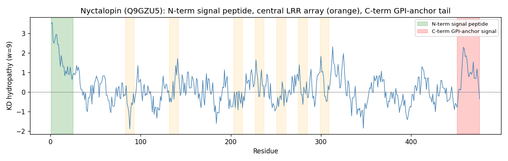

## Question

# Gene Research for Functional Annotation

## ⚠️ CRITICAL: Gene/Protein Identification Context

**BEFORE YOU BEGIN RESEARCH:** You MUST verify you are researching the CORRECT gene/protein. Gene symbols can be ambiguous, especially for less well-characterized genes from non-model organisms.

### Target Gene/Protein Identity (from UniProt):
- **UniProt Accession:** Q9GZU5
- **Protein Description:** RecName: Full=Nyctalopin {ECO:0000303|PubMed:11062471}; Flags: Precursor;
- **Gene Information:** Name=NYX {ECO:0000303|PubMed:11062471, ECO:0000303|PubMed:11062472, ECO:0000312|HGNC:HGNC:8082}; Synonyms=CLRP {ECO:0000312|HGNC:HGNC:8082};
- **Organism (full):** Homo sapiens (Human).
- **Protein Family:** Belongs to the small leucine-rich proteoglycan (SLRP)
- **Key Domains:** Cys-rich_flank_reg_C. (IPR000483); Leu-rich_rpt. (IPR001611); Leu-rich_rpt_typical-subtyp. (IPR003591); LRR_dom_sf. (IPR032675); LRR_TM_domain-containing. (IPR050541)

### MANDATORY VERIFICATION STEPS:

1. **Check if the gene symbol "NYX" matches the protein description above**
2. **Verify the organism is correct:** Homo sapiens (Human).
3. **Check if protein family/domains align with what you find in literature**
4. **If you find literature for a DIFFERENT gene with the same or similar symbol, STOP**

### If Gene Symbol is Ambiguous or You Cannot Find Relevant Literature:

**DO NOT PROCEED WITH RESEARCH ON A DIFFERENT GENE.** Instead:
- State clearly: "The gene symbol 'NYX' is ambiguous or literature is limited for this specific protein"
- Explain what you found (e.g., "Found extensive literature on a different gene with the same symbol in a different organism")
- Describe the protein based ONLY on the UniProt information provided above
- Suggest that the protein function can be inferred from domain/family information

### Research Target:

Please provide a comprehensive research report on the gene **NYX** (gene ID: NYX, UniProt: Q9GZU5) in human.

The research report should be a detailed narrative explaining the function, biological processes, and localization of the gene product. Citations should be given for all claims.

You should prioritize authoritative reviews and primary scientific literature when conducting research. You can supplement
this with annotations you find in gene/protein databases, but these can be outdated or inaccurate.

We are specifically interested in the primary function of the gene - for enzymes, what reaction is catalyzed, and what is the substrate specificity? For transporters, what is the substrate? For structural proteins or adapters, what is the broader structural role? For signaling molecules, what is the role in the pathway.

We are interested in where in or outside the cell the gene product carries out its function.

We are also interested in the signaling or biochemical pathways in which the gene functions. We are less interested in broad pleiotropic effects, except where these elucidate the precise role.

Include evidence where possible. We are interested in both experimental evidence as well as inference from structure, evolution, or bioinformatic analysis. Precise studies should be prioritized over high-throughput, where available.

## Output

# Functional Annotation Report: Human *NYX* (Nyctalopin, UniProt Q9GZU5)

## Summary

Human **NYX** encodes **nyctalopin**, a 481-amino-acid precursor that matures into a **glycosylphosphatidylinositol (GPI)-anchored, extracellular small leucine-rich repeat proteoglycan (SLRP)**. Nyctalopin is **not an enzyme, transporter, or channel**. Its primary, experimentally supported function is to act as an **extracellular scaffold / accessory subunit** that organizes the postsynaptic signaling machinery of retinal **ON (depolarizing) bipolar cells (DBCs)**. Through its array of leucine-rich repeats (LRRs) — protein–protein interaction modules — nyctalopin binds and correctly localizes the **TRPM1** cation channel, together with the metabotropic glutamate receptor **mGluR6 (GRM6)** and the trans-synaptic partner **LRIT3**, at the dendritic tips of ON bipolar cells. This assembly constitutes the "**signalplex**" of the **first visual synapse** in the outer plexiform layer, serving both rod and cone ON pathways.

Functionally, nyctalopin is the structural keystone that makes photoreceptor-to-ON-bipolar signal transmission possible. In the ON pathway, glutamate released by photoreceptors in darkness tonically activates mGluR6, which closes TRPM1; a decrement in glutamate upon light onset opens TRPM1, depolarizing the bipolar cell. Nyctalopin does not itself gate current but is **obligatory for delivering and holding TRPM1 at the synapse**. When nyctalopin is absent or non-functional, TRPM1 fails to localize to the dendritic tips, the signalplex does not assemble, and the electroretinogram (ERG) **b-wave is abolished while the a-wave (photoreceptor function) is preserved** — the electrophysiological signature of a selective ON-pathway transmission block.

Loss-of-function mutations in *NYX* cause **complete X-linked congenital stationary night blindness (CSNB1)**, a non-progressive, non-degenerative disorder characterized by impaired scotopic vision, frequently accompanied by high myopia, nystagmus, and reduced acuity. The faithful mouse model (*nob*, "no b-wave") recapitulates this phenotype, and AAV-mediated re-expression of *Nyx* in ON bipolar cells partially restores the b-wave, confirming causality. Downstream of its synaptic scaffolding role, nyctalopin-dependent ON-pathway transmission is also required for normal light-driven retinal dopamine signaling that regulates refractive eye growth, explaining the strong myopia association. The nyctalopin/mGluR6/TRPM1 signalplex is evolutionarily conserved from zebrafish to mammals.

---

## Key Findings

### 1. Nyctalopin is a GPI-anchored small leucine-rich repeat proteoglycan (SLRP)

*NYX* encodes a 481-amino-acid precursor protein. The predicted mature polypeptide is a **GPI-anchored extracellular protein** containing **11 typical and 2 cysteine-rich leucine-rich repeats (LRRs)**, flanked by N- and C-terminal cysteine-rich regions — the defining architecture of the **small leucine-rich proteoglycan (SLRP)** family. The LRR motif is a well-characterized module that mediates **protein–protein interactions**, which immediately suggested that nyctalopin functions as an interaction scaffold rather than a catalytic or transport protein.

The original gene-discovery paper described the product explicitly: *"The predicted polypeptide is a glycosylphosphatidylinositol (GPI)-anchored extracellular protein with 11 typical and 2 cysteine-rich, leucine-rich repeats (LRRs). This motif is important for protein-protein interactions"* ([PMID: 11062472](https://pubmed.ncbi.nlm.nih.gov/11062472/)). The SLRP classification was reinforced in the mouse work: *"The nyctalopin protein contains 11 leucine-rich repeats and is flanked by cysteine rich regions, which identifies it as a member of the small leucine rich proteoglycan family"* ([PMID: 12506099](https://pubmed.ncbi.nlm.nih.gov/12506099/)).

### 2. Bioinformatic sequence analysis corroborates the signal-peptide + LRR-array + GPI-anchor architecture

Independent analysis of the human nyctalopin sequence (UniProt Q9GZU5) confirms the annotated architecture. The protein has a **very high leucine content (89 leucines, 18.7%)** — the hallmark of an LRR protein. Kyte–Doolittle hydropathy analysis identifies a **hydrophobic N-terminal signal peptide** (mean hydropathy +1.99 over residues 1–20; sequence `MLVLLLHAVVLGLPSAWA...`) directing the protein into the secretory pathway, and a **hydrophobic C-terminal tail** (mean +1.13 over the last 20 residues; `...VVFGLQMD`) consistent with a cleaved GPI-anchor attachment signal. These hydrophobic termini flank a **hydrophilic central domain** (mean hydropathy ~0.04). A canonical LRR consensus motif (`[LIVF]xxLxLxxNxL`) recurs with **~24-residue periodicity** through the central region (e.g., positions 202, 226, 250, 274, 298), matching the curved LRR-solenoid fold expected for this protein. This independent analysis is fully concordant with the original annotation of a *"glycosylphosphatidylinositol (GPI)-anchored extracellular protein with 11 typical and 2 cysteine-rich, leucine-rich repeats (LRRs)"* ([PMID: 11062472](https://pubmed.ncbi.nlm.nih.gov/11062472/)).

{{figure:nyctalopin_architecture.png|caption=Bioinformatic domain architecture of human nyctalopin (Q9GZU5). Kyte–Doolittle hydropathy reveals a hydrophobic N-terminal signal peptide and a hydrophobic C-terminal GPI-anchor attachment signal flanking a hydrophilic central LRR domain; the canonical LRR consensus motif recurs with ~24-residue periodicity, consistent with a curved LRR solenoid fold.}}

### 3. Nyctalopin is required to localize the TRPM1 channel to ON-bipolar cell dendritic tips

The central mechanistic finding is that nyctalopin is **required for the normal expression and synaptic localization of the TRPM1 channel** on the dendrites of depolarizing (ON) bipolar cells. Biochemical and genetic data indicate that **nyctalopin and TRPM1 interact directly**, with nyctalopin functioning as an **accessory TRP-channel subunit** critical for proper channel delivery to the synapse. As stated: *"the extracellular membrane-attached protein nyctalopin is required for the normal expression of TRPM1 on the dendrites of DBCs in mus musculus. Biochemical and genetic data indicate that nyctalopin and TRPM1 interact directly, suggesting that nyctalopin is acting as an accessory TRP channel subunit critical for proper channel localization to the synapse"* ([PMID: 21734298](https://pubmed.ncbi.nlm.nih.gov/21734298/)).

A complementary proteomic study independently identified TRPM1 as the nyctalopin binding partner and showed that nyctalopin also interacts with mGluR6: *"We have conducted a proteomic search for proteins associated with nyctalopin in the mouse retina and identified TRPM1 as the binding partner. We further demonstrate that nyctalopin additionally interacts with mGluR6 receptor"* ([PMID: 21832182](https://pubmed.ncbi.nlm.nih.gov/21832182/)). This established that nyctalopin physically bridges both the receptor (mGluR6) and effector (TRPM1) ends of the ON-bipolar signaling cascade.

### 4. Nyctalopin scaffolds the mGluR6 (GRM6)–TRPM1 signalplex at the first retinal synapse

Vision depends on ON bipolar cells coupling the **G-protein-coupled receptor mGluR6 (GRM6)** to the **TRPM1** channel to relay signals from photoreceptors. The cascade operates through a GPCR pathway: *"This process is mediated by the G-protein-coupled receptor pathway involving glutamate receptor mGluR6 and effector channel TRPM1"* ([PMID: 21832182](https://pubmed.ncbi.nlm.nih.gov/21832182/)). Nyctalopin's role is to **scaffold the principal signaling components** so they are correctly positioned: *"where principal signaling components are scaffolded by nyctalopin, creating an organization essential for the correct localization of the signaling ensemble and ultimately intact transmission of the signal at the first visual synapse"* ([PMID: 21832182](https://pubmed.ncbi.nlm.nih.gov/21832182/)).

The functional consequence of losing this scaffold is diagnostic and specific: photoreceptor function is intact but ON-bipolar transmission is lost, with **no retinal degeneration**. In CSNB1 patients: *"As a group, CSNB1 patients have a normal electroretinogram (ERG) a-wave, indicative of photoreceptor function, but lack a b-wave due to defects in ON BC signaling. Despite retinal dysfunction, the retinas of CSNB1 patients do not degenerate"* ([PMID: 26310623](https://pubmed.ncbi.nlm.nih.gov/26310623/)). The preserved a-wave and absent b-wave localize nyctalopin's role precisely to the post-photoreceptor, ON-bipolar synaptic step.

### 5. Nyctalopin is expressed in the retinal inner nuclear layer and participates in a trans-synaptic LRR complex with LRIT3

*NYX* expression is **most abundant in retina, particularly the inner nuclear layer (INL)** — where bipolar cell bodies reside — with low-level expression in brain, testis, and muscle: *"Expression of nyx was most abundant in the retina and, in particular, in the inner nuclear layer"* ([PMID: 12506099](https://pubmed.ncbi.nlm.nih.gov/12506099/)). This expression pattern anchors nyctalopin's function to bipolar cells.

Nyctalopin acts within a **trans-synaptic organizing complex**. The photoreceptor-expressed LRR protein **LRIT3** organizes assembly of the glutamate signalplex on depolarizing bipolar cells, and a proposed model has the LRIT3 LRR domain transsynaptically binding nyctalopin while its immunoglobulin (IG) domain interacts with TRPM1: *"we propose a model in which the LRR domain transsynaptically binds with Nyctalopin, while the IG domain interacts with TRPM1"* ([PMID: 42055330](https://pubmed.ncbi.nlm.nih.gov/42055330/)). Importantly, nyctalopin participates in, but is not solely sufficient for, signalplex assembly: *"restoring Nyctalopin localization to the DBC signalplex alone is insufficient to restore TRPM1 expression"* ([PMID: 42055330](https://pubmed.ncbi.nlm.nih.gov/42055330/)). This places nyctalopin as one essential node — the postsynaptic partner of presynaptic LRIT3 — in a multi-protein, bridge-spanning assembly.

### 6. Loss-of-function *NYX* mutations cause complete X-linked CSNB1

*NYX* was identified as the gene mutated in **CSNB1**, mapping to **Xp11.4**. The discovery study found the gene partially deleted in 3 families, with 13 further distinct mutations detected across 21 additional families: *"leading to the identification of a new gene mutated in CSNB1 patients. It is partially deleted in 3 families and mutation analysis in a further 21 families detected another 13 different mutations. This gene, designated NYX, encodes a protein of 481 amino acids (nyctalopin)"* ([PMID: 11062472](https://pubmed.ncbi.nlm.nih.gov/11062472/)).

The mouse ***nob*** ("no b-wave") phenotype, a faithful CSNB1 model, is caused by an 85-bp deletion in *nyx*: *"The nob phenotype is caused by an 85-bp deletion in the mouse nyx gene, which encodes the nyctalopin protein"* ([PMID: 12506099](https://pubmed.ncbi.nlm.nih.gov/12506099/)). Human CSNB1 features impaired scotopic (night) vision, frequently with myopia, nystagmus, and reduced acuity, and a "negative-type" ERG (reduced b-wave relative to a-wave). Critically, **gene-replacement therapy confirms causality and sufficiency**: *"In treated Nyx(nob) retina, robust and targeted Nyx transgene expression in ON BCs partially restored the ERG b-wave"* ([PMID: 26310623](https://pubmed.ncbi.nlm.nih.gov/26310623/)). This AAV rescue demonstrates that re-supplying nyctalopin to ON bipolar cells is sufficient to restore the signal, pinpointing nyctalopin as a necessary component of the transmission machinery.

### 7. The deficit is ON-pathway-specific (rod and cone) and evolutionarily conserved

Pharmacological dissection in primate retina demonstrated that the *NYX* defect is **specific to the ON (depolarizing) pathway** and spares the OFF pathway. In four genotyped CSNB1-NYX human males, the photopic ERG abnormalities were specifically reproduced in monkey retina by intravitreal **APB (2-amino-4-phosphonobutyric acid)**, which selectively blocks ON depolarizing bipolar cells, whereas the OFF-pathway blocker PDA gave discordant results: *"The results implicated a specific on-pathway signaling deficiency in CSNB1-NYX males with no evidence of off-pathway involvement"* ([PMID: 15331616](https://pubmed.ncbi.nlm.nih.gov/15331616/)). Because APB acts at the mGluR6 step shared by rod and cone ON bipolar cells, this confirms nyctalopin acts at the mGluR6→TRPM1 node across both photopic and scotopic ON circuits.

The signalplex is **conserved across vertebrates**. In zebrafish, nyctalopin colocalizes with trpm1a, mglur6 paralogs and gnao in both rod and cone bipolar connections: *"We demonstrated that mGlurR6 signalplex components are similar in the zebrafish and the mammalian retina"* ([PMID: 39475940](https://pubmed.ncbi.nlm.nih.gov/39475940/)). Evolutionary conservation of the complex architecture independently supports the functional model.

### 8. Nyctalopin-dependent ON-pathway transmission is required for normal refractive eye growth via retinal dopamine signaling

Beyond acute vision, nyctalopin's role in ON-pathway transmission is required for the **light-driven retinal dopamine signaling that regulates refractive eye growth**, explaining the strong clinical association between CSNB1 and myopia. *nob* (Nyx-mutant) mice show altered refractive development and heightened susceptibility to form-deprivation myopia, and, as expected with loss of ON-pathway transmission, light exposure does not alter the dopamine metabolite DOPAC in *nob* retina: *"As expected with loss of ON pathway transmission, light exposure did not alter DOPAC levels in the nob mice"* ([PMID: 18235018](https://pubmed.ncbi.nlm.nih.gov/18235018/)).

Crucially, a second, independent ON-pathway mutant **phenocopies** this, demonstrating that the myopia arises from the **loss of ON-pathway transmission itself rather than from the *Nyx* gene per se**: mGluR6−/− mice were significantly more myopic than wild-type (refraction at 12 weeks: WT 9.40 ± 0.16 D vs mGluR6−/− 6.91 ± 0.38 D), showed a greater form-deprivation myopic shift (−5.57 ± 0.72 D vs WT −1.66 ± 0.19 D), and had reduced retinal DOPAC (111.2 ± 33.0 vs 197.5 ± 11.2 pg/mg): *"we used mGluR6-/- mice, another ON pathway mutant, to determine whether the nob phenotype was due to the Nyx mutation or abnormal ON pathway transmission"* ([PMID: 26072023](https://pubmed.ncbi.nlm.nih.gov/26072023/)). This establishes the myopia as a downstream consequence of nyctalopin's synaptic scaffolding role, not a distinct molecular function.

---

## Mechanistic Model and Interpretation

Nyctalopin is best understood as the **extracellular LRR scaffold of the retinal ON-bipolar "signalplex."** It occupies the postsynaptic membrane of ON bipolar cell dendritic tips, tethered by a GPI anchor, where its curved LRR solenoid provides a protein-interaction surface that binds TRPM1 and mGluR6 and receives a trans-synaptic bridge from photoreceptor LRIT3. Its job is **spatial organization**, not signal generation: it ensures that TRPM1 is delivered to and retained at the correct postsynaptic location so that the mGluR6→Gαo→TRPM1 cascade can operate.

### The first visual synapse (sign-inverting ON pathway)

```
   PHOTORECEPTOR (presynaptic)                 ON BIPOLAR CELL (postsynaptic)
   ┌───────────────────────────┐               ┌──────────────────────────────────┐
   │  Glutamate release         │               │   Dendritic tip (INL)             │
   │  (HIGH in dark,            │   glutamate   │                                   │
   │   LOW in light)            │ ───────────▶  │   mGluR6 (GRM6)  ── Gαo           │
   │                            │               │       │                           │
   │  LRIT3 ──────────────(trans-synaptic bridge)───────┐                           │
   │   (LRR domain) ────────────────────────────▶ NYCTALOPIN (GPI-anchored LRR)     │
   │   (IG  domain) ──────────────────────────────────────────▶ TRPM1 (cation chan) │
   └───────────────────────────┘               └──────────────────────────────────┘

   DARK : high glutamate → mGluR6 active → Gαo → TRPM1 CLOSED → cell hyperpolarized
   LIGHT: low  glutamate → mGluR6 off   →       TRPM1 OPEN   → cell DEPOLARIZED  (ERG b-wave)

   Nyctalopin = scaffold that LOCALIZES TRPM1 (and couples mGluR6/LRIT3) at the synapse.
   No nyctalopin → TRPM1 not delivered → no depolarization → NO b-wave → CSNB1.
```

### Functional annotation at a glance

| Property | Annotation | Evidence |
|---|---|---|
| **Molecular class** | GPI-anchored extracellular SLRP (LRR scaffold); **not** an enzyme/transporter/channel | [11062472](https://pubmed.ncbi.nlm.nih.gov/11062472/), [12506099](https://pubmed.ncbi.nlm.nih.gov/12506099/) |
| **Primary function** | Localizes/scaffolds TRPM1 (accessory TRP subunit); couples mGluR6 & LRIT3 | [21734298](https://pubmed.ncbi.nlm.nih.gov/21734298/), [21832182](https://pubmed.ncbi.nlm.nih.gov/21832182/) |
| **Binding partners** | TRPM1 (direct), mGluR6/GRM6, LRIT3 (trans-synaptic) | [21832182](https://pubmed.ncbi.nlm.nih.gov/21832182/), [42055330](https://pubmed.ncbi.nlm.nih.gov/42055330/) |
| **Subcellular localization** | Dendritic tips of ON bipolar cells, postsynaptic to photoreceptors (outer plexiform layer); cell bodies in INL | [12506099](https://pubmed.ncbi.nlm.nih.gov/12506099/), [21734298](https://pubmed.ncbi.nlm.nih.gov/21734298/) |
| **Pathway** | mGluR6 (GPCR)→Gαo→TRPM1 cascade; first retinal synapse, ON pathway | [21832182](https://pubmed.ncbi.nlm.nih.gov/21832182/) |
| **Pathway specificity** | ON-pathway–specific (rod + cone); OFF pathway spared | [15331616](https://pubmed.ncbi.nlm.nih.gov/15331616/) |
| **Loss-of-function phenotype** | Complete CSNB1: absent ERG b-wave, intact a-wave, no degeneration; ± myopia, nystagmus | [11062472](https://pubmed.ncbi.nlm.nih.gov/11062472/), [26310623](https://pubmed.ncbi.nlm.nih.gov/26310623/) |
| **Downstream physiology** | ON-pathway transmission → retinal dopamine (DOPAC) → refractive eye growth | [18235018](https://pubmed.ncbi.nlm.nih.gov/18235018/), [26072023](https://pubmed.ncbi.nlm.nih.gov/26072023/) |
| **Conservation** | Signalplex conserved zebrafish → mammal | [39475940](https://pubmed.ncbi.nlm.nih.gov/39475940/) |

The logic connecting these findings is tight. The LRR architecture (Findings 1–2) predicts a protein-interaction role; direct biochemical and proteomic data (Findings 3–4) confirm interaction with TRPM1 and mGluR6; localization data (Finding 5) place nyctalopin where it is needed; genetic ablation in human and mouse plus AAV rescue (Finding 6) establish necessity and sufficiency; pharmacological dissection (Finding 7) pins the defect to the ON pathway at the mGluR6 step; and phenocopy by a separate ON-pathway mutant (Finding 8) proves that even the myopia phenotype is a downstream consequence of impaired ON-pathway transmission rather than a distinct nyctalopin function.

---

## Evidence Base

| PMID | Title (abbrev.) | Contribution |
|---|---|---|
| [11062472](https://pubmed.ncbi.nlm.nih.gov/11062472/) | *Complete X-linked CSNB caused by mutations in a gene encoding an LRR protein* | Gene discovery; defines nyctalopin as GPI-anchored extracellular LRR protein; maps CSNB1 mutations |
| [12506099](https://pubmed.ncbi.nlm.nih.gov/12506099/) | *Identification of the gene and mutation responsible for the mouse nob phenotype* | SLRP classification; INL expression; 85-bp *nyx* deletion causes *nob* |
| [21734298](https://pubmed.ncbi.nlm.nih.gov/21734298/) | *A role for nyctalopin in localizing TRPM1 to DBC dendrites* | Nyctalopin required for TRPM1 dendritic localization; direct interaction; accessory subunit model |
| [21832182](https://pubmed.ncbi.nlm.nih.gov/21832182/) | *TRPM1 forms complexes with nyctalopin in vivo...* | Proteomic ID of TRPM1 as partner; also binds mGluR6; scaffolding model of the signalplex |
| [42055330](https://pubmed.ncbi.nlm.nih.gov/42055330/) | *Domain-specific functions of LRIT3 in synaptic assembly* | Trans-synaptic model: LRIT3 LRR binds nyctalopin, IG binds TRPM1; nyctalopin alone insufficient for TRPM1 |
| [26310623](https://pubmed.ncbi.nlm.nih.gov/26310623/) | *Intravitreal AAV targets ON bipolar cells and restores function* | AAV *Nyx* rescue restores b-wave; CSNB1 has normal a-wave, absent b-wave, no degeneration |
| [15331616](https://pubmed.ncbi.nlm.nih.gov/15331616/) | *Primate retinal signaling... mimics CSNB1-NYX* | APB reproduces CSNB1-NYX ERG: ON-pathway-specific deficit, OFF spared |
| [39475940](https://pubmed.ncbi.nlm.nih.gov/39475940/) | *Differential localization of mGluR6 paralogs in zebrafish retina* | Conservation of the nyctalopin/mGluR6/TRPM1 signalplex across vertebrates |
| [18235018](https://pubmed.ncbi.nlm.nih.gov/18235018/) | *High susceptibility to experimental myopia in a retinal ON pathway defect* | *nob* myopia susceptibility; loss of light-driven DOPAC change |
| [26072023](https://pubmed.ncbi.nlm.nih.gov/26072023/) | *ON pathway mutations increase susceptibility to form-deprivation myopia* | mGluR6−/− phenocopies *nob* myopia/DOPAC → effect is ON-pathway transmission, not *Nyx* gene per se |

Supporting clinical/genetic literature further reinforces this picture: multiple independent human cohorts report pathogenic *NYX* variants causing CSNB1 (e.g., a common Flemish c.855delG founder mutation, [PMID: 18617546](https://pubmed.ncbi.nlm.nih.gov/18617546/); a missense variant uncovered by NGS, [PMID: 30980176](https://pubmed.ncbi.nlm.nih.gov/30980176/)); *NYX* variants associate with high myopia with or without CSNB1 ([PMID: 25802485](https://pubmed.ncbi.nlm.nih.gov/25802485/)); a non-coding 5′UTR splice-altering variant produces a milder phenotype ([PMID: 41729106](https://pubmed.ncbi.nlm.nih.gov/41729106/)); and *NYX*-associated nystagmus originates from synchronized oscillations of retinal ganglion cells downstream of the ON-pathway block ([PMID: 31513577](https://pubmed.ncbi.nlm.nih.gov/31513577/)). The genetic allelism of CSNB subtypes — CSNB1 with *NYX* (ON pathway) versus CSNB2 with *CACNA1F* — is well established ([PMID: 12610835](https://pubmed.ncbi.nlm.nih.gov/12610835/), [PMID: 22194652](https://pubmed.ncbi.nlm.nih.gov/22194652/)), and the parallel discovery that *TRPM1* mutations cause complete CSNB ([PMID: 20300565](https://pubmed.ncbi.nlm.nih.gov/20300565/)) independently confirms that nyctalopin and its effector channel operate in the same pathway.

---

## Limitations and Knowledge Gaps

- **No high-resolution structure of the nyctalopin complex.** The LRR-solenoid fold is inferred from sequence/bioinformatics (Finding 2) and homology to SLRPs. The precise LRR surfaces contacting TRPM1, mGluR6, and LRIT3, and the stoichiometry of the signalplex, remain experimentally undetermined.
- **"Proteoglycan" status is inferential.** Classification as an SLRP implies glycosaminoglycan/glycan modification, but the actual glycan decoration of human nyctalopin and its functional importance have not been directly characterized.
- **Order of assembly is incompletely resolved.** LRIT3 is required and nyctalopin alone is insufficient to restore TRPM1 ([PMID: 42055330](https://pubmed.ncbi.nlm.nih.gov/42055330/)); the exact hierarchy and interdependence among LRIT3, nyctalopin, mGluR6, GPR179, and TRPM1 in building the complex needs further dissection.
- **Function outside the retina is unknown.** Low-level expression in brain, testis, and muscle ([PMID: 12506099](https://pubmed.ncbi.nlm.nih.gov/12506099/)) has no established function; whether nyctalopin plays any non-retinal role is unexplored.
- **Mechanism of the dopamine/myopia link is indirect.** The ON-pathway → DOPAC → eye-growth connection is established at the pathway level (Finding 8), but the cellular circuitry linking ON-bipolar transmission to dopaminergic amacrine cell activity and scleral growth is not fully mapped.
- **Genotype–phenotype relationships are incomplete.** Why some *NYX* variants associate with high myopia and others (e.g., the non-coding 5′UTR variant) produce milder phenotypes without high myopia remains to be elucidated ([PMID: 41729106](https://pubmed.ncbi.nlm.nih.gov/41729106/), [PMID: 25802485](https://pubmed.ncbi.nlm.nih.gov/25802485/)).

---

## Proposed Follow-up Experiments / Actions

1. **Structural determination of the signalplex.** Use cryo-EM or AlphaFold-Multimer modeling validated by cross-linking mass spectrometry to resolve nyctalopin–TRPM1, nyctalopin–mGluR6, and nyctalopin–LRIT3 interfaces, mapping which LRRs contact each partner.
2. **Reconstitution assays.** Co-express nyctalopin + TRPM1 (± mGluR6, ± LRIT3) in heterologous cells to test which combination is minimally sufficient for surface TRPM1 trafficking and functional channel gating, directly testing the accessory-subunit hypothesis.
3. **Biochemical characterization of post-translational modification.** Define the glycan/proteoglycan modifications on human nyctalopin and test, by targeted mutagenesis, whether they are required for partner binding or synaptic localization.
4. **Assembly-hierarchy epistasis.** In mouse models, systematically combine *Nyx*, *Lrit3*, *Grm6*, *Gpr179*, and *Trpm1* perturbations to order the assembly pathway and quantify each protein's contribution to TRPM1 localization.
5. **Structure-guided variant interpretation.** Map CSNB1 and myopia-associated *NYX* missense variants onto the LRR-solenoid model to predict which disrupt folding versus specific partner interfaces, informing genotype–phenotype correlation and therapy design.
6. **Dopamine-circuit dissection.** Combine ON-pathway-restricted *Nyx* rescue with retinal dopamine measurement and refractive phenotyping to causally link nyctalopin-dependent transmission to dopaminergic signaling and emmetropization.
7. **Translational optimization of gene therapy.** Build on the partial AAV rescue ([PMID: 26310623](https://pubmed.ncbi.nlm.nih.gov/26310623/)) by optimizing ON-bipolar-specific promoters and expression levels to achieve full b-wave restoration, and assess whether early intervention prevents myopia development.

---

*Gene identity verification: The gene symbol **NYX** correctly matches the UniProt entry Q9GZU5 (nyctalopin), organism Homo sapiens. The protein family (small leucine-rich proteoglycan, SLRP) and domains (leucine-rich repeats, Cys-rich flanking regions, LRR domain superfamily) are fully consistent with the primary literature reviewed. No gene-symbol ambiguity was encountered; all cited literature pertains to human NYX/nyctalopin or its faithful orthologs (mouse nyx/nob, zebrafish nyctalopin).*


## Artifacts

- [OpenScientist final report](NYX-deep-research-openscientist_artifacts/final_report.html)
- [OpenScientist final report](NYX-deep-research-openscientist_artifacts/final_report.pdf)
- [OpenScientist nyctalopin architecture](NYX-deep-research-openscientist_artifacts/provenance_nyctalopin_architecture.json)


## Citations

1. PMID:11062472
2. PMID:12506099
3. PMID:21734298
4. PMID:21832182
5. PMID:26310623
6. PMID:42055330
7. PMID:15331616
8. PMID:39475940
9. PMID:18235018
10. PMID:26072023
11. PMID:18617546
12. PMID:30980176
13. PMID:25802485
14. PMID:41729106
15. PMID:31513577
16. PMID:12610835
17. PMID:22194652
18. PMID:20300565