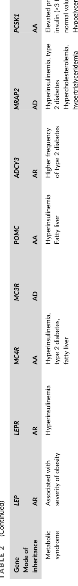

## Question

# Gene Research for Functional Annotation

## ⚠️ CRITICAL: Gene/Protein Identification Context

**BEFORE YOU BEGIN RESEARCH:** You MUST verify you are researching the CORRECT gene/protein. Gene symbols can be ambiguous, especially for less well-characterized genes from non-model organisms.

### Target Gene/Protein Identity (from UniProt):
- **UniProt Accession:** P29120
- **Protein Description:** RecName: Full=Neuroendocrine convertase 1; Short=NEC 1; EC=3.4.21.93; AltName: Full=Prohormone convertase 1; AltName: Full=Proprotein convertase 1; Short=PC1; Flags: Precursor;
- **Gene Information:** Name=PCSK1; Synonyms=NEC1;
- **Organism (full):** Homo sapiens (Human).
- **Protein Family:** Belongs to the peptidase S8 family. Furin subfamily.
- **Key Domains:** Galactose-bd-like_sf. (IPR008979); Kexin/furin. (IPR034182); P_dom. (IPR002884); Peptidase_S8/S53_dom. (IPR000209); Peptidase_S8/S53_dom_sf. (IPR036852)

### MANDATORY VERIFICATION STEPS:

1. **Check if the gene symbol "PCSK1" matches the protein description above**
2. **Verify the organism is correct:** Homo sapiens (Human).
3. **Check if protein family/domains align with what you find in literature**
4. **If you find literature for a DIFFERENT gene with the same or similar symbol, STOP**

### If Gene Symbol is Ambiguous or You Cannot Find Relevant Literature:

**DO NOT PROCEED WITH RESEARCH ON A DIFFERENT GENE.** Instead:
- State clearly: "The gene symbol 'PCSK1' is ambiguous or literature is limited for this specific protein"
- Explain what you found (e.g., "Found extensive literature on a different gene with the same symbol in a different organism")
- Describe the protein based ONLY on the UniProt information provided above
- Suggest that the protein function can be inferred from domain/family information

### Research Target:

Please provide a comprehensive research report on the gene **PCSK1** (gene ID: PCSK1, UniProt: P29120) in human.

The research report should be a detailed narrative explaining the function, biological processes, and localization of the gene product. Citations should be given for all claims.

You should prioritize authoritative reviews and primary scientific literature when conducting research. You can supplement
this with annotations you find in gene/protein databases, but these can be outdated or inaccurate.

We are specifically interested in the primary function of the gene - for enzymes, what reaction is catalyzed, and what is the substrate specificity? For transporters, what is the substrate? For structural proteins or adapters, what is the broader structural role? For signaling molecules, what is the role in the pathway.

We are interested in where in or outside the cell the gene product carries out its function.

We are also interested in the signaling or biochemical pathways in which the gene functions. We are less interested in broad pleiotropic effects, except where these elucidate the precise role.

Include evidence where possible. We are interested in both experimental evidence as well as inference from structure, evolution, or bioinformatic analysis. Precise studies should be prioritized over high-throughput, where available.

## Output

Question: You are an expert researcher providing comprehensive, well-cited information.

Provide detailed information focusing on:
1. Key concepts and definitions with current understanding
2. Recent developments and latest research (prioritize 2023-2024 sources)
3. Current applications and real-world implementations
4. Expert opinions and analysis from authoritative sources
5. Relevant statistics and data from recent studies

Format as a comprehensive research report with proper citations. Include URLs and publication dates where available.
Always prioritize recent, authoritative sources and provide specific citations for all major claims.

# Gene Research for Functional Annotation

## ⚠️ CRITICAL: Gene/Protein Identification Context

**BEFORE YOU BEGIN RESEARCH:** You MUST verify you are researching the CORRECT gene/protein. Gene symbols can be ambiguous, especially for less well-characterized genes from non-model organisms.

### Target Gene/Protein Identity (from UniProt):
- **UniProt Accession:** P29120
- **Protein Description:** RecName: Full=Neuroendocrine convertase 1; Short=NEC 1; EC=3.4.21.93; AltName: Full=Prohormone convertase 1; AltName: Full=Proprotein convertase 1; Short=PC1; Flags: Precursor;
- **Gene Information:** Name=PCSK1; Synonyms=NEC1;
- **Organism (full):** Homo sapiens (Human).
- **Protein Family:** Belongs to the peptidase S8 family. Furin subfamily.
- **Key Domains:** Galactose-bd-like_sf. (IPR008979); Kexin/furin. (IPR034182); P_dom. (IPR002884); Peptidase_S8/S53_dom. (IPR000209); Peptidase_S8/S53_dom_sf. (IPR036852)

### MANDATORY VERIFICATION STEPS:

1. **Check if the gene symbol "PCSK1" matches the protein description above**
2. **Verify the organism is correct:** Homo sapiens (Human).
3. **Check if protein family/domains align with what you find in literature**
4. **If you find literature for a DIFFERENT gene with the same or similar symbol, STOP**

### If Gene Symbol is Ambiguous or You Cannot Find Relevant Literature:

**DO NOT PROCEED WITH RESEARCH ON A DIFFERENT GENE.** Instead:
- State clearly: "The gene symbol 'PCSK1' is ambiguous or literature is limited for this specific protein"
- Explain what you found (e.g., "Found extensive literature on a different gene with the same symbol in a different organism")
- Describe the protein based ONLY on the UniProt information provided above
- Suggest that the protein function can be inferred from domain/family information

### Research Target:

Please provide a comprehensive research report on the gene **PCSK1** (gene ID: PCSK1, UniProt: P29120) in human.

The research report should be a detailed narrative explaining the function, biological processes, and localization of the gene product. Citations should be given for all claims.

You should prioritize authoritative reviews and primary scientific literature when conducting research. You can supplement
this with annotations you find in gene/protein databases, but these can be outdated or inaccurate.

We are specifically interested in the primary function of the gene - for enzymes, what reaction is catalyzed, and what is the substrate specificity? For transporters, what is the substrate? For structural proteins or adapters, what is the broader structural role? For signaling molecules, what is the role in the pathway.

We are interested in where in or outside the cell the gene product carries out its function.

We are also interested in the signaling or biochemical pathways in which the gene functions. We are less interested in broad pleiotropic effects, except where these elucidate the precise role.

Include evidence where possible. We are interested in both experimental evidence as well as inference from structure, evolution, or bioinformatic analysis. Precise studies should be prioritized over high-throughput, where available.

# Human PCSK1 (UniProt P29120): functional annotation research report

**Identity verified.** Human **PCSK1** encodes **prohormone convertase 1/3** (PC1/3; also PC1, PC3, SPC3 or neuroendocrine convertase 1/NEC1), a 753-amino-acid precursor in the subtilisin/kexin **S8 serine-peptidase family**. Its signal peptide, inhibitory prodomain, catalytic domain, conserved P domain and C-terminal sorting region agree with the supplied UniProt identity and domain annotations. PCSK1 is **not** PCSK2, which encodes the related enzyme PC2, or PCSK1N, which encodes a convertase inhibitor. The literature reviewed concerns the human protein, with animal studies identified separately below. [Ramos-Molina *et al.*, January 2016, https://doi.org/10.1016/bs.pmbts.2015.12.001; Demoures *et al.*, 2018, https://doi.org/10.4267/2042/68910.] (ramosmolina2016pcsk1variantsand pages 1-3, demoures2018pcsk1(proproteinconvertase pages 1-3, OpenTargets Search: obesity-PCSK1)

## Primary biochemical function and specificity

PC1/3 is a **calcium-dependent serine endoprotease**: it hydrolyzes peptide bonds **immediately after a basic residue**, typically the arginine in paired-basic processing sites such as Lys–Arg or Arg–Arg. This is *limited proteolysis* of selected precursor proteins, not indiscriminate protein degradation. The subtilisin-like Asp–His–Ser catalytic triad performs the reaction; product maturation often requires subsequent removal of residual basic residues by another enzyme, notably carboxypeptidase E. Recognition depends on residues around the cleavage site and access to the precursor in the appropriate cell compartment, so a dibasic motif alone does not establish that a protein is a physiological PC1/3 substrate. [Ramos-Molina *et al.*, 2016, https://doi.org/10.1016/bs.pmbts.2015.12.001; Demoures *et al.*, 2018, https://doi.org/10.4267/2042/68910.] (ramosmolina2016pcsk1variantsand pages 1-3, demoures2018pcsk1(proproteinconvertase pages 3-4, nour2004structurefunctionanalysisofa pages 77-85)

**Site and cellular location.** A signal peptide directs newly synthesized preproPC1/3 into the endoplasmic reticulum (ER). The prodomain assists folding and is autocatalytically processed during maturation; the protein passes through Golgi/trans-Golgi compartments and is sorted predominantly into **dense-core secretory granules** in endocrine and neuroendocrine cells and neurons. The approximately 87-kDa form can undergo further C-terminal processing to approximately 74- and 66-kDa forms; the shorter forms are more active under acidic, calcium-rich granule conditions, with reported maximal activity around pH 5–5.5. Accordingly, the principal physiological cleavage site is **inside the regulated secretory pathway**, before stimulus-dependent release of hormones, rather than at a cell-surface receptor. PC1/3 is prominent in hypothalamic neurons, pancreatic islets, pituitary and intestinal enteroendocrine cells. [Ramos-Molina *et al.*, 2016, https://doi.org/10.1016/bs.pmbts.2015.12.001.] (ramosmolina2016pcsk1variantsand pages 1-3, ramosmolina2016pcsk1variantsand pages 3-4)

Sorting has unusually precise experimental support: an NMR and transfected-neuroendocrine-cell study localized granule-targeting activity to the PC1/3 C terminus. Its residues **738–750** form an amphipathic helix; a hydrophobic patch centered on **Leu745** was critical for redirecting a normally constitutively secreted reporter toward regulated granules. This establishes a trafficking role for the tail, distinct from catalysis by the S8 domain. [Dikeakos *et al.*, **5 May 2009**, *PNAS*, https://doi.org/10.1073/pnas.0809576106.] (dikeakos2009functionalandstructural pages 1-2, dikeakos2009functionalandstructural pages 2-3)

## Defined substrates and pathways

**Insulin biosynthesis—pancreatic β-cells.** PC1/3 cleaves **proinsulin**, prominently at the B-chain/C-peptide junction; subsequent processing separates insulin from C-peptide. The older, largely mouse-based model assigns the other junction principally to PC2. Importantly, experiments in *primary human islets* challenge applying that model unchanged to healthy humans: validated staining found essentially no detectable PC2 in ordinary human β-cells, and pulse–chase experiments showed that conditions blocking PC2-dependent glucagon formation did **not** prevent mature insulin formation. Conversely, two PC1/3 inhibitors impeded proinsulin processing. Thus PC1/3 is the experimentally supported principal human β-cell convertase, while the precise relative contribution of PC2 is species- and cell-state-dependent. In that study, obvious β-cell PC2 staining occurred in **20/22 donors with type 2 diabetes**, versus occasional staining in **1/10 controls**; this association does not establish that PC2 causes diabetes. [Ramzy, Asadi & Kieffer, online **24 April 2020**, *Diabetes*, https://doi.org/10.2337/db19-0276.] (ramzy2020revisitingproinsulinprocessing pages 1-5, ramzy2020revisitingproinsulinprocessing pages 9-13)

**Incretin biosynthesis—intestinal L cells.** PC1/3 processes **proglucagon** toward **GLP-1 and GLP-2**, linking intracellular precursor cleavage to subsequently secreted incretin and intestinal hormone signaling. This must not be confused with the prevalent **PC2-dependent glucagon-producing** route in pancreatic α-cells: identical precursor sequence can yield different peptides depending on cellular convertase expression. PC1/3 acts upstream of GLP-1 receptor signaling; it is **not itself** the GLP-1 receptor or a GLP-1 receptor agonist. [Ramos-Molina *et al.*, 2016, https://doi.org/10.1016/bs.pmbts.2015.12.001; Chen, Taylor & Verchere, **September 2018**, https://doi.org/10.1111/dom.13401.] (ramosmolina2016pcsk1variantsand pages 1-3, aerts2021pc13deficiencya pages 20-23, kumar2026adomainswappedpropc13 pages 1-5)

**Melanocortin and pituitary signaling.** In POMC-expressing cells, PC1/3 makes early cleavages of **pro-opiomelanocortin (POMC)** to generate ACTH-containing products; in relevant neurons, subsequent processing, including **PC2-dependent** steps and terminal modifications, contributes to **α-MSH**, which signals through MC4R to regulate appetite. PC1/3 therefore supplies an upstream peptide-processing step, **not direct MC4R signaling**. Impaired ACTH-containing-product processing has been observed in people with biallelic PCSK1 deficiency, although some authentic circulating ACTH can remain, indicating that processing is not invariably exclusive to PC1/3. [Ramos-Molina *et al.*, 2016, https://doi.org/10.1016/bs.pmbts.2015.12.001.] (ramosmolina2016pcsk1variantsand pages 3-4)

Other reported precursor targets include **proghrelin** and, in β-cells, **pro-islet amyloid polypeptide**. In a targeted experimental study, PC1/3-null mouse islets accumulated a C-terminally unprocessed pro-IAPP intermediate, while PC1/3 expression in transduced cells generated the expected intermediate; **PC2 could partly compensate**. These results support a direct processing contribution without implying that PC1/3 alone produces every mature peptide. [Marzban *et al.*, **January 2004**, *Diabetes*, https://doi.org/10.2337/diabetes.53.1.141; Ramos-Molina *et al.*, 2016, https://doi.org/10.1016/bs.pmbts.2015.12.001.] (ramosmolina2016pcsk1variantsand pages 1-3, ramosmolina2016pcsk1variantsand pages 3-4)

## Human genetics, recent evidence and implementation

**Loss of PC1/3 function** provides strong human evidence for its physiological role: biallelic pathogenic PCSK1 variants cause an uncommon multisystem disorder characterized by **severe early-life malabsorptive diarrhea**, impaired proinsulin maturation with elevated proinsulin, and frequently later hyperphagia and early-onset obesity. Variable additional endocrine abnormalities can include hypoglycemia and hypothalamic–pituitary hormone deficiencies. These clinical observations establish physiological importance but do **not**, by themselves, prove that every affected hormonal precursor is a direct substrate. [Renard, Thevenard-Berger & Meyre, **July 2024**, systematic review, https://doi.org/10.1111/obr.13797; Ramos-Molina *et al.*, 2016, https://doi.org/10.1016/bs.pmbts.2015.12.001.] (renard2024medicalsemiologyof pages 1-2, renard2024medicalsemiologyof media 0683525b, renard2024medicalsemiologyof media 5a4bce66, ramosmolina2016pcsk1variantsand pages 1-3)

The **2024 systematic review** reported hypoglycemia in **38.2% of PCSK1-deficiency cases** and circulating proinsulin averaging **561.8 pmol/L**, with a reported range of **45.8–1,255 pmol/L**. Those are selected published cases, **not population prevalence estimates**; the available excerpt does not establish a denominator for the 38.2% figure. The same review screened **5,207 references** and included **269** across *eight obesity genes*, not 269 PCSK1 patients. Its literature search ended **January 2022**, an important limitation when interpreting its 2024 publication date. [Renard *et al.*, 2024, https://doi.org/10.1111/obr.13797.] (renard2024medicalsemiologyof pages 1-2, renard2024medicalsemiologyof pages 9-9)

**Clinical application is genotype-guided diagnosis and downstream treatment.** In an infant with unexplained persistent malabsorptive diarrhea or a child with marked early-onset obesity and hyperphagia, a PCSK1 genetic diagnosis can contextualize proinsulin abnormalities, prompt assessment of other endocrine deficiencies, and inform nutritional and endocrine care. For eligible genetically confirmed deficiency obesity, **setmelanotide**, an **MC4R agonist**, provides pharmacological stimulation **downstream** of deficient POMC processing; it does **not repair PC1/3 enzymatic activity**, and it should not be represented as a general treatment for any PCSK1 missense variant. A 2024 precision-medicine review emphasizes interpreting variant pathogenicity before considering such treatment. [Zuccaro, LeDuc & Thaker, **2024**, https://doi.org/10.1007/s13679-024-00567-y; Collet & Schwitzgebel, **December 2024**, https://doi.org/10.3389/fnut.2024.1509994.] (zuccaro2024updatesonrare pages 1-3, collet2024exploringthetherapeutic pages 3-5)

A completed phase-3 trial explicitly enrolled people with **biallelic loss-of-function POMC *or* PCSK1 variants**; its registration specifies a **52-week** outcome and an eight-week blinded withdrawal component. The registry posted results on **21 September 2023**: [NCT02896192](https://clinicaltrials.gov/study/NCT02896192). Reviews commonly quote **8/10 (80%)** attaining at least 10% weight loss at about one year for the **POMC-designated trial cohort**. **That figure must not be presented as a PCSK1-specific response rate**: the sources inspected do not provide a separately interpretable PCSK1 subgroup estimate. Published 2023–2024 expert reviews also note injection-site reactions and hyperpigmentation as common adverse events and the need for longer-term follow-up. [Trial registration; Trapp & Censani, **2023**, https://doi.org/10.1097/MED.0000000000000798; Qamar, Mallik & Makaronidis, **October 2024**, https://doi.org/10.17925/ee.2024.20.2.9.] (NCT02896192 chunk 1, NCT02896192 chunk 2, trapp2023setmelanotideapromising pages 1-2, qamar2024setmelanotideamelanocortin4 pages 5-6)

**Interpretive boundary.** The strongest functional annotation is **basic-site endoproteolysis of peptide-hormone precursors within regulated neuroendocrine secretion**. Sequence/domain conservation predicts catalytic and P-domain roles; targeted localization, human-islet processing experiments, and human loss-of-function phenotypes provide different—and complementary—levels of experimental support. Claims about universal PC1/3 cleavage of every candidate peptide, or PCSK1-specific drug efficacy inferred from a mixed trial, exceed that evidence. (ramosmolina2016pcsk1variantsand pages 1-3, dikeakos2009functionalandstructural pages 1-2, ramzy2020revisitingproinsulinprocessing pages 1-5, NCT02896192 chunk 1)

References

1. (ramosmolina2016pcsk1variantsand pages 1-3): Bruno Ramos-Molina, Martín G. Martín, and Iris Lindberg. Pcsk1 variants and human obesity. Progress in molecular biology and translational science, 140:47-74, Jan 2016. URL: https://doi.org/10.1016/bs.pmbts.2015.12.001, doi:10.1016/bs.pmbts.2015.12.001. This article has 152 citations and is from a peer-reviewed journal.

2. (demoures2018pcsk1(proproteinconvertase pages 1-3): Béatrice Demoures, Géraldine Siegfried, and Abdel-Majid Khatib. Pcsk1 (proprotein convertase subtilisin/kexin type 1). Atlas of Genetics and Cytogenetics in Oncology and Haematology, Nov 2018. URL: https://doi.org/10.4267/2042/68910, doi:10.4267/2042/68910. This article has 6 citations and is from a peer-reviewed journal.

3. (OpenTargets Search: obesity-PCSK1): Open Targets Query (obesity-PCSK1, 10 results). Buniello, A. et al. (2025). Open Targets Platform: facilitating therapeutic hypotheses building in drug discovery. Nucleic Acids Research.

4. (demoures2018pcsk1(proproteinconvertase pages 3-4): Béatrice Demoures, Géraldine Siegfried, and Abdel-Majid Khatib. Pcsk1 (proprotein convertase subtilisin/kexin type 1). Atlas of Genetics and Cytogenetics in Oncology and Haematology, Nov 2018. URL: https://doi.org/10.4267/2042/68910, doi:10.4267/2042/68910. This article has 6 citations and is from a peer-reviewed journal.

5. (nour2004structurefunctionanalysisofa pages 77-85): N Nour. Structure-function analysis of the prosegment and the cysteine-rich domain of the proprotein convertase pc5a: its interaction with timp-2. Unknown journal, 2004.

6. (ramosmolina2016pcsk1variantsand pages 3-4): Bruno Ramos-Molina, Martín G. Martín, and Iris Lindberg. Pcsk1 variants and human obesity. Progress in molecular biology and translational science, 140:47-74, Jan 2016. URL: https://doi.org/10.1016/bs.pmbts.2015.12.001, doi:10.1016/bs.pmbts.2015.12.001. This article has 152 citations and is from a peer-reviewed journal.

7. (dikeakos2009functionalandstructural pages 1-2): Jimmy D. Dikeakos, Paola Di Lello, Marie-Josée Lacombe, Rodolfo Ghirlando, Pascale Legault, Timothy L. Reudelhuber, and James G. Omichinski. Functional and structural characterization of a dense core secretory granule sorting domain from the pc1/3 protease. Proceedings of the National Academy of Sciences, 106:7408-7413, May 2009. URL: https://doi.org/10.1073/pnas.0809576106, doi:10.1073/pnas.0809576106. This article has 52 citations and is from a highest quality peer-reviewed journal.

8. (dikeakos2009functionalandstructural pages 2-3): Jimmy D. Dikeakos, Paola Di Lello, Marie-Josée Lacombe, Rodolfo Ghirlando, Pascale Legault, Timothy L. Reudelhuber, and James G. Omichinski. Functional and structural characterization of a dense core secretory granule sorting domain from the pc1/3 protease. Proceedings of the National Academy of Sciences, 106:7408-7413, May 2009. URL: https://doi.org/10.1073/pnas.0809576106, doi:10.1073/pnas.0809576106. This article has 52 citations and is from a highest quality peer-reviewed journal.

9. (ramzy2020revisitingproinsulinprocessing pages 1-5): Adam Ramzy, Ali Asadi, and Timothy J. Kieffer. Revisiting proinsulin processing: evidence that human β-cells process proinsulin with prohormone convertase (pc) 1/3 but not pc2. Diabetes, 69:1451-1462, Apr 2020. URL: https://doi.org/10.2337/db19-0276, doi:10.2337/db19-0276. This article has 79 citations and is from a highest quality peer-reviewed journal.

10. (ramzy2020revisitingproinsulinprocessing pages 9-13): Adam Ramzy, Ali Asadi, and Timothy J. Kieffer. Revisiting proinsulin processing: evidence that human β-cells process proinsulin with prohormone convertase (pc) 1/3 but not pc2. Diabetes, 69:1451-1462, Apr 2020. URL: https://doi.org/10.2337/db19-0276, doi:10.2337/db19-0276. This article has 79 citations and is from a highest quality peer-reviewed journal.

11. (aerts2021pc13deficiencya pages 20-23): L Aerts. Pc1/3 deficiency. Unknown journal, 2021.

12. (kumar2026adomainswappedpropc13 pages 1-5): Pankaj Kumar, Phillip A. Hyon, Rishi Nixon, Ashley V. Bullington, Ciara A. Payne, Iris Lindberg, and Daniel L. Kober. A domain-swapped propc1/3 structure reveals a conformational checkpoint for er export. Jul 2026. URL: https://doi.org/10.64898/2026.07.21.739776, doi:10.64898/2026.07.21.739776. This article has 0 citations.

13. (renard2024medicalsemiologyof pages 1-2): Emeline Renard, Ariane Thevenard‐Berger, and David Meyre. Medical semiology of patients with monogenic obesity: a systematic review. Obesity Reviews, Jul 2024. URL: https://doi.org/10.1111/obr.13797, doi:10.1111/obr.13797. This article has 20 citations and is from a peer-reviewed journal.

14. (renard2024medicalsemiologyof media 0683525b): Emeline Renard, Ariane Thevenard‐Berger, and David Meyre. Medical semiology of patients with monogenic obesity: a systematic review. Obesity Reviews, Jul 2024. URL: https://doi.org/10.1111/obr.13797, doi:10.1111/obr.13797. This article has 20 citations and is from a peer-reviewed journal.

15. (renard2024medicalsemiologyof media 5a4bce66): Emeline Renard, Ariane Thevenard‐Berger, and David Meyre. Medical semiology of patients with monogenic obesity: a systematic review. Obesity Reviews, Jul 2024. URL: https://doi.org/10.1111/obr.13797, doi:10.1111/obr.13797. This article has 20 citations and is from a peer-reviewed journal.

16. (renard2024medicalsemiologyof pages 9-9): Emeline Renard, Ariane Thevenard‐Berger, and David Meyre. Medical semiology of patients with monogenic obesity: a systematic review. Obesity Reviews, Jul 2024. URL: https://doi.org/10.1111/obr.13797, doi:10.1111/obr.13797. This article has 20 citations and is from a peer-reviewed journal.

17. (zuccaro2024updatesonrare pages 1-3): Michael V. Zuccaro, Charles A. LeDuc, and Vidhu V. Thaker. Updates on rare genetic variants, genetic testing, and gene therapy in individuals with obesity. Current obesity reports, 13:626-641, Jun 2024. URL: https://doi.org/10.1007/s13679-024-00567-y, doi:10.1007/s13679-024-00567-y. This article has 13 citations and is from a peer-reviewed journal.

18. (collet2024exploringthetherapeutic pages 3-5): Tinh-Hai Collet and Valerie Schwitzgebel. Exploring the therapeutic potential of precision medicine in rare genetic obesity disorders: a scientific perspective. Frontiers in Nutrition, Dec 2024. URL: https://doi.org/10.3389/fnut.2024.1509994, doi:10.3389/fnut.2024.1509994. This article has 8 citations.

19. (NCT02896192 chunk 1):  Setmelanotide for the Treatment of Early-Onset Pro-Opiomelanocortin (POMC) Deficiency Obesity. Rhythm Pharmaceuticals, Inc.. 2017. ClinicalTrials.gov Identifier: NCT02896192

20. (NCT02896192 chunk 2):  Setmelanotide for the Treatment of Early-Onset Pro-Opiomelanocortin (POMC) Deficiency Obesity. Rhythm Pharmaceuticals, Inc.. 2017. ClinicalTrials.gov Identifier: NCT02896192

21. (trapp2023setmelanotideapromising pages 1-2): Christine M. Trapp and Marisa Censani. Setmelanotide: a promising advancement for pediatric patients with rare forms of genetic obesity. Current Opinion in Endocrinology, Diabetes, and Obesity, 30:136-140, Feb 2023. URL: https://doi.org/10.1097/med.0000000000000798, doi:10.1097/med.0000000000000798. This article has 52 citations.

22. (qamar2024setmelanotideamelanocortin4 pages 5-6): Sulmaaz Qamar, Ritwika Mallik, and Janine Makaronidis. Setmelanotide: a melanocortin-4 receptor agonist for the treatment of severe obesity due to hypothalamic dysfunction. touchREVIEWS in Endocrinology, Oct 2024. URL: https://doi.org/10.17925/ee.2024.20.2.9, doi:10.17925/ee.2024.20.2.9. This article has 16 citations.

## Artifacts

## Citations

1. nour2004structurefunctionanalysisofa pages 77-85
2. dikeakos2009functionalandstructural pages 1-2
3. dikeakos2009functionalandstructural pages 2-3
4. ramzy2020revisitingproinsulinprocessing pages 1-5
5. ramzy2020revisitingproinsulinprocessing pages 9-13
6. renard2024medicalsemiologyof pages 1-2
7. renard2024medicalsemiologyof pages 9-9
8. zuccaro2024updatesonrare pages 1-3
9. collet2024exploringthetherapeutic pages 3-5
10. trapp2023setmelanotideapromising pages 1-2
11. Ramos-Molina *et al.*, January 2016, https://doi.org/10.1016/bs.pmbts.2015.12.001; Demoures *et al.*, 2018, https://doi.org/10.4267/2042/68910.
12. Ramos-Molina *et al.*, 2016, https://doi.org/10.1016/bs.pmbts.2015.12.001; Demoures *et al.*, 2018, https://doi.org/10.4267/2042/68910.
13. Ramos-Molina *et al.*, 2016, https://doi.org/10.1016/bs.pmbts.2015.12.001.
14. Dikeakos *et al.*, **5 May 2009**, *PNAS*, https://doi.org/10.1073/pnas.0809576106.
15. Ramzy, Asadi & Kieffer, online **24 April 2020**, *Diabetes*, https://doi.org/10.2337/db19-0276.
16. Ramos-Molina *et al.*, 2016, https://doi.org/10.1016/bs.pmbts.2015.12.001; Chen, Taylor & Verchere, **September 2018**, https://doi.org/10.1111/dom.13401.
17. Marzban *et al.*, **January 2004**, *Diabetes*, https://doi.org/10.2337/diabetes.53.1.141; Ramos-Molina *et al.*, 2016, https://doi.org/10.1016/bs.pmbts.2015.12.001.
18. Renard, Thevenard-Berger & Meyre, **July 2024**, systematic review, https://doi.org/10.1111/obr.13797; Ramos-Molina *et al.*, 2016, https://doi.org/10.1016/bs.pmbts.2015.12.001.
19. Renard *et al.*, 2024, https://doi.org/10.1111/obr.13797.
20. Zuccaro, LeDuc & Thaker, **2024**, https://doi.org/10.1007/s13679-024-00567-y; Collet & Schwitzgebel, **December 2024**, https://doi.org/10.3389/fnut.2024.1509994.
21. NCT02896192
22. Trial registration; Trapp & Censani, **2023**, https://doi.org/10.1097/MED.0000000000000798; Qamar, Mallik & Makaronidis, **October 2024**, https://doi.org/10.17925/ee.2024.20.2.9.
23. https://doi.org/10.1016/bs.pmbts.2015.12.001;
24. https://doi.org/10.4267/2042/68910.]
25. https://doi.org/10.1016/bs.pmbts.2015.12.001.]
26. https://doi.org/10.1073/pnas.0809576106.]
27. https://doi.org/10.2337/db19-0276.]
28. https://doi.org/10.1111/dom.13401.]
29. https://doi.org/10.2337/diabetes.53.1.141;
30. https://doi.org/10.1111/obr.13797;
31. https://doi.org/10.1111/obr.13797.]
32. https://doi.org/10.1007/s13679-024-00567-y;
33. https://doi.org/10.3389/fnut.2024.1509994.]
34. https://clinicaltrials.gov/study/NCT02896192
35. https://doi.org/10.1097/MED.0000000000000798;
36. https://doi.org/10.17925/ee.2024.20.2.9.]
37. https://doi.org/10.1016/bs.pmbts.2015.12.001,
38. https://doi.org/10.4267/2042/68910,
39. https://doi.org/10.1073/pnas.0809576106,
40. https://doi.org/10.2337/db19-0276,
41. https://doi.org/10.64898/2026.07.21.739776,
42. https://doi.org/10.1111/obr.13797,
43. https://doi.org/10.1007/s13679-024-00567-y,
44. https://doi.org/10.3389/fnut.2024.1509994,
45. https://doi.org/10.1097/med.0000000000000798,
46. https://doi.org/10.17925/ee.2024.20.2.9,