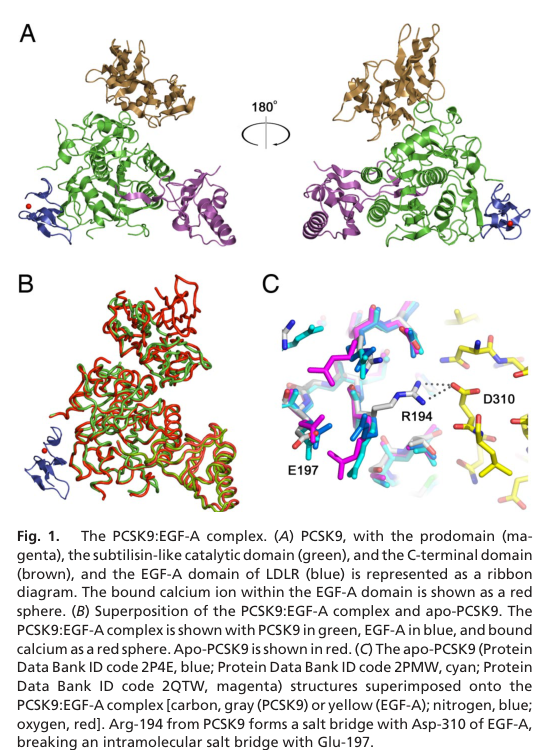

## Question

# Gene Research for Functional Annotation

## ⚠️ CRITICAL: Gene/Protein Identification Context

**BEFORE YOU BEGIN RESEARCH:** You MUST verify you are researching the CORRECT gene/protein. Gene symbols can be ambiguous, especially for less well-characterized genes from non-model organisms.

### Target Gene/Protein Identity (from UniProt):
- **UniProt Accession:** Q8NBP7
- **Protein Description:** RecName: Full=Proprotein convertase subtilisin/kexin type 9; EC=3.4.21.-; AltName: Full=Neural apoptosis-regulated convertase 1; Short=NARC-1; AltName: Full=Proprotein convertase 9; Short=PC9; AltName: Full=Subtilisin/kexin-like protease PC9; Flags: Precursor;
- **Gene Information:** Name=PCSK9; Synonyms=NARC1; ORFNames=PSEC0052;
- **Organism (full):** Homo sapiens (Human).
- **Protein Family:** Belongs to the peptidase S8 family. .
- **Key Domains:** PCSK9_C1. (IPR041254); PCSK9_C2. (IPR041052); PCSK9_C3. (IPR041051); PCSK9_ProteinaseK-like. (IPR034193); Peptidase_S8/S53_dom. (IPR000209)

### MANDATORY VERIFICATION STEPS:

1. **Check if the gene symbol "PCSK9" matches the protein description above**
2. **Verify the organism is correct:** Homo sapiens (Human).
3. **Check if protein family/domains align with what you find in literature**
4. **If you find literature for a DIFFERENT gene with the same or similar symbol, STOP**

### If Gene Symbol is Ambiguous or You Cannot Find Relevant Literature:

**DO NOT PROCEED WITH RESEARCH ON A DIFFERENT GENE.** Instead:
- State clearly: "The gene symbol 'PCSK9' is ambiguous or literature is limited for this specific protein"
- Explain what you found (e.g., "Found extensive literature on a different gene with the same symbol in a different organism")
- Describe the protein based ONLY on the UniProt information provided above
- Suggest that the protein function can be inferred from domain/family information

### Research Target:

Please provide a comprehensive research report on the gene **PCSK9** (gene ID: PCSK9, UniProt: Q8NBP7) in human.

The research report should be a detailed narrative explaining the function, biological processes, and localization of the gene product. Citations should be given for all claims.

You should prioritize authoritative reviews and primary scientific literature when conducting research. You can supplement
this with annotations you find in gene/protein databases, but these can be outdated or inaccurate.

We are specifically interested in the primary function of the gene - for enzymes, what reaction is catalyzed, and what is the substrate specificity? For transporters, what is the substrate? For structural proteins or adapters, what is the broader structural role? For signaling molecules, what is the role in the pathway.

We are interested in where in or outside the cell the gene product carries out its function.

We are also interested in the signaling or biochemical pathways in which the gene functions. We are less interested in broad pleiotropic effects, except where these elucidate the precise role.

Include evidence where possible. We are interested in both experimental evidence as well as inference from structure, evolution, or bioinformatic analysis. Precise studies should be prioritized over high-throughput, where available.

## Output

Question: You are an expert researcher providing comprehensive, well-cited information.

Provide detailed information focusing on:
1. Key concepts and definitions with current understanding
2. Recent developments and latest research (prioritize 2023-2024 sources)
3. Current applications and real-world implementations
4. Expert opinions and analysis from authoritative sources
5. Relevant statistics and data from recent studies

Format as a comprehensive research report with proper citations. Include URLs and publication dates where available.
Always prioritize recent, authoritative sources and provide specific citations for all major claims.

# Gene Research for Functional Annotation

## ⚠️ CRITICAL: Gene/Protein Identification Context

**BEFORE YOU BEGIN RESEARCH:** You MUST verify you are researching the CORRECT gene/protein. Gene symbols can be ambiguous, especially for less well-characterized genes from non-model organisms.

### Target Gene/Protein Identity (from UniProt):
- **UniProt Accession:** Q8NBP7
- **Protein Description:** RecName: Full=Proprotein convertase subtilisin/kexin type 9; EC=3.4.21.-; AltName: Full=Neural apoptosis-regulated convertase 1; Short=NARC-1; AltName: Full=Proprotein convertase 9; Short=PC9; AltName: Full=Subtilisin/kexin-like protease PC9; Flags: Precursor;
- **Gene Information:** Name=PCSK9; Synonyms=NARC1; ORFNames=PSEC0052;
- **Organism (full):** Homo sapiens (Human).
- **Protein Family:** Belongs to the peptidase S8 family. .
- **Key Domains:** PCSK9_C1. (IPR041254); PCSK9_C2. (IPR041052); PCSK9_C3. (IPR041051); PCSK9_ProteinaseK-like. (IPR034193); Peptidase_S8/S53_dom. (IPR000209)

### MANDATORY VERIFICATION STEPS:

1. **Check if the gene symbol "PCSK9" matches the protein description above**
2. **Verify the organism is correct:** Homo sapiens (Human).
3. **Check if protein family/domains align with what you find in literature**
4. **If you find literature for a DIFFERENT gene with the same or similar symbol, STOP**

### If Gene Symbol is Ambiguous or You Cannot Find Relevant Literature:

**DO NOT PROCEED WITH RESEARCH ON A DIFFERENT GENE.** Instead:
- State clearly: "The gene symbol 'PCSK9' is ambiguous or literature is limited for this specific protein"
- Explain what you found (e.g., "Found extensive literature on a different gene with the same symbol in a different organism")
- Describe the protein based ONLY on the UniProt information provided above
- Suggest that the protein function can be inferred from domain/family information

### Research Target:

Please provide a comprehensive research report on the gene **PCSK9** (gene ID: PCSK9, UniProt: Q8NBP7) in human.

The research report should be a detailed narrative explaining the function, biological processes, and localization of the gene product. Citations should be given for all claims.

You should prioritize authoritative reviews and primary scientific literature when conducting research. You can supplement
this with annotations you find in gene/protein databases, but these can be outdated or inaccurate.

We are specifically interested in the primary function of the gene - for enzymes, what reaction is catalyzed, and what is the substrate specificity? For transporters, what is the substrate? For structural proteins or adapters, what is the broader structural role? For signaling molecules, what is the role in the pathway.

We are interested in where in or outside the cell the gene product carries out its function.

We are also interested in the signaling or biochemical pathways in which the gene functions. We are less interested in broad pleiotropic effects, except where these elucidate the precise role.

Include evidence where possible. We are interested in both experimental evidence as well as inference from structure, evolution, or bioinformatic analysis. Precise studies should be prioritized over high-throughput, where available.

# Human PCSK9 (UniProt Q8NBP7): functional annotation and research report

**Identity and central conclusion.** The supplied accession Q8NBP7 identifies human **PCSK9** (also called NARC-1), not a similarly named protein from another organism. The literature agrees with the supplied peptidase-S8/subtilisin-like classification and describes a secreted precursor comprising a signal peptide, inhibitory prodomain, subtilisin-like catalytic region, and three-module cysteine/histidine-rich C-terminal region. Although PCSK9 is classified as a protease, its principal established physiological function is **to bind the low-density lipoprotein receptor (LDLR) and promote its lysosomal destruction**, thereby decreasing hepatic clearance of circulating LDL particles. It does **not** need to proteolytically cleave LDLR to perform this function. The accession is supplied in the question; the cited structural and functional studies independently corroborate the protein’s name, architecture and human LDLR-related function. (bao2024targetingproproteinconvertase pages 2-3, kwon2008molecularbasisfor pages 1-2, lagace2006secretedpcsk9decreases pages 1-2, poirier2016traffickingdynamicsof pages 1-2)

## Biochemical activity and substrate specificity

PCSK9’s demonstrated proteolytic reaction is **intramolecular zymogen processing** in the endoplasmic reticulum (ER): its catalytic triad, Asp186–His226–Ser386, mediates cleavage of its *own* precursor at **VFAQ¹⁵²↓SIP¹⁵³**, producing an N-terminal prodomain and a mature chain beginning at Ser153. This nonbasic cleavage site distinguishes it from several other proprotein convertases. Autocleavage permits folding/ER exit and secretion, but the cleaved prodomain stays tightly associated and occludes the active site. Thus, protease activity is needed to *make* secreted PCSK9, whereas continuing proteolysis is not needed for secreted PCSK9’s LDLR-regulatory action; no comparably established physiological protein substrate cleaved **in trans** should be substituted for its autocleavage substrate. The designation “proprotein convertase” must not be interpreted as evidence that PCSK9 enzymatically digests LDLR. (kwon2008molecularbasisfor pages 1-2, lagace2006secretedpcsk9decreases pages 1-2, poirier2016traffickingdynamicsof pages 1-2, poirier2008theproproteinconvertase pages 1-2)

In the mature complex, the LDLR-recognition surface lies on PCSK9’s subtilisin-like domain **away from its catalytic site**. Kwon and colleagues’ crystal structure resolved PCSK9 bound to LDLR’s calcium-binding epidermal-growth-factor-like repeat A (**EGF-A**) at approximately 2.4 Å; Arg194 and Phe379 contribute to the interface, whereas the prodomain and C-terminal region do not directly form the primary EGF-A contact in that structure. Their binding measurements found approximately **threefold stronger binding at pH 6 than pH 7**; deleting part of the N-terminal prodomain increased apparent LDLR-binding affinity from an EC₅₀ of **203 to 27.8 nM** under the reported assay conditions. These are measurements of interaction, not catalytic turnover. Figure 1 of that study directly illustrates the separate prodomain, catalytic-domain, C-terminal-domain and LDLR–EGF-A components. (kwon2008molecularbasisfor pages 2-3, kwon2008molecularbasisfor media a84aeb5d)

## Where PCSK9 acts and its pathway

**Source and route.** Adult liver hepatocytes are the dominant source of circulating PCSK9. Processing begins in the ER, followed by passage through the secretory pathway and release into blood; hepatic PCSK9 expression is regulated by sterol-responsive **SREBP2**, with HNF1α also implicated. This links PCSK9 to the sterol-feedback network: statins can induce LDLR transcription while simultaneously increasing PCSK9 expression, which can constrain the resulting increase in receptor abundance. Other tissues express PCSK9, but the strongest established explanation for human circulating LDL-cholesterol regulation is the liver-derived PCSK9–hepatic LDLR axis. (lagace2006secretedpcsk9decreases pages 1-2, poirier2016traffickingdynamicsof pages 1-2, bao2024targetingproproteinconvertase pages 2-3)

**Site and sequence of action.** At the extracellular hepatocyte surface, PCSK9 binds LDLR’s EGF-A repeat, distinct from the receptor region that binds LDL particles. Receptor-associated PCSK9 enters endosomes; the stronger interaction under acidic conditions interferes with the receptor’s usual dissociation/recycling itinerary. LDLR is instead delivered to lysosomes, reducing receptor abundance at the surface and therefore decreasing hepatic LDL-particle uptake. Purified PCSK9 lowered surface LDLR in cultured hepatocytes; parabiosis transferred circulating PCSK9 from mice expressing human PCSK9 to wild-type partners and drove hepatic LDLR nearly below detection, providing especially direct evidence that extracellular PCSK9 is biologically active. LDLR degradation is *post-translational*: increased circulating LDL-C results from loss of clearance capacity, not from PCSK9 transporting LDL or cleaving LDL cholesterol. (zhang2007bindingofproprotein pages 1-2, lagace2006secretedpcsk9decreases pages 1-2)

Mechanistic qualifications matter. Silencing clathrin heavy chain blocks PCSK9-mediated LDLR degradation, whereas interference with LDLR-tail ubiquitination, proteasomes, canonical macroautophagy or the tested ESCRT components did not block it. The endocytic adaptor **ARH** was required in some hepatocyte/lymphocyte experiments but *not* in fibroblasts, so it is not a universal PCSK9-specific requirement. Live-cell studies additionally support an intracellular trans-Golgi-to-lysosome route and show that PCSK9’s C-terminal region is important for receptor sorting and degradation, despite not being the main EGF-A-binding surface. The relative contribution of this intracellular route under normal human physiology is less certain than that of circulating PCSK9. (wang2012molecularcharacterizationof pages 1-2, poirier2016traffickingdynamicsof pages 1-2)

The following table separates directly demonstrated steps from less-established ancillary effects:

| Stage/site | Precise molecular role | Strongest experimental evidence |
|---|---|---|
| Endoplasmic reticulum: biosynthesis and maturation | The zymogen autocatalytically cleaves its own **VFAQ¹⁵²↓SIP¹⁵³** bond. Cleavage enables ER exit, but the prodomain remains tightly and noncovalently bound, occluding the catalytic site. Secreted PCSK9 is therefore not an ordinary active protease. The catalytic region begins at Ser153 and may be described as extending to approximately residue 421 or 454, depending on whether the hinge is included. | Pulse–chase experiments resolved precursor and cleaved secreted forms; biochemical and structural studies mapped the mature N terminus to Ser153 and showed the retained prodomain blocking the active site. **Direct biochemical and structural evidence.** (ly2016élucidationetidentification pages 100-102, kwon2008molecularbasisfor pages 1-2, lagace2006secretedpcsk9decreases pages 1-2) |
| Extracellular space and hepatocyte surface | Secreted PCSK9 functions chiefly as a **ligand and trafficking regulator**, not by proteolytically cleaving LDLR. A surface of its subtilisin-like catalytic domain, separate from the active site, binds the LDLR **EGF-A** repeat. Binding is calcium-dependent and strengthens as pH falls. | Purified-protein binding, receptor mutagenesis and a 2.4 Å PCSK9–EGF-A crystal structure localized the interface; catalytically inactive secreted PCSK9 retained LDLR-degrading activity. Extracellular PCSK9 reduced hepatocyte-surface LDLR, while D374Y was approximately tenfold more active in cells. **Direct structural, biochemical and cellular evidence.** (nguyen2013characterizationofpcsk9mediated pages 30-34, kwon2008molecularbasisfor pages 2-3, zhang2007bindingofproprotein pages 1-2, lagace2006secretedpcsk9decreases pages 1-2) |
| Endosomes and lysosomes | The PCSK9–LDLR complex undergoes clathrin-mediated endocytosis. Acidic conditions favor persistent binding, impair normal LDLR recycling and redirect receptor and ligand to lysosomes. ARH dependence varies by cell type. The C-terminal cysteine/histidine-rich region promotes endocytosis and late-endosomal sorting rather than forming the primary EGF-A interface. | LDLR redistribution to lysosomes was visualized after extracellular PCSK9 treatment. Clathrin-heavy-chain knockdown blocked degradation, whereas inhibition of ubiquitination, proteasomes, macroautophagy or canonical ESCRT machinery did not. ARH loss blocked degradation in some cells but not fibroblasts; imaging and rescue experiments established the C-terminal region’s sorting role. **Direct cell-biological evidence.** (zhang2007bindingofproprotein pages 1-2, wang2012molecularcharacterizationof pages 1-2, poirier2016traffickingdynamicsof pages 1-2) |
| Liver and circulation | Hepatocyte-derived PCSK9 lowers surface LDLR abundance, reducing plasma LDL-particle clearance and increasing LDL cholesterol. Hepatic transcription is induced by **SREBP2**, explaining in part why statins can increase PCSK9 while also inducing LDLR. | Liver-specific human-PCSK9 expression in mice produced severe hypercholesterolemia. Parabiosis transferred circulating PCSK9 to wild-type partners and reduced hepatic LDLR to nearly undetectable levels. Hepatic expression studies identified PCSK9 as SREBP regulated. **Direct in-vivo evidence for circulating function; transcriptional regulation supported by primary studies and later synthesis.** (lagace2006secretedpcsk9decreases pages 1-2, poirier2016traffickingdynamicsof pages 1-2) |
| Ancillary LDLR-family targets | PCSK9 can also promote degradation of **VLDLR** and **ApoER2** experimentally, independently of LDLR and without requiring PCSK9 catalytic activity. These effects do not have evidence equivalent to the canonical human hepatic PCSK9–LDLR pathway. | Co-expression and uptake experiments showed that secreted PCSK9 reduced VLDLR and ApoER2; D374Y was more potent, and membrane tethering enhanced delivery to late endosomes and lysosomes. Evidence comes principally from cultured-cell and animal-expression systems. **Direct experimental evidence, but uncertain human physiological importance.** (poirier2008theproproteinconvertase pages 1-2, bao2024targetingproproteinconvertase pages 4-6) |

*Table: Mechanistic evidence for human PCSK9/Q8NBP7 from autocatalytic maturation through LDLR binding, trafficking and systemic LDL regulation. Canonical functions are distinguished from ancillary receptor effects of less certain human significance.*

**Other reported targets.** Cell-based experiments show that PCSK9 can also induce degradation of the LDLR-family members **VLDLR and ApoER2** without requiring PCSK9 catalytic activity or LDLR expression. A 2024 review catalogs further proposed receptor and extrahepatic interactions. These findings are useful for hypotheses about other tissues, but their human physiological importance is not established to the same standard as hepatic LDLR regulation; they should not displace LDLR as the primary functional annotation. (poirier2008theproproteinconvertase pages 1-2, bao2024targetingproproteinconvertase pages 4-6)

## Human genetics and recent molecular research

Human genetics independently validates the pathway. In the prospective ARIC analysis reported by Cohen and colleagues in **March 2006**, **2.6%** of 3,363 Black participants carried the studied PCSK9 nonsense alleles; carriers had **28% lower mean LDL-C** and an estimated **88% lower coronary-heart-disease risk**. Among 9,524 White participants, **3.2%** carried R46L, associated with **15% lower LDL-C** and an estimated **47% lower coronary-heart-disease risk** over approximately 15 years. These are observational genotype-associated estimates, not effects expected after short-term drug treatment. A separate **2006** molecular study identified a person with two inactivating PCSK9 alleles, undetectable circulating PCSK9 and **LDL-C of 14 mg/dL**, reinforcing the importance of PCSK9 secretion for LDL regulation. (cohen2006sequencevariationsin pages 1-2, nguyen2013characterizationofpcsk9mediated pages 25-30)

Recent precise variant work helps distinguish *binding defects* from *processing defects*. In a primary study published **February 2023**, Larrea-Sebal and colleagues found that human **PCSK9 p.Arg160Gln** was processed and secreted similarly to wild type but bound LDLR less effectively: the experimental results assign EC₅₀ values of **8.57 ± 0.76 for wild type** and **25.96 ± 0.72 for Arg160Gln**, with **1.54 ± 0.38 for gain-of-function D374Y**. Cells expressing Arg160Gln internalized approximately **13% more LDL** than those expressing wild-type PCSK9, supporting a loss-of-function classification despite its discovery in a person with hypercholesterolemia. The paper’s abstract presents the two binding values in a potentially misleading order; the values and assignments here follow its detailed results, so a *higher*, not lower, EC₅₀ corresponds to weaker apparent binding in this assay. This example illustrates why a patient’s phenotype alone does not establish that a PCSK9 missense change is pathogenic. (larreasebal2023functionalcharacterizationof pages 4-7, larreasebal2023functionalcharacterizationof pages 1-2)

The authoritative **January 2024** synthesis by Bao and colleagues emphasizes the same separation between precursor proteolysis and mature LDLR-trafficking activity. It distinguishes the catalytic core, intervening hinge and three C-terminal modules and notes that **furin cleavage near Arg218 can inactivate PCSK9**, providing a second processing route distinct from activating autocleavage. This is a synthesis of heterogeneous experimental evidence, not proof that all proposed extrahepatic effects are equally consequential in humans. (bao2024targetingproproteinconvertase pages 2-3, bao2024targetingproproteinconvertase pages 4-6)

## Clinical implementation and quantitative outcomes

**Established therapies act at different stages of the same pathway.** The antibodies **evolocumab and alirocumab** neutralize extracellular PCSK9 so that LDLR can recycle, whereas **inclisiran**, a liver-directed small interfering RNA, reduces production of PCSK9 inside hepatocytes. A 2024 review additionally lists **tafolecimab** among approved antibodies, but approval and availability vary by jurisdiction. PCSK9-targeted treatment is used to lower LDL-C in selected patients with hypercholesterolemia or atherosclerotic cardiovascular disease, generally alongside other lipid-lowering treatment. These interventions do not act by inhibiting cleavage of LDLR by PCSK9. (bao2024targetingproproteinconvertase pages 1-2, sabatine2017evolocumabandclinical pages 1-2, raal2020inclisiranforthe pages 1-2)

Randomized cardiovascular-outcome evidence is strongest for the antibodies. In **FOURIER** (**published 2017**), 27,564 statin-treated patients with established atherosclerotic cardiovascular disease received evolocumab or placebo: LDL-C fell **59%** relative to placebo at 48 weeks, from a median **92 to 30 mg/dL**; the prespecified primary composite event occurred in **9.8% versus 11.3%** over a median 2.2 years (hazard ratio **0.85**). In **ODYSSEY OUTCOMES** (**published 2018**), 18,924 patients after acute coronary syndrome received alirocumab or placebo on background statins: the primary ischemic-event composite occurred in **9.5% versus 11.1%** over a median 2.8 years (hazard ratio **0.85**). The composites differ between trials and should not be treated as identical endpoints. (sabatine2017evolocumabandclinical pages 1-2, schwartz2018alirocumabandcardiovascular pages 1-2)

**Inclisiran has established LDL-C efficacy but a distinct outcomes evidence base.** In **ORION-9** (**published 2020**), 482 adults with heterozygous familial hypercholesterolemia had a **47.9-percentage-point placebo-adjusted LDL-C reduction** at day 510 on the studied dosing schedule; this was a lipid-endpoint trial, not a definitive demonstration of fewer cardiovascular events. The registries retrieved for **ORION-4** ([NCT03705234](https://clinicaltrials.gov/study/NCT03705234)) and **VICTORION-2 PREVENT** ([NCT05030428](https://clinicaltrials.gov/study/NCT05030428)) describe active, nonrecruiting phase 3 cardiovascular-outcome studies, with approximately **16,124** and **17,004** participants respectively, but do not provide final outcome results. These are **registry snapshots available in 2026**, not claims about what their status was in 2024. An implementation study, VICTORION-INITIATE ([NCT04929249](https://clinicaltrials.gov/study/NCT04929249)), completed enrollment of **450** and posted results in **September 2024**; its primary measure was LDL-C change, not cardiovascular-event reduction. (raal2020inclisiranforthe pages 1-2, NCT03705234 chunk 1, NCT05030428 chunk 1, NCT04929249 chunk 1)

**Emerging approaches, not established alternatives.** A **2024** review describes the investigational oral PCSK9-binding macrocycle **MK-0616** and early human LDL-lowering results; it was not a licensed oral PCSK9 therapy in that source. Preliminary first-in-human **VERVE-101** base-editing findings reported in **2023–2024 commentary** described LDL-C decreases of **39% and 48%** in two participants at 0.45 mg/kg and **55%** in one participant at 0.6 mg/kg. Those tiny, uncontrolled dose cohorts, reported safety events and unresolved long-term/off-target risks cannot establish clinical benefit or routine-use readiness. The base-editing findings are conference-derived early reports summarized by commentators, rather than a completed randomized-outcome publication. (fassi2024pcsk9inhibitorsa pages 9-11, han2024firstinvivo pages 1-2, horie2024verve101apromising pages 1-2)

**Interpretive bottom line.** The highest-confidence annotation is **secreted regulator of LDLR endosomal trafficking and lysosomal degradation, controlling hepatic LDL clearance**; its demonstrable enzymatic specificity is **self-cleavage of pro-PCSK9 during maturation**. Human genetic studies, binding/trafficking experiments and antibody outcome trials converge on this account. Important unresolved questions include the physiological weight of intracellular trafficking routes and ancillary receptors, and whether newer RNA-silencing or permanent-editing strategies reproduce antibody-level long-term clinical outcomes and safety. (kwon2008molecularbasisfor pages 1-2, lagace2006secretedpcsk9decreases pages 1-2, wang2012molecularcharacterizationof pages 1-2, cohen2006sequencevariationsin pages 1-2, sabatine2017evolocumabandclinical pages 1-2, NCT03705234 chunk 1)

### Selected primary sources and recent syntheses

- Kwon *et al.* **February 2008**, structural PCSK9–LDLR recognition: https://doi.org/10.1073/pnas.0712064105. (kwon2008molecularbasisfor pages 2-3)
- Lagace *et al.* **November 2006**, circulating PCSK9 and parabiosis: https://doi.org/10.1172/JCI29383; Zhang *et al.* **June 2007**, EGF-A binding and impaired recycling: https://doi.org/10.1074/jbc.M702027200. (lagace2006secretedpcsk9decreases pages 1-2, zhang2007bindingofproprotein pages 1-2)
- Wang *et al.* **September 2012**, endocytic-pathway perturbations: https://doi.org/10.1194/jlr.M028563; Poirier *et al.* **June 2016**, C-terminal trafficking function: https://doi.org/10.1371/journal.pone.0157230. (wang2012molecularcharacterizationof pages 1-2, poirier2016traffickingdynamicsof pages 1-2)
- Cohen *et al.* **March 2006**, human PCSK9 loss-of-function and coronary risk: https://doi.org/10.1056/NEJMoa054013; Larrea-Sebal *et al.* **February 2023**, Arg160Gln functional analysis: https://doi.org/10.3390/ijms24043330. (cohen2006sequencevariationsin pages 1-2, larreasebal2023functionalcharacterizationof pages 4-7)
- Bao *et al.* **January 2024**, broad mechanism-to-therapy review: https://doi.org/10.1038/s41392-023-01690-3. (bao2024targetingproproteinconvertase pages 2-3)
- Sabatine *et al.* **May 2017**, FOURIER: https://doi.org/10.1056/NEJMoa1615664; Schwartz *et al.* **November 2018**, ODYSSEY OUTCOMES: https://doi.org/10.1056/NEJMoa1801174; Raal *et al.* **April 2020**, ORION-9: https://doi.org/10.1056/NEJMoa1913805. (sabatine2017evolocumabandclinical pages 1-2, schwartz2018alirocumabandcardiovascular pages 1-2, raal2020inclisiranforthe pages 1-2)

References

1. (bao2024targetingproproteinconvertase pages 2-3): Xuhui Bao, Yongjun Liang, Hanman Chang, Tianji Cai, Baijie Feng, Konstantin Gordon, Yuekun Zhu, Hailian Shi, Yundong He, and Liyi Xie. Targeting proprotein convertase subtilisin/kexin type 9 (pcsk9): from bench to bedside. Signal Transduction and Targeted Therapy, Jan 2024. URL: https://doi.org/10.1038/s41392-023-01690-3, doi:10.1038/s41392-023-01690-3. This article has 243 citations and is from a peer-reviewed journal.

2. (kwon2008molecularbasisfor pages 1-2): Hyock Joo Kwon, Thomas A. Lagace, Markey C. McNutt, Jay D. Horton, and Johann Deisenhofer. Molecular basis for ldl receptor recognition by pcsk9. Proceedings of the National Academy of Sciences, 105:1820-1825, Feb 2008. URL: https://doi.org/10.1073/pnas.0712064105, doi:10.1073/pnas.0712064105. This article has 566 citations and is from a highest quality peer-reviewed journal.

3. (lagace2006secretedpcsk9decreases pages 1-2): Thomas A. Lagace, David E. Curtis, Rita Garuti, Markey C. McNutt, Sahng Wook Park, Heidi B. Prather, Norma N. Anderson, Y.K. Ho, Robert E. Hammer, and Jay D. Horton. Secreted pcsk9 decreases the number of ldl receptors in hepatocytes and in livers of parabiotic mice. The Journal of clinical investigation, 116 11:2995-3005, Nov 2006. URL: https://doi.org/10.1172/jci29383, doi:10.1172/jci29383. This article has 901 citations.

4. (poirier2016traffickingdynamicsof pages 1-2): Steve Poirier, Hocine Ait Hamouda, Louis Villeneuve, Annie Demers, and Gaétan Mayer. Trafficking dynamics of pcsk9-induced ldlr degradation: focus on human pcsk9 mutations and c-terminal domain. PLoS ONE, 11:e0157230, Jun 2016. URL: https://doi.org/10.1371/journal.pone.0157230, doi:10.1371/journal.pone.0157230. This article has 53 citations and is from a peer-reviewed journal.

5. (poirier2008theproproteinconvertase pages 1-2): Steve Poirier, Gaetan Mayer, Suzanne Benjannet, Eric Bergeron, Jadwiga Marcinkiewicz, Nasha Nassoury, Harald Mayer, Johannes Nimpf, Annik Prat, and Nabil G. Seidah. The proprotein convertase pcsk9 induces the degradation of low density lipoprotein receptor (ldlr) and its closest family members vldlr and apoer2*. Journal of Biological Chemistry, 283:2363-2372, Jan 2008. URL: https://doi.org/10.1074/jbc.m708098200, doi:10.1074/jbc.m708098200. This article has 637 citations and is from a domain leading peer-reviewed journal.

6. (kwon2008molecularbasisfor pages 2-3): Hyock Joo Kwon, Thomas A. Lagace, Markey C. McNutt, Jay D. Horton, and Johann Deisenhofer. Molecular basis for ldl receptor recognition by pcsk9. Proceedings of the National Academy of Sciences, 105:1820-1825, Feb 2008. URL: https://doi.org/10.1073/pnas.0712064105, doi:10.1073/pnas.0712064105. This article has 566 citations and is from a highest quality peer-reviewed journal.

7. (kwon2008molecularbasisfor media a84aeb5d): Hyock Joo Kwon, Thomas A. Lagace, Markey C. McNutt, Jay D. Horton, and Johann Deisenhofer. Molecular basis for ldl receptor recognition by pcsk9. Proceedings of the National Academy of Sciences, 105:1820-1825, Feb 2008. URL: https://doi.org/10.1073/pnas.0712064105, doi:10.1073/pnas.0712064105. This article has 566 citations and is from a highest quality peer-reviewed journal.

8. (zhang2007bindingofproprotein pages 1-2): Da-Wei Zhang, Thomas A. Lagace, Rita Garuti, Zhenze Zhao, Meghan McDonald, Jay D. Horton, Jonathan C. Cohen, and Helen H. Hobbs. Binding of proprotein convertase subtilisin/kexin type 9 to epidermal growth factor-like repeat a of low density lipoprotein receptor decreases receptor recycling and increases degradation*. Journal of Biological Chemistry, 282:18602-18612, Jun 2007. URL: https://doi.org/10.1074/jbc.m702027200, doi:10.1074/jbc.m702027200. This article has 1017 citations and is from a domain leading peer-reviewed journal.

9. (wang2012molecularcharacterizationof pages 1-2): Yan Wang, Yongcheng Huang, Helen H. Hobbs, and Jonathan C. Cohen. Molecular characterization of proprotein convertase subtilisin/kexin type 9-mediated degradation of the ldlr. Journal of Lipid Research, 53:1932-1943, Sep 2012. URL: https://doi.org/10.1194/jlr.m028563, doi:10.1194/jlr.m028563. This article has 144 citations and is from a peer-reviewed journal.

10. (ly2016élucidationetidentification pages 100-102): K Ly. Élucidation et identification des différents interacteurs impliqués dans le mécanisme de régulation du ldlr par la protéine pcsk9. Unknown journal, 2016.

11. (nguyen2013characterizationofpcsk9mediated pages 30-34): My-Anh Nguyen. Characterization of pcsk9-mediated ldlr degradation in hepatic and fibroblast cells. ArXiv, Sep 2013. URL: https://doi.org/10.20381/ruor-3619, doi:10.20381/ruor-3619. This article has 0 citations.

12. (bao2024targetingproproteinconvertase pages 4-6): Xuhui Bao, Yongjun Liang, Hanman Chang, Tianji Cai, Baijie Feng, Konstantin Gordon, Yuekun Zhu, Hailian Shi, Yundong He, and Liyi Xie. Targeting proprotein convertase subtilisin/kexin type 9 (pcsk9): from bench to bedside. Signal Transduction and Targeted Therapy, Jan 2024. URL: https://doi.org/10.1038/s41392-023-01690-3, doi:10.1038/s41392-023-01690-3. This article has 243 citations and is from a peer-reviewed journal.

13. (cohen2006sequencevariationsin pages 1-2): Jonathan C. Cohen, Eric Boerwinkle, Thomas H. Mosley, and Helen H. Hobbs. Sequence variations in pcsk9, low ldl, and protection against coronary heart disease. The New England journal of medicine, 354 12:1264-72, Mar 2006. URL: https://doi.org/10.1056/nejmoa054013, doi:10.1056/nejmoa054013. This article has 4295 citations and is from a highest quality peer-reviewed journal.

14. (nguyen2013characterizationofpcsk9mediated pages 25-30): My-Anh Nguyen. Characterization of pcsk9-mediated ldlr degradation in hepatic and fibroblast cells. ArXiv, Sep 2013. URL: https://doi.org/10.20381/ruor-3619, doi:10.20381/ruor-3619. This article has 0 citations.

15. (larreasebal2023functionalcharacterizationof pages 4-7): Asier Larrea-Sebal, Chiara Trenti, Shifa Jebari-Benslaiman, Stefano Bertolini, Sebastiano Calandra, Emanuele A. Negri, Efrem Bonelli, Asier Benito-Vicente, Leire Uraga-Gracianteparaluceta, César Martín, and Tommaso Fasano. Functional characterization of p.(arg160gln) pcsk9 variant accidentally found in a hypercholesterolemic subject. International Journal of Molecular Sciences, 24:3330, Feb 2023. URL: https://doi.org/10.3390/ijms24043330, doi:10.3390/ijms24043330. This article has 7 citations.

16. (larreasebal2023functionalcharacterizationof pages 1-2): Asier Larrea-Sebal, Chiara Trenti, Shifa Jebari-Benslaiman, Stefano Bertolini, Sebastiano Calandra, Emanuele A. Negri, Efrem Bonelli, Asier Benito-Vicente, Leire Uraga-Gracianteparaluceta, César Martín, and Tommaso Fasano. Functional characterization of p.(arg160gln) pcsk9 variant accidentally found in a hypercholesterolemic subject. International Journal of Molecular Sciences, 24:3330, Feb 2023. URL: https://doi.org/10.3390/ijms24043330, doi:10.3390/ijms24043330. This article has 7 citations.

17. (bao2024targetingproproteinconvertase pages 1-2): Xuhui Bao, Yongjun Liang, Hanman Chang, Tianji Cai, Baijie Feng, Konstantin Gordon, Yuekun Zhu, Hailian Shi, Yundong He, and Liyi Xie. Targeting proprotein convertase subtilisin/kexin type 9 (pcsk9): from bench to bedside. Signal Transduction and Targeted Therapy, Jan 2024. URL: https://doi.org/10.1038/s41392-023-01690-3, doi:10.1038/s41392-023-01690-3. This article has 243 citations and is from a peer-reviewed journal.

18. (sabatine2017evolocumabandclinical pages 1-2): Marc S. Sabatine, Robert P. Giugliano, Anthony C. Keech, Narimon Honarpour, Stephen D. Wiviott, Sabina A. Murphy, Julia F. Kuder, Huei Wang, Thomas Liu, Scott M. Wasserman, Peter S. Sever, and Terje R. Pedersen. Evolocumab and clinical outcomes in patients with cardiovascular disease. New England Journal of Medicine, 376:1713-1722, May 2017. URL: https://doi.org/10.1056/nejmoa1615664, doi:10.1056/nejmoa1615664. This article has 8216 citations and is from a highest quality peer-reviewed journal.

19. (raal2020inclisiranforthe pages 1-2): Frederick J. Raal, David Kallend, Kausik K. Ray, Traci Turner, Wolfgang Koenig, R. Scott Wright, Peter L.J. Wijngaard, Danielle Curcio, Mark J. Jaros, Lawrence A. Leiter, and John J.P. Kastelein. Inclisiran for the treatment of heterozygous familial hypercholesterolemia. New England Journal of Medicine, 382:1520-1530, Apr 2020. URL: https://doi.org/10.1056/nejmoa1913805, doi:10.1056/nejmoa1913805. This article has 1099 citations and is from a highest quality peer-reviewed journal.

20. (schwartz2018alirocumabandcardiovascular pages 1-2): Gregory G. Schwartz, P. Gabriel Steg, Michael Szarek, Deepak L. Bhatt, Vera A. Bittner, Rafael Diaz, Jay M. Edelberg, Shaun G. Goodman, Corinne Hanotin, Robert A. Harrington, J. Wouter Jukema, Guillaume Lecorps, Kenneth W. Mahaffey, Angèle Moryusef, Robert Pordy, Kirby Quintero, Matthew T. Roe, William J. Sasiela, Jean-François Tamby, Pierluigi Tricoci, Harvey D. White, and Andreas M. Zeiher. Alirocumab and cardiovascular outcomes after acute coronary syndrome. New England Journal of Medicine, 379:2097-2107, Nov 2018. URL: https://doi.org/10.1056/nejmoa1801174, doi:10.1056/nejmoa1801174. This article has 4725 citations and is from a highest quality peer-reviewed journal.

21. (NCT03705234 chunk 1):  A Randomized Trial Assessing the Effects of Inclisiran on Clinical Outcomes Among People With Cardiovascular Disease. University of Oxford. 2018. ClinicalTrials.gov Identifier: NCT03705234

22. (NCT05030428 chunk 1):  Study of Inclisiran to Prevent Cardiovascular (CV) Events in Participants With Established Cardiovascular Disease. Novartis Pharmaceuticals. 2021. ClinicalTrials.gov Identifier: NCT05030428

23. (NCT04929249 chunk 1):  A Randomized Study to Evaluate the Effect of an "Inclisiran First" Implementation Strategy Compared to Usual Care in Patients With Atherosclerotic Cardiovascular Disease and Elevated LDL-C Despite Receiving Maximally Tolerated Statin Therapy (VICTORION-INITIATE). Novartis Pharmaceuticals. 2021. ClinicalTrials.gov Identifier: NCT04929249

24. (fassi2024pcsk9inhibitorsa pages 9-11): Enrico Mario Alessandro Fassi, Andrea Citarella, Marco Albani, Erica Ginevra Milano, Laura Legnani, Carmen Lammi, Alessandra Silvani, and Giovanni Grazioso. Pcsk9 inhibitors: a patent review 2018-2023. Expert Opinion on Therapeutic Patents, 34:245-261, Apr 2024. URL: https://doi.org/10.1080/13543776.2024.2340569, doi:10.1080/13543776.2024.2340569. This article has 7 citations and is from a peer-reviewed journal.

25. (han2024firstinvivo pages 1-2): Renzhi Han. First in vivo base-editing trial shows promise. Molecular Therapy, 32:1-2, Jan 2024. URL: https://doi.org/10.1016/j.ymthe.2023.12.001, doi:10.1016/j.ymthe.2023.12.001. This article has 19 citations and is from a highest quality peer-reviewed journal.

26. (horie2024verve101apromising pages 1-2): Takahiro Horie and Koh Ono. Verve-101: a promising crispr-based gene editing therapy that reduces ldl-c and pcsk9 levels in hefh patients. European heart journal. Cardiovascular pharmacotherapy, 10:89-90, Dec 2024. URL: https://doi.org/10.1093/ehjcvp/pvad103, doi:10.1093/ehjcvp/pvad103. This article has 100 citations and is from a peer-reviewed journal.

## Artifacts

- [Edison artifact artifact-00](PCSK9-deep-research-falcon_artifacts/artifact-00.md)

## Citations

1. kwon2008molecularbasisfor pages 2-3
2. bao2024targetingproproteinconvertase pages 2-3
3. kwon2008molecularbasisfor pages 1-2
4. poirier2016traffickingdynamicsof pages 1-2
5. poirier2008theproproteinconvertase pages 1-2
6. zhang2007bindingofproprotein pages 1-2
7. wang2012molecularcharacterizationof pages 1-2
8. bao2024targetingproproteinconvertase pages 4-6
9. cohen2006sequencevariationsin pages 1-2
10. larreasebal2023functionalcharacterizationof pages 4-7
11. larreasebal2023functionalcharacterizationof pages 1-2
12. bao2024targetingproproteinconvertase pages 1-2
13. sabatine2017evolocumabandclinical pages 1-2
14. raal2020inclisiranforthe pages 1-2
15. schwartz2018alirocumabandcardiovascular pages 1-2
16. han2024firstinvivo pages 1-2
17. NCT03705234
18. NCT05030428
19. NCT04929249
20. https://clinicaltrials.gov/study/NCT03705234
21. https://clinicaltrials.gov/study/NCT05030428
22. https://clinicaltrials.gov/study/NCT04929249
23. https://doi.org/10.1073/pnas.0712064105.
24. https://doi.org/10.1172/JCI29383;
25. https://doi.org/10.1074/jbc.M702027200.
26. https://doi.org/10.1194/jlr.M028563;
27. https://doi.org/10.1371/journal.pone.0157230.
28. https://doi.org/10.1056/NEJMoa054013;
29. https://doi.org/10.3390/ijms24043330.
30. https://doi.org/10.1038/s41392-023-01690-3.
31. https://doi.org/10.1056/NEJMoa1615664;
32. https://doi.org/10.1056/NEJMoa1801174;
33. https://doi.org/10.1056/NEJMoa1913805.
34. https://doi.org/10.1038/s41392-023-01690-3,
35. https://doi.org/10.1073/pnas.0712064105,
36. https://doi.org/10.1172/jci29383,
37. https://doi.org/10.1371/journal.pone.0157230,
38. https://doi.org/10.1074/jbc.m708098200,
39. https://doi.org/10.1074/jbc.m702027200,
40. https://doi.org/10.1194/jlr.m028563,
41. https://doi.org/10.20381/ruor-3619,
42. https://doi.org/10.1056/nejmoa054013,
43. https://doi.org/10.3390/ijms24043330,
44. https://doi.org/10.1056/nejmoa1615664,
45. https://doi.org/10.1056/nejmoa1913805,
46. https://doi.org/10.1056/nejmoa1801174,
47. https://doi.org/10.1080/13543776.2024.2340569,
48. https://doi.org/10.1016/j.ymthe.2023.12.001,
49. https://doi.org/10.1093/ehjcvp/pvad103,