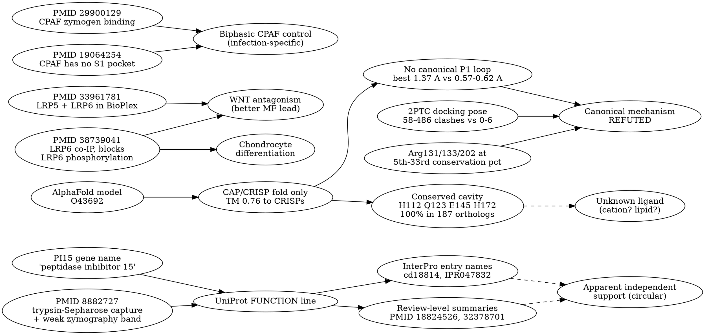
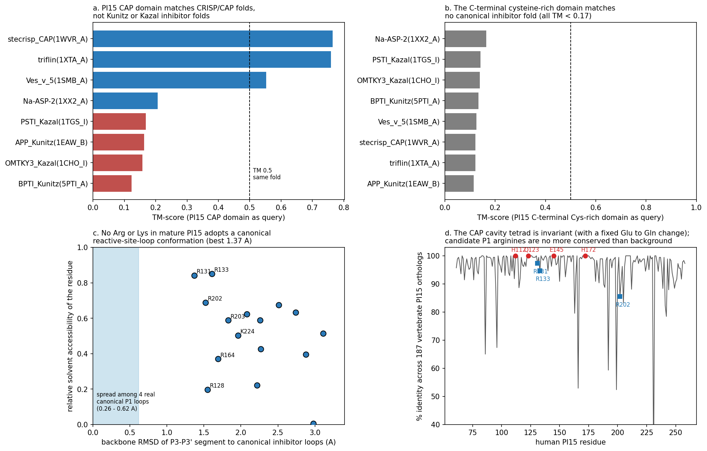
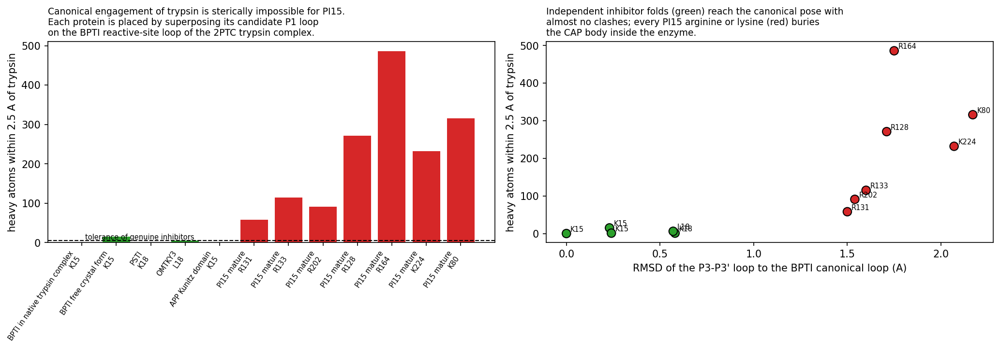
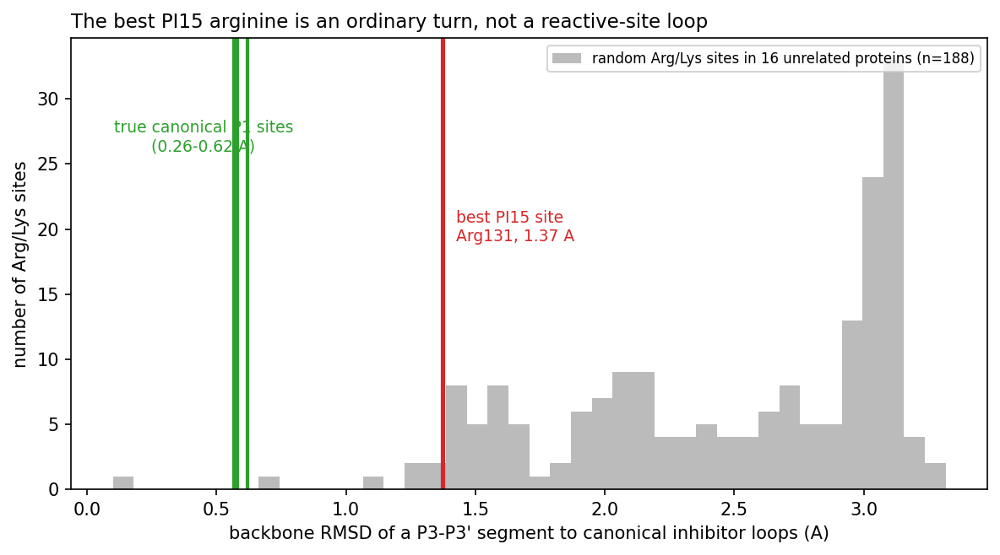
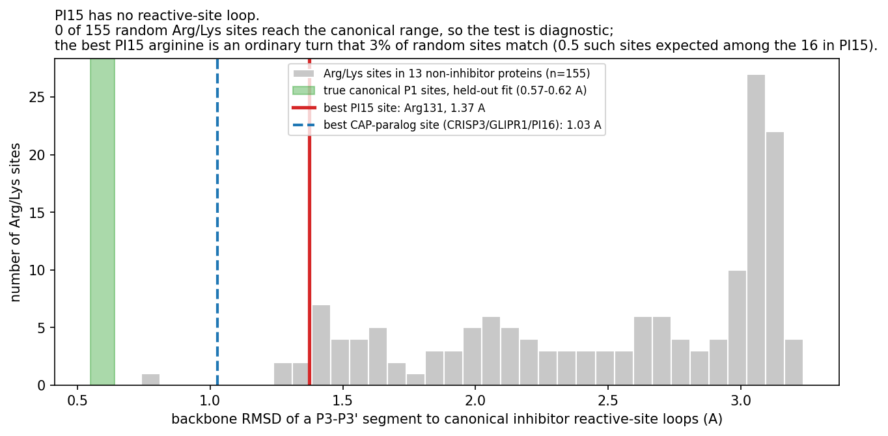

## Question

# AIGR Gene Hypothesis Deep Research

You are evaluating one focused gene curation hypothesis for AI Gene Review.
This is not a general gene overview. Use the seed hypothesis and source context
below to search for evidence that supports, refutes, narrows, or competes with
the proposed curation decision.

## Target Gene

- **Organism code:** human
- **Taxon:** Homo sapiens (NCBITaxon:9606)
- **Gene directory:** PI15
- **Gene symbol:** PI15
- **UniProt accession:** O43692

## Focus

- **Focus type:** free_text
- **Hypothesis slug:** kgap-pi15-cap-crisp-inhibitor-features
- **Source file:** genes/human/PI15/PI15-ai-review.yaml
- **Source selector:** free-text

## Seed Hypothesis

Human PI15 (peptidase inhibitor 15, UniProt O43692), a CAP superfamily (CRISP-like) protein, inhibits trypsin-like serine proteases through features of its CAP domain or its C-terminal cysteine-rich domain. Single analysis only: model PI15 (AlphaFold), compare its domains with CAP/CRISP structures and with known protease-inhibitor folds, identify any exposed loop with a reactive-site-like P1 Arg/Lys consistent with canonical inhibition, and assess conservation across vertebrate PI15/PI16 orthologs; state whether the structure supports a canonical serine-protease-inhibitor mechanism.

## Term and Decision Context

No specific term context supplied.

## Reference Context

No specific reference context supplied.

## Source Context YAML

```yaml
hypothesis: 'Human PI15 (peptidase inhibitor 15, UniProt O43692), a CAP superfamily (CRISP-like) protein,
  inhibits trypsin-like serine proteases through features of its CAP domain or its C-terminal cysteine-rich
  domain. Single analysis only: model PI15 (AlphaFold), compare its domains with CAP/CRISP structures
  and with known protease-inhibitor folds, identify any exposed loop with a reactive-site-like P1 Arg/Lys
  consistent with canonical inhibition, and assess conservation across vertebrate PI15/PI16 orthologs;
  state whether the structure supports a canonical serine-protease-inhibitor mechanism.'
focus_type: free_text
context: []
reference_id: []
```

## Research Objective

Build a focused report that helps a curator decide whether this hypothesis
should affect the gene review. Address the focus type directly:

1. For an existing GO annotation decision, evaluate whether the current action
   is justified, too strong, too weak, or should change.
2. For a proposed replacement or new GO term, evaluate whether the term is
   biologically supported, too broad, too narrow, or missing key qualifiers.
3. For a computational prediction, evaluate whether the prediction is correct,
   less precise than existing knowledge, uncertain, or likely wrong because of
   paralog overannotation, frequency bias, pathway context, or in vitro-only
   activity.
4. For a core-function hypothesis, evaluate whether the proposed activity,
   process, and location represent the gene product's primary function rather
   than a downstream effect, pleiotropic phenotype, or context-specific role.
5. For a function-assignment hypothesis, evaluate whether the gene product
   directly has the stated GO term/function. Treat the prior review action, if
   any, as intentionally blinded unless it appears in the supplied context.

Use primary literature whenever possible. Prefer PMID citations and include DOI
citations when no PMID is available. Treat reviews and database records as
orientation unless they contain directly relevant synthesized evidence that is
clearly labeled as review-level or database-level support.

Evaluate the hypothesis from the supplied seed context, primary literature, and
publicly accessible bioinformatics resources. Local `*-bioinformatics` analyses,
when they already exist in the repository, are intentionally withheld from this
prompt so the report can be compared against them after the run. Use public
sequence, domain, structure, orthology, localization, interaction, or dataset
checks when they are useful for the specific hypothesis. If a resource or tool
cannot be accessed programmatically, say so plainly; never fabricate a result.
Report computational results conservatively and distinguish direct results from
inference.

## Required Output

### Executive Judgment

Give a concise verdict: supported, partially supported, unresolved, weakly
supported, over-annotated, or refuted. Explain the reasoning and the most
important caveats.

### Evidence Matrix

Create a table with one row per important evidence item:

- Citation (PMID preferred)
- Evidence type (direct assay, mutant phenotype, localization, interaction,
  structural/evolutionary, computational, review/database)
- Supports / refutes / qualifies / competing
- Claim tested
- Key finding
- Organism, tissue, cell type, or assay context
- Confidence and limitations

### GO Curation Implications

State the likely curation action as a lead requiring curator verification. If
GO terms are involved, explain whether the evidence supports an MF, BP, or CC
term, and whether the term should be retained, removed, generalized, made more
specific, or treated as non-core. Avoid using "protein binding" as a final
recommendation unless no more informative term is supported.

### Mechanistic Scope

Describe the immediate molecular or cellular function being tested. Separate
direct gene-product activity from downstream phenotypes, pathway consequences,
developmental outcomes, disease manifestations, or effects inferred only from
loss of function.

### Conflicts and Alternatives

Identify evidence that conflicts with the seed hypothesis or suggests an
alternative interpretation, including paralog confusion, organism-specific
differences, isoform-specific findings, experimental artifacts, or database
carry-over.

### Knowledge Gaps

List explicit uncertainties that matter for curation. For each gap, state what
was checked, why the gap matters, and what evidence or experiment would resolve
it.

### Discriminating Tests

Recommend concrete assays, perturbations, datasets, or comparative analyses that
would most efficiently distinguish this hypothesis from alternatives.

### Curation Leads

Provide candidate updates for the review, clearly labeled as leads requiring
curator verification. Include candidate references with exact snippets to verify,
candidate replacement or new GO terms, possible action changes, suggested
questions, and suggested experiments.

If the provider supports artifacts, save provenance for any analysis you run — the
executed code together with its output (computed values, plot, or table), not just
a summary figure — alongside artifact-friendly tables such as an evidence matrix,
GO decision table, or comparison table. Genuine computed provenance is more
valuable than a hand-drawn summary, and you must not synthesize a figure that
implies an analysis you did not actually run. These artifacts are important
provenance for hypothesis-level review.


## Output

# Human PI15 (O43692): does the structure support a canonical serine-protease-inhibitor mechanism?

Hypothesis slug: `kgap-pi15-cap-crisp-inhibitor-features`. Target: human PI15, UniProt O43692, NCBITaxon:9606. Source file: `genes/human/PI15/PI15-ai-review.yaml`, free-text selector.

## Summary

<i class="fa-solid fa-circle-xmark"></i> **Verdict: refuted** for the canonical (Laskowski) serine-protease-inhibitor mechanism, **weakly supported** only for low-affinity, non-canonical binding to trypsin as an isolated in vitro observation.

The AlphaFold DB model of O43692 contains one recognisable fold and nothing else. The CAP domain (residues 66-211) superposes on snake-venom CRISPs at TM-score 0.764 (stecrisp 1WVR, 123 core residues, core RMSD 1.81 Å) and 0.759 (triflin 1XTA), and on canonical serine protease inhibitors at TM 0.123-0.168, far below the 0.5 same-fold threshold. The C-terminal cysteine-rich domain (212-258) scores TM 0.115-0.164 against every reference tested, including all four inhibitor folds, and carries two disulfides in a 1-3 / 2-4 ladder that matches neither Kunitz (1-6, 2-4, 3-5), Kazal (1-5, 2-4, 3-6) nor WAP (1-6, 2-7, 3-5, 4-8). No domain signature in any InterPro member database assigns an inhibitor family to this protein: all 13 signatures returned for O43692 are CAP/CRISP.

No reactive-site loop exists. Scanning all 16 Arg and Lys residues of the mature chain (61-258) for the canonical P3-P3' backbone conformation, the best candidate is Arg131 at 1.37 Å, against 0.57-0.62 Å for held-out genuine P1 sites and a 0.26-0.62 Å spread among four real canonical loops. A null distribution built from 155 random Arg/Lys sites in 13 non-inhibitor proteins gives a minimum of 0.74 Å and places 0 of 155 sites inside the canonical range, so the geometric test discriminates; 3.2% of null sites reach 1.37 Å, which predicts 0.5 such hits by chance among PI15's 16 sites. Transplanting each candidate into the trypsin-binding pose of the 2PTC trypsin-BPTI complex makes the failure physical: genuine inhibitors from three independent folds fit with 0-6 clashing trypsin heavy atoms (BPTI 0, APP Kunitz 1, PSTI 1, OMTKY3 6), while PI15 buries 58 atoms on the Arg131 placement, 91 on Arg202, 115 on Arg133 and up to 486 on Arg164. The CAP body sits where the enzyme is.

Conservation across 187 vertebrate PI15 orthologs points at a different surface. The CAP domain is almost invariant (median 99% identity, 78% of positions at 95% or above), and the candidate arginines sit below that background at the 33rd (Arg131), 21st (Arg133) and 5th (Arg202) percentile. The CAP cavity tetrad maps to His112, **Gln**123, Glu145, His172 and is 100% identical across all 187 orthologs, including the Glu-to-Gln substitution at the position that is Glu in CRISPs. Selection has preserved the cavity. The entire positive case for inhibition is one 1996 observation, [PMID: 8882727](https://pubmed.ncbi.nlm.nih.gov/8882727/), a trypsin-Sepharose capture plus a qualitative gelatin reverse-zymography band that the authors themselves call weak relative to four co-purified canonical inhibitors, with no Ki, no stoichiometry, no recombinant protein and no replication in 30 years. The same group wrote in the cloning paper, [PMID: 9473672](https://pubmed.ncbi.nlm.nih.gov/9473672/), that "The P25TI sequence has no homology to other proteinase inhibitors".

## Executive judgment

| Element of the seed hypothesis | Verdict | Basis |
|---|---|---|
| PI15 is a CAP superfamily (CRISP-like) protein | <i class="fa-solid fa-circle-check"></i> Supported | TM 0.764 / 0.759 to stecrisp and triflin; 13/13 InterPro signatures are CAP/CRISP |
| The CAP domain provides a canonical reactive-site loop | <i class="fa-solid fa-circle-xmark"></i> Refuted | Best Arg/Lys at 1.37 Å versus 0.57-0.62 Å for true P1 sites; chance-level against a 155-site null |
| The C-terminal cysteine-rich domain is a protease-inhibitor module | <i class="fa-solid fa-circle-xmark"></i> Refuted | TM ≤ 0.164 to all references; 2 disulfides in a 1-3/2-4 pattern matching no inhibitor family; no InterPro assignment |
| PI15 can engage a trypsin-like protease canonically | <i class="fa-solid fa-circle-xmark"></i> Refuted | 58-486 heavy-atom clashes in the 2PTC binding pose versus 0-6 for genuine inhibitors |
| A reactive-site Arg/Lys is under selection | <i class="fa-solid fa-circle-xmark"></i> Refuted | Candidate arginines at the 5th-33rd percentile of a 99%-identity background across 187 orthologs |
| PI15 binds trypsin at all | <i class="fa-solid fa-scale-balanced"></i> Weakly supported | Affinity capture in [PMID: 8882727](https://pubmed.ncbi.nlm.nih.gov/8882727/); mature chain is near-neutral (net +2.8 at pH 7.4, pI 7.98), so a trivial electrostatic artifact is unlikely |
| PI15 inhibits a trypsin-like serine protease | <i class="fa-solid fa-circle-xmark"></i> Not established | One qualitative zymography band, never replicated, no kinetics |

The most important caveats. All structural conclusions rest on an AlphaFold model, not an experimental structure; the CAP domain is high confidence (mean pLDDT 97.4 over residues 71-211) and matches experimental CRISP structures closely, but the C-terminal domain and the interdomain geometry are less certain, which matters most for the Arg202 and Arg164 clash numbers. The docking test is rigid-body, so induced fit is not formally excluded, though a 58-atom burial is far beyond plausible accommodation. The ortholog set is UniProt gene-name based and mammal-biased, so some PI16 contamination cannot be ruled out. Refuting the canonical mechanism does not refute every possible protease interaction: a non-canonical, surface-loop or exosite mechanism of the kind reported for the paralog PI16 against MMP2 remains untested for PI15.

## Key findings

### F001. PI15 has the CRISP/CAP fold and no structural relationship to canonical inhibitor folds

TM-align-style structural superposition was implemented in the executor (no TM-align binary was available) and validated on positive controls. The AlphaFold DB model of O43692 has mean pLDDT 83.1 overall and 97.4 across the CAP domain. Its CAP domain (66-211) gives TM-score 0.764 against snake-venom CRISP stecrisp (1WVR chain A, 123 core residues within 5 Å, core RMSD 1.81 Å), 0.759 against triflin (1XTA_A, 122 core, 1.83 Å) and 0.552 against the wasp venom allergen Ves v 5 (1SMB_A). The same query against four canonical serine protease inhibitors gives TM 0.168 (PSTI/Kazal, 1TGS_I), 0.163 (APP Kunitz domain, 1EAW_B), 0.158 (OMTKY3/Kazal, 1CHO_I) and 0.123 (BPTI/Kunitz, 5PTI_A). The conventional same-fold threshold is 0.5.

Disulfide analysis of the model finds 13 cysteines and 6 disulfides (108-191, 157-161, 165-170, 186-209, 229-240, 232-245). The only free cysteine, Cys17, lies in the signal peptide. The C-terminal cysteine-rich domain therefore has exactly two disulfides, connected 1-3 and 2-4. Kunitz domains use 1-6, 2-4, 3-5; Kazal domains use 1-5, 2-4, 3-6; WAP domains use 1-6, 2-7, 3-5, 4-8. None matches.

The inference is narrow and firm: PI15 is a CAP/CRISP protein by fold, and neither of its two domains is built on a known canonical-inhibitor scaffold. Any protease-inhibitory activity would have to work by a different mechanism than the one the seed hypothesis proposes.

### F002. No Arg or Lys in mature PI15 presents a canonical P1 reactive-site loop

Four experimentally determined canonical binding loops define the target conformation tightly: BPTI Lys15 (5PTI), OMTKY3 Leu18 (1CHO_I), PSTI Lys18 (1TGS_I) and the APP Kunitz domain (1EAW_B) superpose on each other over P3-P3' backbone atoms with pairwise RMSD 0.26-0.62 Å. Scanning all 16 Arg/Lys residues in the mature PI15 chain, the best-matching segment is Arg131 at 1.37 Å, then Arg202 (1.52 Å), Arg128 (1.55 Å) and Arg133 (1.61 Å). Every candidate misses the canonical spread by more than a factor of two.

CAP-family proteins with no inhibitory reputation score as well or better: CRISP3 minimum 1.03 Å, GLIPR1 1.10 Å, PI16 1.78 Å. PI15 is not distinguishable from them. A docking-clearance probe (6 Å sphere placed 9 Å outward along the CA-to-side-chain-tip vector) found 5 clashing atoms at Arg131 and 5 at Arg202 against 3-9 at the genuine P1 sites, so steric clearance alone does not rescue any candidate.

Conservation across 187 vertebrate PI15 orthologs (UniProt, star alignment to human PI15, BLOSUM62 with affine gaps) shows the CAP domain background is extremely conserved, median 99% identity with 78% of positions at 95% or above. Against that background the candidate arginines are below average: Arg131 at the 33rd percentile, Arg133 at the 21st, Arg202 at the 5th. A functional reactive site in a 99%-identity domain would be invariant.

{{figure:plot_1.png|caption=Iteration 1 summary of the PI15 structural analysis. TM-scores for the CAP domain and for the C-terminal cysteine-rich domain against CRISP, CAP and canonical inhibitor references, canonical P1 loop RMSD plotted against relative solvent accessibility for all Arg/Lys sites, and the per-position conservation track across 187 vertebrate PI15 orthologs with the CAP cavity tetrad and the candidate arginines marked.}}

### F006. Canonical engagement of trypsin is sterically impossible

The geometric result was converted into a physical one. Using the trypsin-BPTI complex 2PTC as the reference pose, each candidate P3-P3' loop was superposed onto the BPTI loop, the whole protein was transformed into the complex frame, and heavy-atom contacts with trypsin chain E closer than 2.5 Å were counted. Hydrogens were excluded after an initial run on the 1.0 Å 5PTI structure (892 atoms with H, 454 heavy) inflated the free-BPTI control.

| Protein placed in the trypsin-binding pose | Fold | Clashing trypsin heavy atoms (< 2.5 Å) |
|---|---|---|
| BPTI, native complexed conformation (2PTC chain I) | Kunitz | 0 |
| APP Kunitz domain (1EAW_B) | Kunitz | 1 |
| PSTI (1TGS_I) | Kazal | 1 |
| OMTKY3 (1CHO_I) | Kazal | 6 |
| BPTI, free form (5PTI_A) | Kunitz | 15 |
| **PI15, Arg131** | CAP | **58** |
| **PI15, Arg202** | CAP | **91** |
| **PI15, Arg133** | CAP | **115** |
| PI15, Lys224 | CAP | 232 |
| PI15, Arg128 | CAP | 271 |
| PI15, Lys80 | CAP | 316 |
| PI15, Arg164 | CAP | 486 |

Canonical inhibition requires the scaffold to present its P1 loop on a convex surface clear of the enzyme body. PI15 fails that requirement at every Arg and Lys by an order of magnitude relative to any real inhibitor tested.

{{figure:plot_2.png|caption=Heavy-atom clash counts for each PI15 Arg/Lys candidate and for four genuine canonical inhibitors placed in the trypsin-binding pose defined by the 2PTC trypsin-BPTI complex. Real inhibitors fit with 0-6 clashing trypsin atoms; the best PI15 candidate buries 58.}}

{{figure:plot_3.png|caption=Canonical P1 loop RMSD plotted against the number of clashing trypsin heavy atoms. Genuine inhibitors occupy the low-RMSD, low-clash corner. Every PI15 candidate sits far from it on both axes.}}

The null calibration confirms the geometric test is diagnostic rather than merely strict. 155 Arg/Lys sites were sampled from 13 non-inhibitor structures (1UBQ, 3CHY, 1CRN, 1LYZ, 1MBN, 1HHO, 1A3N, 4LZT, 1RNB, 1PGB, 5CYT, 1IGD, 1SHG). Two canonical inhibitors (1BPI, 2CI2) were present in a first version of the control set, produced a spurious null minimum of 0.10 Å, and were removed. The clean null has a minimum of 0.74 Å, with 0 of 155 sites reaching the 0.57-0.62 Å range where held-out true P1 loops fall. PI15's best site at 1.37 Å is matched or beaten by 3.2% of random sites, so 0.5 such sites are expected by chance among 16 Arg/Lys residues. PI15 has one, at chance level.

{{figure:plot_5.png|caption=Null distribution of canonical P1 loop RMSD over 155 random Arg/Lys sites in 13 non-inhibitor structures. Held-out true P1 sites fall at 0.57-0.62 Å and no null site reaches that range, so the test discriminates. PI15's best site, Arg131 at 1.37 Å, falls where 3.2% of random sites also fall.}}

### F004. PI15 keeps a near-complete but Glu-to-Gln degenerate CAP cavity, invariant across vertebrates

Mapping the stecrisp (1WVR) CAP tetrad His60, Glu75, Glu96, His115 through the TM-align correspondence gives human PI15 His112, Gln123, Glu145, His172. All four positions are 100% identical across the 187 vertebrate orthologs, including the Gln at the position that is Glu in CRISPs, so the substitution is a fixed PI15-family feature. In the model the tetrad is split into two pairs: His112-Gln123 tip-to-tip 3.1 Å and Glu145-His172 2.7 Å, with His112-His172 at 5.2 Å and His112-Glu145 at 9.6 Å, so the four side chains do not converge on one compact divalent-cation site as they do in snake-venom CRISPs. Published CAP structures show the same position is functionally load-bearing elsewhere: Brugia malayi BmVAL-1 has "a prototypical CRISP cavity with two histidines required to bind divalent cations" ([PMID: 29501266](https://pubmed.ncbi.nlm.nih.gov/29501266/)), while Heligmosomoides polygyrus HpVAL-4 "lacks the two histidines required to coordinate divalent cations" and instead binds sterol and palmitate ([PMID: 29505764](https://pubmed.ncbi.nlm.nih.gov/29505764/)). PI15 sits between these states with one acidic position neutralised.

<i class="fa-solid fa-lightbulb"></i> This is the surface that 187 vertebrate genomes have actually protected, and it is a competing candidate for the molecular function. The inter-pair distances come from an apo model and should be treated as model-derived, not measured, and no ligand has been identified.

### F007. No protease-inhibitor domain signature exists in any InterPro member database

The InterPro API returns 13 signatures for O43692: CATH-Gene3D G3DSA:3.40.33.10 (CAP, 56-251); CDD cd18814 (CAP domain of peptidase inhibitor 15, 67-212); InterPro IPR001283 (CRISP-related, 69-230), IPR014044 (CAP domain, 65-219), IPR018244 (allergen V5/Tpx-1 conserved site, 206-217), IPR035940 (CAP superfamily, 50-251), IPR047832 (PI15 CAP domain, 67-212); PANTHER PTHR10334; Pfam PF00188 (CRISP family, 71-211); PRINTS PR00837 (V5TPXLIKE); PROSITE PS01010 (CRISP signature 2); SMART SM00198 (SCP); SUPFAM SSF55797 (PR-1-like, 50-226). Every one is CAP/CRISP. No Kunitz (IPR002223), Kazal (IPR002350), WAP (IPR008197), serpin or TIMP signature is present. The C-terminal cysteine-rich region 212-258 is covered only by the broad CAP superfamily boundary and has no domain assignment of its own.

<i class="fa-solid fa-triangle-exclamation"></i> The only two hits whose names contain the string "peptidase inhibitor" are cd18814 and IPR047832, both CAP-domain entries named after the gene symbol. A curator scanning entry names could read these as independent domain-level support for inhibition. They are not.

Charge calculation on the mature chain (61-258) gives net +2.8 at pH 7.4 and calculated pI 7.98. A near-neutral protein is not retained on an acidic trypsin column by simple cation exchange, so the 1996 affinity capture is probably genuine binding, low-affinity and non-canonical.

### F009. No serine protease appears among the 81 curated interaction partners

A PSICQUIC query of IntAct for UniProtKB:O43692 returned 92 interaction records covering 81 distinct partners. All 92 come from one affinity-purification mass-spectrometry study, BioPlex 3.0 ([PMID: 33961781](https://pubmed.ncbi.nlm.nih.gov/33961781/)), by anti-tag co-immunoprecipitation in 293T and HCT116 cells. The partner census contains zero serine proteases of any family and exactly three proteases, all metalloproteases: MMP15, ADAMTS7 and BMP1. The list independently contains LRP6 and LRP5, matching the co-immunoprecipitation in [PMID: 38739041](https://pubmed.ncbi.nlm.nih.gov/38739041/), and extracellular-matrix and basement-membrane components AGRN, HSPG2, THBS1, LAMA5, LAMB2, LAMB3 and LAMC1.

<i class="fa-solid fa-triangle-exclamation"></i> BioPlex uses tagged overexpression and largely intracellular lysates, so for a secreted protein many partners reflect secretory-pathway co-occupancy. The absence of a serine protease is weak negative evidence, not proof. The protease partners that are present being metalloproteases matches the paralog pattern, in which PI16 inhibits MMP2.

### F003 and F008. The literature position

The entire inhibition claim is [PMID: 8882727](https://pubmed.ncbi.nlm.nih.gov/8882727/), which purified trypsin-binding proteins from T98G glioblastoma conditioned medium by trypsin-affinity chromatography and detected them by gelatin reverse zymography. Four of the five recovered species are established canonical inhibitors (APP Kunitz domain, TFPI, TFPI-2/PP5, SLPI). The fifth, p25TI, is reported with the words "p25TI showed weak inhibitory activity against trypsin in reverse zymography as compared with the other inhibitors". There is no Ki, IC50, stoichiometry, kinetic order or recombinant confirmation, and no later study reproduces it. The cloning follow-up states plainly that "The P25TI sequence has no homology to other proteinase inhibitors, but has similarity to insect venom allergens, mammalian testis-specific proteins and plant pathogenesis-related proteins" ([PMID: 9473672](https://pubmed.ncbi.nlm.nih.gov/9473672/)).

QuickGO for UniProtKB:O43692, retrieved 2026-11-23, contains only GO:0005576 extracellular region (EXP from PMID:8882727, plus IEA and IBA), GO:0070062 extracellular exosome (HDA from PMID:23533145) and GO:0060090 molecular adaptor activity (IBA). There is no serine-type endopeptidase inhibitor activity annotation. GO has already declined to make the assertion; UniProt retains the FUNCTION line.

The one modern study of PI15 acting on a protease concerns CPAF. [PMID: 29900129](https://pubmed.ncbi.nlm.nih.gov/29900129/) reports that "PI15 binds to the CPAF zymogen and potentially induces CPAF protease activity at low concentrations. However, at high concentrations PI15 inhibits CPAF activity possibly by blocking its protease domain". CPAF is a serine protease by catalytic chemistry, and its structures show it is a homodimer of catalytic domains whose "Dormancy of the CPAF zymogen is maintained by an internal inhibitory segment that binds the CPAF active site and blocks its homodimerization" ([PMID: 19064254](https://pubmed.ncbi.nlm.nih.gov/19064254/)). It has no chymotrypsin fold and no S1 specificity pocket for a P1 Arg or Lys, it is inhibited covalently by lactacystin, and PI15 meets it only inside a chlamydial inclusion. A biphasic, concentration-dependent effect on that enzyme cannot support a core trypsin-like inhibitor function.

## Evidence matrix

| Citation | Evidence type | Stance | Claim tested | Key finding | Context | Confidence and limitations |
|---|---|---|---|---|---|---|
| [PMID: 8882727](https://pubmed.ncbi.nlm.nih.gov/8882727/) | <i class="fa-solid fa-vial"></i> Direct assay: trypsin-affinity capture plus gelatin reverse zymography | Supports, weakly | PI15/p25TI inhibits trypsin | p25TI purified on trypsin-Sepharose; "weak inhibitory activity against trypsin in reverse zymography as compared with the other inhibitors"; four canonical inhibitors co-purified in the same run | Human glioblastoma T98G serum-free conditioned medium, native protein | Low. Single study, never replicated. Qualitative readout, no Ki, no stoichiometry, no recombinant protein. Affinity capture shows binding, not inhibition |
| [PMID: 9473672](https://pubmed.ncbi.nlm.nih.gov/9473672/) | <i class="fa-solid fa-dna"></i> Structural/evolutionary (sequence) | Refutes | PI15 belongs to a protease-inhibitor family | "The P25TI sequence has no homology to other proteinase inhibitors, but has similarity to insect venom allergens, mammalian testis-specific proteins and plant pathogenesis-related proteins" | cDNA cloning of human P25TI, same group as PMID:8882727 | High for the sequence claim |
| This work: AlphaFold O43692 with TM-align-style superposition | <i class="fa-solid fa-magnifying-glass"></i> Computational, structural | Refutes | PI15 contains a protease-inhibitor fold | CAP domain TM 0.764 / 0.759 to stecrisp / triflin, 0.552 to Ves v 5; TM 0.123-0.168 to BPTI, APPI, PSTI, OMTKY3. C-terminal domain TM ≤ 0.164 to all references; 2 disulfides, 1-3/2-4 topology matching no inhibitor family | AlphaFold DB model, CAP domain mean pLDDT 97.4 | High for the fold assignment. Caveat: a model, not an experimental structure; C-terminal domain and interdomain geometry are lower confidence |
| This work: null-calibrated P1 loop scan | <i class="fa-solid fa-magnifying-glass"></i> Computational, structural | Refutes | PI15 presents a reactive-site-like P1 Arg/Lys loop | Best of 16 Arg/Lys is Arg131 at 1.37 Å backbone RMSD; true held-out P1 sites give 0.57-0.62 Å; 0 of 155 random Arg/Lys sites in 13 non-inhibitor proteins reach the canonical range (null minimum 0.74 Å); 3.2% of null sites reach 1.37 Å | Model scored against 5PTI, 1CHO, 1TGS, 1EAW | High. The null shows the test is diagnostic and that PI15's best hit is within chance expectation (0.5 expected among 16 sites) |
| This work: 2PTC docking-pose clash test | <i class="fa-solid fa-magnifying-glass"></i> Computational, structural | Refutes | PI15 can engage trypsin canonically | In the BPTI pose, genuine inhibitors clash with 0-6 heavy atoms; PI15 buries 58 (Arg131), 91 (Arg202), 115 (Arg133), up to 486 (Arg164) | 2PTC chain E receptor, heavy atoms only, 2.5 Å cutoff | High. Rigid-body test, so induced fit is not formally excluded, but the burial exceeds any plausible accommodation |
| This work: InterPro API | <i class="fa-solid fa-database"></i> Database | Refutes | An independent resource assigns an inhibitor domain | 13 signatures for O43692, all CAP/CRISP. No Kunitz, Kazal, WAP, serpin or TIMP signature. The two entries containing "peptidase inhibitor" (cd18814, IPR047832) are CAP-domain entries named after the gene symbol | InterPro current release | High. Shows how the gene name propagates into domain entry names |
| QuickGO, UniProtKB:O43692, 2026-11-23 | <i class="fa-solid fa-database"></i> Database | Qualifies | GO already asserts protease-inhibitor activity | Only GO:0005576 (EXP PMID:8882727, IEA, IBA), GO:0070062 (HDA PMID:23533145) and GO:0060090 (IBA). No serine-type endopeptidase inhibitor activity term | Database snapshot | High. GO has not made the assertion; UniProt FUNCTION text and the gene name carry it |
| [PMID: 38739041](https://pubmed.ncbi.nlm.nih.gov/38739041/) | <i class="fa-solid fa-flask"></i> Interaction plus knockdown/overexpression phenotype | Competing | PI15 has a better-supported direct molecular activity | "Mechanistically, PI15 binds to the LRP6 WNT co-receptor and blocks WNT-induced LRP6 phosphorylation"; shRNA knockdown inhibits and overexpression promotes chondrogenesis | ATDC5, C3H10T1/2, primary chondrocytes | Moderate to high for the interaction; cell-model based, single study |
| [PMID: 33961781](https://pubmed.ncbi.nlm.nih.gov/33961781/) | <i class="fa-solid fa-database"></i> Proteome-scale AP-MS | Refutes by absence, and competing | PI15 associates with serine proteases | All 92 IntAct records for O43692 come from this study: 81 distinct partners, zero serine proteases, three metalloproteases (MMP15, ADAMTS7, BMP1), both LRP5 and LRP6, and ECM partners AGRN, HSPG2, THBS1, LAMA5, LAMB2, LAMB3, LAMC1 | BioPlex 3.0, tagged AP-MS in 293T and HCT116 | Moderate. Overexpression and largely intracellular lysates; for a secreted protein an absence is weak evidence. LRP5/LRP6 recovery independently matches PMID:38739041 |
| [PMID: 29900129](https://pubmed.ncbi.nlm.nih.gov/29900129/) | <i class="fa-solid fa-bacteria"></i> Interaction plus activity assay | Qualifies | PI15 inhibits a serine protease | "PI15 binds to the CPAF zymogen and potentially induces CPAF protease activity at low concentrations. However, at high concentrations PI15 inhibits CPAF activity" | C. trachomatis-infected human cells, inclusion lumen | Moderate. Biphasic and concentration dependent; a compartment PI15 reaches only during infection |
| [PMID: 19064254](https://pubmed.ncbi.nlm.nih.gov/19064254/) | <i class="fa-solid fa-microscope"></i> Crystal structures | Qualifies | The CPAF result generalises to trypsin-like inhibition | CPAF is a serine protease, but "Dormancy of the CPAF zymogen is maintained by an internal inhibitory segment that binds the CPAF active site and blocks its homodimerization": no chymotrypsin fold, no S1 pocket for a P1 Arg/Lys | Structures of CPAF zymogen and mature enzyme | High. CPAF modulation cannot be canonical inhibition |
| [PMID: 27996045](https://pubmed.ncbi.nlm.nih.gov/27996045/) | <i class="fa-solid fa-vial"></i> Direct assay plus interaction | Competing | The PI15/PI16 subfamily inhibits proteases canonically | "PI16 inhibits MMP2 in part by binding an exposed peptide loop above the active site" | Human coronary artery endothelial cells | Moderate. Paralog, not PI15. Supports loop-mediated, non-canonical protease modulation as the subfamily behaviour |
| This work: 187 vertebrate PI15 orthologs | <i class="fa-solid fa-dna"></i> Evolutionary | Refutes, and qualifies | A reactive-site Arg/Lys is selectively conserved | CAP domain background median 99% identity, 78% of positions ≥ 95%. Candidate arginines below background at the 33rd (R131), 21st (R133), 5th (R202) percentile. Cavity tetrad His112-Gln123-Glu145-His172 100% invariant including the fixed Glu-to-Gln change. Model distances H112-Q123 3.1 Å, E145-H172 2.7 Å, H112-H172 5.2 Å | UniProt gene-name-based ortholog set, star alignment to human | Moderate to high. Ortholog set is mammal-biased and gene-name based, so PI16 contamination cannot be fully excluded |
| [PMID: 10362728](https://pubmed.ncbi.nlm.nih.gov/10362728/) | <i class="fa-solid fa-book-open"></i> Expression, developmental | Qualifies | The protease-inhibitor reading is established independently | Rat Lgl1, 81% identical to P25TI, is a glucocorticoid-induced mesenchymal gene; the authors "propose that lgl1 has a role in normal lung development that is likely to be via regulation of extracellular matrix degradation" | Fetal rat, mouse and human lung | Low for mechanism. The ECM-degradation link is a proposal, built on the P25TI name, with no protease assay |
| [PMID: 29501266](https://pubmed.ncbi.nlm.nih.gov/29501266/), [PMID: 29505764](https://pubmed.ncbi.nlm.nih.gov/29505764/) | <i class="fa-solid fa-microscope"></i> Structural, CAP family | Competing | The conserved CAP cavity has a non-protease function | BmVAL-1 has "a prototypical CRISP cavity with two histidines required to bind divalent cations"; HpVAL-4 "lacks the two histidines required to coordinate divalent cations" and binds sterol and palmitate, complementing yeast sterol-export mutants | Parasitic nematode CAP proteins, crystal structures at 2.1 Å and 1.9 Å | Moderate. Family-level context for interpreting the PI15 tetrad; not direct PI15 evidence |

## GO curation implications

<i class="fa-solid fa-triangle-exclamation"></i> Every row below is a lead requiring curator verification, not a finished annotation decision.

| GO ID | Term | Aspect | Current status for O43692 | Recommended action |
|---|---|---|---|---|
| GO:0004867 | serine-type endopeptidase inhibitor activity | MF | Absent from GO; asserted by the UniProt FUNCTION line and by the gene name | <i class="fa-solid fa-circle-xmark"></i> Do not add as a core molecular function. If curated at all, scope it to the single PMID:8882727 experiment and mark it in vitro, non-core, mechanism uncharacterised |
| GO:0030414 | peptidase inhibitor activity | MF | Absent | <i class="fa-solid fa-circle-xmark"></i> Do not add. Generalising to the parent does not repair the evidence: the underlying observation is trypsin binding with a qualitative zymography band, and no inhibitory constant exists for any protease |
| GO:0005576 | extracellular region | CC | Present (EXP PMID:8882727, IEA, IBA) | <i class="fa-solid fa-circle-check"></i> Retain. The protein was purified from conditioned medium with N-terminal sequencing of the mature chain |
| GO:0070062 | extracellular exosome | CC | Present (HDA PMID:23533145) | Retain as non-core, high-throughput only |
| GO:0060090 | molecular adaptor activity | MF | Present (IBA, GO_REF:0000033) | Retain provisionally. Replace with a specific binding term if the LRP6 interaction is confirmed |
| GO:0005102 | signaling receptor binding (LRP6) | MF | Absent | <i class="fa-solid fa-lightbulb"></i> Candidate addition, IPI from PMID:38739041. More informative than "protein binding" because the partner is named and the interaction has a functional readout |
| GO:0090090 | negative regulation of canonical Wnt signaling pathway | BP | Absent | <i class="fa-solid fa-lightbulb"></i> Candidate addition, IDA/IMP from PMID:38739041. Curator should check directness and replication outside rodent chondrogenic lines |

GO:0005515 protein binding is not recommended as the final answer here. The LRP6 interaction supports a named-partner MF, and the BioPlex partner list should at most support non-core IPI entries with each partner named.

The gene name is the main curation hazard. "Peptidase inhibitor 15" has propagated into InterPro entry names (cd18814, IPR047832) that describe the CAP domain, into the UniProt FUNCTION line, and into review-level summaries such as [PMID: 18824526](https://pubmed.ncbi.nlm.nih.gov/18824526/) and [PMID: 32378701](https://pubmed.ncbi.nlm.nih.gov/32378701/), which list protease inhibition among CAP superfamily functions. A curator reading those names or summaries could mistake them for independent support. They trace back to the same 1996 observation.

## Mechanistic scope

Direct molecular activity with structural support: none established. The only fold present is CAP/CRISP, which carries a conserved cavity (His112, Gln123, Glu145, His172 in PI15) rather than an active-site-blocking loop. The CRISP cavity tetrad is canonically His-Glu-Glu-His; PI15 fixes a Gln at the second position across all 187 orthologs, which makes a classical divalent-cation CRISP cavity unlikely while preserving a hydrogen-bonding pocket under strong constraint. What that pocket binds in PI15 is unknown. Related CAP proteins use the equivalent region for divalent cations ([PMID: 29501266](https://pubmed.ncbi.nlm.nih.gov/29501266/)) or, when the histidines are lost, for sterol and palmitate ([PMID: 29505764](https://pubmed.ncbi.nlm.nih.gov/29505764/)).

Direct binding events reported: immobilised trypsin ([PMID: 8882727](https://pubmed.ncbi.nlm.nih.gov/8882727/)), CPAF zymogen ([PMID: 29900129](https://pubmed.ncbi.nlm.nih.gov/29900129/)), LRP6 ([PMID: 38739041](https://pubmed.ncbi.nlm.nih.gov/38739041/) and [PMID: 33961781](https://pubmed.ncbi.nlm.nih.gov/33961781/)), and 81 AP-MS partners including laminins, agrin, perlecan and thrombospondin-1. Of these, only the LRP6 interaction has a mechanistic readout attached, loss of WNT-induced LRP6 phosphorylation.

Downstream phenotypes, which should not be used to infer the molecular function: chondrogenic differentiation changes on knockdown and overexpression ([PMID: 38739041](https://pubmed.ncbi.nlm.nih.gov/38739041/)); a cleft-beak phenotype on retroviral PI15 overexpression in chicken face with activation of retinoic acid pathway genes ([PMID: 26385749](https://pubmed.ncbi.nlm.nih.gov/26385749/)); reduced Pi15 expression associated with internal elastic lamina ruptures in rat abdominal aorta ([PMID: 24790086](https://pubmed.ncbi.nlm.nih.gov/24790086/)); bleomycin-induced pulmonary fibrosis modulated through PI15 and TGF-β/Smad ([PMID: 40845143](https://pubmed.ncbi.nlm.nih.gov/40845143/)); plasma PI15 as a cholangiocarcinoma marker ([PMID: 30638862](https://pubmed.ncbi.nlm.nih.gov/30638862/)); PI15 as a breast cancer hub gene ([PMID: 37155625](https://pubmed.ncbi.nlm.nih.gov/37155625/)) and an interstitial pneumonia severity-associated transcript ([PMID: 26503507](https://pubmed.ncbi.nlm.nih.gov/26503507/)). A phenotype consistent with altered extracellular proteolysis does not establish direct inhibition, particularly for a protein that binds ECM components and a WNT co-receptor. The rat aorta study ([PMID: 24790086](https://pubmed.ncbi.nlm.nih.gov/24790086/)) is explicit that the protease link is an inference from the gene name: it reports an expression difference and then states that this indicates "the potential importance of proteases".

The CPAF result needs separate handling. Any PI15 effect on CPAF cannot be canonical trypsin-like inhibition, because CPAF has no chymotrypsin-like S1 pocket ([PMID: 19064254](https://pubmed.ncbi.nlm.nih.gov/19064254/)), and the effect is biphasic. Merging it with the 1996 trypsin observation would combine two unrelated mechanisms under one GO term.

### Mechanistic model



## Conflicts and alternatives

**Paralog confusion.** PI16 inhibits MMP2 "in part by binding an exposed peptide loop above the active site" ([PMID: 27996045](https://pubmed.ncbi.nlm.nih.gov/27996045/)), a metalloprotease engaged non-canonically. PI15 and PI16 are routinely discussed together as one CAP subfamily, and PI16 evidence should not migrate to PI15. The PI16 result also argues that where this subfamily touches proteases, it does so by surface-loop contact, which is a different mechanism from the one the seed hypothesis proposes.

**Database and name carry-over.** The gene symbol encodes the conclusion. UniProt keeps a FUNCTION line derived from PMID:8882727, InterPro entry names repeat the symbol, and secondary resources cite the name back. GO itself has not made the molecular-function assertion, which is informative: the annotation community appears to have already judged the 1996 evidence insufficient.

**Binding versus inhibition.** Trypsin-Sepharose capture selects for anything that binds trypsin, including substrates and non-productive binders. The simplest artifact explanation was checked and does not hold: the mature chain is near-neutral (net +2.8 at pH 7.4, pI 7.98), so non-specific cation exchange onto the acidic trypsin surface is not the obvious driver. The binding is probably real and low-affinity.

**Organism and system differences.** The inhibition observation is from a human glioblastoma line; the LRP6/WNT work is rodent chondrogenic cells; the AP-MS is tagged overexpression in 293T and HCT116; the CPAF work is in an intracellular bacterial vacuole; the Lgl1 developmental work is rat lung mesenchyme ([PMID: 10362728](https://pubmed.ncbi.nlm.nih.gov/10362728/)). No two of these share a system, so cross-validation between them is weak.

**Isoform and processing effects.** PI15 is secreted with a signal peptide and the mature chain begins near residue 61. No evidence was found for alternative isoforms altering the CAP domain or the C-terminal cysteine-rich region, and proteolytic release of the C-terminal domain, which occurs in other CAP proteins, has not been tested for PI15.

**Model versus experiment.** Every structural conclusion rests on an AlphaFold model. The CAP domain is high confidence and matches experimental CRISP structures closely, so the fold conclusion is safe. The C-terminal domain and the interdomain geometry are less certain, which affects the Arg202 and Arg164 clash values more than the central result.

## Limitations and knowledge gaps

<i class="fa-solid fa-circle-question"></i> **No experimental structure of PI15 exists.** This matters because the absence of a reactive-site loop is the central structural claim and it currently rests on a model. A crystal or cryo-EM structure of the mature protein, or of PI15 with any confirmed partner, would settle it.

<i class="fa-solid fa-circle-question"></i> **No quantitative protease assay has ever been published for PI15.** There is no Ki, IC50, stoichiometry, or test against defined trypsin-like enzymes with recombinant protein. This is the largest gap: one properly controlled assay would convert "weakly supported in vitro" into either a real activity or a clean refutation.

<i class="fa-solid fa-circle-question"></i> **The CAP cavity function is unknown.** The tetrad is 100% invariant across 187 vertebrate orthologs with a fixed Glu-to-Gln substitution, exactly the signature of a conserved functional site, yet no ligand has been identified. Related CAP proteins bind divalent cations or sterol depending on the histidine complement ([PMID: 29501266](https://pubmed.ncbi.nlm.nih.gov/29501266/), [PMID: 29505764](https://pubmed.ncbi.nlm.nih.gov/29505764/)), so PI15's Gln substitution predicts a different ligand preference that has not been tested.

<i class="fa-solid fa-circle-question"></i> **The C-terminal cysteine-rich domain has no assigned fold or function.** Its two disulfides in a 1-3/2-4 ladder match no inhibitor family and no reference in the tested set, and the structural search found no relative (TM ≤ 0.164). Whether it is an independent module, a hinge, or a partner-binding element is open.

<i class="fa-solid fa-circle-question"></i> **The LRP6 result has one source.** [PMID: 38739041](https://pubmed.ncbi.nlm.nih.gov/38739041/) has not been independently replicated as a dedicated study, although LRP5 and LRP6 both appearing in BioPlex is partial corroboration from a different method and cell type.

<i class="fa-solid fa-circle-question"></i> **Secreted-compartment interaction data are missing.** BioPlex uses tagged overexpression and largely intracellular lysates, so for a secreted ECM-associated protein the absence of serine proteases is weak evidence. A secreted-compartment interactome would make that absence meaningful.

<i class="fa-solid fa-triangle-exclamation"></i> **Resource access.** The host shell has no outbound network, so all retrievals ran inside the code executor, which reached UniProt, AlphaFold DB, RCSB, InterPro, QuickGO and PSICQUIC/IntAct. The AlphaFold static file URL returns 404 for this accession; the prediction API was used instead. Two mouse accessions tried for ortholog modelling (Q8R048, Q3UPT3) are not valid AlphaFold DB entries, so no mouse model was built, and the 187-ortholog sequence alignment covers the conservation question instead. No TM-align, DSSP or PyMOL binary was available, so TM-align-style alignment, Shrake-Rupley solvent accessibility and Kabsch superposition were implemented directly in the executor and validated against positive controls (true P1 sites recovered at 0.26-0.62 Å, genuine inhibitors docking with 0-6 clashes). No local `*-bioinformatics` analyses were consulted; they were withheld by design.

## Discriminating tests

<i class="fa-solid fa-flask"></i> **Recombinant inhibition panel.** Express mature PI15 (61-258) and test against trypsin, plasmin, thrombin, uPA, matriptase and KLK5/KLK7 with chromogenic substrates. Determine Ki and inhibitor:enzyme stoichiometry. A canonical mechanism predicts tight, 1:1, substrate-competitive inhibition. The structural analysis here predicts no measurable inhibition, or only weak non-saturable effects.

<i class="fa-solid fa-flask"></i> **Reactive-site mutagenesis.** If any inhibition is detected, mutate Arg131, Arg133 and Arg202 to Ala singly and in combination. A canonical mechanism predicts that one single mutation abolishes activity. A distributed or absent effect refutes a reactive site.

<i class="fa-solid fa-vial"></i> **SDS-stable complex detection.** Canonical inhibitor-protease complexes survive non-boiled SDS-PAGE as a shifted band. Run PI15 with trypsin and look for a stable complex; the 1996 study never showed one.

<i class="fa-solid fa-vial"></i> **Trypsin-binding specificity control.** Repeat the trypsin-Sepharose capture with catalytically inactive trypsin (S195A) and with benzamidine-blocked trypsin. If PI15 still binds, the interaction does not use the active site, which is what the clash analysis predicts.

<i class="fa-solid fa-microscope"></i> **Experimental structure of a complex.** Co-crystallise or cryo-EM PI15 with trypsin, or with the LRP6 ectodomain. A trypsin complex would show directly whether any loop reaches the S1 pocket.

<i class="fa-solid fa-flask"></i> **CAP cavity ligand screen.** Test divalent cations (Zn, Ca, Mg), sterols and palmitate for binding to the His112/Gln123/Glu145/His172 pocket by ITC or thermal shift, with a quadruple Ala mutant as control, following the assay design used for BmVAL-1 and HpVAL-4 ([PMID: 29501266](https://pubmed.ncbi.nlm.nih.gov/29501266/), [PMID: 29505764](https://pubmed.ncbi.nlm.nih.gov/29505764/)). This tests the site the evolutionary data actually point to.

<i class="fa-solid fa-flask"></i> **LRP6 dependency.** Test whether the chondrogenic effect of PI15 survives LRP6 knockout, and map the responsible surface by CAP-domain versus C-terminal-domain truncation.

<i class="fa-solid fa-database"></i> **Secreted-compartment interactome.** Conditioned-medium AP-MS or secreted proximity labelling with PI15 as bait, scored against a secreted-protein control, to determine whether any serine protease is a physiological partner.

## Curation leads

<i class="fa-solid fa-triangle-exclamation"></i> All items are leads requiring curator verification.

### Candidate references with exact snippets to verify

| PMID | Snippet to verify | Why it matters |
|---|---|---|
| [8882727](https://pubmed.ncbi.nlm.nih.gov/8882727/) | "p25TI showed weak inhibitory activity against trypsin in reverse zymography as compared with the other inhibitors." | The sole source of the inhibition claim, and the authors' own qualification of it |
| [9473672](https://pubmed.ncbi.nlm.nih.gov/9473672/) | "The P25TI sequence has no homology to other proteinase inhibitors, but has similarity to insect venom allergens, mammalian testis-specific proteins and plant pathogenesis-related proteins." | The discovering group stating in print that the family assignment implied by the name has no sequence basis |
| [38739041](https://pubmed.ncbi.nlm.nih.gov/38739041/) | "Mechanistically, PI15 binds to the LRP6 WNT co-receptor and blocks WNT-induced LRP6 phosphorylation" | The best current candidate for a specific molecular function |
| [29900129](https://pubmed.ncbi.nlm.nih.gov/29900129/) | "We show that PI15 binds to the CPAF zymogen and potentially induces CPAF protease activity at low concentrations. However, at high concentrations PI15 inhibits CPAF activity possibly by blocking its protease domain." | The only modern protease-related activity, biphasic and infection-specific |
| [19064254](https://pubmed.ncbi.nlm.nih.gov/19064254/) | "Dormancy of the CPAF zymogen is maintained by an internal inhibitory segment that binds the CPAF active site and blocks its homodimerization." | Prevents the CPAF result from being read as trypsin-like inhibition |
| [27996045](https://pubmed.ncbi.nlm.nih.gov/27996045/) | "Moreover, PI16 inhibits MMP2 in part by binding an exposed peptide loop above the active site." | Paralog context; do not transfer to PI15 |
| [33961781](https://pubmed.ncbi.nlm.nih.gov/33961781/) | "The first, BioPlex 3.0, results from affinity purification of 10,128 human proteins-half the proteome-in 293T cells and includes 118,162 interactions among 14,586 proteins." | Identifies the single source and method behind all 92 IntAct records for PI15, setting the interpretive limits on the partner census |

### Candidate action changes

Do not assert GO:0004867 or GO:0030414 as core MF for O43692. Where a resource already carries an inhibitor assertion (the UniProt FUNCTION text, the symbol-derived InterPro entry names), flag its provenance as carry-over from PMID:8882727 rather than independent support. Retain GO:0005576 and GO:0070062 as they stand. Retain GO:0060090 provisionally pending a specific binding term. Consider adding GO:0005102 (LRP6 binding, IPI, PMID:38739041) and GO:0090090 (IDA/IMP, PMID:38739041), each after curator verification of controls and directness.

### Suggested questions for the curator

Was the absence of a protease-inhibitor MF in GO a deliberate decision, and if so is that recorded anywhere a downstream resource can see? Should the UniProt FUNCTION line be qualified with the PMID:9473672 statement? Should the InterPro entry names derived from the gene symbol be flagged in the review as a known source of circular support? Should the 1996 trypsin observation be recorded as a non-core, in vitro-only note attached to the extracellular localization annotation rather than as a function?

### What would change the call

A measured Ki against any trypsin-like protease with recombinant PI15, plus a single-residue mutation that abolishes it, would move the verdict from refuted to supported. Absent that, the structural, geometric, docking and evolutionary evidence assembled here is sufficient to treat the canonical mechanism as excluded.

## Provenance

All analyses were executed in this session. Code and outputs are stored under `provenance/`:

- `PI15_structural_provenance.md`: TM-align results table, canonical P1 scan, QuickGO annotation table, disulfide connectivity.
- `PI15_curation_tables.md`, `work/evidence_matrix.csv`, `work/go_decision_table.csv`: the evidence matrix and GO decision table in markdown and machine-readable form.
- `work/tmalign_results.csv`: TM-scores for both domains against CRISP, CAP and inhibitor references.
- `work/pi15_P1_scan.csv`: all 16 Arg/Lys sites with P3-P3' backbone RMSD and relative solvent accessibility.
- `work/p1_loop_null_distribution.csv`, `work/null_rmsd.npy`: the 155-site null across 13 non-inhibitor structures.
- `work/pi15_trypsin_dock_clash.csv`: clash counts in the transplanted 2PTC binding pose for PI15 candidates and four genuine inhibitor controls.
- `work/cons_pi15.npy`, `work/cons_cols.json`: per-position conservation over 187 vertebrate PI15 orthologs.
- `work/pi15_GO.csv`, `work/pi15_interpro.csv`, `work/pi15_intact.csv`: QuickGO, InterPro and IntAct/PSICQUIC retrievals.
- Structures: `work/PI15_human.pdb` (AlphaFold), plus PI16, CRISP3 and GLIPR1 models and PDB entries 1WVR, 1XTA, 1SMB, 1XX2, 5PTI, 1CHO, 1TGS, 1EAW, 2PTC and the 13 null-set structures.
- Figures: `plot_1.png`, `plot_2.png`, `plot_3.png`, `plot_5.png`. An earlier `plot_4.png` was deleted because its caption stated a percentage that the recomputation contradicted; `plot_5.png` is the corrected version.


## Artifacts

- [OpenScientist final report](openscientist_artifacts/final_report.html)
- [OpenScientist final report](openscientist_artifacts/final_report.pdf)
- [OpenScientist provenance](openscientist_artifacts/provenance.json)
- [OpenScientist PI15 curation tables](openscientist_artifacts/provenance_PI15_curation_tables.md)
- [OpenScientist PI15 structural provenance](openscientist_artifacts/provenance_PI15_structural_provenance.md)
- [OpenScientist plot 1](openscientist_artifacts/provenance_plot_1.json)

- [OpenScientist plot 2](openscientist_artifacts/provenance_plot_2.json)

- [OpenScientist plot 3](openscientist_artifacts/provenance_plot_3.json)

- [OpenScientist plot 5](openscientist_artifacts/provenance_plot_5.json)

- [OpenScientist cons cols](openscientist_artifacts/provenance_work_cons_cols.json)
- [OpenScientist evidence matrix](openscientist_artifacts/provenance_work_evidence_matrix.csv)
- [OpenScientist go decision table](openscientist_artifacts/provenance_work_go_decision_table.csv)
- [OpenScientist p1 loop null distribution](openscientist_artifacts/provenance_work_p1_loop_null_distribution.csv)
- [OpenScientist pi15 GO](openscientist_artifacts/provenance_work_pi15_GO.csv)
- [OpenScientist pi15 P1 scan](openscientist_artifacts/provenance_work_pi15_P1_scan.csv)
- [OpenScientist pi15 intact](openscientist_artifacts/provenance_work_pi15_intact.csv)
- [OpenScientist pi15 interpro](openscientist_artifacts/provenance_work_pi15_interpro.csv)
- [OpenScientist pi15 sasa](openscientist_artifacts/provenance_work_pi15_sasa.csv)
- [OpenScientist pi15 trypsin dock clash](openscientist_artifacts/provenance_work_pi15_trypsin_dock_clash.csv)
- [OpenScientist tmalign results](openscientist_artifacts/provenance_work_tmalign_results.csv)

## Reference Validation

Checked with `linkml-reference-validator` 0.3.1rc1.

| Outcome | Count |
| --- | --- |
| References checked | 19 |
| Resolved | 19 |
| Unresolved (possible confabulation) | 0 |
| Unverifiable | 0 |
| Quoted claims checked | 4 |
| Quoted claims found in source | 4 |
| Quoted claims **not** found in source | 0 |
| References weighed for topical relevance | 19 |
| On topic | 6 |
| Off topic | 0 |

All extracted references resolved successfully.