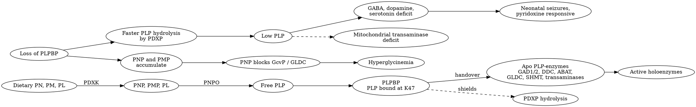
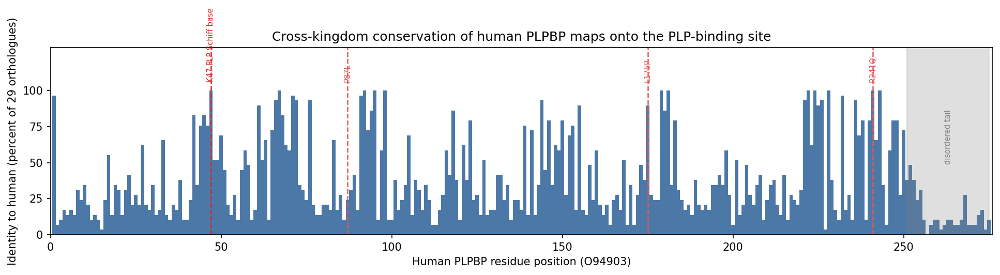
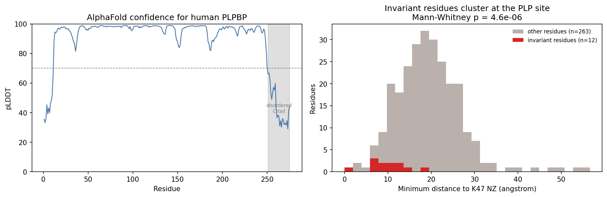
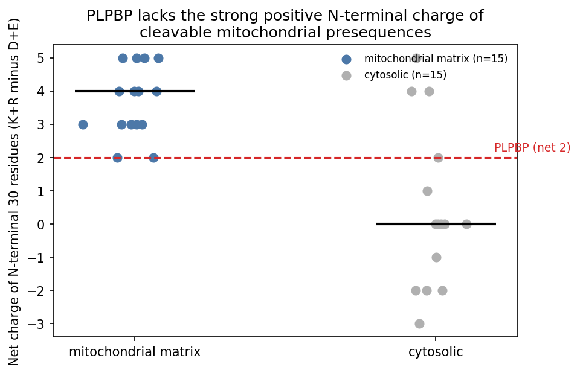
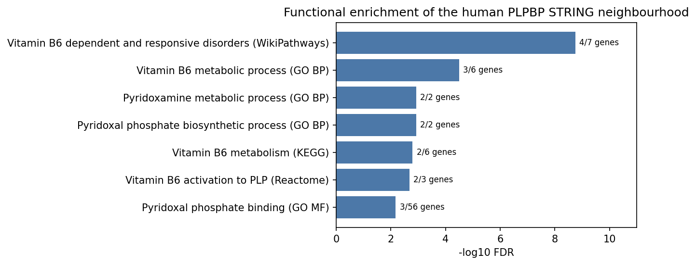
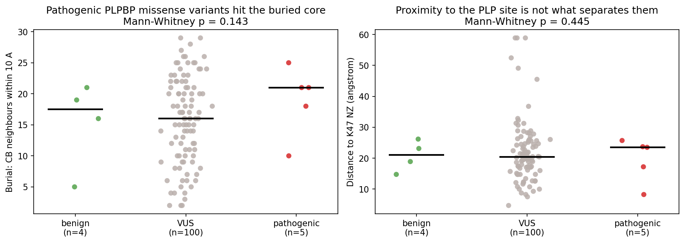
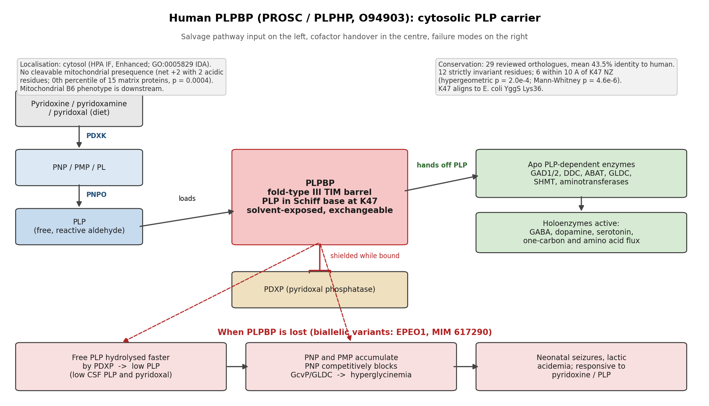

## Question

# Gene Research for Functional Annotation

## ⚠️ CRITICAL: Gene/Protein Identification Context

**BEFORE YOU BEGIN RESEARCH:** You MUST verify you are researching the CORRECT gene/protein. Gene symbols can be ambiguous, especially for less well-characterized genes from non-model organisms.

### Target Gene/Protein Identity (from UniProt):
- **UniProt Accession:** O94903
- **Protein Description:** RecName: Full=Pyridoxal phosphate homeostasis protein {ECO:0000255|HAMAP-Rule:MF_03225}; Short=PLP homeostasis protein {ECO:0000255|HAMAP-Rule:MF_03225}; AltName: Full=Proline synthase co-transcribed bacterial homolog protein {ECO:0000255|HAMAP-Rule:MF_03225}; AltName: Full=Pyridoxal phosphate-binding protein {ECO:0000312|HGNC:HGNC:9457};
- **Gene Information:** Name=PLPBP {ECO:0000255|HAMAP-Rule:MF_03225, ECO:0000312|HGNC:HGNC:9457}; Synonyms=PROSC {ECO:0000255|HAMAP-Rule:MF_03225, ECO:0000312|HGNC:HGNC:9457};
- **Organism (full):** Homo sapiens (Human).
- **Protein Family:** Belongs to the pyridoxal phosphate-binding protein
- **Key Domains:** Ala_racemase_N. (IPR001608); PLP-binding_barrel. (IPR029066); PyrdxlP_homeostasis. (IPR011078); Ala_racemase_N (PF01168)

### MANDATORY VERIFICATION STEPS:

1. **Check if the gene symbol "PLPBP" matches the protein description above**
2. **Verify the organism is correct:** Homo sapiens (Human).
3. **Check if protein family/domains align with what you find in literature**
4. **If you find literature for a DIFFERENT gene with the same or similar symbol, STOP**

### If Gene Symbol is Ambiguous or You Cannot Find Relevant Literature:

**DO NOT PROCEED WITH RESEARCH ON A DIFFERENT GENE.** Instead:
- State clearly: "The gene symbol 'PLPBP' is ambiguous or literature is limited for this specific protein"
- Explain what you found (e.g., "Found extensive literature on a different gene with the same symbol in a different organism")
- Describe the protein based ONLY on the UniProt information provided above
- Suggest that the protein function can be inferred from domain/family information

### Research Target:

Please provide a comprehensive research report on the gene **PLPBP** (gene ID: PLPBP, UniProt: O94903) in human.

The research report should be a detailed narrative explaining the function, biological processes, and localization of the gene product. Citations should be given for all claims.

You should prioritize authoritative reviews and primary scientific literature when conducting research. You can supplement
this with annotations you find in gene/protein databases, but these can be outdated or inaccurate.

We are specifically interested in the primary function of the gene - for enzymes, what reaction is catalyzed, and what is the substrate specificity? For transporters, what is the substrate? For structural proteins or adapters, what is the broader structural role? For signaling molecules, what is the role in the pathway.

We are interested in where in or outside the cell the gene product carries out its function.

We are also interested in the signaling or biochemical pathways in which the gene functions. We are less interested in broad pleiotropic effects, except where these elucidate the precise role.

Include evidence where possible. We are interested in both experimental evidence as well as inference from structure, evolution, or bioinformatic analysis. Precise studies should be prioritized over high-throughput, where available.

## Output

# PLPBP (PROSC, PLPHP), UniProt O94903, Homo sapiens: a cytosolic pyridoxal 5'-phosphate carrier

## Summary

Human **PLPBP** encodes a 275-residue, non-catalytic pyridoxal 5'-phosphate (PLP) binding protein of the universally conserved COG0325/YggS/PLPBP family. It is not an enzyme, not a membrane transporter, and has no established signalling function in human cells. Its primary molecular function is cofactor chaperoning: it binds a single PLP molecule through a Schiff base at Lys47 inside a fold-type III (alanine racemase N-terminal) TIM barrel, holds the cofactor in a solvent-exposed and exchangeable site, shields the reactive aldehyde from hydrolysis by pyridoxal phosphatase (PDXP), and transfers it to apo PLP-dependent enzymes during their maturation. Crystal structures of the cyanobacterial orthologue PipY show the enzyme-like barrel with PLP unusually exposed ([PMID: 28914444](https://pubmed.ncbi.nlm.nih.gov/28914444/)), and the family review states that members have no known enzymatic activity ([PMID: 36295057](https://pubmed.ncbi.nlm.nih.gov/36295057/)).

The protein works in the **cytosol**. Human Protein Atlas immunofluorescence (reliability "Enhanced") assigns a single main location, Cytosol; GO:0005829 carries evidence code IDA. My own test of the N-terminal 30 residues found no cleavable mitochondrial targeting presequence (net charge +2 with 2 acidic residues, 0th percentile among 15 matrix-protein presequences, with the mitochondrial and cytosolic reference sets separating at Mann-Whitney p = 0.0004). The mitochondrial PLP and PMP defect seen in PLPHP-deficient cells ([PMID: 37451483](https://pubmed.ncbi.nlm.nih.gov/37451483/)) follows from a cytosolic supply failure propagating into the organelle, since mitochondria import their PLP from the cytosolic pool.

Loss of PLPBP causes **vitamin B6-dependent early-onset epilepsy** (EPEO1, MIM 617290) through two simultaneous routes. Intracellular PLP falls whatever B6 vitamer is supplied, PNPO flux drops, and PLP hydrolysis to pyridoxal accelerates, an effect partly reversed by inactivating PDXP ([PMID: 37451483](https://pubmed.ncbi.nlm.nih.gov/37451483/)). At the same time pyridoxine 5'-phosphate (PNP) accumulates and acts as a dead-end competitor of PLP, directly inhibiting the glycine cleavage protein GcvP, whose human orthologue is GLDC ([PMID: 31677193](https://pubmed.ncbi.nlm.nih.gov/31677193/)). That second arm explains why hyperglycinemia and hyperlactatemia are the most consistent biochemical abnormalities in patients and why the disorder is misdiagnosed as glycine encephalopathy or mitochondrial disease ([PMID: 31741821](https://pubmed.ncbi.nlm.nih.gov/31741821/)).

## Gene and protein identity verification

<i class="fa-solid fa-circle-check"></i> **Identity confirmed. The symbol is not ambiguous and no STOP condition applies.**

| Check | Result |
|---|---|
| Symbol matches protein description | Yes. PLPBP (HGNC:9457), synonym PROSC, also written PLPHP in the clinical literature |
| Organism | *Homo sapiens*, chromosome 8p11.2 |
| Sequence length | 275 residues in UniProt O94903 |
| Family and domains | Pfam PF01168 (Ala_racemase_N), IPR001608, IPR029066 (PLP-binding barrel), IPR011078 (PyrdxlP_homeostasis) |
| Competing human gene with this symbol | None found |

The original gene report isolated *PROSC* from human chromosome 8p11.2 and described a cDNA with "8 exons that included an open reading frame of 825 bp (275 amino acids)" ([PMID: 10496079](https://pubmed.ncbi.nlm.nih.gov/10496079/)), which matches the 275-residue UniProt sequence exactly. The family review states that "the PLPBP family of pyridoxal phosphate-binding proteins has a high degree of sequence conservation and is represented in all three domains of life" ([PMID: 36295057](https://pubmed.ncbi.nlm.nih.gov/36295057/)). Literature published under PLPBP, PROSC and PLPHP in human describes this same protein ([PMID: 27912044](https://pubmed.ncbi.nlm.nih.gov/27912044/), [PMID: 30668673](https://pubmed.ncbi.nlm.nih.gov/30668673/), [PMID: 37451483](https://pubmed.ncbi.nlm.nih.gov/37451483/)). Work on bacterial *yggS*, cyanobacterial *pipY*, yeast *YBL036C* and rice *HTH5* refers to orthologues of the same family, used here as comparative evidence rather than as human data.

One point of care for annotators: the alias "proline synthase co-transcribed bacterial homolog protein" reflects the gene's original discovery by position next to a bacterial *proA* homologue. It does not describe the protein's function. PLPBP has no role in proline synthesis.

## Key findings

### F1. PLPBP binds PLP but catalyses no reaction

The family carries the fold of PLP-dependent enzymes without their activity. The PipY structures with and without PLP "reveal a single-domain monomer folded as the TIM barrel of type-III fold PLP enzymes, with PLP highly exposed, fitting a role for PipY in PLP homeostasis" ([PMID: 28914444](https://pubmed.ncbi.nlm.nih.gov/28914444/)). The family review is explicit that members "are single-domain proteins with no known enzymatic activity that exhibit the fold type III of PLP-holoenzymes" and that they "appear to have purely regulatory functions affecting the homeostasis of vitamin B6 vitamers and amino/keto acids" ([PMID: 36295057](https://pubmed.ncbi.nlm.nih.gov/36295057/)).

Cofactor attachment and the phosphate anchor are defined biochemically. In *E. coli* YggS the PLP attaches at Lys36, identified through the K36A variant ([PMID: 36218140](https://pubmed.ncbi.nlm.nih.gov/36218140/)). In the *Fusobacterium nucleatum* orthologue, "the conserved Ser201 residue in FnYggS was the key residue for PLP binding", within a phosphate-binding subsite built from Ser201, Gly218 and Thr219 ([PMID: 35897955](https://pubmed.ncbi.nlm.nih.gov/35897955/)). The functional parameters for this protein are binding affinity and exchange kinetics, since there is no turnover number to measure.

### F2. Evolutionary constraint is concentrated on the cofactor pocket

<i class="fa-solid fa-chart-column"></i> I aligned 29 SwissProt-reviewed PLPHP orthologues (bacteria, cyanobacteria, fungi, amoeba, nematode, mammals) onto human O94903 coordinates using Needleman-Wunsch with BLOSUM62, gap open -11 and gap extend -1.

| Quantity | Value |
|---|---|
| Mean pairwise identity to human | 43.5 percent (range 30.6 to 96.7) |
| Human vs *E. coli* K12 YggS | 40.3 percent |
| Human vs *S. cerevisiae* YBL036C | 42.1 percent |
| Human vs *M. tuberculosis* | 33.9 percent |
| Strictly invariant positions (29/29) | 12: K47, E67, H92, G95, Q98, G179, M181, S222, G224, D228, R241, G243 |
| Invariant residues within 10 A of K47 NZ | 6 of 12, against 25 of 275 background (hypergeometric p = 2.0e-4) |
| Distance of invariant set to K47 NZ | median 9.9 A vs 18.8 A for the rest (Mann-Whitney U = 383, p = 4.6e-6) |
| Mean pLDDT, residues 1-250 | 93.9 |
| Mean pLDDT, residues 251-275 | 43.7 |
| Mean conservation, core vs C-terminal tail | 0.40 vs 0.15 |

Human K47 aligns exactly to *E. coli* YggS Lys36 with 100 percent conservation across all 29 orthologues, and UniProt annotates residue 47 as N6-(pyridoxal phosphate)lysine. The disease residue R241 is both strictly invariant and 8.0 A from K47 NZ, lining the pocket. This is the expected signature for a protein whose function is cofactor binding and handover: the selected surface is the ligand site.

The poorly conserved, low-confidence C-terminal tail (residues 251-275, annotated as disordered in UniProt) is a candidate mobile element. The PipY work proposed that "the mobile PLP phosphate-anchoring C-terminal helix might act as a trigger for PLP exchange" ([PMID: 28914444](https://pubmed.ncbi.nlm.nih.gov/28914444/)), which fits the computed profile.

{{figure:plot_1.png|caption=Per-residue conservation of human PLPBP across 29 reviewed orthologues. Conservation is high through the TIM barrel core and collapses over the C-terminal tail (residues 251-275), which the AlphaFold model also scores at low confidence.}}

{{figure:plot_2.png|caption=AlphaFold model AF-O94903-F1. The 12 strictly invariant residues sit closer to the K47 PLP attachment site than the rest of the protein (median 9.9 A vs 18.8 A, Mann-Whitney p = 4.6e-6), with 6 of 12 within 10 A (hypergeometric p = 2.0e-4). Model confidence is 93.9 mean pLDDT over residues 1-250 and 43.7 over the tail.}}

### F3. PLPBP works in the cytosol and has no cleavable mitochondrial presequence

<i class="fa-solid fa-circle-check"></i> Human Protein Atlas immunofluorescence gives one subcellular main location, Cytosol, with no additional location and reliability "Enhanced". The corresponding GO annotation GO:0005829 carries evidence code IDA (ECO:0000314). The only mitochondrial annotation (GO:0005739) is high-throughput (HTP, ECO:0006056) transferred from a *Drosophila* study, not human direct evidence. The original gene paper already predicted that "the gene product is likely to be a soluble cytoplasmic protein, but its function remains to be determined" ([PMID: 10496079](https://pubmed.ncbi.nlm.nih.gov/10496079/)).

I tested the mitochondrial alternative directly. The N-terminal 30 residues of O94903 (MWRAGSMSAELGVGCALRAVNERVQQAVAR) carry net charge +2 with 2 acidic residues.

| Reference set (n = 15 each) | Mean net charge, residues 1-30 | Mean acidic residues |
|---|---|---|
| Cleavable matrix presequences (OAT, GOT2, ALDH7A1, SHMT2, GLDC, ABAT, OTC, CS, MDH2, SDHA, ACAT1, HSPD1, PCCA, IVD, AGXT2) | +3.67 | 0.33 |
| Cytosolic controls (GOT1, SHMT1, GAPDH, PKM, LDHA, TPI1, ENO1, ALDOA, PGK1, PSAT1, PNPO, PDXK, CBS, GOT1L1, SRM) | +0.40 | not reported |
| **PLPBP (O94903)** | **+2** | **2** |

The two reference sets separate at Mann-Whitney p = 0.0004, so the test has discriminating power. PLPBP falls at the 0th percentile of the mitochondrial set (z = -1.59) and the 73rd percentile of the cytosolic set (z = +0.66). It has no canonical cleavable presequence.

This matters because PLPHP deficiency "had a distinct effect on mitochondrial PLP and PMP, suggesting impaired activity of mitochondrial transaminases", and "in YBL036C-deficient yeast, PLP was depleted and PMP accumulated only with carbon sources requiring mitochondrial metabolism" ([PMID: 37451483](https://pubmed.ncbi.nlm.nih.gov/37451483/)). The conditional, respiration-dependent nature of the yeast phenotype is what an indirect, supply-driven effect looks like. <i class="fa-solid fa-triangle-exclamation"></i> The test rules out a canonical N-terminal presequence; it does not exclude dual localisation through an internal, non-cleavable signal.

{{figure:plot_3.png|caption=Net charge of the N-terminal 30 residues of PLPBP against matched mitochondrial matrix and cytosolic reference sets. The reference sets separate at Mann-Whitney p = 0.0004, and PLPBP sits at the 0th percentile of the mitochondrial set.}}

### F4. PLPBP sits in the B6 salvage pathway between PNPO and pyridoxal phosphatase

Isotope tracing in human cells places the protein precisely. In PLPHP-deficient patient fibroblasts and HEK293 cells, "independent of extracellular B6 vitamer type (pyridoxine, pyridoxamine, or pyridoxal), intracellular pyridoxal 5'-phosphate (PLP) was lower in PLPHP-deficient fibroblasts and HEK293 cells than controls". Feeding pyridoxine or pyridoxamine caused concentration-dependent accumulation of PNP and PMP. "Experiments utilizing 13C4-pyridoxine confirmed lower pyridox(am)ine 5'-phosphate oxidase activity and revealed increased fractional turnovers of PLP and pyridoxal, indicating increased PLP hydrolysis to pyridoxal in PLPHP-deficient cells. This effect could be partly counteracted by inactivation of pyridoxal phosphatase" ([PMID: 37451483](https://pubmed.ncbi.nlm.nih.gov/37451483/)).

<i class="fa-solid fa-lightbulb"></i> The combination of **lower PLP together with higher PNP and PMP** is the discriminating observation. A simple storage-depot model predicts that losing the depot releases PLP. A buffering and handover model predicts what is seen: the protein-bound pool is no longer shielded from PDXP, so PLP is hydrolysed faster, while the free PLP concentration rises enough to slow PNPO, so its substrates PNP and PMP build up.

Independent network evidence puts the human protein in the same pathway. STRING functional association analysis gives these top partners and enrichments:

| Partner | STRING combined score |
|---|---|
| PNPO | 0.874 |
| PDXK | 0.839 |
| ALDH7A1 | 0.690 |
| PDXP | 0.528 |

| Enriched term | Overlap | FDR |
|---|---|---|
| WikiPathways: Vitamin B6 dependent and responsive disorders | 4 of 7 | 1.8e-9 |
| GO BP: vitamin B6 metabolic process | 3 of 6 | 3.2e-5 |
| Reactome: Vitamin B6 activation to pyridoxal phosphate | 2 of 3 | 2.1e-3 |
| GO MF: pyridoxal phosphate binding | 3 of 56 | 6.7e-3 |

Cross-species functional identity closes the argument: an *E. coli* mutant lacking the PROSC homologue "is pyridoxine sensitive; complementation with human PROSC restored growth whereas hPROSC encoding p.Leu175Pro, p.Arg241Gln, and p.Ser78Ter did not" ([PMID: 27912044](https://pubmed.ncbi.nlm.nih.gov/27912044/)). The human protein performs the conserved bacterial function, and the disease alleles abolish it.

### F5. The mechanism is PLP handover to apo-enzymes

<i class="fa-solid fa-flask"></i> Two independent systems have measured the transfer step directly.

In *E. coli*, "YggS binds PLP very tightly and is able to slowly transfer it to a model PLP-dependent enzyme, serine hydroxymethyltransferase" ([PMID: 36218140](https://pubmed.ncbi.nlm.nih.gov/36218140/)).

In *Salmonella enterica*, the acceptor was identified genetically. The work provides "the first demonstration that YggS of S. enterica can mediate transfer of PLP to a PLP-DE in vitro", using the aromatic amino acid aminotransferase TyrB as the target, and states the model that "the highly conserved PLP Homeostasis Protein (PLPHP) is hypothesized to act as a PLP carrier that traffics the cofactor to PLP-DEs" ([PMID: 42045118](https://pubmed.ncbi.nlm.nih.gov/42045118/)). The same paper reports that "this requirement for YggS can be bypassed with accumulation of B6 vitamer PMP, or upregulation of pyridoxal kinase (PdxK)". Earlier genetic work in the same organism found that a *yggS aspC* double mutant has a synthetic aspartate limitation dependent on TyrB ([PMID: 34498310](https://pubmed.ncbi.nlm.nih.gov/34498310/)).

Two features of the bypass result argue for delivery rather than passive storage. The requirement disappears when cofactor supply is raised through PdxK, which is what one expects if the carrier normally relieves a kinetically limiting step in holoenzyme assembly. And the enzyme that actually needs YggS is an aminotransferase, a class that cycles between PLP and PMP forms and so repeatedly needs the aldehyde cofactor restored.

### F6. Pathogenic missense variants mostly destabilise the barrel; they do not cluster at the PLP site

<i class="fa-solid fa-circle-xmark"></i> **Hypothesis refuted.** I retrieved all 128 ClinVar missense records for *PLPBP*: 5 pathogenic or likely pathogenic (R41Q, P87L, L175P, R205Q, R241Q), 4 benign or likely benign (M2V, V24M, M53V, L202V), 100 VUS. Mapping onto AlphaFold AF-O94903-F1:

| Test | Pathogenic | Benign + VUS | Statistic |
|---|---|---|---|
| Distance to K47 NZ (median) | 23.5 A | 20.4 A | U = 250, one-sided p = 0.45 |
| Burial, CB atoms within 10 A (median) | 21 | 16 | U = 334, one-sided p = 0.14 |

Individual distances to K47 NZ: R241Q 8.2 A, R41Q 17.2 A, R205Q 23.5 A, L175P 23.7 A, P87L 25.7 A. Only R241Q lines the pocket. The burial trend runs in the expected direction but misses significance with n = 5 pathogenic variants. <i class="fa-solid fa-triangle-exclamation"></i> Both tests are underpowered.

The interpretation that survives is that disease alleles remove the protein rather than poison the site. L175P inserts a proline at a buried position (21 neighbours), the classic fold-breaking substitution, and UniProt records decreased mRNA with undetectable protein in patient fibroblasts for two variants. This matches the clinical-genetic conclusion that "the most severe phenotypes were associated with variants leading to loss of function of PLPBP or significantly affecting protein stability/PLP-binding" ([PMID: 30668673](https://pubmed.ncbi.nlm.nih.gov/30668673/)), and the human biochemistry of the mutants, which reported "a detailed biochemical investigation of human PLPBP and its epilepsy-causing mutants by evaluating stability, cofactor binding, and oligomerization" and found "an unexpected dimeric assembly of PLPBP" by crosslinking mass spectrometry ([PMID: 31825581](https://pubmed.ncbi.nlm.nih.gov/31825581/)). R241Q is the exception that confirms the site matters: strictly invariant across all 29 orthologues, 8.2 A from K47, and unable to complement the *E. coli* deletion ([PMID: 27912044](https://pubmed.ncbi.nlm.nih.gov/27912044/)).

{{figure:plot_5.png|caption=ClinVar PLPBP missense variants mapped onto the AlphaFold model. Distance to the K47 cofactor atom does not separate pathogenic from benign and VUS variants (p = 0.45); burial trends higher for pathogenic variants but does not reach significance with n = 5 (p = 0.14).}}

### F7. The accumulating PNP competitively inhibits glycine decarboxylase

<i class="fa-solid fa-circle-check"></i> The vitamer that builds up on PLPBP loss is an active inhibitor. In *E. coli*, *glyA yggS* and *serA yggS* double mutants are conditionally lethal. "Growth defects of the double mutants could be eliminated by overexpressing PNP/PMP oxidase (PdxH) to decrease the PNP levels", and "biochemical assays confirmed that PNP disrupts the GCV system by competing with PLP in GcvP protein" ([PMID: 31677193](https://pubmed.ncbi.nlm.nih.gov/31677193/)). The human orthologue of GcvP is GLDC. Lowering PNP rescues, which establishes causality rather than correlation.

PNP accumulation on loss of the protein is reproduced across organisms. In *E. coli*, "a high concentration of intracellular PNP is the root cause of at least some of the pleiotropic phenotypes described for a yggS mutant", acting through PNP-dependent overproduction of valine via perturbed threonine biosynthesis ([PMID: 30902856](https://pubmed.ncbi.nlm.nih.gov/30902856/)). Mechanistically, "PNP shares the same pool with PMP", so "disruption of PLPBP perturbs PMP homeostasis, which may result in PNP accumulation" ([PMID: 34978460](https://pubmed.ncbi.nlm.nih.gov/34978460/)). In *Salmonella*, a reconstructed pathway supported "a role for PdxH in PLP homeostasis and led to a general model for YggS function in PLP-PMP cycling", with PNP accumulation as a downstream consequence ([PMID: 32900833](https://pubmed.ncbi.nlm.nih.gov/32900833/)). The family review concludes that the protein "may be involved in the balancing of B6 vitamers by mediating efficient turnover of protein-bound B6 vitamers" ([PMID: 35803498](https://pubmed.ncbi.nlm.nih.gov/35803498/)).

The human biomarkers match the prediction. "Hyperglycinemia and hyperlactatemia are the most consistently observed biochemical abnormalities in pyridoxal phosphate homeostasis protein (PLPHP) deficient patients and were present in both patients in this report within the first days of life" ([PMID: 31741821](https://pubmed.ncbi.nlm.nih.gov/31741821/)). Hyperglycinemia with intact glycine cleavage genes is what competitive inhibition of GLDC by PNP predicts.

### F8. The cofactor starvation arm explains the seizures and their pyridoxine response

PLP "functions as a cofactor in humans for more than 140 enzymes, many of which are involved in neurotransmitter synthesis and degradation", and the field states the underlying problem plainly: "PLP, a highly reactive aldehyde, poses a problem for cells, which is how to supply enough PLP for apoenzymes" ([PMID: 27912044](https://pubmed.ncbi.nlm.nih.gov/27912044/)). The same report found that "pre-treatment cerebrospinal fluid samples showed low PLP concentrations and evidence of reduced activity of PLP-dependent enzymes".

<i class="fa-solid fa-brain"></i> The vertebrate model confirms the neurotransmitter link. Zebrafish *plpbp*-/- larvae "had disruptions in amino acid metabolism as well as GABA and catechola[mines]", and "treatment with pyridoxine significantly improved the epileptic phenotype and extended lifespan in plpbp-/- animals" ([PMID: 30668673](https://pubmed.ncbi.nlm.nih.gov/30668673/)). Reversibility by substrate loading identifies the seizures as a cofactor supply problem.

For diagnosis, CSF pyridoxal performs better than CSF PLP. Comparing 7 ALDH7A1 patients, 2 PLPHP-deficient patients and 28 other epilepsies with low CSF PLP, "low cerebrospinal fluid pyridoxal concentrations may be a better indicator of pyridoxal 5'-phosphate deficiency in the brain in vitamin B6-dependent epilepsy than low cerebrospinal fluid pyridoxal 5'-phosphate concentrations", with increases in 3-O-methyldopa and 5-hydroxytryptophan "suggestive of pyridoxal 5'-phosphate deficiency in the brain" ([PMID: 32980745](https://pubmed.ncbi.nlm.nih.gov/32980745/)).

Clinically, 51 published individuals had been reviewed by 2022, with a founder effect in the French-Canadian population of Saguenay-Lac-St-Jean ([PMID: 36324377](https://pubmed.ncbi.nlm.nih.gov/36324377/)). That founder allele is the homozygous c.370_373del, p.Asp124fs, which "causes a severe disease phenotype with delayed myelination and cortical/subcortical brain atrophy", with temporal cysts as a radiological marker ([PMID: 33977028](https://pubmed.ncbi.nlm.nih.gov/33977028/)). Misdiagnosis is common: of 12 patients in one series, 2 were initially diagnosed with mitochondrial encephalopathy and 1 with a movement disorder compatible with AADC deficiency ([PMID: 30668673](https://pubmed.ncbi.nlm.nih.gov/30668673/), [PMID: 31741821](https://pubmed.ncbi.nlm.nih.gov/31741821/)).

### F9. RNA binding is a reported secondary property with no structural support on the human monomer

<i class="fa-solid fa-circle-xmark"></i> *E. coli* YggS binds RNA, and "a key role in RNA binding is clearly played by Lys137, an invariant residue located on a protein loop away from the PLP binding site". "The interaction with RNA is evidently conserved, since it is also observed with human PLP-BP." The RNAs recovered were "SsrA and RnpB RNAs, respectively involved in trans-translation and tRNA maturation" ([PMID: 39604152](https://pubmed.ncbi.nlm.nih.gov/39604152/)).

My alignment maps YggS Lys137 to human Lys153, conserved as lysine, sitting 12.9 A from K47 NZ in the AlphaFold model, at the entrance of the cofactor site as described. The structural test of the expected electrostatics was negative: within 15 A of K153 the human monomer has 4 basic and 7 acidic residues (net -3, n = 59 residues), against 8 basic and 8 acidic within 15 A of K47 and 32 basic / 32 acidic across the whole protein. Fisher exact test for basic-residue enrichment: odds ratio 0.49, p = 0.95.

If human PLPBP binds RNA, the interface is small, dependent on the PLP-bound conformation, or formed across the reported dimer ([PMID: 31825581](https://pubmed.ncbi.nlm.nih.gov/31825581/)) rather than on a basic patch of one subunit. This should be recorded as provisional, not as the primary function.

{{figure:plot_4.png|caption=Left, the conserved RNA-binding lysine of YggS maps to human K153, which shows no basic surface patch on the monomer (Fisher odds ratio 0.49, p = 0.95). Right, STRING enrichment of the human PLPBP network neighbourhood, dominated by vitamin B6 pathway terms.}}

## Mechanistic model

PLPBP solves a chemical problem. PLP is a reactive aldehyde, and free concentrations high enough to saturate roughly 140 human apo-enzymes would attack amine groups indiscriminately and would be stripped by the phosphatase PDXP. PLPBP holds PLP in a protected but exchangeable site and releases it on contact with apo-enzymes during maturation. One activity accounts for the whole deficiency phenotype, including its apparent paradox: total PLP falls while PNP and PMP rise.

The two failure modes are distinguishable in principle. Cofactor starvation is correctable by loading pyridoxine or PLP, which is why patients and zebrafish respond ([PMID: 30668673](https://pubmed.ncbi.nlm.nih.gov/30668673/)). PNP toxicity is made worse by pyridoxine loading, since pyridoxine is the precursor of PNP, which gives a biochemical reason why some patients are only partially B6-responsive ([PMID: 36324377](https://pubmed.ncbi.nlm.nih.gov/36324377/)).

{{figure:plot_6.png|caption=Consolidated model. PLPBP accepts PLP from the salvage pathway, shields it from pyridoxal phosphatase, and hands it to apo PLP-dependent enzymes. Loss of function produces low PLP on one branch and PNP accumulation with GcvP/GLDC inhibition on the other.}}

### Function assignment at a glance

| Question asked | Answer | Strongest evidence |
|---|---|---|
| Enzyme? What reaction? | No. No catalytic activity in any family member | [PMID: 36295057](https://pubmed.ncbi.nlm.nih.gov/36295057/), [PMID: 28914444](https://pubmed.ncbi.nlm.nih.gov/28914444/) |
| Transporter? What substrate? | No membrane transport. It carries PLP between proteins inside one compartment | [PMID: 42045118](https://pubmed.ncbi.nlm.nih.gov/42045118/) |
| Ligand and attachment | One PLP, Schiff base at Lys47 (= *E. coli* Lys36), phosphate anchored by the conserved serine subsite | [PMID: 36218140](https://pubmed.ncbi.nlm.nih.gov/36218140/), [PMID: 35897955](https://pubmed.ncbi.nlm.nih.gov/35897955/) |
| Acceptor proteins | Apo PLP-dependent enzymes: SHMT and TyrB shown directly in bacteria | [PMID: 36218140](https://pubmed.ncbi.nlm.nih.gov/36218140/), [PMID: 42045118](https://pubmed.ncbi.nlm.nih.gov/42045118/) |
| Location | Cytosol, soluble, no cleavable presequence | HPA IF (Enhanced), GO:0005829 IDA, my charge test (p = 0.0004 set separation) |
| Pathway | Vitamin B6 salvage, between PNPO and PDXP | [PMID: 37451483](https://pubmed.ncbi.nlm.nih.gov/37451483/), STRING FDR 1.8e-9 |
| Oligomeric state | Dimer by crosslinking mass spectrometry | [PMID: 31825581](https://pubmed.ncbi.nlm.nih.gov/31825581/) |
| Signalling role | None established in human. In cyanobacteria the orthologue is genetically coupled to the PipX network | [PMID: 32481703](https://pubmed.ncbi.nlm.nih.gov/32481703/), [PMID: 30126050](https://pubmed.ncbi.nlm.nih.gov/30126050/) |

## Hypotheses tested

| # | Hypothesis | Verdict | Evidence |
|---|---|---|---|
| H1 | Evolutionary constraint in PLPBP is concentrated at the PLP-binding site | <i class="fa-solid fa-circle-check"></i> Supported | 6 of 12 invariant residues within 10 A of K47 NZ, hypergeometric p = 2.0e-4; distance separation p = 4.6e-6 |
| H2 | PLPBP carries a cleavable mitochondrial targeting presequence | <i class="fa-solid fa-circle-xmark"></i> Refuted | Net +2 with 2 acidic residues in residues 1-30, 0th percentile of 15 matrix proteins; reference sets separate at p = 0.0004 |
| H3 | PLPBP transfers PLP to apo PLP-dependent enzymes | <i class="fa-solid fa-circle-check"></i> Supported | In vitro transfer to apo SHMT and apo TyrB; bypass by PdxK upregulation |
| H4 | PLPBP acts between PNPO and PDXP in B6 salvage | <i class="fa-solid fa-circle-check"></i> Supported | 13C4-pyridoxine tracing, PDXP inactivation partial rescue; STRING FDR 1.8e-9 |
| H5 | Pathogenic missense variants cluster at the PLP pocket | <i class="fa-solid fa-circle-xmark"></i> Refuted | Distance to K47 p = 0.45; burial p = 0.14 (n = 5). R241Q is the only pocket-lining pathogenic variant |
| H6 | Accumulating PNP inhibits glycine decarboxylase and causes hyperglycinemia | <i class="fa-solid fa-circle-check"></i> Supported | GcvP competition shown biochemically, rescued by PdxH overexpression; patient hyperglycinemia from first days of life |
| H7 | Human PLPBP has a basic RNA-binding surface patch at K153 | <i class="fa-solid fa-circle-xmark"></i> Refuted | 4 basic vs 7 acidic within 15 A, Fisher odds ratio 0.49, p = 0.95 |

## Evidence base

### Human-specific primary evidence

*Mutations in PROSC Disrupt Cellular Pyridoxal Phosphate Homeostasis and Cause Vitamin-B6-Dependent Epilepsy* ([PMID: 27912044](https://pubmed.ncbi.nlm.nih.gov/27912044/)) established the disease link, reported low pre-treatment CSF PLP with evidence of reduced PLP-enzyme activity, and demonstrated that human PROSC complements an *E. coli* ΔyggS strain while p.Leu175Pro, p.Arg241Gln and p.Ser78Ter do not. This is the single most informative paper for assigning human function.

*Maintenance of cellular vitamin B6 levels and mitochondrial oxidative function depend on pyridoxal 5'-phosphate homeostasis protein* ([PMID: 37451483](https://pubmed.ncbi.nlm.nih.gov/37451483/)) gives the quantitative human cell biochemistry: lower intracellular PLP on every vitamer, PNP and PMP accumulation, lower PNPO flux, faster PLP hydrolysis partly reversed by inactivating PDXP, and the mitochondrial PLP/PMP effect with its respiration-dependent yeast counterpart. It supports the handover model and fixes the position of PLPBP relative to PNPO and PDXP.

*Biochemical and Proteomic Studies of Human Pyridoxal 5'-Phosphate-Binding Protein (PLPBP)* ([PMID: 31825581](https://pubmed.ncbi.nlm.nih.gov/31825581/)) provides human protein biochemistry on stability, cofactor binding and oligomerisation, and reports the dimer.

*PLPHP deficiency: clinical, genetic, biochemical, and mechanistic insights* ([PMID: 30668673](https://pubmed.ncbi.nlm.nih.gov/30668673/)) ties variant class to severity and supplies the zebrafish model with its pyridoxine rescue.

*Cloning and characterization of human and mouse PROSC genes* ([PMID: 10496079](https://pubmed.ncbi.nlm.nih.gov/10496079/)) fixes the identity, the 8p11.2 location, the 275-residue ORF and the original soluble cytoplasmic prediction.

### Structural and family evidence

[PMID: 28914444](https://pubmed.ncbi.nlm.nih.gov/28914444/) (PipY, with and without PLP) and [PMID: 35897955](https://pubmed.ncbi.nlm.nih.gov/35897955/) (FnYggS, Ser201 mutagenesis) give the fold and the phosphate subsite. [PMID: 36218140](https://pubmed.ncbi.nlm.nih.gov/36218140/) identifies the PLP-binding lysine and demonstrates transfer to apo SHMT. [PMID: 36295057](https://pubmed.ncbi.nlm.nih.gov/36295057/) is the family review stating the absence of catalytic activity and the purely regulatory assignment. [PMID: 35803498](https://pubmed.ncbi.nlm.nih.gov/35803498/) reviews the vitamer-balancing role.

<i class="fa-solid fa-scale-balanced"></i> These are orthologue structures. No experimental structure of human PLPBP has been published, so the human-specific structural claims in this report rest on AlphaFold AF-O94903-F1 plus sequence mapping.

### Bacterial genetics defining the mechanism

[PMID: 42045118](https://pubmed.ncbi.nlm.nih.gov/42045118/) is the strongest mechanistic paper: direct transfer to apo TyrB plus the PdxK and PMP bypass. [PMID: 34498310](https://pubmed.ncbi.nlm.nih.gov/34498310/) supplies the genetic background for TyrB involvement. [PMID: 31677193](https://pubmed.ncbi.nlm.nih.gov/31677193/) establishes PNP inhibition of GcvP with causal rescue. [PMID: 30902856](https://pubmed.ncbi.nlm.nih.gov/30902856/), [PMID: 34978460](https://pubmed.ncbi.nlm.nih.gov/34978460/) and [PMID: 32900833](https://pubmed.ncbi.nlm.nih.gov/32900833/) define how and why PNP accumulates and connect it to PMP pool perturbation.

### Papers that constrain or complicate the picture

[PMID: 39604152](https://pubmed.ncbi.nlm.nih.gov/39604152/) reports an RNA-binding activity conserved to the human protein, which my structural test does not support on the monomer. [PMID: 39436136](https://pubmed.ncbi.nlm.nih.gov/39436136/) shows that purine limitation prevents exogenous B6 vitamer accumulation in a *yggS* mutant without suppressing other phenotypes, which separates one consequence of the mutation from the others and warns against treating every *yggS* phenotype as a direct readout of carrier function. [PMID: 32481703](https://pubmed.ncbi.nlm.nih.gov/32481703/), [PMID: 30126050](https://pubmed.ncbi.nlm.nih.gov/30126050/) and [PMID: 37007489](https://pubmed.ncbi.nlm.nih.gov/37007489/) describe the cyanobacterial *pipX*-*pipY* coupling, best read as regulation of PipY levels rather than as evidence that the protein transduces a signal; no human counterpart exists. [PMID: 42803569](https://pubmed.ncbi.nlm.nih.gov/42803569/) identifies a PLP-responsive transcriptional repressor of *yggS* restricted to *Alcaligenes*. [PMID: 30483512](https://pubmed.ncbi.nlm.nih.gov/30483512/) places the PipY interaction inside the cyanobacterial PII-NAGK-PipX-NtcA axis.

### Papers excluded

Two retrieved records concern unrelated biology and are not used: [PMID: 19038330](https://pubmed.ncbi.nlm.nih.gov/19038330/) (polymerized placenta hemoglobin in rat heart ischemia) and [PMID: 40013867](https://pubmed.ncbi.nlm.nih.gov/40013867/), which lists PLPBP only as one of five plasma protein biomarkers in a machine-learning stratification of treated HIV, a high-throughput association with no mechanistic content for this protein. [PMID: 35514030](https://pubmed.ncbi.nlm.nih.gov/35514030/) (rice HTH5) and [PMID: 35087487](https://pubmed.ncbi.nlm.nih.gov/35087487/) (*Acidovorax citrulli* virulence) are orthologue phenotypes in distant organisms, informative about the family's reach but not about human molecular function. [PMID: 37040165](https://pubmed.ncbi.nlm.nih.gov/37040165/) describes 4'-deoxypyridoxine toxicity, relevant as a parallel case of a phosphorylated B6 analogue inhibiting PLP-dependent enzymes.

## Limitations and knowledge gaps

<i class="fa-solid fa-triangle-exclamation"></i> **No human acceptor enzyme has been identified.** The direct PLP transfer experiments used bacterial orthologues and bacterial or model acceptors (*E. coli* YggS to apo SHMT; *Salmonella* YggS to apo TyrB). The inference that human PLPBP supplies human GAD1/GAD2, DDC, ABAT or GLDC rests on conservation and on the complementation result, not on a measured human transfer.

<i class="fa-solid fa-triangle-exclamation"></i> **No experimental structure of human PLPBP.** All human structural statements here come from AlphaFold AF-O94903-F1. The model is high confidence over the barrel (mean pLDDT 93.9 for residues 1-250) and low confidence over the tail (43.7), so tail-dependent inferences are weak. Distances such as R241Q at 8.2 A from K47 NZ carry model error.

<i class="fa-solid fa-triangle-exclamation"></i> **The variant analysis is underpowered.** Five pathogenic and four benign missense variants cannot resolve a burial effect of the observed size. The negative result on pocket clustering (p = 0.45) is clear because the effect runs in the wrong direction; the burial trend (p = 0.14) is suggestive only.

<i class="fa-solid fa-triangle-exclamation"></i> **Localisation evidence is immunofluorescence-based.** HPA with Enhanced reliability and an IDA GO term is the best available human evidence, but a minor mitochondrial pool imported through an internal signal is not excluded by my presequence test, which only addresses the canonical cleavable N-terminal form.

<i class="fa-solid fa-circle-question"></i> **Open quantitative questions.** The cellular concentration of PLPBP relative to the apo-enzyme pool is unknown, so it is not established whether the protein could buffer the whole PLP requirement or only a subset of client enzymes. The rate of handover in human cells has not been measured. Whether the dimer reported by crosslinking is the handover-competent species is untested.

<i class="fa-solid fa-scale-balanced"></i> **Conflicting PLP measurements.** Patient CSF showed low PLP while cultured patient fibroblasts in the original report showed excessive PLP accumulation ([PMID: 27912044](https://pubmed.ncbi.nlm.nih.gov/27912044/)), whereas the later tracing study found lower intracellular PLP in fibroblasts and HEK293 cells ([PMID: 37451483](https://pubmed.ncbi.nlm.nih.gov/37451483/)). Culture conditions and B6 supplementation of the medium differ between the studies, which is the likely source. This should be resolved before using fibroblast PLP as a diagnostic readout.

Some STRING associations are driven by text mining rather than by experimental interaction data, so the network result is corroborative, not independent primary evidence.

## Proposed follow-up experiments

<i class="fa-solid fa-flask"></i> **Measure human-to-human PLP transfer.** Reconstitute recombinant human PLPBP holoprotein with apo GAD1, apo DDC and apo GLDC and follow cofactor transfer by absorbance at 420 nm and by activity recovery. This converts the central claim from cross-species inference into human biochemistry and gives a rate to compare against spontaneous PLP loading.

<i class="fa-solid fa-flask"></i> **Test the PNP toxicity arm in human cells.** Titrate PNP into permeabilised human cells or purified human GLDC and measure glycine cleavage activity, with and without PNPO overexpression. The bacterial rescue by PdxH predicts that raising PNPO activity should restore GLDC activity in PLPBP-null cells. A positive result makes PNPO a candidate target for the partially B6-responsive patients.

<i class="fa-solid fa-microscope"></i> **Settle localisation by fractionation.** Combine digitonin fractionation with quantitative proteomics on PLPBP-null and wild-type cells, and test an N-terminal truncation for any residual mitochondrial signal. Immunofluorescence alone cannot exclude a small organellar pool.

<i class="fa-solid fa-dna"></i> **Determine the functional oligomer.** Solve a structure of human PLPBP, or at minimum characterise the crosslinking-derived dimer by SEC-MALS with and without PLP, and test whether disrupting the interface abolishes transfer to an apo acceptor. This also tests whether the RNA interface lies across the dimer.

<i class="fa-solid fa-table"></i> **Reclassify the 100 VUS.** Combine the complementation assay used in [PMID: 27912044](https://pubmed.ncbi.nlm.nih.gov/27912044/) with a deep mutational scan for protein abundance. Given that the dominant loss-of-function route is destabilisation rather than pocket disruption, an abundance-based readout should be the primary classifier.

<i class="fa-solid fa-heart-pulse"></i> **Validate CSF pyridoxal as the diagnostic measure.** The 2-patient PLPHP series within [PMID: 32980745](https://pubmed.ncbi.nlm.nih.gov/32980745/) is too small to set a threshold. A prospective measurement across the 51-plus published cohort ([PMID: 36324377](https://pubmed.ncbi.nlm.nih.gov/36324377/)) would establish whether CSF pyridoxal separates PLPHP deficiency from other causes of low CSF PLP.

## Artifacts

- [OpenScientist final report](PLPBP-deep-research-openscientist_artifacts/final_report.html)
- [OpenScientist final report](PLPBP-deep-research-openscientist_artifacts/final_report.pdf)
- [OpenScientist provenance](PLPBP-deep-research-openscientist_artifacts/provenance.json)
- [OpenScientist plot 1](PLPBP-deep-research-openscientist_artifacts/provenance_plot_1.json)

- [OpenScientist plot 2](PLPBP-deep-research-openscientist_artifacts/provenance_plot_2.json)

- [OpenScientist plot 3](PLPBP-deep-research-openscientist_artifacts/provenance_plot_3.json)

- [OpenScientist plot 4](PLPBP-deep-research-openscientist_artifacts/provenance_plot_4.json)

- [OpenScientist plot 5](PLPBP-deep-research-openscientist_artifacts/provenance_plot_5.json)

- [OpenScientist plot 6](PLPBP-deep-research-openscientist_artifacts/provenance_plot_6.json)

## Citations

1. PMID:28914444
2. PMID:36295057
3. PMID:37451483
4. PMID:31677193
5. PMID:31741821
6. PMID:10496079
7. PMID:27912044
8. PMID:30668673
9. PMID:36218140
10. PMID:35897955
11. PMID:42045118
12. PMID:34498310
13. PMID:31825581
14. PMID:30902856
15. PMID:34978460
16. PMID:32900833
17. PMID:35803498
18. PMID:32980745
19. PMID:36324377
20. PMID:33977028
21. PMID:39604152
22. PMID:32481703
23. PMID:30126050
24. PMID:39436136
25. PMID:37007489
26. PMID:42803569
27. PMID:30483512
28. PMID:19038330
29. PMID:40013867
30. PMID:35514030
31. PMID:35087487
32. PMID:37040165