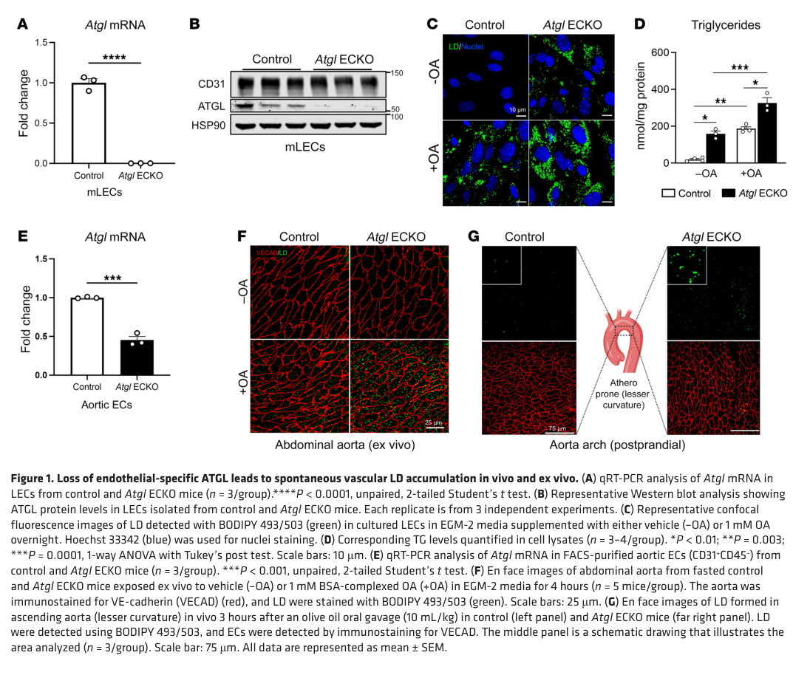

## Question

# Gene Research for Functional Annotation

## ⚠️ CRITICAL: Gene/Protein Identification Context

**BEFORE YOU BEGIN RESEARCH:** You MUST verify you are researching the CORRECT gene/protein. Gene symbols can be ambiguous, especially for less well-characterized genes from non-model organisms.

### Target Gene/Protein Identity (from UniProt):
- **UniProt Accession:** Q96AD5
- **Protein Description:** RecName: Full=Patatin-like phospholipase domain-containing protein 2 {ECO:0000305}; EC=3.1.1.3 {ECO:0000269|PubMed:15364929, ECO:0000269|PubMed:15550674, ECO:0000269|PubMed:16150821, ECO:0000269|PubMed:16239926, ECO:0000269|PubMed:17603008}; AltName: Full=Adipose triglyceride lipase {ECO:0000303|PubMed:15550674}; AltName: Full=Calcium-independent phospholipase A2-zeta {ECO:0000303|PubMed:15364929}; Short=iPLA2-zeta {ECO:0000303|PubMed:15364929}; EC=3.1.1.4 {ECO:0000269|PubMed:15364929, ECO:0000269|PubMed:17032652}; AltName: Full=Desnutrin; AltName: Full=Pigment epithelium-derived factor receptor {ECO:0000303|PubMed:17032652}; Short=PEDF-R {ECO:0000303|PubMed:17032652}; AltName: Full=TTS2.2 {ECO:0000303|PubMed:17603008}; AltName: Full=Transport-secretion protein 2; Short=TTS2;
- **Gene Information:** Name=PNPLA2 {ECO:0000312|HGNC:HGNC:30802}; Synonyms=ATGL {ECO:0000303|PubMed:15550674}; ORFNames=FP17548;
- **Organism (full):** Homo sapiens (Human).
- **Protein Family:** Not specified in UniProt
- **Key Domains:** Acyl_Trfase/lysoPLipase. (IPR016035); PLPL. (IPR033562); PNPLA2. (IPR033903); PNPLA_dom. (IPR002641); Patatin (PF01734)

### MANDATORY VERIFICATION STEPS:

1. **Check if the gene symbol "PNPLA2" matches the protein description above**
2. **Verify the organism is correct:** Homo sapiens (Human).
3. **Check if protein family/domains align with what you find in literature**
4. **If you find literature for a DIFFERENT gene with the same or similar symbol, STOP**

### If Gene Symbol is Ambiguous or You Cannot Find Relevant Literature:

**DO NOT PROCEED WITH RESEARCH ON A DIFFERENT GENE.** Instead:
- State clearly: "The gene symbol 'PNPLA2' is ambiguous or literature is limited for this specific protein"
- Explain what you found (e.g., "Found extensive literature on a different gene with the same symbol in a different organism")
- Describe the protein based ONLY on the UniProt information provided above
- Suggest that the protein function can be inferred from domain/family information

### Research Target:

Please provide a comprehensive research report on the gene **PNPLA2** (gene ID: PNPLA2, UniProt: Q96AD5) in human.

The research report should be a detailed narrative explaining the function, biological processes, and localization of the gene product. Citations should be given for all claims.

You should prioritize authoritative reviews and primary scientific literature when conducting research. You can supplement
this with annotations you find in gene/protein databases, but these can be outdated or inaccurate.

We are specifically interested in the primary function of the gene - for enzymes, what reaction is catalyzed, and what is the substrate specificity? For transporters, what is the substrate? For structural proteins or adapters, what is the broader structural role? For signaling molecules, what is the role in the pathway.

We are interested in where in or outside the cell the gene product carries out its function.

We are also interested in the signaling or biochemical pathways in which the gene functions. We are less interested in broad pleiotropic effects, except where these elucidate the precise role.

Include evidence where possible. We are interested in both experimental evidence as well as inference from structure, evolution, or bioinformatic analysis. Precise studies should be prioritized over high-throughput, where available.

## Output

Question: You are an expert researcher providing comprehensive, well-cited information.

Provide detailed information focusing on:
1. Key concepts and definitions with current understanding
2. Recent developments and latest research (prioritize 2023-2024 sources)
3. Current applications and real-world implementations
4. Expert opinions and analysis from authoritative sources
5. Relevant statistics and data from recent studies

Format as a comprehensive research report with proper citations. Include URLs and publication dates where available.
Always prioritize recent, authoritative sources and provide specific citations for all major claims.

# Gene Research for Functional Annotation

## ⚠️ CRITICAL: Gene/Protein Identification Context

**BEFORE YOU BEGIN RESEARCH:** You MUST verify you are researching the CORRECT gene/protein. Gene symbols can be ambiguous, especially for less well-characterized genes from non-model organisms.

### Target Gene/Protein Identity (from UniProt):
- **UniProt Accession:** Q96AD5
- **Protein Description:** RecName: Full=Patatin-like phospholipase domain-containing protein 2 {ECO:0000305}; EC=3.1.1.3 {ECO:0000269|PubMed:15364929, ECO:0000269|PubMed:15550674, ECO:0000269|PubMed:16150821, ECO:0000269|PubMed:16239926, ECO:0000269|PubMed:17603008}; AltName: Full=Adipose triglyceride lipase {ECO:0000303|PubMed:15550674}; AltName: Full=Calcium-independent phospholipase A2-zeta {ECO:0000303|PubMed:15364929}; Short=iPLA2-zeta {ECO:0000303|PubMed:15364929}; EC=3.1.1.4 {ECO:0000269|PubMed:15364929, ECO:0000269|PubMed:17032652}; AltName: Full=Desnutrin; AltName: Full=Pigment epithelium-derived factor receptor {ECO:0000303|PubMed:17032652}; Short=PEDF-R {ECO:0000303|PubMed:17032652}; AltName: Full=TTS2.2 {ECO:0000303|PubMed:17603008}; AltName: Full=Transport-secretion protein 2; Short=TTS2;
- **Gene Information:** Name=PNPLA2 {ECO:0000312|HGNC:HGNC:30802}; Synonyms=ATGL {ECO:0000303|PubMed:15550674}; ORFNames=FP17548;
- **Organism (full):** Homo sapiens (Human).
- **Protein Family:** Not specified in UniProt
- **Key Domains:** Acyl_Trfase/lysoPLipase. (IPR016035); PLPL. (IPR033562); PNPLA2. (IPR033903); PNPLA_dom. (IPR002641); Patatin (PF01734)

### MANDATORY VERIFICATION STEPS:

1. **Check if the gene symbol "PNPLA2" matches the protein description above**
2. **Verify the organism is correct:** Homo sapiens (Human).
3. **Check if protein family/domains align with what you find in literature**
4. **If you find literature for a DIFFERENT gene with the same or similar symbol, STOP**

### If Gene Symbol is Ambiguous or You Cannot Find Relevant Literature:

**DO NOT PROCEED WITH RESEARCH ON A DIFFERENT GENE.** Instead:
- State clearly: "The gene symbol 'PNPLA2' is ambiguous or literature is limited for this specific protein"
- Explain what you found (e.g., "Found extensive literature on a different gene with the same symbol in a different organism")
- Describe the protein based ONLY on the UniProt information provided above
- Suggest that the protein function can be inferred from domain/family information

### Research Target:

Please provide a comprehensive research report on the gene **PNPLA2** (gene ID: PNPLA2, UniProt: Q96AD5) in human.

The research report should be a detailed narrative explaining the function, biological processes, and localization of the gene product. Citations should be given for all claims.

You should prioritize authoritative reviews and primary scientific literature when conducting research. You can supplement
this with annotations you find in gene/protein databases, but these can be outdated or inaccurate.

We are specifically interested in the primary function of the gene - for enzymes, what reaction is catalyzed, and what is the substrate specificity? For transporters, what is the substrate? For structural proteins or adapters, what is the broader structural role? For signaling molecules, what is the role in the pathway.

We are interested in where in or outside the cell the gene product carries out its function.

We are also interested in the signaling or biochemical pathways in which the gene functions. We are less interested in broad pleiotropic effects, except where these elucidate the precise role.

Include evidence where possible. We are interested in both experimental evidence as well as inference from structure, evolution, or bioinformatic analysis. Precise studies should be prioritized over high-throughput, where available.

# Human PNPLA2 (UniProt Q96AD5): functional annotation research report

## Identity and central conclusion

**Identity verified.** The supplied UniProt record identifies Q96AD5 as the *Homo sapiens* PNPLA2 gene product, also called adipose triglyceride lipase (ATGL), desnutrin and, in retinal literature, pigment epithelium-derived factor receptor (PEDF-R). Independent human PNPLA-family analysis identifies PNPLA2 as a 504-amino-acid protein with an N-terminal patatin domain; PNPLA3 is a separate family member, and ABHD5/CGI-58 is a separate ATGL coactivator, not another name for PNPLA2. The family analysis identified the patatin motif PF01734 within approximately residues 10–179. (schweiger2009neutrallipidstorage pages 4-5, wilson2006characterizationofthe pages 2-3, kulminskaya2024unmaskingcrucialresidues pages 1-2)

**Primary functional annotation:** PNPLA2 is an intracellular, lipid-droplet-associated **triacylglycerol lipase** that initiates mobilization of stored fat. Its principal reaction is **triacylglycerol (TAG) + H₂O → diacylglycerol (DAG) + free fatty acid**. This is the first reaction in the sequential lipolysis pathway, not the complete conversion of TAG to glycerol. Human-enzyme inhibition in human adipocytes and PNPLA2-associated human disease both reinforce the physiological importance of this assignment. (schweiger2006adiposetriglyceridelipase pages 1-1, grabner2022smallmoleculeinhibitorstargeting pages 2-4, grabner2022smallmoleculeinhibitorstargeting pages 5-8, wang2024dilatedcardiomyopathycaused pages 1-2)

The following evidence table separates direct human observations from mouse and other experimental systems; publication links are DOI URLs.

| Functional claim | Best direct evidence, DOI/URL, and quantitative result | Interpretation / limitations |
|---|---|---|
| **Primary reaction:** TAG + H₂O → DAG + free fatty acid | Schweiger et al. (2006) showed that ATGL/PNPLA2 removes the first fatty acid from TAG and, together with HSL, accounts for **>95%** of murine white-adipose TAG-hydrolase activity. [DOI: 10.1074/jbc.M608048200](https://doi.org/10.1074/jbc.M608048200) (schweiger2006adiposetriglyceridelipase pages 1-1) | Strong physiological evidence for initiation of intracellular TAG lipolysis, but the quantitative tissue experiment was performed in mice. Human biochemical evidence supports preferential TAG hydrolysis, with much lower DAG and phospholipid activity and essentially no monoacylglycerol, cholesteryl-ester, or retinyl-ester hydrolysis (schweiger2009neutrallipidstorage pages 4-5, zechner2009adiposetriglyceridelipase pages 3-4). |
| **Patatin-domain catalysis and ABHD5-sensitive region:** Ser47–Asp166 catalytic dyad; residues N209–N215 contribute to coactivation | Human-family analyses identify a PNPLA domain at residues **10–179** and the conserved catalytic architecture; Ser47 is the nucleophile and Asp166 the second catalytic residue (schweiger2009neutrallipidstorage pages 4-5, wilson2006characterizationofthe pages 2-3). Kulminskaya et al. (2024) found that mouse ATGL N209A, I212A/I212S, and N215A retained basal TAG-hydrolase activity but had only **~1.5–4-fold** CGI-58 activation; activation EC₅₀ values ranged from **200 ± 20 to 500 ± 50 nM**, versus **178 ± 20 nM** for wild type. [DOI: 10.1016/j.jlr.2023.100491](https://doi.org/10.1016/j.jlr.2023.100491) (kulminskaya2024unmaskingcrucialresidues pages 1-2, kulminskaya2024unmaskingcrucialresidues pages 5-8) | Ser47/Asp166 is the established patatin-family catalytic dyad. The N209–N215 experiments used truncated **mouse** ATGL and bacterial lysates, so they inform a conserved mechanism but are not direct measurements of full-length human protein. The modeled ATGL–ABHD5 interface remains provisional because no experimental atomic structure was available (kulminskaya2024unmaskingcrucialresidues pages 14-15). |
| **Canonical site of action:** cytosolic surface of intracellular lipid droplets | Murugesan et al. (2013) used GFP-tagged human ATGL constructs in oleate-loaded cells and showed that the isolated C-terminal segment **320–504** was sufficient for lipid-droplet targeting. [DOI: 10.1371/journal.pone.0064950](https://doi.org/10.1371/journal.pone.0064950) (murugesan2013identificationofdiverse pages 5-6) | Supports catalysis at the lipid-droplet phospholipid monolayer, where ATGL accesses core TAG. Both lipid-droplet-associated and cytoplasmic pools occur. A hydrophobic segment around residues **315–360** is implicated, but localization also depends on cellular partners and post-translational regulation (schweiger2009neutrallipidstorage pages 4-5, dubey2026patatin‐domain‐containing(phospho)lipasesunder pages 16-17). |
| **Principal coactivator and interaction network:** ABHD5/CGI-58 activates ATGL; G0S2 and other partners regulate it | Lass et al. (2006) demonstrated direct CGI-58–ATGL interaction and up to **20-fold** stimulation of TAG-hydrolase activity; disease-associated CGI-58 variants failed to activate ATGL. [DOI: 10.1016/j.cmet.2006.03.005](https://doi.org/10.1016/j.cmet.2006.03.005) (lass2006adiposetriglyceridelipasemediated pages 1-2). Kohlmayr et al. (2024) screened **>4,000** ATGL substitutions against CGI-58, G0S2, PLIN1, PLIN5, and CIDEC, validating **23** interaction-perturbing variants and **11** partner-selective switch mutations. [DOI: 10.1038/s41467-024-46937-x](https://doi.org/10.1038/s41467-024-46937-x) (kohlmayr2024mutationalscanningpinpoints pages 4-5, kohlmayr2024mutationalscanningpinpoints pages 1-2) | Establishes ATGL as a tightly regulated enzyme rather than a constitutively active lipase. Much foundational activation work used mouse proteins or heterologous cells; the 2024 interaction map provides amino-acid-resolution mechanism but does not quantify regulation in intact human tissues. |
| **Human loss-of-function phenotype:** autosomal-recessive neutral lipid storage disease with myopathy (NLSDM) | Wang et al. (2024) reported two men homozygous for PNPLA2 c.757+1G>T with severe dilated cardiomyopathy and mild skeletal involvement, and summarized **49 previously reported cardiomyopathy cases** in the article abstract. The review estimated cardiac involvement in **40–50%** of NLSDM and described one patient with LVEF **22%**. [DOI: 10.3389/fgene.2024.1415156](https://doi.org/10.3389/fgene.2024.1415156) (wang2024dilatedcardiomyopathycaused pages 1-2, wang2024dilatedcardiomyopathycaused pages 5-6, wang2024dilatedcardiomyopathycaused pages 2-4) | Human genetics strongly validates the necessity of PNPLA2-mediated TAG mobilization in skeletal and cardiac muscle. Frequencies derive from rare, heterogeneous published cases rather than population-based cohorts; genotype–phenotype correlations remain uncertain. PNPLA2 disease generally lacks ichthyosis, distinguishing it from ABHD5-related Chanarin–Dorfman disease (schweiger2009neutrallipidstorage pages 5-6, luan2025clinicopathologicalgeneticfeaturesof pages 1-2). |
| **Human pharmacological target engagement:** NG-497 selectively inhibits human ATGL | Grabner et al. (2022) reported NG-497 as a reversible competitive human ATGL inhibitor with biochemical **IC₅₀ ≈1 μM** and **Kᵢ ≈0.5 μM**. In human SGBS adipocytes, cellular IC₅₀ was **~1.5 μM**, with near-complete suppression of stimulated lipolysis at **≥10 μM**; primary human-adipocyte fatty-acid release fell to basal levels. [DOI: 10.1021/jacs.1c10836](https://doi.org/10.1021/jacs.1c10836) (grabner2022smallmoleculeinhibitorstargeting pages 2-4, grabner2022smallmoleculeinhibitorstargeting pages 5-8) | Strong human-enzyme and human-cell proof of target engagement, but not evidence of clinical safety or efficacy. Species selectivity is crucial: mouse Atglistatin does **not** inhibit human ATGL, whereas NG-497 primarily inhibits human and rhesus ATGL; mouse therapeutic results therefore cannot be directly extrapolated to humans (grabner2022smallmoleculeinhibitorstargeting pages 4-5, grabner2022smallmoleculeinhibitorstargeting pages 8-9). |
| **Secondary physiological context:** endothelial lipid-droplet turnover and vascular homeostasis | Boutagy et al. (2024) found that endothelial-specific **mouse** Atgl deletion caused vascular neutral-lipid accumulation, impaired nitric-oxide signaling and vasodilation, ER-stress and inflammatory activation, and accelerated atherosclerosis; aortic eNOS protein was reduced by approximately **50%**. [DOI: 10.1172/JCI170453](https://doi.org/10.1172/JCI170453) (boutagy2024dynamicmetabolismof pages 1-2, boutagy2024dynamicmetabolismof pages 8-9, boutagy2024dynamicmetabolismof media 54b8df58) | Demonstrates a causal endothelial role in vivo, but entirely in mouse genetic models. It supports broader PNPLA2 biology beyond adipocytes without establishing a human vascular indication or showing that systemic ATGL activation would be safe. |
| **Alternative context-dependent function:** PEDF-responsive retinal membrane protein with PLA₂ activity | Notari et al. (2006) identified human PNPLA2/PEDF-R as a PEDF-binding protein in retinal systems, reporting approximately **3 nM** affinity, cell-surface accessibility, and PEDF-stimulated phosphatidylcholine hydrolysis. Recombinant activity was **5.7 ΔA₂₃₄/min/nmol**, versus **1.3** for pancreatic PLA₂ under the assay conditions. [DOI: 10.1074/jbc.M600353200](https://doi.org/10.1074/jbc.M600353200) (notari2006identificationofa pages 11-12, notari2006identificationofa pages 12-13, notari2006identificationofa pages 10-10) | Supports an additional retinal membrane-associated PEDF-receptor/PLA₂ model, not replacement of the well-validated intracellular TAG-lipase function. The evidence is tissue- and assay-specific and does not establish PEDF signaling as PNPLA2’s predominant function across human tissues (notari2006identificationofa pages 1-2, notari2006identificationofa pages 14-15). |

*Table: Evidence hierarchy for human PNPLA2/ATGL, separating direct human findings from mouse, cell-based, and context-dependent evidence. Quantitative results and limitations clarify which functions are firmly established and which remain translational or secondary.*

## Catalytic activity and substrate specificity

ATGL preferentially acts on **stored TAG**, releasing one fatty acid and leaving DAG. Hormone-sensitive lipase (HSL/LIPE) preferentially processes the resulting DAG, and downstream monoacylglycerol lipase completes glycerol release. Biochemical comparisons report much less ATGL activity toward DAG and phospholipids than toward TAG, and negligible activity toward monoacylglycerol, cholesteryl esters or retinyl esters. Mouse adipose-tissue experiments attributed **more than 95%** of TAG-hydrolase activity to ATGL and HSL together; this tissue-level percentage should not be interpreted as a measurement of isolated human ATGL. Earlier reviews did not establish a definitive preference among individual TAG *sn*-positions, so the well-supported specificity is for the *first hydrolysis step*, not an invariant *sn*-1, *sn*-2 or *sn*-3 bond. (schweiger2009neutrallipidstorage pages 4-5, schweiger2006adiposetriglyceridelipase pages 1-1, zechner2009adiposetriglyceridelipase pages 3-4)

The catalytic apparatus is a patatin-family **Ser47–Asp166 dyad**, with Ser47 in a G-X-S-X-G lipase motif and a glycine-rich oxyanion-hole region. In a 2024 site-directed-mutagenesis study, substituting Ser47 abolished detectable basal and stimulated activity of *mouse* ATGL, supporting the active-site assignment; sequence homology supports its correspondence in human PNPLA2. Although phospholipase A₂ and transacylase activities have been demonstrated in particular assays, their general physiological importance is less firmly established than intracellular TAG hydrolysis. The protein’s historical description as a “phospholipase-domain-containing” enzyme should therefore **not** be read as evidence that phospholipid hydrolysis is its principal human function. (schweiger2009neutrallipidstorage pages 4-5, kienesberger2009mammalianpatatindomain pages 2-3, kulminskaya2024unmaskingcrucialresidues pages 1-2, kulminskaya2024unmaskingcrucialresidues pages 5-8)

## Where the reaction occurs and how it is controlled

The best-established site of action is the **cytosolic surface of intracellular lipid droplets**, where PNPLA2 can access stored neutral lipid; it is not primarily a secreted lipase acting on circulating lipoproteins. Microscopy with human ATGL constructs showed that its C-terminal residues **320–504** suffice for lipid-droplet targeting, while a hydrophobic region around **315–360** contributes to association. Cytoplasmic as well as droplet-associated protein pools have been observed. These targeting observations distinguish intracellular ATGL from endothelial-luminal lipoprotein lipase. (murugesan2013identificationofdiverse pages 5-6, schweiger2009neutrallipidstorage pages 4-5, boutagy2024dynamicmetabolismof pages 1-2)

At the droplet, **ABHD5/CGI-58 directly activates ATGL**: purified-protein and cellular experiments reported up to **20-fold** stimulation of TAG hydrolase activity, and disease-associated ABHD5 variants failed to activate it. In adipocytes, perilipin-regulated access to ABHD5 helps couple hormonal stimulation to ATGL-dependent lipolysis. **G0S2 inhibits ATGL**; HILPDA and droplet-associated proteins provide additional regulatory inputs. The identities and functions of these partners matter because enzyme abundance alone does not establish its activity in a given cell. (lass2006adiposetriglyceridelipasemediated pages 1-2, kohlmayr2024mutationalscanningpinpoints pages 1-2, kulminskaya2024unmaskingcrucialresidues pages 1-2, grabner2022smallmoleculeinhibitorstargeting pages 1-2)

Two **2024 mechanistic studies** sharpened this picture. Kulminskaya and colleagues found that substitutions within *mouse* ATGL residues **N209–N215** preserved basal TAG hydrolysis but impaired CGI-58-dependent activation, separating coactivation from catalysis. Their ATGL–CGI-58 structural interface was a computational model rather than an experimentally resolved atomic structure. Kohlmayr and colleagues screened **more than 4,000** ATGL amino-acid substitutions against ABHD5, G0S2, PLIN1, PLIN5 and CIDEC; mammalian-cell validation identified **23** interaction-perturbing variants, including **11** partner-selective “switch” mutations. Together these experiments indicate distinct regulator-sensitive surfaces, while leaving the complete molecular sequence of activation unresolved. [Kulminskaya *et al.*, *Journal of Lipid Research*, January 2024, https://doi.org/10.1016/j.jlr.2023.100491; Kohlmayr *et al.*, *Nature Communications*, March 2024, https://doi.org/10.1038/s41467-024-46937-x.] (kulminskaya2024unmaskingcrucialresidues pages 1-2, kulminskaya2024unmaskingcrucialresidues pages 5-8, kohlmayr2024mutationalscanningpinpoints pages 1-2, kulminskaya2024unmaskingcrucialresidues pages 14-15)

## Biological processes and pathways

**Intracellular lipolysis and energy supply.** PNPLA2 initiates retrieval of fatty acids from lipid-droplet TAG in adipocytes and nonadipose cells. Fatty acids released by the pathway can be used for oxidation, membrane-lipid synthesis or signaling; in adipose tissue, subsequent release into blood helps provision other organs during energy demand. These are downstream fates of lipolytic products, not additional chemical reactions catalyzed by PNPLA2. (schweiger2009neutrallipidstorage pages 5-6, grabner2022smallmoleculeinhibitorstargeting pages 1-2, haemmerle2011atglmediatedfatcatabolism pages 2-4)

**Cardiac lipid-dependent transcription.** In genetically modified mice, cardiac ATGL loss reduced PPAR-α-regulated and some PPAR-δ-regulated metabolic-gene expression, lowered PGC-1α/β, impaired mitochondrial oxidation and produced cardiomyopathy. Cardiac ATGL re-expression and pharmacological **PPAR-α agonist rescue** support a causal connection from intracellular lipolysis to this transcriptional program. The *particular endogenous ATGL-derived lipid ligand* has not been identified, and successful rescue in mice is **not evidence of an established treatment in human PNPLA2 deficiency**. [Haemmerle *et al.*, *Nature Medicine*, September 2011, https://doi.org/10.1038/nm.2439.] (haemmerle2011atglmediatedfatcatabolism pages 9-11, haemmerle2011atglmediatedfatcatabolism pages 4-5, haemmerle2011atglmediatedfatcatabolism pages 5-7)

**Vascular lipid-droplet turnover: a newer tissue-specific finding.** Endothelial-specific *Atgl* deletion in mice caused endothelial TAG-rich droplets, impaired nitric-oxide-dependent vascular function, ER-stress/inflammatory signaling and larger atherosclerotic lesions. Aortic eNOS protein fell by approximately **50%** in that study. Its **Figure 1** provides visual evidence of lipid-droplet and TAG accumulation in knockout endothelial cells and vessels; these are mouse findings, not proof that modulating endothelial PNPLA2 prevents human atherosclerosis. [Boutagy *et al.*, *Journal of Clinical Investigation*, published January 4, 2024, https://doi.org/10.1172/JCI170453.] (boutagy2024dynamicmetabolismof pages 1-2, boutagy2024dynamicmetabolismof pages 8-9, boutagy2024dynamicmetabolismof media 54b8df58)

**A context-dependent PEDF-associated function.** The PEDF-R alias derives from work with human retinal-derived cells: PNPLA2-associated protein bound extracellular pigment epithelium-derived factor, was detected in cell-surface preparations, and showed **PEDF-stimulated phosphatidylcholine-hydrolyzing activity**. These experiments support an additional membrane-associated receptor/phospholipase model in that context; they do **not** establish that PNPLA2 is chiefly a cell-surface receptor, that it is exclusively extracellular, or that PEDF-stimulated phospholipid hydrolysis predominates over droplet TAG hydrolysis throughout human tissues. [Notari *et al.*, *Journal of Biological Chemistry*, December 2006, https://doi.org/10.1074/jbc.M600353200.] (notari2006identificationofa pages 1-2, notari2006identificationofa pages 11-12, notari2006identificationofa pages 12-13, notari2006identificationofa pages 10-10)

## Human genetic evidence and current applications

Biallelic pathogenic **PNPLA2** variants cause **neutral lipid storage disease with myopathy (NLSDM)**, a rare recessive disorder with accumulated intracellular neutral lipid, typically progressive skeletal-muscle involvement and sometimes severe cardiomyopathy or liver involvement. Lipid-filled muscle vacuoles and lipid droplets in circulating leukocytes—**Jordans’ anomaly**—are useful diagnostic clues; molecular PNPLA2 testing identifies the responsible gene. This disorder should be distinguished from **ABHD5-associated neutral lipid storage disease with ichthyosis**, despite the proteins’ close functional partnership. (schweiger2009neutrallipidstorage pages 5-5, wang2024dilatedcardiomyopathycaused pages 1-2, luan2025clinicopathologicalgeneticfeaturesof pages 1-2)

In a **July 2024** report, two patients homozygous for a PNPLA2 splice-site variant had severe dilated cardiomyopathy despite relatively mild skeletal involvement. Its literature review summarized **49 previously reported cardiomyopathy cases** and cited cardiac involvement in approximately **40–50%** of published NLSDM patients; one described patient had a left-ventricular ejection fraction of **22%**. These are estimates from a very rare, selectively reported and clinically heterogeneous disease, **not population-based prevalence estimates**. This evidence makes PNPLA2 a relevant consideration in otherwise unexplained cardiomyopathy accompanied by elevated creatine kinase, even without prominent weakness. [Wang *et al.*, *Frontiers in Genetics*, published July 25, 2024, https://doi.org/10.3389/fgene.2024.1415156.] (wang2024dilatedcardiomyopathycaused pages 1-2, wang2024dilatedcardiomyopathycaused pages 5-6, wang2024dilatedcardiomyopathycaused pages 2-4)

For experimental target validation, **NG-497** competitively and reversibly inhibits **human** ATGL, with a reported biochemical **IC₅₀ of about 1 μM** and **Kᵢ of about 0.5 μM**. It suppresses stimulated lipolysis in cultured and primary human adipocytes; the reported cellular IC₅₀ in SGBS adipocytes is approximately **1.5 μM**. These are human-cell results, **not an approved therapy or evidence of clinical efficacy**. Species specificity is consequential: the commonly used mouse inhibitor **Atglistatin does not inhibit human ATGL**, so its mouse outcomes cannot be transferred directly to human pharmacology. [Grabner *et al.*, *Journal of the American Chemical Society*, published April 1, 2022, https://doi.org/10.1021/jacs.1c10836.] (grabner2022smallmoleculeinhibitorstargeting pages 2-4, grabner2022smallmoleculeinhibitorstargeting pages 5-8, grabner2022smallmoleculeinhibitorstargeting pages 8-9)

A further **2024** preclinical study linked PNPLA2 to lipid use in advanced prostate cancer. Patient-derived phosphoproteomics and cancer models implicated ATGL **Ser404** in CAMKK2–AMPK-associated signaling: an S404 substitution altered cancer-cell behavior and interaction partners **without substantially changing measured canonical lipase activity**. Genetic or pharmacological ATGL disruption impaired growth in experimental models, but the study did not establish patient benefit from ATGL inhibition. It illustrates a possible context-specific, noncanonical role rather than a revision of PNPLA2’s primary enzyme annotation. [Awad *et al.*, *Cancer Research*, 2024, https://doi.org/10.1158/0008-5472.CAN-23-0555.] (awad2024adiposetriglyceridelipase pages 1-3, awad2024adiposetriglyceridelipase pages 25-26, awad2024adiposetriglyceridelipase pages 18-20)

**Annotation assessment.** The convergent biochemical, localization, human-genetic and human-adipocyte evidence supports **lipid-droplet TAG hydrolysis** as PNPLA2/Q96AD5’s primary function. PEDF-responsive phospholipase activity, transacylation and tumor-associated signaling merit context-specific annotation, with their physiological scope stated separately. Important remaining questions include the precise in-vivo selectivity among TAG molecular species, the atomic mechanism of ABHD5 coactivation, the identity of lipolysis-derived PPAR ligands and the safety of tissue-specific ATGL modulation in humans. (schweiger2009neutrallipidstorage pages 4-5, kulminskaya2024unmaskingcrucialresidues pages 14-15, notari2006identificationofa pages 1-2, haemmerle2011atglmediatedfatcatabolism pages 1-2, grabner2022smallmoleculeinhibitorstargeting pages 2-4)

References

1. (schweiger2009neutrallipidstorage pages 4-5): Martina Schweiger, Achim Lass, Robert Zimmermann, Thomas O. Eichmann, and Rudolf Zechner. Neutral lipid storage disease: genetic disorders caused by mutations in adipose triglyceride lipase/pnpla2 or cgi-58/abhd5. American journal of physiology. Endocrinology and metabolism, 297 2:E289-96, Aug 2009. URL: https://doi.org/10.1152/ajpendo.00099.2009, doi:10.1152/ajpendo.00099.2009. This article has 351 citations.

2. (wilson2006characterizationofthe pages 2-3): Paul A. Wilson, Scott D. Gardner, Natalie M. Lambie, Stephane A. Commans, and Daniel J. Crowther. Characterization of the human patatin-like phospholipase family. Journal of Lipid Research, 47:1940-1949, Sep 2006. URL: https://doi.org/10.1194/jlr.m600185-jlr200, doi:10.1194/jlr.m600185-jlr200. This article has 384 citations and is from a peer-reviewed journal.

3. (kulminskaya2024unmaskingcrucialresidues pages 1-2): Natalia Kulminskaya, Carlos Francisco Rodriguez Gamez, Peter Hofer, Ines Kathrin Cerk, Noopur Dubey, Roland Viertlmayr, Theo Sagmeister, Tea Pavkov-Keller, Rudolf Zechner, and Monika Oberer. Unmasking crucial residues in adipose triglyceride lipase for coactivation with comparative gene identification-58. Journal of Lipid Research, 65:100491, Jan 2024. URL: https://doi.org/10.1016/j.jlr.2023.100491, doi:10.1016/j.jlr.2023.100491. This article has 12 citations and is from a peer-reviewed journal.

4. (schweiger2006adiposetriglyceridelipase pages 1-1): Martina Schweiger, Renate Schreiber, Guenter Haemmerle, Achim Lass, Christian Fledelius, Poul Jacobsen, Hans Tornqvist, Rudolf Zechner, and Robert Zimmermann. Adipose triglyceride lipase and hormone-sensitive lipase are the major enzymes in adipose tissue triacylglycerol catabolism. Journal of Biological Chemistry, 281:40236-40241, Dec 2006. URL: https://doi.org/10.1074/jbc.m608048200, doi:10.1074/jbc.m608048200. This article has 939 citations and is from a domain leading peer-reviewed journal.

5. (grabner2022smallmoleculeinhibitorstargeting pages 2-4): Gernot F. Grabner, Nikolaus Guttenberger, Nicole Mayer, Anna K. Migglautsch-Sulzer, Christian Lembacher-Fadum, Nermeen Fawzy, Dominik Bulfon, Peter Hofer, Thomas Züllig, Lennart Hartig, Natalia Kulminskaya, Gabriel Chalhoub, Margarita Schratter, Franz P. W. Radner, Karina Preiss-Landl, Sarah Masser, Achim Lass, Rudolf Zechner, Karl Gruber, Monika Oberer, Rolf Breinbauer, and Robert Zimmermann. Small-molecule inhibitors targeting lipolysis in human adipocytes. Journal of the American Chemical Society, 144:6237-6250, Apr 2022. URL: https://doi.org/10.1021/jacs.1c10836, doi:10.1021/jacs.1c10836. This article has 60 citations and is from a highest quality peer-reviewed journal.

6. (grabner2022smallmoleculeinhibitorstargeting pages 5-8): Gernot F. Grabner, Nikolaus Guttenberger, Nicole Mayer, Anna K. Migglautsch-Sulzer, Christian Lembacher-Fadum, Nermeen Fawzy, Dominik Bulfon, Peter Hofer, Thomas Züllig, Lennart Hartig, Natalia Kulminskaya, Gabriel Chalhoub, Margarita Schratter, Franz P. W. Radner, Karina Preiss-Landl, Sarah Masser, Achim Lass, Rudolf Zechner, Karl Gruber, Monika Oberer, Rolf Breinbauer, and Robert Zimmermann. Small-molecule inhibitors targeting lipolysis in human adipocytes. Journal of the American Chemical Society, 144:6237-6250, Apr 2022. URL: https://doi.org/10.1021/jacs.1c10836, doi:10.1021/jacs.1c10836. This article has 60 citations and is from a highest quality peer-reviewed journal.

7. (wang2024dilatedcardiomyopathycaused pages 1-2): Shuai Wang, Sha Wu, and Daoquan Peng. Dilated cardiomyopathy caused by mutation of the pnpla2 gene: a case report and literature review. Frontiers in Genetics, Jul 2024. URL: https://doi.org/10.3389/fgene.2024.1415156, doi:10.3389/fgene.2024.1415156. This article has 8 citations and is from a peer-reviewed journal.

8. (zechner2009adiposetriglyceridelipase pages 3-4): Rudolf Zechner, Petra C. Kienesberger, Guenter Haemmerle, Robert Zimmermann, and Achim Lass. Adipose triglyceride lipase and the lipolytic catabolism of cellular fat stores. Journal of Lipid Research, 50:3-21, Jan 2009. URL: https://doi.org/10.1194/jlr.r800031-jlr200, doi:10.1194/jlr.r800031-jlr200. This article has 777 citations and is from a peer-reviewed journal.

9. (kulminskaya2024unmaskingcrucialresidues pages 5-8): Natalia Kulminskaya, Carlos Francisco Rodriguez Gamez, Peter Hofer, Ines Kathrin Cerk, Noopur Dubey, Roland Viertlmayr, Theo Sagmeister, Tea Pavkov-Keller, Rudolf Zechner, and Monika Oberer. Unmasking crucial residues in adipose triglyceride lipase for coactivation with comparative gene identification-58. Journal of Lipid Research, 65:100491, Jan 2024. URL: https://doi.org/10.1016/j.jlr.2023.100491, doi:10.1016/j.jlr.2023.100491. This article has 12 citations and is from a peer-reviewed journal.

10. (kulminskaya2024unmaskingcrucialresidues pages 14-15): Natalia Kulminskaya, Carlos Francisco Rodriguez Gamez, Peter Hofer, Ines Kathrin Cerk, Noopur Dubey, Roland Viertlmayr, Theo Sagmeister, Tea Pavkov-Keller, Rudolf Zechner, and Monika Oberer. Unmasking crucial residues in adipose triglyceride lipase for coactivation with comparative gene identification-58. Journal of Lipid Research, 65:100491, Jan 2024. URL: https://doi.org/10.1016/j.jlr.2023.100491, doi:10.1016/j.jlr.2023.100491. This article has 12 citations and is from a peer-reviewed journal.

11. (murugesan2013identificationofdiverse pages 5-6): Sricharan Murugesan, Elysa B. Goldberg, Eda Dou, and William J. Brown. Identification of diverse lipid droplet targeting motifs in the pnpla family of triglyceride lipases. PLoS ONE, 8:e64950, May 2013. URL: https://doi.org/10.1371/journal.pone.0064950, doi:10.1371/journal.pone.0064950. This article has 57 citations and is from a peer-reviewed journal.

12. (dubey2026patatin‐domain‐containing(phospho)lipasesunder pages 16-17): Noopur Dubey, Lina Riegler‐Berket, and Monika Oberer. Patatin‐domain‐containing (phospho)lipases under control: mammalian co‐regulators and pathogenic activation mechanisms. FEBS Open Bio, 16:279-298, Jan 2026. URL: https://doi.org/10.1002/2211-5463.70201, doi:10.1002/2211-5463.70201. This article has 2 citations and is from a peer-reviewed journal.

13. (lass2006adiposetriglyceridelipasemediated pages 1-2): Achim Lass, Robert Zimmermann, Guenter Haemmerle, Monika Riederer, Gabriele Schoiswohl, Martina Schweiger, Petra Kienesberger, Juliane G. Strauss, Gregor Gorkiewicz, and Rudolf Zechner. Adipose triglyceride lipase-mediated lipolysis of cellular fat stores is activated by cgi-58 and defective in chanarin-dorfman syndrome. Cell metabolism, 3 5:309-19, May 2006. URL: https://doi.org/10.1016/j.cmet.2006.03.005, doi:10.1016/j.cmet.2006.03.005. This article has 1207 citations and is from a highest quality peer-reviewed journal.

14. (kohlmayr2024mutationalscanningpinpoints pages 4-5): Johanna M. Kohlmayr, Gernot F. Grabner, Anna Nusser, Anna Höll, Verina Manojlović, Bettina Halwachs, Sarah Masser, Evelyne Jany-Luig, Hanna Engelke, Robert Zimmermann, and Ulrich Stelzl. Mutational scanning pinpoints distinct binding sites of key atgl regulators in lipolysis. Nature Communications, Mar 2024. URL: https://doi.org/10.1038/s41467-024-46937-x, doi:10.1038/s41467-024-46937-x. This article has 25 citations and is from a highest quality peer-reviewed journal.

15. (kohlmayr2024mutationalscanningpinpoints pages 1-2): Johanna M. Kohlmayr, Gernot F. Grabner, Anna Nusser, Anna Höll, Verina Manojlović, Bettina Halwachs, Sarah Masser, Evelyne Jany-Luig, Hanna Engelke, Robert Zimmermann, and Ulrich Stelzl. Mutational scanning pinpoints distinct binding sites of key atgl regulators in lipolysis. Nature Communications, Mar 2024. URL: https://doi.org/10.1038/s41467-024-46937-x, doi:10.1038/s41467-024-46937-x. This article has 25 citations and is from a highest quality peer-reviewed journal.

16. (wang2024dilatedcardiomyopathycaused pages 5-6): Shuai Wang, Sha Wu, and Daoquan Peng. Dilated cardiomyopathy caused by mutation of the pnpla2 gene: a case report and literature review. Frontiers in Genetics, Jul 2024. URL: https://doi.org/10.3389/fgene.2024.1415156, doi:10.3389/fgene.2024.1415156. This article has 8 citations and is from a peer-reviewed journal.

17. (wang2024dilatedcardiomyopathycaused pages 2-4): Shuai Wang, Sha Wu, and Daoquan Peng. Dilated cardiomyopathy caused by mutation of the pnpla2 gene: a case report and literature review. Frontiers in Genetics, Jul 2024. URL: https://doi.org/10.3389/fgene.2024.1415156, doi:10.3389/fgene.2024.1415156. This article has 8 citations and is from a peer-reviewed journal.

18. (schweiger2009neutrallipidstorage pages 5-6): Martina Schweiger, Achim Lass, Robert Zimmermann, Thomas O. Eichmann, and Rudolf Zechner. Neutral lipid storage disease: genetic disorders caused by mutations in adipose triglyceride lipase/pnpla2 or cgi-58/abhd5. American journal of physiology. Endocrinology and metabolism, 297 2:E289-96, Aug 2009. URL: https://doi.org/10.1152/ajpendo.00099.2009, doi:10.1152/ajpendo.00099.2009. This article has 351 citations.

19. (luan2025clinicopathologicalgeneticfeaturesof pages 1-2): Yi-Ning Luan, Guan-Zhong Shi, Qiuxiang Li, Kun-yun Huang, and Huan Yang. Clinicopathological-genetic features of neutral lipid storage disease with myopathy from a chinese neuromuscular center. Orphanet Journal of Rare Diseases, Jul 2025. URL: https://doi.org/10.1186/s13023-025-03861-7, doi:10.1186/s13023-025-03861-7. This article has 4 citations and is from a peer-reviewed journal.

20. (grabner2022smallmoleculeinhibitorstargeting pages 4-5): Gernot F. Grabner, Nikolaus Guttenberger, Nicole Mayer, Anna K. Migglautsch-Sulzer, Christian Lembacher-Fadum, Nermeen Fawzy, Dominik Bulfon, Peter Hofer, Thomas Züllig, Lennart Hartig, Natalia Kulminskaya, Gabriel Chalhoub, Margarita Schratter, Franz P. W. Radner, Karina Preiss-Landl, Sarah Masser, Achim Lass, Rudolf Zechner, Karl Gruber, Monika Oberer, Rolf Breinbauer, and Robert Zimmermann. Small-molecule inhibitors targeting lipolysis in human adipocytes. Journal of the American Chemical Society, 144:6237-6250, Apr 2022. URL: https://doi.org/10.1021/jacs.1c10836, doi:10.1021/jacs.1c10836. This article has 60 citations and is from a highest quality peer-reviewed journal.

21. (grabner2022smallmoleculeinhibitorstargeting pages 8-9): Gernot F. Grabner, Nikolaus Guttenberger, Nicole Mayer, Anna K. Migglautsch-Sulzer, Christian Lembacher-Fadum, Nermeen Fawzy, Dominik Bulfon, Peter Hofer, Thomas Züllig, Lennart Hartig, Natalia Kulminskaya, Gabriel Chalhoub, Margarita Schratter, Franz P. W. Radner, Karina Preiss-Landl, Sarah Masser, Achim Lass, Rudolf Zechner, Karl Gruber, Monika Oberer, Rolf Breinbauer, and Robert Zimmermann. Small-molecule inhibitors targeting lipolysis in human adipocytes. Journal of the American Chemical Society, 144:6237-6250, Apr 2022. URL: https://doi.org/10.1021/jacs.1c10836, doi:10.1021/jacs.1c10836. This article has 60 citations and is from a highest quality peer-reviewed journal.

22. (boutagy2024dynamicmetabolismof pages 1-2): Nabil E. Boutagy, Ana Gamez-Mendez, Joseph W.M. Fowler, Hanming Zhang, Bal K. Chaube, Enric Esplugues, Andrew Kuo, Sungwoon Lee, Daiki Horikami, Jiasheng Zhang, Kathryn M. Citrin, Abhishek K. Singh, Brian G. Coon, Monica Y. Lee, Yajaira Suarez, Carlos Fernandez-Hernando, and William C. Sessa. Dynamic metabolism of endothelial triglycerides protects against atherosclerosis in mice. The Journal of Clinical Investigation, Jan 2024. URL: https://doi.org/10.1172/jci170453, doi:10.1172/jci170453. This article has 68 citations.

23. (boutagy2024dynamicmetabolismof pages 8-9): Nabil E. Boutagy, Ana Gamez-Mendez, Joseph W.M. Fowler, Hanming Zhang, Bal K. Chaube, Enric Esplugues, Andrew Kuo, Sungwoon Lee, Daiki Horikami, Jiasheng Zhang, Kathryn M. Citrin, Abhishek K. Singh, Brian G. Coon, Monica Y. Lee, Yajaira Suarez, Carlos Fernandez-Hernando, and William C. Sessa. Dynamic metabolism of endothelial triglycerides protects against atherosclerosis in mice. The Journal of Clinical Investigation, Jan 2024. URL: https://doi.org/10.1172/jci170453, doi:10.1172/jci170453. This article has 68 citations.

24. (boutagy2024dynamicmetabolismof media 54b8df58): Nabil E. Boutagy, Ana Gamez-Mendez, Joseph W.M. Fowler, Hanming Zhang, Bal K. Chaube, Enric Esplugues, Andrew Kuo, Sungwoon Lee, Daiki Horikami, Jiasheng Zhang, Kathryn M. Citrin, Abhishek K. Singh, Brian G. Coon, Monica Y. Lee, Yajaira Suarez, Carlos Fernandez-Hernando, and William C. Sessa. Dynamic metabolism of endothelial triglycerides protects against atherosclerosis in mice. The Journal of Clinical Investigation, Jan 2024. URL: https://doi.org/10.1172/jci170453, doi:10.1172/jci170453. This article has 68 citations.

25. (notari2006identificationofa pages 11-12): Luigi Notari, Victoriano Baladron, J.Daniel Aroca-Aguilar, Natalia Balko, Raul Heredia, Christina Meyer, Patricia M. Notario, Senthil Saravanamuthu, Maria-Luisa Nueda, Francisco Sanchez-Sanchez, Julio Escribano, Jorge Laborda, and S.Patricia Becerra. Identification of a lipase-linked cell membrane receptor for pigment epithelium-derived factor*. Journal of Biological Chemistry, 281:38022-38037, Dec 2006. URL: https://doi.org/10.1074/jbc.m600353200, doi:10.1074/jbc.m600353200. This article has 373 citations and is from a domain leading peer-reviewed journal.

26. (notari2006identificationofa pages 12-13): Luigi Notari, Victoriano Baladron, J.Daniel Aroca-Aguilar, Natalia Balko, Raul Heredia, Christina Meyer, Patricia M. Notario, Senthil Saravanamuthu, Maria-Luisa Nueda, Francisco Sanchez-Sanchez, Julio Escribano, Jorge Laborda, and S.Patricia Becerra. Identification of a lipase-linked cell membrane receptor for pigment epithelium-derived factor*. Journal of Biological Chemistry, 281:38022-38037, Dec 2006. URL: https://doi.org/10.1074/jbc.m600353200, doi:10.1074/jbc.m600353200. This article has 373 citations and is from a domain leading peer-reviewed journal.

27. (notari2006identificationofa pages 10-10): Luigi Notari, Victoriano Baladron, J.Daniel Aroca-Aguilar, Natalia Balko, Raul Heredia, Christina Meyer, Patricia M. Notario, Senthil Saravanamuthu, Maria-Luisa Nueda, Francisco Sanchez-Sanchez, Julio Escribano, Jorge Laborda, and S.Patricia Becerra. Identification of a lipase-linked cell membrane receptor for pigment epithelium-derived factor*. Journal of Biological Chemistry, 281:38022-38037, Dec 2006. URL: https://doi.org/10.1074/jbc.m600353200, doi:10.1074/jbc.m600353200. This article has 373 citations and is from a domain leading peer-reviewed journal.

28. (notari2006identificationofa pages 1-2): Luigi Notari, Victoriano Baladron, J.Daniel Aroca-Aguilar, Natalia Balko, Raul Heredia, Christina Meyer, Patricia M. Notario, Senthil Saravanamuthu, Maria-Luisa Nueda, Francisco Sanchez-Sanchez, Julio Escribano, Jorge Laborda, and S.Patricia Becerra. Identification of a lipase-linked cell membrane receptor for pigment epithelium-derived factor*. Journal of Biological Chemistry, 281:38022-38037, Dec 2006. URL: https://doi.org/10.1074/jbc.m600353200, doi:10.1074/jbc.m600353200. This article has 373 citations and is from a domain leading peer-reviewed journal.

29. (notari2006identificationofa pages 14-15): Luigi Notari, Victoriano Baladron, J.Daniel Aroca-Aguilar, Natalia Balko, Raul Heredia, Christina Meyer, Patricia M. Notario, Senthil Saravanamuthu, Maria-Luisa Nueda, Francisco Sanchez-Sanchez, Julio Escribano, Jorge Laborda, and S.Patricia Becerra. Identification of a lipase-linked cell membrane receptor for pigment epithelium-derived factor*. Journal of Biological Chemistry, 281:38022-38037, Dec 2006. URL: https://doi.org/10.1074/jbc.m600353200, doi:10.1074/jbc.m600353200. This article has 373 citations and is from a domain leading peer-reviewed journal.

30. (kienesberger2009mammalianpatatindomain pages 2-3): Petra C. Kienesberger, Monika Oberer, Achim Lass, and Rudolf Zechner. Mammalian patatin domain containing proteins: a family with diverse lipolytic activities involved in multiple biological functions. Journal of Lipid Research, 50:S63-S68, Apr 2009. URL: https://doi.org/10.1194/jlr.r800082-jlr200, doi:10.1194/jlr.r800082-jlr200. This article has 399 citations and is from a peer-reviewed journal.

31. (grabner2022smallmoleculeinhibitorstargeting pages 1-2): Gernot F. Grabner, Nikolaus Guttenberger, Nicole Mayer, Anna K. Migglautsch-Sulzer, Christian Lembacher-Fadum, Nermeen Fawzy, Dominik Bulfon, Peter Hofer, Thomas Züllig, Lennart Hartig, Natalia Kulminskaya, Gabriel Chalhoub, Margarita Schratter, Franz P. W. Radner, Karina Preiss-Landl, Sarah Masser, Achim Lass, Rudolf Zechner, Karl Gruber, Monika Oberer, Rolf Breinbauer, and Robert Zimmermann. Small-molecule inhibitors targeting lipolysis in human adipocytes. Journal of the American Chemical Society, 144:6237-6250, Apr 2022. URL: https://doi.org/10.1021/jacs.1c10836, doi:10.1021/jacs.1c10836. This article has 60 citations and is from a highest quality peer-reviewed journal.

32. (haemmerle2011atglmediatedfatcatabolism pages 2-4): Guenter Haemmerle, Tarek Moustafa, Gerald Woelkart, Sabrina Büttner, Albrecht Schmidt, Tineke van de Weijer, Matthijs Hesselink, Doris Jaeger, Petra C Kienesberger, Kathrin Zierler, Renate Schreiber, Thomas Eichmann, Dagmar Kolb, Petra Kotzbeck, Martina Schweiger, Manju Kumari, Sandra Eder, Gabriele Schoiswohl, Nuttaporn Wongsiriroj, Nina M Pollak, Franz P W Radner, Karina Preiss-Landl, Thomas Kolbe, Thomas Rülicke, Burkert Pieske, Michael Trauner, Achim Lass, Robert Zimmermann, Gerald Hoefler, Saverio Cinti, Erin E Kershaw, Patrick Schrauwen, Frank Madeo, Bernd Mayer, and Rudolf Zechner. Atgl-mediated fat catabolism regulates cardiac mitochondrial function via ppar-α and pgc-1. Nature Medicine, 17:1076-1085, Sep 2011. URL: https://doi.org/10.1038/nm.2439, doi:10.1038/nm.2439. This article has 929 citations and is from a highest quality peer-reviewed journal.

33. (haemmerle2011atglmediatedfatcatabolism pages 9-11): Guenter Haemmerle, Tarek Moustafa, Gerald Woelkart, Sabrina Büttner, Albrecht Schmidt, Tineke van de Weijer, Matthijs Hesselink, Doris Jaeger, Petra C Kienesberger, Kathrin Zierler, Renate Schreiber, Thomas Eichmann, Dagmar Kolb, Petra Kotzbeck, Martina Schweiger, Manju Kumari, Sandra Eder, Gabriele Schoiswohl, Nuttaporn Wongsiriroj, Nina M Pollak, Franz P W Radner, Karina Preiss-Landl, Thomas Kolbe, Thomas Rülicke, Burkert Pieske, Michael Trauner, Achim Lass, Robert Zimmermann, Gerald Hoefler, Saverio Cinti, Erin E Kershaw, Patrick Schrauwen, Frank Madeo, Bernd Mayer, and Rudolf Zechner. Atgl-mediated fat catabolism regulates cardiac mitochondrial function via ppar-α and pgc-1. Nature Medicine, 17:1076-1085, Sep 2011. URL: https://doi.org/10.1038/nm.2439, doi:10.1038/nm.2439. This article has 929 citations and is from a highest quality peer-reviewed journal.

34. (haemmerle2011atglmediatedfatcatabolism pages 4-5): Guenter Haemmerle, Tarek Moustafa, Gerald Woelkart, Sabrina Büttner, Albrecht Schmidt, Tineke van de Weijer, Matthijs Hesselink, Doris Jaeger, Petra C Kienesberger, Kathrin Zierler, Renate Schreiber, Thomas Eichmann, Dagmar Kolb, Petra Kotzbeck, Martina Schweiger, Manju Kumari, Sandra Eder, Gabriele Schoiswohl, Nuttaporn Wongsiriroj, Nina M Pollak, Franz P W Radner, Karina Preiss-Landl, Thomas Kolbe, Thomas Rülicke, Burkert Pieske, Michael Trauner, Achim Lass, Robert Zimmermann, Gerald Hoefler, Saverio Cinti, Erin E Kershaw, Patrick Schrauwen, Frank Madeo, Bernd Mayer, and Rudolf Zechner. Atgl-mediated fat catabolism regulates cardiac mitochondrial function via ppar-α and pgc-1. Nature Medicine, 17:1076-1085, Sep 2011. URL: https://doi.org/10.1038/nm.2439, doi:10.1038/nm.2439. This article has 929 citations and is from a highest quality peer-reviewed journal.

35. (haemmerle2011atglmediatedfatcatabolism pages 5-7): Guenter Haemmerle, Tarek Moustafa, Gerald Woelkart, Sabrina Büttner, Albrecht Schmidt, Tineke van de Weijer, Matthijs Hesselink, Doris Jaeger, Petra C Kienesberger, Kathrin Zierler, Renate Schreiber, Thomas Eichmann, Dagmar Kolb, Petra Kotzbeck, Martina Schweiger, Manju Kumari, Sandra Eder, Gabriele Schoiswohl, Nuttaporn Wongsiriroj, Nina M Pollak, Franz P W Radner, Karina Preiss-Landl, Thomas Kolbe, Thomas Rülicke, Burkert Pieske, Michael Trauner, Achim Lass, Robert Zimmermann, Gerald Hoefler, Saverio Cinti, Erin E Kershaw, Patrick Schrauwen, Frank Madeo, Bernd Mayer, and Rudolf Zechner. Atgl-mediated fat catabolism regulates cardiac mitochondrial function via ppar-α and pgc-1. Nature Medicine, 17:1076-1085, Sep 2011. URL: https://doi.org/10.1038/nm.2439, doi:10.1038/nm.2439. This article has 929 citations and is from a highest quality peer-reviewed journal.

36. (schweiger2009neutrallipidstorage pages 5-5): Martina Schweiger, Achim Lass, Robert Zimmermann, Thomas O. Eichmann, and Rudolf Zechner. Neutral lipid storage disease: genetic disorders caused by mutations in adipose triglyceride lipase/pnpla2 or cgi-58/abhd5. American journal of physiology. Endocrinology and metabolism, 297 2:E289-96, Aug 2009. URL: https://doi.org/10.1152/ajpendo.00099.2009, doi:10.1152/ajpendo.00099.2009. This article has 351 citations.

37. (awad2024adiposetriglyceridelipase pages 1-3): Dominik Awad, Pham Hong Anh Cao, Thomas L. Pulliam, Meredith Spradlin, Elavarasan Subramani, Tristen V. Tellman, Caroline F. Ribeiro, Riccardo Muzzioli, Brittany E. Jewell, Hubert Pakula, Jeffrey J. Ackroyd, Mollianne M. Murray, Jenny J. Han, Mei Leng, Antrix Jain, Badrajee Piyarathna, Jingjing Liu, Xingzhi Song, Jianhua Zhang, Albert R. Klekers, Justin M. Drake, Michael M. Ittmann, Cristian Coarfa, David Piwnica-Worms, Mary C. Farach-Carson, Massimo Loda, Livia S. Eberlin, and Daniel E. Frigo. Adipose triglyceride lipase is a therapeutic target in advanced prostate cancer that promotes metabolic plasticity. Cancer research, 84:703-724, Dec 2024. URL: https://doi.org/10.1158/0008-5472.can-23-0555, doi:10.1158/0008-5472.can-23-0555. This article has 40 citations and is from a highest quality peer-reviewed journal.

38. (awad2024adiposetriglyceridelipase pages 25-26): Dominik Awad, Pham Hong Anh Cao, Thomas L. Pulliam, Meredith Spradlin, Elavarasan Subramani, Tristen V. Tellman, Caroline F. Ribeiro, Riccardo Muzzioli, Brittany E. Jewell, Hubert Pakula, Jeffrey J. Ackroyd, Mollianne M. Murray, Jenny J. Han, Mei Leng, Antrix Jain, Badrajee Piyarathna, Jingjing Liu, Xingzhi Song, Jianhua Zhang, Albert R. Klekers, Justin M. Drake, Michael M. Ittmann, Cristian Coarfa, David Piwnica-Worms, Mary C. Farach-Carson, Massimo Loda, Livia S. Eberlin, and Daniel E. Frigo. Adipose triglyceride lipase is a therapeutic target in advanced prostate cancer that promotes metabolic plasticity. Cancer research, 84:703-724, Dec 2024. URL: https://doi.org/10.1158/0008-5472.can-23-0555, doi:10.1158/0008-5472.can-23-0555. This article has 40 citations and is from a highest quality peer-reviewed journal.

39. (awad2024adiposetriglyceridelipase pages 18-20): Dominik Awad, Pham Hong Anh Cao, Thomas L. Pulliam, Meredith Spradlin, Elavarasan Subramani, Tristen V. Tellman, Caroline F. Ribeiro, Riccardo Muzzioli, Brittany E. Jewell, Hubert Pakula, Jeffrey J. Ackroyd, Mollianne M. Murray, Jenny J. Han, Mei Leng, Antrix Jain, Badrajee Piyarathna, Jingjing Liu, Xingzhi Song, Jianhua Zhang, Albert R. Klekers, Justin M. Drake, Michael M. Ittmann, Cristian Coarfa, David Piwnica-Worms, Mary C. Farach-Carson, Massimo Loda, Livia S. Eberlin, and Daniel E. Frigo. Adipose triglyceride lipase is a therapeutic target in advanced prostate cancer that promotes metabolic plasticity. Cancer research, 84:703-724, Dec 2024. URL: https://doi.org/10.1158/0008-5472.can-23-0555, doi:10.1158/0008-5472.can-23-0555. This article has 40 citations and is from a highest quality peer-reviewed journal.

40. (haemmerle2011atglmediatedfatcatabolism pages 1-2): Guenter Haemmerle, Tarek Moustafa, Gerald Woelkart, Sabrina Büttner, Albrecht Schmidt, Tineke van de Weijer, Matthijs Hesselink, Doris Jaeger, Petra C Kienesberger, Kathrin Zierler, Renate Schreiber, Thomas Eichmann, Dagmar Kolb, Petra Kotzbeck, Martina Schweiger, Manju Kumari, Sandra Eder, Gabriele Schoiswohl, Nuttaporn Wongsiriroj, Nina M Pollak, Franz P W Radner, Karina Preiss-Landl, Thomas Kolbe, Thomas Rülicke, Burkert Pieske, Michael Trauner, Achim Lass, Robert Zimmermann, Gerald Hoefler, Saverio Cinti, Erin E Kershaw, Patrick Schrauwen, Frank Madeo, Bernd Mayer, and Rudolf Zechner. Atgl-mediated fat catabolism regulates cardiac mitochondrial function via ppar-α and pgc-1. Nature Medicine, 17:1076-1085, Sep 2011. URL: https://doi.org/10.1038/nm.2439, doi:10.1038/nm.2439. This article has 929 citations and is from a highest quality peer-reviewed journal.

## Artifacts

- [Edison artifact artifact-00](PNPLA2-deep-research-falcon_artifacts/artifact-00.md)

## Citations

1. schweiger2006adiposetriglyceridelipase pages 1-1
2. kulminskaya2024unmaskingcrucialresidues pages 14-15
3. murugesan2013identificationofdiverse pages 5-6
4. lass2006adiposetriglyceridelipasemediated pages 1-2
5. schweiger2009neutrallipidstorage pages 4-5
6. wilson2006characterizationofthe pages 2-3
7. kulminskaya2024unmaskingcrucialresidues pages 1-2
8. grabner2022smallmoleculeinhibitorstargeting pages 2-4
9. grabner2022smallmoleculeinhibitorstargeting pages 5-8
10. wang2024dilatedcardiomyopathycaused pages 1-2
11. zechner2009adiposetriglyceridelipase pages 3-4
12. kulminskaya2024unmaskingcrucialresidues pages 5-8
13. kohlmayr2024mutationalscanningpinpoints pages 4-5
14. kohlmayr2024mutationalscanningpinpoints pages 1-2
15. wang2024dilatedcardiomyopathycaused pages 5-6
16. wang2024dilatedcardiomyopathycaused pages 2-4
17. schweiger2009neutrallipidstorage pages 5-6
18. luan2025clinicopathologicalgeneticfeaturesof pages 1-2
19. grabner2022smallmoleculeinhibitorstargeting pages 4-5
20. grabner2022smallmoleculeinhibitorstargeting pages 8-9
21. boutagy2024dynamicmetabolismof pages 1-2
22. boutagy2024dynamicmetabolismof pages 8-9
23. notari2006identificationofa pages 11-12
24. notari2006identificationofa pages 12-13
25. notari2006identificationofa pages 10-10
26. notari2006identificationofa pages 1-2
27. notari2006identificationofa pages 14-15
28. kienesberger2009mammalianpatatindomain pages 2-3
29. grabner2022smallmoleculeinhibitorstargeting pages 1-2
30. haemmerle2011atglmediatedfatcatabolism pages 2-4
31. haemmerle2011atglmediatedfatcatabolism pages 9-11
32. haemmerle2011atglmediatedfatcatabolism pages 4-5
33. haemmerle2011atglmediatedfatcatabolism pages 5-7
34. schweiger2009neutrallipidstorage pages 5-5
35. awad2024adiposetriglyceridelipase pages 1-3
36. awad2024adiposetriglyceridelipase pages 25-26
37. awad2024adiposetriglyceridelipase pages 18-20
38. haemmerle2011atglmediatedfatcatabolism pages 1-2
39. DOI: 10.1074/jbc.M608048200
40. DOI: 10.1016/j.jlr.2023.100491
41. DOI: 10.1371/journal.pone.0064950
42. DOI: 10.1016/j.cmet.2006.03.005
43. DOI: 10.1038/s41467-024-46937-x
44. DOI: 10.3389/fgene.2024.1415156
45. DOI: 10.1021/jacs.1c10836
46. DOI: 10.1172/JCI170453
47. DOI: 10.1074/jbc.M600353200
48. Kulminskaya *et al.*, *Journal of Lipid Research*, January 2024, https://doi.org/10.1016/j.jlr.2023.100491; Kohlmayr *et al.*, *Nature Communications*, March 2024, https://doi.org/10.1038/s41467-024-46937-x.
49. Haemmerle *et al.*, *Nature Medicine*, September 2011, https://doi.org/10.1038/nm.2439.
50. Boutagy *et al.*, *Journal of Clinical Investigation*, published January 4, 2024, https://doi.org/10.1172/JCI170453.
51. Notari *et al.*, *Journal of Biological Chemistry*, December 2006, https://doi.org/10.1074/jbc.M600353200.
52. Wang *et al.*, *Frontiers in Genetics*, published July 25, 2024, https://doi.org/10.3389/fgene.2024.1415156.
53. Grabner *et al.*, *Journal of the American Chemical Society*, published April 1, 2022, https://doi.org/10.1021/jacs.1c10836.
54. Awad *et al.*, *Cancer Research*, 2024, https://doi.org/10.1158/0008-5472.CAN-23-0555.
55. https://doi.org/10.1074/jbc.M608048200
56. https://doi.org/10.1016/j.jlr.2023.100491
57. https://doi.org/10.1371/journal.pone.0064950
58. https://doi.org/10.1016/j.cmet.2006.03.005
59. https://doi.org/10.1038/s41467-024-46937-x
60. https://doi.org/10.3389/fgene.2024.1415156
61. https://doi.org/10.1021/jacs.1c10836
62. https://doi.org/10.1172/JCI170453
63. https://doi.org/10.1074/jbc.M600353200
64. https://doi.org/10.1016/j.jlr.2023.100491;
65. https://doi.org/10.1038/s41467-024-46937-x.]
66. https://doi.org/10.1038/nm.2439.]
67. https://doi.org/10.1172/JCI170453.]
68. https://doi.org/10.1074/jbc.M600353200.]
69. https://doi.org/10.3389/fgene.2024.1415156.]
70. https://doi.org/10.1021/jacs.1c10836.]
71. https://doi.org/10.1158/0008-5472.CAN-23-0555.]
72. https://doi.org/10.1152/ajpendo.00099.2009,
73. https://doi.org/10.1194/jlr.m600185-jlr200,
74. https://doi.org/10.1016/j.jlr.2023.100491,
75. https://doi.org/10.1074/jbc.m608048200,
76. https://doi.org/10.1021/jacs.1c10836,
77. https://doi.org/10.3389/fgene.2024.1415156,
78. https://doi.org/10.1194/jlr.r800031-jlr200,
79. https://doi.org/10.1371/journal.pone.0064950,
80. https://doi.org/10.1002/2211-5463.70201,
81. https://doi.org/10.1016/j.cmet.2006.03.005,
82. https://doi.org/10.1038/s41467-024-46937-x,
83. https://doi.org/10.1186/s13023-025-03861-7,
84. https://doi.org/10.1172/jci170453,
85. https://doi.org/10.1074/jbc.m600353200,
86. https://doi.org/10.1194/jlr.r800082-jlr200,
87. https://doi.org/10.1038/nm.2439,
88. https://doi.org/10.1158/0008-5472.can-23-0555,