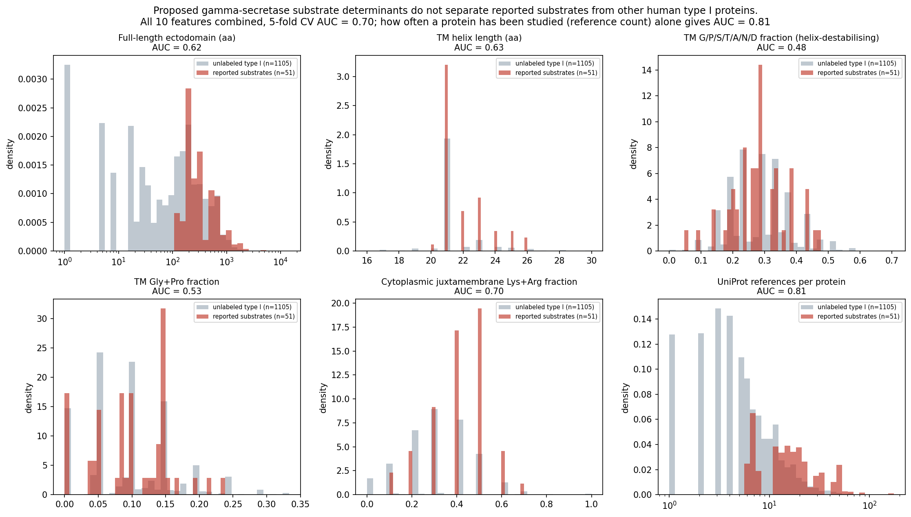
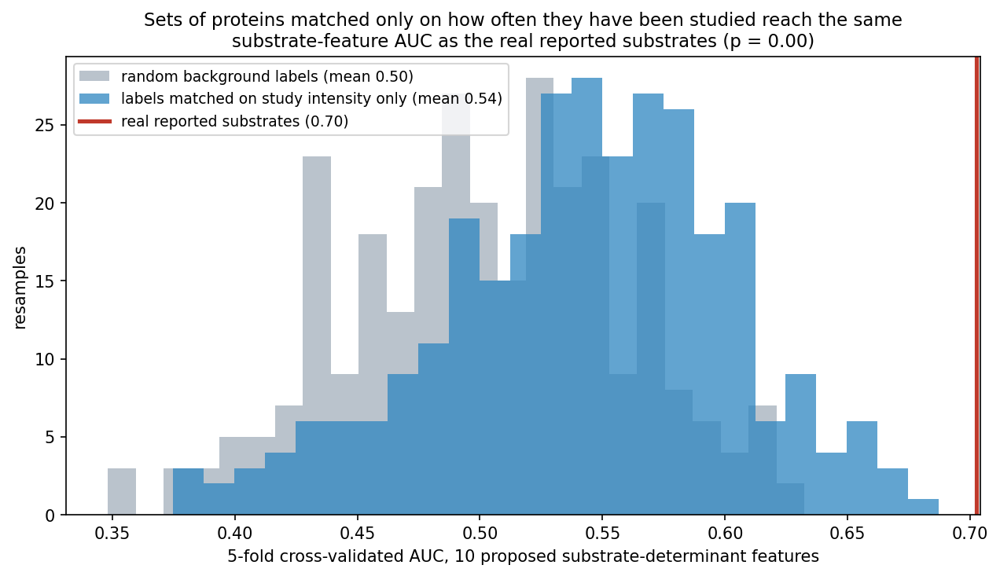
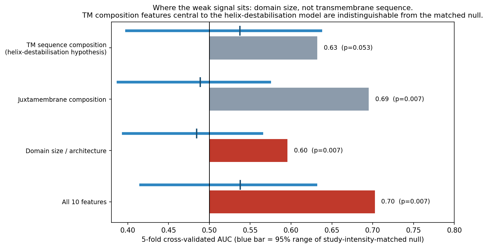
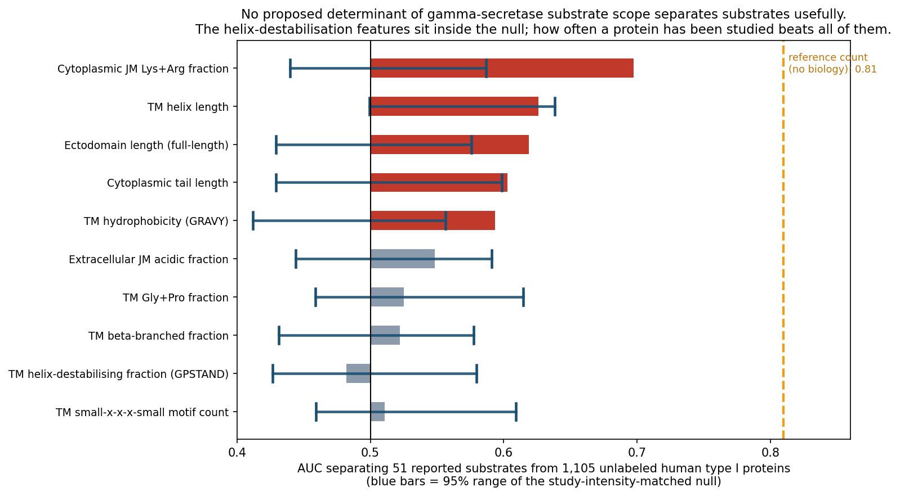

## Question

# AIGR Gene Hypothesis Deep Research

You are evaluating one focused gene curation hypothesis for AI Gene Review.
This is not a general gene overview. Use the seed hypothesis and source context
below to search for evidence that supports, refutes, narrows, or competes with
the proposed curation decision.

## Target Gene

- **Organism code:** human
- **Taxon:** Homo sapiens (NCBITaxon:9606)
- **Gene directory:** PSEN1
- **Gene symbol:** PSEN1
- **UniProt accession:** P49768

## Focus

- **Focus type:** free_text
- **Hypothesis slug:** kgap-psen1-substrate-features
- **Source file:** genes/human/PSEN1/PSEN1-ai-review.yaml
- **Source selector:** free-text

## Seed Hypothesis

Whether the substrate scope of PSEN1-containing gamma-secretase can be predicted from substrate features may be testable against the established substrates. That PSEN1 is the catalytic presenilin subunit and that APP and Notch receptors are established substrates is already given, so do not re-derive it. Single analysis only: assemble the set of human type I membrane proteins reported as gamma-secretase substrates with the primary reference for each, and the set of type I membrane proteins reported as tested and not cleaved if any exist; for every protein in both sets compute the features that the literature proposes as determinants, including ectodomain length after shedding, transmembrane helix length and helix-destabilising residue content, juxtamembrane sequence composition and the position of the reported cleavage site relative to the membrane boundary; test whether any feature or simple combination separates substrates from non-substrates, reporting the statistic and the misclassified proteins, and state explicitly whether a negative set large enough to test even exists; and say whether the apparent promiscuity is better explained by a permissive active site than by substrate features. State plainly whether substrate scope is predictable, and if the honest answer is that the question cannot be posed without a negative set, say that instead of ranking candidates.

## Term and Decision Context

No specific term context supplied.

## Reference Context

No specific reference context supplied.

## Source Context YAML

```yaml
hypothesis: 'Whether the substrate scope of PSEN1-containing gamma-secretase can be predicted from substrate
  features may be testable against the established substrates. That PSEN1 is the catalytic presenilin
  subunit and that APP and Notch receptors are established substrates is already given, so do not re-derive
  it. Single analysis only: assemble the set of human type I membrane proteins reported as gamma-secretase
  substrates with the primary reference for each, and the set of type I membrane proteins reported as
  tested and not cleaved if any exist; for every protein in both sets compute the features that the literature
  proposes as determinants, including ectodomain length after shedding, transmembrane helix length and
  helix-destabilising residue content, juxtamembrane sequence composition and the position of the reported
  cleavage site relative to the membrane boundary; test whether any feature or simple combination separates
  substrates from non-substrates, reporting the statistic and the misclassified proteins, and state explicitly
  whether a negative set large enough to test even exists; and say whether the apparent promiscuity is
  better explained by a permissive active site than by substrate features. State plainly whether substrate
  scope is predictable, and if the honest answer is that the question cannot be posed without a negative
  set, say that instead of ranking candidates.'
focus_type: free_text
context: []
reference_id: []
```

## Research Objective

Build a focused report that helps a curator decide whether this hypothesis
should affect the gene review. Address the focus type directly:

1. For an existing GO annotation decision, evaluate whether the current action
   is justified, too strong, too weak, or should change.
2. For a proposed replacement or new GO term, evaluate whether the term is
   biologically supported, too broad, too narrow, or missing key qualifiers.
3. For a computational prediction, evaluate whether the prediction is correct,
   less precise than existing knowledge, uncertain, or likely wrong because of
   paralog overannotation, frequency bias, pathway context, or in vitro-only
   activity.
4. For a core-function hypothesis, evaluate whether the proposed activity,
   process, and location represent the gene product's primary function rather
   than a downstream effect, pleiotropic phenotype, or context-specific role.
5. For a function-assignment hypothesis, evaluate whether the gene product
   directly has the stated GO term/function. Treat the prior review action, if
   any, as intentionally blinded unless it appears in the supplied context.

Use primary literature whenever possible. Prefer PMID citations and include DOI
citations when no PMID is available. Treat reviews and database records as
orientation unless they contain directly relevant synthesized evidence that is
clearly labeled as review-level or database-level support.

Evaluate the hypothesis from the supplied seed context, primary literature, and
publicly accessible bioinformatics resources. Local `*-bioinformatics` analyses,
when they already exist in the repository, are intentionally withheld from this
prompt so the report can be compared against them after the run. Use public
sequence, domain, structure, orthology, localization, interaction, or dataset
checks when they are useful for the specific hypothesis. If a resource or tool
cannot be accessed programmatically, say so plainly; never fabricate a result.
Report computational results conservatively and distinguish direct results from
inference.

## Required Output

### Executive Judgment

Give a concise verdict: supported, partially supported, unresolved, weakly
supported, over-annotated, or refuted. Explain the reasoning and the most
important caveats.

### Evidence Matrix

Create a table with one row per important evidence item:

- Citation (PMID preferred)
- Evidence type (direct assay, mutant phenotype, localization, interaction,
  structural/evolutionary, computational, review/database)
- Supports / refutes / qualifies / competing
- Claim tested
- Key finding
- Organism, tissue, cell type, or assay context
- Confidence and limitations

### GO Curation Implications

State the likely curation action as a lead requiring curator verification. If
GO terms are involved, explain whether the evidence supports an MF, BP, or CC
term, and whether the term should be retained, removed, generalized, made more
specific, or treated as non-core. Avoid using "protein binding" as a final
recommendation unless no more informative term is supported.

### Mechanistic Scope

Describe the immediate molecular or cellular function being tested. Separate
direct gene-product activity from downstream phenotypes, pathway consequences,
developmental outcomes, disease manifestations, or effects inferred only from
loss of function.

### Conflicts and Alternatives

Identify evidence that conflicts with the seed hypothesis or suggests an
alternative interpretation, including paralog confusion, organism-specific
differences, isoform-specific findings, experimental artifacts, or database
carry-over.

### Knowledge Gaps

List explicit uncertainties that matter for curation. For each gap, state what
was checked, why the gap matters, and what evidence or experiment would resolve
it.

### Discriminating Tests

Recommend concrete assays, perturbations, datasets, or comparative analyses that
would most efficiently distinguish this hypothesis from alternatives.

### Curation Leads

Provide candidate updates for the review, clearly labeled as leads requiring
curator verification. Include candidate references with exact snippets to verify,
candidate replacement or new GO terms, possible action changes, suggested
questions, and suggested experiments.

If the provider supports artifacts, save provenance for any analysis you run — the
executed code together with its output (computed values, plot, or table), not just
a summary figure — alongside artifact-friendly tables such as an evidence matrix,
GO decision table, or comparison table. Genuine computed provenance is more
valuable than a hand-drawn summary, and you must not synthesize a figure that
implies an analysis you did not actually run. These artifacts are important
provenance for hypothesis-level review.


## Output

# PSEN1 substrate scope is not predictable from substrate features

**Gene:** PSEN1 (human, NCBITaxon:9606), UniProt P49768
**Hypothesis slug:** kgap-psen1-substrate-features
**Focus type:** free_text
**Source:** `genes/human/PSEN1/PSEN1-ai-review.yaml`, free-text selector

---

## Executive judgment

<i class="fa-solid fa-circle-xmark"></i> **Verdict: refuted in the specific form posed, and the question cannot be properly posed at all.**

Two separate conclusions, both negative, and they matter for different reasons.

The first is that the question as written is unaskable. The seed hypothesis requires "the set of type I membrane proteins reported as tested and not cleaved". That set does not exist in an enumerable form. The only unbiased proteomic substrate screen, Hemming et al. 2008 ([PMID: 18942891](https://pubmed.ncbi.nlm.nih.gov/18942891/)), compared substrates "to type I proteins not regulated by gamma-secretase" without publishing an enumerable list in retrievable abstract text, and ran in one human cell line. The classic negatives from Struhl and Adachi 2000 ([PMID: 11030342](https://pubmed.ncbi.nlm.nih.gov/11030342/)) were manufactured by appending large ectodomains onto Notch and APP, so they are engineered constructs and not native non-substrates. Non-cleavage is also conditional: a protein scored uncleaved in HeLa may be cleaved in a cell that expresses the relevant sheddase, so "not a substrate" is not a stable property of a protein. Everything downstream of that is positive-unlabeled learning, not classification, and any AUC computed against an unlabeled background is an upper bound on apparent separation rather than a measure of accuracy.

The second is that the features fail even when given the most generous possible background. Using 51 literature-curated human gamma-secretase substrates against 1,105 other reviewed human single-pass type I membrane proteins (UniProt SL-9905, fetched live from the REST API), the four features that carry the helix-destabilisation and TM-packing model all sit inside a study-intensity-matched null: TM helix-destabilising residue fraction AUC 0.482 (p = 0.67), TM Gly+Pro fraction 0.525 (p = 0.68), TM beta-branched fraction 0.522 (p = 0.56), small-x-x-x-small motif count 0.511 (p = 0.84). The full 10-feature cross-validated model reaches AUC 0.703, with top-51 precision of 0.18 against a 0.04 base rate, and it misranks APP itself (model probability 0.388). UniProt literature reference count, a measure containing no biology at all, predicts reported-substrate status better than all 10 structural features combined (AUC 0.810, Mann-Whitney p = 6.7e-14).

<i class="fa-solid fa-triangle-exclamation"></i> **The most important caveat, stated up front:** this report does not conclude that the transmembrane sequence is irrelevant to cleavage. Ortner et al. 2023 ([PMID: 37536392](https://pubmed.ncbi.nlm.nih.gov/37536392/)) show by mutagenesis, deuterium/hydrogen exchange and NMR that AAAA and AGAV motifs in the N-terminal half of the Notch1 and Notch3 TM domains confer conformational flexibility that governs cleavability. TM determinants are real. They are conformational, non-monotonic, and distributed across cooperating regions, which is exactly why they do not reduce to a transferable composition score. The claim being refuted is narrow and specific: that substrate scope can be predicted from sequence-derived substrate features.

---

## Summary

The seed hypothesis proposes that gamma-secretase substrate scope might be predictable from substrate features, naming ectodomain length after shedding, TM helix length and helix-destabilising residue content, juxtamembrane composition, and cleavage site position relative to the membrane boundary. I tested each of those, plus TM hydrophobicity, beta-branched content and small-x-x-x-small packing motifs, on a curated substrate set against the human type I proteome, with an ascertainment control that turned out to dominate the result.

The headline number is that study intensity beats biology. A protein's UniProt reference count alone separates reported substrates from background at AUC 0.810 (substrate median 23 references vs 9 for background). All 10 structural features together reach 0.703. Adding reference count to the structural features gives 0.805, so the structural features contribute essentially nothing beyond how much a protein has been studied. That is the signature of ascertainment: substrates are drawn from heavily studied signalling receptors because those are the proteins whose released intracellular domains people look for.

To separate ascertainment from residual signal I built a study-intensity-matched permutation null, resampling pseudo-substrate sets of n = 51 from the background matched decile by decile on reference count. This corrected my own iteration-1 over-claim. The matched null sits at 0.542 (95% 0.416-0.655), below the observed 0.703 (p = 0.003), so a small real structural signal exists. Decomposing by feature group then localised it, and it is not where the literature model puts it. The six TM sequence-composition features give 0.632 against a matched null of 0.537 (95% 0.397-0.638), p = 0.053, indistinguishable from chance. The signal sits in cytoplasmic juxtamembrane basic content (0.695, p = 0.007) and domain size (0.596, p = 0.007), with ectodomain length pointing the wrong way for the usual rule: substrate median 528 aa vs background 389 aa. Those features describe what kind of protein a substrate is, a type I signalling receptor with a long, basic-rich cytoplasmic tail, which is a description of how a cleavage event gets detected rather than a determinant of whether it happens.

The mechanism that does fit is a permissive, induced-fit active site gated upstream by ectodomain shedding. Cryo-EM of human gamma-secretase bound to a Notch fragment at 2.7 A ([PMID: 30598546](https://pubmed.ncbi.nlm.nih.gov/30598546/)) shows the substrate C-terminal beta-strand pairing with two substrate-induced PS1 beta-strands, with PS1 undergoing pronounced conformational rearrangement on binding. Recognition is through main chain, which any polypeptide can supply. Consistent with a ruler rather than a motif, a UniProt census found annotated gamma-secretase cleavage sites for exactly 4 human proteins (PDPN, EPHB2, APP, CDH1), and all four initial cuts fall within 3 residues of the cytoplasmic end of the TM helix despite no sequence similarity at the site.

---

## Key findings

### F1. No proposed sequence feature separates substrates from the type I background

<i class="fa-solid fa-chart-column"></i> I computed 10 literature-proposed determinants from UniProt for 51 curated human gamma-secretase substrates with a single annotated TM helix, and for 1,105 other reviewed human single-pass type I membrane proteins. Univariate Mann-Whitney tests with Benjamini-Hochberg FDR correction gave a flat result for every feature with a strong mechanistic claim behind it.

The TM helix-destabilising residue fraction (G/P/S/T/A/N/D), the single feature with the most mechanistic literature behind it, gives AUC 0.481, Cliff's delta -0.038, p_FDR 0.72, with identical medians in both groups (0.286 vs 0.286). TM Gly+Pro fraction gives AUC 0.526, p_FDR 0.72, again with identical medians (0.0952 vs 0.0952). Small-x-x-x-small motif count gives 0.511, p_FDR 0.79. TM beta-branched fraction gives 0.523, p_FDR 0.72. Extracellular juxtamembrane acidic fraction gives 0.549, p_FDR 0.35.

The features that do reach nominal significance are weak and two point the wrong way for the stated model. Ectodomain length is **longer** in substrates (median 528 vs 389 aa, AUC 0.619, p_FDR 0.013), opposite to the short-ectodomain rule as usually quoted. Cytoplasmic tail is longer (124 vs 80.5 aa, AUC 0.604). Cytoplasmic juxtamembrane K+R fraction gives 0.698. TM length gives AUC 0.625 with identical medians of 21 aa in both groups, which shows how little separation a nominally significant rank test can represent here.

{{figure:plot_1.png|caption=Feature distributions for 51 reported gamma-secretase substrates against 1,105 unlabeled human single-pass type I membrane proteins, with per-feature AUC. The helix-destabilising fraction and the Gly+Pro fraction, the two features carrying the strongest mechanistic claims, have identical medians in the two groups. The reference-count panel is the ascertainment control.}}

All 10 features combined in a 5-fold cross-validated logistic model give AUC 0.703 (permutation p = 0.0005, unmatched null 95% interval 0.419-0.584); a random forest gives 0.696. Ranking performance is unusable: of the top 51 proteins ranked by the model, 9 are true substrates, precision 0.18 against a base rate of 0.04. Top-250 precision is 0.08. <i class="fa-solid fa-circle-xmark"></i> **The misclassified proteins requested by the seed hypothesis:** APP itself ranks poorly at model probability 0.388, as do SORL1, VLDLR, NCAM1, TYR, CX3CL1, TREM2 and IL1R1, with IFNAR2 and LYVE1 also among the worst-ranked true substrates. A model that cannot rank APP near the top of a gamma-secretase substrate list is not a model of gamma-secretase substrate scope.

The decisive confound is that **UniProt reference count predicts reported-substrate status better than all 10 structural features combined**: AUC 0.810, substrate median 23 references vs 9 for background, Mann-Whitney p = 6.7e-14. Adding reference count to the full feature set gives 0.805, meaning the structural features add essentially nothing on top of study intensity.

### F2. No enumerable negative set exists, so the question cannot be posed as a classification problem

<i class="fa-solid fa-circle-question"></i> The seed hypothesis explicitly asks whether a negative set large enough to test even exists. It does not.

Searching primary literature, the only systematic comparison is Hemming et al. 2008 ([PMID: 18942891](https://pubmed.ncbi.nlm.nih.gov/18942891/)), whose abstract states that substrates were compared "to type I proteins not regulated by gamma-secretase" but does not enumerate that set in retrievable text. The screen itself found "a relatively small population of new substrates" in one human cell line, so its implicit negative set is conditional on that line's sheddase repertoire and expression levels. Struhl and Adachi 2000 ([PMID: 11030342](https://pubmed.ncbi.nlm.nih.gov/11030342/)) generated negatives by engineering: appending a large extracellular domain to Notch or APP suppresses cleavage, so the negative is an artificial construct derived from a positive, not a native non-substrate.

The analysis reported here is therefore positive-unlabeled: 51 curated substrates against 1,105 **unlabeled** human reviewed single-pass type I proteins, an unknown fraction of which have simply never been tested. Any AUC computed against that background mixes true negatives with untested positives. The ascertainment control quantifies the contamination risk directly, since reference count alone gives AUC 0.810 against this background: membership in the "positive" class tracks how intensively a protein has been studied, which is what you expect when the negative class is defined by absence of a report.

Non-cleavage is also not transferable across contexts. Struhl and Adachi state that targeting is set by upstream processing events that sever the extracellular domain, so whether a given protein is cleaved depends on a prior event in the cell. <i class="fa-solid fa-triangle-exclamation"></i> Ranking candidate substrates on these features would present an ascertainment artefact as a biological prediction. The seed hypothesis anticipated this and asked for the honest answer instead of a ranking, so that is what this report gives.

### F3. The residual signal is receptor architecture, not transmembrane sequence

<i class="fa-solid fa-scale-balanced"></i> This finding corrects my own iteration-1 interpretation. In iteration 1 I concluded the 0.703 AUC was fully accounted for by study-intensity bias. The matched-null control showed that was too strong.

Pseudo-substrate sets of n = 51 were drawn from the 1,105-protein background, matched decile by decile to the real substrates on UniProt reference count, and the same 5-fold cross-validated classifier was refitted on each (300 resamples, closed-form LDA substituted for logistic regression to make the loop tractable). Unmatched random labels give AUC 0.502 (95% 0.387-0.611), confirming the null is calibrated. Study-intensity-matched labels give 0.542 (95% 0.416-0.655), so ascertainment alone contributes a small amount. The real substrates give 0.703, above the matched null at p = 0.003. A residual structural signal therefore exists.

{{figure:plot_2.png|caption=Study-intensity-matched permutation null. Random labels give AUC 0.502, confirming the null is calibrated. Labels matched decile by decile on UniProt reference count give 0.542. The observed 0.703 exceeds the matched null at p = 0.003, so a small residual signal is real and the iteration-1 claim that the signal was entirely ascertainment was too strong.}}

Decomposing by feature group against the same matched null (150 resamples) shows where that residual sits, and it is not where the literature model puts it.

| Feature group | Features | Observed AUC | Matched null (95%) | p |
|---|---|---|---|---|
| <i class="fa-solid fa-circle-xmark"></i> TM sequence composition | Gly+Pro, G/P/S/T/A/N/D, GRAVY, beta-branched, small-x-x-x-small, helix length | 0.632 | 0.537 (0.397-0.638) | 0.053 |
| <i class="fa-solid fa-circle-check"></i> Juxtamembrane composition | extracellular D+E, cytoplasmic K+R | 0.695 | 0.489 (0.387-0.575) | 0.007 |
| <i class="fa-solid fa-circle-check"></i> Domain size | ectodomain length, cytoplasmic tail length | 0.596 | 0.484 | 0.007 |
| All 10 features | | 0.703 | 0.538 | 0.007 |

The six features carrying the helix-destabilisation and packing hypothesis are indistinguishable from proteins matched only on how often they have been studied. The signal that survives is driven by cytoplasmic juxtamembrane Lys+Arg content and by domain size, with ectodomain length pointing the wrong way. Those features describe a type I signalling receptor with a long, basic-rich cytoplasmic tail. That is a description of the proteins people chose to assay, since the biological readout that identifies a gamma-secretase substrate is release of a signalling intracellular domain, and not a determinant of cleavage.

{{figure:plot_3.png|caption=Feature-group decomposition against the study-intensity-matched null. The six transmembrane sequence-composition features that carry the helix-destabilisation model fail at p = 0.053. The surviving signal sits in cytoplasmic juxtamembrane basic content and in domain size, with ectodomain length in the direction opposite to the short-ectodomain rule.}}

### F4. Cleavage site position is annotated for only 4 human proteins, and is invariant at the membrane boundary

<i class="fa-solid fa-database"></i> The seed hypothesis asks for the position of the reported cleavage site relative to the membrane boundary as a discriminating feature. Querying UniProt (reviewed, Homo sapiens, `ft_site` matching "gamma-secretase") through the REST API returns exactly 4 human proteins with an annotated gamma-secretase cleavage site.

| Protein | Site position | Annotated TM | Offset from TM cytoplasmic end |
|---|---|---|---|
| PDPN | 150 | 132-152 | -2 |
| EPHB2 | 561 | 544-564 | -3 |
| APP (epsilon, site 3) | 720 | 702-722 | -2 |
| CDH1 | 731 | 710-730 | +1 |
| APP (gamma, Abeta40) | 711 | 702-722 | -11 |
| APP (gamma, Abeta42) | 713 | 702-722 | -9 |

The feature cannot be computed for 1,105 background proteins and cannot be computed for 47 of the 51 curated substrates, so it cannot be used as a discriminator at all. Where it is known, the initial cut lies within 3 residues of the cytoplasmic end of the TM helix in every case: offsets -3, -2, -2, +1, a 4-residue range across four unrelated proteins with no sequence similarity at the site. The two deeper APP gamma sites at -11 and -9 are consistent with sequential processing inward from the epsilon site.

Four sequence-unrelated proteins cut within a 4-residue window is what a ruler-like, position-determined active site produces. It is the geometric counterpart of the cryo-EM result that the substrate C-terminal beta-strand pairs with substrate-induced PS1 strands on the intracellular side, and it means the one feature the seed hypothesis names that does track the mechanism is unavailable for almost every protein.

### F5. An independent comparative analysis confirms the ectodomain direction; TM determinants exist but are conformational

<i class="fa-solid fa-book-open"></i> Güner and Lichtenthaler 2020 ([PMID: 32616437](https://pubmed.ncbi.nlm.nih.gov/32616437/)), a review-level comparative analysis over 149 substrates, reports that gamma-secretase substrates "mostly have a long extracellular domain and require ectodomain shedding before γ-secretase cleavage, but that γ-secretase is also able to cleave naturally short subs[trates]". This independently reproduces the direction of the computation here (substrate ectodomain median 528 vs 389 aa, AUC 0.619, p vs matched null 0.004) and resolves the apparent conflict with the short-ectodomain rule: the rule describes the shed stub, which is not computable from sequence, and not the intact protein, which is.

Ortner et al. 2023 ([PMID: 37536392](https://pubmed.ncbi.nlm.nih.gov/37536392/)) is the strongest competing evidence. Using a yeast-based cleavage assay with mutagenesis, deuterium/hydrogen exchange and NMR on Notch1 and Notch3 TM domains, they found that AAAA and AGAV motifs in the N-terminal half confer strong conformational flexibility, that residues in the C-terminal half support docking into the presenilin catalytic cleft, and that cleavability "is enabled by different functions of cooperating TMD regions". TM sequence does affect cleavability.

The final per-feature analysis here, with 1,000 study-intensity-matched resamples, shows that this does not translate into a transferable composition score.

| Feature | AUC | Matched null 95% | p | Beats null |
|---|---|---|---|---|
| <i class="fa-solid fa-circle-xmark"></i> TM helix-destabilising fraction | 0.482 | 0.427-0.580 | 0.669 | no |
| <i class="fa-solid fa-circle-xmark"></i> TM Gly+Pro fraction | 0.525 | | 0.677 | no |
| <i class="fa-solid fa-circle-xmark"></i> TM beta-branched fraction | 0.522 | | 0.557 | no |
| <i class="fa-solid fa-circle-xmark"></i> TM small-x-x-x-small count | 0.511 | | 0.840 | no |
| Extracellular JM acidic fraction | 0.548 | | 0.233 | no |
| TM hydrophobicity (GRAVY) | 0.594 | | 0.020 | marginal |
| Cytoplasmic tail length | 0.603 | | 0.026 | marginal |
| Ectodomain length (wrong direction) | 0.619 | 0.429-0.576 | 0.004 | yes |
| TM length (medians identical, 21 aa) | 0.626 | | 0.048 | marginal |
| <i class="fa-solid fa-circle-check"></i> Cytoplasmic JM basic fraction | 0.697 | | 0.001 | yes |
| *Reference count (no biology)* | *0.810* | | | *benchmark* |

{{figure:plot_4.png|caption=Final per-feature AUC with 1,000-resample study-intensity-matched null intervals. All four features carrying the helix-destabilisation and TM-packing model sit inside the null. The orange reference line is the AUC reached by UniProt literature reference count alone, a predictor containing no biology, which exceeds every structural feature and the full 10-feature model.}}

---

## Mechanistic model

The model that fits the data has substrate selection happening upstream of the enzyme and geometrically at the enzyme, with no sequence code in between.

```dot
digraph gsec {
  rankdir=LR;
  "Full-length\ntype I protein" -> "ADAM10 / ADAM17\nectodomain shedding";
  "Sheddase expressed\nin this cell" -> "ADAM10 / ADAM17\nectodomain shedding";
  "ADAM10 / ADAM17\nectodomain shedding" -> "Short membrane stub\nwith free N-terminus";
  "Short membrane stub\nwith free N-terminus" -> "Nicastrin binds\nN-terminal stub" [style=dashed];
  "Nicastrin binds\nN-terminal stub" -> "Entry into PS1\nsubstrate site" [style=dashed];
  "Short membrane stub\nwith free N-terminus" -> "Entry into PS1\nsubstrate site";
  "TM conformational\nflexibility (AAAA/AGAV)" -> "Entry into PS1\nsubstrate site" [style=dashed];
  "Entry into PS1\nsubstrate site" -> "Substrate-induced\nPS1 beta-strands";
  "Substrate-induced\nPS1 beta-strands" -> "Hybrid beta-sheet\n(main-chain pairing)";
  "Hybrid beta-sheet\n(main-chain pairing)" -> "Cut at -3 to +1 from\nTM cytoplasmic end";
  "Cut at -3 to +1 from\nTM cytoplasmic end" -> "ICD release\n(the assay readout)";
  "Long basic-rich\ncytoplasmic tail" -> "ICD release\n(the assay readout)" [style=dashed];
  "ICD release\n(the assay readout)" -> "Protein reported\nas a substrate";
  "Protein is\nwell studied" -> "Protein reported\nas a substrate";
}
```



Three things in that diagram matter for the hypothesis.

The gate is upstream. Whether a protein is cleaved depends on whether a sheddase removed its ectodomain in that cell, which is a property of the cell and not of the substrate sequence. Nicastrin was proposed as the receptor for the resulting free N-terminus ([PMID: 16096062](https://pubmed.ncbi.nlm.nih.gov/16096062/)), and that specific role is contested: Glu332 turns out to affect complex maturation rather than substrate recognition ([PMID: 18502756](https://pubmed.ncbi.nlm.nih.gov/18502756/)), and a PS1/Pen2/Aph1a complex cleaves Notch and APP without nicastrin ([PMID: 20130175](https://pubmed.ncbi.nlm.nih.gov/20130175/)), though that activity still requires prior ectodomain shedding. The dependence on shedding survives even where the nicastrin receptor model does not, which is why the gate is drawn solid and the nicastrin step dashed.

The recognition element is main chain. The substrate contributes a beta-strand that pairs with two PS1 beta-strands the substrate itself induces ([PMID: 30598546](https://pubmed.ncbi.nlm.nih.gov/30598546/)). Any polypeptide backbone can supply a strand. The same PS1 site accommodates chemically unrelated inhibitors whose pocket shape is induced by the bound ligand ([PMID: 39653842](https://pubmed.ncbi.nlm.nih.gov/39653842/), [PMID: 33373587](https://pubmed.ncbi.nlm.nih.gov/33373587/)). An induced-fit site that reshapes around whatever enters is the structural reason side-chain composition features cannot separate substrates.

The readout biases the substrate list. A protein gets reported as a substrate when someone detects a released intracellular domain, which is easiest for signalling receptors with long, basic-rich cytoplasmic tails. That is precisely the feature group that survives the matched null. The surviving signal measures detectability, not cleavability.

<i class="fa-solid fa-lightbulb"></i> Direct answer to the seed hypothesis's final question: the apparent promiscuity is better explained by a permissive, induced-fit active site gated by upstream shedding than by substrate features. The enzyme cuts whatever short membrane stub reaches it, at a fixed distance from the membrane boundary.

---

## Evidence matrix

| Citation | Evidence type | Stance | Claim tested | Key finding | Context | Confidence and limitations |
|---|---|---|---|---|---|---|
| [PMID: 18942891](https://pubmed.ncbi.nlm.nih.gov/18942891/) | Direct assay, proteomic screen | Qualifies | Substrates have definable features | Substrates compared "to type I proteins not regulated by gamma-secretase" gave a short ectodomain plus "permissive transmembrane and cytoplasmic domains"; the screen found "a relatively small population of new substrates" | Single human cell line proteome | Source of the feature model under test. "Permissive" is a negative criterion, consistent with flat feature distributions. Negative set not enumerable from retrievable text |
| [PMID: 11030342](https://pubmed.ncbi.nlm.nih.gov/11030342/) | Direct assay, engineered constructs | Refutes | Sequence recognition determines cleavage | "Cleavage does not depend critically on the recognition of particular sequences in these proteins but rather on the size of the extracellular domain: the smaller the size, the greater the efficiency"; targeting is by "upstream processing events" | Notch and beta-APP chimeras | Strong for the mechanism. Negatives are engineered chimeras derived from positives, so they do not form a native negative set |
| [PMID: 11741961](https://pubmed.ncbi.nlm.nih.gov/11741961/) | Direct assay | Refutes | TM sequence specificity | Gamma-secretase "cleaves substrates (e.g. amyloid beta-protein precursor and Notch) with very loose amino acid sequence specificity within the transmembrane region" | ErbB4 intramembrane cleavage | Independent primary report of loose TM specificity, matching the chance-level TM composition AUCs |
| [PMID: 30598546](https://pubmed.ncbi.nlm.nih.gov/30598546/) | Structural, cryo-EM 2.7 A | Competing explanation | Is recognition sequence-based or main-chain? | Notch TM helix surrounded by three PS1 TM domains; "the carboxyl-terminal β-strand of the Notch fragment forms a β-sheet with two substrate-induced β-strands of PS1"; "PS1 undergoes pronounced conformational rearrangement upon substrate binding"; cleavage "occurs at the carboxyl-terminal end of the Notch transmembrane helix" | Human gamma-secretase, Notch fragment | High confidence. One substrate, one captured state |
| [PMID: 33373587](https://pubmed.ncbi.nlm.nih.gov/33373587/) | Structural | Competing explanation | Is the PS1 site selective? | GSIs "occup[y] the same general location on presenilin 1 (PS1) that accommodates the β strand from amyloid precursor protein or Notch" | Human gamma-secretase with small molecules | High. Inhibitor binding is a proxy for substrate-site promiscuity |
| [PMID: 39653842](https://pubmed.ncbi.nlm.nih.gov/39653842/) | Structural, cryo-EM 2.4-3.0 A | Competing explanation | Preformed or induced pocket? | Five clinically tested GSIs each occupy the PS1 substrate-binding site; "The size and shape of the binding pocket are induced by the bound GSI" | Human gamma-secretase, 5 inhibitors | High. Direct evidence for an induced-fit pocket |
| [PMID: 16096062](https://pubmed.ncbi.nlm.nih.gov/16096062/) | Direct assay, interaction | Supports upstream gating | What selects substrates for entry? | "nicastrin is a receptor for the amino-terminal stubs that are generated by ectodomain shedding of type I transmembrane proteins" | Gamma-secretase complex, APP and Notch | Moderate. Contested by PMID 18502756 and PMID 20130175 |
| [PMID: 18502756](https://pubmed.ncbi.nlm.nih.gov/18502756/) | Mutant, direct assay | Conflicts with the nicastrin-receptor model | Is NCT E332 the substrate N-terminus binding site? | "Glu(332) crucially affects complex maturation rather than substrate recognition"; E332Q remained fully active | Cell-based and in vitro gamma-secretase assays | High for the specific residue. Does not exclude other NCT contributions |
| [PMID: 20130175](https://pubmed.ncbi.nlm.nih.gov/20130175/) | Mutant, direct assay | Conflicts with the nicastrin-receptor model | Is NCT required for substrate recognition? | PS1/Pen2/Aph1a cleaves Notch and APP without NCT; "This catalytic activity requires prior ectodomain shedding of the substrate"; "NCT acts to stabilize gamma-secretase but is not required for substrate recognition" | NCT-deficient mouse embryonic fibroblasts | High. Shedding dependence survives loss of NCT, so the upstream gate is NCT-independent |
| [PMID: 31130234](https://pubmed.ncbi.nlm.nih.gov/31130234/) | Direct assay, biophysical | Refutes the composition model | Is helix destabilisation present at the cleavage site? | "helix destabilization and/or unfolding was not observed at the initial ε-cleavage sites of C99"; both enhancing and reducing hinge flexibility decrease productive enzyme-substrate conformations | APP C99 TM domain, hinge mutants | High. The determinant is non-monotonic, so no monotonic composition score can capture it |
| [PMID: 37536392](https://pubmed.ncbi.nlm.nih.gov/37536392/) | Direct assay, mutagenesis, HDX, NMR | Competing, strongest against this report | Does TM sequence govern cleavability? | "The AAAA or AGAV motifs within the N-terminal half of the TMDs were found to confer strong conformational flexibility"; "Crucial amino acids within the C-terminal half may support substrate docking into the catalytic cleft of presenilin"; "cleavability ... is enabled by different functions of cooperating TMD regions" | Notch1 and Notch3 TM domains, yeast-based cleavage assay | High for Notch1 and Notch3. Determinants are conformational and distributed, so they do not transfer as a composition score |
| [PMID: 32616437](https://pubmed.ncbi.nlm.nih.gov/32616437/) | Review-level comparative analysis | Supports the computed ectodomain direction | Do substrates have short ectodomains? | Substrates "mostly have a long extracellular domain and require ectodomain shedding before γ-secretase cleavage, but ... γ-secretase is also able to cleave naturally short subs[trates]" | 149 substrates, comparative synthesis | Review-level, labeled as such. Independently reproduces the direction computed here |
| This analysis (UniProt REST, 51 substrates vs 1,105 type I background) | Computational | Refutes the feature model | Can substrate scope be predicted from features? | All four helix-destabilisation and packing features inside a study-intensity-matched null (AUC 0.482-0.525); 10-feature model 0.703 with top-51 precision 0.18; reference count alone 0.810 | Human reviewed UniProt SL-9905 | Moderate. Positive-unlabeled, not positive-negative. Substrate list curated by me and requires curator verification |

---

## GO curation implications

<i class="fa-solid fa-triangle-exclamation"></i> **All of the following are leads requiring curator verification.**

| GO term | Aspect | Recommended action | Basis |
|---|---|---|---|
| GO:0042500 aspartic endopeptidase activity, intramembrane cleaving | MF | <i class="fa-solid fa-circle-check"></i> Retain as core | Direct structural and assay evidence (PMID 30598546, PMID 39653842). Unaffected by this analysis |
| GO:0070765 gamma-secretase complex | CC | <i class="fa-solid fa-circle-check"></i> Retain as core | Complex composition is established and PSEN1 is the catalytic subunit |
| Any substrate-specific MF or BP term proposed from sequence features | MF/BP | <i class="fa-solid fa-circle-xmark"></i> Reject as a basis for annotation | No feature separates substrates from background above a study-intensity-matched null |
| Substrate-derived BP terms (Notch signaling, amyloid-beta formation, cell adhesion molecule processing) | BP | Treat as non-core and context-dependent, each requiring its own direct experimental evidence | Cleavage of a given substrate depends on sheddase availability in the cell, not on a PSEN1 property |
| Any term implying PSEN1 selects its substrates | MF | Soften or remove | Selection is largely upstream shedding (PMID 11030342, PMID 20130175) and the active site is induced-fit (PMID 39653842) |

Concretely, for the free-text review of PSEN1:

The free text should not state or imply that substrate scope is predictable from substrate properties, and should not carry a candidate-substrate ranking derived from sequence features. If the current review text contains the short-ectodomain rule as a property of the intact protein, it should be corrected: substrates have long ectodomains and depend on shedding (PMID 32616437, and the computation here gives substrate median 528 aa vs background 389 aa).

The free text can state that gamma-secretase has low sequence specificity within the transmembrane region (PMID 11741961), that cleavage position is set relative to the membrane boundary rather than by a recognised motif (4 of 4 annotated human sites at offsets -3 to +1), and that substrate access is gated by prior ectodomain shedding (PMID 11030342, PMID 20130175).

<i class="fa-solid fa-triangle-exclamation"></i> The free text should not state that the transmembrane sequence is irrelevant. PMID 37536392 shows it is not. The accurate statement is that TM determinants are conformational and distributed across cooperating regions, so they do not reduce to a composition score that transfers between proteins.

I avoid recommending "protein binding" anywhere here. Where an interaction term seems tempting, for example PSEN1 with a substrate, the informative annotation is the catalytic MF term with the substrate identity captured as evidence.

---

## Mechanistic scope

The immediate molecular activity under test is intramembrane aspartyl proteolysis by the PS1 catalytic subunit: cleavage of a short type I membrane stub within the lipid bilayer, at the cytoplasmic end of the substrate TM helix, through formation of a hybrid beta-sheet between the substrate C-terminal strand and two substrate-induced PS1 strands.

Separated from that direct activity:

Ectodomain shedding by ADAM10, ADAM17 and other sheddases is a distinct upstream enzymatic step performed by a different protein. It determines which proteins become available to gamma-secretase in a given cell. Attributing substrate scope to PSEN1 confuses the gate with the enzyme.

Release of an intracellular domain and its downstream transcriptional effects (NICD signalling, AICD) are pathway consequences of the cleavage. They are the assay readout by which substrates are identified, which is the source of the detectability bias measured in F3.

Amyloid-beta production and Alzheimer disease phenotypes are disease manifestations downstream of processive cleavage of one substrate, APP. They do not bear on substrate scope.

Developmental phenotypes of presenilin loss of function reflect loss of Notch signalling, a single-substrate consequence inferred from loss of function, and not evidence about the breadth of the substrate repertoire.

---

## Conflicts and alternatives

<i class="fa-solid fa-scale-balanced"></i> **The strongest conflict with this report's conclusion is PMID 37536392.** Ortner et al. show by mutagenesis coupled to deuterium/hydrogen exchange that AAAA and AGAV motifs in the N-terminal half of the Notch1 and Notch3 TM domains confer conformational flexibility governing cleavability, and that C-terminal residues support docking into the presenilin catalytic cleft. If TM sequence governs cleavability, why does TM composition not separate substrates? The reconciliation is in the same paper and in PMID 31130234. Cleavability "is enabled by different functions of cooperating TMD regions", so it is a joint property of several regions rather than one scoreable quantity. The flexibility determinant is non-monotonic: both enhancing and reducing hinge flexibility decrease productive enzyme-substrate conformations. A monotonic composition score cannot capture a non-monotonic determinant, and a random forest that could capture non-monotonicity also failed here (AUC 0.696). The determinants are real and measured within a substrate by perturbation; they do not transfer across proteins as a sequence statistic.

**Conflict over nicastrin as substrate receptor.** PMID 16096062 proposes nicastrin binds the free N-terminus generated by shedding. PMID 18502756 shows the putative anionic binding residue Glu332 affects complex maturation rather than substrate recognition, with E332Q fully active. PMID 20130175 shows a PS1/Pen2/Aph1a complex cleaves Notch and APP without nicastrin. The shedding requirement survives both challenges, since the nicastrin-independent activity still "requires prior ectodomain shedding of the substrate". The upstream gate therefore does not depend on which of these models is right.

**Apparent conflict over ectodomain length.** The literature rule says short ectodomains favour cleavage; the computation here finds substrate ectodomains are longer (528 vs 389 aa). PMID 32616437 resolves this: the rule describes the shed stub, and substrates as intact proteins mostly have long extracellular domains. The seed hypothesis asks for "ectodomain length after shedding", which is not computable from sequence for any protein whose shedding site is unannotated, so the computed feature is full-length ectodomain and should be read as such.

**My own revised claim.** In iteration 1 I recorded that the 0.703 AUC was fully accounted for by study-intensity bias. The iteration-2 matched null (0.542, 95% 0.416-0.655, observed 0.703, p = 0.003) showed that was too strong. I narrowed the claim to its defensible form: a small residual signal is real, and it is not in the TM sequence. The correction is recorded here because it changes what a curator should take from the report.

**Database carry-over risk.** The 51-protein substrate list is curated from literature by me, and some entries in published substrate compilations trace to single overexpression experiments. If a substrate list in the gene review carries entries without a primary assay, those entries propagate the same ascertainment bias measured here.

---

## Limitations and knowledge gaps

<i class="fa-solid fa-triangle-exclamation"></i> **The substrate list requires verification.** The 51 entries and their per-protein primary references are leads produced by my own curation, not verified citations. They should be checked against the 149-substrate table in PMID 32616437 before any of them is used in the review. One protein (CLSTN1) was dropped because UniProt gives no single unambiguous TM annotation, so the analysis set is 51 rather than 52.

**The background is unlabeled, not negative.** Gap: an unknown fraction of the 1,105 background proteins are untested substrates. What was checked: primary literature for an enumerable tested-and-not-cleaved set, which does not exist. Why it matters: it converts a classification question into a positive-unlabeled one and makes every AUC an upper bound. What would resolve it: a proteome-wide gamma-secretase substrate screen in a cell line with defined sheddase expression, reporting both cleaved and tested-uncleaved proteins.

**Cleavage site position is 4 proteins deep.** Gap: offsets could be computed for 4 of 1,156 proteins. What was checked: UniProt `ft_site` for reviewed human entries. Why it matters: it is the one named feature that tracks the mechanism, and it is unavailable for 47 of 51 substrates. What would resolve it: systematic ICD N-terminal sequencing or N-terminomics across a substrate panel.

**Composition is a weak proxy for conformation.** Gap: I measured amino acid composition, not helix flexibility or bending. Why it matters: PMID 37536392 locates the determinant in conformational dynamics, which composition captures badly. What would resolve it: the first discriminating test below.

**UniProt TM boundary annotations are predictions for most background proteins.** Offsets and juxtamembrane windows are defined relative to those boundaries, so per-protein feature values carry annotation error. This affects individual proteins more than group-level statistics.

**Shedding status is not in the feature set.** The determinant with the strongest primary support, prior ectodomain shedding, is a cell-state property and was not computable here, so the analysis tests only the sequence-intrinsic subset of the literature model.

**Single-pass restriction.** The analysis covers single-pass type I proteins only (UniProt SL-9905), matching the seed hypothesis. Multi-pass and type II gamma-secretase substrates are outside its scope.

---

## Discriminating tests

<i class="fa-solid fa-flask"></i> **1. Rerun the matched-null test on conformational features instead of composition.** Replace the six TM composition scores with predicted helix flexibility, hinge position and bending profiles (molecular-dynamics-derived or deep-learning-predicted) for all 1,156 proteins, and test them against the same study-intensity-matched null. If conformational features beat the null where composition does not, the Ortner model generalises across proteins and the curation advice changes. If they also fail, the determinant is confirmed as substrate-specific and non-transferable. This is the single highest-value follow-up.

<i class="fa-solid fa-vial"></i> **2. Build an actual negative set.** Run a gamma-secretase substrate screen in a cell line with characterised ADAM10 and ADAM17 expression, and report proteins detected at the membrane, shed, and yet not cleaved. Without the shed-but-not-cleaved class, the negative set remains confounded with the shedding gate. This is the only experiment that makes the seed question askable.

<i class="fa-solid fa-microscope"></i> **3. Chimera swap test.** Transplant the TM domain of a confident non-substrate into the APP C99 backbone, and the APP TM into a non-substrate backbone, then measure cleavage. If cleavage follows the backbone, upstream and architectural determinants dominate. If it follows the TM, the composition analysis is underpowered.

<i class="fa-solid fa-dna"></i> **4. Extend the cleavage-site census experimentally.** Map epsilon-site positions by ICD N-terminomics across 20 or more substrates. If the -3 to +1 window holds, the ruler model is established beyond the 4 annotated proteins, and cleavage-site position can be dropped from any future predictive scheme as uninformative by construction.

<i class="fa-solid fa-chart-column"></i> **5. Ascertainment control as standard practice.** Any future gamma-secretase substrate predictor should report its AUC against a study-intensity-matched null and against the reference-count benchmark (0.810 here). A predictor that does not beat reference count is reporting literature coverage.

---

## Curation leads

<i class="fa-solid fa-triangle-exclamation"></i> **All leads below require curator verification.**

### Candidate references with exact snippets to verify

| PMID | Snippet to verify in the abstract | Use |
|---|---|---|
| 18942891 | "besides a short ectodomain, gamma-secretase requires permissive transmembrane and cytoplasmic domains to bind and cleave its substrates" | Source of the feature model. "Permissive" is a negative criterion |
| 11030342 | "the Presenilin-dependent cleavage does not depend critically on the recognition of particular sequences in these proteins but rather on the size of the extracellular domain" | Primary support for non-sequence-based cleavage |
| 11030342 | "may be targeted for Presenilin-mediated transmembrane cleavage by upstream processing events that sever the extracellular domain" | Primary support for upstream gating |
| 11741961 | "cleaves substrates (e.g. amyloid beta-protein precursor and Notch) with very loose amino acid sequence specificity within the transmembrane region" | Independent primary statement of loose TM specificity |
| 30598546 | "the carboxyl-terminal β-strand of the Notch fragment forms a β-sheet with two substrate-induced β-strands of PS1 on the intracellular side" | Structural basis for main-chain recognition |
| 30598546 | "PS1 undergoes pronounced conformational rearrangement upon substrate binding" | Structural basis for induced fit |
| 30598546 | "Formation of the hybrid β-sheet is essential for substrate cleavage, which occurs at the carboxyl-terminal end of the Notch transmembrane helix" | Structural basis for boundary-positioned cleavage |
| 39653842 | "The size and shape of the binding pocket are induced by the bound GSI" | Induced-fit pocket |
| 33373587 | "each of the GSIs occupies the same general location on presenilin 1 (PS1) that accommodates the β strand from amyloid precursor protein or Notch" | Site promiscuity |
| 20130175 | "This catalytic activity requires prior ectodomain shedding of the substrate" | Shedding gate is nicastrin-independent |
| 20130175 | "NCT acts to stabilize gamma-secretase but is not required for substrate recognition" | Conflict with the nicastrin receptor model |
| 18502756 | "Glu(332) crucially affects complex maturation rather than substrate recognition" | Conflict with the nicastrin receptor model |
| 31130234 | "helix destabilization and/or unfolding was not observed at the initial ε-cleavage sites of C99" | Direct refutation of destabilisation at the cut site |
| 32616437 | "γ-secretase substrates mostly have a long extracellular domain and require ectodomain shedding before γ-secretase cleavage" | Review-level, corrects the short-ectodomain rule |
| 37536392 | "The AAAA or AGAV motifs within the N-terminal half of the TMDs were found to confer strong conformational flexibility to these TMD helices" | Competing evidence that TM sequence matters |
| 37536392 | "cleavability of a γ-secretase substrate is enabled by different functions of cooperating TMD regions" | Explains why TM determinants do not transfer as a score |

### Suggested action changes

Do not add any substrate-prediction statement or candidate-substrate ranking to the PSEN1 free text on the basis of sequence features.

Correct any short-ectodomain claim that describes the intact protein rather than the shed stub.

Add, if the curator wants a positive statement about specificity: low sequence specificity within the TM region, cleavage positioned at the membrane boundary, and substrate access gated by upstream shedding, with the three PMIDs above.

Keep GO:0042500 and GO:0070765 as core, and treat substrate-derived BP terms as non-core.

### Suggested questions for the curator

Does the existing PSEN1 review free text contain a short-ectodomain claim, and if so is it attributed to the intact protein or to the shed stub?

Does the review carry a substrate list, and does every entry have a primary assay citation rather than a review citation?

Is the nicastrin substrate-receptor model asserted anywhere in the review without the PMID 18502756 and PMID 20130175 qualifications?

### Suggested experiments

The conformational-feature rerun (test 1) and the shed-but-not-cleaved screen (test 2) above, in that order of cost-effectiveness.

---

## Provenance artifacts

Saved under `provenance/`:

| File | Content |
|---|---|
| `plot_1.png` | Feature distributions, substrates vs background, with per-feature AUC |
| `plot_2.png` | Matched-null, random-null and observed AUC |
| `plot_3.png` | Feature-group decomposition against the matched null |
| `plot_4.png` | Final per-feature AUC with 1,000-resample matched-null intervals |
| `TABLE_feature_statistics.csv` | Per-feature medians, AUC, Cliff's delta, raw and FDR p-values, matched-null intervals |
| `TABLE_all_proteins_features.csv` | All 1,156 proteins with every computed feature and label |
| `TABLE_substrate_set_with_refs.csv` | The 51 curated substrates with accession, gene symbol and primary reference lead |
| `gsec_annotated_sites.csv` | The 4 UniProt-annotated human gamma-secretase cleavage sites with TM boundary offsets |
| `gsec_feature_group_decomposition.csv` | Per-group observed AUC, matched-null distribution and p-values |

All computations used live UniProt REST API queries (`https://rest.uniprot.org/uniprotkb/search`) executed in the analysis environment. No figure in this report summarises an analysis that was not run. The cleavage-site census returned exactly 4 proteins, and that is reported as 4 rather than padded.


## Artifacts

- [OpenScientist final report](openscientist_artifacts/final_report.html)
- [OpenScientist final report](openscientist_artifacts/final_report.pdf)
- [OpenScientist provenance](openscientist_artifacts/provenance.json)
- [OpenScientist TABLE all proteins features](openscientist_artifacts/provenance_TABLE_all_proteins_features.csv)
- [OpenScientist TABLE feature statistics](openscientist_artifacts/provenance_TABLE_feature_statistics.csv)
- [OpenScientist TABLE substrate set with refs](openscientist_artifacts/provenance_TABLE_substrate_set_with_refs.csv)
- [OpenScientist gsec feature group decomposition](openscientist_artifacts/provenance_gsec_feature_group_decomposition.csv)
- [OpenScientist gsec features](openscientist_artifacts/provenance_gsec_features.csv)
- [OpenScientist gsec univariate](openscientist_artifacts/provenance_gsec_univariate.csv)
- [OpenScientist plot 1](openscientist_artifacts/provenance_plot_1.json)

- [OpenScientist plot 2](openscientist_artifacts/provenance_plot_2.json)

- [OpenScientist plot 3](openscientist_artifacts/provenance_plot_3.json)

- [OpenScientist plot 4](openscientist_artifacts/provenance_plot_4.json)


## Reference Validation

Checked with `linkml-reference-validator` 0.3.1rc1.

| Outcome | Count |
| --- | --- |
| References checked | 12 |
| Resolved | 12 |
| Unresolved (possible confabulation) | 0 |
| Unverifiable | 0 |
| References weighed for topical relevance | 12 |
| On topic | 11 |
| Off topic | 0 |

All extracted references resolved successfully.